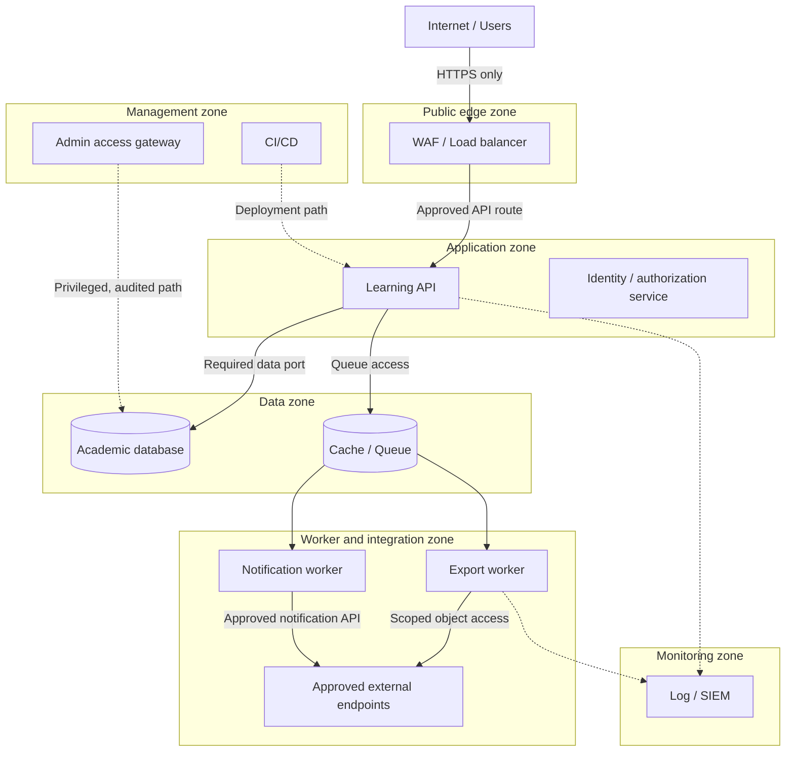
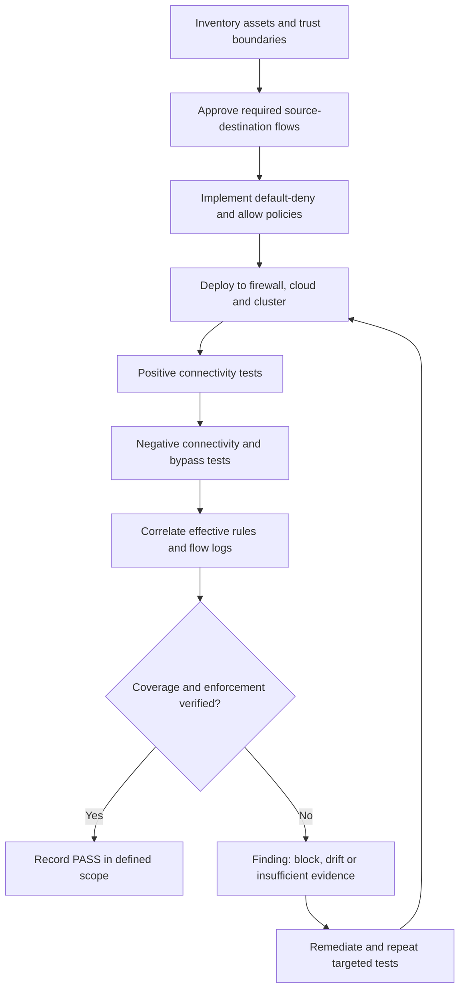

# Network segmentation

## Mục tiêu học tập

Sau bài học này, bạn có thể:

- Giải thích **network segmentation (phân đoạn mạng)** và vai trò của nó trong việc giới hạn đường truy cập, giảm bề mặt tấn công và hạn chế **blast radius** khi một thành phần bị xâm nhập.
- Phân biệt **network zones, subnet, VLAN, routing, firewall, security group, network ACL, Kubernetes NetworkPolicy, service mesh và application authorization**; biết lớp nào kiểm soát loại lưu lượng nào.
- Xây dựng mô hình phân đoạn theo **trust boundary, data flow, workload identity, mức độ nhạy cảm và threat scenarios**, thay vì chỉ chia mạng theo sơ đồ phòng ban.
- Thiết kế quy tắc **default deny, least connectivity, ingress/egress control và east-west segmentation** cho hệ thống Java/Spring Boot triển khai trên hạ tầng cloud hoặc Kubernetes.
- Đánh giá các đường truy cập phụ như DNS, management plane, node/host network, load balancer, observability, backup và remote support.
- Viết security requirements, test cases và **Claim – Argument – Evidence** để xác minh thiết kế phân đoạn thực sự được áp dụng trên cấu hình và runtime.
- Tổ chức thay đổi, review rule, xử lý ngoại lệ, phát hiện drift và đo hiệu quả segmentation liên tục.

## 1. Network segmentation là gì?

**Network segmentation** là cách chia hạ tầng mạng thành các vùng hoặc nhóm tài nguyên có ranh giới tin cậy khác nhau, sau đó **kiểm soát lưu lượng được phép đi qua giữa các vùng** theo nhu cầu nghiệp vụ và rủi ro. Mục tiêu là giảm những kết nối không cần thiết, ngăn một thành phần bị xâm nhập dễ dàng tiếp cận các thành phần khác và tạo điểm kiểm soát có thể giám sát, kiểm thử, kiểm toán.

Ví dụ, một nền tảng học tập có web frontend, API, database, worker xuất bảng điểm và hệ thống quản trị. Nếu mọi thành phần đều nằm trong cùng một mạng và có thể kết nối tự do, việc khai thác một web server có thể mở đường tới database hoặc hệ thống quản trị. Với segmentation, frontend chỉ được kết nối API qua cổng được duyệt; API được kết nối database trên cổng DB cần thiết; worker chỉ được truy cập queue và object storage theo nhiệm vụ; quản trị hạ tầng đi qua management path riêng có xác thực mạnh và audit.

Phân đoạn mạng **không chỉ là chia subnet hoặc VLAN**. Một subnet có thể vẫn cho phép mọi máy giao tiếp tự do; một firewall có thể có rule quá rộng; một cluster Kubernetes có thể không thực thi NetworkPolicy nếu CNI không hỗ trợ; một service mesh có thể xác thực service-to-service nhưng không ngăn mọi luồng ở tầng mạng. Giá trị của segmentation đến từ **mô hình ranh giới, policy cụ thể, enforcement thực tế và bằng chứng rằng lưu lượng ngoài policy bị chặn**.

Trong module **SECURITY_SECURITY_ASSURANCE**, segmentation là security control cần được đánh giá theo chuỗi:

```text
Assets and trust boundaries
  → Threat scenarios and required communications
  → Network zones and allowed flows
  → Firewall / routing / workload policy
  → Positive and negative connectivity tests
  → Runtime logs, rule review and drift detection
  → Findings, remediation and residual risk
```

### 1.1. Segmentation giảm rủi ro như thế nào?

- **Giới hạn lateral movement:** máy chủ bị xâm nhập không tự do quét và kết nối sang mọi workload.
- **Bảo vệ tài sản quan trọng:** database, secrets service, backup và management plane chỉ nhận kết nối từ nguồn được duyệt.
- **Giảm blast radius:** sự cố ở frontend không mặc nhiên trở thành quyền truy cập trực tiếp vào database hoặc control plane.
- **Tạo ranh giới kiểm soát:** lưu lượng qua zone boundary có thể được lọc, log, cảnh báo và review.
- **Hỗ trợ compliance và assurance:** có thể chứng minh những luồng truy cập nào được phép và lý do tồn tại của chúng.
- **Giảm lỗi vận hành:** các đường kết nối không cần thiết bị loại bỏ, giảm cơ hội truy cập nhầm hoặc cấu hình nhầm.

Segmentation không bảo đảm hệ thống không bị xâm nhập. Một attacker đã chiếm workload được phép kết nối database vẫn có thể lạm dụng chính kết nối đó; vì vậy cần thêm **identity, authorization, encryption, secure configuration, monitoring và response**.

## 2. Thuật ngữ và lớp kiểm soát

| Khái niệm | Vai trò | Ví dụ |
| --- | --- | --- |
| **Network zone** | Nhóm hệ thống có mức tin cậy, mục đích và quy tắc giao tiếp tương tự. | Public edge, application, data, management, monitoring. |
| **Subnet** | Phân chia địa chỉ IP và phạm vi định tuyến. | Subnet riêng cho private application workloads. |
| **VLAN** | Tách miền broadcast ở mạng Ethernet lớp 2. | VLAN cho máy trạm quản trị và VLAN cho server. |
| **Routing** | Quyết định đường đi giữa các mạng. | Route table cho phép app subnet tới database subnet qua đường được kiểm soát. |
| **Firewall** | Lọc lưu lượng theo địa chỉ, giao thức, cổng, trạng thái và đôi khi theo ứng dụng. | Chỉ cho phép API subnet kết nối DB TCP port được duyệt. |
| **Network ACL** | Lọc lưu lượng ở ranh giới subnet/network theo khả năng nền tảng. | Rule ingress/egress cho subnet. |
| **Security group** | Bộ quy tắc gắn với network interface/resource theo mô hình cloud. | API security group chỉ nhận HTTPS từ load balancer. |
| **Kubernetes NetworkPolicy** | Giới hạn ingress/egress của Pod theo selector và port. | Chỉ API Pod được truy cập database Pod trên cổng ứng dụng. |
| **Service mesh policy** | Kiểm soát service-to-service, identity và giao thức ở tầng ứng dụng/proxy. | Chỉ service identity của API được gọi service grades. |
| **Application authorization** | Kiểm soát người dùng/service được thực hiện hành động nghiệp vụ nào trên tài nguyên nào. | Giáo viên chỉ xem điểm lớp được phân công. |

Các cơ chế có thể phối hợp, nhưng **không thay thế lẫn nhau**. Firewall có thể cho phép API tới database, nhưng không biết giáo viên nào được xem học viên nào. Spring Security có thể chặn người dùng không có quyền, nhưng không tự chặn một container bị xâm nhập mở kết nối outbound tới endpoint lạ.

### 2.1. North-south và east-west traffic

- **North-south traffic:** lưu lượng đi từ bên ngoài vào hệ thống hoặc từ hệ thống ra bên ngoài. Ví dụ người học truy cập frontend, API gọi dịch vụ email, worker gửi dữ liệu tới đối tác.
- **East-west traffic:** lưu lượng giữa các workload bên trong môi trường. Ví dụ API gọi database, microservice gọi service khác, worker đọc queue.

Nhiều kiến trúc tập trung firewall ở internet edge nhưng để **east-west traffic quá rộng**. Khi attacker chiếm một workload nội bộ, các đường kết nối nội bộ có thể tạo điều kiện di chuyển ngang. Vì vậy phải kiểm tra cả hai chiều và cả **ingress lẫn egress** của từng zone.

### 2.2. Segmentation khác isolation tuyệt đối

Segmentation cho phép **những luồng đã được xác định và phê duyệt** đi qua ranh giới; isolation tuyệt đối có thể chặn mọi giao tiếp. Một database cần API kết nối để phục vụ nghiệp vụ nên không thể chỉ tách mạng rồi bỏ kết nối hợp lệ. Thiết kế tốt xác định:

- Nguồn nào được kết nối?
- Đích nào được truy cập?
- Giao thức/cổng nào cần thiết?
- Mục đích nghiệp vụ và owner của luồng?
- Có xác thực workload, mã hóa và authorization bổ sung không?
- Rule nào cần log, review hoặc tự hết hạn?

## 3. Thiết kế zones từ tài sản và trust boundaries

### 3.1. Ví dụ kiến trúc nền tảng học tập

Giả sử hệ thống gồm:

- **Public edge:** CDN, WAF và load balancer tiếp nhận traffic từ internet.
- **Application zone:** frontend backend/API và dịch vụ nghiệp vụ.
- **Data zone:** database, cache và message broker chứa dữ liệu học viên.
- **Worker/integration zone:** export worker, notification worker và connector tới đối tác.
- **Management zone:** CI/CD control, bastion hoặc admin gateway, quản trị KMS và hạ tầng.
- **Monitoring zone:** log collector, metrics, tracing và security monitoring.

Một mô hình tham khảo:



Đây là sơ đồ logic, không phải cấu hình cloud thực tế. **Đường chấm** cũng là đường cần kiểm soát và kiểm chứng; management hoặc logging không được mặc định là đáng tin chỉ vì nằm trong mạng nội bộ.

### 3.2. Phân vùng theo rủi ro, không chỉ theo loại máy

Một zone nên được xác định từ:

1. **Mức nhạy cảm tài sản:** public content, thông tin cá nhân, bảng điểm, tài liệu identity proofing, secrets.
2. **Vai trò và nhiệm vụ:** API xử lý request người dùng, worker xử lý batch, management plane thay đổi hạ tầng.
3. **Mức tin cậy và threat:** thành phần internet-facing có bề mặt tấn công lớn hơn workload nội bộ hạn chế.
4. **Yêu cầu giao tiếp:** nguồn, đích, port, protocol, hướng và thời điểm cần kết nối.
5. **Khả năng enforcement:** subnet, firewall, security group, NetworkPolicy, host firewall hoặc service mesh.
6. **Khả năng quan sát:** log flow, alert, owner, review và quy trình xử lý sai lệch.

Không cần tạo một zone riêng cho từng Pod nếu chi phí quản trị vượt lợi ích; nhưng cũng không nên gom database, CI/CD, public API và backup vào một zone rộng chỉ để giảm số rule. **Ranh giới cần phản ánh sự khác nhau về trust và hậu quả khi bị xâm nhập.**

### 3.3. Ma trận luồng mạng

Trước khi viết firewall rules, lập **flow matrix**:

| Nguồn | Đích | Protocol/port | Mục đích | Quyết định minh họa |
| --- | --- | --- | --- | --- |
| Internet | WAF/load balancer | TCP 443 | Người dùng truy cập HTTPS | Allow theo edge policy, rate limit và WAF. |
| WAF/load balancer | Learning API | TCP 8443 | Chuyển request tới API | Allow từ nguồn edge cụ thể. |
| Learning API | Academic DB | TCP 5432 | Đọc/ghi nghiệp vụ | Allow từ API workload identity/network group được duyệt. |
| Learning API | Queue | TCP 5671 hoặc port theo nền tảng | Gửi job | Allow theo broker endpoint và TLS. |
| Export worker | Object storage | HTTPS 443 | Đọc/ghi object theo job | Allow tới endpoint storage được duyệt và scope IAM hẹp. |
| Export worker | Academic DB | Không mặc định | Chỉ khi kiến trúc cần đọc trực tiếp | Ưu tiên qua service/data access boundary; nếu cần phải có lý do và scope. |
| CI/CD | Workload management API | Port theo nền tảng | Deploy release | Chỉ từ runner/identity được quản trị. |
| Admin gateway | Database/cluster management | Port quản trị cần thiết | Bảo trì có kiểm soát | JIT, MFA, approval và session audit. |
| Workloads | Log collector | Endpoint/port được duyệt | Gửi audit/telemetry | Egress allowlist, payload minimization. |
| Any workload | Internet bất kỳ | Any | Không có mục đích được duyệt | Deny mặc định, ngoại lệ có owner và thời hạn. |

Các port trong bảng là **ví dụ phổ biến**, phải xác nhận với cấu hình triển khai thực tế. Không mở port chỉ vì “ứng dụng thường dùng port đó”; cần kiểm tra protocol, TLS, source/destination và endpoint cụ thể.

## 4. Default deny và least connectivity

### 4.1. Default deny

**Default deny** nghĩa là lưu lượng không có rule cho phép rõ ràng sẽ bị từ chối. Điều này giảm nguy cơ một workload mới mặc nhiên có quyền giao tiếp với tất cả thành phần.

Một chính sách nền tảng có thể là:

- Chặn kết nối giữa các zone theo mặc định.
- Chỉ mở flow đã có owner, mục đích và source/destination cụ thể.
- Hạn chế ingress vào workload, kể cả traffic từ subnet nội bộ.
- Hạn chế egress ra internet và tới các dịch vụ cloud nhạy cảm.
- Không mở rule rộng `0.0.0.0/0` hoặc `::/0` cho port quản trị nếu không có thiết kế được duyệt.
- Rule tạm phải có expiry, người chịu trách nhiệm và lịch review.

**Default deny cần được kiểm chứng ở đúng điểm enforcement.** Nếu chỉ tạo NetworkPolicy nhưng CNI không thực thi policy, cấu hình YAML có thể tồn tại mà không chặn packet. Nếu một subnet có route khác hoặc security group khác cho phép, flow vẫn có thể đi qua.

### 4.2. Least connectivity

Nguyên tắc **least connectivity** tương tự least privilege nhưng áp dụng cho đường truyền: chỉ cho phép những nguồn, đích, giao thức và hướng cần thiết. Một rule tốt nêu:

- Source cụ thể (subnet, security group, workload selector hoặc identity).
- Destination cụ thể.
- Protocol và port cần thiết.
- Direction: ingress, egress hay cả hai.
- Mục đích, owner, ticket/decision và môi trường.
- Thời hạn hoặc trigger review.
- Logging/monitoring và cách kiểm tra rule.

Tránh các rule như:

```text
ALLOW  10.0.0.0/8  ->  10.0.0.0/8  ANY
ALLOW  0.0.0.0/0  ->  DATABASE   TCP/5432
ALLOW  ALL_WORKLOADS -> INTERNET ANY
```

Những rule này có thể mở rộng phạm vi lớn hơn nhu cầu. Nếu một dịch vụ thực sự cần nhiều đích, hãy định danh theo nhóm đích có quản trị, service tag, proxy hoặc endpoint catalog và review định kỳ.

### 4.3. Ingress và egress đều cần kiểm soát

- **Ingress:** ai có thể kết nối vào workload? Ví dụ database chỉ nhận kết nối từ API service group.
- **Egress:** workload có thể kết nối ra đâu? Ví dụ export worker chỉ gọi queue, KMS và object storage endpoint được phê duyệt.

Egress thường bị bỏ qua, nhưng là đường quan trọng để attacker **exfiltrate dữ liệu**, tải payload, gọi command-and-control hoặc lạm dụng cloud metadata service. Cần xem DNS, proxy, IPv6, direct IP, service endpoint, host network và các giao thức không phải HTTP.

## 5. Các lớp triển khai segmentation

### 5.1. Physical và virtual network

**Physical segmentation** có thể sử dụng switch, router, VLAN, firewall và thiết bị riêng. **Virtual/cloud segmentation** sử dụng subnet, route table, security group, network ACL, firewall service, VPC/VNet peering và private endpoints.

| Cơ chế | Phù hợp | Điểm cần kiểm tra |
| --- | --- | --- |
| VLAN/subnet | Tách miền mạng và địa chỉ. | Routing giữa VLAN/subnet, trunk, route propagation và rule ở router/firewall. |
| Firewall | Enforcement tại ranh giới zone hoặc ứng dụng. | Rule order, stateful/stateless behavior, shadow rules, logging và failover. |
| Security group | Gắn policy với network interface/resource. | Rule ingress/egress thực, tham chiếu group, quyền sửa và rule kế thừa theo nền tảng. |
| Network ACL | Lọc ở subnet boundary theo capability của cloud. | Stateful/stateless, thứ tự rule, ephemeral ports và đường return traffic. |
| Private endpoint/service endpoint | Truy cập dịch vụ cloud qua đường riêng được kiểm soát. | DNS resolution, policy của endpoint, route và quyền IAM vẫn cần kiểm tra. |
| Host firewall | Lọc kết nối tại máy/VM. | Cấu hình thực trên từng node, drift, process binding và quản trị tập trung. |

**Subnet riêng không tự tạo security boundary** nếu route và firewall cho phép mọi kết nối. Cũng không nên cho rằng private IP đồng nghĩa đáng tin; một workload nội bộ bị xâm nhập vẫn có thể tấn công dịch vụ khác.

### 5.2. Cloud security groups và network policy

Một thiết kế cloud có thể:

- Chỉ cho load balancer public; API và database không có public IP.
- API security group chỉ nhận từ load balancer security group.
- Database security group chỉ nhận từ API group trên port cần thiết.
- Worker group chỉ được gọi endpoint queue/storage/KMS được duyệt.
- Management plane chỉ nhận kết nối từ admin gateway/runner đã quản trị.
- Egress tới internet qua proxy/NAT có kiểm soát; hạn chế endpoint metadata và service quản trị.

Tên và ngữ nghĩa security group khác nhau giữa các nền tảng. Cần kiểm tra **effective network policy** từ resource thực, không chỉ một file IaC hoặc ảnh chụp console.

## 6. Kubernetes NetworkPolicy và microsegmentation

### 6.1. Vì sao cần policy ở cấp workload?

Trong Kubernetes, nhiều Pod có thể cùng nằm trong cluster network và có thể kết nối nhau nếu không có policy chặn. **Kubernetes NetworkPolicy** cho phép chọn Pod bằng label và kiểm soát ingress/egress theo namespace, Pod selector, IP block và port theo khả năng API/CNI.

Microsegmentation áp dụng ranh giới nhỏ hơn, thường theo workload hoặc service identity. Mục tiêu là hạn chế kết nối **Pod-to-Pod** theo chức năng. Tuy nhiên, NetworkPolicy chuẩn tập trung ở tầng network; nó không tự xác thực người dùng nghiệp vụ hoặc hiểu nội dung HTTP request.

### 6.2. Ví dụ default deny trong namespace

```yaml
apiVersion: networking.k8s.io/v1
kind: NetworkPolicy
metadata:
  name: default-deny-ingress-egress
  namespace: learning-prod
spec:
  podSelector: {}
  policyTypes:
    - Ingress
    - Egress
```

Policy này chọn tất cả Pod trong namespace và khai báo cả ingress/egress. Với CNI hỗ trợ NetworkPolicy, nó tạo nền tảng **deny mặc định** cho các loại traffic tương ứng; cần thêm allow policies cho DNS và luồng nghiệp vụ hợp lệ. Hành vi thực tế phải được kiểm tra với CNI, phiên bản và cấu hình cluster.

### 6.3. Chỉ cho API gọi database

Ví dụ tiếp theo giả định database chạy trong cùng namespace với label `app: academic-db`, API có label `app: learning-api`, và DB lắng nghe TCP 5432:

```yaml
apiVersion: networking.k8s.io/v1
kind: NetworkPolicy
metadata:
  name: allow-api-to-academic-db
  namespace: learning-prod
spec:
  podSelector:
    matchLabels:
      app: academic-db
  policyTypes:
    - Ingress
  ingress:
    - from:
        - podSelector:
            matchLabels:
              app: learning-api
      ports:
        - protocol: TCP
          port: 5432
```

Policy cho phép ingress tới database Pod từ API Pod được chọn. **Nó không tự bảo đảm chỉ có API đúng nghĩa được truy cập** nếu attacker có thể tạo Pod với label đó hoặc có quyền sửa workload/policy. Cần RBAC Kubernetes hạn chế ai tạo/sửa Pod, admission controls, namespace boundaries, workload identity và database authentication.

### 6.4. Hạn chế egress của export worker

Một policy egress có thể chỉ cho worker gọi DNS và một endpoint nội bộ được chọn bằng Pod selector:

```yaml
apiVersion: networking.k8s.io/v1
kind: NetworkPolicy
metadata:
  name: export-worker-egress
  namespace: learning-prod
spec:
  podSelector:
    matchLabels:
      app: grade-export-worker
  policyTypes:
    - Egress
  egress:
    - to:
        - namespaceSelector:
            matchLabels:
              kubernetes.io/metadata.name: platform-system
          podSelector:
            matchLabels:
              app: approved-queue
      ports:
        - protocol: TCP
          port: 5671
    - to:
        - namespaceSelector:
            matchLabels:
              kubernetes.io/metadata.name: kube-system
          podSelector:
            matchLabels:
              k8s-app: kube-dns
      ports:
        - protocol: UDP
          port: 53
        - protocol: TCP
          port: 53
```

Đây là ví dụ minh họa; label DNS và queue phải đối chiếu với cluster thật. **NetworkPolicy chuẩn không phải lúc nào cũng lọc được domain/FQDN**, và policy ở trên không cho phép worker gọi một object storage endpoint bên ngoài. Với cloud storage, có thể cần private endpoint, egress gateway/firewall, CNI có tính năng phù hợp hoặc proxy có allowlist.

### 6.5. Những giới hạn phải xác minh

- CNI/network plugin có thực thi NetworkPolicy không? Một số môi trường hoặc mode cấu hình có hành vi khác.
- Policy được áp dụng trên **Pod network**, nhưng traffic qua hostNetwork, node, control plane hoặc đường đặc biệt có thể có phạm vi khác.
- DNS bị chặn có thể làm hỏng workload; mở DNS rộng có thể tạo đường exfiltration qua DNS tunneling.
- Selector dựa trên label chỉ đáng tin nếu RBAC/admission kiểm soát ai được gắn label.
- NetworkPolicy có tính cộng gộp cho các rule allow trong các policy áp dụng; một policy allow rộng khác có thể mở thêm traffic.
- Traffic tới service external, load balancer, NodePort, ingress controller và metadata service cần kiểm tra riêng.
- NetworkPolicy không thay thế mTLS, service identity, authorization hoặc database credential.

## 7. Service mesh và Zero Trust

### 7.1. Service mesh bổ sung điều gì?

Service mesh có thể cung cấp mTLS, workload identity, authorization policy, telemetry và traffic management giữa các service. Điều này hữu ích cho east-west traffic, đặc biệt khi nhiều microservices cần xác thực **service nào gọi service nào**.

Tuy nhiên, service mesh có thể không bao phủ:

- Traffic không đi qua sidecar/proxy hoặc workload chưa được onboard.
- Node-to-node, host networking, traffic control plane hoặc service bên ngoài.
- Các luồng ở tầng network không phải service-to-service được mesh quản lý.
- Quyền truy cập tới database/object storage nếu chúng không nằm trong mesh.
- Authorization ở cấp người dùng/tài nguyên nếu policy chỉ xác thực service identity.

### 7.2. Zero Trust không có nghĩa bỏ segmentation

**Zero Trust** yêu cầu không mặc định tin cậy chỉ vì một chủ thể hoặc workload nằm trong mạng nội bộ. Quyết định truy cập cần dựa trên danh tính, trạng thái, context, resource và policy phù hợp. Segmentation giúp giới hạn đường mạng; identity-aware policy và application authorization kiểm soát sâu hơn.

Một hệ thống có thể kết hợp:

1. **Network layer:** subnet/firewall/NetworkPolicy giới hạn đường kết nối.
2. **Workload identity:** mTLS hoặc credential workload xác định service caller.
3. **Service policy:** cho phép service identity gọi API cụ thể.
4. **Application authorization:** xác định người dùng có quyền với lớp/học viên cụ thể.
5. **Data layer:** DB role, row-level security hoặc storage IAM giới hạn quyền cuối cùng.

Không nên chỉ thêm service mesh rồi xóa firewall/NetworkPolicy nếu các trust boundary khác vẫn cần bảo vệ.

## 8. Phân đoạn management plane và đường quản trị

Management plane thường có quyền rất lớn: deploy code, thay firewall, quản lý cluster, truy cập KMS, sửa database hoặc đọc secrets. Nếu đường quản trị bị xâm nhập, attacker có thể thay đổi chính các controls segmentation.

### 8.1. Nguyên tắc thiết kế

- Không phơi SSH/RDP/Kubernetes API/database admin ra internet rộng.
- Dùng **admin gateway/bastion** hoặc phương thức truy cập được quản trị, xác thực mạnh và ghi audit.
- Giới hạn source, thời hạn, danh tính và resource; dùng JIT/JEA hoặc quyền tạm theo khả năng nền tảng.
- Tách CI/CD runner và production workload; chỉ cho runner đi tới endpoint deploy cần thiết.
- Giới hạn ai được sửa firewall/security group/NetworkPolicy và ai được approve thay đổi.
- Bảo vệ KMS/HSM, secrets manager và backup management bằng zone/quyền riêng.
- Giám sát thay đổi rule, route table, security group, cluster RBAC và admission policies.

### 8.2. Không quên monitoring và backup zones

Monitoring cần nhận telemetry từ workload, nhưng không có nghĩa mọi workload được quyền gửi **bất kỳ payload** nào tới mọi endpoint. Chỉ mở flow tới collector cần thiết, hạn chế dữ liệu nhạy cảm trong log và bảo vệ sink.

Backup/restore cũng là một luồng mạng nhạy cảm: nguồn backup, đích lưu, service identity, cổng, region, quyền đọc/xóa và khả năng phục hồi cần được phân đoạn. Tài khoản backup không nên đồng thời có quyền xóa mọi bản sao mà không có kiểm soát bù trừ.

## 9. Java/Spring Boot: kiến trúc ứng dụng phải hỗ trợ segmentation

### 9.1. Phân biệt network policy và application policy

Một Spring Boot API lắng nghe cổng 8443. Network policy có thể giới hạn **nguồn được mở TCP connection** tới Pod. Nhưng khi request đã đến ứng dụng, Spring Security cần xác thực và phân quyền theo endpoint/tài nguyên.

Ví dụ:

```java
@Configuration
@EnableMethodSecurity
class SecurityConfiguration {}

@Service
class GradeService {
    private final GradeRepository grades;

    GradeService(GradeRepository grades) {
        this.grades = grades;
    }

    @PreAuthorize("@courseAccess.canRead(authentication, #courseId)")
    public List<GradeView> getGrades(long courseId) {
        return grades.findViewsByCourseId(courseId);
    }
}
```

`courseAccess` là bean policy giả định và phải kiểm tra quan hệ giáo viên–lớp, tenant và hành động trên nguồn tin cậy. Đoạn mã minh họa **application authorization**; nó không tạo firewall rule, không giới hạn egress của Pod và không thay thế database IAM.

### 9.2. Tách kết nối theo workload

Không nên dùng chung một service account hoặc một bộ credential cho API, export worker và CI/CD nếu chúng có nhiệm vụ khác nhau. Một thiết kế tốt có thể:

- API chỉ truy cập database và queue cần cho request.
- Export worker chỉ consume job được giao, đọc dataset theo scope và ghi object vào bucket/prefix được duyệt.
- Notification worker chỉ gọi provider notification.
- CI/CD runner chỉ truy cập Kubernetes deployment API hoặc registry cần thiết.
- Monitoring agent chỉ gửi telemetry tới collector, không có quyền đọc bảng điểm.

Tài khoản dịch vụ và network source identity phải được quản lý riêng. **IP allowlist đơn thuần** có thể không đủ khi nhiều workload dùng chung node/NAT; kết hợp workload identity, mTLS hoặc security group theo nền tảng để tăng độ chắc chắn.

### 9.3. Kiểm thử ứng dụng và network tách biệt

Application integration test có thể xác minh endpoint và quyền nghiệp vụ:

```java
@SpringBootTest
@AutoConfigureMockMvc
class GradeAuthorizationIT {
    @Autowired
    MockMvc mockMvc;

    @Test
    @WithMockUser(username = "teacher-a", roles = "TEACHER")
    void assignedTeacherCanReadGrades() throws Exception {
        mockMvc.perform(get("/api/courses/42/grades"))
            .andExpect(status().isOk());
    }

    @Test
    @WithMockUser(username = "teacher-b", roles = "TEACHER")
    void unassignedTeacherCannotReadGrades() throws Exception {
        mockMvc.perform(get("/api/courses/42/grades"))
            .andExpect(status().isForbidden());
    }
}
```

Các fixtures cần bảo đảm `teacher-a` được phân công lớp 42, còn `teacher-b` không được. Test cần đi qua Spring Security filter/method security thực; `403` đơn lẻ có thể do route, CSRF hoặc cấu hình test sai.

Nhưng **MockMvc không chứng minh segmentation**. Để kiểm tra network, cần test từ workload/source network thực:

- API Pod kết nối được database endpoint trên cổng cần thiết.
- Pod không thuộc API không kết nối được database.
- Export worker chỉ kết nối được queue/storage/KMS cần thiết.
- Workload không thể mở kết nối outbound tới đích không được duyệt.
- Admin API chỉ truy cập qua management path được cho phép.
- Luồng DNS, IPv4/IPv6, load balancer và node-level paths được xem xét.

Các phép kiểm network phải được thực hiện trong môi trường thuộc quyền quản trị, theo change window và tránh scan gây ảnh hưởng production. Kết quả cần gắn với **cluster/region, policy version, source Pod identity và thời điểm**.

## 10. IaC, deployment và policy lifecycle

### 10.1. Quản lý segmentation như code

Firewall rules, security groups, route tables, Kubernetes NetworkPolicy và service mesh policy nên được quản lý có version, review và test phù hợp. Một thay đổi cần:

1. Flow request có owner, purpose, source/destination, port/protocol và thời hạn.
2. Threat/risk review, đặc biệt nếu mở inbound/egress, management hoặc data zone.
3. IaC/policy change có reviewer độc lập theo mức rủi ro.
4. Static checks phát hiện rule quá rộng, port quản trị công khai, `0.0.0.0/0`, `::/0`, wildcard hoặc rule không có owner.
5. Deployment theo môi trường và có rollback plan.
6. Runtime verification đối chiếu rule hiệu lực với policy đã duyệt.
7. Rule cleanup khi service ngừng hoặc nhu cầu kết thúc.

### 10.2. Rule không nên tồn tại vô thời hạn

Một rule tạm để xử lý migration có thể trở thành đường mở lâu dài nếu không có expiry. Mỗi rule nên có:

- ID, owner, mục đích và ticket/approval.
- Source, destination, protocol, port và direction.
- Environment, thời điểm bắt đầu, expiry hoặc trigger review.
- Logging/monitoring và test cần thực hiện.
- Trạng thái active, temporary, expired, revoked hoặc exception.

**Comment trong file IaC không tự chứng minh owner vẫn chịu trách nhiệm**. Cần quy trình định kỳ đối soát rule thực tế, phát hiện orphaned rules và yêu cầu gia hạn có căn cứ.

### 10.3. Rule ordering và hiệu lực cấu hình

Một policy có thể có allow và deny chồng lấn; kết quả phụ thuộc thứ tự, stateful behavior và semantics của nền tảng. Cần xem:

- Rule nào được evaluate trước?
- Có implicit allow hoặc default behavior nào?
- Một policy khác có cộng thêm quyền không?
- Security group tham chiếu group khác ra sao?
- NetworkPolicy chọn Pod nào sau khi label thay đổi?
- Rule mới đã propagate tới tất cả zone/node chưa?
- Rollback có thể khôi phục policy trước mà không mở đường ngoài ý muốn không?

Review file YAML/IaC là cần thiết nhưng chưa đủ; phải xác minh **effective policy và packet path thực tế**.

## 11. Kiểm chứng segmentation: design và operating effectiveness

### 11.1. Design effectiveness

Câu hỏi:

- Zones có phản ánh trust boundaries và data classification không?
- Mỗi flow có business owner và lý do?
- Database, secrets, management, backup và monitoring có ranh giới phù hợp?
- Ingress và egress đã được đánh giá?
- Default deny có được định nghĩa và có đường cho phép hợp lệ?
- Có xử lý các đường bypass như node, hostNetwork, IPv6, load balancer và external service?

Bằng chứng: architecture diagrams, asset inventory, flow matrix, threat model, approved network standards, firewall design và review records.

### 11.2. Implementation effectiveness

Câu hỏi:

- IaC/policies có được deploy đúng version?
- Cloud security groups, route tables, firewall, CNI và service mesh có cấu hình tương ứng?
- Workload selector/labels và namespace có được bảo vệ?
- Public endpoints, management access và egress rules có đúng scope?
- Quyền sửa network policy có được giới hạn?

Bằng chứng: IaC commit/build, deployment record, effective rules export, cloud configuration snapshot, cluster policy inventory và IAM/RBAC.

### 11.3. Operating effectiveness

Câu hỏi:

- Kết nối hợp lệ hoạt động ổn định?
- Kết nối trái policy thực sự bị từ chối?
- Rule drift hoặc kết nối bất thường có được phát hiện?
- Owner review rule tạm và rule không còn sử dụng?
- Incident response có thể cô lập zone/workload mà không phá hỏng khả năng phục hồi?

Bằng chứng: positive/negative connectivity tests, firewall/flow logs, network telemetry, alert drill, rule review, change history và incident exercise.

### 11.4. Kiểm tra theo ma trận

| Nguồn | Đích | Positive test | Negative test |
| --- | --- | --- | --- |
| WAF/load balancer | API | HTTPS tới route được phép thành công. | Kết nối trực tiếp từ internet tới Pod/private IP bị chặn. |
| API workload | Database | TCP tới endpoint/port DB cần thiết thành công và xác thực DB hợp lệ. | Kết nối tới port quản trị hoặc DB khác bị chặn. |
| Unrelated Pod | Database | Không có flow nghiệp vụ hợp lệ. | Kết nối bị từ chối và có evidence phù hợp. |
| Export worker | Queue/storage | Endpoint được duyệt hoạt động. | Internet/endpoint không được duyệt bị chặn. |
| Application workload | Management API | Không có nhu cầu truy cập trực tiếp. | Kết nối bị chặn; chỉ runner/admin path được phép. |
| Admin gateway | Management target | Truy cập có JIT/approval thành công. | Source/user không được duyệt bị chặn. |
| Workload | Monitoring collector | Gửi telemetry theo schema được phép. | Gửi tới sink lạ hoặc payload ngoài policy bị hạn chế/phát hiện. |

Kết quả test cần có **source thực tế, destination, protocol/port, thời điểm, policy version và cách quan sát**. Một lỗi timeout không tự chứng minh firewall đã chặn; có thể do DNS, service down hoặc route sai. Cần positive control và log/firewall evidence để xác định nguyên nhân.

### 11.5. Vòng lặp kiểm chứng segmentation



Vòng lặp này giúp phân biệt **cấu hình được khai báo**, **cấu hình đã triển khai** và **hành vi packet thực tế**. Nếu thiếu flow inventory hoặc không có negative test từ nguồn ngoài scope, không thể kết luận coverage đầy đủ.

## 12. Threat modeling và các đường bypass

### 12.1. Threat scenarios

| Threat ID | Kịch bản | Tác động | Controls/verification |
| --- | --- | --- | --- |
| `SEG-01` | Web/API bị xâm nhập và attacker lateral movement tới database. | Đọc/sửa dữ liệu học viên, bảng điểm. | App/data zone boundary, DB ingress allowlist, negative connectivity test. |
| `SEG-02` | Export worker bị chiếm và gửi dữ liệu tới C2/external endpoint. | Exfiltration, malware download. | Egress deny/allowlist, workload identity, flow monitoring và egress test. |
| `SEG-03` | Rule `ANY-ANY` được thêm tạm rồi quên xóa. | Mở rộng attack surface lâu dài. | Approval/expiry, IaC checks, orphaned rule review. |
| `SEG-04` | Pod giả mạo label của API để được NetworkPolicy cho phép. | Bypass workload segmentation. | Kubernetes RBAC, admission policy, signed/declarative deployment, runtime identity. |
| `SEG-05` | Attacker dùng IPv6 hoặc hostNetwork để đi vòng policy IPv4/Pod. | Kết nối ngoài scope. | Kiểm tra dual-stack/host networking, node firewall và runtime tests. |
| `SEG-06` | Management plane bị truy cập qua public endpoint hoặc runner bị chiếm. | Thay policy, deploy mã độc, đọc secrets. | Dedicated management zone, JIT/MFA, runner isolation, audit. |
| `SEG-07` | DNS/metadata endpoint trở thành kênh exfiltration hoặc credential theft. | Lộ dữ liệu/credential cloud. | DNS egress control, metadata protections, resolver logs và tests. |
| `SEG-08` | Firewall/NetworkPolicy được khai báo nhưng CNI/provider không thực thi. | False sense of segmentation. | Capability validation, effective runtime policy and packet-level test. |
| `SEG-09` | Observability agent có quyền kết nối/đọc quá rộng. | Lộ log nhạy cảm hoặc trở thành pivot. | Monitoring zone, scoped credentials, payload minimization and access review. |
| `SEG-10` | Route peering/VPN mở đường mới giữa các environment. | Dev/staging truy cập production. | Route inventory, environment separation, network path test and change approval. |

### 12.2. Những đường thường bị bỏ quên

- **DNS:** resolver, DNS over HTTPS, DNS tunneling, wildcard record và split-horizon.
- **IPv6:** policy chỉ có IPv4 nhưng workload vẫn có địa chỉ IPv6 hoặc route dual-stack.
- **Cloud metadata service:** workload có thể truy cập metadata endpoint để lấy credential nếu không được bảo vệ.
- **HostNetwork/host ports:** Pod chia sẻ network namespace của node hoặc mở port trên host.
- **NodePort/LoadBalancer/Ingress:** đường truy cập có thể khác policy giữa Pod.
- **VPN/peering/transit gateway:** tạo kết nối giữa environment/organization ngoài sơ đồ chính.
- **CI/CD và artifact registry:** runner có quyền rộng hoặc kết nối trực tiếp management plane.
- **Backup/restore:** workload backup có quyền tới data plane và storage khác zone.
- **Support/monitoring agents:** công cụ vận hành có thể tạo luồng truy cập đặc biệt.
- **External dependencies:** email, analytics, telemetry, package repository và KMS endpoint.

Một network diagram chỉ thể hiện những đường nhóm kiến trúc biết trước; assurance cần đối chiếu với **routing, cloud resources, flow logs, runtime discovery và danh sách dịch vụ thực tế**.

## 13. Control statements và evidence

### 13.1. Control statements có thể kiểm chứng

| Control ID | Phát biểu kiểm soát | Verification |
| --- | --- | --- |
| `SEG-NET-01` | Các zone production có default deny và chỉ mở flow được phê duyệt với source/destination/port cụ thể. | Effective firewall/SG/ACL review và positive/negative connectivity tests. |
| `SEG-DATA-02` | Database và secrets endpoints chỉ nhận kết nối từ workload/management identity được duyệt. | DB ingress tests, IAM, source network and flow logs. |
| `SEG-EGR-03` | Workloads chỉ được egress tới endpoint cần thiết; outbound bất thường bị chặn hoặc cảnh báo theo policy. | Egress policy, proxy/firewall logs, denied connection tests. |
| `SEG-K8S-04` | Namespace/workload segmentation được thực thi bởi CNI hỗ trợ NetworkPolicy và không thể bị Pod không có thẩm quyền tự thay label/policy. | CNI capability, policy inventory, RBAC/admission review, runtime tests. |
| `SEG-MGMT-05` | Management plane chỉ được truy cập qua đường quản trị được xác thực, giới hạn và audit. | External reachability test, JIT/MFA/session logs, IAM review. |
| `SEG-CHG-06` | Network rules có owner, purpose, approval, expiry/review trigger và được đối chiếu với runtime. | IaC review, rule inventory, orphan/expired rule report. |
| `SEG-OBS-07` | Monitoring/backup flows có scope và quyền phù hợp, không tạo đường bypass không được kiểm soát. | Flow matrix, service identity, backup/telemetry connectivity tests. |

### 13.2. Hồ sơ network flow

Một bản ghi flow có thể dùng cấu trúc:

```yaml
flow_id: "FLOW-API-TO-ACADEMIC-DB"
environment: "production"
source:
  zone: "application"
  workload: "learning-api"
  identity_ref: "<trusted-workload-identity>"
destination:
  zone: "data"
  resource: "academic-db"
  identity_or_resource_ref: "<managed-db-resource>"
network:
  direction: "egress-from-api-and-ingress-to-db"
  protocol: "TCP"
  port: 5432
purpose: "Read and write authorized learning records"
data_classification: "CONFIDENTIAL"
owner_role: "learning-service-owner"
approval_ref: "<approved-flow-decision>"
enforcement:
  - "cloud-security-group"
  - "kubernetes-network-policy"
  - "database-authentication"
verification:
  allowed_flow_test: "<actual-positive-test>"
  denied_flow_test: "<actual-negative-test>"
  runtime_policy_ref: "<actual-effective-policy-snapshot>"
assurance:
  status: "INSUFFICIENT_EVIDENCE"
  last_reviewed: "<verified-review-time>"
  findings: []
reassess_on:
  - "Workload identity or port change"
  - "New database endpoint or network route"
  - "Environment, CNI or cloud policy change"
```

Đây là **mẫu minh họa**, không phải flow đã được triển khai hoặc phê duyệt. Evidence reference phải dẫn tới artifact thật có nguồn, thời gian, môi trường và phạm vi; không đưa password, token, private key hoặc dữ liệu học viên vào bản ghi này.

### 13.3. Claim – Argument – Evidence

**Claim:** “Trong production scope đã kiểm kê của nền tảng học tập, các workload application chỉ được kết nối tới database, queue, storage và management endpoints cần cho nhiệm vụ được duyệt; kết nối trái policy từ workload không liên quan và egress tới đích không được duyệt bị chặn hoặc phát hiện theo control.”

**Argument:**

1. Asset/zone inventory và flow matrix bao phủ các workload, endpoint, environment, route và trust boundary trong phạm vi.
2. Default deny và allow rules được triển khai ở các enforcement points phù hợp; rule có owner, purpose, approval và scope.
3. Positive tests chứng minh luồng nghiệp vụ hợp lệ vẫn hoạt động; negative tests chứng minh những nguồn/đích ngoài policy không kết nối được.
4. Effective policy và flow logs xác nhận cấu hình đang chạy phù hợp với version được duyệt.
5. Management, backup, DNS, IPv6, observability và cloud metadata paths đã được đánh giá hoặc nêu rõ giới hạn.
6. Drift, ngoại lệ và findings được phát hiện, xử lý và kiểm tra lại.

**Evidence matrix:**

| Nội dung cần chứng minh | Evidence | Giới hạn cần nêu |
| --- | --- | --- |
| Zone/flow coverage | Asset inventory, architecture/DFD, flow matrix, cloud/cluster inventory. | Hệ thống hoặc endpoint chưa discover có thể bị bỏ sót. |
| Policy đã triển khai | IaC commit, pipeline result, cloud SG/firewall export, NetworkPolicy/CNI evidence. | Source config không chứng minh runtime đã áp dụng. |
| Luồng được phép | Positive connectivity test và application/service health evidence. | Service up không chứng minh chỉ đúng nguồn được kết nối. |
| Luồng bị chặn | Negative connectivity test, firewall deny/flow logs, source/destination evidence. | Timeout đơn lẻ không xác định nguyên nhân bị chặn. |
| Management plane được bảo vệ | External reachability, admin gateway/JIT, IAM and session audit. | Không bao phủ mọi tài khoản/đường break-glass nếu population thiếu. |
| Egress/telemetry | Egress policy, proxy/flow logs, endpoint inventory, alert drill. | Không có log có thể do collector mất dữ liệu. |
| Change/drift control | Change approval, runtime drift scan, rule expiry/review và re-test. | Review checklist không thay thế đối soát effective rules. |

**Giới hạn claim:** nếu chưa kiểm tra IPv6, backup network hoặc một VPN/peering, không thể tuyên bố mọi đường lateral movement đã bị chặn. Có thể kết luận hẹp cho các zone/flow đã xác minh và ghi phần còn thiếu là `INSUFFICIENT_EVIDENCE`.

## 14. Audit, findings và xử lý ngoại lệ

### 14.1. Trạng thái đánh giá

| Trạng thái | Ý nghĩa | Hành động |
| --- | --- | --- |
| **PASS trong phạm vi** | Policy, implementation và runtime evidence đáp ứng yêu cầu cho các zone/flow đã xác định. | Ghi scope, thời điểm, version, tiếp tục monitoring và review. |
| **FAIL** | Có bằng chứng kết nối trái policy, rule quá rộng hoặc enforcement không hoạt động. | Tạo finding, đánh giá ảnh hưởng, thu hẹp/đóng flow, re-test và chuyển cấp khi cần. |
| **INSUFFICIENT_EVIDENCE** | Chưa xác minh CNI, route, effective policy, egress hoặc population. | Bổ sung bằng chứng; không tự suy ra PASS. |
| **EXCEPTION_APPLIED** | Có ngoại lệ nội bộ được phê duyệt đúng thẩm quyền, scope và thời hạn. | Theo dõi residual risk và điều kiện bù trừ; không che giấu trạng thái control. |

### 14.2. Xử lý finding

Khi phát hiện database nhận traffic từ mọi Pod trong cluster:

1. Ghi lại source, destination, port, policy/rule version, thời điểm và bằng chứng.
2. Xác định đó là rule thực thi hay chỉ cấu hình không được áp dụng; xác nhận đường mạng có thể đi qua.
3. Đánh giá tài sản, dữ liệu và workloads có thể truy cập; kiểm tra log để xác định có kết nối thực tế hay không.
4. Theo thẩm quyền, giảm scope hoặc chặn rule nguy hiểm; tránh làm gián đoạn các luồng nghiệp vụ không liên quan.
5. Sửa nguồn IaC/policy và xác minh cấu hình runtime trên mọi node/zone.
6. Chạy positive và negative tests để bảo đảm vừa đóng đường trái phép vừa giữ đường cần thiết.
7. Reviewer xác minh evidence mới trước khi đóng finding; ghi residual risk nếu còn dependency.

**Rule mở rộng là control FAIL trong phạm vi được chứng minh**, nhưng chưa tự chứng minh attacker đã khai thác hoặc dữ liệu đã bị đọc. Cần phân biệt **khả năng kết nối**, **kết nối thực tế**, **hành vi truy cập** và **tác động**.

### 14.3. Ngoại lệ mạng

Một ngoại lệ chỉ nên có:

- Mục đích cụ thể và service owner.
- Source/destination/port/protocol chính xác.
- Risk assessment và lý do không thể dùng đường chuẩn.
- Biện pháp bù trừ, monitoring và điều kiện dừng.
- Người phê duyệt có thẩm quyền, thời hạn/expiry và review.
- Test và evidence chứng minh ngoại lệ không mở rộng ngoài scope.

Không để rule `ANY-ANY` kéo dài chỉ vì “đang cần debug”. Nếu cần truy cập tạm, sử dụng đường quản trị có JIT, session audit và thu hồi sau tác vụ.

## 15. Metrics và continuous assurance

### 15.1. Chỉ số có ích

| KPI/KRI | Câu hỏi quản trị | Cách tránh hiểu sai |
| --- | --- | --- |
| Tỷ lệ workload/zone có owner và flow inventory | Có biết hệ thống nào cần giao tiếp với nhau không? | Chỉ số không đáng tin nếu asset discovery thiếu. |
| Số rule rộng, wildcard hoặc public management ports | Có rule làm tăng bề mặt tấn công? | Cần phân biệt false positive và exception hợp lệ có hạn. |
| Số flow trái policy bị chặn/phát hiện | Enforcement/monitoring có hoạt động? | Số 0 có thể là thiếu coverage hoặc không có test. |
| Tỷ lệ flow có positive/negative test | Đã kiểm cả khả năng hoạt động và từ chối? | Test cũ không áp dụng nếu policy/CNI/runtime đã đổi. |
| Số rule không owner hoặc quá hạn | Có orphaned rules? | Xóa tự động mà không xem dependency có thể gây outage. |
| Tỷ lệ NetworkPolicy được CNI thực thi và xác minh | Kubernetes config có tác dụng thật? | YAML tồn tại không đồng nghĩa packet bị chặn. |
| Số thay đổi egress/route chưa review | Có đường outbound/peering ngoài scope? | Phải lấy dữ liệu từ cloud và network runtime, không chỉ Git. |
| Thời gian khắc phục segmentation finding | Khả năng giảm exposure sau phát hiện. | Ticket đóng không thay thế test sau sửa. |
| Tỷ lệ management access có JIT/audit | Đường đặc quyền có được kiểm soát? | Cần kiểm cả break-glass và tài khoản service. |
| Tỷ lệ restore/monitoring flows được kiểm tra | Các vùng vận hành phụ có bypass không? | Kiểm tra theo data flow và quyền, không chỉ trạng thái service. |

### 15.2. Trigger review

Segmentation cần đánh giá lại khi:

- Thêm service, namespace, node pool, VPC/VNet, subnet hoặc peering.
- Thay CNI, cluster version, service mesh, load balancer hoặc ingress controller.
- Thêm endpoint SaaS, API đối tác, telemetry exporter, storage region hoặc DNS resolver.
- Thay route, firewall, security group, NetworkPolicy, host firewall hoặc egress proxy.
- Có sự cố lateral movement, credential compromise hoặc rule bypass.
- Thay phân loại dữ liệu hoặc yêu cầu bảo vệ của database, secrets và backup.
- Tạo môi trường mới hoặc chuyển workload giữa staging và production.
- Thay CI/CD runner, admin gateway, remote support hoặc quyền quản trị.

Mỗi trigger phải có owner và quy trình xác định **cần review những flow nào**. Không cần chạy lại toàn bộ kiểm thử sau mọi thay đổi nhỏ, nhưng các thay đổi ảnh hưởng trust boundary hoặc enforcement cần test tương ứng.

## 16. Những sai lầm thường gặp

| Sai lầm | Hậu quả | Cách làm đúng |
| --- | --- | --- |
| “Tách subnet là đã segmentation.” | Route/firewall có thể vẫn cho phép mọi kết nối. | Kiểm tra effective packet path và rule giữa zone. |
| “Mạng nội bộ đều đáng tin.” | Workload bị xâm nhập có thể lateral movement. | Default deny, identity-aware controls và least connectivity. |
| “Chỉ cần firewall ở internet edge.” | East-west và egress traffic quá rộng. | Phân đoạn cả ingress, egress và service-to-service. |
| “Private IP thì không cần auth.” | Bất kỳ workload trong mạng có thể thử kết nối. | TLS/mTLS, workload identity, application authz và DB auth. |
| “NetworkPolicy YAML tồn tại nghĩa là được thực thi.” | CNI có thể không hỗ trợ hoặc policy selector sai. | Kiểm tra capability và negative packet tests trên runtime. |
| “Service mesh thay thế mọi network controls.” | Traffic ngoài mesh, node/host và external paths vẫn mở. | Dùng mesh cùng firewall/NetworkPolicy theo trust boundary. |
| “Chỉ cần ingress; egress có thể mở tự do.” | Exfiltration/C2 và metadata access không được hạn chế. | Egress allowlist, proxy, DNS/metadata protections và logs. |
| “Cho phép cả namespace là đủ hẹp.” | Pod không liên quan trong namespace vẫn có thể truy cập. | Selector/workload identity, RBAC và admission controls. |
| “Port 5432 chỉ dùng cho PostgreSQL nên mở rộng cũng an toàn.” | Source có thể là attacker; protocol/port không xác thực caller. | Giới hạn source, DB identity, TLS và quyền dữ liệu. |
| “MockMvc pass chứng minh mạng đã được chia đoạn.” | MockMvc kiểm tra HTTP/app, không đi qua packet enforcement. | Kết hợp application tests với network connectivity tests. |
| “Không thấy denied log nghĩa là không có kết nối sai.” | Logging có thể không bật hoặc mất event. | Alert drill, packet/flow evidence và independent tests. |
| “Rule tạm có thể để lại cho tiện.” | Exposure tồn tại lâu, owner không còn nhớ. | Expiry, owner, approval và orphaned rule review. |
| “Staging có segmentation nên production cũng vậy.” | Config, route, labels và CNI khác nhau. | Post-deploy runtime verification theo môi trường. |
| “Chặn mọi thứ là an toàn nhất.” | Workload tìm workaround hoặc hệ thống mất khả năng phục hồi. | Allow flow có lý do, test và quản lý ngoại lệ đúng scope. |

## 17. Bài tập tình huống: lateral movement trong nền tảng học tập

**Bối cảnh:** một nền tảng học tập chạy trên Kubernetes và cloud network:

1. Public load balancer chuyển HTTPS tới API Pod.
2. API và export worker cùng nằm trong một namespace; không có default-deny NetworkPolicy.
3. Database có private IP nhưng security group cho phép mọi subnet trong VPC kết nối TCP 5432.
4. Export worker có thể egress tới internet bất kỳ để tải dependency và gửi file báo cáo.
5. CI/CD runner và admin workstation cùng dùng một subnet; Kubernetes API cho phép kết nối từ toàn subnet.
6. Một đội vận hành thêm rule tạm `0.0.0.0/0 -> TCP/22` để debug và quên thu hồi.
7. Monitoring collector nhận logs từ mọi workload nhưng có thể xem payload và token.
8. Dashboard báo “segmentation enabled” vì có nhiều subnet và một số NetworkPolicy manifest trong Git.

Một attacker khai thác lỗ hổng trên API Pod, sau đó quét database, truy cập metadata endpoint và thử gửi một file chứa dữ liệu học viên ra ngoài.

### 17.1. Nhiệm vụ thực hành

1. Vẽ **zone diagram và flow matrix** mới; xác định edge, application, data, worker, management và monitoring boundaries.
2. Liệt kê ít nhất **sáu đường lateral movement hoặc exfiltration** mà attacker có thể thử trong kiến trúc hiện tại.
3. Viết policy default-deny và allow flow cần thiết cho API, worker, database, DNS, KMS, storage, monitoring và management.
4. Đề xuất cách tách API và worker, giới hạn DB ingress, egress, metadata service và internet access.
5. Viết Kubernetes NetworkPolicy minh họa cho API-to-database và worker-to-queue; nêu những giới hạn phụ thuộc CNI, labels và host networking.
6. Thiết kế kiểm soát CI/CD/admin access: nguồn truy cập, identity, JIT, MFA, session audit và quyền thay đổi network policies.
7. Lập bảng **positive/negative connectivity tests**. Nêu vì sao timeout đơn lẻ không đủ kết luận firewall đã chặn.
8. Viết control statements cho default deny, egress, management plane và rule expiry.
9. Xây dựng **Claim – Argument – Evidence** cho tuyên bố “API bị xâm nhập không thể trực tiếp kết nối mọi database hoặc management endpoint”.
10. Đề xuất cách khắc phục rule SSH công khai mà vẫn duy trì khả năng debug có kiểm soát; xác định evidence cần trước khi đóng finding.
11. Dashboard “segmentation enabled” hiện tại thiếu population nào? Đề xuất chỉ số bao phủ effective policies và runtime flows.

### 17.2. Gợi ý tự đối chiếu

- Private IP không ngăn workload khác trong VPC kết nối nếu security group/route cho phép.
- Cần tách **API, worker, database và management** theo nhu cầu giao tiếp; worker không nên có quyền egress toàn internet mặc định.
- Metadata endpoint cần được bảo vệ ở cả network và workload identity; một egress rule rộng có thể mở đường lấy cloud credentials.
- Monitoring phải nhận telemetry tối thiểu và không trở thành kho token/PII có quyền xem rộng.
- NetworkPolicy phải được CNI thực thi; label/namespace và RBAC cần bảo vệ để Pod không thể tự giả mạo selector.
- Positive test xác nhận flow hợp lệ; negative test xác nhận flow ngoài policy bị chặn; flow/firewall logs giúp phân biệt chặn thật với service down.
- Rule SSH công khai là **FAIL** trong phạm vi policy đã nêu; cần thu hồi/giới hạn, kiểm tra lịch sử truy cập và giữ evidence trước/sau sửa.
- Một subnet hoặc manifest trong Git không chứng minh runtime segmentation; cần đối chiếu **cloud route/security group, CNI, Pod, node, IPv6, load balancer và egress**.

## Tổng kết

**Network segmentation** tạo ranh giới giữa các zone/workload và chỉ cho phép những luồng cần thiết đi qua. Hiệu quả phụ thuộc vào **asset/trust-boundary inventory, flow matrix, default deny, ingress/egress policy, enforcement thực tế, identity và khả năng quan sát**. Subnet, firewall, security group, Kubernetes NetworkPolicy và service mesh là những lớp bổ trợ; chúng không thay thế authorization nghiệp vụ hoặc bảo vệ mọi đường bypass.

Trong **security assurance**, cần nối được **risk/threat model → zone và luồng được duyệt → rule/policy được triển khai → positive/negative connectivity tests → runtime/flow evidence → review drift và ngoại lệ → remediation/re-test**. Chỉ khi population và enforcement points đã được xác định, cấu hình hiệu lực được kiểm chứng và các đường phụ quan trọng được đánh giá, tổ chức mới có thể đưa ra claim segmentation có giới hạn và đáng tin cậy.
