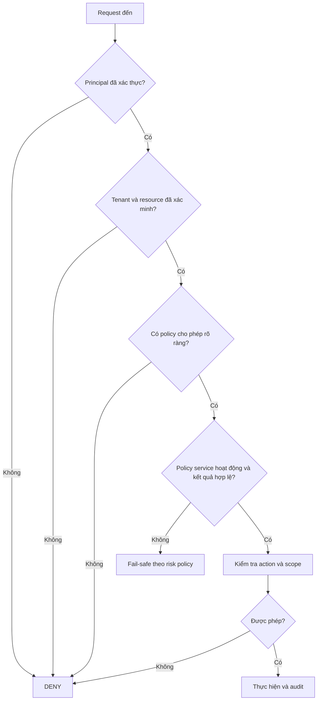
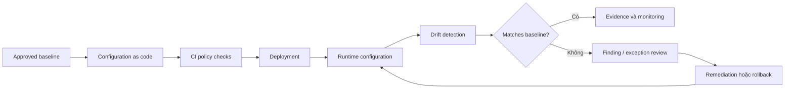

# Secure default: thiết kế trạng thái mặc định an toàn cho hệ thống

Một nhóm phát triển triển khai API mới để quản lý báo cáo. Trong môi trường local, endpoint chỉ có dữ liệu giả nên nhóm tạm thời cho phép truy cập không cần đăng nhập. Khi cấu hình được đưa lên production, một biến môi trường bị thiếu khiến ứng dụng dùng lại giá trị mặc định `permitAll`. Endpoint hoạt động ổn định, health checks đều xanh, nhưng bất kỳ ai biết URL đều có thể truy cập báo cáo.

Không có lỗ hổng phức tạp trong thuật toán mã hóa. Vấn đề xuất phát từ **trạng thái mặc định**: khi cấu hình không được cung cấp, hệ thống chọn cách ít an toàn hơn.

**Secure default** là nguyên tắc thiết kế trong đó hệ thống khởi đầu ở trạng thái bảo vệ phù hợp: quyền truy cập được giới hạn, tính năng nhạy cảm bị tắt cho đến khi được cấu hình rõ, dữ liệu được bảo vệ theo mặc định và thiếu thông tin quan trọng không dẫn tới việc vô tình mở quyền. Người triển khai có thể điều chỉnh cấu hình theo nhu cầu hợp lệ, nhưng mọi ngoại lệ phải có chủ đích, thẩm quyền và bằng chứng.

Trong chương **Kiến trúc an toàn** của module `SECURITY_SECURITY_ASSURANCE`, secure default là một nguyên tắc kiến trúc có thể đánh giá được. Cần chứng minh **baseline an toàn đã được thiết kế, được triển khai trong đúng môi trường, không bị vô hiệu hóa bởi cấu hình khác và tiếp tục được giám sát khi hệ thống thay đổi**.

> **Nguyên tắc trọng tâm:** Nếu thiếu cấu hình, thiếu danh tính, thiếu quyền, không xác định được tenant hoặc không xác minh được một điều kiện bảo mật quan trọng, hệ thống phải chọn hành vi được chính sách phê duyệt là an toàn. **Không được âm thầm mở quyền chỉ để request tiếp tục chạy.**

## 1. Secure default là gì?

**Secure default** là cách thiết kế cấu hình, hành vi và quyền ban đầu để một hệ thống khi mới cài đặt, khởi động, tạo tài khoản, tạo tài nguyên hoặc gặp dữ liệu cấu hình thiếu vẫn có mức bảo vệ phù hợp với threat model.

Một default an toàn thường có những đặc điểm:

- **Default deny:** chỉ cho phép hành động khi có quy tắc cho phép rõ ràng.
- **Least privilege:** tài khoản, workload và người dùng chỉ có quyền tối thiểu cần cho nhiệm vụ.
- **Safe configuration:** các tùy chọn nhạy cảm được đặt ở trạng thái hạn chế; debug, anonymous access và quyền quản trị không tự bật.
- **Secure bootstrap:** lần cài đặt đầu không sử dụng mật khẩu mặc định dùng chung hoặc tài khoản quản trị không được bảo vệ.
- **Fail-safe behavior:** khi kiểm tra quyền hoặc policy thất bại, hệ thống không cấp quyền trái phép.
- **Data protection by default:** không thu thập, chia sẻ hoặc lưu dữ liệu vượt nhu cầu mặc định.
- **Explicit opt-in:** tính năng làm tăng bề mặt tấn công chỉ được bật sau khi có cấu hình và quyết định phù hợp.
- **Observable configuration:** trạng thái bảo mật có thể kiểm tra, audit và so sánh với baseline.

Secure default không có nghĩa mọi tính năng đều phải tắt. Hệ thống vẫn cần hoạt động hữu ích ngay sau cài đặt. Cần phân biệt **chức năng thiết yếu có cấu hình an toàn** với **tính năng nhạy cảm cần được bật có chủ đích**.

### 1.1. Ví dụ trạng thái mặc định

| Thành phần | Mặc định không an toàn | Mặc định an toàn hơn |
|---|---|---|
| API | Mọi route đều anonymous | Yêu cầu xác thực; route công khai nằm trong allowlist |
| Authorization | Cho phép nếu không có rule từ chối | Từ chối nếu không có rule cho phép |
| Admin account | `admin/admin` dùng chung | Bootstrap có kiểm soát, MFA và credential riêng |
| Database | User ứng dụng là superuser | Role riêng, chỉ quyền cần thiết |
| CORS | `*` cho mọi origin | Chỉ origin được phê duyệt; không wildcard khi dùng credentials |
| TLS | Cho phép giao thức/cipher cũ để tương thích | Baseline giao thức và cipher được duyệt |
| Cookie phiên | Không có thuộc tính bảo vệ | `Secure`, `HttpOnly`, `SameSite` theo luồng |
| Debug | Bật chi tiết ở production | Tắt mặc định, bật có thời hạn và kiểm soát |
| Object storage | Public read | Private; cấp quyền truy cập theo nhu cầu |
| Kubernetes pod | Chạy root, privileged | Non-root, capabilities tối thiểu, filesystem hạn chế |
| Logs | Ghi toàn bộ request body | Chỉ ghi trường cần thiết, loại secret và dữ liệu nhạy cảm |
| Feature flag | Tính năng mới tự bật cho mọi người | Mặc định tắt hoặc giới hạn rollout theo approval |
| Tenant context | Lấy tenant từ query parameter | Lấy từ identity/context đã xác minh |
| Secret | Giá trị mẫu hoặc hardcode | Secret được cấp từ nguồn quản lý, thiếu secret thì không khởi động chức năng nhạy cảm |

Bảng này là ví dụ định hướng. Baseline thực tế phải xét kiến trúc, mục đích nghiệp vụ, môi trường và rủi ro; ví dụ một endpoint health liveness tối thiểu có thể công khai trong một mô hình triển khai, nhưng không được để lộ thông tin cấu hình hoặc dữ liệu nghiệp vụ.

## 2. Secure default liên quan gì tới các nguyên tắc kiến trúc an toàn?

Secure default thường được triển khai cùng các nguyên tắc sau:

| Nguyên tắc | Ý nghĩa | Quan hệ với secure default |
|---|---|---|
| **Least privilege** | Cấp quyền tối thiểu | Tài khoản mới không nhận quyền rộng |
| **Fail-safe defaults** | Mặc định từ chối khi không có căn cứ cho phép | Unknown/undefined policy không được hiểu là permit |
| **Defense in depth** | Nhiều lớp bảo vệ độc lập | Default an toàn ở gateway, service, database và storage |
| **Secure by design** | Bảo mật được đưa vào kiến trúc từ đầu | Default là quyết định kiến trúc, không phải thao tác hardening sau release |
| **Secure by default** | Sản phẩm cài đặt/khởi chạy ở cấu hình an toàn | Người dùng không cần tự tìm và bật từng control cơ bản |
| **Complete mediation** | Kiểm tra quyền tại mỗi lần truy cập cần bảo vệ | Không chỉ kiểm tra lúc đăng nhập hoặc ở giao diện |
| **Separation of duties** | Phân tách nhiệm vụ nhạy cảm | Tài khoản bootstrap và operator không tự có toàn quyền |
| **Minimization** | Giảm dữ liệu, quyền và bề mặt cần bảo vệ | Tính năng thu thập/chia sẻ dữ liệu không cần thiết không tự bật |
| **Fail securely** | Lỗi bảo mật không tạo đường bypass | Policy service lỗi không chuyển sang anonymous permit |

### 2.1. Secure by design và secure by default

Hai khái niệm bổ trợ nhau:

- **Secure by design** yêu cầu kiến trúc xử lý rủi ro ngay từ lúc lựa chọn luồng dữ liệu, trust boundary, xác thực, phân quyền và vận hành.
- **Secure by default** yêu cầu cấu hình ban đầu của thiết kế đó có mức bảo vệ phù hợp mà không cần người triển khai phải tự phát hiện mọi tùy chọn yếu.

Ví dụ: kiến trúc có hỗ trợ tenant authorization là secure-by-design; nếu cấu hình tenant isolation mặc định tắt, mỗi triển khai phải tự nhớ bật, sản phẩm chưa đạt secure-by-default.

### 2.2. Default deny và fail-safe defaults

**Default deny** là quy tắc authorization: nếu không tìm thấy một policy cho phép phù hợp, hành động bị từ chối.

**Fail-safe default** là nguyên tắc rộng hơn: khi thiếu thông tin hoặc một bước kiểm tra bảo mật quan trọng không thể hoàn tất, hệ thống chọn trạng thái không làm suy yếu bảo vệ.

Ví dụ:

- Không có principal đã xác thực → không cho truy cập route yêu cầu đăng nhập.
- Không có tenant context đáng tin → không truy vấn dữ liệu tenant.
- Policy engine timeout → không tự cho phép giao dịch nhạy cảm.
- Không có retention policy rõ → không tự xóa dữ liệu không thể phục hồi.
- Không có cấu hình TLS hợp lệ → không hạ xuống giao thức yếu chỉ để kết nối.
- Không lấy được secret ký → không tự dùng private key mẫu trong file.

**Fail-safe không có nghĩa luôn dừng toàn hệ thống.** Cần xác định hành động nào có thể degraded safely. Ví dụ, hệ thống có thể tiếp tục phục vụ trang thông tin công khai trong khi tạm từ chối thao tác chuyển tiền hoặc ký tài liệu.

## 3. Thiết kế secure baseline theo bối cảnh

Một baseline là tập cấu hình và hành vi tối thiểu được tổ chức phê duyệt cho một loại workload hoặc môi trường.

Không nên dùng cùng một bộ cấu hình cho laptop developer, staging, production, batch worker và hệ thống xử lý dữ liệu nhạy cảm. Nhưng cũng không nên để từng nhóm tự định nghĩa những giá trị bảo mật cốt lõi mà không có kiểm soát.

### 3.1. Các lớp baseline

| Lớp | Phạm vi | Ví dụ baseline |
|---|---|---|
| **Platform baseline** | OS, runtime, container, Kubernetes, cloud account | Non-root, patch policy, restricted metadata, logging |
| **Network baseline** | Ingress, egress, segmentation, DNS, TLS | Chỉ mở cổng cần thiết, egress allowlist theo use case |
| **Identity baseline** | User, service account, workload identity | MFA cho admin, short-lived credential, least privilege |
| **Application baseline** | API, session, authorization, input validation | Authenticated by default, deny unknown routes |
| **Data baseline** | Database, object storage, logs, backups | Private storage, encryption, retention, tenant isolation |
| **Operations baseline** | Monitoring, incident, deployment, backup | Audit logs, alerting, recovery tests |
| **Privacy baseline** | Data collection, notice, choice, retention | Không bật tracking không cần, schema minimization |

### 3.2. Baseline phải có owner và version

Một baseline có thể ghi:

- ID và version.
- Phạm vi áp dụng và các loại workload.
- Cấu hình bắt buộc và giá trị mặc định.
- Những trường hợp được phép tùy chỉnh.
- Owner phê duyệt và người chịu trách nhiệm thực thi.
- Cách phát hiện drift.
- Cách kiểm thử.
- Ngày hiệu lực, ngày review và lịch sử thay đổi.

Không chỉ lưu baseline dưới dạng tài liệu. Nên biểu diễn phần có thể tự động hóa bằng **configuration-as-code**, policy-as-code hoặc kiểm tra CI/CD, và giữ liên kết với tài liệu giải thích rationale.

## 4. Secure default trong authentication và account bootstrap

### 4.1. Không có tài khoản mặc định dùng chung

Một sản phẩm không nên cài đặt sẵn tài khoản kiểu `admin/admin`, password cố định trong image hoặc một private key dùng chung giữa mọi khách hàng.

Quy trình bootstrap an toàn có thể:

1. Tạo một danh tính quản trị ban đầu theo cơ chế triển khai đã xác thực.
2. Buộc thay credential tạm hoặc hoàn tất enrollment trước khi mở chức năng quản trị.
3. Yêu cầu MFA hoặc phương thức xác thực mạnh theo chính sách.
4. Gán quyền tối thiểu cho người bootstrap; quyền đặc biệt được cấp riêng.
5. Ghi audit event về người tạo, thời điểm, nguồn và phạm vi.
6. Vô hiệu hóa bootstrap token/secret sau khi hoàn tất.
7. Có quy trình break-glass riêng, được giám sát và hậu kiểm.

Nếu hệ thống không có người dùng quản trị ban đầu, phải có cơ chế khởi tạo an toàn qua identity provider hoặc deployment control plane; không để giao diện quản trị public tự tạo người đầu tiên chỉ bằng cách truy cập URL.

### 4.2. Password và authentication policy

Secure defaults thường gồm:

- Không dùng mật khẩu mặc định hoặc credential chung.
- Không lưu plaintext password; dùng password hashing scheme phù hợp và cấu hình đã được review.
- MFA cho vai trò nhạy cảm theo risk policy.
- Giới hạn thử đăng nhập và phát hiện hành vi bất thường mà không tạo lockout dễ bị lạm dụng.
- Reset/recovery token ngắn hạn, dùng một lần và không lộ qua log/referrer.
- Không bật authentication bypass chỉ vì môi trường là internal.
- Phân biệt service identity với human identity.

Chính sách password cụ thể phải phù hợp chuẩn/khuyến nghị đang được tổ chức áp dụng. Không hardcode một độ dài hay chu kỳ thay đổi làm “chuẩn chung” cho mọi hệ thống.

### 4.3. Session và token

| Thành phần | Mặc định cần xem |
|---|---|
| Session cookie | `Secure`, `HttpOnly`, `SameSite` phù hợp; scope domain/path tối thiểu |
| Session lifetime | Thời hạn idle/absolute phù hợp mức rủi ro |
| Logout | Hủy hoặc vô hiệu hóa session theo mô hình |
| Token audience | Chỉ dành cho đúng API/resource |
| Token expiry | Có thời hạn; refresh/renewal được kiểm soát |
| CSRF | Bật biện pháp phù hợp với kiểu authentication và request |
| CORS | Origin cụ thể; không mở rộng wildcard với credential |
| Recovery | Không làm yếu hơn authentication thông thường |

Một ứng dụng không nên phát token với quyền admin chỉ vì người dùng vừa hoàn tất đăng nhập. **Authentication xác định danh tính; authorization mới quyết định hành động được phép.**

## 5. Secure default trong authorization và tenant isolation

Đây là một trong những nơi default sai có thể gây hậu quả lớn nhất.

### 5.1. Không có rule thì deny

Một authorization engine cần phân biệt:

- **Explicit allow:** policy cụ thể cho phép hành động trên tài nguyên.
- **Explicit deny:** policy cấm hành động.
- **No matching rule:** không có căn cứ cho phép; kết quả mặc định là deny.
- **Unknown/error:** không thể xác định policy; hành động nhạy cảm bị từ chối hoặc đưa vào trạng thái review phù hợp.

Không nên dùng logic kiểu `if (policy == null) return true;` hoặc coi exception của policy service là “cho phép tạm thời”.

### 5.2. Tenant context phải đến từ nguồn tin cậy

Giả sử người dùng thuộc tenant A gọi:

```http
GET /api/reports?tenantId=tenant-B
```

Nếu backend tin `tenantId` trong query parameter, người dùng có thể thử truy cập dữ liệu tenant B. Secure default yêu cầu:

- Tenant context được rút ra từ principal/identity đã xác minh hoặc một delegation có kiểm soát.
- Tài nguyên được kiểm tra tenant ownership ở server-side.
- Repository/query luôn gắn tenant scope.
- Cache key có tenant context.
- Export, background job và queue consumer mang context đã xác minh.
- Không có endpoint admin/debug bypass ngoài policy.
- Unknown tenant hoặc missing context bị từ chối.

Không nên coi việc UI chỉ hiển thị dữ liệu tenant A là tenant isolation. Enforcement phải ở backend/data access boundary.

### 5.3. Quyền mặc định tối thiểu

Khi tạo user mới, không tự gán `ADMIN` hoặc mọi role để tránh lỗi onboarding. Một số vai trò có thể cần quyền đọc tối thiểu; quyền ghi/xóa/quản trị cần được cấp rõ ràng.

Khi tạo service account/workload mới, mặc định không tự cấp quyền đọc mọi bucket, gọi mọi API hoặc truy cập secrets của toàn namespace. Cần gán permission theo workload purpose.

## 6. Secure default cho API, network và browser

### 6.1. API exposure

- Route mới cần authentication mặc định.
- Public route phải được liệt kê tường minh, có owner và rationale.
- Method nhạy cảm (write/delete/admin/export) cần authorization riêng.
- Không expose debug, schema explorer, admin console hoặc actuator details public.
- Không trả stack trace, internal host, SQL, token hay secret trong error response.
- Rate limit/abuse protection phải có baseline theo loại endpoint.
- Input size, upload type, timeout và pagination có giới hạn.
- Không cho phép client tự chỉ định callback URL hoặc outbound target mà không có kiểm soát SSRF phù hợp.

**Allowlist public endpoints** thường an toàn hơn việc cố liệt kê mọi endpoint cần khóa trong một danh sách deny có thể bị thiếu khi thêm route mới.

### 6.2. CORS

CORS không phải cơ chế authentication. Nó là chính sách trình duyệt quyết định trang web ở origin nào có thể đọc response theo các điều kiện nhất định.

Default phù hợp thường là:

- Không bật CORS rộng khi sản phẩm không cần cross-origin browser access.
- Khi cần, chỉ định origin cụ thể.
- Không kết hợp `Access-Control-Allow-Origin: *` với credentials.
- Giới hạn methods/headers cần thiết.
- Kiểm tra preflight và origin normalization.
- Không phản chiếu bất kỳ Origin header nào từ request một cách tự động.

### 6.3. TLS và security headers

Baseline thường cần:

- HTTPS cho các đường truyền có dữ liệu hoặc credential nhạy cảm.
- Tắt giao thức/cipher yếu theo crypto policy đã phê duyệt.
- Chứng chỉ được quản lý và gia hạn có giám sát.
- HSTS khi toàn bộ domain/subdomain và vận hành HTTPS đã sẵn sàng.
- Content Security Policy phù hợp ứng dụng web.
- `X-Content-Type-Options: nosniff`, framing policy và Referrer Policy phù hợp.
- Không đưa secret hoặc dữ liệu nhạy cảm vào URL.

Không bật `includeSubDomains` hoặc `preload` HSTS một cách máy móc nếu các subdomain chưa hỗ trợ HTTPS. Một header quá rộng có thể làm hỏng dịch vụ hợp lệ; baseline cần được thử trên toàn domain scope.

## 7. Secure default trong data protection và privacy

Một hệ thống nên bảo vệ dữ liệu theo mặc định ngay từ lúc tạo record, file, log và event.

### 7.1. Data minimization

- Chỉ thu trường cần cho mục đích đã xác định.
- Không bật telemetry/tracking tùy chọn nếu chưa có quyết định phù hợp.
- Không ghi raw request body, password, token, secret hoặc dữ liệu nhạy cảm vào log.
- Giới hạn retention; không mặc định lưu vô thời hạn.
- Dùng dữ liệu tổng hợp hoặc synthetic trong môi trường phát triển khi phù hợp.
- Hạn chế export, download và sharing mặc định.

### 7.2. Encryption và key management

- Dữ liệu nhạy cảm được mã hóa theo policy và threat model.
- Không dùng khóa mẫu, khóa dùng chung hoặc key mặc định trong production.
- Key permissions được giới hạn theo service/purpose.
- Secret không hardcode trong repository hoặc container image.
- Key rotation và revocation có owner, evidence và quy trình.
- Không coi encryption là thay thế authorization/retention/disposal.

### 7.3. Privacy settings

Nếu một tính năng thu thập dữ liệu không cần thiết cho dịch vụ cốt lõi, không nên bật nó chỉ vì SDK đặt mặc định là enabled. Cần đánh giá mục đích, cơ sở xử lý, lựa chọn áp dụng, nhóm người bị ảnh hưởng và đường thực thi server-side.

**Secure default và privacy by default có điểm giao nhau**: giảm dữ liệu, giới hạn quyền và không tự bật hoạt động xâm lấn. Nhưng PIA/privacy assurance vẫn cần đánh giá purpose, necessity, transparency và impact đối với cá nhân.

## 8. Secure default cho secrets và cấu hình

### 8.1. Secret không có giá trị mặc định

Ví dụ nguy hiểm:

```java
String signingKey = System.getenv().getOrDefault(
        "SIGNING_KEY", "development-secret");
```

Nếu biến môi trường bị thiếu ở production, ứng dụng vẫn chạy bằng một secret đã biết. Một default an toàn hơn là **không khởi động chức năng nhạy cảm hoặc không khởi động ứng dụng** khi secret bắt buộc bị thiếu, đồng thời báo lỗi không tiết lộ giá trị.

```java
String signingKey = System.getenv("SIGNING_KEY");
if (signingKey == null || signingKey.isBlank()) {
    throw new IllegalStateException(
            "Required signing configuration is missing");
}
```

Trong production, secret nên được cấp từ secret manager/HSM/KMS theo mô hình phù hợp, có rotation và access audit. Environment variable không tự động là nơi lưu secret an toàn; cần xem cách runtime, orchestrator, crash dump và diagnostics xử lý nó.

### 8.2. Cấu hình fail-safe

Cấu hình nhạy cảm nên phân biệt:

- **Missing:** chưa được cung cấp.
- **Invalid:** giá trị không hợp lệ.
- **Explicitly disabled:** người có thẩm quyền chủ động tắt.
- **Enabled:** đã cấu hình và được duyệt.
- **Unknown:** không thể xác định trạng thái.

Không gộp tất cả thành boolean mặc định `false` nếu điều đó khiến ứng dụng không biết một control bắt buộc chưa được cấu hình. Với một số controls, **missing phải làm startup fail** hoặc chức năng liên quan bị khóa, thay vì silently disabling.

Ví dụ, production không được chạy nếu `authorization.defaultDecision` không phải `DENY`, hoặc nếu danh sách public routes chưa được duyệt theo policy.

### 8.3. Configuration precedence

Khi cấu hình đến từ file, environment, command-line, secret manager và remote config, cần biết **nguồn nào ưu tiên**. Nếu một biến môi trường cũ vô tình ghi đè baseline, giá trị an toàn trong file có thể không còn hiệu lực.

Nên:

- Tài liệu hóa thứ tự precedence.
- Validate effective configuration sau khi merge.
- Phân biệt config thường và secret.
- Có schema/version và allowed values.
- Audit thay đổi runtime.
- Hạn chế ai được sửa remote config/feature flags.
- Cảnh báo khi production lệch baseline.

## 9. Secure default trong errors, logs và monitoring

### 9.1. Error handling

Mặc định trả thông báo chung cho client, giữ chi tiết kỹ thuật trong kênh log có kiểm soát. Không tiết lộ:

- Stack traces và internal class names không cần thiết.
- SQL query, table names, hostnames hoặc topology nhạy cảm.
- Session ID, access token, API key hoặc secret.
- Dữ liệu cá nhân trong exception message.
- Khóa, PIN hoặc thông tin HSM.

Không nên nuốt exception rồi trả thành công. Lỗi security check cần được phân biệt với lỗi nghiệp vụ và được ghi nhận đủ để điều tra.

### 9.2. Logging

Một baseline log nên xác định:

- Sự kiện authentication/authorization, admin changes, policy changes.
- Actor/principal, resource/action, outcome, timestamp và correlation ID.
- Trường nào được phép log và trường nào phải redact.
- Quyền truy cập log và thời hạn lưu.
- Cơ chế chống sửa/xóa log trái phép và đồng bộ thời gian.
- Alert cho hành vi đặc quyền, deny spike, config drift và audit pipeline failure.

**Log càng nhiều không đồng nghĩa an toàn hơn.** Log toàn bộ payload có thể tạo thêm kho dữ liệu nhạy cảm và tăng tác động khi bị lộ.

## 10. Secure default trong container, Kubernetes và cloud

### 10.1. Container baseline

Một container nên được cấu hình theo mức quyền tối thiểu:

- Chạy non-root khi ứng dụng hỗ trợ.
- Không dùng privileged mode nếu không có lý do và phê duyệt đặc biệt.
- Drop Linux capabilities không cần thiết.
- Dùng read-only root filesystem khi phù hợp.
- Giới hạn CPU/memory và process count.
- Không mount host path hoặc Docker socket mặc định.
- Dùng image tối thiểu, pin digest/version và kiểm tra provenance.
- Không nhúng secret vào image layer.

Ví dụ manifest minh họa:

```yaml
apiVersion: v1
kind: Pod
metadata:
  name: reports-api
  namespace: reports-prod
spec:
  automountServiceAccountToken: false
  securityContext:
    runAsNonRoot: true
    seccompProfile:
      type: RuntimeDefault
  containers:
    - name: api
      image: registry.example.invalid/reports-api@sha256:<approved-digest>
      securityContext:
        allowPrivilegeEscalation: false
        readOnlyRootFilesystem: true
        capabilities:
          drop: ["ALL"]
      resources:
        requests:
          cpu: "100m"
          memory: "128Mi"
        limits:
          cpu: "1"
          memory: "512Mi"
```

Đây là ví dụ cấu hình, cần điều chỉnh theo image/runtime thực tế. Nếu ứng dụng cần ghi file tạm, mount một volume riêng với quyền và dung lượng phù hợp; không bật lại toàn bộ filesystem writable chỉ để tránh sửa ứng dụng.

### 10.2. Service account và RBAC

- Không tự động mount Kubernetes API token nếu workload không cần.
- Service account riêng theo workload/purpose.
- Không gán `cluster-admin` làm mặc định.
- Giới hạn quyền tạo pod, exec, secrets, role binding và impersonation.
- Tách namespace/environment theo trust boundary.
- Kiểm tra cả quyền của người tạo workload vì họ có thể gắn service account đặc quyền.
- Có inventory và review định kỳ cho service accounts không còn owner.

### 10.3. Network policy và cloud security groups

Default deny ingress/egress có thể giảm bề mặt mạng, nhưng cần thiết kế các allow rules cho DNS, identity provider, logging, dependencies và health checks cần thiết. Nếu chặn nhầm dependency, đội vận hành có thể mở rộng firewall tạm thời quá mức.

Cần xác minh **network policy engine thực thi thật**, không chỉ manifest được apply. Với Kubernetes, hành vi phụ thuộc CNI/provider; một policy không được hỗ trợ có thể không tạo enforcement như mong đợi.

### 10.4. Cloud resources

- Object storage private by default.
- Database không public endpoint trừ khi có kiến trúc và kiểm soát được duyệt.
- Security group/firewall chỉ mở source/destination cần thiết.
- IAM role không dùng wildcard `*` nếu không có rationale và scope rõ.
- Metadata service được bảo vệ khỏi truy cập không phù hợp.
- Audit trail và encryption được bật theo baseline.
- Resource mới phải có owner, classification, tags và policy.

## 11. Secure default cho feature flags và tính năng mới

Feature flag thường được dùng để kiểm soát rollout, nhưng có thể trở thành một **đường bypass** nếu flag bảo mật được bật sai.

Ví dụ:

- `skipAuthorization=true` để test rồi quên tắt.
- `debugEndpoints=true` trong production.
- `allowCrossTenant=true` để migration.
- `disableMfa=true` cho một nhóm người dùng.
- `legacyTokenValidation=true` không có hạn kết thúc.

Nguyên tắc:

1. Không tạo flag bypass security như cách mặc định để ứng dụng hoạt động.
2. Flag nhạy cảm cần owner, approval, scope, expiry và audit.
3. Giá trị thiếu hoặc không tải được phải theo hành vi an toàn được định nghĩa.
4. Flag phải được kiểm tra ở server-side, không chỉ ẩn UI.
5. Có test khi flag bật/tắt, config service lỗi và cache stale.
6. Có cơ chế loại bỏ flag cũ, tránh tích tụ đường legacy.
7. Không cho phép một flag cấp quyền rộng hơn baseline mà không có quyết định rủi ro.

Với feature rollout, mặc định tắt có thể là lựa chọn an toàn, nhưng nếu tính năng là một security fix bắt buộc, cần quy trình rollout/rollback riêng; không để feature flag vô tình vô hiệu hóa biện pháp bảo vệ.

## 12. Fail-safe behavior và graceful degradation

Một câu hỏi thiết kế quan trọng là **điều gì xảy ra khi dependency bảo mật không khả dụng?**

| Thành phần lỗi | Fallback nguy hiểm | Hành vi an toàn cần cân nhắc |
|---|---|---|
| Authorization service | Cho phép mọi request để duy trì uptime | Từ chối hành động nhạy cảm; có thể phục vụ phần công khai |
| Identity provider | Bỏ xác thực tạm thời | Từ chối login mới; session hợp lệ hiện có xử lý theo policy |
| KMS/HSM | Dùng key hardcode/software fallback | Hoãn thao tác mật mã nhạy cảm hoặc DR đã được duyệt |
| Policy/config service | Dùng config mặc định permissive | Dùng last-known-good đã xác minh hoặc deny theo risk policy |
| Audit pipeline | Tiếp tục thao tác nhạy cảm mà không có audit | Queue có kiểm soát hoặc tạm dừng hành động cần audit bắt buộc |
| Tenant registry | Dùng tenant mặc định chung | Từ chối truy cập dữ liệu nếu tenant không xác định |
| Secrets manager | Dùng placeholder secret | Không khởi động chức năng cần secret |
| Rate limiter | Tắt giới hạn khi service lỗi | Giới hạn cục bộ an toàn hoặc từ chối theo policy |

### 12.1. Fail closed có thể ảnh hưởng availability

Nếu mọi dependency lỗi đều làm toàn bộ ứng dụng ngừng hoạt động, có thể gây DoS hoặc sự cố vận hành. Vì vậy cần **phân loại hành động**:

- **High-impact:** ký giao dịch, thay quyền, export PII, chuyển tiền → fail closed.
- **Low-risk/public:** nội dung công khai hoặc health liveness tối thiểu → có thể tiếp tục.
- **Degraded read-only:** có thể cho phép đọc dữ liệu đã được cache nếu authorization và freshness được đảm bảo.
- **Recovery/emergency:** có đường break-glass có thẩm quyền, giám sát và hậu kiểm.

Không dùng một default chung cho mọi endpoint. Mỗi degraded mode phải có **threat model, phạm vi, owner và test**.



## 13. Secure default trong Java 17: policy mặc định từ chối

Ví dụ sau minh họa authorization policy đơn giản. Một request chỉ được phép đọc báo cáo khi:

- Principal đã được xác thực bởi thành phần tin cậy.
- Có role `REPORT_READER`.
- Tenant của principal khớp tenant của tài nguyên.
- Route nằm trong danh sách được hỗ trợ.

Mọi trường hợp còn lại bị từ chối. Ví dụ **không thay thế** framework authentication, database row-level security hoặc kiểm tra authorization ở mọi endpoint của ứng dụng thật.

```java
import java.util.Objects;
import java.util.Set;

record VerifiedPrincipal(
        String subject,
        String tenantId,
        Set<String> roles) {}

record ReportResource(
        String reportId,
        String tenantId) {}

enum AccessDecision {
    ALLOW,
    DENY
}

final class SecureDefaultPolicy {
    private SecureDefaultPolicy() {}

    static AccessDecision canReadReport(
            VerifiedPrincipal principal,
            ReportResource report) {

        if (principal == null || report == null
                || principal.subject() == null
                || principal.subject().isBlank()
                || principal.tenantId() == null
                || principal.tenantId().isBlank()
                || principal.roles() == null
                || report.reportId() == null
                || report.reportId().isBlank()
                || report.tenantId() == null
                || report.tenantId().isBlank()) {
            return AccessDecision.DENY;
        }

        if (!Objects.equals(
                principal.tenantId(), report.tenantId())) {
            return AccessDecision.DENY;
        }

        if (!principal.roles().contains("REPORT_READER")) {
            return AccessDecision.DENY;
        }

        return AccessDecision.ALLOW;
    }
}
```

### 13.1. JUnit 5: kiểm thử default deny

```java
import static org.junit.jupiter.api.Assertions.assertEquals;
import java.util.Set;
import org.junit.jupiter.api.Test;

class SecureDefaultPolicyTest {
    private static ReportResource report(String tenant) {
        return new ReportResource("report-42", tenant);
    }

    @Test
    void allowsReaderWithinOwnTenant() {
        var principal = new VerifiedPrincipal(
                "user-1", "tenant-A", Set.of("REPORT_READER"));

        assertEquals(AccessDecision.ALLOW,
                SecureDefaultPolicy.canReadReport(
                        principal, report("tenant-A")));
    }

    @Test
    void deniesCrossTenantAccess() {
        var principal = new VerifiedPrincipal(
                "user-1", "tenant-A", Set.of("REPORT_READER"));

        assertEquals(AccessDecision.DENY,
                SecureDefaultPolicy.canReadReport(
                        principal, report("tenant-B")));
    }

    @Test
    void deniesWhenRoleIsMissing() {
        var principal = new VerifiedPrincipal(
                "user-1", "tenant-A", Set.of("REPORT_WRITER"));

        assertEquals(AccessDecision.DENY,
                SecureDefaultPolicy.canReadReport(
                        principal, report("tenant-A")));
    }

    @Test
    void deniesUnknownPrincipalOrResource() {
        assertEquals(AccessDecision.DENY,
                SecureDefaultPolicy.canReadReport(
                        null, report("tenant-A")));
        assertEquals(AccessDecision.DENY,
                SecureDefaultPolicy.canReadReport(
                        new VerifiedPrincipal(
                                "user-1", "tenant-A",
                                Set.of("REPORT_READER")), null));
    }

    @Test
    void deniesMissingTenantAndEmptyRoleSet() {
        var missingTenant = new VerifiedPrincipal(
                "user-1", null, Set.of("REPORT_READER"));
        var noRoles = new VerifiedPrincipal(
                "user-1", "tenant-A", Set.of());

        assertEquals(AccessDecision.DENY,
                SecureDefaultPolicy.canReadReport(
                        missingTenant, report("tenant-A")));
        assertEquals(AccessDecision.DENY,
                SecureDefaultPolicy.canReadReport(
                        noRoles, report("tenant-A")));
    }
}
```

Các test này xác nhận một số nhánh logic. Chúng **không chứng minh** `VerifiedPrincipal` được tạo đúng từ token đã xác minh hoặc mọi repository/API đều gọi policy. Cần integration tests cho authentication, route mapping, database tenant filters, cache keys, export và background jobs.

### 13.2. Không tạo bypass qua exception

Một anti-pattern:

```java
try {
    return authorizationService.isAllowed(principal, resource);
} catch (RuntimeException ex) {
    return true; // FAIL OPEN: không an toàn
}
```

Hành vi phù hợp hơn cho một thao tác nhạy cảm:

```java
try {
    return authorizationService.isAllowed(principal, resource);
} catch (RuntimeException ex) {
    securityAudit.recordAuthorizationUnavailable(
            principal.subject(), resource.id());
    return false; // DENY khi không thể xác minh
}
```

Trong production cần phân loại lỗi, bảo đảm logging không gây lộ dữ liệu và xử lý trường hợp principal/resource null. Nếu audit service cũng lỗi, phải có chính sách cho hành động nhạy cảm và cơ chế lưu bền vững/alert phù hợp; không được giả định dòng log đơn lẻ đã giải quyết toàn bộ yêu cầu audit.

## 14. Mẫu secure configuration baseline bằng YAML

Đây là ví dụ cấu hình học tập. Giá trị cần được điều chỉnh theo framework, kiến trúc và policy của tổ chức.

```yaml
baseline_id: "APP-SECURE-DEFAULT-01"
version: "1.0"
environment: "production"

authentication:
  required_by_default: true
  anonymous_routes:
    - "/health/live"
  admin_mfa_required: true
  default_credentials_enabled: false

authorization:
  default_decision: "DENY"
  unknown_principal: "DENY"
  unknown_tenant: "DENY"
  cross_tenant_access: "DENY"
  privileged_roles_require_explicit_grant: true

session:
  secure_cookie: true
  http_only_cookie: true
  same_site: "LAX"
  idle_timeout_minutes: 20
  absolute_timeout_minutes: 480

network:
  https_required: true
  cors:
    enabled: false
    allowed_origins: []
    allow_credentials: false
  debug_endpoints_public: false

data:
  collection_minimized: true
  encryption_required_for_sensitive_data: true
  retention_schedule_required: true
  public_storage_default: false

secrets:
  hardcoded_defaults_allowed: false
  missing_required_secret: "FAIL_STARTUP"
  source: "approved-secret-manager"

runtime:
  debug_mode: false
  run_as_non_root: true
  read_only_root_filesystem: true
  privileged_container: false
  default_service_account_token_mount: false

logging:
  redact_credentials: true
  redact_sensitive_payloads: true
  audit_admin_actions: true
  audit_retention_policy_required: true

change_control:
  baseline_owner: "<security-platform-owner>"
  approval_reference: "<approved-baseline-decision>"
  review_due: "<date>"
```

Không nên copy nguyên YAML vào mọi ứng dụng mà không đánh giá. Ví dụ `/health/live` cần thực sự chỉ trả trạng thái liveness tối thiểu; nếu endpoint tiết lộ version, dependency, database status hoặc topology thì không còn là route public an toàn.

## 15. Secure default cho database, storage và messaging

### 15.1. Database

- Tài khoản ứng dụng không dùng superuser/root.
- Role đọc/ghi tách theo use case nếu cần.
- Tenant scoping được thực thi tại query/data access boundary.
- Database listener không public mặc định.
- TLS, encryption at rest và backup theo policy.
- Migration account tách khỏi runtime account.
- Không bật debug SQL chứa dữ liệu nhạy cảm ở production.
- Database error không tiết lộ schema hoặc credentials.

### 15.2. Object storage

- Bucket private by default.
- Public ACL/policy bị tắt nếu không có quyết định rõ.
- Signed URL ngắn hạn và giới hạn object/method.
- Versioning, lifecycle và retention được cấu hình theo mục đích.
- Upload/download có kiểm tra content, size, ownership và authorization.
- Không để object key có thể đoán được trở thành cơ chế bảo vệ.

### 15.3. Queue và event bus

- Producer/consumer identity được xác thực.
- Topic/queue permissions giới hạn theo workload.
- Message có schema/version và tenant context từ nguồn tin cậy.
- DLQ/retry retention không vô thời hạn.
- Replay không bỏ qua authorization hoặc privacy policy.
- Không ghi payload nhạy cảm vào broker console/log.
- Consumer lỗi không tự bỏ qua validation để tiếp tục xử lý.

### 15.4. Backup và restore

- Backup encryption và access controls theo baseline.
- Không public snapshot hoặc export.
- Restore test định kỳ.
- Deletion/tombstone reconciliation để dữ liệu đã xử lý không hồi sinh ngoài policy.
- Restore vào môi trường cách ly trước khi mở traffic khi phù hợp.
- Audit các thao tác restore và quyền operator.

## 16. Kiểm thử secure default và configuration drift

Một baseline cần có **positive tests** để chứng minh tính năng hợp lệ vẫn hoạt động và **negative tests** để chứng minh đường ngoài policy bị chặn.

| Test ID | Kịch bản | Kết quả mong đợi | Evidence |
|---|---|---|---|
| `TEST-SD-01` | Route mới không có rule public | Yêu cầu authentication/authorization | Route inventory + integration test |
| `TEST-SD-02` | Principal thiếu role | DENY | Authorization test |
| `TEST-SD-03` | Tenant context không xác định | DENY hoặc review theo policy | Missing-tenant test |
| `TEST-SD-04` | User tenant A yêu cầu resource tenant B | DENY, không có side effect | Cross-tenant E2E test |
| `TEST-SD-05` | Authorization service timeout | Không fail-open | Failure injection test |
| `TEST-SD-06` | Secret bắt buộc bị thiếu | Startup fail hoặc chức năng nhạy cảm bị khóa | Startup/config validation test |
| `TEST-SD-07` | Debug flag bật ngoài môi trường được duyệt | CI/deployment policy chặn | IaC/config policy test |
| `TEST-SD-08` | CORS origin không nằm allowlist | Browser không được cấp quyền đọc response | CORS integration test |
| `TEST-SD-09` | Cookie thiếu Secure/HttpOnly theo policy | Build/release test phát hiện | Header/cookie inspection |
| `TEST-SD-10` | Storage bucket tạo mới | Private theo baseline | Cloud config scan |
| `TEST-SD-11` | Container chạy root/privileged | Admission/CI policy từ chối theo baseline | Runtime manifest test |
| `TEST-SD-12` | Service account không cần Kubernetes API token | Không tự mount token | Manifest/runtime inspection |
| `TEST-SD-13` | Log nhận password/token/raw sensitive payload | Redaction hoặc loại bỏ | Log inspection with synthetic secrets |
| `TEST-SD-14` | Default credential còn hoạt động sau bootstrap | Authentication bị từ chối | Bootstrap regression test |
| `TEST-SD-15` | Config service lỗi hoặc thiếu key security setting | Last-known-good đã xác minh hoặc fail-safe | Config failure test |
| `TEST-SD-16` | Remote config đổi public route hoặc role | Có approval, audit và alert | Change audit |
| `TEST-SD-17` | Feature flag security bypass không có owner/expiry | Không được bật hoặc bị cảnh báo/chặn | Flag inventory and policy test |
| `TEST-SD-18` | Restore backup chứa dữ liệu đã disposal | Reconciliation trước khi phục vụ | Restore test |
| `TEST-SD-19` | Health endpoint được gọi anonymous | Chỉ trả dữ liệu tối thiểu đã phê duyệt | Response schema test |
| `TEST-SD-20` | Baseline version mới làm thay đổi hành vi bảo mật | Có impact review, test và rollout approval | Version diff + release evidence |

### 16.1. Configuration drift

**Configuration drift** là tình trạng cấu hình thực tế lệch khỏi baseline được phê duyệt do thay đổi thủ công, IaC, remote config, hotfix, cloud console hoặc lỗi deployment.

Cần:

1. Xác định **source of truth** và phiên bản baseline.
2. Thu effective configuration từ môi trường đang chạy.
3. Chuẩn hóa/loại bỏ secret trước khi so sánh.
4. Phát hiện khác biệt và phân loại severity.
5. Gắn owner, lý do và approval của exception.
6. Remediate hoặc rollback.
7. Retest và lưu evidence sau sửa.

Một bản Terraform an toàn không chứng minh cloud resource hiện tại vẫn đúng nếu có người thay đổi thủ công ngoài IaC. Cần kiểm tra **runtime state**.



## 17. Exceptions: khi nào được thay đổi default?

Có trường hợp nghiệp vụ cần public endpoint, egress rộng hơn, debug tạm thời hoặc một quyền đặc biệt. Không nên giả định mọi ngoại lệ đều trái phép, nhưng ngoại lệ phải được quản lý.

### 17.1. Exception record

| Trường | Nội dung |
|---|---|
| **Exception ID** | Mã duy nhất |
| **Baseline rule** | Quy tắc mặc định bị thay đổi |
| **Scope** | Service, environment, tenant, resource và thời gian |
| **Business rationale** | Nhu cầu cụ thể |
| **Risk assessment** | Kịch bản, tác động, khả năng và residual risk |
| **Compensating controls** | Biện pháp thay thế, giới hạn và monitoring |
| **Approver** | Người có thẩm quyền/risk owner |
| **Expiry** | Thời hạn hoặc điều kiện kết thúc |
| **Verification** | Cách kiểm tra exception thực sự giới hạn đúng scope |
| **Reassessment trigger** | Thay đổi/incident làm exception cần xem lại |

### 17.2. Không để exception thành default thứ hai

- Không dùng exception không thời hạn.
- Không áp dụng một ngoại lệ cho nhiều service không liên quan.
- Không để người yêu cầu tự phê duyệt khi policy yêu cầu độc lập.
- Có cảnh báo trước ngày hết hạn.
- Tự động quay lại baseline nếu khả thi và an toàn.
- Ghi exception vào inventory và báo cáo audit.
- Không dùng exception nội bộ để vượt yêu cầu bắt buộc.

Một hệ thống có hàng trăm exception tồn tại lâu có thể cho thấy baseline không phù hợp hoặc governance yếu. Cần xem **root cause và thiết kế lại baseline**, thay vì chỉ gia hạn từng exception.

## 18. Secure default và backward compatibility

Một thay đổi default có thể làm ứng dụng cũ ngừng hoạt động. Ví dụ bật authentication cho route trước đây public hoặc bỏ quyền superuser khỏi database account. Đây là vấn đề cần quản lý có kế hoạch, không phải lý do để giữ mặc định yếu vô thời hạn.

Quy trình thay đổi:

1. **Inventory:** tìm service, client, integration và tenant chịu ảnh hưởng.
2. **Impact analysis:** xác định dependency đang dựa vào behavior cũ.
3. **Migration path:** cung cấp cách chuyển sang cơ chế an toàn.
4. **Versioning:** phân biệt config/schema cũ và mới.
5. **Rollout:** canary hoặc phased deployment nếu phù hợp.
6. **Telemetry:** theo dõi client cũ và lỗi tương thích.
7. **Deadline:** đặt ngày kết thúc legacy mode.
8. **Removal:** xóa fallback/flag và kiểm tra không còn đường bypass.

Nếu buộc giữ tương thích tạm thời, dùng **scoped exception có hạn** và compensating controls. Không giữ `allowAnonymous=true` toàn hệ thống chỉ vì một tích hợp cũ chưa cập nhật.

## 19. Threat modeling secure default

| Threat scenario | Nguyên nhân default yếu | Tác động | Control/assessment |
|---|---|---|---|
| **Anonymous access** | Route mới public nếu không cấu hình | Lộ dữ liệu hoặc thao tác trái phép | Authenticated-by-default, route allowlist |
| **Privilege escalation** | Role mới nhận quyền admin mặc định | Chiếm quyền quản trị | Default least privilege, approval, role tests |
| **Cross-tenant disclosure** | Tenant lấy từ request hoặc thiếu filter | Lộ dữ liệu tenant khác | Trusted tenant context, row-level tests |
| **Credential compromise** | Default password/secret trong image | Chiếm tài khoản/dịch vụ | Secure bootstrap, secret scan, rotation |
| **Debug exposure** | Debug/admin endpoints bật mặc định | Lộ topology, secret hoặc dữ liệu | Production baseline, admission/config tests |
| **Network exposure** | Port/security group mở rộng | Tăng attack surface | Deny-by-default network, egress allowlist |
| **Policy outage bypass** | Authorization exception dẫn tới permit | Truy cập trái quyền khi dependency lỗi | Fail-safe, timeout/failure tests |
| **Supply-chain abuse** | Image/tag không pin, runtime chạy privileged | Code độc hại có quyền rộng | Image provenance, non-root, admission policy |
| **Sensitive logging** | Request body được ghi toàn bộ | Tạo thêm bản sao dữ liệu nhạy cảm | Log schema allowlist/redaction |
| **Stale exception** | Temporary override không expiry | Bypass tồn tại lâu dài | Exception inventory, expiry alert and retest |

Secure default giảm khả năng cấu hình sai vô tình, nhưng không thay thế threat modeling cho các hành vi lạm dụng có chủ đích hoặc lỗi logic nghiệp vụ.

## 20. Mapping từ risk tới control và assurance evidence

| Risk ID | Security requirement | Control | Evidence/test |
|---|---|---|---|
| `RISK-SD-01`: route public ngoài ý muốn | `REQ-SD-01`: route yêu cầu auth trừ allowlist được duyệt | `CTRL-SD-01`: authenticated-by-default | Route inventory, anonymous route tests |
| `RISK-SD-02`: cấp quyền quá rộng | `REQ-SD-02`: no matching rule phải deny | `CTRL-SD-02`: default-deny authorization | Policy config, missing-role tests |
| `RISK-SD-03`: cross-tenant | `REQ-SD-03`: tenant context phải từ nguồn tin cậy | `CTRL-SD-03`: tenant-aware enforcement | Cross-tenant E2E tests, query review |
| `RISK-SD-04`: default credential | `REQ-SD-04`: không có shared default credential | `CTRL-SD-04`: secure bootstrap | Bootstrap tests, secret scans |
| `RISK-SD-05`: config thiếu làm yếu security | `REQ-SD-05`: mandatory settings phải validate | `CTRL-SD-05`: fail-safe config validation | Startup failure/config tests |
| `RISK-SD-06`: debug/network exposure | `REQ-SD-06`: chỉ expose interface được duyệt | `CTRL-SD-06`: secure deployment baseline | IaC scan, runtime config snapshot |
| `RISK-SD-07`: secret/sensitive data lộ trong log | `REQ-SD-07`: log phải minimize/redact | `CTRL-SD-07`: secure logging defaults | Synthetic secret test, log inspection |
| `RISK-SD-08`: exception tồn tại lâu | `REQ-SD-08`: override có owner và expiry | `CTRL-SD-08`: exception governance | Exception inventory, expiry and audit test |

Các ID chỉ là ví dụ để xây control traceability. Tổ chức cần map với risk register và catalogue chính thức của mình.

## 21. Claim – Argument – Evidence cho secure default

Một assurance claim nên giới hạn rõ **sản phẩm, version, environment, baseline, workload và thời kỳ**.

| Thành phần | Ví dụ |
|---|---|
| **Claim** | Dịch vụ báo cáo production trong release đã đánh giá khởi động theo baseline secure default; truy cập yêu cầu principal có quyền và tenant hợp lệ; cấu hình thiếu hoặc policy lỗi không mở quyền trái phép |
| **Argument** | Baseline được version hóa; route/role/config được kiểm soát; runtime config được đối chiếu; negative tests chứng minh deny; exceptions có owner/expiry |
| **Evidence: design** | Architecture, threat model, baseline rationale, route/data inventory |
| **Evidence: implementation** | IaC, Spring/security config, container manifest, IAM and network policies |
| **Evidence: testing** | Missing config, wrong tenant, unknown route, policy outage, default credential tests |
| **Evidence: operations** | Runtime config snapshot, drift reports, access logs, exception reviews, alerts |
| **Assumptions** | Identity provider, platform enforcement và source-of-truth config được bảo vệ theo control liên quan |
| **Limitations** | Một legacy worker chưa chuyển baseline; một số cloud settings chưa có runtime evidence |
| **Conclusion** | PASS/FAIL/INCONCLUSIVE theo scope; residual risk và điều kiện cần xử lý |

### 21.1. Ba mức hiệu lực

- **Design effectiveness:** baseline có giảm đúng risk scenarios không? Default deny, least privilege, safe bootstrap và fail-safe có được thiết kế đầy đủ?
- **Implementation effectiveness:** cấu hình/code/manifest/policy đã được triển khai trên đúng environment và đúng version chưa?
- **Operating effectiveness:** baseline có được duy trì qua thời gian, drift được phát hiện, exceptions được review và các lỗi được xử lý không?

Một test unit pass không chứng minh cloud security group production đúng. Một file YAML đúng không chứng minh remote config không ghi đè. Một policy document có chữ ký không chứng minh runtime đang dùng policy đó.

## 22. Audit secure default: kiểm tra từ population đến runtime

### 22.1. Xác định population

Auditor nên đối chiếu:

- Toàn bộ services/routes và public interfaces.
- Tất cả environment và deployment profiles.
- Identity providers, roles, service accounts và privileged paths.
- Cloud accounts, databases, buckets, security groups và clusters.
- Feature flags, remote configs và exceptions.
- Secrets sources, debug endpoints, health/actuator endpoints.
- Các phiên bản baseline và release đang hoạt động.

Nếu chỉ audit một service mẫu, không thể kết luận mọi sản phẩm đều secure-by-default. Cần xác định cách lấy mẫu và giới hạn suy rộng.

### 22.2. Kiểm tra thực tế

1. Tạo môi trường sạch theo hướng dẫn triển khai chính thức.
2. Không cung cấp một số cấu hình bảo mật bắt buộc; xác minh hệ thống fail safely.
3. Thử truy cập route mới/unknown, resource sai tenant và thao tác đặc quyền.
4. Kiểm tra effective config sau khi merge file/env/remote config.
5. Đối chiếu runtime với IaC/baseline.
6. Thử dependency failure trong môi trường được phép.
7. Kiểm tra exceptions và expiry.
8. Kiểm tra logs/alerts cho các hành động bị từ chối và config drift.
9. Ghi version, timestamp, environment, principal và kết quả.
10. Xác minh finding sau remediation bằng release/config thực tế.

### 22.3. Sampling

Ví dụ một nền tảng có 40 service thuộc scope, auditor kiểm tra 10 service và phát hiện 2 service có anonymous route không nằm trong allowlist. Có thể kết luận **2/10 service được chọn có sai lệch**. Không tự kết luận 20% toàn bộ 40 service có lỗi nếu sampling không được thiết kế để hỗ trợ suy rộng.

Quan trọng hơn, nếu inventory route/service thiếu, mẫu được chọn từ danh sách không đầy đủ sẽ không đại diện. **Completeness của population là một phần của assurance.**

### 22.4. Finding mẫu: authorization fail-open khi policy service timeout

| Trường | Ví dụ |
|---|---|
| **Finding ID** | `FND-SD-005` |
| **Criteria** | `REQ-SD-02` và `REQ-SD-05`: khi không xác minh được policy, thao tác nhạy cảm phải theo fail-safe default đã duyệt |
| **Condition** | Khi policy service timeout, một nhánh exception trả `ALLOW` để tránh gián đoạn request |
| **Evidence** | Code path, failure-injection test, request trace và runtime configuration |
| **Risk** | Người dùng hoặc workload có thể thực hiện hành động trái quyền trong thời gian dependency lỗi |
| **Root cause cần xác minh** | Availability objective được ưu tiên mà không phân loại hành động và residual risk |
| **Owner** | Application owner và IAM/platform owner |
| **Khắc phục (remediation)** | Từ chối thao tác nhạy cảm khi policy không xác minh được; xác định rõ hành động read-only/public có thể degraded safely; thêm alert và bounded retry |
| **Verification** | Test timeout, partial outage, stale cache và recovery; kiểm tra không có side effect trước khi DENY; xác minh cấu hình đã triển khai |
| **Residual risk** | Availability impact khi policy service ngừng hoạt động; cần HA/DR và runbook phù hợp |

Không đóng finding chỉ vì nhánh `catch` đã đổi thành `return false`. Cần kiểm tra các đường gọi khác, cache policy, background jobs và release thực tế để xác nhận không còn fail-open path.

## 23. Metrics và quản trị baseline

| Metric | Ý nghĩa | Giới hạn |
|---|---|---|
| **Baseline adoption** | Workloads thuộc scope áp dụng baseline version được duyệt | Áp dụng baseline không chứng minh runtime không drift |
| **Secure config validation pass rate** | Config được validate thành công / config cần validate | Cần xem severity và phạm vi |
| **Unknown route count** | Route không có explicit classification/rule | Số 0 không chứng minh route inventory đầy đủ |
| **Public exposure exceptions** | Số ngoại lệ mở public interface | Cần xem risk và thời hạn |
| **Privileged default grant count** | Tài khoản/workload nhận quyền đặc biệt mặc định | Cần đối chiếu mọi nguồn quyền |
| **Configuration drift age** | Thời gian config lệch baseline chưa xử lý | Phân loại theo mức tác động |
| **Expired exceptions still active** | Override quá hạn vẫn còn | Nên là chỉ số cần escalation |
| **Fail-safe test coverage** | Các đường lỗi bảo mật có test | Coverage không chứng minh test đúng/thực tế |
| **Runtime evidence freshness** | Snapshot/test còn phù hợp version hiện tại | Không thay kiểm tra completeness |
| **Repeat configuration findings** | Lỗi default tái diễn sau remediation | Dùng để tìm root cause trong template/process |

Không báo “100% secure” từ một tỷ lệ baseline adoption. Cần tách **design, config deployment, runtime drift, negative test và exception status**.

### 23.1. Quản trị baseline

Một nhóm quản trị nên chịu trách nhiệm:

- Định nghĩa baseline và threat assumptions.
- Phê duyệt thay đổi default.
- Review compatibility và migration.
- Duy trì test suite/policy-as-code.
- Theo dõi drift và exception.
- Ghi lại phiên bản, owner và ngày đánh giá.
- Đảm bảo baseline được cập nhật khi framework, runtime, cloud platform hoặc threat landscape đổi.

## 24. Bài tập tình huống

Một nền tảng Java Spring Boot đa tenant chuẩn bị release phiên bản mới. Nhóm triển khai ghi nhận:

- Endpoint `/api/admin/export` không có annotation authorization vì developer cho rằng gateway đã kiểm tra.
- Một cấu hình thiếu `AUTHZ_MODE` làm ứng dụng chuyển sang `DISABLED`.
- Kubernetes pod chạy root và tự động mount service account token.
- CORS phản chiếu bất kỳ Origin header nào.
- Storage bucket mới được tạo với public read để tiện demo.
- Khi policy service timeout, code trả về `ALLOW`.
- Feature flag `skipTenantCheck` vẫn bật cho một tenant từ giai đoạn migration.
- Báo cáo assurance chỉ đính kèm file Helm values, không có runtime snapshot.

**Hãy thực hiện:**

1. Phân loại các vấn đề theo **default deny, least privilege, fail-safe, secure bootstrap và configuration drift**.
2. Xác định ít nhất sáu risk scenarios và ảnh hưởng tới confidentiality, integrity hoặc availability.
3. Viết baseline mong muốn cho API, tenant, container, CORS, storage, policy service và feature flag.
4. Đề xuất negative tests cho route không có rule, tenant thiếu, policy timeout, CORS origin lạ và config thiếu.
5. Xác định những nguồn runtime evidence cần thu để kiểm tra Helm/IaC so với thực tế.
6. Thiết kế exception record cho `skipTenantCheck`, bao gồm owner, scope, expiry, approval và retest.
7. Viết một **Claim–Argument–Evidence** có giới hạn; không kết luận secure default chỉ từ manifest.
8. Đề xuất remediation theo mức độ rủi ro và cách xác minh sau deployment.

**Gợi ý đối chiếu:** các vấn đề trọng yếu gồm endpoint thiếu authorization, policy timeout fail-open, public bucket và CORS reflection. Cần khóa tenant ở backend, loại bỏ flag bypass hoặc giới hạn có thời hạn, sửa baseline container/network/storage, validate cấu hình lúc startup và kiểm tra runtime. Nếu chưa có runtime evidence, kết luận phù hợp có thể là **INCONCLUSIVE**.

## 25. Checklist đánh giá secure default

- [ ] Baseline có ID, version, owner, scope, environment và ngày review.
- [ ] API yêu cầu authentication mặc định; public routes có allowlist và rationale.
- [ ] Authorization dùng default deny; unknown principal/resource/tenant không được permit.
- [ ] Least privilege áp dụng cho user, service account, workload, database và cloud role.
- [ ] Secure bootstrap không dùng default/shared credentials; admin enrollment được bảo vệ.
- [ ] MFA và privileged access controls áp dụng theo risk policy.
- [ ] Session, cookie, token audience/expiry và CSRF được cấu hình phù hợp.
- [ ] CORS chỉ cho origin cần thiết; không phản chiếu Origin tùy ý.
- [ ] TLS/security headers có baseline và được kiểm tra tương thích.
- [ ] Secrets không có giá trị mặc định yếu; missing mandatory secret không dẫn tới fallback insecure.
- [ ] Effective configuration được validate sau khi merge các nguồn.
- [ ] Debug/admin endpoints không public mặc định; lỗi không lộ stack trace/secret.
- [ ] Logs minimize/redact dữ liệu nhạy cảm và có integrity/retention.
- [ ] Data collection/sharing/retention không bật vượt mục đích mặc định.
- [ ] Database/storage private; quyền, tenant và object scope được enforcement server-side.
- [ ] Container chạy non-root, không privileged và capabilities tối thiểu theo baseline.
- [ ] Kubernetes token/RBAC/service account được cấp theo nhu cầu.
- [ ] Network ingress/egress có allow rules rõ và được xác minh enforcement.
- [ ] Feature flags bảo mật có owner, approval, expiry và audit; không tạo bypass vô hạn.
- [ ] Dependency outage có fail-safe behavior được phân loại theo impact và availability.
- [ ] CI/IaC/admission kiểm tra baseline trước deployment.
- [ ] Runtime drift được phát hiện, phân loại, remediate và retest.
- [ ] Exceptions có rationale, scope, compensating controls, approver, expiry và reassessment.
- [ ] Migration/backward compatibility có kế hoạch loại bỏ insecure legacy behavior.
- [ ] Evidence gắn với release, environment, baseline version và nguồn runtime.
- [ ] Kết luận assurance phân biệt design, implementation, operating effectiveness và residual risk.

**Ghi nhớ:** **Secure default** làm cho trạng thái khởi đầu của hệ thống có mức bảo vệ phù hợp: **không cấp quyền khi thiếu căn cứ, không mở tính năng nhạy cảm vô tình, không dùng credential mặc định yếu và không fail-open khi kiểm tra bảo mật thất bại**. Trong `SECURITY_SECURITY_ASSURANCE`, một kết luận đáng tin phải nối **baseline → cấu hình thực tế → kiểm thử positive/negative → runtime monitoring → exception/remediation → reassessment**. Chỉ khi các trạng thái mặc định được kiểm chứng trên đúng release và môi trường, tổ chức mới có cơ sở tuyên bố kiến trúc đang vận hành theo nguyên tắc secure default.
