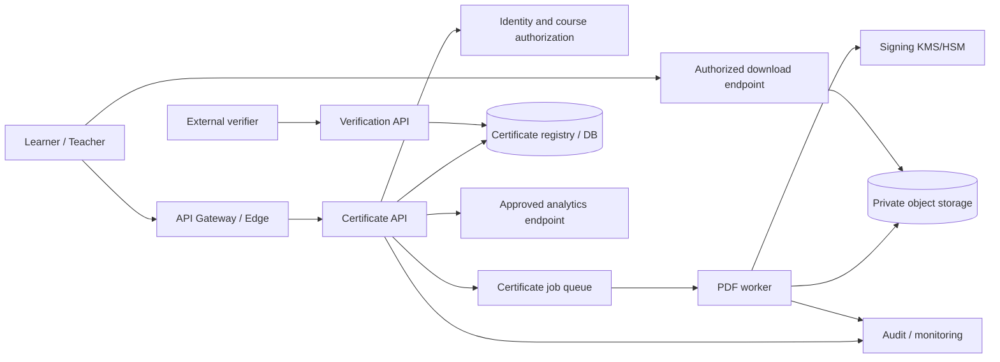

# Rà soát kiến trúc định kỳ

## Mục tiêu học tập

Sau bài học này, bạn có thể:

- Giải thích **periodic architecture review (rà soát kiến trúc định kỳ)** và vai trò của nó trong việc duy trì mục tiêu bảo mật khi hệ thống, mối đe dọa, công nghệ và tổ chức thay đổi.
- Phân biệt **review theo lịch**, **review theo sự kiện/thay đổi**, **design review**, **threat modeling**, **security assessment**, **architecture compliance review** và **post-incident review**.
- Xác định phạm vi, tài sản, luồng dữ liệu, trust boundaries, giả định và quyết định kiến trúc cần xem lại; dùng **architecture baseline, ADR, DFD, threat model và risk register** làm đầu vào.
- Tổ chức buổi review có owner, reviewer độc lập phù hợp, tiêu chí rõ ràng, câu hỏi có thể kiểm chứng và cách xử lý bất đồng/ngoại lệ.
- Đánh giá các khía cạnh **identity/access, data protection, network, cryptography, secrets, logging, resilience, supply chain, privacy và operations** theo mức rủi ro.
- Theo dõi finding, remediation, residual risk, exception và quyết định chấp nhận rủi ro; kích hoạt review lại khi có thay đổi quan trọng.
- Xây dựng hồ sơ **Claim – Argument – Evidence** để chứng minh kiến trúc đã được xem xét đúng phạm vi và các hành động sau review thực sự hoàn tất.

## 1. Rà soát kiến trúc định kỳ là gì?

**Rà soát kiến trúc định kỳ** là hoạt động đánh giá có kế hoạch và có bằng chứng đối với kiến trúc hệ thống nhằm xác định liệu **thiết kế, các quyết định, ranh giới tin cậy, controls và giả định vận hành** còn phù hợp với mục tiêu nghiệp vụ, bảo mật và các yêu cầu đang áp dụng hay không.

Một kiến trúc có thể được phê duyệt khi mới xây dựng nhưng sau đó thay đổi đáng kể: hệ thống thêm microservice, chuyển sang Kubernetes, tích hợp nhà cung cấp analytics, mở API cho đối tác, thay IdP, thay KMS, chuyển region hoặc xử lý thêm dữ liệu học viên. Những thay đổi này có thể làm xuất hiện trust boundary, data flow, dependency hoặc threat mới. Nếu chỉ dựa vào bản thiết kế cũ, tổ chức có thể tiếp tục tin vào các giả định đã không còn đúng.

Ví dụ, nền tảng học tập ban đầu chỉ có một Spring Boot API và một database nội bộ. Sau một năm, hệ thống bổ sung export worker, message broker, object storage, SSO, observability SaaS và dịch vụ cấp chứng chỉ. Một bản review định kỳ cần kiểm tra lại **ai có thể gọi ai, dữ liệu nào đi đâu, quyền workload ra sao, key được quản lý thế nào, log chứa gì và khả năng phục hồi có còn phù hợp**.

Trong module **SECURITY_SECURITY_ASSURANCE**, review kiến trúc không dừng ở việc đọc sơ đồ hoặc xác nhận tài liệu còn tồn tại. Cần chứng minh được **phạm vi đã xem, tiêu chí đã áp dụng, bằng chứng đã kiểm tra, rủi ro đã xác định, quyết định đã có người chịu trách nhiệm và finding đã được theo dõi đến khi xử lý hoặc chấp nhận đúng thẩm quyền**.

### 1.1. Vì sao cần review lặp lại?

- **Kiến trúc luôn thay đổi:** service, API, dữ liệu, region, vendor, workload và đường quản trị mới có thể làm thay đổi ranh giới tin cậy.
- **Threat thay đổi:** kỹ thuật tấn công, lỗ hổng thư viện, cấu hình cloud và phương thức lạm dụng có thể khiến giả định cũ không còn phù hợp.
- **Controls có thể drift:** cấu hình runtime khác IaC, quyền được mở tạm không thu hồi, secret hoặc certificate hết hạn, policy bị bypass.
- **Yêu cầu thay đổi:** sản phẩm mới, hợp đồng, luật, chuẩn nội bộ và kỳ vọng của khách hàng có thể đặt thêm điều kiện.
- **Bằng chứng mất hiệu lực:** test của bản build cũ không tự chứng minh bản triển khai hiện tại vẫn đúng.
- **Tổ chức và trách nhiệm thay đổi:** owner, team vận hành, nhà cung cấp hoặc người phê duyệt có thể đổi.

Review định kỳ giúp phát hiện **sự sai lệch tích lũy** trước khi chúng kết hợp thành sự cố lớn. Tuy vậy, review theo lịch không thay thế review trước thay đổi quan trọng; một sự kiện rủi ro cao không nên chờ tới kỳ review tiếp theo.

## 2. Phân biệt các hoạt động review liên quan

| Hoạt động | Trigger/phạm vi | Câu hỏi chính | Đầu ra thường gặp |
| --- | --- | --- | --- |
| **Periodic architecture review** | Theo chu kỳ được tổ chức xác định và theo risk profile. | Kiến trúc tổng thể còn phù hợp và controls vẫn hiệu lực không? | Review record, findings, action plan, residual risk. |
| **Change-driven architecture review** | Trước/sau thay đổi quan trọng. | Thay đổi này tạo trust boundary, data flow hoặc threat nào? | Impact assessment, design decision, conditions to release. |
| **Security design review** | Một thiết kế, feature, integration hoặc control cụ thể. | Thiết kế có đáp ứng security requirements không? | Review comments, design risks, control requirements. |
| **Threat modeling** | Theo tài sản, luồng và ranh giới tin cậy. | Attacker có thể lạm dụng hệ thống bằng đường nào? | Threat scenarios, mitigations, residual threats. |
| **Security assessment/audit** | Theo control scope, kỳ đánh giá hoặc nghĩa vụ. | Controls được thiết kế/triển khai/vận hành có hiệu lực không? | Test results, evidence, findings, assurance opinion. |
| **Post-incident review** | Sau sự cố hoặc near miss. | Kiến trúc/controls đã thất bại ở đâu và cần thay đổi gì? | Root cause, corrective actions, architecture changes. |
| **Architecture compliance review** | Theo policy, standards hoặc baseline nội bộ. | Thiết kế/triển khai có tuân thủ các guardrails đã duyệt? | Deviations, exceptions, compliance evidence. |

Các hoạt động có thể dùng chung dữ liệu và reviewer, nhưng **không đồng nghĩa**. Một threat model tốt không tự chứng minh firewall runtime đang chặn đúng; một security scan pass không thay thế review kiến trúc về data flow và trust boundary.

### 2.1. Review định kỳ không phải một cuộc họp hình thức

Một buổi họp có đủ kiến trúc sư và quản lý nhưng không xem artifact, không kiểm chứng giả định và không có action owner thì chưa tạo ra assurance đáng tin. Review có thể được thực hiện qua **workshop, tài liệu có comment, kiểm tra cấu hình, phỏng vấn và test có chọn lọc**, miễn là phương pháp, phạm vi và kết luận được ghi nhận.

## 3. Xác định cadence và trigger theo rủi ro

### 3.1. Không có một chu kỳ cố định cho mọi hệ thống

Tần suất review nên dựa trên:

- Mức nhạy cảm và giá trị của dữ liệu/tài sản.
- Mức độ phức tạp, số lượng service, integration, region và bên thứ ba.
- Tốc độ thay đổi và tần suất release.
- Exposure ra internet, remote access, management plane và egress.
- Mức độ đặc quyền, ảnh hưởng khi compromise và khả năng phục hồi.
- Findings/incident trước đây và mức residual risk.
- Yêu cầu nội bộ, hợp đồng, tiêu chuẩn hoặc quy định áp dụng.

Một ứng dụng nội bộ nhỏ có thể có cadence khác hệ thống xử lý hồ sơ học viên nhạy cảm, phát hành chứng chỉ hoặc kết nối nhiều nhà cung cấp. Tổ chức có thể chọn **review theo năm, nửa năm hoặc quý** làm ví dụ lịch quản trị, nhưng phải nêu căn cứ risk-based; những con số này không phải yêu cầu phổ quát.

### 3.2. Trigger ngoài lịch

Nên kích hoạt review bổ sung khi:

| Trigger | Tác động kiến trúc cần xem lại |
| --- | --- |
| Thêm microservice, API hoặc event flow | Service identity, authorization, trust boundaries, schema và data lineage. |
| Chuyển cloud provider/region hoặc thay network topology | Residency, egress, routing, IAM, backup, disaster recovery. |
| Thay IdP, authentication flow hoặc token format | Issuer trust, claims, audience, key rotation, session và authorization. |
| Thêm dữ liệu cá nhân/nhạy cảm hoặc mục đích mới | Classification, minimization, privacy controls, retention và transfer. |
| Thay KMS/HSM, crypto library hoặc key lifecycle | Key ownership, algorithm, cryptoperiod, backup/recovery và rotation. |
| Thêm vendor/subprocessor hoặc quyền remote support | Data sharing, cross-border flow, IAM, contract và monitoring. |
| Sự cố bảo mật, near miss hoặc finding nghiêm trọng | Threat model, control failure, containment và kiến trúc phòng ngừa tái diễn. |
| Thay đổi quy định/chuẩn/hợp đồng có ảnh hưởng | Requirements, design assumptions, evidence và trách nhiệm. |
| Kết quả kiểm thử xâm nhập cho thấy đường bypass | Network segmentation, identity, application logic và detection. |
| Thay đổi lớn về tổ chức/owner | Accountability, quyền quản trị, review approval và incident response. |

### 3.3. Mô hình cadence minh họa

| Mức rủi ro | Review theo lịch minh họa | Trigger bổ sung |
| --- | --- | --- |
| **Thấp** | Hằng năm hoặc theo policy nội bộ. | Thay đổi lớn, finding mới hoặc yêu cầu mới. |
| **Trung bình** | Sáu tháng một lần. | Thay đổi data flow, vendor, auth hoặc network boundary. |
| **Cao** | Theo quý hoặc cadence ngắn hơn do risk owner quyết định. | Mọi thay đổi trọng yếu, incident, drift hoặc thay trust boundary. |
| **Rất cao/critical** | Theo kế hoạch riêng được governance phê duyệt, có thể review liên tục một số controls. | Trigger tức thời và trước khi đưa thay đổi rủi ro cao vào production. |

Đây là **ví dụ để xây dựng policy**, không phải chuẩn tần suất bắt buộc. Cadence cần được ghi trong governance, gắn với owner, scope và khả năng thực hiện. Nếu tổ chức không đủ năng lực review toàn bộ kiến trúc cùng lúc, cần ưu tiên theo risk và ghi rõ phần chưa được đánh giá.

## 4. Chuẩn bị đầu vào cho architecture review

Review hiệu quả bắt đầu từ **bộ artifact có phiên bản và phạm vi rõ ràng**. Không cần mọi tài liệu phải hoàn hảo, nhưng reviewer phải biết tài liệu nào phản ánh thiết kế hiện tại và chỗ nào chưa chắc chắn.

### 4.1. Các artifact chính

| Artifact | Nội dung | Cách dùng trong review |
| --- | --- | --- |
| **Architecture overview/diagram** | Thành phần, service, trust boundary, deployment zones và dependency. | Xác định scope và những đường cần hỏi. |
| **Data Flow Diagram (DFD)** | Data source, processing, storage, transfer, recipient và trust boundaries. | Theo dõi dữ liệu cá nhân, secrets, credentials và các bản sao. |
| **Architecture Decision Records (ADRs)** | Bối cảnh, lựa chọn, trade-offs, quyết định và hậu quả. | Kiểm tra giả định cũ còn đúng và quyết định quan trọng có owner. |
| **Threat model** | Assets, actors, entry points, threats, mitigations và residual risks. | Xem threat mới hoặc mitigation đã lỗi thời. |
| **Risk register** | Risk owner, likelihood/impact, controls, residual risk, due date. | Ưu tiên review và theo dõi finding/risk acceptance. |
| **Security requirements/control matrix** | Requirement, control, implementation point và verification. | Đối chiếu mục tiêu với controls và bằng chứng. |
| **Deployment/IaC manifests** | Cloud resources, network, IAM, cluster, policy, region và secrets references. | So sánh design với cấu hình triển khai. |
| **API/service inventory** | Endpoints, callers, protocols, data categories, authentication và authorization. | Phát hiện đường truy cập không được ghi nhận. |
| **Data catalog/classification** | Owner, loại dữ liệu, nhãn, purpose, retention và location. | Kiểm tra data protection và privacy assumptions. |
| **Operational evidence** | Logs, alerts, backup/restore, key rotation, incident, access review. | Xác minh controls vận hành thực tế. |
| **Change history/release record** | Thay đổi từ kỳ review trước, version và owner. | Xác định những phần cần xem lại sâu. |
| **Previous review/finding records** | Kết luận, actions, exceptions và trạng thái khắc phục. | Kiểm tra finding lặp lại hoặc chưa đóng. |

### 4.2. Xác minh tài liệu có còn phản ánh thực tế

Một sơ đồ được cập nhật năm ngoái có thể không chứa service mới. Một ADR ghi database chỉ truy cập từ API có thể đã lỗi thời sau khi thêm BI connector. Vì vậy cần đối chiếu artifact với:

- Repository và service catalog hiện hành.
- Cloud account/project, region, route, security group và resource inventory.
- Kubernetes namespaces, workloads, NetworkPolicies, ingress/egress và RBAC.
- IAM identities, service accounts, secrets/KMS consumers và admin access.
- API gateway, DNS, message broker, data pipeline và integration inventory.
- Runtime telemetry, flow logs, deployment records và vendor/subprocessor list.

**Không coi thiếu tài liệu là bằng chứng hệ thống không có thành phần đó.** Nếu discovery không đầy đủ, kết luận phải nêu coverage gap và trạng thái `INSUFFICIENT_EVIDENCE` cho claim rộng hơn.

### 4.3. Chốt scope trước khi review

Scope record nên nêu:

- Hệ thống, product/service, environment, region và release/configuration được xem.
- Tài sản, data categories, trust boundaries và service dependencies.
- Phần nằm ngoài scope và lý do.
- Kỳ review, trigger và baseline được dùng.
- Những người tham gia, vai trò, reviewer độc lập và người phê duyệt.
- Tiêu chí kết luận, giới hạn bằng chứng và cách xử lý ngoại lệ.

## 5. Những nội dung cần rà soát

Review phải bao phủ những khía cạnh liên quan đến **risk profile của kiến trúc**. Không cần biến mỗi kỳ review thành audit sâu mọi control; cần chọn độ sâu hợp lý và giải thích phần nào được sampling hoặc chuyển sang assessment chuyên biệt.

### 5.1. Assets, trust boundaries và attack surface

- Tài sản quan trọng có owner và classification không?
- Entry points, public endpoints, partner connections và management plane có được inventory đầy đủ?
- Ranh giới giữa public, application, data, worker, management, monitoring và backup có còn hợp lý?
- Service mới có quyền gọi service nào, theo protocol/port nào?
- Có đường bypass qua host networking, VPN, cloud peering, DNS, IPv6, CI/CD hoặc remote support không?
- Attack surface nào tăng từ kỳ review trước và vì sao?

### 5.2. Identity, authentication và authorization

- IdP/issuer, token validation, audience, key rotation và session handling còn phù hợp?
- Quyền service account có theo least privilege, workload identity và scope nhiệm vụ?
- Các thao tác nhạy cảm có kiểm tra quyền theo tài nguyên/tenant ở server?
- Có đường truy cập trực tiếp tới database, storage, queue hoặc admin API bỏ qua application controls?
- Break-glass, JIT, MFA, privileged access và reviewer approval có audit?

### 5.3. Data protection và privacy

- Data inventory, classification, purpose, retention và data lineage có cập nhật?
- Dữ liệu có bị nhân bản qua cache, queue, logs, export, analytics và backup không?
- Masking, encryption, tokenization và key management có phù hợp loại dữ liệu?
- Cross-border flows, vendor/subprocessor, remote access và onward transfer đã được đánh giá?
- Quyền truy cập, correction, deletion và retention được thực thi xuyên suốt các bản sao?

### 5.4. Network, infrastructure và cloud

- Segmentation, default deny, ingress/egress và private endpoints có được thực thi?
- Public exposure, security groups, route tables, firewall, NetworkPolicy và service mesh có drift?
- Cloud IAM, metadata endpoint, secrets, workload isolation và control plane có được bảo vệ?
- IaC và runtime configuration có khớp baseline?
- Backup, disaster recovery, region failover và management access có đường riêng và quyền phù hợp?

### 5.5. Cryptography và secrets

- Thuật toán, parameters, TLS profile và crypto library có còn được chấp nhận theo policy?
- Key inventory, owner, cryptoperiod, rotation và revocation có cập nhật?
- KMS/HSM permissions, key version, backup/restore và destruction dependencies có được xem xét?
- Secrets có bị đưa vào source, container image, logs, CI variables hoặc ticket?
- Có crypto agility và kế hoạch chuyển đổi khi thuật toán/provider thay đổi?

### 5.6. Application security và supply chain

- API validation, output encoding, SSRF, injection, deserialization và file upload có được xem xét theo threat model?
- Dependency, container image, base image, build pipeline và artifact provenance có được quản lý?
- CI/CD runner, deploy credentials, signing keys và release approval có tách quyền?
- Security tests và findings có gắn với release/build hiện tại?
- Feature flag, debug mode, admin endpoint và diagnostic tools có được kiểm soát?

### 5.7. Resilience, monitoring và incident response

- Availability, rate limiting, resource exhaustion và dependency failure có được xử lý?
- Backup/restore và disaster recovery đã được diễn tập với key/dependency thực tế?
- Logs, metrics, traces và audit events có đủ phát hiện mà không làm lộ dữ liệu?
- Alert có owner, severity, escalation và response runbook?
- Có khả năng cô lập workload/zone, revoke credential, rotate key và khôi phục dịch vụ?

## 6. Tổ chức một buổi review có hiệu quả

### 6.1. Thành phần tham gia

| Vai trò | Đóng góp |
| --- | --- |
| **Architecture owner/lead architect** | Trình bày kiến trúc hiện tại, quyết định, thay đổi và trade-offs. |
| **Service/product owner** | Mô tả mục đích nghiệp vụ, data usage, tác động và ưu tiên. |
| **Security architect/engineer** | Đánh giá trust boundaries, threat, controls và security assumptions. |
| **Privacy/data owner** | Xem loại dữ liệu, mục đích, quyền cá nhân, transfer và retention. |
| **Platform/operations** | Xác nhận deployment, IAM, network, monitoring, backup và runtime drift. |
| **Developer/technical lead** | Giải thích implementation, API, dependencies, code paths và test evidence. |
| **Risk/compliance/legal khi cần** | Xem nghĩa vụ áp dụng, residual risk và quyết định theo thẩm quyền. |
| **Independent reviewer/auditor** | Đặt câu hỏi độc lập, challenge assumptions và đánh giá chất lượng evidence. |

Không phải cuộc review nào cũng cần tất cả vai trò; lựa chọn theo scope và rủi ro. Tuy nhiên, **người đề xuất thay đổi không nên là người duy nhất phê duyệt residual risk của chính thay đổi đó** khi cần độc lập.

### 6.2. Agenda mẫu

1. **Scope và mục tiêu:** hệ thống, release, trigger, tài sản và tiêu chí.
2. **Thay đổi từ lần trước:** service, data flow, region, vendor, identity, network, crypto và operational changes.
3. **Kiến trúc hiện tại:** diagram/DFD, trust boundaries, dependencies và critical paths.
4. **Threat/risk review:** threat mới, giả định thay đổi, findings/incident và residual risk.
5. **Control/evidence walkthrough:** controls chính, test, runtime evidence, gaps và ngoại lệ.
6. **Challenge và quyết định:** vấn đề chưa rõ, phương án thay thế, điều kiện release hoặc remediation.
7. **Action owner/deadline:** ưu tiên, dependency, người phê duyệt và ngày xem lại.
8. **Kết luận:** PASS trong scope, FAIL, INSUFFICIENT_EVIDENCE, exception hoặc cần review bổ sung.

### 6.3. Câu hỏi review giúp phát hiện giả định sai

- “Điều gì đã thay đổi kể từ lần review gần nhất và bằng chứng nào cho thấy sơ đồ hiện tại đầy đủ?”
- “Nếu API này bị chiếm, attacker có thể kết nối hoặc đọc tài sản nào tiếp theo?”
- “Có service nào có quyền rộng hơn nhiệm vụ của nó không? Ai đã kiểm tra quyền hiệu lực?”
- “Dữ liệu này xuất hiện ở logs, traces, backup, analytics hoặc vendor nào khác?”
- “Nếu KMS/IdP/queue/vendor không khả dụng hoặc bị compromise, hệ thống sẽ fail theo cách nào?”
- “Control nào chỉ tồn tại trên tài liệu và control nào đã được test ở production?”
- “Ai chịu trách nhiệm cho finding này, khi nào được sửa và evidence nào sẽ chứng minh đã sửa?”
- “Những giả định nào nếu sai sẽ làm kết luận review thay đổi?”

### 6.4. Xử lý bất đồng

Review kiến trúc có thể có bất đồng về mức rủi ro, trade-off, chi phí và khả năng triển khai. Không nên giải quyết bằng cách bỏ qua comment hoặc ghi “team đã đồng ý”. Cần:

- Ghi rõ **vấn đề, dữ kiện, giả định và quan điểm khác nhau**.
- Đưa ra các phương án, tác động, control bù trừ và điều kiện chấp nhận.
- Chuyển quyết định tới **risk owner/authority phù hợp**, không để reviewer kỹ thuật tự chấp nhận rủi ro ngoài thẩm quyền.
- Ghi quyết định và lý do trong ADR/risk record/review record.
- Đặt hạn và trigger xem lại nếu quyết định dựa trên giả định tạm thời.

## 7. Đánh giá giả định và quyết định kiến trúc

Kiến trúc thường chứa giả định không thể hiện rõ trong sơ đồ, ví dụ:

- “Database chỉ có API truy cập.”
- “Vendor không giữ dữ liệu sau khi xóa.”
- “Chỉ có một IdP được tin cậy.”
- “Backup luôn nằm trong cùng region.”
- “Service account chỉ dùng bởi một worker.”
- “Tất cả traffic east-west đi qua service mesh.”
- “Logs không chứa dữ liệu cá nhân.”

Mỗi giả định quan trọng nên có **owner, nguồn xác nhận, evidence, thời điểm kiểm tra và điều kiện làm nó không còn đúng**. Nếu không thể xác minh, ghi rõ uncertainty thay vì coi giả định là fact.

### 7.1. Review ADR

Với mỗi ADR có ảnh hưởng bảo mật, hỏi:

1. Bối cảnh và vấn đề ban đầu còn đúng không?
2. Các lựa chọn thay thế có thay đổi do công nghệ/threat/chi phí mới không?
3. Lựa chọn hiện tại có tạo trust boundary hoặc dependency mới?
4. Consequences và residual risks đã được chấp nhận bởi đúng owner?
5. Có evidence cho các giả định kỹ thuật (latency, IAM, isolation, backup, encryption) không?
6. ADR đã bị supersede nhưng code/config cũ còn hoạt động không?

### 7.2. Review threat model

Đối chiếu threat model với kiến trúc hiện tại:

- Assets, actors, entry points và data flows có đầy đủ?
- Threat mới nào xuất hiện sau khi thêm vendor, API hoặc service?
- Mitigation có thực thi tại mọi đường liên quan?
- Threat đã được đánh giá thấp vì một assumption không còn đúng?
- Finding/incident có làm thay đổi likelihood/impact?
- Residual risk có owner, hạn và phương án xử lý?

Không cần tạo threat model mới hoàn toàn mỗi lần nếu có thể cập nhật có kiểm soát; nhưng phải ghi **phiên bản, phần thay đổi và lý do** để reviewer biết nội dung nào được xem xét.

## 8. Ví dụ thực tế: review kiến trúc nền tảng học tập

### 8.1. Thay đổi cần review

Nền tảng học tập đang triển khai một tính năng cấp chứng chỉ mới. Tính năng bổ sung:

- API phát hành chứng chỉ trong Spring Boot.
- Worker tạo PDF và lưu vào object storage.
- Dịch vụ ký chứng chỉ dùng signing key trong KMS.
- Một đối tác bên ngoài xác minh tính hợp lệ của chứng chỉ qua API.
- Dashboard analytics nhận event về lượt phát hành và xác minh.

Review cần xem lại **identity proofing, authorization, certificate signing, key lifecycle, storage access, download URL, outbound data, vendor, logging, audit, revocation và recovery**. Không thể chỉ review controller mới vì kiến trúc thay đổi trên nhiều trust boundaries.

### 8.2. Bản đồ trust boundaries



### 8.3. Câu hỏi cụ thể

| Thành phần/flow | Câu hỏi review | Bằng chứng mong đợi |
| --- | --- | --- |
| Certificate API | Người gọi có quyền phát hành cho learner/course/result cụ thể? | Method/API authz tests, policy review, negative tests. |
| Identity proofing | Proofing state có đủ cho mục đích cấp chứng chỉ? | Proofing decision record, trusted issuer/subject binding, state checks. |
| PDF worker | Worker có thể tự ý đọc mọi hồ sơ hoặc ghi mọi bucket? | Workload IAM, queue scope, storage permissions và network policy. |
| Signing KMS | Key usage chỉ cho workload signer, có approval/rotation/audit? | KMS policy, key inventory, signing operation logs, rotation evidence. |
| Object storage | PDF private, download theo quyền, URL có thời hạn và scope? | Bucket policy, download tests, access logs, expiry/revocation tests. |
| External verifier | Chỉ nhận trường tối thiểu? Có thể enumerate certificate IDs? | API schema, rate limit, authn/authz, data sharing review. |
| Analytics | Có dữ liệu định danh hoặc event vượt purpose? | Outbound schema, classification, destination approval và egress logs. |
| Audit/logging | Có log đủ điều tra mà không lộ PDF, token hoặc dữ liệu cá nhân? | Structured event schema, log sink review, error-path tests. |
| Revocation | Chứng chỉ bị thu hồi có được verifier nhận biết? | Revocation model, propagation tests, cache/expiry behavior. |
| Recovery | Nếu KMS/storage/queue lỗi, hệ thống có thể phục hồi mà không phát hành trùng? | DR/restore test, idempotency, recovery runbook. |

### 8.4. Quyết định sau review

Giả sử review phát hiện worker có quyền đọc mọi object trong bucket và signer role có thể dùng nhiều signing keys không liên quan. Đây là finding cần đánh giá theo **least privilege và blast radius**. Action có thể gồm tách bucket/prefix, scope IAM theo certificate job, giới hạn KMS key usage và thêm negative tests. Review chỉ được đóng finding khi có **runtime evidence** cho quyền mới và xác minh luồng cấp chứng chỉ vẫn hoạt động.

## 9. Tích hợp periodic review với Java/Spring Boot và delivery pipeline

### 9.1. Review trigger từ thay đổi hệ thống

Không phải mọi commit đều cần architecture board review. Nhưng một số loại thay đổi có thể tự động gắn nhãn **architecture/security impact** để yêu cầu đánh giá trước release:

- Thêm dependency/service hoặc external endpoint.
- Thêm API route, authentication scheme, privileged operation hoặc data category.
- Thay database, message broker, storage, KMS, IdP hoặc region.
- Thay network policy, IAM role, secret scope hoặc public exposure.
- Thay log/tracing exporter, backup/DR hoặc retention.
- Thay encryption format, key version handling hoặc token claims.

Một pipeline có thể kiểm tra **metadata của change** và yêu cầu review record hợp lệ trước khi deploy vào môi trường cần kiểm soát. Tuy nhiên, pipeline không thể tự đánh giá đầy đủ legal, privacy hoặc residual risk chỉ từ tên file; cần owner/reviewer có thẩm quyền.

### 9.2. Ví dụ annotation/metadata cho change impact

```yaml
architecture_review:
  required: true
  change_id: "ARCH-CHANGE-2026-014"
  affected_areas:
    - "certificate-signing"
    - "object-storage"
    - "external-verification-api"
  risk_triggers:
    - "new-external-recipient"
    - "new-signing-key-consumer"
    - "new-personal-data-flow"
  owner_role: "certificate-service-owner"
  reviewer_roles:
    - "security-architect"
    - "privacy-reviewer"
  decision_ref: "<approved-review-record>"
  evidence_refs:
    - "<threat-model-revision>"
    - "<authorization-test-run>"
    - "<kms-policy-review>"
  status: "PENDING_REVIEW"
```

Đây là **mẫu metadata minh họa**. Trạng thái phải lấy từ workflow có xác thực, không tin một developer chỉ thêm `status: APPROVED` vào YAML. Reference phải trỏ tới quyết định/evidence thật, có version, owner và timestamp.

### 9.3. Test ứng dụng là một phần của review

Ví dụ Spring Boot kiểm tra người dùng chỉ có thể phát hành chứng chỉ cho học viên thuộc phạm vi được giao:

```java
@Configuration
@EnableMethodSecurity
class MethodSecurityConfig {}

@Service
class CertificateService {
    private final CertificateRepository certificates;

    CertificateService(CertificateRepository certificates) {
        this.certificates = certificates;
    }

    @PreAuthorize(
        "@certificatePolicy.canIssue(authentication, #learnerId, #courseId)"
    )
    public Certificate issue(long learnerId, long courseId) {
        return certificates.issueFor(learnerId, courseId);
    }
}
```

`certificatePolicy` phải kiểm tra proofing/binding khi nghiệp vụ yêu cầu, quyền theo learner/course, trạng thái hoàn thành và điều kiện phát hành. Test positive/negative nên chứng minh principal đúng, principal sai, proofing pending/revoked, course không thuộc quyền và retry không tạo chứng chỉ trùng.

Nhưng unit/integration tests không chứng minh toàn bộ kiến trúc. Review vẫn cần **KMS runtime permissions, worker identity, bucket policy, network flows, external verifier, data transfer, backup/restore và log behavior**. Đây là ví dụ về cách gắn code-level evidence vào một lập luận kiến trúc rộng hơn.

## 10. Theo dõi finding, remediation và residual risk

### 10.1. Một finding cần có gì?

- **ID và mô tả:** điều gì không đáp ứng hoặc chưa có bằng chứng?
- **Scope:** system, environment, release, data flow, zone và tài sản ảnh hưởng.
- **Evidence:** test, config, log, interview hoặc artifact cụ thể; thời điểm và nguồn.
- **Risk:** threat, likelihood/impact, affected assets và điều kiện khai thác.
- **Owner:** cá nhân/nhóm có trách nhiệm sửa; risk owner quyết định residual risk theo thẩm quyền.
- **Remediation:** hành động cụ thể, dependency, due date và tiêu chí hoàn tất.
- **Compensating controls/exception:** nếu chưa sửa ngay, biện pháp bù trừ, scope, expiry và approval.
- **Re-test/closure:** evidence mới, reviewer xác nhận và trạng thái sau khắc phục.

### 10.2. Không đánh đồng trạng thái

| Trạng thái | Ý nghĩa | Cách xử lý |
| --- | --- | --- |
| **OPEN** | Finding được xác nhận, chưa khắc phục. | Có owner, priority và due date. |
| **IN_PROGRESS** | Đang triển khai remediation. | Theo dõi dependency, risk exposure và milestone. |
| **READY_FOR_RETEST** | Owner báo đã sửa, chờ xác minh. | Reviewer chạy test/kiểm tra độc lập. |
| **CLOSED_VERIFIED** | Evidence mới chứng minh yêu cầu đạt trong scope. | Lưu kết quả, release/config version và ngày đóng. |
| **RISK_ACCEPTED** | Risk owner có thẩm quyền chấp nhận residual risk trong phạm vi và thời hạn được phép. | Theo dõi expiry/trigger; không mô tả là đã khắc phục kỹ thuật. |
| **INSUFFICIENT_EVIDENCE** | Chưa đủ dữ kiện để xác nhận pass/fail hoặc scope. | Bổ sung evidence và giữ kết luận giới hạn. |

Một ticket ở trạng thái Done không tự chứng minh control đã được sửa. Một ngoại lệ được ký cũng không biến finding thành `CLOSED_VERIFIED`; hai trạng thái phải tách biệt.

### 10.3. Ưu tiên remediation

Ưu tiên theo **tác động, khả năng khai thác, exposure, mức nhạy cảm dữ liệu, blast radius, mức đặc quyền và dependency**. Một lỗi public management endpoint hoặc signing key access quá rộng thường cần xử lý sớm hơn một thiếu sót tài liệu không ảnh hưởng trực tiếp đến enforcement. Tuy nhiên, thiếu inventory có thể là rủi ro nền nếu nó làm tổ chức không biết mình đang phơi bày tài sản nào.

## 11. Claim – Argument – Evidence cho periodic architecture review

### 11.1. Claim có giới hạn

**Claim:** “Kiến trúc production của nền tảng học tập trong scope hệ thống, region và release R đã được rà soát theo cadence và các trigger được governance phê duyệt; các trust boundaries, data flows và controls trọng yếu đã được đối chiếu với bằng chứng hiện hành; finding và residual risk có owner và quyết định theo thẩm quyền.”

**Argument:**

1. Scope và baseline được xác định rõ, có service/asset inventory và change history làm đầu vào.
2. Reviewer phù hợp đã xem architecture diagram, DFD, ADR, threat model và các cấu hình/runtime evidence.
3. Những thay đổi trọng yếu và các giả định có ảnh hưởng lớn đã được challenge.
4. Các controls rủi ro cao được kiểm tra ở mức phù hợp; phần không test sâu được ghi rõ.
5. Findings, remediation, exceptions và residual risk được ghi nhận với owner, hạn và evidence.
6. Trigger review tiếp theo và điều kiện xem lại quyết định đã được xác định.

**Evidence matrix:**

| Điều cần chứng minh | Evidence | Giới hạn cần nêu |
| --- | --- | --- |
| Scope và baseline đầy đủ | Review charter, asset/service inventory, release/region, flow inventory. | Inventory có thể thiếu service/vendor chưa được phát hiện. |
| Review có thực chất | Agenda, attendee roles, comments, reviewed artifacts, decision record. | Có mặt trong cuộc họp không chứng minh đã challenge nội dung. |
| Kiến trúc phản ánh runtime | Cloud/cluster/IAM/network snapshots, deployment record, telemetry. | Snapshot chỉ đại diện thời điểm và nguồn đã lấy. |
| Threat và controls được đánh giá | Threat model revision, control matrix, test results và risk assessment. | Không phải mọi control đều được test đầy đủ mỗi kỳ. |
| Finding được xử lý | Finding register, owner, remediation PR/change, re-test và closure approval. | Ticket đóng chưa phải bằng chứng hiệu lực nếu không có re-test. |
| Residual risk có thẩm quyền | Risk acceptance, scope, expiry, compensating controls. | Chấp nhận nội bộ không thay thế nghĩa vụ bắt buộc. |
| Review được duy trì | Cadence/trigger policy, reminder/change hooks, next review date. | Có lịch không chứng minh review đã thực hiện đúng hạn. |

**Giới hạn claim:** review không chứng minh hệ thống không có lỗ hổng. Kết luận chỉ áp dụng cho scope, thời điểm, artifacts và phép kiểm đã nêu; các luồng chưa được discover hoặc controls chưa test phải được ghi rõ.

### 11.2. Mẫu review record

```yaml
review_id: "ARCH-REVIEW-EXAMPLE-001"
system: "learning-platform"
review_type: "PERIODIC_AND_CHANGE_TRIGGERED"
scope:
  environment: "production"
  release: "<verified-release-id>"
  regions: ["<verified-region-list>"]
  services: ["learning-api", "certificate-service", "export-worker"]
  data_flows: ["<verified-flow-inventory-ref>"]
baseline:
  architecture_ref: "<versioned-diagram>"
  dfd_ref: "<versioned-data-flow>"
  adr_refs: ["<reviewed-adr-ids>"]
  threat_model_ref: "<reviewed-threat-model>"
inputs:
  change_history_ref: "<release-and-change-record>"
  runtime_inventory_ref: "<cloud-and-cluster-snapshot>"
  prior_findings_ref: "<finding-register>"
participants:
  architecture_owner: "<owner-role>"
  security_reviewer: "<reviewer-role>"
  privacy_reviewer: "<reviewer-role-or-not-applicable>"
  operations_reviewer: "<reviewer-role>"
criteria_ref: "<approved-review-criteria>"
results:
  status: "INSUFFICIENT_EVIDENCE"
  findings: []
  exceptions: []
  residual_risk_ref: "<risk-record>"
actions:
  - action_ref: "<remediation-item>"
    owner_role: "<accountable-owner>"
    due_date: "<approved-date>"
    retest_evidence_ref: "<pending-artifact>"
next_review:
  scheduled_window: "<approved-review-window>"
  triggers: ["New trust boundary", "New data category", "Security incident"]
```

Đây là **mẫu minh họa**, không phải review record đã thực hiện. Không điền `PASS` nếu chưa có evidence thật, reviewer và scope xác minh. Các reference phải trỏ tới artifact có phiên bản, nguồn và thời điểm; tránh đưa token, secret hoặc dữ liệu cá nhân thô vào hồ sơ review.

## 12. Continuous assurance và cải tiến chương trình

### 12.1. Kết nối review với vòng đời phát triển

Periodic review nên kết hợp với các điểm kiểm soát khác:

- **Architecture/design gate:** review trước khi thêm trust boundary, data category, vendor hoặc public endpoint mới.
- **CI/CD:** static policy checks, dependency/security tests, IaC validation và yêu cầu review record cho thay đổi có impact.
- **Deployment verification:** kiểm tra effective IAM, network, region, KMS, secrets và runtime config sau release.
- **Operations:** drift detection, flow logs, access review, backup/restore, certificate/key rotation và incident lessons.
- **Governance:** review cadence, risk acceptance, finding aging, exception expiry và management reporting.

Không nên chờ tới cuối năm mới phát hiện một public endpoint đã mở từ nhiều tháng trước. Continuous monitoring giúp nhận biết **trigger**, còn periodic review giúp nhìn lại **kiến trúc tổng thể và các giả định liên kết**.

### 12.2. Metrics

| KPI/KRI | Câu hỏi quản trị | Lưu ý |
| --- | --- | --- |
| Tỷ lệ hệ thống rủi ro cao được review đúng cadence | Review coverage có đáp ứng kế hoạch? | Cần mẫu số từ asset inventory, không chỉ danh sách team tự đăng ký. |
| Số change trigger chưa có review phù hợp | Có thay đổi vượt gate? | Phải lấy dữ liệu từ release/IaC/vendor changes. |
| Tỷ lệ review có artifact/runtime evidence | Review có dựa trên thực tế? | Nhiều tài liệu không đồng nghĩa bằng chứng đúng/đủ. |
| Số finding nghiêm trọng quá hạn | Rủi ro tồn đọng ở đâu? | Phân tích exposure và risk acceptance. |
| Thời gian finding tới verified closure | Khả năng khắc phục và xác minh? | Không dùng thời điểm ticket Done thay cho re-test. |
| Tỷ lệ ADR/threat model được xem lại khi trigger | Giả định cũ có được đánh giá lại? | Không cần update mọi ADR nếu không liên quan; phải ghi căn cứ. |
| Số exception quá hạn hoặc thiếu owner | Sai khác nào đang bị bỏ quên? | Exception không đồng nghĩa control đạt. |
| Số runtime drift chưa được xử lý | Thiết kế và triển khai có lệch nhau? | Phải xem cả cloud console và cấu hình ngoài Git. |
| Tỷ lệ action được reviewer độc lập xác minh | Remediation có kiểm chứng? | Mức độc lập tùy rủi ro và governance. |

### 12.3. Cải thiện từ finding lặp lại

Nếu nhiều kỳ review liên tiếp phát hiện quyền IAM quá rộng, rule mạng không có owner hoặc log chứa dữ liệu nhạy cảm, cần xem **nguyên nhân hệ thống**:

- Guardrail chưa được tự động hóa?
- Owner và trách nhiệm chưa rõ?
- Pipeline cho phép deploy thay đổi không có review?
- Inventory không phản ánh runtime?
- Quy trình exception không có expiry?
- Team thiếu công cụ hoặc năng lực kiểm chứng?

Mục tiêu là giảm khả năng finding lặp lại bằng cách cải thiện **architecture standards, reusable patterns, policy-as-code, platform guardrails và quy trình review**, không chỉ đóng từng ticket riêng lẻ.

## 13. Những sai lầm thường gặp

| Sai lầm | Hệ quả | Cách làm đúng |
| --- | --- | --- |
| “Kiến trúc đã được duyệt lúc go-live nên không cần review nữa.” | Giả định và controls lỗi thời khi hệ thống thay đổi. | Duy trì cadence và trigger-based review. |
| “Review hằng năm là đủ cho mọi hệ thống.” | Hệ thống rủi ro cao có thể thay đổi nhiều lần trước kỳ review. | Chọn cadence theo risk và trigger ngoài lịch. |
| “Chỉ đọc sơ đồ là đã review.” | Sơ đồ có thể không khớp runtime và bỏ sót data flow. | Đối chiếu DFD/ADR với inventory, IaC, cloud/cluster và telemetry. |
| “Có mặt trong buổi họp nghĩa là đã review độc lập.” | Reviewer có thể không challenge assumptions hoặc thiếu chuyên môn. | Xác định vai trò, scope, câu hỏi và evidence review. |
| “Không có finding nghĩa là kiến trúc an toàn.” | Có thể do coverage hoặc phương pháp yếu. | Đánh giá completeness, sampling và test effectiveness. |
| “Unit tests pass là toàn bộ kiến trúc đạt.” | Không kiểm tra network, IAM, KMS, vendor, backup hoặc runtime. | Kết hợp nhiều lớp evidence theo claim. |
| “Ticket Done là finding đã khắc phục.” | Có thể chưa deploy hoặc chưa re-test. | Chỉ đóng verified khi có evidence mới và reviewer xác nhận. |
| “Risk acceptance làm control trở thành PASS.” | Che residual risk và sai trạng thái. | Tách exception/risk accepted khỏi technical remediation. |
| “Một ADR cũ luôn đúng vì chưa ai sửa.” | Quyết định có thể dựa trên giả định đã lỗi thời. | Kiểm tra trigger, hậu quả và dependency. |
| “Review toàn bộ mọi thứ mỗi lần mới là assurance.” | Chi phí lớn, review hình thức và thiếu trọng tâm. | Risk-based scope, sampling minh bạch và trigger phù hợp. |
| “Chỉ security team chịu trách nhiệm.” | Business/data owner và operator không tham gia quyết định. | Phân vai owner, reviewer, operator và risk authority. |
| “Exception có thể để vô thời hạn.” | Rủi ro tồn đọng không được xem lại. | Expiry, owner, compensating control và review trigger. |
| “Review staging đại diện cho production.” | Config, identity, data, region và quyền runtime khác nhau. | Gắn evidence với environment/release và kiểm tra production phù hợp. |

## 14. Bài tập tình huống: review kiến trúc sau khi mở rộng nền tảng

**Bối cảnh:** một nền tảng học tập Spring Boot đã vận hành hai năm. Từ lần review gần nhất, hệ thống có các thay đổi:

1. Tách monolith thành bốn microservices và thêm Kubernetes cluster.
2. Bổ sung export worker tạo CSV bảng điểm trong object storage.
3. Thêm SSO từ IdP của trường và API phát hành chứng chỉ dùng signing key trong KMS.
4. Gửi analytics events tới nhà cung cấp bên ngoài; logs/traces được chuyển sang observability SaaS.
5. Tạo backup cross-region và thêm vendor support có quyền truy cập production khi mở ticket.
6. Một số NetworkPolicy được commit nhưng chưa xác minh CNI thực thi; firewall rules có ngoại lệ debug chưa có expiry.
7. Một finding về service account quyền rộng đã mở quá hạn; ticket được đánh dấu Done nhưng không có re-test.
8. Architecture diagram và threat model vẫn mô tả monolith ban đầu.

### 14.1. Nhiệm vụ thực hành

1. Xác định **scope** và trigger của periodic review; những thay đổi nào cần review trước khi tiếp tục release hoặc xử lý riêng ngay?
2. Lập danh sách artifact cần thu thập: diagram, DFD, ADR, threat model, risk register, IaC, cloud/Kubernetes inventory, IAM, vendor và runtime evidence.
3. Vẽ trust boundaries/data flows mới, chỉ ra public edge, application, data, worker, management, monitoring, backup và external recipient.
4. Xây checklist review theo identity, data protection/privacy, network, crypto, supply chain, resilience và operations.
5. Xác định ít nhất **sáu finding/unknowns** và phân biệt finding đã được xác nhận với `INSUFFICIENT_EVIDENCE`.
6. Đề xuất cadence và trigger cho hệ thống sau mở rộng; giải thích vì sao không dùng một lịch duy nhất cho mọi component.
7. Viết control statements và phép kiểm cho NetworkPolicy/CNI, service account, KMS signing key, cross-region backup, vendor support và log egress.
8. Phân vai architecture owner, security reviewer, privacy/legal, operator, risk owner và người xác minh remediation.
9. Viết **Claim – Argument – Evidence** cho tuyên bố “kiến trúc production hiện tại đã được review theo baseline và các rủi ro trọng yếu có owner/action”. Nêu giới hạn claim.
10. Xác định tiêu chí đóng finding quyền service account quá rộng; ticket Done hiện tại có đủ không? Evidence nào cần sau deploy?
11. Thiết kế dashboard theo dõi review coverage, change triggers, findings quá hạn, exceptions và runtime drift.

### 14.2. Gợi ý tự đối chiếu

- Diagram/threat model monolith đã lỗi thời; không thể dùng chúng làm baseline hiện tại nếu chưa reconcile với service inventory và runtime.
- Backup cross-region, vendor remote support, analytics và observability là các luồng/ranh giới cần review độc lập.
- NetworkPolicy manifest không chứng minh CNI thực thi; cần capability check và negative connectivity tests.
- Finding service account quá rộng chưa được xác minh đóng khi chỉ có ticket Done; cần effective permissions và test/operation evidence sau deploy.
- Chưa biết vendor/subprocessor hoặc backup region thì không tự kết luận đã vi phạm, nhưng claim bao phủ toàn bộ cần `INSUFFICIENT_EVIDENCE` cho tới khi xác minh.
- Review phải có data/business owner, technical owner và reviewer phù hợp; risk acceptance thuộc đúng risk authority.
- Claim review chỉ có giá trị cho release/environment/scope được xem; không khẳng định kiến trúc không có lỗ hổng hoặc mọi controls đều đã test sâu.

## Tổng kết

**Rà soát kiến trúc định kỳ** duy trì sự phù hợp của kiến trúc với mục tiêu bảo mật khi hệ thống, threat, công nghệ và yêu cầu thay đổi. Một review đáng tin cần **scope và cadence theo rủi ro, trigger ngoài lịch, artifact có phiên bản, đối chiếu với runtime, reviewer phù hợp, challenge giả định, findings có owner và re-test sau remediation**.

Trong **security assurance**, kết luận phải nối được **kiến trúc và data flow hiện tại → risk/threat và requirements → controls được thiết kế/triển khai → evidence đã kiểm tra → quyết định/ngoại lệ → remediation và review tiếp theo**. Review không chứng minh hệ thống không có lỗ hổng; nó cung cấp một đánh giá có giới hạn, có thể truy vết và được cập nhật khi có thay đổi hoặc bằng chứng mới.
