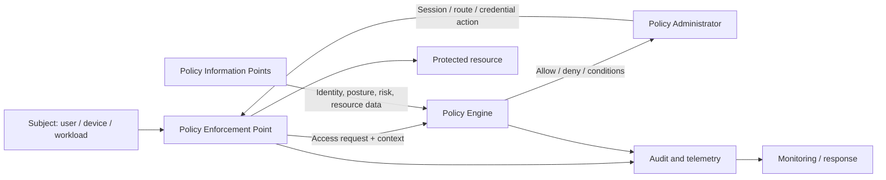
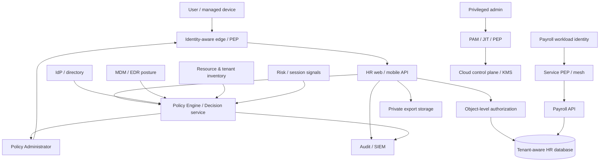

# Zero Trust là gì?

## 1. Zero Trust: thay đổi cách hệ thống quyết định quyền truy cập

Trong một mạng doanh nghiệp truyền thống, người dùng kết nối VPN hoặc đi vào mạng nội bộ có thể được xem là đáng tin hơn người dùng ở Internet. Mô hình đó thường dựa vào giả định rằng **bên trong mạng là an toàn**, còn tường lửa ở ranh giới sẽ ngăn phần lớn mối đe dọa từ bên ngoài. Khi doanh nghiệp dùng cloud, SaaS, thiết bị cá nhân, nhân sự làm việc từ xa, API và workload phân tán, giả định này không còn đủ tin cậy. Kẻ tấn công có thể đánh cắp tài khoản, chiếm thiết bị, xâm nhập một máy chủ nội bộ hoặc lạm dụng quyền của service account rồi di chuyển ngang trong mạng.

**Zero Trust (ZT)** là cách tiếp cận kiến trúc và vận hành bảo mật trong đó **không cấp niềm tin mặc định chỉ vì một người dùng, thiết bị hoặc workload đang ở trong một mạng, một văn phòng hay một vùng hạ tầng nhất định**. Mỗi yêu cầu truy cập vào tài nguyên cần được xác minh và quyết định dựa trên danh tính, trạng thái thiết bị/workload, tài nguyên đích, hành động, ngữ cảnh và chính sách hiện hành. Quyền truy cập được giới hạn ở mức cần thiết, có thời hạn phù hợp và có thể bị đánh giá lại hoặc thu hồi khi rủi ro thay đổi.

Nói cách khác, Zero Trust chuyển trọng tâm từ **“người này đã vào mạng chưa?”** sang **“chủ thể này, trên thiết bị hoặc workload này, có được phép thực hiện hành động cụ thể trên tài nguyên cụ thể vào thời điểm này không?”**. Ranh giới bảo vệ được đặt gần tài nguyên và luồng dữ liệu, thay vì chỉ dựa vào vị trí mạng.

Trong chương **Zero Trust assurance** của module **SECURITY_SECURITY_ASSURANCE**, bài học tập trung vào nền tảng Zero Trust và cách chứng minh mô hình được triển khai có hiệu lực. Mục tiêu của module là xây dựng cách đánh giá có bằng chứng rằng hệ thống đáp ứng các mục tiêu bảo mật, từ phân tích rủi ro, yêu cầu và security controls đến kiểm thử, audit, khắc phục phát hiện và vận hành assurance liên tục.

### Kết quả học tập

Sau bài này, người học có thể:

1. Giải thích Zero Trust, các nguyên tắc cốt lõi và những hiểu lầm thường gặp.
2. Phân biệt xác thực danh tính, đánh giá thiết bị, authorization, network segmentation và continuous verification.
3. Mô tả các thành phần Policy Engine, Policy Administrator, Policy Enforcement Point và nguồn thông tin chính sách.
4. Phân tích luồng truy cập của người dùng, thiết bị, workload và API theo tài nguyên cụ thể.
5. Chuyển mục tiêu Zero Trust thành yêu cầu, security controls, test cases và evidence.
6. Xây dựng lộ trình triển khai theo rủi ro, quản lý ngoại lệ, đo hiệu lực và cải tiến liên tục.

## 2. Vì sao mô hình tin cậy theo mạng không còn đủ?

### 2.1. Ranh giới mạng đã thay đổi

Một ứng dụng hiện đại có thể được truy cập từ văn phòng, nhà riêng, điện thoại, máy tính của nhà cung cấp, cloud workload, pipeline CI/CD và dịch vụ SaaS. Dữ liệu cũng di chuyển qua API, queue, object storage, data warehouse và đối tác. Không còn một đường biên duy nhất bao quanh mọi người dùng và tài nguyên.

Các tình huống điển hình:

- **Tài khoản hợp lệ bị đánh cắp:** kẻ tấn công dùng thông tin đăng nhập thật để truy cập ứng dụng từ vị trí hoặc thiết bị bất thường.
- **Thiết bị đã vào VPN bị xâm nhập:** phần mềm độc hại sử dụng quyền mạng của thiết bị để dò tìm máy chủ khác.
- **Máy chủ nội bộ bị chiếm:** attacker dùng service identity hoặc credential có sẵn để gọi API và di chuyển ngang.
- **Quyền cũ chưa thu hồi:** nhân viên chuyển vai trò nhưng session, group hoặc quyền ứng dụng vẫn còn.
- **API bị gọi trực tiếp:** người dùng không đi qua giao diện web vẫn có thể gọi endpoint nếu backend không kiểm tra quyền trên tài nguyên.
- **Cloud control plane bị lạm dụng:** một workload có quyền rộng truy cập storage, key hoặc database ngoài nhu cầu.

### 2.2. Mô hình perimeter truyền thống và Zero Trust

| Khía cạnh | Tin cậy theo ranh giới mạng | Zero Trust |
| --- | --- | --- |
| Điểm xuất phát | Tin cậy tương đối khi đã vào mạng nội bộ. | Không có niềm tin mặc định theo vị trí mạng. |
| Quyết định truy cập | Có thể dựa nhiều vào subnet, VPN hoặc network zone. | Dựa trên danh tính, thiết bị/workload, tài nguyên, hành động và policy. |
| Phạm vi quyền | Quyền mạng rộng có thể mở đường tới nhiều hệ thống. | Quyền theo tài nguyên và nhiệm vụ, giới hạn phạm vi. |
| Đánh giá sau đăng nhập | Có thể giữ phiên lâu và ít xem lại ngữ cảnh. | Có thể đánh giá lại theo thời gian, sự kiện và rủi ro. |
| Di chuyển ngang | Một điểm xâm nhập có thể tiếp cận nhiều dịch vụ nội bộ. | Segmentation và policy hạn chế đường đi giữa workload/resource. |
| Bằng chứng | Có thể tập trung vào VPN, firewall và network access. | Cần evidence cho identity, device, policy, enforcement, resource và response. |

Zero Trust **không loại bỏ firewall, VPN, mạng nội bộ hoặc phân vùng mạng**. Các cơ chế đó vẫn có vai trò, nhưng vị trí mạng không tự chứng minh chủ thể được phép truy cập tài nguyên. Một thiết bị ở văn phòng vẫn có thể không đạt posture; một workload trong private subnet vẫn phải có identity và quyền cụ thể.

### 2.3. Một ví dụ dễ thấy

Nhân viên kế toán đang dùng laptop công ty và đã kết nối VPN. Họ yêu cầu tải bảng lương của tenant A. Hệ thống cần xác minh:

1. Danh tính đã được xác thực và tài khoản còn hiệu lực không?
2. Thiết bị có được quản lý, mã hóa ổ đĩa, cập nhật và không có tín hiệu compromise theo policy không?
3. Người dùng có vai trò phù hợp và thuộc tenant A không?
4. Tài nguyên được yêu cầu có thuộc tenant A, đúng kỳ lương và đúng phạm vi nhiệm vụ không?
5. Hành động tải hàng loạt có cần step-up, phê duyệt hoặc kiểm tra rủi ro bổ sung không?
6. Quyết định có được enforcement ở API và storage, hay chỉ ở giao diện?

Việc đã kết nối VPN là một dữ kiện về đường truyền, không phải câu trả lời cho sáu câu hỏi này.

## 3. Các nguyên tắc cốt lõi của Zero Trust

Zero Trust không phải một sản phẩm hay một cấu hình duy nhất. Đây là kiến trúc gồm các nguyên tắc phối hợp, được điều chỉnh theo rủi ro và tài sản.

### 3.1. Không có implicit trust

Không tự tin cậy chỉ vì chủ thể:

- Nằm trong mạng nội bộ, VPN hoặc subnet riêng.
- Dùng thiết bị từng được cấp quyền.
- Có phiên đăng nhập còn hiệu lực nhưng ngữ cảnh đã thay đổi.
- Là một service account hoặc workload thuộc cùng cloud account.
- Được cấp quyền trong quá khứ nhưng không còn nhu cầu hiện tại.

Mỗi yêu cầu phải được đánh giá theo policy và dữ kiện đủ tin cậy. “Verify explicitly” không có nghĩa mọi request đều phải bắt người dùng nhập lại mật khẩu; việc xác minh có thể dựa trên token, session, device posture, workload identity, risk signals và mức nhạy cảm của hành động.

### 3.2. Least privilege access

Chỉ cấp **quyền tối thiểu cần thiết** cho chủ thể, hành động, tài nguyên, tenant và khoảng thời gian phù hợp. Tránh quyền quản trị thường trực nếu có thể dùng quyền tạm thời; tránh một service account dùng chung cho nhiều ứng dụng; giới hạn scope của token và API.

Least privilege cần được đánh giá trên **quyền hiệu lực**: direct grants, group membership, inherited permissions, cloud role, database grants, API scopes, cached session và quyền ở bên thứ ba. Một role tên “Reader” vẫn có thể đọc dữ liệu nhạy cảm quá rộng.

### 3.3. Assume breach

Thiết kế với giả định một tài khoản, thiết bị, workload hoặc phân đoạn mạng có thể đã bị xâm nhập. Khi đó:

- Giới hạn blast radius bằng segmentation và quyền hẹp.
- Yêu cầu xác minh ở các ranh giới truy cập quan trọng.
- Bảo vệ credential, token và key; phát hiện hành vi bất thường.
- Ghi nhận sự kiện đủ để điều tra mà không tạo thêm rò rỉ dữ liệu.
- Có thể thu hồi quyền, session hoặc credential khi phát hiện rủi ro.

Assume breach không có nghĩa mặc định mọi người dùng đều là attacker. Nó là giả định thiết kế để giảm tác động nếu một lớp phòng vệ thất bại.

### 3.4. Quyết định theo tài nguyên

Đơn vị bảo vệ là **resource**: hồ sơ nhân viên, database, bucket, API, workload, máy chủ, key, chức năng quản trị hoặc một tập dữ liệu cụ thể. Policy cần xác định chủ thể nào được thực hiện hành động nào trên resource nào trong điều kiện nào.

### 3.5. Đánh giá liên tục và có thể thu hồi

Niềm tin không phải một lần xác thực rồi giữ mãi. Hệ thống cần cập nhật tín hiệu khi:

- Tài khoản bị disable, role bị thu hồi hoặc có dấu hiệu credential compromise.
- Thiết bị mất trạng thái compliant hoặc xuất hiện tín hiệu nguy hiểm.
- Workload identity thay đổi, certificate hết hạn hoặc secret bị thu hồi.
- Resource chuyển phân loại, tenant, trạng thái hoặc mức nhạy cảm.
- Session kéo dài, hành vi bất thường hoặc điều kiện policy không còn đúng.

Đánh giá liên tục không nhất thiết có nghĩa gửi lại mọi yêu cầu tới một policy server cho mỗi byte. Cần xác định điểm đánh giá, thời gian hiệu lực của quyết định, cách cập nhật/revoke và rủi ro do cache hoặc token còn hiệu lực.

## 4. Những điều Zero Trust không có nghĩa

| Hiểu lầm | Thực tế |
| --- | --- |
| “Zero Trust là không tin bất kỳ ai.” | Hệ thống vẫn cho phép truy cập hợp lệ; quyết định dựa trên bằng chứng và policy. |
| “Mua một nền tảng Zero Trust là xong.” | Cần kiến trúc, inventory, identity, device, resource policy, enforcement, telemetry và governance. |
| “Zero Trust nghĩa là bỏ VPN/firewall.” | Network controls vẫn hữu ích, nhưng không tạo quyền truy cập ngầm. |
| “Bắt MFA mỗi phút là Zero Trust.” | MFA là một control; còn cần authorization theo resource, posture, segmentation và lifecycle. |
| “Mọi request phải hỏi lại người dùng.” | Có thể đánh giá session/workload context mà không gây re-authentication liên tục. |
| “Đã xác thực là được phép.” | Authentication xác nhận danh tính; authorization quyết định quyền hành động. |
| “Mọi dữ liệu phải đặt sau một proxy.” | Enforcement có thể nằm ở gateway, service, host, database hoặc resource layer tùy kiến trúc. |
| “Chỉ cần micro-segmentation.” | Segmentation giảm đường di chuyển ngang nhưng không thay identity và resource authorization. |
| “Không có incident nghĩa là Zero Trust hoạt động.” | Cần test chủ động, evidence coverage và đánh giá những đường chưa quan sát. |
| “Zero Trust có thể loại bỏ mọi rủi ro.” | Mục tiêu là giảm implicit trust và giới hạn tác động; residual risk vẫn tồn tại. |

## 5. Mô hình kiến trúc: Policy Engine, Policy Administrator và PEP

Một kiến trúc Zero Trust cần tách **ra quyết định truy cập** khỏi **thực thi quyết định**. Thuật ngữ thường dùng gồm:

- **Policy Engine (PE):** đánh giá yêu cầu và dữ kiện để quyết định allow, deny hoặc điều kiện truy cập.
- **Policy Administrator (PA):** thiết lập hoặc điều phối đường truy cập theo quyết định, ví dụ tạo session, cấp cấu hình hoặc kết thúc kết nối.
- **Policy Enforcement Point (PEP):** điểm thực thi policy; chặn, cho phép hoặc giới hạn luồng tới resource.
- **Policy Information Point (PIP):** nguồn cung cấp dữ kiện cho quyết định, như identity provider, device management, asset inventory, threat intelligence, resource metadata và risk signals.
- **Policy Decision Point (PDP):** phần logic quyết định; trong mô hình tham chiếu, PE và PA phối hợp tạo thành chức năng PDP.

Tên và cách phân chia có thể khác giữa sản phẩm/kiến trúc. Điều quan trọng là tổ chức biết **ai cung cấp dữ liệu, thành phần nào quyết định và điểm nào thực thi**.

### 5.1. Sơ đồ thành phần



Ví dụ: người dùng yêu cầu truy cập hệ thống payroll. PEP tại application gateway hoặc service nhận request; PE đánh giá danh tính, thiết bị, role, tenant, resource và risk; PA tạo hoặc điều chỉnh phiên; PEP chỉ cho request đi tiếp nếu quyết định và điều kiện hợp lệ. Telemetry được ghi để giám sát và đánh giá lại.

### 5.2. PEP đặt ở đâu?

PEP có thể là:

- Reverse proxy, identity-aware proxy hoặc API gateway.
- Agent/host enforcement trên máy chủ hoặc endpoint.
- Sidecar/service mesh proxy cho luồng service-to-service.
- Middleware/authorization layer trong ứng dụng.
- Database proxy hoặc cơ chế kiểm soát truy cập ở database.
- Policy enforcement tích hợp tại storage, message broker hoặc cloud resource.

Không có một PEP duy nhất bao phủ mọi đường dữ liệu. Nếu ứng dụng kiểm tra policy nhưng bucket cho phép public access hoặc job có thể truy cập DB trực tiếp, đường phụ vẫn có thể bypass. **Assurance phải đối chiếu data flow và enforcement points**.

### 5.3. PIP: dữ liệu đầu vào phải đáng tin

PIP có thể cung cấp:

| Nguồn | Dữ liệu | Rủi ro nếu dữ liệu sai/cũ |
| --- | --- | --- |
| Identity Provider/directory | Subject, trạng thái account, group, MFA/authentication context. | Account đã nghỉ việc hoặc group cũ vẫn được coi hợp lệ. |
| Device management/EDR | Device identity, compliance, encryption, patch, threat status. | Thiết bị bị compromise nhưng posture vẫn báo compliant. |
| Resource inventory | Owner, classification, tenant, environment, criticality. | Policy áp dụng nhầm mức nhạy cảm hoặc tenant. |
| Workload identity platform | Service identity, attestation, certificate, audience. | Workload giả mạo hoặc token được dùng sai service. |
| Threat/risk signals | IP reputation, anomaly, impossible travel, behavior. | False positive/false negative, tín hiệu không đủ nguồn. |
| Session/context service | Thời gian, auth age, location context, request history. | Cache hoặc clock skew làm policy quyết định sai. |

PE cần biết **nguồn, độ mới, tính toàn vẹn, confidence và trạng thái unavailable** của từng tín hiệu. Không nên coi một giá trị thiếu hoặc không truy cập được là “compliant” mặc định.

## 6. Một quyết định truy cập Zero Trust diễn ra thế nào?

Một request có thể được mô tả bằng bộ thuộc tính:

- **Subject:** user, service, device hoặc workload identity.
- **Action:** read, write, export, approve, administer, execute.
- **Resource:** API, record, database, file, key, cluster hoặc service.
- **Context:** thời điểm, tenant, session, network path, request origin.
- **Posture/risk:** trạng thái thiết bị, xác thực, tín hiệu hành vi, workload attestation.
- **Policy:** yêu cầu nghiệp vụ, classification, risk threshold, exceptions và obligations.

Quyết định có thể là **deny**, **allow**, hoặc **allow with conditions** như step-up authentication, read-only scope, giới hạn thời gian, chỉ cho qua managed device hoặc yêu cầu approval.

### 6.1. Ví dụ logic quyết định

Giả sử một nhân viên cần xem bảng lương:

| Điều kiện | Giá trị yêu cầu cho hành động nhạy cảm |
| --- | --- |
| Account | Active, không bị khóa hoặc thu hồi. |
| Authentication | Token hợp lệ, issuer/audience đúng, auth context đáp ứng policy. |
| Device | Đã đăng ký, posture còn mới và compliant theo chính sách. |
| Tenant | User có membership hợp lệ ở tenant sở hữu record. |
| Role/action | Có quyền payroll.read; không tự suy từ role chung. |
| Resource | Record thuộc đúng tenant và kỳ được phép. |
| Risk | Không có tín hiệu compromise vượt ngưỡng đã định. |
| Session | Còn trong thời hạn; quyền và posture chưa bị thu hồi. |

Nếu tất cả điều kiện bắt buộc đạt, PE có thể cho phép **read** trong phạm vi. Nếu user yêu cầu **export toàn bộ**, policy có thể yêu cầu step-up hoặc approval. Nếu device posture không thể xác minh, kết quả tùy risk policy; không mặc định allow cho dữ liệu nhạy cảm.

### 6.2. Pseudocode minh họa

```text
decision = policy_engine.evaluate(
    subject = verified_subject,
    device = current_device_posture,
    action = requested_action,
    resource = resource_from_trusted_inventory,
    tenant = trusted_resource_tenant,
    context = current_session_and_risk
)

if decision.effect == "deny":
    enforcement_point.reject()
elif decision.is_expired or decision.policy_version_is_stale:
    enforcement_point.reject_or_re_evaluate()
elif decision.effect == "allow_with_conditions":
    enforcement_point.enforce(decision.conditions)
else:
    enforcement_point.allow_with_scope(decision.scope)
```

Đây là logic khái niệm, không phải thư viện authorization. Trong hệ thống thật, dữ liệu subject/resource phải lấy từ nguồn đã xác minh; client không được tự quyết định tenant, role, device compliance hoặc policy version.

### 6.3. Policy không thể chỉ dựa vào một tín hiệu

IP văn phòng tốt không bù được token sai audience. MFA thành công không bù được user không có quyền trên record. Device compliant không bù được service role có quyền đọc mọi tenant. Zero Trust yêu cầu **nhiều thuộc tính có ý nghĩa** được đánh giá đúng chỗ, theo rủi ro.

## 7. Identity là nền tảng của Zero Trust

Danh tính cho biết **chủ thể nào đang yêu cầu truy cập**. Zero Trust cần danh tính được quản trị xuyên suốt vòng đời, có thể xác minh và gắn với đúng hành động/tài nguyên. Identity không chỉ là tài khoản người dùng; còn có service account, workload, máy ảo, container, thiết bị, pipeline, robot và bên thứ ba.

### 7.1. Human identity

Các control quan trọng:

- **Identity proofing/onboarding:** nguồn thẩm quyền tạo danh tính, kiểm tra liên kết người–tổ chức–tenant.
- **Authentication:** MFA phù hợp, ưu tiên phương thức chống phishing cho quyền nhạy cảm khi khả thi và theo baseline.
- **Session management:** thời hạn, idle timeout, re-auth/step-up, cookie/token protection và logout.
- **Lifecycle:** joiner/mover/leaver, thu hồi quyền, xử lý guest/vendor và tài khoản dormant.
- **Privileged access:** quyền tạm/JIT, PAM/PIM, approval, session recording/monitoring theo chính sách.
- **Account recovery:** bảo vệ enrollment, reset, thay thiết bị và khôi phục quyền.

Một user có MFA không có nghĩa mọi hành động được cho phép. Identity phải được kết hợp với device, tenant membership, resource và action. Khi tài khoản bị disable, cần xác minh **phiên, token, local account, API key và quyền ứng dụng** có được xử lý theo policy không.

### 7.2. Workload identity

Workload identity là danh tính của service, job, container, VM, function, pipeline hoặc process cần giao tiếp với tài nguyên khác. Nên ưu tiên credential ngắn hạn và có thể xác minh, gắn với workload cụ thể; hạn chế secret tĩnh tồn tại lâu và service account dùng chung.

| Thành phần | Câu hỏi Zero Trust |
| --- | --- |
| Workload identity | Có xác định được workload nào đang gọi không? |
| Authentication | Có xác minh certificate/token/attestation theo trust anchor không? |
| Audience | Credential có được phát hành cho đúng service nhận không? |
| Scope | Chỉ có quyền và API cần thiết không? |
| Lifecycle | Credential có expiry, rotation, revoke và owner không? |
| Runtime | Workload chạy từ image/config/host được phép không? |
| Observability | Có log actor, target, action, result và correlation ID không? |

Một batch job tính lương không nên dùng credential của ứng dụng marketing. Mỗi workload nên có identity và quyền riêng; nếu phải chia sẻ, cần nêu lý do, giới hạn và biện pháp bù đắp.

### 7.3. Third-party identity

Nhà cung cấp, đối tác hỗ trợ và contractor cần danh tính riêng, sponsor, thời hạn, phạm vi, điều kiện thiết bị và audit. Tránh tài khoản dùng chung như `vendor-support` mà không biết cá nhân nào sử dụng. Quyền phải kết thúc khi hợp đồng/ticket/nhiệm vụ kết thúc, đồng thời kiểm tra session và credential còn hiệu lực.

## 8. Device posture: thiết bị cũng phải chứng minh trạng thái

Một tài khoản hợp lệ trên thiết bị bị chiếm có thể trở thành đường vào dữ liệu. Device posture giúp policy xem xét **thiết bị nào đang được dùng và trạng thái bảo mật hiện tại của nó**.

### 8.1. Thuộc tính thiết bị có thể đánh giá

- Thiết bị đã đăng ký với tổ chức và gắn với chủ sở hữu chưa?
- Có disk encryption, screen lock và bảo vệ endpoint theo baseline không?
- OS/browser có phiên bản được hỗ trợ và bản vá trong ngưỡng không?
- EDR/MDM agent có hoạt động và báo cáo đủ mới không?
- Thiết bị có root/jailbreak, malware hoặc tín hiệu compromise không?
- Certificate/device identity còn hiệu lực không?
- Thiết bị có bị lost, stolen, quarantined hoặc revoked không?

Không phải thuộc tính nào cũng có thể đo chính xác. Cần quy định **nguồn tín hiệu, thời điểm cập nhật, độ tin cậy, ngưỡng và hành vi khi thiếu dữ liệu**.

### 8.2. Device posture không phải nhãn vĩnh viễn

Thiết bị có thể compliant lúc 9 giờ nhưng bị tắt EDR hoặc phát hiện malware lúc 10 giờ. Nếu policy chỉ đọc posture lúc login và giữ kết quả cả ngày, hệ thống có thể tiếp tục cấp quyền sau khi điều kiện đã thay đổi. Cần xác định:

- Khoảng thời gian tối đa mà posture được xem là còn mới.
- Sự kiện nào kích hoạt đánh giá lại hoặc thu hồi session.
- Resource nào yêu cầu posture mạnh hơn.
- Có thể dùng thiết bị không quản lý cho dữ liệu ít nhạy cảm không?
- Khi MDM/EDR không khả dụng, policy fail closed hay dùng phương án hạn chế nào?

### 8.3. Ví dụ theo mức nhạy cảm

| Resource/action | Device condition minh họa |
| --- | --- |
| Xem trang thông tin công khai | Có thể cho phép trên thiết bị không quản lý, tùy policy. |
| Xem hồ sơ nhân viên | Thiết bị được bảo vệ, session hợp lệ, MFA phù hợp. |
| Export bảng lương | Managed device, posture mới, step-up hoặc approval theo rủi ro. |
| Quản trị KMS/IAM | Thiết bị quản trị chuyên dụng, privileged session và giám sát tăng cường. |

Đây là ví dụ phân tầng, không phải quy tắc phổ quát. Owner tài sản và security risk assessment xác định điều kiện phù hợp.

## 9. Bảo vệ workload, service-to-service và API

Trong hệ thống phân tán, nhiều truy cập không có người dùng tương tác trực tiếp. Zero Trust cần bảo vệ cả **machine identity và luồng service-to-service**.

### 9.1. Service identity thay cho tin cậy theo subnet

Nếu service A gọi service B, B cần xác minh:

1. Caller có identity hợp lệ và thuộc workload được tin cậy không?
2. Credential còn hiệu lực, audience đúng và không bị revoke không?
3. Service A có quyền gọi endpoint/action này không?
4. Request có được ràng buộc với tenant, user hoặc job đã được phép khi cần không?
5. Dữ liệu trả về có bị giới hạn theo resource/action không?
6. Lỗi xác minh có dẫn tới deny an toàn và có telemetry không?

Private subnet hoặc mutual TLS chỉ giúp bảo vệ đường truyền và xác minh peer theo cấu hình. Chúng không tự cấp quyền nghiệp vụ trên mọi API.

### 9.2. API authorization

API nên kiểm tra **issuer, signature, audience, expiry, token type, scope/claims theo contract** và quyền trên resource. Cần bảo vệ object-level authorization để tránh BOLA/IDOR: thay ID trong URL không được phép truy cập bản ghi của người khác hoặc tenant khác.

| Lớp | Ví dụ kiểm soát |
| --- | --- |
| Token validation | Chỉ nhận token từ issuer đã đăng ký, đúng audience/resource. |
| Client/workload identity | Client ID và credential gắn với workload cụ thể. |
| Scope/action | Chỉ cho action đã được cấp. |
| Object authorization | Kiểm tra quyền trên từng record/file/job. |
| Tenant boundary | Tenant lấy từ trusted membership/resource, không từ header tùy ý. |
| Rate/risk controls | Giới hạn bulk operations, phát hiện hành vi bất thường. |
| Audit | Ghi actor, action, resource reference, outcome và correlation ID. |

### 9.3. Credential và secret lifecycle

Secret cần nằm trong secret manager hoặc cơ chế được duyệt; giới hạn người/workload đọc, thời gian sống, rotation, revocation và audit. CI/CD không nên nhúng cloud administrator credential lâu dài trong pipeline. Có thể dùng workload federation hoặc credential ngắn hạn nếu nền tảng hỗ trợ.

Khi secret bị lộ, việc đổi giá trị mới chưa đủ: cần xác định **nơi đã copy secret, session/token được tạo, quyền đã sử dụng, logs và các dependency**. Zero Trust assurance kiểm tra cả revoke/rotation lẫn hành vi sau thu hồi.

## 10. Network segmentation và micro-segmentation

Zero Trust vẫn dùng network controls, nhưng phân đoạn được thiết kế để **giới hạn đường đi và blast radius**, không tạo niềm tin mặc định cho mọi host trong một zone.

### 10.1. Phân đoạn theo ứng dụng, workload và dữ liệu

Ví dụ kiến trúc có các vùng:

- User/device access.
- Public-facing edge/API gateway.
- Application services.
- Data services/database.
- Management/control plane.
- CI/CD build và deployment.
- Backup/recovery.
- Third-party connectivity.

Mỗi luồng giữa các vùng cần có owner, protocol/port, caller identity, target, purpose, điều kiện và lý do. Những kết nối không cần thiết phải bị chặn.

### 10.2. Micro-segmentation

Micro-segmentation áp dụng policy chi tiết giữa workload hoặc nhóm workload, ví dụ chỉ payroll-api được kết nối payroll-db trên giao thức/port đã duyệt. Nó giảm khả năng một máy chủ bị xâm nhập có thể dò và gọi mọi dịch vụ khác.

Nhưng nếu payroll-api có quyền đọc mọi tenant, segmentation không sửa được lỗi authorization. Nếu rule network được tạo tự động nhưng không có inventory và review, policy có thể quá rộng hoặc lỗi thời.

### 10.3. Evidence cho segmentation

- Network flow inventory và danh sách luồng được phê duyệt.
- Runtime firewall/security group/service mesh policy.
- Test từ nguồn không được phép tới resource.
- Kiểm tra drift và rule không còn owner/nhu cầu.
- Test đường bypass qua public endpoint, alternate port, direct storage hoặc admin plane.
- Log deny/allow, alert và xử lý thay đổi policy.

Một biểu đồ mạng đẹp là design evidence; để chứng minh hiệu lực cần kiểm tra **effective rules và hành vi traffic trong phạm vi**.

## 11. Zero Trust bảo vệ dữ liệu và tài nguyên

Zero Trust không dừng ở việc cấp quyền vào mạng hay ứng dụng. Mỗi resource cần **owner, classification, access policy và evidence**.

### 11.1. Resource inventory

Tài nguyên cần quản lý có thể gồm:

- Dữ liệu cá nhân, bảng lương, giao dịch, hồ sơ y tế.
- Database, bucket, file, queue, topic, search index và backup.
- API, microservice, function, cluster và VM.
- KMS/HSM keys, secrets, certificate và signing keys.
- Admin console, cloud control plane, CI/CD pipeline.
- SaaS tenant, integration, webhook và tài khoản bên thứ ba.

Mỗi resource nên có ID, owner, tenant/environment, data class, criticality, exposed interfaces, policy refs, dependency và review trigger.

### 11.2. Policy theo resource và action

Một policy tốt mô tả **ai được làm gì trên tài nguyên nào, trong điều kiện nào, trong bao lâu và có nghĩa vụ gì**. Không chỉ nói “user đã đăng nhập thì allow”.

Ví dụ:

| Subject | Action | Resource | Conditions | Decision |
| --- | --- | --- | --- | --- |
| Payroll operator A | read | Payroll record A | Membership active, device compliant, kỳ lương được phép | Allow |
| Payroll operator A | read | Payroll record B | Tenant không khớp | Deny |
| Payroll operator A | export | Payroll dataset A | Step-up và approval khi vượt ngưỡng | Allow with conditions |
| Analytics workload | read | Raw payroll DB | Không có purpose/scope phù hợp | Deny |
| Backup operator | restore | Backup vault | JIT approval, incident/change ticket, audit | Allow with conditions |

### 11.3. Data protection controls vẫn cần thiết

Encryption at rest/in transit, key management, minimization, retention/deletion, DLP, backup và audit là các lớp bảo vệ dữ liệu. Zero Trust bổ sung cách đánh giá **identity, context và policy trước khi cho phép truy cập**, không thay các controls đó.

## 12. Continuous verification và quản lý session

### 12.1. Đánh giá theo sự kiện và rủi ro

Một số sự kiện nên kích hoạt re-evaluation:

- Thay đổi account status, group, role, tenant membership hoặc employment status.
- Device posture thay đổi, agent ngừng hoạt động hoặc phát hiện compromise.
- Credential/token/certificate bị thu hồi hoặc nghi bị lộ.
- User chuyển sang hành động nhạy cảm hơn, như đọc → export hoặc view → approve.
- Resource đổi classification, owner hoặc trạng thái.
- Hành vi truy cập khác baseline, bulk download hoặc request từ ngữ cảnh bất thường.
- Policy version hoặc risk threshold thay đổi.

Không cần re-authentication cho mọi sự kiện. Có thể re-evaluate policy, hạ scope, yêu cầu step-up, kết thúc session hoặc chuyển sang deny tùy mức rủi ro.

### 12.2. Token và session không nên sống ngoài policy

Token ngắn hạn có thể giảm cửa sổ lạm dụng nhưng không tự giải quyết revocation. Nếu quyền bị thu hồi mà API vẫn chấp nhận token chứa claim cũ đến khi hết hạn, cần xác định **cửa sổ chấp nhận được**, cơ chế introspection/revocation/event, cache TTL và resource risk.

| Cơ chế | Vai trò | Evidence cần có |
| --- | --- | --- |
| Short-lived access token | Giới hạn thời gian sử dụng credential. | TTL thực tế, audience/scope, expiry tests. |
| Refresh token rotation/revocation | Quản lý phiên dài hạn và phát hiện reuse theo thiết kế. | Config, event, test revoke và reuse. |
| Session invalidation | Kết thúc phiên ứng dụng khi điều kiện không còn đúng. | Disable-user/device tests, runtime session state. |
| Continuous access evaluation | Truyền sự kiện thay đổi để đánh giá lại quyền. | Event propagation, latency, fail behavior, test. |
| Step-up authentication | Tăng mức xác thực trước hành động rủi ro cao. | Trigger, authentication context, bypass tests. |

### 12.3. Độ trễ cũng là một control objective

Nếu device compromise được phát hiện lúc 10:00 nhưng phiên truy cập dữ liệu nhạy cảm chỉ bị chặn sau 45 phút, cần đánh giá **45 phút đó có nằm trong ngưỡng chấp nhận không**. Đặt tiêu chí đo được như thời gian từ tín hiệu → policy update → PEP enforcement, phân theo mức độ tài nguyên. Không tuyên bố continuous verification chỉ vì hệ thống có gửi event.

## 13. Zero Trust cho privileged access và control plane

Quyền quản trị có thể thay đổi policy, cấp credential, đọc dữ liệu hoặc tắt logging. Đây là vùng rủi ro cao, cần kiểm soát chặt:

- Danh tính admin riêng, MFA mạnh và thiết bị quản trị được kiểm soát.
- Quyền thường trực tối thiểu; dùng JIT/PIM/PAM khi phù hợp.
- Approval theo nhiệm vụ, thời hạn và scope.
- Session recording hoặc audit phù hợp, bảo vệ log độc lập.
- Tách người thay policy khỏi người review/approve trong trường hợp cần.
- Break-glass có điều kiện, kiểm kê, cảnh báo và hậu kiểm.
- Review quyền cloud control plane, KMS, identity provider và CI/CD.

**Một admin đã xác thực vẫn có thể không được phép thực hiện mọi hành động**. Ví dụ admin vận hành có thể restart service nhưng không được tự ý export dữ liệu khách hàng hoặc destroy encryption key nếu không có quy trình riêng.

### 13.1. CI/CD và build identity

Pipeline có thể deploy production, đọc secrets, ký artifact và thay policy. Zero Trust cần xác minh:

1. Pipeline/job nào đang chạy, từ repository/branch/commit nào?
2. Artifact có provenance, signature hoặc attestation phù hợp không?
3. Runner/agent có được quản lý và posture đủ tin cậy không?
4. Credential có ngắn hạn, audience/scope đúng và chỉ dùng cho nhiệm vụ?
5. Ai có thể sửa pipeline, approve deployment hoặc lấy secrets?
6. Có audit và khả năng revoke credential/runner khi compromise không?

Không cấp một credential admin chung cho mọi build. Tách quyền build, publish, deploy, production approval và key signing theo kiến trúc/risks.

## 14. Các mẫu triển khai Zero Trust

### 14.1. Identity-aware proxy

Proxy kiểm tra identity và context trước khi cho kết nối đến ứng dụng. Mẫu này hữu ích cho web apps và admin portals, nhưng cần kiểm tra API trực tiếp, alternate endpoint và quyền bên trong ứng dụng. Nếu proxy là điểm enforcement duy nhất, mọi đường bypass phải được đóng.

### 14.2. API gateway + authorization service

Gateway xác minh token và áp dụng policy cơ bản; service hoặc authorization engine kiểm tra quyền trên từng resource. Không nên để gateway chỉ kiểm tra role chung rồi backend tin mọi object ID. Object-level authorization thường cần ngữ cảnh nghiệp vụ ở service.

### 14.3. Service mesh và workload identity

Service mesh có thể cung cấp mTLS, service identity, policy và telemetry giữa workload. Cần xác minh certificate/identity, trust domain, audience, policy hiệu lực và các luồng không đi qua mesh. mTLS xác minh peer theo trust model; **không tự chứng minh peer có quyền đọc mọi dữ liệu**.

### 14.4. Cloud-native resource policy

Cloud IAM, resource policy, KMS policy, database grants và storage policy có thể thực thi quyền gần tài nguyên. Cần kiểm tra direct/inherited grants, wildcard, cross-account access, service principals, public access và drift. IaC review không thay runtime reconciliation.

### 14.5. Kết hợp các mẫu

Một tổ chức thường dùng nhiều mẫu cùng lúc: identity-aware access cho người dùng, service mesh cho service-to-service, cloud IAM cho storage/KMS và authorization logic trong ứng dụng. **Không cần ép mọi luồng qua một sản phẩm duy nhất**; cần đảm bảo không có đường truy cập quan trọng bị bỏ ngoài policy/evidence.

## 15. Threat modeling và xác định yêu cầu Zero Trust

Không nên bắt đầu bằng việc mua proxy hoặc bật micro-segmentation. Trước tiên cần xác định **tài sản, đường truy cập, chủ thể, ranh giới tin cậy, threat scenarios và hậu quả**.

### 15.1. Các câu hỏi threat modeling

1. Tài sản nào quan trọng nhất: dữ liệu, dịch vụ, key, admin plane hay pipeline?
2. Ai hoặc workload nào cần truy cập; danh tính được xác minh từ nguồn nào?
3. Resource có những entry points nào, kể cả API, job, storage và đường quản trị?
4. Nếu identity/device/workload bị compromise, attacker có thể đi tới đâu?
5. Quyền nào đang quá rộng, tồn tại lâu hoặc không có owner?
6. Những tín hiệu nào cho biết context đã thay đổi và policy cần đánh giá lại?
7. Enforcement nằm ở đâu; có bypass path hoặc single point of failure không?
8. Bằng chứng nào có thể chứng minh control hoạt động và ai sẽ review?

### 15.2. Threat scenarios mẫu

| Risk ID | Kịch bản | Mục tiêu bảo mật | Hướng control |
| --- | --- | --- | --- |
| **ZT-R01** | Tài khoản bị đánh cắp truy cập dữ liệu nhạy cảm từ thiết bị không compliant. | Confidentiality. | Strong authentication, device posture, risk-based policy, resource authorization. |
| **ZT-R02** | Host nội bộ bị chiếm và di chuyển ngang tới database. | Confidentiality/integrity. | Workload identity, segmentation, least privilege, PEP gần resource. |
| **ZT-R03** | Service account dùng chung gọi API ngoài nhiệm vụ. | Confidentiality/integrity. | Unique workload identity, scope/audience, policy và rotation. |
| **ZT-R04** | Leaver vẫn dùng token/session sau khi account bị disable. | Confidentiality/accountability. | Lifecycle event, session/token revoke, effective-state test. |
| **ZT-R05** | Gateway cho phép nhưng backend không kiểm tra object ownership. | Confidentiality. | Object-level authorization, tenant binding và negative tests. |
| **ZT-R06** | Device posture stale vẫn được coi compliant. | Confidentiality/integrity. | Freshness SLA, re-evaluation, quarantine/revoke. |
| **ZT-R07** | Admin thay policy và xóa audit trail. | Integrity/accountability. | Separation of duties, immutable/independent logging, privileged monitoring. |
| **ZT-R08** | Policy engine hoặc PIP outage dẫn tới fail-open. | Confidentiality/integrity. | Fail-safe behavior, bounded fallback, outage test. |
| **ZT-R09** | CI/CD runner bị chiếm dùng credential deploy. | Integrity/availability. | Workload identity, artifact provenance, short-lived credentials, approval. |
| **ZT-R10** | Token audience/scope không đúng vẫn được resource server chấp nhận. | Confidentiality/integrity. | Token validation, resource-specific policy, negative tests. |

### 15.3. Từ threat sang requirement có thể kiểm thử

| Requirement ID | Yêu cầu | Tiêu chí có thể xác minh |
| --- | --- | --- |
| **ZT-REQ-01** | Mọi truy cập tới resource nhạy cảm phải được gắn với principal đã xác minh. | Request không có/ sai identity bị từ chối tại PEP. |
| **ZT-REQ-02** | Quyết định phải xét action, resource, tenant và policy hiện hành. | User có role chung nhưng sai tenant/resource không truy cập được. |
| **ZT-REQ-03** | Quyền workload phải giới hạn theo service và audience. | Token sai audience/scope hoặc workload giả bị từ chối. |
| **ZT-REQ-04** | Device posture phải mới trong giới hạn đã duyệt cho resource nhạy cảm. | Posture hết freshness hoặc revoked dẫn tới deny/step-up theo policy. |
| **ZT-REQ-05** | Quyền bị thu hồi phải có hiệu lực trong cửa sổ thời gian được xác định. | Test account/role revoke đo được thời gian tới khi PEP chặn. |
| **ZT-REQ-06** | Mọi đường truy cập quan trọng phải đi qua enforcement đã xác định. | Direct/bypass path tests không vượt policy. |
| **ZT-REQ-07** | Policy engine không khả dụng không được tạo quyền ngoài policy. | Fault test cho thấy fail-safe hoặc bounded fallback. |
| **ZT-REQ-08** | Quyền đặc quyền cần approval, thời hạn và audit theo mức rủi ro. | JIT expiry, unauthorized admin action và review tests. |
| **ZT-REQ-09** | Thay đổi policy phải có owner, version, approval và khả năng rollback. | Change records đối chiếu runtime policy version. |
| **ZT-REQ-10** | Quyết định truy cập và thay đổi quan trọng phải có telemetry bảo vệ phù hợp. | Test event-to-log/alert/response với dữ liệu không nhạy cảm. |

Một requirement tốt có **resource scope, action, principal type, condition, expected result, environment, owner và evidence**. Câu “áp dụng Zero Trust cho mọi thứ” không phải tiêu chí nghiệm thu.

## 16. Assurance controls: chứng minh Zero Trust có hiệu lực

### 16.1. Control catalog minh họa

| Control ID | Mục tiêu | Thiết kế control | Bằng chứng vận hành |
| --- | --- | --- | --- |
| **ZT-C01 Identity** | Chủ thể có danh tính tin cậy và vòng đời được quản lý. | IdP, unique identities, MFA, JML, service identity. | Identity inventory, authentication tests, revoke tests, access review. |
| **ZT-C02 Device** | Thiết bị đạt posture phù hợp trước khi truy cập. | MDM/EDR, compliance policy, device identity. | Runtime posture, stale/revoked device tests, event propagation. |
| **ZT-C03 Resource authorization** | Quyền gắn với resource/action/tenant. | PDP/PEP, RBAC/ABAC, object-level checks. | Negative tests, effective permissions, direct endpoint tests. |
| **ZT-C04 Workload** | Service-to-service chỉ dùng identity/scope được cấp. | Workload identity, short-lived credentials, audience binding. | Token validation, unauthorized service tests, credential revoke. |
| **ZT-C05 Segmentation** | Giới hạn luồng và lateral movement. | Network/micro-segmentation, service mesh policy. | Runtime flow policy, denied connection tests, drift review. |
| **ZT-C06 Continuous evaluation** | Thay đổi rủi ro dẫn tới đánh giá lại/revoke. | Event-driven reevaluation, TTL, session invalidation. | Measured revoke latency, stale signal tests. |
| **ZT-C07 Privileged access** | Quyền quản trị tạm, giới hạn và có audit. | PAM/PIM/JIT, approval, break-glass. | Eligibility/activation logs, expiry tests, independent review. |
| **ZT-C08 Telemetry** | Truy vết truy cập và phát hiện bất thường. | Audit schema, SIEM/alert, response playbook. | Event-to-alert test, triage evidence, log access review. |
| **ZT-C09 Policy governance** | Policy đúng phiên bản, owner và thay đổi được quản lý. | Versioning, review, approval, rollback. | Policy diff, deployment evidence, runtime reconciliation. |
| **ZT-C10 Recovery/failure** | Lỗi dependency không mở quyền ngoài policy. | Fail-safe design, HA/DR, bounded fallback. | PEP/PDP/PIP outage test, recovery drill, measured outcomes. |

### 16.2. Design effectiveness và operating effectiveness

Một kiến trúc có PEP/PDP là bằng chứng thiết kế. Một policy file trong repository là bằng chứng triển khai dự kiến. Để kết luận control hiệu quả, cần chứng minh:

- PEP thực sự bảo vệ **mọi entry point thuộc scope**.
- PIP cung cấp dữ liệu có nguồn, độ mới và độ tin cậy phù hợp.
- PE đánh giá đúng các thuộc tính và trả quyết định theo policy version.
- PA/PEP thực thi đúng allow/deny/conditions, bao gồm revoke và expiry.
- Telemetry phản ánh sự kiện thực tế và có người xử lý.
- Thay đổi resource, identity, network hoặc policy được phát hiện và review.

### 16.3. Control dependency và điểm lỗi chung

Ví dụ, nhiều policy cùng dựa trên một IdP. Nếu IdP bị compromise, nhiều lớp xác thực có thể cùng thất bại. Một device compliance signal sai có thể khiến hàng loạt request được cho phép. Một policy engine duy nhất có thể trở thành dependency về availability. Assurance phải ghi **common dependencies, fallback, blast radius và test độc lập**, không cộng các lớp cùng phụ thuộc như thể chúng hoàn toàn độc lập.

## 17. Lộ trình triển khai Zero Trust

Zero Trust là quá trình chuyển đổi, không phải một lần bật tính năng. Nên ưu tiên tài sản và rủi ro cao, triển khai từng bước, đo kết quả và điều chỉnh.

### 17.1. Giai đoạn 1 — Discover và baseline

- Lập inventory user, device, workload, application, API, data, admin plane và network flows.
- Xác định tài sản trọng yếu, data classification và business owner.
- Rà soát identity sources, MFA, service accounts, token, key và quyền hiện tại.
- Xác định các entry point và đường bypass.
- Thu thập baseline evidence: current effective permissions, posture coverage, policy gaps, logging và revoke behavior.

**Exit criteria:** phạm vi ưu tiên và các khoảng trống inventory được owner xác nhận; unknowns có action.

### 17.2. Giai đoạn 2 — Define policy và protect identities

- Thiết lập unique identity cho user, admin, service và workload.
- Cải thiện MFA, privileged access, JML và credential lifecycle.
- Phân loại resource, định nghĩa action và policy conditions.
- Xác định device posture cho từng nhóm tài nguyên.
- Chọn PEP/PDP/PIP và trust boundaries.

**Exit criteria:** policy có owner/version, test plan và đường truy cập ưu tiên được xác định.

### 17.3. Giai đoạn 3 — Enforce và segment

- Đặt PEP tại các đường truy cập trọng yếu.
- Thực thi resource-level authorization và workload identity.
- Chia nhỏ network flows theo nhu cầu, đóng luồng không cần thiết.
- Giới hạn quyền, token scopes và session.
- Kiểm tra đường bypass và policy drift.

**Exit criteria:** negative tests cho tài sản trọng yếu đạt; các đường chưa bao phủ có biện pháp giảm rủi ro và quyết định rõ.

### 17.4. Giai đoạn 4 — Continuous verification và response

- Kết nối identity, device, workload, resource và threat signals.
- Đo độ mới tín hiệu, latency cập nhật và revoke.
- Kiểm thử alert, triage, containment và recovery.
- Review ngoại lệ, stale policy, service identity và quyền đặc quyền.
- Tự động hóa kiểm tra phù hợp trong CI/CD và runtime.

**Exit criteria:** có evidence cho event-to-policy-to-enforcement-to-response; các failure modes trọng yếu đã diễn tập.

### 17.5. Giai đoạn 5 — Optimize và assurance liên tục

- Đánh giá lại threat model, resource inventory và policy theo thay đổi.
- Đo hiệu lực theo rủi ro và phát hiện bypass mới.
- Xem xét false positives/false negatives và tác động tới người dùng.
- Cập nhật control catalog, risk register, exception và evidence.
- Rà soát nhà cung cấp, cloud services và thay đổi kiến trúc.

Không dùng số lượng sản phẩm đã mua hoặc số policy được tạo làm thước đo trưởng thành. Đo **coverage, enforcement effectiveness, revoke latency, blast-radius reduction và khả năng chứng minh**.

## 18. Kiểm thử Zero Trust: chứng minh allow và deny đúng

Một chương trình kiểm thử tốt phải có cả **positive tests** (người/thiết bị/workload đúng được truy cập trong phạm vi) và **negative tests** (chủ thể sai hoặc điều kiện không đạt bị từ chối). Nếu chỉ kiểm tra deny, hệ thống có thể quá chặt tới mức không hoạt động; nếu chỉ kiểm tra allow, lỗi authorization dễ bị bỏ sót.

### 18.1. Test matrix

| Test ID | Tình huống | Kết quả mong đợi | Evidence |
| --- | --- | --- | --- |
| **ZT-T01** | User active, MFA đạt, device compliant truy cập resource đúng tenant. | Allow đúng scope. | Identity/device/policy versions, request ID, result. |
| **ZT-T02** | Token hợp lệ nhưng audience dành cho API khác. | Resource server từ chối. | Token fixture giả, expected/actual, validation log. |
| **ZT-T03** | User A thay resource ID sang tenant B. | Deny, không tiết lộ payload/metadata nhạy cảm. | Object-level negative test, tenant mapping. |
| **ZT-T04** | User có role đúng nhưng device bị revoke/quarantine. | Deny hoặc hạn chế theo policy. | Device event, reevaluation trace, PEP result. |
| **ZT-T05** | Posture signal cũ quá freshness threshold. | Không dùng trạng thái stale như compliant. | Signal timestamp, policy threshold, decision. |
| **ZT-T06** | Leaver bị disable trong IdP nhưng có session cũ. | Session/token bị xử lý trong ngưỡng đã duyệt. | Disable event, revoke latency, access retry. |
| **ZT-T07** | Workload A gọi API chỉ dành cho workload B. | Deny do identity/audience/scope. | Workload identity, token claims, PEP decision. |
| **ZT-T08** | Host trong subnet nội bộ gọi database không có identity/policy. | Deny. | Network flow test, DB/PEP logs. |
| **ZT-T09** | Admin yêu cầu quyền tạm ngoài thời hạn hoặc không có approval. | Deny; quyền hết hạn được thu hồi. | JIT activation/expiry events. |
| **ZT-T10** | Policy engine hoặc PIP timeout. | Fail-safe hoặc fallback có giới hạn theo policy. | Fault test, decision trace, service availability. |
| **ZT-T11** | Quyền bị thu hồi trong khi session đang hoạt động. | Re-evaluate/revoke trong latency mục tiêu. | Timeline event → PEP block. |
| **ZT-T12** | Direct object storage URL bỏ qua application gateway. | Deny hoặc chỉ cho phép signed access hợp lệ, đúng TTL/scope. | Storage policy và direct-access test. |
| **ZT-T13** | Service account dùng chung cố gọi endpoint ngoài nhiệm vụ. | Deny và phát hiện theo policy. | Effective IAM, token scope, alert. |
| **ZT-T14** | Policy thay đổi nhưng PEP vẫn cache version cũ. | Cache invalidation/re-evaluation đúng giới hạn. | Policy version, propagation time, test result. |
| **ZT-T15** | Credential bị revoke nhưng token/certificate cũ còn được thử. | Deny theo cơ chế revocation/expiry đã thiết kế. | Revoke event, retry result, audit. |
| **ZT-T16** | Break-glass được kích hoạt đúng điều kiện khẩn. | Allow có giới hạn, thời hạn, audit và hậu kiểm. | Approval/incident ref, session logs, expiry. |
| **ZT-T17** | CI/CD runner không được phép yêu cầu deploy production. | Deny; chỉ pipeline identity/approval hợp lệ được deploy. | Runner attestation, credential scope, deployment log. |
| **ZT-T18** | Bulk export vượt ngưỡng thông thường. | Step-up, approval, rate limit hoặc deny theo risk policy. | Risk signal, decision conditions, audit. |

### 18.2. Test policy consistency

Khi cùng một user/device/resource request đi qua web, mobile, API, job và direct storage, kết quả cần nhất quán theo **policy và context tương ứng**. Có thể có khác biệt hợp lệ giữa các client, nhưng phải được mô tả. Test một đường UI không chứng minh API hoặc job có cùng enforcement.

### 18.3. Test failure và degraded mode

Diễn tập IdP outage, MDM/EDR signal stale, PDP timeout, PEP unreachable, audit pipeline failure, network segmentation drift và key service outage. Xác định rõ **đường nào bị chặn, đường nào được tiếp tục trong phạm vi hạn chế, ai được phép kích hoạt fallback, thời gian tối đa và cách khôi phục**.

### 18.4. Không thử nghiệm trái phép trên production

Test thay đổi posture, revoke credential, disable policy, fault injection hoặc lateral movement cần môi trường, tài khoản và phê duyệt phù hợp. Dùng dữ liệu giả và kế hoạch rollback. Với production, ưu tiên kiểm tra thụ động hoặc canary có kiểm soát nếu quy trình cho phép.

## 19. Evidence package cho Zero Trust assurance

Một chương trình Zero Trust phải chứng minh **policy được xác định, dữ liệu đầu vào đáng tin, enforcement hoạt động, quyền có thể thu hồi và hoạt động được giám sát**. Không thể chỉ nộp sơ đồ kiến trúc hoặc ảnh chụp bảng điều khiển.

### 19.1. Evidence theo từng lớp

| Evidence ID/nhóm | Nội dung | Chứng minh được | Giới hạn |
| --- | --- | --- | --- |
| **EV-ZT-SCOPE** | Resource/identity/device/workload inventory, data flows, trust boundaries. | Phạm vi đánh giá và tài sản/đường được nhận diện. | Inventory có thể thiếu nguồn hoặc legacy path. |
| **EV-ZT-RISK** | Threat model, risk register, business impact và control objectives. | Lý do cần controls và rủi ro ưu tiên. | Chưa chứng minh control chạy. |
| **EV-ZT-POLICY** | Policy definition, owner, version, conditions và approvals. | Thiết kế quyết định truy cập. | Policy file chưa chắc được deploy hoặc thực thi. |
| **EV-ZT-IDENTITY** | Identity source, MFA, lifecycle, workload identity và grants. | Danh tính và quyền được quản trị trong scope. | Cần kiểm tra session/token và hiệu lực ở resource. |
| **EV-ZT-DEVICE** | MDM/EDR posture, freshness, device identity và quarantine events. | Tín hiệu posture và quy trình cập nhật. | Chưa chứng minh PEP dùng tín hiệu đúng. |
| **EV-ZT-PEP** | PEP inventory, route coverage, runtime config và bypass analysis. | Các điểm thực thi policy được xác định. | Cần test hành vi từng entry point. |
| **EV-ZT-PDP** | Decision traces, policy version, PIP inputs, allow/deny/conditions. | Policy engine đánh giá các thuộc tính trong test. | Trace mẫu không đại diện mọi request. |
| **EV-ZT-SEG** | Network/service mesh/resource policies và effective flows. | Segmentation và luồng được phép/chặn. | Không thay object-level authorization. |
| **EV-ZT-TEST** | Positive/negative, stale signal, revoke, outage và bypass tests. | Hành vi trong build/environment/time đã thử. | Coverage và test fixture cần được công bố. |
| **EV-ZT-TELEMETRY** | Audit schema, event-to-alert, triage/response. | Khả năng quan sát và phản ứng trong test. | Không thấy được sự kiện không ghi/không phát hiện. |
| **EV-ZT-CHANGE** | Policy diff, approval, rollout, rollback và runtime reconciliation. | Governance thay đổi và version đang áp dụng. | Ticket đóng không chứng minh runtime state. |
| **EV-ZT-REMEDIATION** | Finding, owner, action, retest và risk decision. | Sai lệch được xử lý có truy vết. | Không tự chứng minh residual risk bằng không. |

### 19.2. Metadata của evidence

Mỗi artifact nên có:

- Evidence ID và claim/control/requirement/risk refs.
- Resource, principal type, tenant, environment và phạm vi.
- Policy/build/config version và thời gian thu thập/thực hiện.
- Source system, collector, truy vấn/bộ lọc hoặc phương pháp.
- Expected/actual, result, error, limitation và test data classification.
- Người thực hiện, reviewer và mức độc lập nếu yêu cầu.
- Integrity/provenance, kho lưu và quyền truy cập.
- Finding/action/decision refs nếu có sai lệch.

### 19.3. Chất lượng bằng chứng

**Completeness:** có bao phủ mọi đường quan trọng, kể cả API trực tiếp, service accounts, storage và admin plane không?

**Accuracy:** dữ liệu là effective state hay chỉ cấu hình dự kiến? Có xác minh inherited permissions, cached sessions và runtime policy không?

**Freshness:** evidence có còn đại diện sau khi thay IdP, device policy, PEP, resource hoặc network rule không?

**Provenance/integrity:** ai thu thập, từ nguồn nào, có lịch sử sửa và cách tái lập không?

**Independence:** người cấu hình có tự đánh giá chính mình trong trường hợp rủi ro cao không?

**Protection:** evidence có chứa token, IP nhạy cảm, dữ liệu cá nhân, cấu hình chưa sửa hoặc kiến trúc cần hạn chế không?

Hash của file có thể hỗ trợ phát hiện thay đổi nội dung, nhưng không chứng minh nguồn gốc, độ đầy đủ hoặc cách diễn giải. Evidence cần được lưu trong kho có phân quyền và retention phù hợp.

### 19.4. Từ claim tới conclusion

Claim: “Thiết bị không compliant không thể truy cập payroll.”

Control: PEP kiểm tra posture từ nguồn thiết bị tin cậy và áp policy theo resource.

Evidence: device quarantine event, posture timestamp, policy version, request giả, PEP deny trace và kiểm tra direct API/storage.

Conclusion: “Các entry points A/B thuộc build X đã từ chối thiết bị revoked trong staging; direct export path C chưa được xác minh, do đó chưa đủ căn cứ kết luận toàn bộ payroll access được bảo vệ.”

Một kết luận tốt **nêu cả điều đã chứng minh và phần chưa kiểm tra**.

## 20. Case study: Zero Trust cho HR SaaS đa tenant

### 20.1. Bối cảnh

Một nền tảng HR SaaS phục vụ tenant A và B. Người dùng gồm nhân viên, HR operator, payroll operator, support và workload chạy job. Hệ thống có web app, mobile app, API, database, object storage, queue, KMS, analytics, backup và cloud control plane.

Mục tiêu:

- Người dùng chỉ truy cập dữ liệu tenant mình và các chức năng thuộc nhiệm vụ.
- Thiết bị không đạt posture không thể thực hiện hành động nhạy cảm.
- Service/job chỉ dùng identity, audience và scope cần thiết.
- Quyền bị thu hồi có hiệu lực trong thời gian đã định.
- Một host bị compromise không tự có đường tới toàn bộ dữ liệu.
- Hành động đặc quyền và thay đổi policy được truy vết, kiểm tra và xử lý.

### 20.2. Kiến trúc minh họa



Sơ đồ là mô hình tham khảo. Trong thực tế, từng resource phải có PEP hoặc cơ chế enforcement tương đương; các đường job, direct storage và control plane cần được đưa vào threat model.

### 20.3. Findings giả định sau đợt assurance

| Finding | Quan sát | Trạng thái |
| --- | --- | --- |
| **ZT-F01** | Web UI chặn sai tenant, nhưng API export trực tiếp trả file nếu biết object ID. | Failed – object-level enforcement chưa đầy đủ. |
| **ZT-F02** | Device posture được đọc lúc login; khi EDR quarantine, session cũ tiếp tục tải dữ liệu trong 30 phút. | Failed/Partial – revoke latency vượt mục tiêu giả định. |
| **ZT-F03** | Payroll job dùng service identity riêng, nhưng quyền DB có thể đọc dữ liệu cả hai tenant. | Failed – least privilege và tenant scope. |
| **ZT-F04** | Network segmentation chặn từ user subnet tới DB, nhưng một host app bị compromise có thể gọi nhiều service nội bộ. | Partial – workload segmentation và identity policy còn thiếu. |
| **ZT-F05** | Policy engine outage khiến gateway dùng allow cache không giới hạn thời gian. | Failed – fallback không bounded. |
| **ZT-F06** | Admin JIT có approval và expiry, nhưng log activation chưa được kiểm tra event-to-alert. | Implemented, unverified. |
| **ZT-F07** | Token validation ở API kiểm tra issuer và signature nhưng một endpoint chưa ràng audience. | Failed – resource token validation. |

### 20.4. Phân tích và remediation

**ZT-F01 — API export bypass:** đưa authorization vào backend và kiểm tra owner/tenant của export; bảo vệ object storage bằng private policy; kiểm thử URL trực tiếp, object ID thay thế và link hết hạn. Kiểm tra cả job và cache.

**ZT-F02 — posture stale:** xác định freshness threshold theo resource risk; phát event quarantine tới session/policy layer; đo thời gian tới PEP deny; kiểm thử event bị mất và MDM outage.

**ZT-F03 — workload scope:** cấp database role theo nhu cầu và tenant context; tách workload identity; kiểm tra direct DB grants, query paths và job retry; test truy cập chéo tenant.

**ZT-F04 — lateral movement:** inventory service flows, xác minh workload identity/mTLS, đóng luồng không cần thiết và test từ host giả định bị chiếm.

**ZT-F05 — fail-open cache:** đặt TTL và giới hạn fallback; deny hành động nhạy cảm khi không thể xác minh; thiết kế availability path được duyệt; diễn tập PDP/PIP outage.

**ZT-F06 — privileged telemetry:** tạo test event activation/expiry, kiểm tra alert và người nhận; xác minh log không thể bị chính admin thao tác xóa không dấu vết.

**ZT-F07 — audience:** cấu hình đúng resource audience/token type; negative test token dành cho service khác; kiểm tra mọi endpoint cùng middleware.

### 20.5. Kết luận assurance minh họa

Không nên báo “Zero Trust đã triển khai” vì đã có IdP, MDM, VPN, gateway và service mesh. Kết luận chính xác hơn:

> Kiến trúc có các thành phần identity, device posture, policy decision và network segmentation. Tuy nhiên, kiểm thử phát hiện đường export API bypass, quyền DB của workload rộng, một endpoint thiếu audience validation và fallback policy engine không có giới hạn. Device quarantine chưa thu hồi session trong thời gian mục tiêu. Vì vậy, controls mới đạt một phần trong phạm vi đã kiểm tra; cần ưu tiên sửa các đường truy cập dữ liệu và xác minh lại runtime trước khi kết luận mức assurance mục tiêu.

## 21. Mẫu Zero Trust policy và evidence record

YAML sau là **mẫu mô tả học tập**, không phải cấu hình chạy trực tiếp của một sản phẩm. Các trường phải được ánh xạ vào policy engine thực tế và review theo kiến trúc.

```yaml
policy_id: "ZT-HR-PAYROLL-READ-01"
version: "1.3"
owner_role: "HR data security owner"
resource:
  type: "payroll-record"
  classification: "restricted"
  tenant_binding: "trusted-resource-metadata"
action: "read"
subject:
  principal_types: ["human"]
  identity_source: "approved-enterprise-idp"
  account_state: "active"
  required_role: "payroll.reader"
authentication:
  issuer: "registered-issuer"
  audience: "hr-api"
  max_auth_age: "policy-defined"
  mfa_context: "required-for-sensitive-access"
device:
  managed: true
  compliant: true
  posture_freshness: "policy-defined"
context:
  tenant_membership: "must-match-resource"
  risk_state: "below-approved-threshold"
decision:
  effect: "allow"
  conditions:
    - "resource-level authorization"
    - "audit access decision"
fallback:
  policy_engine_unavailable: "deny-sensitive-access"
governance:
  approval_ref: "ZT-APPROVAL-001"
  review_triggers:
    - "resource classification change"
    - "identity/device policy change"
    - "new entry point"
    - "security incident"
evidence:
  requirement_refs: ["ZT-REQ-01", "ZT-REQ-02", "ZT-REQ-04"]
  test_refs: ["ZT-T01", "ZT-T03", "ZT-T05", "ZT-T10"]
  runtime_policy_ref: "EV-ZT-POLICY-01"
```

### 21.1. Mẫu decision evidence

```yaml
decision_trace_id: "TRACE-ZT-2026-00041"
timestamp: "2026-11-28T10:15:00+07:00"
environment: "staging"
build_ref: "HR-BUILD-124"
policy:
  id: "ZT-HR-PAYROLL-READ-01"
  version: "1.3"
subject_ref: "TEST-USER-A"
device_ref: "TEST-DEVICE-A"
resource_ref: "TEST-PAYROLL-RECORD-A"
action: "read"
inputs:
  identity_state: "active"
  mfa: "satisfied"
  device_posture: "compliant"
  posture_age_seconds: 90
  tenant_membership: "tenant-A"
  resource_tenant: "tenant-A"
  risk_state: "low"
decision:
  effect: "allow"
  conditions_applied: ["resource-level-authorization", "audit"]
pep_result: "enforced"
evidence_ref: "EV-ZT-TEST-01"
limitations:
  - "Test data only"
  - "Does not represent all production entry points"
```

Không ghi access token, session cookie, secret hoặc dữ liệu payroll thật vào decision trace. Các giá trị identity/resource trong mẫu là mã test; evidence production cần được bảo vệ theo classification và retention.

## 22. Ví dụ Java: authorization theo resource và context

Ví dụ sau minh họa nguyên tắc backend phải kiểm tra **principal, tenant, action và resource**. Nó không phải implementation hoàn chỉnh của PDP/PEP, không thay token validation hoặc device attestation ở middleware.

```java
public final class PayrollAccessService {
    private final MembershipRepository memberships;
    private final DeviceTrustService deviceTrust;
    private final RiskPolicy riskPolicy;
    private final AuditSink audit;

    public PayrollAccessService(
            MembershipRepository memberships,
            DeviceTrustService deviceTrust,
            RiskPolicy riskPolicy,
            AuditSink audit) {
        this.memberships = memberships;
        this.deviceTrust = deviceTrust;
        this.riskPolicy = riskPolicy;
        this.audit = audit;
    }

    public PayrollRecord read(
            VerifiedPrincipal principal,
            VerifiedDevice device,
            UUID recordId) {

        PayrollRecord record = repository.findById(recordId)
                .orElseThrow(() -> new NotFoundException());

        boolean member = memberships.hasRole(
                principal.localId(),
                record.tenantId(),
                "payroll.reader");

        boolean compliant = deviceTrust.isCompliantAndFresh(device);
        boolean acceptableRisk = riskPolicy.isAllowed(
                principal, device, "payroll.read", record);

        if (!member || !compliant || !acceptableRisk) {
            audit.denied(
                    principal.reference(),
                    "payroll.read",
                    record.reference());
            throw new AccessDeniedException();
        }

        audit.allowed(
                principal.reference(),
                "payroll.read",
                record.reference());
        return record;
    }
}
```

**Giới hạn của ví dụ:** giả định middleware đã xác minh token/issuer/audience và object/resource lấy từ nguồn tin cậy. Production cần xử lý policy freshness, cache, revoke event, timeout, error handling, audit redaction, data minimization, race conditions và mọi đường truy cập khác như export/job/storage. Không dùng một boolean device compliant đã lưu lâu làm bằng chứng posture hiện tại.

## 23. Governance, RACI và quản lý ngoại lệ

Zero Trust ảnh hưởng nhiều đội: identity, endpoint, network, cloud, application, data, security operations, risk owner và nhà cung cấp. Cần trách nhiệm rõ để policy có người sở hữu và finding có người khắc phục.

### 23.1. RACI minh họa

**R** thực hiện, **A** chịu trách nhiệm giải trình cuối cùng, **C** tham vấn, **I** được thông báo. Mỗi hoạt động dưới đây có một A:

| Hoạt động | Lãnh đạo (LD) | Product/resource owner (PO) | Identity/Device team (ID) | Platform/Network (PLAT) | Engineering (ENG) | Security/GRC (SEC) | QA/Assessor (QA) | Operations (OPS) |
| --- | :---: | :---: | :---: | :---: | :---: | :---: | :---: | :---: |
| Xác định tài sản, criticality và risk appetite | **A** | **R** | C | C | C | R | I | C |
| Quản trị identity, MFA và lifecycle | I | C | **A/R** | C | C | C | C | R |
| Quản lý device posture và signal freshness | I | C | **A/R** | C | C | C | R | R |
| Thiết kế resource authorization | I | **A** | C | C | **R** | C | C | I |
| Thiết kế workload identity và segmentation | I | C | R | **A/R** | R | C | C | R |
| Quản lý policy engine/PEP và policy versions | I | C | R | **A** | R | C | C | R |
| Thực hiện kiểm thử Zero Trust | I | C | C | R | R | C | **A/R** | C |
| Vận hành telemetry và response | I | I | R | R | C | C | C | **A/R** |
| Tổng hợp assurance và theo dõi findings | I | C | C | C | R | **A** | **R** | C |
| Chấp nhận residual risk trong thẩm quyền | I | **A** | C | C | C | R | C | C |
| Rủi ro vượt thẩm quyền tổ chức | **A** | R | C | C | C | R | I | C |

### 23.2. Exception governance

Có thể có tài sản legacy chưa hỗ trợ device posture, workload cũ dùng credential dài hạn hoặc thiết bị vendor không thể quản lý. Ngoại lệ cần:

- Resource, principal, tenant và luồng cụ thể.
- Lý do, risk scenario, hậu quả và thời hạn.
- Biện pháp bù đắp có thể kiểm chứng.
- Người phê duyệt đúng thẩm quyền và xung đột lợi ích được xem xét.
- Ngày hết hạn, trigger và lịch review.
- Kế hoạch loại bỏ nguyên nhân gốc và evidence retest.

Không dùng ngoại lệ vô thời hạn để biến legacy path thành implicit trust. Ngoại lệ cũng không được miễn trừ nghĩa vụ pháp lý/hợp đồng hoặc yêu cầu bắt buộc.

### 23.3. Policy change governance

Mỗi policy cần owner, version, mô tả, resource scope, test, approval, deployment evidence và rollback. Khi thay policy, đánh giá cả **tác động bảo mật lẫn tác động nghiệp vụ**: deny nhầm có thể làm gián đoạn payroll; allow nhầm có thể làm lộ dữ liệu. Canary/gradual rollout và monitoring có thể giảm rủi ro nếu phù hợp.

## 24. Metrics: đo mức giảm implicit trust và hiệu lực enforcement

Metrics cần có **mẫu số, phạm vi, nguồn, thời điểm và giới hạn diễn giải**. Không dùng số lượng sản phẩm, agent hoặc policy đã cài làm đại diện cho mức độ Zero Trust.

| KPI/KRI | Cách đo | Giới hạn cần nêu |
| --- | --- | --- |
| **Critical resource inventory coverage** | Tài nguyên trọng yếu có owner, classification, entry points và policy refs / tổng tài nguyên trọng yếu đã đối soát. | Inventory thiếu sẽ làm tỷ lệ cao giả. |
| **Identity lifecycle coverage** | Human/workload identities trong scope có owner, lifecycle và review / tổng identity được phát hiện. | Không tự chứng minh quyền hiệu lực đã đúng. |
| **MFA/strong authentication coverage** | Các luồng truy cập nhạy cảm đáp ứng authentication policy / tổng luồng phải áp dụng. | Cần tính recovery, bypass và session. |
| **Device posture coverage** | Request/resource nhạy cảm có posture signal mới và được enforcement / tổng request thuộc scope. | Có signal không đồng nghĩa PEP đã dùng đúng. |
| **PEP route coverage** | Entry points quan trọng có enforcement đã kiểm tra / tổng entry points phát hiện. | Cần bao gồm direct API, storage, job và admin plane. |
| **Resource authorization test coverage** | Resource/action/tenant combinations quan trọng có positive/negative tests / tổng combinations trong test scope. | Số lượng test không phản ánh chất lượng fixture. |
| **Workload identity coverage** | Service-to-service flows dùng identity riêng, scope và lifecycle được review / tổng flows cần xác minh. | mTLS đơn lẻ chưa chứng minh quyền nghiệp vụ. |
| **Least privilege drift** | Grants vượt policy hoặc không có owner, theo mức độ và tuổi finding. | Phải tính inherited và effective grants. |
| **Revocation latency** | Thời gian từ disable/revoke/posture event đến PEP deny, phân theo resource class. | Cần đo cả event propagation failure. |
| **Policy decision freshness** | Request dùng policy version và PIP signals còn trong ngưỡng / tổng request thuộc scope. | Cache/version drift có thể bị bỏ sót nếu chỉ xem config. |
| **Segmentation verification** | Luồng được phép/chặn đã test và runtime rules đã đối chiếu / tổng flows trọng yếu. | Không thay object-level authorization. |
| **Privileged JIT coverage** | Hoạt động admin nhạy cảm dùng quyền tạm có approval/expiry / tổng hoạt động phải kiểm soát. | Break-glass và service admins cần được tính. |
| **Event-to-response effectiveness** | Test events được ghi, alert, triage và xử lý theo mục tiêu / tổng test events. | Không phản ánh false negatives chưa được tạo test. |
| **Unverified/stale evidence** | Controls có evidence thiếu, quá hạn hoặc không đại diện sau change. | Không được tính thành Pass. |
| **High-risk finding aging** | Finding mức cao chưa retest/đóng đúng thẩm quyền, theo tuổi và blast radius. | Ticket đóng không đồng nghĩa verified. |

### 24.1. Ví dụ dashboard dễ gây hiểu nhầm

Một tổ chức báo “95% ứng dụng đã tích hợp SSO”. Con số này không cho biết:

- API nào vẫn có thể truy cập trực tiếp mà không qua PEP.
- Service account nào có quyền rộng và credential lâu dài.
- Device posture có được đánh giá lại sau khi thiết bị bị quarantine không.
- Backend có kiểm tra quyền trên từng record/tenant không.
- Policy engine outage có dẫn tới fail-open không.

Báo cáo nên tách **identity coverage, PEP coverage, resource authorization, workload controls, revoke latency, segmentation, telemetry và findings**. Chỉ số phải gắn với tài sản và hậu quả; không nên dùng một điểm tổng hợp để che lỗi nghiêm trọng ở một đường truy cập.

### 24.2. Sampling và phạm vi suy luận

Assessor có thể lấy mẫu user, workload, resource hoặc request logs. Cần ghi phương pháp, population, tiêu chí chọn, thời gian, tỷ lệ bao phủ và giới hạn suy luận. Với các đường rủi ro cao như admin plane, payroll export hoặc KMS, có thể cần kiểm tra toàn bộ principals/permissions trọng yếu thay vì chỉ lấy mẫu ngẫu nhiên.

## 25. Những sai lầm thường gặp khi triển khai Zero Trust

| Sai lầm | Vì sao không đủ assurance? | Cách cải thiện |
| --- | --- | --- |
| Coi Zero Trust là một sản phẩm. | Công cụ không tự tạo inventory, policy đúng hay ownership. | Xây kiến trúc, control objectives và governance xuyên hệ thống. |
| Chỉ yêu cầu MFA. | Không xử lý device compromise, workload, resource authorization và bypass. | Kết hợp identity, device, resource, action và context. |
| Tin cậy mọi thứ trong VPN/private subnet. | Host bị chiếm vẫn có thể di chuyển ngang. | Kiểm soát từng luồng và resource, dùng segmentation. |
| Chỉ bảo vệ web gateway. | API, job, storage hoặc admin plane có thể đi đường khác. | Đối soát entry points và kiểm tra bypass. |
| Dùng role chung quá rộng. | Một identity compromise có blast radius lớn. | Unique workload identity, least privilege và access review. |
| Chỉ kiểm tra token signature. | Bỏ issuer/audience/scope, tenant và object authorization. | Validation theo resource contract và negative tests. |
| Coi mTLS là authorization. | Peer hợp lệ vẫn có thể gọi hành động ngoài nhiệm vụ. | Identity + action/resource policy ở service. |
| Device posture được cache vô thời hạn. | Thiết bị bị quarantine vẫn giữ phiên cũ. | Freshness threshold, event reevaluation và revoke tests. |
| Policy engine outage thì allow để giữ uptime. | Tạo đường fail-open không kiểm soát. | Bounded fallback, deny sensitive action và DR design. |
| Không đo revoke latency. | “Continuous” chỉ là tên gọi, không có tiêu chí thời gian. | Đo event-to-enforcement theo resource risk. |
| Chỉ kiểm tra policy file. | Runtime có thể khác do drift, cache hoặc bypass. | Runtime reconciliation và behavioral tests. |
| Dùng một điểm Zero Trust tổng hợp. | Lỗi nghiêm trọng có thể bị tỷ lệ tốt che khuất. | Báo cáo theo asset, risk, control và gaps. |
| Không kiểm tra legacy/third-party path. | Implicit trust còn tồn tại ở hệ thống ít được quản lý. | Inventory, exception owner, deadline và compensating controls. |
| Coi log có nghĩa là phát hiện tốt. | Không có alert/triage/response hoặc log thiếu event. | Event-to-alert-to-response tests. |
| Đóng finding khi đã deploy. | Chưa chứng minh PEP thực thi đúng ở runtime. | Retest, effective state và verifier độc lập. |
| Triển khai đồng loạt không có rollout. | Có thể gây outage hoặc khóa nhầm người dùng hợp lệ. | Ưu tiên theo rủi ro, canary, rollback và theo dõi. |

## 26. Bài tập thực hành: thiết kế Zero Trust cho nền tảng HR đa tenant

**Bối cảnh:** một HR SaaS phục vụ nhiều doanh nghiệp. Người dùng gồm nhân viên, HR, payroll, support và quản trị viên. Các thành phần gồm web/mobile, API gateway, microservices, database, object storage, queue, KMS, CI/CD, backup và hệ thống phân tích. Hạ tầng có VPN và private subnet, nhưng một số API và service accounts được tạo từ trước.

Trong đợt review, nhóm phát hiện:

- User có MFA nhưng một số endpoint API không kiểm tra tenant của object.
- Thiết bị bị EDR quarantine nhưng session ứng dụng còn hiệu lực.
- Payroll job dùng service account có quyền đọc toàn bộ database.
- Một host ứng dụng có thể gọi trực tiếp nhiều service nội bộ.
- Gateway dùng cache allow khi policy engine timeout mà không có giới hạn.
- Admin có quyền thường trực trên cloud control plane.
- Audit ghi login nhưng chưa ghi export và quyết định deny.
- Một nhà cung cấp hỗ trợ có tài khoản dùng chung, không có sponsor/expiry.

### Nhiệm vụ

1. **Lập inventory:** xác định user, device, workload, resource, API, network flows, admin plane và bên thứ ba; nêu nguồn dữ liệu và phần chưa đối soát.
2. **Vẽ kiến trúc:** đánh dấu PEP, PDP/PE, PA, PIP, identity source, device management, resource và audit pipeline.
3. **Threat model:** viết tối thiểu tám risk scenarios, bao gồm stolen identity, stale posture, lateral movement, workload privilege, API BOLA, fail-open, admin misuse và vendor access.
4. **Viết requirements:** ít nhất tám requirement có điều kiện pass/fail, owner, resource scope và evidence refs.
5. **Thiết kế policy:** lập decision table cho user, workload và admin; xác định allow, deny và allow-with-conditions.
6. **Lập test plan:** chọn ít nhất 12 test trong ZT-T01 đến ZT-T18; có positive, negative, revoke, outage và bypass tests.
7. **Xác minh PEP coverage:** tìm mọi entry points, bao gồm direct storage, API, job, database và control plane; giải thích đường nào chưa có enforcement.
8. **Xây evidence manifest:** ghi build/policy version, environment, source, time, test identity giả, expected/actual, limitations và protected storage ref.
9. **Xử lý findings:** đề xuất containment/remediation cho API BOLA, service role rộng, posture stale và fail-open; xác định verifier và điều kiện đóng.
10. **Quản lý ngoại lệ:** xử lý vendor account dùng chung hoặc workload legacy chưa có identity; ghi owner, expiry, compensating control và kế hoạch thay thế.
11. **Đo hiệu lực:** đề xuất metrics cho PEP coverage, revoke latency, least privilege, workload identity và event-to-response.
12. **Báo cáo:** kết luận phần nào Pass, Partial, Failed, Implemented-unverified và Unknown; không gọi hệ thống “Zero Trust hoàn chỉnh” chỉ vì đã có VPN, MFA và gateway.

**Tiêu chí đạt:** reviewer độc lập có thể lần theo **resource → threat/risk → requirement → identity/context/policy → PEP enforcement → test/evidence → finding/remediation → residual risk → decision**, hiểu những đường đã được kiểm chứng và các khoảng trống còn lại. Dùng tài khoản, thiết bị và dữ liệu giả; mọi fault test phải nằm trong phạm vi được phép.

## 27. Câu hỏi tự kiểm tra

**1. Zero Trust là gì?**  
Là cách tiếp cận kiến trúc không cấp niềm tin mặc định theo vị trí mạng; mỗi yêu cầu truy cập được đánh giá theo danh tính, thiết bị/workload, tài nguyên, hành động, ngữ cảnh và policy.

**2. Zero Trust có nghĩa bỏ VPN và firewall không?**  
Không. Chúng vẫn bảo vệ đường truyền và giới hạn network exposure, nhưng không tự cấp quyền vào tài nguyên.

**3. Authentication và authorization khác nhau thế nào?**  
Authentication xác minh chủ thể; authorization quyết định chủ thể được làm gì trên resource cụ thể trong điều kiện nào.

**4. PEP, PE, PA và PIP làm gì?**  
PEP thực thi; PE đánh giá policy; PA điều phối thiết lập/kết thúc đường truy cập; PIP cung cấp dữ liệu đầu vào cho quyết định.

**5. mTLS có đủ chứng minh service được phép đọc database không?**  
Không. mTLS xác minh peer và bảo vệ kênh theo trust model; cần authorization theo service identity, action, resource và scope.

**6. Device posture có phải được đánh giá một lần lúc login?**  
Không. Cần độ mới và sự kiện cập nhật; khi posture thay đổi, session/resource policy có thể cần reevaluate hoặc revoke.

**7. Vì sao phải kiểm tra direct API và storage path?**  
Vì user hoặc workload có thể bypass giao diện/gateway; mọi entry point thuộc scope phải được bảo vệ bởi enforcement tương ứng.

**8. Workload identity khác service account dùng chung ra sao?**  
Workload identity gắn credential với workload cụ thể, scope và lifecycle; tài khoản dùng chung làm khó xác định actor, giới hạn quyền và thu hồi.

**9. Policy engine timeout có nên mặc định allow?**  
Không cho hành động nhạy cảm. Cần fail-safe hoặc fallback giới hạn rõ, được phê duyệt và kiểm thử.

**10. Continuous verification được chứng minh thế nào?**  
Đo signal freshness, event propagation, policy reevaluation, PEP enforcement và thời gian revoke; test cả trường hợp event chậm/mất.

**11. Network segmentation có thay object-level authorization không?**  
Không. Segmentation giới hạn đường kết nối; ứng dụng/API vẫn cần kiểm tra quyền trên từng đối tượng và tenant.

**12. Policy file đã review có chứng minh runtime enforcement không?**  
Không. Cần đối chiếu policy version đang deploy, PEP coverage, effective permissions và behavioral tests.

**13. Có thể kết luận Zero Trust đạt vì không có incident không?**  
Không. Thiếu incident không chứng minh control hiệu lực; cần test chủ động, evidence coverage và phân tích khoảng trống.

**14. Khi nào được hạ residual risk sau khi sửa PEP?**  
Khi đã xác minh runtime ở đúng resource/entry points, test positive/negative đạt và người có thẩm quyền đánh giá phần rủi ro còn lại.

## 28. Tổng kết

**Zero Trust là cách thiết kế và vận hành truy cập dựa trên xác minh tường minh, quyền tối thiểu, giả định có thể bị xâm nhập và bảo vệ gần từng tài nguyên.** Nó kết hợp danh tính người dùng/workload, trạng thái thiết bị, context, resource policy, PEP/PDP/PIP, segmentation, continuous evaluation, telemetry và khả năng thu hồi. Zero Trust không phải một sản phẩm, không loại bỏ mọi rủi ro và không thay thế các controls như mã hóa, bảo vệ dữ liệu, backup hay response.

Trong **SECURITY_SECURITY_ASSURANCE**, tổ chức cần chứng minh chuỗi **inventory → threat/risk → requirement → policy/design → identity/device/workload signals → PEP enforcement → positive/negative tests → telemetry/response → findings/remediation/retest → residual risk → decision and continuous monitoring**. Chỉ khi biết chính xác tài nguyên nào được bảo vệ, đường nào thực thi policy, dữ liệu đầu vào có đáng tin và quyền bị thu hồi có hiệu lực, tổ chức mới có thể đưa ra kết luận Zero Trust có căn cứ thay vì dựa trên tên sản phẩm hoặc tuyên bố kiến trúc.
