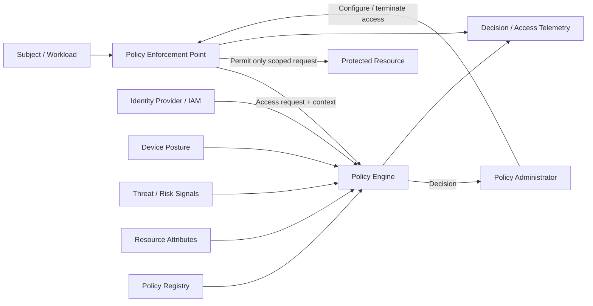
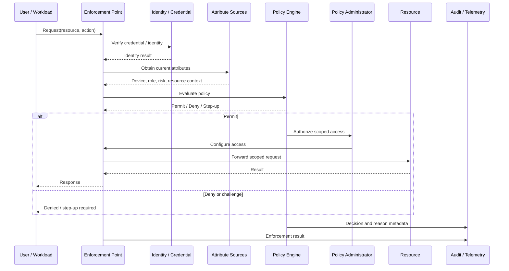
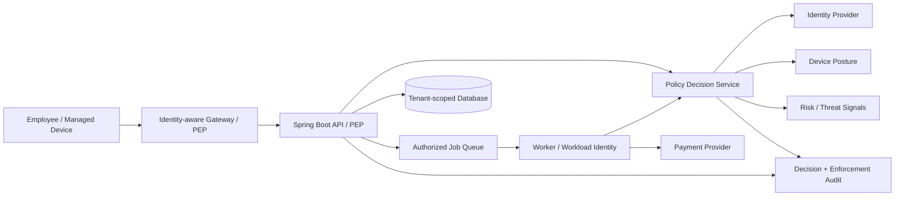

# Verify explicitly: Xác minh tường minh trong Zero Trust assurance

## 1. Mục tiêu học tập

Sau bài học, người học có thể:

1. Giải thích nguyên tắc **Verify explicitly** và lý do không suy ra độ tin cậy chỉ từ vị trí mạng, quyền sở hữu thiết bị hoặc lần đăng nhập trước.
2. Phân biệt **authentication, authorization, identity proofing, device posture, session assurance và continuous evaluation**; hiểu từng tín hiệu chứng minh điều gì và giới hạn của nó.
3. Phân tích yêu cầu truy cập theo **subject, resource, action, environment/context** và mục đích nghiệp vụ.
4. Thiết kế luồng quyết định gồm **Policy Engine (PE), Policy Administrator (PA) và Policy Enforcement Point (PEP)**, gắn với nguồn identity, device, risk và resource attributes.
5. Áp dụng least privilege, deny by default, short-lived credentials, step-up authentication và policy evaluation cho người dùng lẫn workload.
6. Thiết kế xác minh cho API, service-to-service, database, admin plane, cloud resources, SaaS và data access.
7. Đánh giá bằng chứng về policy, identity, device, enforcement, telemetry, negative tests, session revocation và thay đổi ngữ cảnh.
8. Lập **risk–control–evidence mapping** và kế hoạch kiểm thử positive/negative/failure cho kiến trúc Java/Spring Boot.
9. Đánh giá design effectiveness, operating effectiveness, residual risk và cách duy trì Zero Trust assurance khi hệ thống thay đổi.

Bài thuộc chương **Zero Trust assurance** của module **SECURITY_SECURITY_ASSURANCE**. Module hướng tới việc đánh giá có bằng chứng rằng hệ thống đáp ứng mục tiêu bảo mật, từ rủi ro và security controls đến kiểm thử, audit, khắc phục phát hiện và assurance liên tục. Trong Zero Trust, **Verify explicitly** là nguyên tắc yêu cầu mỗi quyết định truy cập dựa trên danh tính, tài nguyên, hành động và ngữ cảnh đáng tin, với mức kiểm tra tương xứng rủi ro. Câu hỏi assurance là: **“Ta chứng minh được điều kiện truy cập đã được xác minh và thực thi đúng ở mọi đường vào quan trọng như thế nào?”**

## 2. Verify explicitly là gì?

**Verify explicitly** nghĩa là xác thực và ủy quyền dựa trên các tín hiệu liên quan, có thể kiểm chứng, trước khi cho phép truy cập vào tài nguyên. Quyết định không dựa đơn thuần vào việc request xuất phát từ mạng nội bộ, thiết bị thuộc công ty hoặc người dùng đã đăng nhập từ trước.

Các tín hiệu có thể bao gồm:

- Danh tính chủ thể: người dùng, service account, workload, thiết bị hoặc đối tác.
- Bằng chứng xác thực: phương thức đăng nhập, MFA, khóa phần cứng, chứng thư hoặc workload credential.
- Quyền hiện tại: role, group, entitlement, relationship và purpose.
- Tài nguyên: loại dữ liệu, tenant, độ nhạy cảm, owner và trạng thái.
- Hành động: read, update, export, approve, administer, sign hoặc delete.
- Ngữ cảnh: thời gian, vị trí ở mức phù hợp, thiết bị, network path, session và risk signals.
- Tình trạng hiện tại: credential có bị thu hồi, thiết bị có bị đánh dấu compromised, policy có còn hiệu lực không.
- Mức assurance: độ tin cậy và độ mới của từng tín hiệu.

**Xác minh tường minh không có nghĩa yêu cầu người dùng nhập MFA ở mọi thao tác.** Nó có nghĩa hệ thống đánh giá quyền và điều kiện truy cập cho từng request theo policy, đồng thời áp dụng step-up hoặc kiểm tra bổ sung khi rủi ro/ngữ cảnh yêu cầu.

### 2.1. Không có implicit trust theo vị trí mạng

Một request từ subnet nội bộ không mặc nhiên an toàn. Kẻ tấn công có thể chiếm máy trạm, lấy credential/token, khai thác service có quyền quá rộng, di chuyển ngang giữa workload hoặc tận dụng VPN/jump host đã bị xâm nhập.

Network location vẫn có thể là **một tín hiệu context**, nhưng không thay thế identity verification, authorization và kiểm soát resource.

### 2.2. Verify explicitly là quyết định có căn cứ

Ví dụ policy:

> Cho phép nhân viên thuộc bộ phận đối soát đọc trạng thái giao dịch trong tenant được giao khi danh tính và session hợp lệ, thiết bị đáp ứng baseline cần thiết, mục đích truy cập phù hợp và không có tín hiệu rủi ro nghiêm trọng. Thao tác export hoặc phê duyệt giao dịch lớn cần quyền riêng và xác minh tăng cường.

Phát biểu này có thể chuyển thành **subject attributes, resource attributes, action, context, decision và evidence** để kiểm thử.

## 3. Zero Trust là mô hình bảo vệ tài nguyên

Zero Trust không phải một sản phẩm đơn lẻ, cũng không đồng nghĩa “không tin ai”. Đây là cách tổ chức kiến trúc và kiểm soát để **không cấp quyền mặc định chỉ vì một chủ thể đã ở bên trong một network boundary**.

Các nguyên tắc thường gặp:

- Bảo vệ tài nguyên như dữ liệu, ứng dụng, workload, dịch vụ và hạ tầng.
- Xác thực và ủy quyền rõ ràng trước khi tạo quyền truy cập.
- Áp dụng least privilege theo tài nguyên, hành động và thời gian.
- Giả định có thể đã xảy ra compromise; hạn chế blast radius và lateral movement.
- Đưa nhiều tín hiệu đáng tin vào quyết định policy.
- Theo dõi trạng thái và đánh giá lại khi context/risks thay đổi.
- Thu thập telemetry đủ để kiểm tra quyết định và phát hiện bất thường.

Một triển khai có thể dùng network segmentation, identity-aware proxy, mTLS, endpoint management, IAM, policy engine và SIEM. Tuy nhiên, **sự hiện diện của các thành phần không chứng minh nguyên tắc đã được thực thi**. Assurance cần chứng minh request được kiểm tra đúng và policy không bị bypass.

## 4. Phân biệt authentication, authorization và assurance

| Khái niệm | Câu hỏi | Ví dụ | Điều không chứng minh |
| --- | --- | --- | --- |
| **Identity proofing** | Danh tính được xác lập/đối chiếu ban đầu ra sao? | Kiểm tra hồ sơ khi cấp tài khoản | Không chứng minh người dùng hiện tại là đúng người |
| **Authentication** | Ai hoặc workload nào đang trình credential? | Passkey, certificate, token | Không tự chứng minh được phép truy cập mọi resource |
| **Authorization** | Subject được làm gì với resource nào? | Cho phép đọc giao dịch trong tenant A | Không chứng minh credential/device hiện tại còn an toàn |
| **Device posture** | Thiết bị có đáp ứng điều kiện được yêu cầu không? | OS patch, disk encryption, EDR status | Không chứng minh thiết bị không thể bị compromise |
| **Session assurance** | Phiên hiện tại có đủ mức bảo đảm và còn hiệu lực? | MFA freshness, session binding, expiry | Không bảo đảm mọi request tương lai vẫn an toàn |
| **Continuous evaluation** | Điều kiện truy cập có thay đổi cần đánh giá lại? | Thu hồi token, risk signal mới, thiết bị mất | Không có nghĩa mọi tín hiệu đều tức thời hoặc hoàn hảo |

Một token hợp lệ chỉ chứng minh các điều kiện liên quan đến việc phát hành và xác minh token. Ứng dụng vẫn phải kiểm tra **issuer, audience, thời hạn, chữ ký, scope/claims và authorization theo resource**.

## 5. Mô hình quyết định truy cập: subject, resource, action, context

| Thành phần | Thuộc tính ví dụ | Câu hỏi |
| --- | --- | --- |
| **Subject** | user/workload ID, tenant, role, group, authentication method | Ai đang yêu cầu? |
| **Resource** | resource ID, owner, tenant, classification, state | Tài nguyên nào được yêu cầu? |
| **Action** | read, write, export, approve, delete, administer | Chủ thể muốn làm gì? |
| **Context** | device posture, session age, time, risk, network, transaction value | Điều kiện hiện tại có cho phép không? |

Có thể biểu diễn quyết định:

```text
Decision = Policy(
    Subject,
    Resource,
    Action,
    Context,
    CurrentPolicy,
    CurrentRisk
)
```

Kết quả không chỉ có allow/deny. Policy engine có thể trả Permit, Deny, Step-up, Challenge/Remediate, Limited access hoặc Indeterminate. Khi thiếu dữ liệu hoặc policy dependency lỗi, hành vi phải được quy định rõ.

### 5.1. Attributes phải có nguồn và độ mới

Nếu policy dựa vào group membership, device compliance hoặc risk score, cần biết nguồn phát ra, ai có quyền thay đổi, thời điểm cập nhật, cơ chế integrity, cache/replication delay, hành vi khi nguồn không khả dụng và cách diễn giải giá trị thiếu.

Không nên mặc định **missing signal = safe**. Cách xử lý phải dựa vào mức rủi ro và policy đã phê duyệt.

## 6. Policy Engine, Policy Administrator và Policy Enforcement Point

Trong kiến trúc Zero Trust, ba vai trò logic thường được phân biệt:

- **Policy Engine (PE):** đánh giá request theo policy và các tín hiệu, đưa ra quyết định permit, deny hoặc điều kiện khác.
- **Policy Administrator (PA):** thiết lập/điều phối đường truy cập dựa trên quyết định, có thể tạo, duy trì hoặc kết thúc session/connection.
- **Policy Enforcement Point (PEP):** thực thi quyết định tại điểm truy cập; request không được phép không đi tới resource.

Các thành phần hỗ trợ có thể cung cấp identity, device, threat intelligence, security analytics, PKI và logging.



### 6.1. PEP phải bao phủ mọi đường vào

Một API có PEP tại gateway nhưng database, internal admin endpoint, worker queue hoặc object storage cho phép truy cập trực tiếp có thể tạo bypass.

Cần xác định PEP tại các điểm thích hợp: API Gateway/ingress, service-to-service boundary, application/service layer, database/data access layer, admin console/control plane, message broker/worker, object storage/download endpoint và cloud management API.

Không phải mọi request cần cùng một sản phẩm PEP, nhưng **mọi đường truy cập quan trọng phải có enforcement tương đương với mục tiêu bảo vệ**.

### 6.2. PDP/PE/PIP và cách đặt tên

Một số kiến trúc dùng thuật ngữ **Policy Decision Point (PDP)** cho chức năng quyết định và **Policy Information Point (PIP)** cho nguồn attributes. Trong mô hình PE/PA/PEP, policy engine thường tổng hợp thông tin từ các nguồn hỗ trợ. Tổ chức có thể chọn cách phân lớp khác nhau; điều quan trọng là phân định rõ **ai cung cấp tín hiệu, ai quyết định và ai thực thi**.

## 7. Xác minh danh tính người dùng

Đối với human identity, cần kiểm tra:

1. Tài khoản được cấp đúng người và thuộc vòng đời nhân sự hợp lệ.
2. Credential được đăng ký và bảo vệ theo assurance level phù hợp.
3. MFA/strong authentication được áp dụng cho thao tác/rủi ro tương ứng.
4. Session/token có issuer, audience, expiry và claims đúng.
5. Credential hoặc session bị thu hồi khi tài khoản/thiết bị/risk thay đổi.
6. Authorization kiểm tra action và resource cụ thể.
7. Quyền đặc quyền có approval, time-bound access và audit.

### 7.1. MFA không thay thế authorization

Nhân viên đăng nhập bằng passkey và MFA có thể đã xác thực tốt, nhưng vẫn không có quyền xem khách hàng tenant khác, export toàn bộ ledger, thay đổi key policy, approve giao dịch của chính họ hoặc đọc secrets production chỉ vì thuộc nhóm developer.

Mức authentication assurance trả lời một phần về **cách chứng minh danh tính**. Authorization vẫn cần subject–resource–action–context.

### 7.2. Step-up theo rủi ro

Ví dụ policy có thể yêu cầu:

- Đọc dashboard thông thường: session hợp lệ và thiết bị đạt baseline.
- Export dữ liệu nhạy cảm: quyền export riêng, MFA gần đây và purpose được phê duyệt.
- Thay đổi KMS policy: privileged role, phishing-resistant authentication, approval và session ngắn.
- Giao dịch vượt ngưỡng rủi ro: xác minh bổ sung hoặc approval thứ hai.

Ngưỡng, freshness window và mức xác thực phải được xác định theo risk assessment; không hard-code một con số dùng cho mọi thao tác.

## 8. Xác minh workload và machine identity

Workload cũng là subject. Một service account hoặc pod không đáng tin chỉ vì chạy trong cluster nội bộ.

Các thuộc tính có thể xác minh: workload identity/subject URI, namespace/service/deployment/environment, certificate/key binding, image digest/provenance, runtime identity/quyền, service owner/purpose, credential expiry/rotation/revocation và policy cho phép workload gọi resource nào.

### 8.1. mTLS chứng minh điều gì?

mTLS giúp hai phía xác thực certificate của nhau và bảo vệ kênh truyền. Tuy nhiên, certificate hợp lệ không tự cho phép gọi mọi API; service identity không thay thế end-user authorization; workload bị compromise vẫn có thể dùng credential hợp lệ; certificate chưa bị revoke có thể vẫn được chấp nhận nếu trust path chưa cập nhật.

Cần kết hợp **workload identity + authorization policy + least privilege + telemetry + credential lifecycle**.

### 8.2. Delegation và confused deputy

Khi API nhận yêu cầu từ user rồi enqueue job cho worker, worker cần biết requester ban đầu, hành động được ủy quyền, scope resource, thời hạn job, thời điểm cần kiểm tra lại quyền và cách ngăn worker thực hiện quyền rộng hơn requester.

Không chuyển access token người dùng nguyên vẹn vào queue mà không xem xét exposure, replay và delegation semantics. Dùng job authorization context có integrity protection, scope rõ và thời hạn phù hợp.

## 9. Device posture và endpoint context

Device posture là tập tín hiệu về tình trạng thiết bị, có thể gồm thiết bị được đăng ký/managed, OS version và patch status, disk encryption, EDR health, secure boot/hardware-backed key khi phù hợp, screen lock, jailbreak/root detection, device certificate và trạng thái lost/stolen/quarantined.

### 9.1. Posture là tín hiệu, không phải chứng nhận an toàn tuyệt đối

Một thiết bị compliant vẫn có thể bị compromise sau lần đánh giá gần nhất. Ngược lại, thiết bị không gửi được telemetry do network outage không nhất thiết đã bị tấn công.

Policy nên phân biệt:

- **Compliant:** các tín hiệu bắt buộc được xác minh đạt.
- **Non-compliant:** có bằng chứng không đạt baseline.
- **Unknown/stale:** thiếu hoặc quá cũ để ra quyết định đáng tin.
- **Compromised/quarantined:** có tín hiệu rủi ro cao cần giới hạn hoặc chặn.

Cách xử lý từng trạng thái phải dựa vào resource sensitivity và action risk.

### 9.2. Device attestation và nguồn dữ liệu

Cần đánh giá ai phát hành posture, thiết bị có thể giả mạo không, dữ liệu có freshness, device identity có bị sao chép và cách revoke khi mất thiết bị. Không đưa thông tin vị trí hoặc telemetry cá nhân vượt mức cần thiết vào policy/logging.

## 10. Resource-centric authorization và data access

Zero Trust tập trung bảo vệ **resource**. Một resource có thể là bản ghi giao dịch/hồ sơ khách hàng, tập dữ liệu/bảng/bucket/object, API endpoint/chức năng nghiệp vụ, service account/secret/key/certificate, cloud control plane, source repository/CI artifact, admin console hoặc audit evidence.

Một policy cần xác định resource owner và tenant, classification/sensitivity, purpose và allowed consumers, action-level permissions, context/approval requirements, data residency constraints nếu áp dụng, retention/lifecycle và quan hệ cần bảo vệ.

### 10.1. RBAC, ABAC và relationship-based authorization

**RBAC** dùng role để gom quyền, hữu ích cho trách nhiệm ổn định. **ABAC** đánh giá thuộc tính subject/resource/action/environment. **Relationship-based authorization** mô tả quan hệ giữa chủ thể và tài nguyên.

Có thể kết hợp: role `RECONCILIATION_AGENT` cho phép xem trạng thái đối soát; ABAC giới hạn tenant và classification; relationship kiểm tra nhân viên được giao case; context yêu cầu thiết bị managed và session phù hợp; export action yêu cầu step-up và approval riêng.

Role rộng như `ADMIN` không nên thay thế policy resource-level.

## 11. Policy design: least privilege và deny by default

Policy phải đủ cụ thể để giải thích vì sao request được phép.

Các nguyên tắc:

- **Default deny:** nếu không có rule cho phép rõ, từ chối hoặc trả trạng thái an toàn theo policy.
- **Least privilege:** chỉ cho phép resource/action cần thiết, trong phạm vi và thời gian cần thiết.
- **Separation of duties:** các hành động xung đột không do cùng một chủ thể hoàn tất khi cần.
- **Time-bound access:** quyền đặc quyền có expiry và tự thu hồi.
- **Purpose limitation:** dữ liệu chỉ được dùng cho mục đích được phép.
- **Context-aware:** dùng device/session/risk signals khi có giá trị.
- **Explicit exceptions:** ngoại lệ có owner, lý do, scope, expiry và evidence.
- **No hidden bypass:** đường admin/debug/support được bảo vệ tương đương.

### 11.1. Tránh policy quá rộng hoặc quá phức tạp

Policy có hàng trăm ngoại lệ chồng chéo khó đánh giá và dễ tạo quyền ngoài ý muốn. Cần phân lớp policy theo resource/data class, có canonical policy ID/version, review rule overlap/shadowing/unreachable rules, kiểm thử boundary/negative cases, ghi rationale/owner và retire rule không còn dùng.

### 11.2. Deny và Indeterminate

Nếu policy engine không liên hệ được identity provider hoặc posture service, hệ thống phải xác định **fail closed hay restricted mode** theo risk. Không để mỗi microservice tự diễn giải lỗi dependency theo cách khác nhau.

Với thao tác nhạy cảm, không thể xác minh điều kiện bắt buộc thường phải từ chối. Với thao tác ít rủi ro, có thể có degraded mode được duyệt, giới hạn rõ và theo dõi. Không dùng “fail open” chung cho mọi tài nguyên.

## 12. Session, token và continuous evaluation

Một session đã được xác thực không phải giấy phép vô hạn.

Các controls gồm token/session lifetime phù hợp risk, refresh token rotation/reuse detection, audience/issuer validation, scope/resource binding, session revocation/continuous access evaluation, step-up khi context/action đổi, idle timeout/absolute lifetime, client/device binding khi phù hợp và thu hồi khi account disabled/credential compromised/role changed.

### 12.1. Token claims không thay thế policy runtime

JWT có thể chứa role/scope, nhưng quyền có thể thay đổi sau khi token phát hành. Hệ thống cần xác định claims nào là snapshot và tồn tại bao lâu; thay đổi nào cần revoke/introspect/re-evaluate; policy decision cache có TTL bao lâu; làm sao phát hiện group/device posture đã đổi; token có thể replay từ thiết bị khác không; verifier cập nhật trust thế nào khi signing key rotate.

### 12.2. Continuous evaluation không đồng nghĩa đánh giá mọi thuộc tính theo thời gian thực

Một số hệ thống đánh giá lại tại mỗi request; một số dùng event-driven revocation, session revalidation hoặc short-lived credentials. Điều quan trọng là **trigger, độ trễ tối đa chấp nhận được, loại resource/action và hành vi khi không cập nhật được** phải được xác định.

Triggers có thể gồm user bị disable/chuyển team, device lost/compromised, credential/certificate revoked, risk signal thay đổi, resource classification đổi, policy version mới hoặc session có hành vi bất thường.

## 13. Context và risk signals: sử dụng có kiểm soát

Context có thể gồm time, network, device, transaction, threat intelligence, impossible travel hoặc behavior analytics. Nhưng context không phải chân lý tuyệt đối.

Đánh giá từng tín hiệu theo source, integrity, freshness, coverage, confidence, purpose, privacy, fallback và explainability.

### 13.1. Không dùng một risk score làm quyết định bí ẩn

Risk score có thể hữu ích, nhưng cần hiểu nguồn, trọng số, calibration, threshold, drift và false positives. Với thao tác quan trọng, policy nên có **điều kiện tối thiểu minh bạch** và khả năng giải thích vì sao permit/deny/step-up.

Không dùng vị trí địa lý đơn lẻ để kết luận người dùng là attacker; VPN, roaming và dữ liệu vị trí sai có thể gây nhầm.

## 14. Policy lifecycle và Policy as Code

Policy cần được quản lý như một artifact có version:

1. Xác định risk scenario và control objective.
2. Viết policy với subject/resource/action/context rõ.
3. Review bởi owner và security/privacy/legal khi liên quan.
4. Unit test, integration test và negative test.
5. Kiểm tra xung đột, shadowing và unreachable rules.
6. Deploy theo môi trường và rollout có kiểm soát.
7. Theo dõi decision telemetry và false positives/negatives.
8. Review định kỳ, thay đổi hoặc retire.
9. Lưu approval, version, build và evidence.

### 14.1. Policy as Code

Policy-as-code giúp version control/code review, automated tests/regression, diff policy giữa release và reproducible evaluation với test fixtures. Nhưng policy file trong Git không chứng minh production đã nạp đúng version. Cần **runtime policy version, deployment evidence và test của enforcement point**.

### 14.2. Shadow evaluation

Có thể chạy policy mới ở chế độ quan sát để so sánh quyết định trước khi enforce. Kết quả shadow chỉ là evidence về đánh giá mô phỏng; nó **không chứng minh PEP thực thi policy mới**. Phải tách metrics shadow và enforcement, có rollout/rollback plan.

## 15. Ví dụ policy: ai được export dữ liệu giao dịch?

Ví dụ YAML khái niệm:

```yaml
policy:
  id: "TRANSFER-EXPORT-VERIFIED"
  version: "v4"
  effect: "deny_by_default"
  request:
    subject:
      identity_type: "human"
      required_attributes:
        - "authenticated_subject_id"
        - "active_employment_status"
        - "assigned_tenant"
        - "reconciliation_role"
    resource:
      type: "transaction-report"
      required_attributes:
        - "tenant_id"
        - "classification"
        - "owner"
    action: "export"
  conditions:
    all:
      - "subject.assigned_tenant == resource.tenant_id"
      - "subject.reconciliation_role == true"
      - "subject.active_employment_status == true"
      - "context.device_posture == compliant"
      - "context.session_assurance >= approved_level"
      - "context.step_up_is_fresh == true"
      - "context.purpose == approved_reconciliation_purpose"
      - "resource.export_enabled == true"
  decision:
    permit: "only_approved_fields_and_rows"
    otherwise: "deny"
  evidence:
    log:
      - "subject_reference"
      - "resource_reference"
      - "action"
      - "policy_id"
      - "policy_version"
      - "decision"
      - "reason_code"
      - "decision_timestamp"
```

Đây là **policy minh họa**, không phải cú pháp của một policy engine cụ thể. Thuộc tính, ngưỡng và điều kiện cần xác định theo identity schema, classification, risk assessment và business rules thực tế. Không ghi raw PII vào decision log.

## 16. Quy trình đánh giá một request

Một request có thể đi qua:

1. PEP nhận request và xác định subject/resource/action.
2. Authentication layer xác minh credential và token.
3. PIP/attribute sources cung cấp trạng thái identity, device, resource và risk.
4. Policy engine kiểm tra policy version và quyết định.
5. Nếu cần, yêu cầu step-up hoặc remediation.
6. PA thiết lập/điều chỉnh quyền truy cập hoặc session.
7. PEP thực thi permit/deny tại boundary.
8. Resource layer tiếp tục kiểm tra invariants cần thiết, ví dụ tenant scope.
9. Telemetry ghi quyết định và kết quả với metadata tối thiểu.
10. Trigger sau đó có thể revoke session hoặc đánh giá lại.



Không phải mọi hệ thống đều cần một network connection do PA tạo; đây là mô hình logic. Có thể triển khai enforcement ở gateway, sidecar, service middleware hoặc data layer.

## 17. Java/Spring Boot: enforcement tại API và service layer

Ví dụ giả định: Transfer API phục vụ nhiều tenant. Nhân viên tenant A chỉ được đọc giao dịch của A. Request mang token hợp lệ nhưng truyền tenant B không được phép vượt qua.

### 17.1. Authorization context

```java
public record AccessRequest(
    String subjectId,
    String resourceType,
    String resourceId,
    String action,
    String tenantId,
    String purpose,
    String policyVersion
) {}

public enum AccessDecision {
    PERMIT,
    DENY,
    STEP_UP,
    INDETERMINATE
}

public record PolicyResult(
    AccessDecision decision,
    String reasonCode,
    String policyId,
    String policyVersion,
    Set<String> permittedFields
) {}
```

Các record trên là **mô hình minh họa**, không phải kiểu có sẵn trong Spring Security.

### 17.2. Không tin tenant từ client

```java
@Service
public class TransactionQueryService {
    private final PolicyDecisionService policy;
    private final TransactionRepository repository;

    public TransactionQueryService(
            PolicyDecisionService policy,
            TransactionRepository repository) {
        this.policy = policy;
        this.repository = repository;
    }

    public TransactionView getTransaction(
            AuthenticatedPrincipal principal,
            String transactionId,
            String requestedTenantId) {

        // Lấy tenant được gắn với principal từ nguồn identity đáng tin.
        String assignedTenant = principal.assignedTenantId();

        // Không để client tự đổi tenant scope.
        if (!assignedTenant.equals(requestedTenantId)) {
            throw new AccessDeniedException("Resource scope denied");
        }

        AccessRequest request = new AccessRequest(
            principal.subjectId(),
            "transaction",
            transactionId,
            "read",
            assignedTenant,
            "reconciliation",
            "current"
        );

        PolicyResult result = policy.evaluate(request);

        if (result.decision() != AccessDecision.PERMIT) {
            throw new AccessDeniedException("Policy denied");
        }

        // Query vẫn ràng buộc tenant ở data layer.
        return repository.findViewByIdAndTenantId(
                transactionId,
                assignedTenant,
                result.permittedFields())
            .orElseThrow(() -> new AccessDeniedException("Resource unavailable"));
    }
}
```

Đây là **pseudocode**. `AuthenticatedPrincipal`, `PolicyDecisionService` và repository method cần được định nghĩa trong ứng dụng. Implementation thật cần tenant/subject attributes từ identity source được xác minh; policy version lấy từ registry; resource owner/tenant lấy từ record hoặc trusted metadata; query có tenant predicate tại data layer chống IDOR/BOLA; không tiết lộ resource tồn tại hay không khi policy yêu cầu che giấu; cache decision có key gồm subject/resource/action/context/policy version và TTL phù hợp; policy engine failure có hành vi fail-safe; logs chỉ ghi opaque references và reason codes.

### 17.3. Spring Security không tự tạo Zero Trust

Spring Security có thể cung cấp authentication filters, authorization managers và method security. Nhưng cấu hình `authenticated()` chỉ xác nhận request có authentication, không tự chứng minh người dùng được truy cập record cụ thể, tenant scope đúng, device posture đạt, purpose hợp lệ, session còn phù hợp hoặc quyết định được đánh giá lại khi risk thay đổi.

Cần kiểm tra **authorization theo object/resource**, policy context và enforcement ở các boundary thực.

## 18. Service-to-service và workload authorization

Trong microservices, không nên chỉ cho phép “mọi pod trong cluster gọi mọi service”.

Một request giữa hai workload cần xác minh caller/target workload identity, action/API, resource/tenant scope, delegation context, certificate/token validity, audience và runtime deployment identity.

### 18.1. mTLS + authorization

mTLS có thể xác thực service A đang kết nối service B. Policy tiếp theo cần trả lời service A có quyền gọi `POST /transfers/{id}/approve` không, trong tenant nào và thay mặt subject nào.

Nếu mọi service dùng cùng một certificate hoặc service account, identity granularity thấp và blast radius lớn. Nên cấp identity riêng theo workload/service boundary, với lifecycle và quyền tương xứng.

### 18.2. Queue và asynchronous jobs

- Producer được xác minh và có quyền tạo loại job đó.
- Message được bảo vệ integrity và chống replay theo nhu cầu.
- Job mang scope tối thiểu và requester/delegation reference.
- Consumer xác minh producer/job authenticity.
- Worker chỉ có quyền resource cần thiết.
- Quyền hoặc approval có thể cần re-check tại thời điểm thực thi.
- DLQ, retry và replay không được bỏ qua authorization.

## 19. Privileged access và break-glass

Admin plane có thể gây tác động lớn nên cần privileged identity tách khỏi tài khoản thường, MFA mạnh và session ngắn, JIT access có lý do/thời gian, approval hoặc dual control, command/action-level audit, access review và revoke khi hết nhu cầu.

### 19.1. Break-glass không phải bypass vô hạn

Một tình huống khẩn cấp có thể cần quyền đặc biệt, nhưng cần ghi trigger/incident ID và lý do; người phê duyệt hoặc cơ chế emergency được duyệt; subject, resource, actions và expiry; giới hạn hành động; telemetry/record; người hậu kiểm và thời điểm; việc thu hồi và xác minh sau sử dụng.

Nếu emergency account không có owner, không kiểm thử và không cảnh báo khi dùng, đó là một đường implicit trust.

## 20. Bằng chứng cho Verify explicitly

| Claim | Evidence |
| --- | --- |
| Danh tính user/workload được xác minh | IdP configuration, credential policy, token/cert validation tests |
| Mỗi request quan trọng được ủy quyền | PEP coverage, API inventory, negative authorization tests |
| Resource scope/tenant được ràng buộc | Data model, query review, cross-tenant tests |
| Device/context được dùng theo policy | Posture source, freshness, decision traces, stale/unknown tests |
| Least privilege được thực thi | IAM/policy export, role mapping, access review |
| Quyền đặc quyền có giới hạn | JIT records, approvals, expiry/revocation logs |
| Thay đổi context làm đánh giá lại | Trigger tests, session revoke/step-up evidence |
| Policy đúng version chạy ở production | Policy registry revision, deployment/runtime version |
| Deny/indeterminate được xử lý an toàn | Failure tests, timeout/outage tests |
| Bypass paths được kiểm soát | Architecture/route inventory, direct-access tests |
| Quyết định có thể giải thích | Decision logs, reason codes, source references |
| PII trong telemetry được giảm thiểu | Logging schema review, redaction tests, access policy |

### 20.1. Evidence quality

Mỗi artifact cần evidence ID và claim/control ID, service/environment/region/tenant/resource scope, build/config/policy version, source/collector và thời gian UTC, method/result, population/sample/coverage/exclusions, integrity/provenance, reviewer/owner, limitations và next review trigger.

Evidence phải **đúng claim, đúng phạm vi và còn hiệu lực**. Test staging không tự chứng minh production; policy export không chứng minh PEP đã nạp policy; dashboard không chứng minh tất cả routes được bảo vệ.

## 21. Risk–control–evidence mapping

| Risk | Control objective | Control | Evidence |
| --- | --- | --- | --- |
| ZT-01: token hợp lệ truy cập tenant khác | Resource authorization theo tenant | Server-side scope + data-layer predicate | Cross-tenant negative test, query review |
| ZT-02: thiết bị mất vẫn dùng session | Thu hồi/đánh giá lại session | Device state signal, token revoke, session evaluation | Lost-device simulation, revocation trace |
| ZT-03: workload bị compromise di chuyển ngang | Giới hạn service identity và actions | Workload identity, mTLS, service authorization | Certificate/identity tests, denied-call logs |
| ZT-04: quyền admin tồn tại vô hạn | Privileged access time-bound | JIT, approval, expiry | JIT records, expiry/revoke tests |
| ZT-05: posture cũ được coi là compliant | Tín hiệu có freshness | Posture timestamp/TTL và stale policy | Stale-signal test, decision trace |
| ZT-06: PE lỗi làm PEP fail open | Không cấp quyền khi không đánh giá được | Fail-safe policy và restricted mode | Policy outage/fault injection |
| ZT-07: PEP bị bypass qua direct path | Bao phủ mọi đường vào | Network/resource enforcement | Route inventory, direct-access tests |
| ZT-08: token claim cũ sau đổi role | Quyền được cập nhật theo risk | Short-lived token/revocation/introspection | Role-change and stale-token tests |
| ZT-09: policy drift ngoài kiểm soát | Policy version được quản trị | Policy as code, approval, runtime version | Git review, deployed revision, drift alert |
| ZT-10: break-glass thành backdoor | Emergency access có giới hạn | JIT exception, alert, post-review | Tabletop, usage audit, expiry tests |
| ZT-11: context giả mạo | Chỉ dùng attribute có nguồn tin cậy | Signed/trusted attribute sources | Source validation and tampering tests |
| ZT-12: log quyết định lộ dữ liệu cá nhân | Evidence đủ nhưng tối thiểu hóa | Structured reason codes, redaction | Log inspection, privacy tests |

Một control có thể xử lý nhiều risks; một risk có thể cần nhiều controls. Giữ canonical IDs và ghi rõ dependency, tránh cộng số lượng control như thể coverage đã hoàn tất.

## 22. Kiểm thử Zero Trust: positive, negative và failure

| Test ID | Kịch bản | Kết quả mong muốn |
| --- | --- | --- |
| ZT-T01 | User hợp lệ, đúng tenant, đúng resource/action | Permit trong scope đã duyệt |
| ZT-T02 | User token hợp lệ nhưng tenant khác | Deny, không có side effect |
| ZT-T03 | User có role nhưng không được giao resource | Deny |
| ZT-T04 | Token sai issuer/audience/chữ ký hoặc hết hạn | Authentication thất bại |
| ZT-T05 | Device posture non-compliant | Deny hoặc restricted/step-up theo policy |
| ZT-T06 | Device posture stale/unknown | Xử lý theo policy; không tự coi safe |
| ZT-T07 | Credential/session bị revoke | Request mới bị từ chối trong latency được xác định |
| ZT-T08 | Role bị thu hồi sau token issue | Quyền không tiếp tục tồn tại ngoài giới hạn chấp nhận |
| ZT-T09 | Service A gọi API không thuộc scope | Deny dù mTLS hợp lệ |
| ZT-T10 | Queue message bị sửa hoặc replay | Integrity/replay control phát hiện hoặc chặn |
| ZT-T11 | Policy Engine unavailable | Fail-safe/restricted mode theo risk |
| ZT-T12 | PEP bị truy cập trực tiếp qua alternate route | Bị chặn hoặc có enforcement tương đương |
| ZT-T13 | Break-glass hết hạn | Không tiếp tục có quyền |
| ZT-T14 | Context risk tăng giữa session | Re-evaluate/step-up/revoke theo trigger |
| ZT-T15 | Decision cache dùng policy version cũ | Cache invalidation/versioning hoạt động |
| ZT-T16 | Resource classification đổi | Policy mới được áp dụng trong thời gian xác định |
| ZT-T17 | Workload identity bị rotate | Service hợp lệ tiếp tục; credential cũ không được chấp nhận theo policy |
| ZT-T18 | Decision log được tạo | Có reason/source/version nhưng không lộ raw PII/token |
| ZT-T19 | Policy có rule conflict hoặc missing attribute | Không tạo permit ngoài ý muốn; có test/alert |
| ZT-T20 | Admin cố thay policy không có approval | Change bị chặn hoặc được phát hiện theo control |

### 22.1. Kiểm tra không có side effects khi deny

Một API trả 403 nhưng đã enqueue job hoặc ghi file export trước đó vẫn có thể gây lộ dữ liệu. Negative tests cần kiểm tra không tạo transaction/job, không ghi object/cache, không phát event chứa dữ liệu, không tiết lộ resource metadata ngoài policy, không để worker tiếp tục job bị revoke và decision log không chứa raw data.

### 22.2. Kiểm thử latency và consistency

Zero Trust có thể phụ thuộc nhiều nguồn identity/posture/policy. Cần đo thời gian đánh giá, độ trễ revoke/role change/device lost, cache TTL/invalidation, event propagation/retry, hành vi khi attribute sources phân vùng và khác biệt giữa regions/replicas.

Đặt SLO và giới hạn chấp nhận dựa vào rủi ro; không tuyên bố “continuous” nếu re-evaluation có độ trễ không được đo.

## 23. Failure handling và resilience

| Failure | Rủi ro | Hành vi cần định nghĩa |
| --- | --- | --- |
| Identity Provider outage | Không xác minh identity mới | Từ chối hoặc degraded mode giới hạn |
| Policy Engine timeout | Không có decision đáng tin | Fail-safe cho thao tác nhạy cảm |
| Device posture unavailable | Context không đủ | Unknown state và policy xử lý |
| Revocation event delayed | Credential cũ tiếp tục được chấp nhận | Short lifetime, polling/introspection hoặc compensating control |
| PEP unreachable | Resource có thể bị bypass | Network/resource boundary không cho truy cập trực tiếp |
| Attribute source poisoned | Policy nhận dữ liệu giả | Integrity/source validation và alert |
| Policy deployment lỗi | Một số PEP dùng version khác | Version pinning, rollout/rollback và drift detection |
| Clock skew | Token/expiry sai | Clock health, bounded skew và monitoring |
| Log pipeline outage | Mất audit visibility | Protected buffering, alert và gap record |

Không phải mọi failure đều phải gây ngừng toàn bộ hệ thống. Nhưng với action nhạy cảm, **không xác minh được điều kiện bắt buộc không được biến thành permit mặc định**.

## 24. Telemetry và audit: giải thích quyết định mà không lộ dữ liệu

Một decision event hữu ích có thể ghi request/correlation ID, subject/resource reference dạng opaque, action, policy ID/version, decision/reason code, attribute source/freshness, PEP/service/environment, timestamp/latency, step-up outcome, enforcement result và exception/break-glass reference.

Tránh log raw access token, cookie, private key, secret, toàn bộ payload/PII, vị trí chính xác hoặc telemetry thiết bị không cần thiết và full query/body khi chỉ cần metadata.

### 24.1. Decision log không tự chứng minh enforcement

Policy Engine có thể ghi `PERMIT`, nhưng PEP có thể không nhận decision hoặc route khác bypass. Cần kết hợp **decision telemetry + enforcement result + resource access evidence** để chứng minh.

### 24.2. Bảo vệ log

Audit logs phải có access control, integrity, retention, monitoring và khả năng phát hiện gap. Người có quyền thay policy không nên tùy ý xóa log quyết định. Khi log pipeline hỏng, phải có alert và cách xác định khoảng thời gian evidence bị thiếu.

## 25. Design effectiveness và operating effectiveness

### 25.1. Design effectiveness

Câu hỏi: nếu kiến trúc vận hành đúng như thiết kế, Verify explicitly có thể ngăn truy cập trái quyền trong các tình huống quan trọng không?

Review resource inventory/trust boundaries, subject/workload identity, authentication/authorization separation, PE/PA/PEP coverage và bypass analysis, policy attributes/source integrity/freshness, least privilege/JIT/exception model, continuous evaluation triggers/latency, failure handling, telemetry/privacy và negative test strategy.

### 25.2. Operating effectiveness

Câu hỏi: controls có thật sự vận hành trên build, policy version, environment và kỳ đánh giá không?

Evidence gồm runtime policy version và PEP deployment state, identity/device attribute health, access decisions/enforcement records, token/certificate revocation tests, role/access review và JIT records, negative tests xuyên tenant/service boundaries, direct path/bypass assessments, policy drift/cache freshness/dependency outage records, incident findings/remediation/retest và vendor evidence đúng scope.

### 25.3. Trạng thái kết luận

| Trạng thái | Ý nghĩa |
| --- | --- |
| **Designed** | Có kiến trúc/policy được review |
| **Implemented** | Có code/config, chưa đủ evidence runtime |
| **Verified in scope** | Đã kiểm tra các paths/resources/conditions được nêu |
| **Partial** | Một số PEP, services hoặc context chưa được đánh giá |
| **Failed** | Có đường truy cập trái policy hoặc enforcement không hoạt động |
| **Insufficient evidence** | Không đủ nguồn/phạm vi/độ mới để kết luận |
| **Accepted exception** | Có risk owner chấp nhận ngoại lệ có scope/expiry; không đồng nghĩa control đạt |

## 26. Case study: Zero Trust assurance cho nền tảng chuyển tiền

### 26.1. Bối cảnh

Một nền tảng Java/Spring Boot phục vụ nhiều doanh nghiệp (tenant). Nhân viên truy cập portal để đối soát giao dịch. Workload gồm API, report service, queue worker và payment connector.

Mục tiêu: nhân viên tenant A chỉ xem dữ liệu tenant A; export yêu cầu quyền riêng, session phù hợp và thiết bị đạt baseline; worker chỉ thực hiện job được ủy quyền; admin thay đổi policy phải có quyền đặc biệt và audit; khi tài khoản hoặc thiết bị bị compromise, quyền có thể bị giới hạn/thu hồi.

### 26.2. Trust boundaries



### 26.3. Tình huống lỗi

Một nhân viên tenant A có token hợp lệ. Endpoint nhận thêm query parameter `tenantId=B`; repository tìm giao dịch theo transaction ID mà không ràng buộc tenant. Gateway chỉ kiểm tra token và role chung.

**Lỗi:** authentication thành công, nhưng authorization không ràng buộc resource với tenant. Request đi qua PEP ở gateway nhưng thiếu enforcement tại resource/data layer.

### 26.4. Điều tra và remediation

1. Xác định build, route, thời gian và role có thể gọi endpoint.
2. Đo request thành công, job/export được tạo và resource bị truy cập; phân biệt confirmed với possible.
3. Tắt/giới hạn route lỗi và bảo toàn audit evidence.
4. Kiểm tra API, worker, search và export khác dùng chung repository/query.
5. Sửa scope lấy từ identity/resource source đáng tin, ràng buộc query tenant.
6. Bổ sung policy decision theo subject/resource/action/context.
7. Kiểm tra object storage/download và async job authorization.
8. Retest cross-tenant, wrong resource, revoked session và bypass routes.
9. Đánh giá tác động tới khách hàng, nghĩa vụ và thông báo nếu áp dụng.
10. Cập nhật risk register, threat model và assurance claim.

### 26.5. Evidence để đóng finding

- Pull request/code review cho tenant-bound query.
- Policy version và owner approval.
- Build digest đã triển khai production.
- Tests với token hợp lệ của A nhưng resource B.
- Direct route và worker path tests.
- Audit evidence cho denied request và không có side effects.
- Access review và monitoring cho policy drift.
- Scope/limitations của log trước thời điểm fix.
- Retest độc lập và residual risk decision.

Không đóng finding chỉ vì request thử nghiệm trả 403; phải xác nhận **đúng token, đúng resource, đúng đường code và không có side effect**.

## 27. Triển khai theo giai đoạn và migration

Có thể triển khai theo risk-based roadmap:

1. **Discover:** inventory users, workloads, devices, resources, data flows và access paths.
2. **Prioritize:** chọn tài nguyên nhạy cảm, admin plane, cross-tenant và service identities.
3. **Instrument:** bổ sung identity/context/policy decision telemetry và xác định coverage.
4. **Enforce core controls:** resource authorization, MFA/strong auth, workload identity và least privilege.
5. **Close bypass paths:** direct DB, legacy API, admin endpoint, object store và queues.
6. **Introduce continuous evaluation:** revocation, posture changes, short-lived credentials và step-up.
7. **Automate policy lifecycle:** tests, review, versioning, deployment và drift detection.
8. **Assure and improve:** retest, tabletop, independent assessment, metrics và risk treatment.

### 27.1. Shadow mode và staged rollout

Có thể bắt đầu bằng quan sát quyết định mới trước khi enforce, nhưng cần so sánh với policy hiện tại, phân tích false allow/false deny, tránh log raw PII, có owner duyệt threshold/exception, rollout theo resource/tenant/canary, rollback không mở rộng quyền và đo khác biệt giữa shadow decision và enforcement thực tế.

## 28. Metrics: đo coverage và hiệu lực

| Metric | Ý nghĩa | Cảnh báo |
| --- | --- | --- |
| Tỷ lệ critical resources có owner/classification/policy | Resource governance coverage | Inventory thiếu sẽ làm mẫu số sai |
| Tỷ lệ access paths có PEP | Enforcement coverage | PEP tồn tại chưa chắc chặn đúng |
| Tỷ lệ requests có subject/resource/action context | Decision input completeness | Attribute có thể sai/stale |
| Tỷ lệ policies có owner/version/tests | Policy governance | File có test không chứng minh production nạp đúng |
| Tỷ lệ privileged access JIT/time-bound | Giảm quyền tồn tại lâu | Cần kiểm tra expiry/revoke thực tế |
| Thời gian revoke tới enforcement | Hiệu quả continuous evaluation | Cần đo p50/p95 và giới hạn theo risk |
| Tỷ lệ stale/unknown posture | Chất lượng tín hiệu | Không ép unknown thành compliant |
| Deny rate theo reason code | Hiểu hành vi policy | Deny cao không tự động là an toàn |
| Bypass findings | Khoảng trống PEP coverage | Cần kiểm tra alternate paths |
| Policy drift/version mismatch | Runtime governance | Cần inventory đầy đủ PEP |
| Unauthorized KMS/data access | Hiệu quả least privilege | Cần triage false positives |
| Incident lặp theo access path | Chất lượng remediation | Không dùng zero reports làm mục tiêu duy nhất |
| Evidence freshness | Bằng chứng còn đúng build/context? | Mới nhưng sai scope vẫn yếu |

Một chỉ số coverage có thể định nghĩa:

```text
PEP Coverage =
  Critical access paths with verified enforcement
  ------------------------------------------------
  Total inventoried critical access paths
```

Chỉ số có ý nghĩa nếu **inventory đầy đủ và “verified enforcement” có test evidence**. Không tính gateway là bao phủ database/worker/object store nếu các đường đó có thể truy cập trực tiếp.

### 28.1. Không tối ưu chỉ theo deny rate

Deny rate tăng có thể do policy đúng hơn, nhưng cũng có thể do cấu hình sai làm gián đoạn nghiệp vụ. Permit rate cao không chứng minh an toàn. Cần phân tích reason codes, false positives/negatives, resource sensitivity, incident signals và user impact.

## 29. Vai trò và trách nhiệm

| Vai trò | Trách nhiệm |
| --- | --- |
| **Security Architect** | Trust boundaries, Zero Trust architecture, policy design và assurance claims |
| **Identity/IAM Owner** | User/workload identity, credential lifecycle, federation và access governance |
| **Device Management Owner** | Posture signals, attestation, freshness và device revocation |
| **Resource/Data Owner** | Classification, ownership, allowed purposes và resource policy |
| **Application/Platform Engineering** | PEP enforcement, query scope, service identity và runtime integration |
| **Policy Owner** | Policy rationale, version, review, tests và exception |
| **SecOps/SOC** | Risk signals, telemetry, alerting và incident response |
| **QA/AppSec/Assessor** | Negative/failure tests, bypass review và evidence assessment |
| **Risk Owner** | Treatment/acceptance của residual risk theo thẩm quyền |
| **Internal Audit** | Đánh giá độc lập theo scope |
| **Vendor/Cloud Owner** | Shared responsibility và provider evidence |

Không để một nhóm vừa tự cấp đặc quyền, sửa policy, thực thi và tự phê duyệt evidence mà không có separation/review phù hợp.

## 30. Những sai lầm thường gặp

| Sai lầm | Hậu quả | Cách cải thiện |
| --- | --- | --- |
| Xem Zero Trust là một sản phẩm | Mua tool nhưng thiếu resource policy và assurance | Bắt đầu từ risk, resources và access paths |
| Tin mọi request từ mạng nội bộ | Lateral movement và compromised device | Verify identity/context và enforce per resource |
| MFA nghĩa là được truy cập | Authentication bị nhầm với authorization | Policy theo subject/resource/action |
| mTLS là đủ cho service authorization | Service hợp lệ gọi API ngoài scope | Action/resource-level workload policy |
| Chỉ có PEP ở gateway | Direct DB/worker/object path bypass | Inventory và test mọi critical paths |
| Role ADMIN cho mọi việc | Blast radius lớn | JIT, least privilege và separation of duties |
| Device compliant nghĩa là an toàn tuyệt đối | Bỏ qua stale/compromised state | Freshness, unknown state và reevaluation |
| Missing attribute coi là trusted | Policy fail open | Explicit unknown/indeterminate handling |
| Token dài hạn với quyền tĩnh | Role/device change không có hiệu lực kịp | Short-lived token, revoke/introspection |
| Chỉ kiểm tra policy ở lúc login | Session tiếp tục dù context đổi | Request evaluation và event-driven recheck |
| Policy as code là đủ | Runtime có thể chạy version khác | Deployment/runtime version evidence |
| Shadow decision là enforcement | Báo cáo quá mức | Tách shadow telemetry khỏi PEP result |
| Deny 403 là test pass | Có thể bị chặn vì lý do khác, đã tạo side effect | Assert đúng boundary và state changes |
| Fail open khi PE outage | Mất kiểm soát trong lúc lỗi | Risk-based fail-safe/restricted mode |
| Thu quá nhiều device/location data | Tạo privacy risk | Data minimization và purpose limitation |
| Không có owner cho exception | Quyền tạm thời tồn tại vô hạn | Owner, scope, expiry và review |
| Chỉ đo deny rate | Không biết false deny/false permit | Kết hợp coverage, quality và impact |
| Không xem async jobs | Worker thực hiện quyền vượt requester | Delegation context và reauthorization |
| Break-glass không hậu kiểm | Trở thành backdoor | Alert, expiry và independent review |
| Không gắn evidence với build/policy | Test cũ bị dùng cho phiên bản mới | Provenance và versioned claims |

## 31. Checklist Verify explicitly

- [ ] Đã lập inventory subject, workload, device, resource và access paths?
- [ ] Resource có owner, classification, tenant và allowed purpose?
- [ ] Authentication và authorization được tách rõ?
- [ ] Mỗi critical request kiểm tra subject, resource, action và context?
- [ ] PEP bao phủ API, service, worker, data, admin và storage paths?
- [ ] Không có đường truy cập trực tiếp bypass enforcement?
- [ ] Policy có version, owner, rationale, tests và approval?
- [ ] Default deny, least privilege và separation of duties được thực thi?
- [ ] Identity/device/risk attributes có source, integrity và freshness?
- [ ] Unknown/stale signals có hành vi được định nghĩa?
- [ ] User và workload identities có lifecycle, rotation và revocation?
- [ ] mTLS được kết hợp authorization theo service/action/resource?
- [ ] Tenant/resource scope được ràng buộc ở data layer?
- [ ] Session/token có expiry, audience, issuer và revocation semantics?
- [ ] Có step-up cho action nhạy cảm và privileged access?
- [ ] Continuous evaluation có triggers và latency limits đo được?
- [ ] PE/IdP/PIP outage có fail-safe/restricted mode?
- [ ] Async job/queue/DLQ có integrity, delegation và replay controls?
- [ ] Break-glass có owner, scope, expiry, alert và post-review?
- [ ] Negative tests xác minh deny đúng nguyên nhân và không side effects?
- [ ] Có tests cho stale posture, revoked credential, policy drift và PEP bypass?
- [ ] Decision telemetry có policy version/reason code nhưng không lộ token/PII?
- [ ] Runtime evidence khớp build, environment, region và policy version?
- [ ] Findings có owner, remediation, retest và residual risk decision?
- [ ] Metrics có denominator/scope rõ và phản ánh coverage thực?

Checklist hỗ trợ thiết kế và đánh giá; không thay thế threat model, policy governance hoặc kiểm tra chuyên môn theo từng tài nguyên.

## 32. Bài tập vận dụng

**Bài 1 — Verify explicitly.** Một nhân viên đăng nhập MFA từ VPN nội bộ và mở hồ sơ tenant khác. Xác định tín hiệu đã được xác minh, tín hiệu còn thiếu, resource authorization và PEP cần có.

**Bài 2 — PE/PA/PEP.** Vẽ kiến trúc cho mobile → API → database và giải thích nguồn attributes, nơi quyết định, nơi thực thi, nơi ghi evidence.

**Bài 3 — Device posture.** Thiết bị bị đánh dấu non-compliant sau khi session được tạo. Thiết kế trigger, độ trễ chấp nhận được, revoke/step-up và tests.

**Bài 4 — Workload identity.** Service A có mTLS certificate hợp lệ nhưng gọi endpoint admin của service B. Xây policy và negative test chứng minh identity không đồng nghĩa permission.

**Bài 5 — Token stale.** Nhân viên bị chuyển team nhưng JWT còn role cũ. Đề xuất short-lived token, introspection/revocation/cache và assurance evidence.

**Bài 6 — Policy outage.** Policy Engine không khả dụng trong 5 phút. Phân loại thao tác high/low risk, xác định fail-safe/degraded mode, alert và recovery tests.

**Bài 7 — PEP bypass.** Gateway kiểm tra role nhưng worker có thể nhận job trực tiếp từ broker. Vẽ attack path và đề xuất producer identity, job integrity, delegation context và worker authorization.

**Bài 8 — Spring Boot BOLA.** API lấy transaction ID và tenant ID từ client. Viết test cho user hợp lệ truy cập đúng record, user khác tenant, resource không tồn tại và không có side effects khi deny.

**Bài 9 — Break-glass.** DBA cần quyền truy cập khẩn cấp khi production outage. Thiết kế approval, scope, expiry, audit, alert và post-event review.

**Bài 10 — Evidence package.** Xây hồ sơ claim “critical API routes enforce tenant-scoped authorization” gồm inventory, policy version, build, negative tests, runtime logs và limitations.

**Bài 11 — Context quality.** Device posture source gửi timestamp cũ nhưng trạng thái compliant. Xác định freshness policy, unknown state và cách tránh fail open.

**Bài 12 — Metrics.** Dashboard ghi 100% API gateway routes có PEP nhưng chưa kiểm tra database, queue và object store. Viết nhận định assurance và đề xuất denominator mới.

**Bài 13 — Shadow mode.** Policy mới tạo nhiều deny hơn policy cũ. Thiết kế rollout/canary, phân tích false positives, criteria để enforce và rollback không mở rộng quyền.

**Bài 14 — Continuous evaluation.** Thiết kế trigger matrix cho user disabled, device lost, key revoked, risk increased, resource classification changed và policy version updated.

**Bài 15 — Risk treatment.** Một service legacy không hỗ trợ workload identity mới. Viết exception có scope, compensating controls, owner, expiry và evidence cần để chấp nhận residual risk.

## 33. Kết luận

**Verify explicitly** yêu cầu quyết định truy cập dựa trên **danh tính, tài nguyên, hành động và ngữ cảnh đáng tin**, được thực thi tại các điểm bảo vệ resource và đánh giá lại khi điều kiện quan trọng thay đổi. Authentication, MFA, mTLS, device compliance, policy engine hay network segmentation đều có thể góp phần, nhưng từng thành phần chỉ chứng minh một phần của quyết định. Hệ thống vẫn cần authorization theo resource, least privilege, kiểm soát bypass, xử lý tín hiệu thiếu/cũ và hành vi an toàn khi dependency lỗi.

Trong **SECURITY_SECURITY_ASSURANCE**, một kết luận đáng tin phải truy vết **risk → resource/access path → policy objective → identity/context signals → PE/PA/PEP enforcement → negative/failure tests → runtime evidence → limitations → remediation và residual risk**. Bằng chứng phải chỉ rõ build, policy version, environment, phạm vi routes/resources, độ mới của tín hiệu và các đường chưa kiểm tra. Khi user, workload, device, resource hoặc threat context thay đổi, controls và evidence phải được đánh giá lại để duy trì assurance liên tục.
