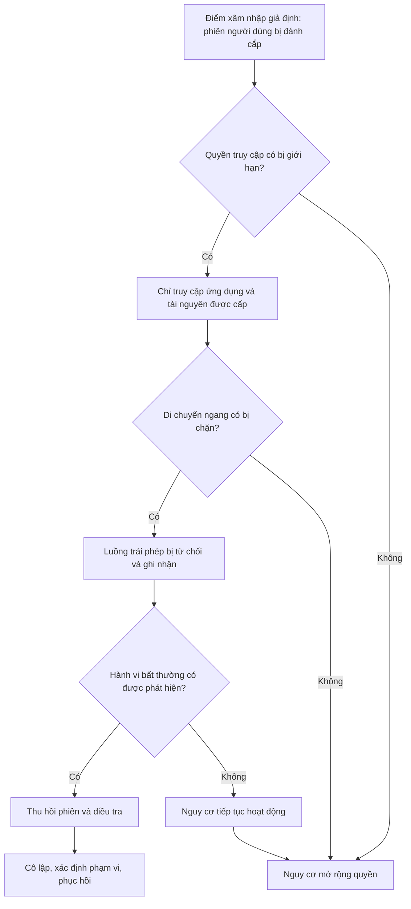
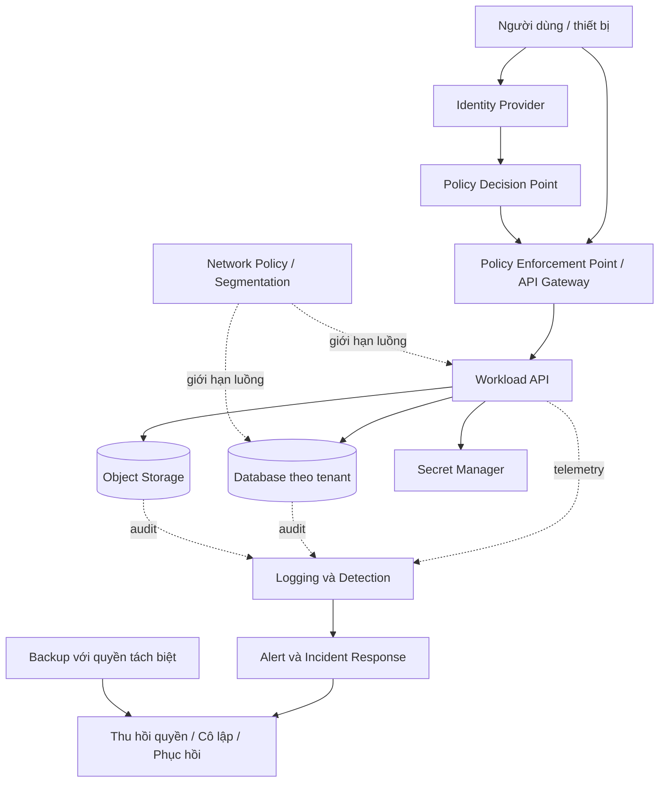
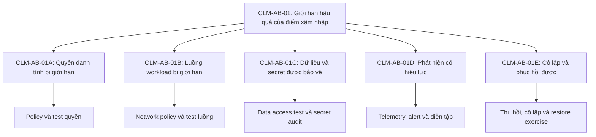

# Assume breach

Trong một hệ thống doanh nghiệp, kẻ tấn công có thể lấy được mật khẩu của nhân viên, đánh cắp phiên đăng nhập, chiếm một máy chủ ứng dụng hoặc khai thác một thư viện có lỗ hổng. Nếu thiết kế bảo mật chỉ dựa vào giả định rằng mạng nội bộ luôn đáng tin cậy và mọi thành phần bên trong đều an toàn, một điểm xâm nhập ban đầu có thể trở thành bàn đạp để truy cập nhiều hệ thống khác.

**Assume breach** là nguyên tắc thiết kế và vận hành yêu cầu tổ chức luôn tính đến khả năng một tài khoản, thiết bị, ứng dụng hoặc workload đã bị xâm phạm. Từ giả định đó, hệ thống phải giới hạn quyền và phạm vi truy cập, quan sát hoạt động, phát hiện hành vi bất thường, cô lập thành phần bị ảnh hưởng và phục hồi có kiểm soát. Nguyên tắc này là một phần quan trọng trong tư duy **Zero Trust**.

Trong chương trình **security assurance**, Assume breach đặt ra một câu hỏi thực tế: *Nếu một lớp phòng thủ đã thất bại và kẻ tấn công có được một điểm tựa ban đầu, các lớp kiểm soát còn lại có ngăn họ lan sang tài sản khác, phát hiện hành vi nguy hiểm, giới hạn thiệt hại và hỗ trợ phục hồi được không?* Câu trả lời cần dựa trên kiểm thử, cấu hình, dữ liệu vận hành và bằng chứng có thể truy vết.

## 1. Hiểu đúng nguyên tắc Assume breach

Assume breach không phải tuyên bố rằng hệ thống chắc chắn đã bị xâm nhập. Đây là cách đặt giả định bảo thủ khi thiết kế và kiểm tra hệ thống: **không dựa vào niềm tin rằng một lớp bảo vệ sẽ luôn ngăn được mọi cuộc tấn công**. Tổ chức vẫn phòng ngừa xâm nhập, nhưng đồng thời chuẩn bị cho tình huống phòng ngừa thất bại.

Một số câu hỏi thể hiện tư duy này:

- Nếu mật khẩu hoặc token của một nhân viên bị đánh cắp, kẻ tấn công có thể truy cập những ứng dụng và dữ liệu nào?
- Nếu một workload bị chiếm quyền, nó có thể gọi những dịch vụ nội bộ nào, đọc những bí mật nào và gửi dữ liệu ra đâu?
- Nếu một máy chủ trong subnet ứng dụng bị kiểm soát, phân đoạn mạng và chính sách truy cập có ngăn việc di chuyển ngang (*lateral movement*) không?
- Nếu tài khoản quản trị bị chiếm, có cơ chế giới hạn quyền, xác thực tăng cường, phê duyệt và ghi nhận hoạt động không?
- Nếu dữ liệu bị sửa hoặc mã hóa trái phép, tổ chức có phát hiện, xác định phạm vi và khôi phục bản sao sạch được không?

### 1.1. Assume breach trong Zero Trust

Zero Trust loại bỏ niềm tin mặc định chỉ dựa trên vị trí mạng, quyền truy cập trước đây hoặc việc một thiết bị đang ở trong mạng nội bộ. Quyết định truy cập cần dựa trên danh tính, trạng thái thiết bị hoặc workload, tài nguyên được yêu cầu, chính sách và tín hiệu rủi ro phù hợp. Quyền cần được giới hạn theo nhu cầu và có thể được đánh giá lại khi ngữ cảnh thay đổi.

Assume breach bổ sung một góc nhìn về hậu quả: ngay cả khi một danh tính hoặc thành phần đã vượt qua một bước xác thực, nó vẫn có thể bị xâm phạm. Vì vậy, xác thực thành công không đồng nghĩa với quyền truy cập vô hạn, và một vùng mạng nội bộ không nên trở thành vùng tin cậy rộng.

| Cách nghĩ dựa trên vùng tin cậy truyền thống | Tư duy Zero Trust và Assume breach |
| --- | --- |
| Thiết bị vào mạng nội bộ được xem là đáng tin hơn mặc định | Vị trí mạng không tự cấp quyền; mỗi yêu cầu được đánh giá theo danh tính, tài nguyên và chính sách |
| Một lần đăng nhập thành công có thể mở phiên truy cập rộng | Quyền được giới hạn theo ứng dụng, dữ liệu, hành động và thời gian cần thiết |
| Máy chủ trong cùng subnet có thể giao tiếp rộng | Luồng giao tiếp được cho phép rõ ràng; phân đoạn hạn chế di chuyển ngang |
| Tập trung vào ngăn chặn xâm nhập ban đầu | Kết hợp phòng ngừa, phát hiện, cô lập, ứng cứu và phục hồi |
| Sau khi cấp quyền, ít xem xét lại | Đánh giá lại quyền và ngữ cảnh khi có tín hiệu rủi ro hoặc thay đổi trạng thái |

### 1.2. Assume breach không thay thế phòng ngừa

Tổ chức vẫn cần vá lỗ hổng, MFA, bảo vệ endpoint, mã hóa, secure coding, quản lý danh tính và các biện pháp phòng thủ khác. Assume breach giúp kiểm tra xem các lớp kiểm soát còn lại có đủ sức hạn chế hậu quả nếu một biện pháp phòng ngừa thất bại hay không.

Nếu chỉ tập trung phát hiện sau xâm nhập mà bỏ qua phòng ngừa, tổ chức sẽ chấp nhận số sự cố không cần thiết. Ngược lại, nếu chỉ tập trung phòng ngừa, một lỗi đơn lẻ có thể tạo ra thiệt hại lớn vì hệ thống không được chuẩn bị cho tình huống bị vượt qua.

## 2. Mục tiêu bảo mật khi giả định đã có điểm xâm nhập

Assume breach chuyển trọng tâm từ câu hỏi “làm sao để không ai vào được?” sang một tập câu hỏi đầy đủ hơn: “nếu một chủ thể đã vào được, họ có thể làm gì, bị phát hiện khi nào, bị giới hạn ra sao và hệ thống phục hồi thế nào?”. Các mục tiêu thường gặp gồm:

1. **Giảm phạm vi ảnh hưởng (limit blast radius):** một tài khoản hoặc workload bị xâm phạm không được tự động mở đường đến toàn bộ môi trường.
2. **Ngăn di chuyển ngang:** hạn chế khả năng dùng điểm xâm nhập ban đầu để tiếp cận máy chủ, dịch vụ, tài khoản hoặc dữ liệu khác.
3. **Bảo vệ dữ liệu và thao tác quan trọng:** giới hạn đọc, sửa, xóa, xuất dữ liệu và thay đổi cấu hình theo quyền cụ thể.
4. **Phát hiện đủ sớm:** nhận biết hành vi khác thường hoặc vi phạm chính sách bằng telemetry có chất lượng và cảnh báo có thể hành động.
5. **Cô lập và thu hồi quyền:** vô hiệu hóa phiên, token, thông tin xác thực hoặc kết nối bị xâm phạm; cô lập thiết bị/workload trong phạm vi an toàn.
6. **Duy trì hoạt động thiết yếu:** giữ các chức năng quan trọng hoạt động hoặc phục hồi theo mục tiêu đã thống nhất.
7. **Khôi phục trạng thái đáng tin cậy:** phục hồi dữ liệu, danh tính, khóa và workload từ nguồn sạch; xác minh trước khi đưa trở lại production.
8. **Tạo bằng chứng:** có thể chứng minh các kiểm soát trên hoạt động trong phạm vi, phiên bản và điều kiện đã đánh giá.

### 2.1. Blast radius là gì?

*Blast radius* là phạm vi tài sản và hoạt động có thể bị ảnh hưởng khi một thành phần hoặc danh tính bị xâm phạm. Phạm vi này có thể gồm số lượng tài khoản, workload, hệ thống, tenant, bản ghi dữ liệu hoặc quy trình nghiệp vụ bị tác động.

Ví dụ, một tài khoản dịch vụ chỉ được đọc một bucket chứa tệp đầu vào sẽ có blast radius nhỏ hơn tài khoản có quyền quản trị toàn bộ tài khoản cloud. Nếu tài khoản đầu tiên bị chiếm, thiệt hại tiềm năng bị giới hạn ở một tập tài nguyên cụ thể. Nếu tài khoản thứ hai bị chiếm, kẻ tấn công có thể thay đổi mạng, tạo danh tính mới, đọc bí mật và vô hiệu hóa logging.

Giảm blast radius không chỉ là chia subnet. Cần giới hạn đồng thời quyền danh tính, quyền dữ liệu, luồng mạng, quyền quản trị, bí mật, khả năng xuất dữ liệu và phạm vi điều khiển hạ tầng.

## 3. Các lớp kiểm soát hỗ trợ Assume breach

Không có một control đơn lẻ thực hiện đầy đủ nguyên tắc này. Một kiến trúc có khả năng chống chịu cần phối hợp nhiều lớp, mỗi lớp có mục đích và bằng chứng riêng.

### 3.1. Danh tính và quyền truy cập tối thiểu

Danh tính người dùng, tài khoản dịch vụ và workload là một ranh giới kiểm soát quan trọng. Các biện pháp thường gồm:

- MFA hoặc xác thực mạnh, đặc biệt với quyền quản trị và thao tác nhạy cảm.
- Quyền tối thiểu (*least privilege*) theo tài nguyên và hành động; tránh tài khoản dùng chung và quyền quản trị thường trực.
- Quyền tạm thời (*just-in-time access*) có thời hạn, lý do và phê duyệt phù hợp.
- Danh tính workload riêng, credential ngắn hạn và cơ chế luân chuyển/thu hồi.
- Kiểm tra trạng thái thiết bị, mức bảo đảm danh tính và ngữ cảnh truy cập khi phù hợp.
- Rà soát định kỳ quyền, danh tính không còn sử dụng và quyền vượt nhu cầu.

Assurance cần kiểm tra cả đường cấp quyền hợp lệ và đường lạm dụng: token bị đánh cắp có thể làm gì, refresh token tồn tại bao lâu, quyền bị thu hồi có hiệu lực sau bao lâu, tài khoản dịch vụ có thể dùng credential ở môi trường khác hay không.

### 3.2. Phân đoạn mạng và kiểm soát luồng giao tiếp

Phân đoạn mạng (*network segmentation*) chia hệ thống thành các vùng hoặc miền giao tiếp có chính sách rõ ràng. Microsegmentation áp dụng giới hạn chi tiết hơn đến workload hoặc nhóm workload. Mục tiêu là chỉ cho phép luồng cần thiết, từ đúng nguồn đến đúng đích, trên đúng giao thức và cổng.

Ví dụ, một máy chủ web có thể gọi API nghiệp vụ qua cổng được quy định, nhưng không được kết nối trực tiếp tới database quản trị hoặc máy chủ backup. Database chỉ chấp nhận kết nối từ các workload được phê duyệt. Quyền quản trị hạ tầng đi qua một đường truy cập riêng có xác thực mạnh và ghi nhận.

Phân đoạn chỉ có ý nghĩa khi được kiểm chứng trong môi trường đang chạy. Một sơ đồ mạng đẹp không chứng minh firewall rule, security group, service mesh hoặc network policy đã được cấu hình đúng. Cần kiểm tra cả luồng được phép và luồng phải bị chặn, bao gồm IPv4/IPv6, DNS, giao thức quản trị, đường dự phòng và thay đổi cấu hình.

### 3.3. Bảo vệ workload, ứng dụng và bí mật

Một workload có thể bị khai thác qua lỗ hổng ứng dụng, dependency, cấu hình hoặc quyền của container. Các lớp bảo vệ có thể gồm:

- Chạy tiến trình với user không đặc quyền; giảm capability và quyền hệ điều hành.
- Giới hạn quyền container, filesystem, namespace và quyền truy cập metadata service.
- Xác minh nguồn gốc artifact, chữ ký và cấu hình triển khai.
- Quản lý secret qua hệ thống chuyên dụng; tránh hard-code và tránh để secret trong image, log hoặc repository.
- Giới hạn quyền của workload identity theo API và tài nguyên cụ thể.
- Giám sát hành vi tiến trình, thay đổi file, kết nối mạng và truy cập secret bất thường.

Nếu một container bị chiếm, assurance phải trả lời được liệu kẻ tấn công có thể thoát khỏi container, truy cập node, lấy credential của workload khác hoặc gọi API quản trị cluster hay không.

### 3.4. Bảo vệ dữ liệu và đường xuất dữ liệu

Kẻ tấn công có thể không cần chiếm toàn bộ hệ thống; chỉ cần đọc hoặc xuất được dữ liệu có giá trị. Cần kiểm soát quyền ở mức đối tượng và thao tác, phân loại dữ liệu, mã hóa, giới hạn tải xuống, kiểm soát chia sẻ, theo dõi truy cập hàng loạt và bảo vệ khóa.

Các đường xuất dữ liệu cần được xét riêng: API export, truy vấn báo cáo, URL tải tạm thời, object storage, backup, snapshot, log, cache và tài khoản hỗ trợ. Một endpoint được bảo vệ tốt không chứng minh các đường khác cũng an toàn.

### 3.5. Telemetry, logging và phát hiện

Giả định breach chỉ có giá trị vận hành khi tổ chức có khả năng nhận biết dấu hiệu xâm phạm. Telemetry hữu ích có thể bao gồm:

- Đăng nhập, xác thực thất bại, MFA, tạo và thu hồi token.
- Cấp quyền, thay đổi role, dùng quyền quản trị và truy cập khẩn cấp.
- Truy cập dữ liệu nhạy cảm, xuất dữ liệu lớn hoặc hành vi bất thường theo tenant.
- Kết nối giữa workload, DNS, lưu lượng ra ngoài và thay đổi chính sách mạng.
- Tạo workload, thay đổi image, truy cập secret và hành động trên control plane.
- Thay đổi logging, tắt agent bảo vệ, sửa chính sách cảnh báo hoặc xóa dấu vết.

Log cần có thời gian đồng bộ, định danh chủ thể, tài nguyên, hành động, kết quả và correlation ID khi phù hợp. Phải bảo vệ tính toàn vẹn, quyền truy cập và thời hạn lưu giữ; tránh ghi dữ liệu nhạy cảm vượt nhu cầu. Cảnh báo cần có người nhận, quy trình xử lý và kiểm tra khả năng hoạt động đầu-cuối.

### 3.6. Cô lập, ứng cứu và phục hồi

Phát hiện mà không thể hành động sẽ không hạn chế được thiệt hại. Tổ chức cần quy trình để:

- Thu hồi phiên, token, khóa hoặc credential nghi bị lộ.
- Vô hiệu hóa tài khoản hoặc chuyển tài khoản sang trạng thái hạn chế.
- Cô lập endpoint/workload hoặc chặn luồng mạng có nguy cơ.
- Bảo toàn chứng cứ phục vụ điều tra.
- Xác định phạm vi ảnh hưởng, kiểm tra persistence và đường truy cập còn lại.
- Phục hồi dữ liệu và dịch vụ từ nguồn sạch, thay credential và xác minh cấu hình trước khi mở lại.

Các hành động tự động cần có guardrail. Ví dụ, cô lập một node database có thể ngăn lan truyền nhưng cũng làm gián đoạn dịch vụ. Quy trình phải xác định hành động nào được tự động thực hiện, hành động nào cần người phê duyệt, cách xử lý ngoại lệ và cách hoàn tác an toàn.

## 4. Kiểm chứng theo kịch bản: từ điểm xâm nhập đến giới hạn thiệt hại

Assurance không nên chỉ xác nhận rằng từng control được bật. Cần đánh giá chuỗi tấn công giả định, bởi kẻ tấn công thường kết hợp nhiều điểm yếu để đạt mục tiêu.

Một kịch bản mẫu:

1. Nhân viên bị lừa cung cấp thông tin đăng nhập hoặc phiên truy cập bị đánh cắp.
2. Kẻ tấn công dùng phiên đó truy cập ứng dụng nội bộ.
3. Từ ứng dụng, họ tìm cách truy cập API hoặc workload khác.
4. Họ tìm secret, mở rộng quyền hoặc di chuyển ngang.
5. Họ truy cập dữ liệu nhạy cảm, tạo persistence hoặc tìm đường xuất dữ liệu.
6. Hệ thống phát hiện tín hiệu bất thường, cô lập tài khoản/workload và tổ chức điều tra.

Mỗi bước là một cơ hội để một hoặc nhiều control ngăn chặn, phát hiện hoặc giảm tác động. Không nhất thiết mọi bước đều bị chặn; mục tiêu là giới hạn chuỗi tấn công và chứng minh các biện pháp có hiệu lực.



### 4.1. Kịch bản A: tài khoản người dùng bị chiếm

**Mục tiêu assurance:** tài khoản bị chiếm không thể truy cập dữ liệu hoặc chức năng vượt quá quyền được cấp; tổ chức có thể phát hiện và thu hồi quyền kịp thời.

| Giai đoạn | Câu hỏi kiểm chứng | Bằng chứng cần thu thập |
| --- | --- | --- |
| Đăng nhập | MFA và chính sách xác thực có được áp dụng cho nhóm tài khoản quan trọng không? | Cấu hình IdP, kết quả kiểm thử chính sách, danh sách ngoại lệ |
| Sử dụng phiên | Token có giới hạn audience, scope, thời hạn và khả năng thu hồi không? | Cấu hình token, test vòng đời phiên, kết quả thu hồi |
| Truy cập ứng dụng | API có kiểm tra quyền theo từng tài nguyên và tenant không? | Test truy cập trái quyền, review code và policy |
| Hành vi bất thường | Truy cập hàng loạt hoặc từ ngữ cảnh khác thường có tạo cảnh báo không? | Sự kiện mô phỏng, alert, ticket và thời gian xử lý |
| Ứng cứu | Có thể vô hiệu hóa phiên và ngăn đăng nhập lại bằng credential bị lộ không? | Kết quả diễn tập, audit trail, xác nhận thu hồi |

Một điểm cần chú ý là MFA không giải quyết mọi trường hợp chiếm phiên. Kẻ tấn công có thể lấy cookie hoặc token sau khi người dùng đã xác thực. Vì vậy, cần xem xét bảo vệ phiên, ràng buộc token với ngữ cảnh phù hợp, phát hiện hành vi, giới hạn quyền và khả năng thu hồi.

### 4.2. Kịch bản B: workload bị chiếm quyền

**Mục tiêu assurance:** workload bị xâm phạm không thể tự do truy cập hệ thống khác, lấy secret có phạm vi rộng hoặc xuất dữ liệu không được phép.

| Giai đoạn | Câu hỏi kiểm chứng | Bằng chứng cần thu thập |
| --- | --- | --- |
| Runtime | Workload có chạy với quyền tối thiểu và cấu hình hạn chế không? | Manifest, runtime policy, kết quả kiểm tra cấu hình |
| Danh tính workload | Credential có ngắn hạn và chỉ cho phép đúng API cần thiết không? | IAM policy, token claim, test quyền |
| Mạng | Workload có thể kết nối đến đích không nằm trong allowlist không? | Network policy, flow log, test kết nối âm tính |
| Secret | Workload có đọc được secret của ứng dụng khác không? | Policy secret manager, test truy cập trái quyền, audit log |
| Phát hiện | Hành vi tiến trình hoặc kết nối bất thường có được ghi nhận không? | Telemetry, rule cảnh báo, kết quả diễn tập |
| Cô lập | Có thể cô lập workload mà vẫn bảo toàn chứng cứ và phục hồi dịch vụ không? | Kịch bản diễn tập, timeline và biên bản hậu kiểm |

Không nên kết luận workload an toàn chỉ vì container không chạy bằng root. Cần kiểm tra capability, quyền mount, host namespace, socket quản trị, service account, metadata endpoint, secret và luồng mạng thực tế.

### 4.3. Kịch bản C: tài khoản quản trị bị xâm phạm

**Mục tiêu assurance:** quyền quản trị có phạm vi hẹp, được giám sát, có thể thu hồi và không cho phép một tài khoản đơn lẻ vô hiệu hóa mọi lớp phòng thủ mà không bị phát hiện.

Kiểm tra các câu hỏi:

- Có tách tài khoản quản trị khỏi tài khoản làm việc hằng ngày không?
- Quyền quản trị có được cấp theo thời hạn và theo nhiệm vụ không?
- Thay đổi chính sách IAM, network, logging và backup có cần phê duyệt hoặc xác minh độc lập không?
- Có cảnh báo khi tạo principal mới, nâng quyền, tắt logging, xóa backup hoặc thay đổi khóa không?
- Có tài khoản khẩn cấp (*break-glass*) được bảo vệ, giám sát và rà soát sau khi sử dụng không?
- Có cách khôi phục quyền quản trị nếu IdP hoặc tài khoản quản trị chính bị xâm phạm không?

Với tài khoản có khả năng thay đổi control plane, cần xem xét cơ chế bảo vệ độc lập và lưu trữ log ngoài phạm vi quyền mà tài khoản đó có thể xóa. Nếu cùng một quyền có thể vừa gây sự cố vừa xóa toàn bộ bằng chứng, assurance cần ghi nhận đây là điểm tập trung rủi ro.

## 5. Thiết kế bài kiểm tra Assume breach

Một bài kiểm tra tốt bắt đầu bằng mục tiêu và giới hạn an toàn, không bắt đầu bằng công cụ tấn công. Các bài kiểm tra có thể gồm review kiến trúc, kiểm tra cấu hình, test quyền, mô phỏng sự kiện, purple-team exercise, diễn tập tabletop hoặc red-team exercise được phê duyệt.

### 5.1. Xác định phạm vi và quy tắc thực hiện

Trước khi kiểm tra, cần xác định:

- Hệ thống, tenant, môi trường, workload và danh tính nằm trong phạm vi.
- Kịch bản giả định và mục tiêu cần kiểm chứng.
- Những thao tác được phép, thao tác bị cấm và giới hạn tải.
- Dữ liệu thử nghiệm, cách bảo vệ dữ liệu thật và phương án dừng khẩn cấp.
- Người liên hệ, cửa sổ kiểm thử, quy trình thông báo và xử lý sự cố ngoài dự kiến.
- Bằng chứng cần thu thập và nơi lưu trữ an toàn.

Kiểm thử trong production cần có phê duyệt và kiểm soát tác động phù hợp. Ưu tiên môi trường đại diện hoặc dữ liệu thử nghiệm khi có thể. Không để hoạt động kiểm tra tạo ra truy cập trái phép vào dữ liệu thật, làm gián đoạn dịch vụ hoặc gây ảnh hưởng đến bên thứ ba.

### 5.2. Xây dựng ma trận kiểm chứng

| Kịch bản | Control kỳ vọng | Phép kiểm tra | Kết quả cần quan sát |
| --- | --- | --- | --- |
| Phiên người dùng bị đánh cắp | Scope và quyền theo tài nguyên, giới hạn phiên, thu hồi | Dùng danh tính thử nghiệm với quyền hạn chế; thử truy cập tài nguyên ngoài phạm vi | Yêu cầu trái quyền bị từ chối; phiên có thể thu hồi; sự kiện được ghi |
| Workload bị chiếm | Workload identity, least privilege, network policy | Dùng workload kiểm thử để gọi dịch vụ không được cấp quyền | Kết nối hoặc API bị từ chối và có telemetry phù hợp |
| Di chuyển ngang | Phân đoạn và allowlist luồng | Thử các luồng kết nối không được phê duyệt trong môi trường kiểm thử | Không thiết lập được kết nối trái phép; luồng được ghi nhận |
| Xuất dữ liệu bất thường | Giới hạn export, kiểm tra quyền, phát hiện hành vi | Mô phỏng khối lượng xuất bằng dữ liệu thử nghiệm | Hành vi bị giới hạn hoặc cảnh báo theo chính sách |
| Tắt logging | Bảo vệ cấu hình và giám sát thay đổi | Mô phỏng thay đổi quyền được phê duyệt trong môi trường kiểm thử | Thao tác bị kiểm soát, cảnh báo đến nơi nhận độc lập |
| Credential bị thu hồi | Thu hồi token/secret và cập nhật quyền | Dùng credential thử nghiệm sau khi thu hồi | Credential không còn truy cập được trong ngưỡng quy định |
| Phục hồi sau xâm phạm | Backup sạch, quy trình rebuild và xác minh | Diễn tập phục hồi theo kịch bản | Dịch vụ phục hồi trong RTO/RPO; cấu hình và danh tính được xác minh |

Kết quả cần phân biệt rõ: **control ngăn được hành vi**, **control phát hiện nhưng không ngăn**, **control không hoạt động**, hoặc **chưa đủ dữ liệu để kết luận**. Một cảnh báo xuất hiện sau khi dữ liệu thử nghiệm đã bị truy cập có thể chứng minh khả năng phát hiện, nhưng không chứng minh khả năng ngăn truy cập.

### 5.3. Đo thời gian và phạm vi ảnh hưởng

Với mỗi kịch bản, có thể ghi nhận:

- Thời gian từ hành vi thử nghiệm đến khi sự kiện được thu thập.
- Thời gian từ sự kiện đến cảnh báo có thể hành động.
- Thời gian từ cảnh báo đến khi người trực xác nhận.
- Thời gian thu hồi phiên hoặc cô lập thành phần.
- Số lượng tài nguyên và danh tính mà điểm xâm nhập có thể tiếp cận.
- Số lượng luồng trái phép bị chặn, được phép ngoài dự kiến hoặc chưa được kiểm tra.
- Thời gian phục hồi và mức mất dữ liệu thực tế so với mục tiêu.

Các mốc thời gian phải dùng đồng hồ đồng bộ và định nghĩa điểm bắt đầu/kết thúc thống nhất. Ví dụ, *time to contain* có thể tính từ thời điểm sự kiện được xác nhận đến thời điểm tài khoản hoặc workload không còn thực hiện được hành vi nguy hiểm. Nếu mỗi nhóm dùng cách tính khác nhau, số liệu không thể so sánh.

## 6. Ví dụ kiến trúc: giới hạn ảnh hưởng trong nền tảng đa tenant

Giả sử một nền tảng SaaS chạy trên Kubernetes, phục vụ nhiều tổ chức. Các thành phần chính gồm:

- Người dùng đăng nhập qua Identity Provider (IdP).
- API gateway xác thực token và chuyển yêu cầu đến dịch vụ nghiệp vụ.
- Workload dùng danh tính riêng để gọi database và object storage.
- Network policy giới hạn giao tiếp giữa các namespace và workload.
- Secret manager cấp credential theo phạm vi.
- Hệ thống telemetry tập trung nhận audit log, network flow và cảnh báo runtime.
- Backup được quản lý bằng danh tính và quyền tách biệt với workload production.



Sơ đồ chỉ mô tả ý tưởng. Một hệ thống thực tế có thể dùng nhiều policy enforcement point ở gateway, service mesh, workload agent hoặc lớp dữ liệu. Điều quan trọng là vị trí thực thi chính sách phải bao phủ các đường truy cập thực tế và có bằng chứng cho thấy không thể bỏ qua nó.

### 6.1. Xây dựng kịch bản kiểm chứng

Giả định một pod API bị khai thác thông qua lỗi xử lý đầu vào. Nhóm assurance tạo workload kiểm thử trong namespace đại diện và xác minh các điều sau:

1. Pod chạy với quyền hệ điều hành tối thiểu; không có quyền truy cập host hoặc socket quản trị ngoài nhu cầu.
2. Workload identity chỉ được phép đọc đúng nhóm secret cần thiết.
3. Pod không thể kết nối trực tiếp tới database của tenant khác hoặc control plane Kubernetes.
4. API vẫn kiểm tra tenant và quyền trên từng tài nguyên, kể cả khi yêu cầu đến từ workload hợp lệ.
5. Truy cập secret bất thường và luồng mạng ngoài allowlist tạo telemetry có thể truy vết.
6. Nhóm vận hành có thể cô lập pod, thu hồi danh tính và triển khai lại từ image đã xác minh.
7. Quy trình phục hồi dữ liệu không phụ thuộc vào credential của workload bị xâm phạm.

Nếu pod đọc được secret của nhiều dịch vụ, đó là bằng chứng blast radius lớn hơn dự kiến. Nếu network policy chặn kết nối nhưng log không ghi nhận được sự kiện, khả năng ngăn chặn có thể tốt trong kịch bản đó nhưng khả năng điều tra còn thiếu. Nếu alert được tạo nhưng không có người nhận, control phát hiện chưa hoàn chỉnh về mặt vận hành.

### 6.2. Minh họa policy mạng

Ví dụ Kubernetes NetworkPolicy sau minh họa ý tưởng chỉ cho phép pod API nhận lưu lượng từ namespace gateway và chỉ cho phép egress tới DNS cùng database được chọn. Đây là mẫu rút gọn; nhãn, selector, cổng và khả năng hỗ trợ phụ thuộc vào CNI và cấu hình cluster thực tế.

```yaml
apiVersion: networking.k8s.io/v1
kind: NetworkPolicy
metadata:
  name: document-api-restricted
  namespace: tenant-services
spec:
  podSelector:
    matchLabels:
      app: document-api
  policyTypes:
    - Ingress
    - Egress
  ingress:
    - from:
        - namespaceSelector:
            matchLabels:
              role: gateway
          podSelector:
            matchLabels:
              app: api-gateway
      ports:
        - protocol: TCP
          port: 8080
  egress:
    - to:
        - namespaceSelector:
            matchLabels:
              role: data
          podSelector:
            matchLabels:
              app: document-db-proxy
      ports:
        - protocol: TCP
          port: 5432
    - to:
        - namespaceSelector:
            matchLabels:
              kubernetes.io/metadata.name: kube-system
      ports:
        - protocol: UDP
          port: 53
        - protocol: TCP
          port: 53
```

Chỉ áp dụng YAML không chứng minh chính sách có hiệu lực. Cần xác minh CNI thực thi NetworkPolicy, nhãn không thể bị workload tự ý sửa, DNS được giới hạn đúng, các đường egress khác bị chặn và không có policy khác mở rộng quyền ngoài dự kiến. Cũng cần đánh giá khả năng truy cập từ node, host network, service mesh, proxy và các đường quản trị.

## 7. Xây dựng assurance case cho Assume breach

Một assurance case tổ chức kết luận thành claim, lập luận và bằng chứng. Nó giúp người đánh giá hiểu vì sao tổ chức tin rằng hệ thống có thể giới hạn hậu quả của một điểm xâm nhập.

### 7.1. Claim cấp cao và các claim thành phần

Ví dụ claim cấp cao:

> **CLM-AB-01:** Trong phạm vi dịch vụ và phiên bản được đánh giá, việc một danh tính người dùng hoặc workload đơn lẻ bị xâm phạm không tự động cho phép truy cập không giới hạn đến các tài nguyên khác; hành vi nguy hiểm thuộc kịch bản đã xác định có thể được phát hiện, xử lý và phục hồi theo tiêu chí đã phê duyệt.

Claim này cần được chia nhỏ, chẳng hạn:

- `CLM-AB-01A`: Danh tính và quyền được giới hạn theo tài nguyên, hành động và thời hạn.
- `CLM-AB-01B`: Luồng giao tiếp giữa workload được giới hạn theo chính sách.
- `CLM-AB-01C`: Truy cập dữ liệu và secret được kiểm soát theo phạm vi.
- `CLM-AB-01D`: Telemetry và cảnh báo bao phủ các hành vi trong kịch bản.
- `CLM-AB-01E`: Tổ chức có thể thu hồi quyền, cô lập thành phần và phục hồi trong mục tiêu đã định.



### 7.2. Ví dụ hồ sơ bằng chứng

Một evidence register có thể dùng cấu trúc sau. Các giá trị trong dấu ngoặc nhọn là chỗ điền dữ liệu thực, không phải kết quả đã kiểm tra.

```yaml
assurance_case:
  id: CLM-AB-01
  claim: "Điểm xâm nhập đơn lẻ bị giới hạn trong phạm vi rủi ro đã đánh giá"
  scope:
    service: "<service-name>"
    environment: "<environment>"
    release: "<release-id>"
    workloads: ["<workload-a>", "<workload-b>"]
  scenarios:
    - "compromised-user-session"
    - "compromised-workload"
    - "compromised-admin-identity"
  subclaims:
    - id: CLM-AB-01A
      subject: "identity-and-least-privilege"
      evidence:
        - "<iam-policy-review>"
        - "<token-revocation-test>"
    - id: CLM-AB-01B
      subject: "segmentation-and-lateral-movement"
      evidence:
        - "<network-policy-review>"
        - "<negative-connectivity-test>"
    - id: CLM-AB-01C
      subject: "data-and-secret-access"
      evidence:
        - "<data-access-test>"
        - "<secret-manager-audit>"
    - id: CLM-AB-01D
      subject: "detection-and-telemetry"
      evidence:
        - "<alert-exercise>"
        - "<log-integrity-check>"
    - id: CLM-AB-01E
      subject: "containment-and-recovery"
      evidence:
        - "<isolation-exercise>"
        - "<restore-test>"
  open_findings: ["<finding-id-if-any>"]
  assumptions: ["<explicit-assumption>"]
  residual_risks: ["<residual-risk>"]
  assessed_by: "<reviewer>"
  assessed_at: "<timestamp>"
  decision: "<accepted-rejected-or-pending>"
```

Hồ sơ cần trỏ tới hiện vật gốc có thể truy cập và kiểm tra, như policy version, commit, cấu hình triển khai, test run, log, ticket và biên bản diễn tập. Không nên chỉ ghi “đã kiểm tra” hoặc lưu ảnh chụp mà không có thông tin về phạm vi, thời gian và phiên bản.

### 7.3. Tiêu chí chất lượng bằng chứng

- **Đúng kịch bản:** bằng chứng gắn với điểm xâm nhập và hành vi cần đánh giá, không phải một kiểm tra chung không liên quan.
- **Đúng phạm vi:** bao phủ các đường truy cập, danh tính, workload và dữ liệu nằm trong claim; nêu rõ phần bị loại trừ.
- **Đúng phiên bản:** chỉ ra commit, image digest, policy version, cấu hình và môi trường được kiểm tra.
- **Có thể lặp lại:** nêu dữ liệu thử nghiệm, bước thực hiện, điều kiện, kết quả và người/hệ thống thực hiện.
- **Có tính độc lập phù hợp:** các rủi ro cao nên có review độc lập hoặc phương pháp xác minh khác với cơ chế đã tạo ra control.
- **Có tính thời điểm:** bằng chứng phải được đánh giá lại sau thay đổi đáng kể về danh tính, mạng, workload, dữ liệu, cloud policy hoặc threat model.
- **Có cả kết quả bất lợi:** ghi nhận test thất bại, alert bị bỏ lỡ, ngoại lệ và phát hiện chưa khắc phục.

Một policy review xác nhận cấu hình khai báo không thay thế bài kiểm tra luồng thực tế. Một alert test chứng minh pipeline gửi cảnh báo trong tình huống thử nghiệm không chứng minh mọi hành vi nguy hiểm đều được phát hiện. Cần trình bày giới hạn của từng loại bằng chứng.

## 8. Chỉ số theo dõi khả năng chống chịu

Chỉ số giúp theo dõi xu hướng, nhưng phải gắn với định nghĩa, mẫu số, phạm vi và mục tiêu. Không nên biến chúng thành điểm số duy nhất đại diện cho mức an toàn.

| Chỉ số | Ý nghĩa | Cách diễn giải và giới hạn |
| --- | --- | --- |
| **MTTD** (Mean Time to Detect) | Thời gian trung bình từ sự kiện xâm phạm được xác định đến khi phát hiện | Cần định nghĩa thời điểm bắt đầu; phụ thuộc chất lượng telemetry và phạm vi sự kiện được quan sát |
| **MTTC** (Mean Time to Contain) | Thời gian trung bình để hạn chế hoặc cô lập sự cố sau khi được xác nhận | Phải nêu rõ “contained” nghĩa là hành vi nguy hiểm đã bị chặn ở đâu |
| **Time to revoke** | Thời gian từ yêu cầu thu hồi đến khi token/credential không còn sử dụng được | Đo trên các đường xác thực và cache thực tế, không chỉ thời điểm API trả thành công |
| **Attack path coverage** | Tỷ lệ kịch bản hoặc đường tấn công quan trọng đã được kiểm chứng | Mẫu số phải đến từ threat model; số lượng test lớn không bảo đảm bao phủ rủi ro lớn |
| **Segmentation escape attempts blocked** | Các luồng trái phép trong tập kiểm thử bị chặn | Cần ghi cả luồng chưa thử và luồng được phép ngoài dự kiến |
| **Alert actionability** | Tỷ lệ cảnh báo thử nghiệm được chuyển tới đúng người và có hành động theo quy trình | Một cảnh báo được tạo nhưng không được nhận hoặc xử lý không phải kết quả vận hành đầy đủ |
| **Recovery against RTO/RPO** | Kết quả phục hồi so với thời gian và mức mất dữ liệu mục tiêu | Chỉ có giá trị khi thực sự thử khôi phục từ bản sao lưu và nguồn sạch |
| **Excessive privilege** | Danh tính có quyền vượt nhu cầu đã xác định | Cần phân loại theo mức nhạy cảm, thời gian tồn tại và khả năng khai thác |

Ví dụ, “95% alert được tạo trong vòng 5 phút” chưa cho biết cảnh báo có đúng, có được người trực nhận hay có giúp cô lập sự cố hay không. “100% luồng thử nghiệm bị chặn” cũng không có ý nghĩa nếu threat model bỏ sót đường truy cập quan trọng. Chỉ số phải được đọc cùng phát hiện định tính và bằng chứng kiểm tra.

## 9. Tích hợp Assume breach vào vòng đời phát triển và vận hành

Assume breach cần xuất hiện trong thiết kế, triển khai và vận hành; không nên chỉ là một bài diễn tập an ninh hằng năm.

| Giai đoạn | Hoạt động | Bằng chứng đầu ra |
| --- | --- | --- |
| Thiết kế | Threat modeling với giả định danh tính, thiết bị hoặc workload có thể bị xâm phạm; xác định blast radius mục tiêu | Threat model, trust boundary, luồng dữ liệu và yêu cầu segmentation |
| Phát triển | Review quyền, xử lý token, secret, API authorization và log | Code review, test quyền, secret scan và kết quả kiểm tra |
| Build | Kiểm tra image, dependency, cấu hình và provenance | SBOM, scan result, image digest và attestations nếu áp dụng |
| Triển khai | Kiểm tra IAM, network policy, runtime policy, logging và guardrail | Policy-as-code result, deployment evidence, cấu hình thực tế |
| Vận hành | Giám sát danh tính, workload, luồng mạng, dữ liệu và thay đổi control plane | Log, alert, ticket, dashboard và kiểm tra sức khỏe telemetry |
| Diễn tập | Mô phỏng điểm xâm nhập, di chuyển ngang, thu hồi và phục hồi trong phạm vi được duyệt | Kịch bản, timeline, kết quả, phát hiện và bài học |
| Sau sự cố | Xác định blast radius, khôi phục, cập nhật threat model và kiểm soát | Incident report, remediation evidence và quyết định rủi ro còn lại |

### 9.1. Đưa kiểm tra vào CI/CD

Một số kiểm tra có thể tự động hóa trong pipeline:

- Policy-as-code để phát hiện quyền IAM quá rộng hoặc cấu hình mạng không phù hợp.
- Kiểm tra image và workload security context trước khi triển khai.
- Kiểm thử API authorization và truy cập chéo tenant.
- Xác minh secret không nằm trong source, image hoặc artifact.
- Kiểm tra cấu hình logging, audit và cảnh báo bắt buộc.
- Kiểm tra drift giữa cấu hình khai báo và môi trường triển khai.

Pipeline có thể chặn phát hành khi một điều kiện nghiêm trọng không đạt, ví dụ workload mới yêu cầu quyền quản trị cluster mà không có phê duyệt. Tuy nhiên, pipeline chỉ kiểm tra những quy tắc đã được viết và những dữ liệu nó nhìn thấy. Cần kiểm thử định kỳ chính pipeline, policy và khả năng phát hiện drift.

### 9.2. Duy trì bằng chứng sau thay đổi

Khi thay đổi role, token lifetime, service mesh, network policy, secret manager, cluster, logging pipeline hoặc backup, các claim liên quan có thể mất hiệu lực. Nhóm cần xác định thay đổi nào kích hoạt kiểm tra lại và liên kết bằng chứng mới với phiên bản triển khai.

Không nên dùng kết quả pentest hoặc diễn tập cũ để khẳng định một kiến trúc đã thay đổi vẫn có cùng mức bảo vệ. Bằng chứng phải phản ánh trạng thái hiện tại hoặc giải thích rõ vì sao phần được kiểm tra không bị ảnh hưởng.

## 10. Những sai lầm thường gặp

| Sai lầm | Hệ quả | Cách cải thiện |
| --- | --- | --- |
| Hiểu Assume breach là bỏ qua phòng ngừa | Tăng số điểm xâm nhập có thể xảy ra | Duy trì phòng ngừa và kiểm tra khả năng hạn chế hậu quả song song |
| Chỉ tập trung vào phân đoạn mạng | Quyền danh tính, API, secret và dữ liệu vẫn có thể quá rộng | Kết hợp segmentation với least privilege, workload identity và data access control |
| Cho rằng MFA ngăn mọi chiếm đoạt tài khoản | Token hoặc phiên hợp lệ có thể bị đánh cắp sau xác thực | Bảo vệ vòng đời phiên, giới hạn token, phát hiện hành vi và thu hồi |
| Có log nhưng không có quy trình phản ứng | Sự kiện không dẫn đến hành động | Kiểm tra alert-to-response, người nhận, trực vận hành và quyền cô lập |
| Chỉ kiểm tra từng control riêng lẻ | Bỏ sót đường kết hợp nhiều điểm yếu | Kiểm thử theo attack path và kịch bản đầu-cuối |
| Tạo quá nhiều cảnh báo | Cảnh báo quan trọng bị chìm trong nhiễu | Đo chất lượng, ưu tiên theo rủi ro và diễn tập khả năng xử lý |
| Cho rằng policy khai báo đã được thực thi | Cấu hình runtime hoặc thành phần mạng có thể không hỗ trợ | Kiểm tra hành vi thực tế, cả luồng được phép và bị chặn |
| Cô lập tự động không có guardrail | Có thể gây gián đoạn lớn hoặc phá hủy chứng cứ | Xác định mức tự động hóa, phê duyệt, ngoại lệ và quy trình hoàn tác |
| Có backup nhưng chưa thử restore | Không biết dữ liệu có sạch và khôi phục được không | Diễn tập phục hồi, xác minh integrity và tách quyền backup |
| Dùng một chỉ số để tuyên bố đã đạt Zero Trust | Che khuất khoảng trống về phạm vi và giả định | Dùng assurance case, ma trận kiểm chứng và nhiều loại bằng chứng |

## 11. Checklist đánh giá Assume breach

Trước khi kết luận một hệ thống có khả năng giới hạn hậu quả của điểm xâm nhập, hãy xem xét:

- [ ] Đã xác định tài sản quan trọng, trust boundary và kịch bản xâm phạm thực tế.
- [ ] Đã mô tả blast radius tối đa chấp nhận được cho danh tính và workload quan trọng.
- [ ] Quyền người dùng, quản trị và workload được giới hạn theo nhiệm vụ, tài nguyên và thời gian.
- [ ] Phiên, token và secret có cơ chế thu hồi; thời gian thu hồi đã được đo.
- [ ] Luồng mạng và giao tiếp giữa workload có chính sách rõ ràng, được kiểm tra thực tế.
- [ ] API và lớp dữ liệu kiểm tra quyền theo đối tượng, tenant và hành động.
- [ ] Log bao phủ các sự kiện quan trọng, có đồng bộ thời gian và được bảo vệ.
- [ ] Cảnh báo được chuyển đến đúng người và có quy trình xử lý đã diễn tập.
- [ ] Có thể cô lập tài khoản, endpoint hoặc workload mà vẫn bảo toàn chứng cứ.
- [ ] Có quy trình phục hồi từ nguồn sạch; backup và danh tính phục hồi được bảo vệ tách biệt.
- [ ] Đã kiểm thử ít nhất các kịch bản điểm xâm nhập phù hợp với threat model.
- [ ] Các phát hiện, ngoại lệ, giả định và rủi ro còn lại có chủ sở hữu và người phê duyệt.
- [ ] Có sự kiện kích hoạt đánh giá lại khi kiến trúc, quyền, dữ liệu hoặc mối đe dọa thay đổi.

Checklist là công cụ định hướng. Việc đánh dấu đủ các mục không tự động chứng minh mọi kịch bản tấn công đã được xử lý; cần xem phạm vi, chất lượng và kết quả của bằng chứng đằng sau từng mục.

## 12. Kết luận

Assume breach yêu cầu thiết kế hệ thống với nhận thức rằng một tài khoản, thiết bị hoặc workload có thể bị xâm phạm. Khi đó, quyền truy cập phải bị giới hạn, các vùng và luồng giao tiếp phải được kiểm soát, hoạt động cần được quan sát, hành vi nguy hiểm phải được phát hiện và tổ chức phải có khả năng cô lập, điều tra và phục hồi.

Trong security assurance, nguyên tắc này được kiểm chứng bằng các kịch bản cụ thể: giả định một điểm xâm nhập, theo dõi những tài nguyên mà nó có thể tiếp cận, kiểm tra các lớp ngăn chặn và phát hiện, đo thời gian thu hồi/cô lập, rồi xác minh khả năng phục hồi. Bằng chứng cần gắn với phiên bản, môi trường, chính sách và phạm vi rõ ràng; phát hiện và rủi ro còn lại phải được ghi nhận.

**Một hệ thống theo tư duy Assume breach không được đánh giá chỉ bằng việc có bao nhiêu lớp phòng thủ. Nó cần chứng minh rằng khi một lớp đã thất bại, các lớp còn lại vẫn giới hạn được hậu quả và giúp tổ chức khôi phục trạng thái đáng tin cậy.**
