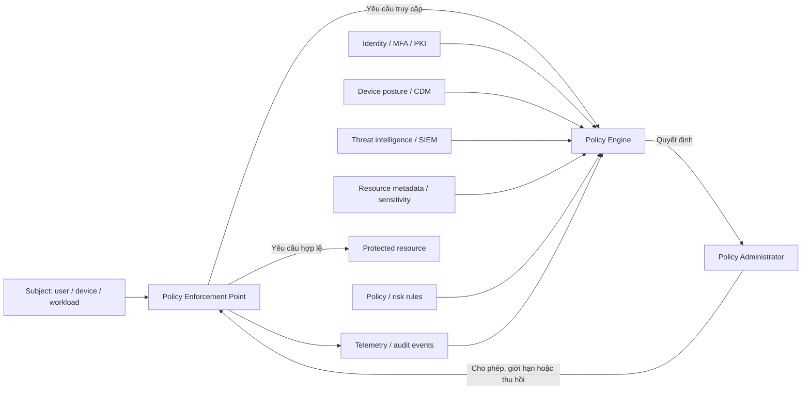
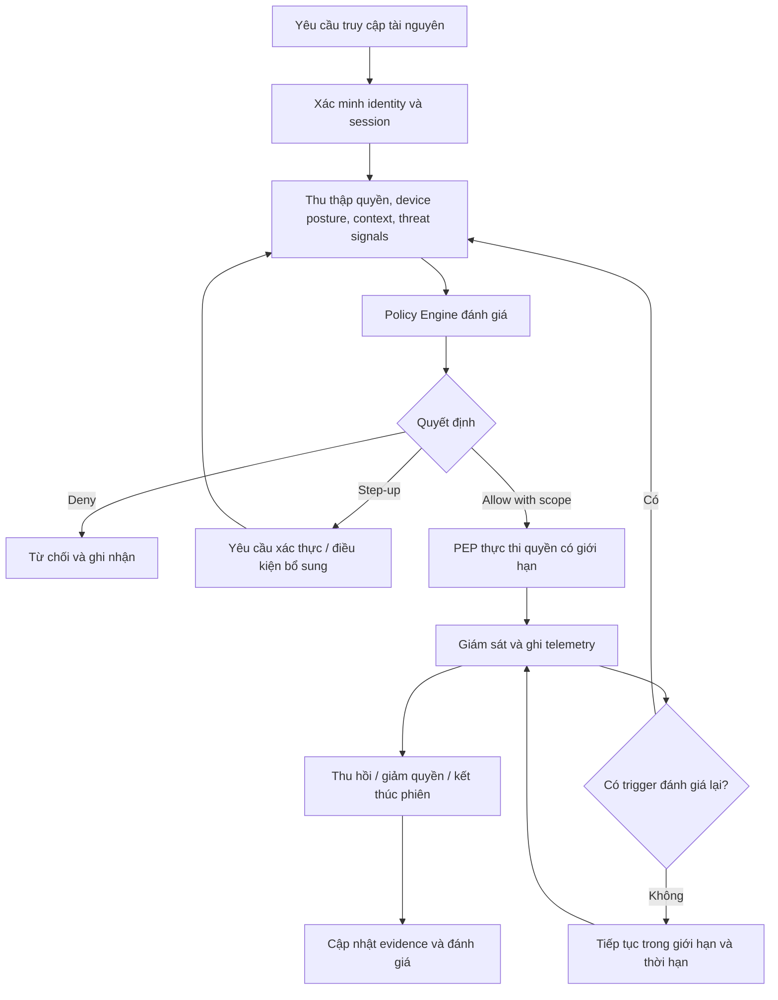

# Continuous verification trong Zero Trust

## 1. Vì sao phải xác minh liên tục?

Một nhân viên đăng nhập thành công vào nền tảng học tập lúc 8 giờ sáng. Đến 10 giờ, tài khoản có thể bị đánh cắp cookie phiên; thiết bị có thể vừa bị phát hiện nhiễm mã độc; hoặc người dùng đã chuyển sang một mạng và vị trí truy cập bất thường. Nếu hệ thống coi kết quả đăng nhập ban đầu là sự bảo đảm cho toàn bộ phiên làm việc, kẻ tấn công có thể tiếp tục sử dụng quyền đã cấp cho đến khi phiên hết hạn.

**Continuous verification (xác minh liên tục)** trong kiến trúc **Zero Trust** là cách đánh giá lại danh tính, quyền và ngữ cảnh truy cập trong suốt vòng đời tương tác với tài nguyên. Hệ thống đưa ra quyết định dựa trên thông tin hiện tại, phạm vi quyền cần thiết và chính sách đã định; quyết định có thể được điều chỉnh hoặc thu hồi khi tín hiệu rủi ro thay đổi.

Nguyên tắc Zero Trust thường được diễn đạt là *never trust, always verify* — không mặc nhiên tin cậy chỉ vì một người dùng, thiết bị hoặc dịch vụ đã ở trong mạng nội bộ hay từng xác thực thành công. Tuy nhiên, xác minh liên tục không có nghĩa là bắt người dùng nhập mật khẩu ở mỗi thao tác hoặc chạy lại toàn bộ quy trình xác thực cho từng gói tin. Điều quan trọng là **mỗi lần truy cập tài nguyên phải được kiểm soát theo chính sách phù hợp**, đồng thời phiên và quyền đang tồn tại phải được xem xét lại khi có sự kiện hoặc tín hiệu mới.

Trong module **SECURITY_SECURITY_ASSURANCE**, continuous verification giúp biến tuyên bố “hệ thống áp dụng Zero Trust” thành những claim có thể kiểm chứng: danh tính được xác minh, quyền được giới hạn, tín hiệu thiết bị và môi trường được xét đến, quyết định được thực thi nhất quán, và quyền có thể bị thu hồi kịp thời khi điều kiện thay đổi.

### Mục tiêu học tập

Sau bài này, bạn có thể:

1. Giải thích continuous verification và mối liên hệ với các nguyên tắc Zero Trust.
2. Phân biệt xác thực danh tính, cấp quyền, đánh giá ngữ cảnh và đánh giá lại phiên.
3. Mô tả các thành phần quyết định và thực thi policy trong một kiến trúc Zero Trust.
4. Thiết kế chu trình kiểm tra từ lúc đăng nhập, truy cập tài nguyên, thay đổi ngữ cảnh đến thu hồi quyền.
5. Xác định evidence và test case để chứng minh việc xác minh liên tục có hiệu lực.
6. Nhận diện giới hạn, rủi ro vận hành và chỉ số cần theo dõi khi triển khai.

## 2. Các nguyên tắc Zero Trust liên quan

Zero Trust là một cách tiếp cận kiến trúc và vận hành, không phải một sản phẩm đơn lẻ. Một số nguyên tắc cốt lõi liên quan trực tiếp đến continuous verification:

- **Bảo vệ tài nguyên, không dựa vào vị trí mạng:** tài nguyên có thể là API, dữ liệu, ứng dụng, máy chủ hoặc dịch vụ. Kết nối từ LAN, VPN hay mạng cloud không tự tạo ra quyền truy cập.
- **Xác minh rõ ràng:** xem xét danh tính người dùng hoặc workload, quyền, tình trạng thiết bị, tài nguyên đích và ngữ cảnh của yêu cầu.
- **Quyền tối thiểu:** chỉ cấp đúng quyền, đúng tài nguyên, đúng hành động và trong khoảng thời gian cần thiết.
- **Giả định có thể đã xảy ra xâm nhập:** thiết kế để giới hạn phạm vi ảnh hưởng, phát hiện hoạt động bất thường và thu hồi quyền khi cần.
- **Đánh giá dựa trên chính sách và tín hiệu:** quyết định truy cập cần phản ánh trạng thái hiện tại; dữ liệu lỗi thời hoặc thiếu phải được xử lý theo quy tắc đã xác định.
- **Giám sát và cải tiến liên tục:** ghi nhận sự kiện phù hợp, kiểm tra hiệu lực controls và điều chỉnh policy theo bằng chứng.

Không nên hiểu “không tin cậy” là mọi người dùng đều đáng ngờ hoặc hệ thống phải từ chối tất cả. Zero Trust yêu cầu **không cấp niềm tin mặc định**; quyền hợp lệ vẫn được cấp khi bằng chứng và chính sách đáp ứng điều kiện.

## 3. Continuous verification gồm những gì?

Một quyết định truy cập thường cần xem xét nhiều nhóm tín hiệu:

| Nhóm tín hiệu | Câu hỏi cần trả lời | Ví dụ |
|---|---|---|
| **Identity — danh tính** | Chủ thể là ai và danh tính đã được xác minh ở mức nào? | User ID, workload identity, MFA, độ mạnh của phương thức xác thực |
| **Authorization — quyền** | Chủ thể được phép làm hành động gì trên tài nguyên nào? | Role, scope, quan hệ với đối tượng, tenant, quyền quản trị |
| **Device posture — tình trạng thiết bị** | Thiết bị có đáp ứng yêu cầu an toàn không? | Mã hóa ổ đĩa, bản vá, endpoint protection, trạng thái quản lý |
| **Workload/service identity** | Dịch vụ gọi có đúng danh tính và thuộc môi trường được phép? | Chứng thư workload, service account, mTLS, attestation |
| **Resource sensitivity** | Tài nguyên nhạy cảm đến mức nào? | Hồ sơ cá nhân, kết quả thi, dữ liệu thanh toán, chức năng quản trị |
| **Context — ngữ cảnh** | Yêu cầu diễn ra trong điều kiện nào? | Thời điểm, nguồn truy cập, thiết bị, vị trí ở mức phù hợp, hành vi |
| **Threat signals** | Có tín hiệu nguy cơ hoặc sự kiện mới không? | Token bị lộ, IP độc hại, hành vi bất thường, cảnh báo EDR |
| **Session state** | Phiên còn hợp lệ và đáp ứng điều kiện hiện tại không? | Thời hạn, thời điểm xác thực gần nhất, thay đổi quyền, trạng thái thu hồi |

Không phải mọi ứng dụng đều cần thu thập mọi tín hiệu. Cần lựa chọn theo mức rủi ro và khả năng tin cậy của nguồn dữ liệu. Một tín hiệu vị trí có thể không chính xác; một điểm số rủi ro có thể có false positive; trạng thái thiết bị có thể đến chậm. Chính sách phải xác định nguồn, độ mới, độ tin cậy và cách xử lý khi tín hiệu thiếu hoặc xung đột.

## 4. Xác thực, cấp quyền và xác minh liên tục

Ba khái niệm thường bị trộn lẫn:

| Hoạt động | Câu hỏi | Ví dụ |
|---|---|---|
| **Authentication — xác thực** | Chủ thể có chứng minh được danh tính? | Mật khẩu kết hợp MFA, chứng thư của workload |
| **Authorization — cấp quyền** | Danh tính này được làm gì trên tài nguyên nào? | Giảng viên chỉ xem kết quả lớp được phân công |
| **Continuous verification — xác minh liên tục** | Các điều kiện để tiếp tục truy cập còn đúng không? | Thiết bị bị đánh dấu không an toàn thì phiên truy cập dữ liệu nhạy cảm bị hạn chế hoặc thu hồi |

Đăng nhập thành công chỉ cung cấp một phần thông tin cho quyết định. Danh tính đã xác thực không đồng nghĩa mọi hành động đều được cho phép. Tương tự, token còn hạn không tự chứng minh người dùng vẫn có quyền, thiết bị vẫn đạt posture hoặc phiên chưa bị thu hồi.

### 4.1. Quyết định ở mỗi lần truy cập

Khi một chủ thể yêu cầu tài nguyên, hệ thống nên kiểm tra:

1. Danh tính và bằng chứng xác thực có hợp lệ không?
2. Quyền có bao phủ đúng tài nguyên và hành động không?
3. Điều kiện thiết bị, workload và ngữ cảnh có đáp ứng policy không?
4. Có tín hiệu đe dọa, trạng thái thu hồi hoặc điều kiện bắt buộc xác minh lại không?
5. Nếu được phép, quyền được cấp với phạm vi và thời hạn nào?

Ví dụ: người học có thể xem kết quả của chính mình; giảng viên có thể xem kết quả của lớp được phân công; nhân viên hỗ trợ không mặc nhiên có quyền xem toàn bộ dữ liệu chỉ vì thuộc mạng nội bộ.

### 4.2. Đánh giá lại khi trạng thái thay đổi

Trong một phiên dài, hệ thống cần xem xét lại khi có trigger như:

- Người dùng thay đổi vai trò, bị khóa hoặc bị thu hồi quyền.
- Thiết bị chuyển sang trạng thái không tuân thủ, mất quản lý hoặc có cảnh báo bảo mật.
- Token, chứng thư hoặc phiên bị thu hồi hay sắp hết hạn.
- Có cảnh báo rủi ro liên quan đến tài khoản, thiết bị, địa chỉ nguồn hoặc workload.
- Người dùng chuyển sang thao tác nhạy cảm hơn, chẳng hạn từ xem dữ liệu sang xuất hàng loạt.
- Tín hiệu quan trọng đã quá cũ hoặc không còn xác minh được.
- Policy hoặc mức phân loại tài nguyên thay đổi.

Tổ chức có thể kết hợp đánh giá theo sự kiện, theo chu kỳ, theo yêu cầu tài nguyên và khi hết thời hạn xác minh. Không có một tần suất duy nhất phù hợp cho mọi ứng dụng. Tần suất càng cao có thể giảm thời gian tồn tại của quyền sai, nhưng cũng tăng độ trễ, tải hệ thống và nguy cơ làm gián đoạn người dùng.

## 5. Kiến trúc quyết định và thực thi policy

NIST SP 800-207 mô tả kiến trúc Zero Trust với các thành phần logic hỗ trợ quyết định và thực thi quyền truy cập. Tên gọi có thể được triển khai thành dịch vụ hoặc chức năng khác nhau tùy hệ thống.

- **Policy Engine (PE):** đánh giá yêu cầu và tín hiệu để quyết định cho phép, từ chối hoặc điều chỉnh truy cập theo policy.
- **Policy Administrator (PA):** thực hiện quyết định của PE bằng cách thiết lập, duy trì hoặc chấm dứt đường truy cập.
- **Policy Enforcement Point (PEP):** điểm thực thi policy, cho phép, giám sát và chấm dứt kết nối hoặc yêu cầu đến tài nguyên.
- **Policy Decision Point (PDP):** cách gọi khái quát cho chức năng ra quyết định; trong mô hình NIST, PE và PA phối hợp để đưa quyết định và thực thi quyết định.
- **Policy Information Points / nguồn tín hiệu:** các hệ thống cung cấp thông tin như identity management, PKI, threat intelligence, continuous diagnostics and mitigation (CDM), SIEM và dữ liệu về tài nguyên.



Trong sơ đồ, PEP là nơi chặn và thực thi yêu cầu. PE sử dụng policy cùng tín hiệu để quyết định; PA chuyển quyết định thành hành động thực thi. Log và telemetry cung cấp dữ liệu cho giám sát, điều tra và đánh giá tiếp theo. Một hệ thống có thể gộp một số thành phần hoặc triển khai chúng ở nhiều lớp, nhưng trách nhiệm quyết định và thực thi cần rõ ràng.

### 5.1. Nguồn thông tin phải có chất lượng

PE chỉ có thể đưa ra quyết định tốt nếu dữ liệu đầu vào đủ tin cậy. Ví dụ:

- Identity provider phải phát hành và xác minh token đúng issuer, audience, signature, thời hạn và điều kiện.
- Hệ thống quản lý thiết bị phải xác định thiết bị thuộc đối tượng nào, trạng thái được cập nhật lúc nào và cách phát hiện mất liên lạc.
- Nguồn threat intelligence phải có thời điểm cập nhật, nguồn gốc và cơ chế xử lý cảnh báo sai.
- Resource registry phải phản ánh đúng mức nhạy cảm và owner của tài nguyên.
- Hệ thống log cần đồng bộ thời gian và giữ liên kết giữa yêu cầu, quyết định và hành động thực thi.

Nếu một nguồn tín hiệu bị lỗi hoặc quá hạn, policy cần quyết định rõ có từ chối, yêu cầu xác minh mạnh hơn, giới hạn chức năng hay cho phép có điều kiện. Cách xử lý phải tương ứng với mức nhạy cảm; không nên mặc định mọi trường hợp đều fail-open hoặc fail-closed mà không phân tích tác động.

## 6. Chu trình continuous verification

Một chu trình tổng quát có thể chia thành các bước:

1. **Establish identity:** xác minh danh tính người dùng, thiết bị hoặc workload bằng phương thức phù hợp.
2. **Collect context:** lấy quyền, posture, mức nhạy cảm tài nguyên, trạng thái phiên và tín hiệu đe dọa.
3. **Evaluate policy:** đánh giá yêu cầu theo policy, rủi ro và độ mới của tín hiệu.
4. **Enforce decision:** cho phép, từ chối, giới hạn scope, yêu cầu xác thực bổ sung hoặc tạo phiên truy cập có thời hạn.
5. **Observe activity:** ghi nhận hành vi và sự kiện có liên quan, phát hiện sai lệch.
6. **Re-evaluate:** đánh giá lại khi có trigger, theo chu kỳ hoặc trước hành động nhạy cảm.
7. **Revoke or adapt:** giảm quyền, yêu cầu xác minh lại, kết thúc phiên hoặc chặn yêu cầu khi điều kiện không còn đáp ứng.
8. **Preserve evidence:** lưu decision, policy version, tín hiệu đầu vào phù hợp và kết quả thực thi để kiểm chứng.



Trong triển khai thực tế, việc đánh giá lại có thể diễn ra trước một request, qua sự kiện đẩy từ hệ thống quản lý thiết bị, hoặc khi policy phát hiện trạng thái thay đổi. Không nhất thiết phải chạy toàn bộ bước thu thập từ đầu cho mọi gói tin; cần bảo đảm điểm thực thi không dùng quyết định đã hết hiệu lực và có cách nhận biết sự kiện thu hồi.

## 7. Thiết kế policy theo rủi ro và mức nhạy cảm

Một policy nên xác định ít nhất:

- Chủ thể: user, nhóm, thiết bị hoặc workload.
- Tài nguyên và hành động: đọc, sửa, xuất, quản trị, gọi API.
- Điều kiện danh tính: phương thức xác thực, mức bảo đảm, trạng thái tài khoản.
- Điều kiện thiết bị/workload: quản lý, posture, chứng thư, môi trường.
- Điều kiện ngữ cảnh: thời điểm, nguồn truy cập, tín hiệu bất thường.
- Mức nhạy cảm và hậu quả nếu truy cập sai.
- Quyết định: allow, deny, step-up, restrict, quarantine hoặc revoke.
- Thời hạn: thời gian hiệu lực của quyết định, token, session hoặc cache.
- Cách xử lý khi thiếu dữ liệu, nguồn lỗi hoặc tín hiệu xung đột.
- Log và lý do quyết định cần lưu.

Ví dụ ma trận đơn giản:

| Tài nguyên/hành động | Điều kiện tối thiểu | Quyết định khi điều kiện không đạt |
|---|---|---|
| Người học xem kết quả của chính mình | Danh tính hợp lệ, quan hệ với hồ sơ đúng, phiên còn hiệu lực | Từ chối và ghi nhận |
| Giảng viên xem kết quả lớp được phân công | MFA theo policy, vai trò hợp lệ, quan hệ lớp còn hiệu lực | Từ chối hoặc yêu cầu xác thực bổ sung |
| Quản trị viên thay đổi quyền người dùng | Tài khoản đặc quyền, MFA mạnh, thiết bị đạt posture, approval phù hợp | Step-up hoặc từ chối |
| Xuất dữ liệu hàng loạt | Quyền export riêng, mục đích được phép, giới hạn phạm vi và điều kiện giám sát | Chặn, yêu cầu phê duyệt hoặc giới hạn số lượng |
| Workload gọi dịch vụ nội bộ | Workload identity hợp lệ, audience đúng, mTLS hoặc cơ chế bảo vệ kênh, scope tối thiểu | Từ chối và cảnh báo |

Không nên biến một tín hiệu đơn lẻ như địa chỉ IP hoặc vị trí địa lý thành bằng chứng tuyệt đối về danh tính. Tín hiệu đó chỉ là một phần ngữ cảnh, cần kết hợp với danh tính, quyền, posture và mức nhạy cảm của yêu cầu.

### 7.1. Quyền ngắn hạn và phạm vi hẹp

Continuous verification hiệu quả hơn khi quyền được giới hạn ngay từ đầu:

- Token có audience và scope đúng dịch vụ, đúng mục đích.
- Quyền đặc quyền được cấp tạm thời (*just-in-time*) và có thời hạn.
- Phiên nhạy cảm có thời hạn xác thực phù hợp với rủi ro.
- Workload sử dụng danh tính riêng, credential có vòng đời và khả năng xoay vòng.
- Refresh token, session cookie và cache policy có cơ chế thu hồi hoặc tái đánh giá.

Token ngắn hạn làm giảm cửa sổ lạm dụng nếu bị lộ, nhưng không tự giải quyết mọi vấn đề. Nếu refresh token có thể được dùng vô hạn, hoặc gateway cache quyết định allow quá lâu, quyền có thể tồn tại sau khi tài khoản bị khóa. Cần kiểm tra toàn bộ vòng đời credential và độ trễ lan truyền thu hồi.

### 7.2. Re-authentication và step-up authentication

**Step-up authentication** yêu cầu thêm bằng chứng xác thực khi hành động hoặc ngữ cảnh có rủi ro cao hơn. Ví dụ: người dùng đã đăng nhập bằng passkey có thể cần xác minh lại trước khi thay đổi phương thức thanh toán hoặc xuất dữ liệu nhạy cảm.

Không phải mọi thay đổi ngữ cảnh đều cần hỏi lại người dùng. Hệ thống có thể tự động giảm scope, chặn một hành động, chuyển phiên sang chế độ chỉ đọc hoặc kết thúc phiên. Cách xử lý cần cân bằng mức rủi ro, khả năng sử dụng và yêu cầu bảo mật.

## 8. Ví dụ: continuous verification cho nền tảng học tập nhiều tenant

Giả sử nền tảng sử dụng backend Java/Spring Boot, phục vụ nhiều trường học. Người học, giảng viên và quản trị viên truy cập dữ liệu thuộc tenant riêng. Dịch vụ có API xem kết quả, xuất báo cáo và quản lý quyền.

### 8.1. Kịch bản rủi ro

Một giảng viên đăng nhập từ thiết bị đã được quản lý và được phép xem kết quả của lớp mình. Trong phiên, thiết bị bị EDR cảnh báo có mã độc. Nếu backend chỉ kiểm tra token lúc đăng nhập và không nhận tín hiệu posture mới, kẻ tấn công có thể tiếp tục sử dụng phiên để đọc hoặc xuất dữ liệu.

**Mục tiêu bảo mật:** chỉ cho phép truy cập khi danh tính, quyền, tenant, trạng thái thiết bị và điều kiện của tài nguyên đáp ứng policy hiện hành.

### 8.2. Policy và hành vi mong đợi

| Tình huống | Policy mong đợi | Bằng chứng cần có |
|---|---|---|
| Giảng viên truy cập lớp được phân công trên thiết bị đạt posture | Cho phép đọc trong đúng tenant và lớp | Decision log, integration test thành công |
| Giảng viên đổi ID để xem lớp của tenant khác | Từ chối tại backend, không trả dữ liệu | Negative test, log deny và kiểm tra response |
| EDR đánh dấu thiết bị không tuân thủ trong phiên | Thu hồi hoặc giới hạn phiên theo policy; yêu cầu xử lý thiết bị | Sự kiện posture, thời điểm nhận, revoke event và test phiên cũ |
| Tài khoản bị khóa sau khi token được phát hành | Token/session không tiếp tục cấp quyền vượt thời gian cho phép | Account disable event, propagation time, test truy cập bằng token cũ |
| Người dùng yêu cầu export hàng loạt | Đánh giá quyền export riêng, mức nhạy cảm, phạm vi và step-up/approval nếu cần | Policy trace, approval, audit log và test giới hạn |
| Workload báo cáo gọi API kết quả | Xác minh workload identity và scope đúng dịch vụ | Certificate/identity evidence, mTLS test, authorization log |

### 8.3. Luồng quyết định minh họa

1. Người dùng đăng nhập qua identity provider; MFA và trạng thái tài khoản được xác minh.
2. API gateway/PEP nhận yêu cầu và chuyển thông tin cần thiết đến policy decision service.
3. Policy engine kiểm tra role, tenant, quan hệ lớp, mức nhạy cảm, posture và trạng thái phiên.
4. Nếu được phép, PEP chuyển yêu cầu đến service; service tiếp tục kiểm tra quyền đối tượng và tenant trước khi truy vấn.
5. Hệ thống ghi decision ID, policy version, resource ID phù hợp, kết quả và correlation ID.
6. Khi EDR phát sự kiện thiết bị không an toàn, nguồn posture cập nhật; policy engine đánh giá lại phiên hoặc request kế tiếp.
7. PEP từ chối yêu cầu mới, thu hồi phiên hoặc giới hạn quyền; sự kiện được ghi nhận để điều tra.

Nếu PEP không nhận được sự kiện thu hồi, hoặc service vẫn chấp nhận token cũ mà không kiểm tra trạng thái, tuyên bố “đã xác minh liên tục” chưa được chứng minh. Cần đo độ trễ từ lúc tín hiệu phát sinh đến lúc mọi điểm thực thi áp dụng quyết định mới.

### 8.4. Pseudocode quyết định

Ví dụ logic khái niệm dưới đây minh họa các điều kiện cần đánh giá. Đây không phải một policy engine hoàn chỉnh hay mã có thể đưa thẳng vào production:

```text
function authorize(request, subject, resource, context):
    if not subject.identity_is_valid:
        return DENY("identity_invalid")

    if subject.account_is_disabled or subject.session_is_revoked:
        return DENY("subject_or_session_revoked")

    if not permission_allows(subject, resource, request.action):
        return DENY("permission_missing")

    if not tenant_scope_matches(subject, resource):
        return DENY("tenant_boundary_violation")

    if resource.is_sensitive and context.device_posture != COMPLIANT:
        return DENY_OR_STEP_UP("device_not_compliant")

    if context.signal_is_stale:
        return STEP_UP_OR_DENY("required_signal_stale")

    if context.risk_requires_stronger_authentication:
        return STEP_UP("stronger_authentication_required")

    return ALLOW(
        scope = least_privilege_scope(request, resource),
        expires_at = policy_defined_expiry()
    )
```

Trong hệ thống thật, mỗi điều kiện cần nguồn dữ liệu xác thực, xử lý lỗi, log, kiểm thử và cách cập nhật trạng thái. Nhánh từ chối hoặc xác minh bổ sung cần được policy cụ thể hóa; không được để tùy ý theo từng service.

## 9. Các lớp kiểm soát để duy trì xác minh

Continuous verification thường cần nhiều lớp phối hợp:

### 9.1. Identity và credential

- Sử dụng danh tính duy nhất cho user và workload.
- Xác minh issuer, audience, chữ ký, thời hạn và trạng thái token.
- Áp dụng MFA hoặc phương thức xác thực mạnh theo mức rủi ro.
- Quản lý vòng đời tài khoản, quyền, chứng thư và secret.
- Hỗ trợ khóa tài khoản, thu hồi phiên và credential bị lộ.

### 9.2. Device và workload posture

- Đăng ký thiết bị và gắn trạng thái với danh tính thiết bị.
- Kiểm tra mức bản vá, mã hóa, endpoint protection và cấu hình quan trọng.
- Xác minh danh tính workload giữa dịch vụ với dịch vụ.
- Có cơ chế phát hiện chứng thư hoặc workload identity bị thu hồi.
- Xác định độ mới tối đa của posture; dữ liệu quá hạn phải kích hoạt xử lý theo policy.

### 9.3. Policy enforcement

- Đặt PEP tại các ranh giới phù hợp: gateway, reverse proxy, service mesh, ứng dụng hoặc lớp dữ liệu.
- Kiểm tra quyền đối tượng tại backend; không dựa duy nhất vào UI hoặc gateway.
- Truyền context và decision một cách an toàn; tránh để client tự khai báo role hoặc tenant.
- Có cơ chế cập nhật policy, thu hồi và giới hạn quyền nhất quán giữa các điểm thực thi.
- Bảo vệ PEP khỏi bị bypass hoặc bị cấu hình fail-open ngoài ý muốn.

### 9.4. Telemetry và phản ứng

- Ghi nhận quyết định allow/deny/step-up/revoke cùng lý do ở mức đủ điều tra.
- Phát hiện đăng nhập, truy cập hoặc hành vi lệch chuẩn.
- Kết nối tín hiệu identity, device, network, application và workload.
- Có playbook xử lý token bị lộ, tài khoản bị chiếm, thiết bị không tuân thủ và policy bị thay đổi.
- Đo thời gian từ phát hiện đến khi quyền bị thu hồi tại các điểm thực thi.

Không phải mọi dữ liệu cần được đưa vào log. Cần giảm thiểu dữ liệu cá nhân, không ghi password, token nguyên vẹn hoặc secret; kiểm soát quyền xem log, thời hạn lưu và mục đích sử dụng.

## 10. Kiểm chứng continuous verification: claim, test và evidence

Một tuyên bố như “mọi truy cập đều được xác minh liên tục” quá rộng nếu không xác định phạm vi. Hãy chia thành các claim nhỏ có thể kiểm tra.

| Claim | Tiêu chí kiểm chứng | Evidence |
|---|---|---|
| CLM-01: Mọi yêu cầu đến tài nguyên trong phạm vi đều đi qua PEP được chỉ định | Kiểm kê đường truy cập; thử gọi trực tiếp origin/service; kiểm tra cấu hình routing | Resource/API inventory, network/config review, negative bypass test |
| CLM-02: Quyết định dựa trên identity và quyền hiện hành | Token validation đúng; role, scope, tenant và object permission được kiểm tra | Test invalid/expired/revoked token; authorization tests; code/config review |
| CLM-03: Tín hiệu posture ảnh hưởng đến quyết định | Trạng thái compliant/non-compliant và stale có hành vi đúng policy | Test thay đổi posture, event trace, decision log |
| CLM-04: Phiên có thể bị thu hồi khi rủi ro thay đổi | Thời gian lan truyền revoke nằm trong ngưỡng đã phê duyệt | Revoke test, timestamp tại nguồn và PEP, log phiên cũ bị từ chối |
| CLM-05: Quyền được giới hạn theo tài nguyên và thời hạn | Scope, audience, TTL và quyền đặc quyền phù hợp | Token inspection, policy test, privileged access review |
| CLM-06: Hành động nhạy cảm được đánh giá với điều kiện tăng cường | Step-up/approval/deny đúng theo policy | Test export, admin action, policy trace và approval record |
| CLM-07: Quyết định có thể truy vết và điều tra | Log liên kết request, subject, resource, policy version và decision | Sample audit trail, log integrity/access review |

### 10.1. Bộ test quan trọng

| Test case | Thao tác | Kết quả mong đợi |
|---|---|---|
| Token hết hạn | Gửi request với token đã hết hạn | Từ chối; không dùng cache cũ để cho phép |
| Token sai audience/issuer | Dùng token hợp lệ về chữ ký nhưng dành cho dịch vụ khác | Từ chối |
| Thu hồi phiên | Khóa tài khoản hoặc revoke session rồi dùng lại cookie/token cũ | Từ chối trong thời gian lan truyền đã cam kết |
| Thay đổi quyền | Gỡ role hoặc quan hệ lớp giữa phiên | Quyền mới có hiệu lực theo SLA; hành động không còn hợp lệ bị từ chối |
| Thiết bị mất posture | Chuyển posture sang non-compliant | Phiên/tài nguyên nhạy cảm bị hạn chế theo policy |
| Tín hiệu quá hạn | Làm nguồn posture mất cập nhật quá TTL | Không coi dữ liệu cũ là trạng thái compliant hiện tại |
| Tenant mismatch | Thay tenant/object ID trong request | Backend từ chối; không lộ dữ liệu |
| Bypass PEP | Thử gọi trực tiếp địa chỉ nội bộ hoặc origin | Không thể truy cập ngoài điểm thực thi được bảo vệ |
| Replay credential | Phát lại token hoặc credential bị đánh cắp trong điều kiện test | Bị giới hạn bởi audience, TTL, sender constraint hoặc kiểm soát bổ sung theo thiết kế |
| Policy update | Thay policy để thu hồi một quyền đã cấp | Quyết định mới áp dụng theo thời gian hiệu lực đã quy định |
| PEP/PE lỗi | Mô phỏng dịch vụ quyết định không sẵn sàng | Hành vi fail-open/fail-closed đúng policy cho từng mức nhạy cảm |
| Step-up | Gọi hành động quản trị từ phiên mức bảo đảm thấp | Yêu cầu xác minh bổ sung hoặc từ chối |

Test cần xác nhận cả phản hồi và tác động thực tế. Một API trả HTTP 403 nhưng dữ liệu đã được ghi hoặc export ở tác vụ nền vẫn là lỗi. Tương tự, test revoke chỉ kiểm tra endpoint đăng xuất thành công chưa chứng minh token cũ bị vô hiệu ở mọi PEP.

### 10.2. Chất lượng evidence

Evidence nên gắn với:

- Claim, policy và control được kiểm tra.
- Phiên bản ứng dụng, policy, gateway/PEP và cấu hình liên quan.
- Môi trường, thời gian, nguồn tín hiệu và độ mới của dữ liệu.
- Danh tính test, vai trò, thiết bị và tài nguyên mẫu (đã giảm thiểu dữ liệu nhạy cảm).
- Request, decision ID, kết quả thực thi và log tương ứng.
- Phạm vi bao phủ, trường hợp chưa thử, lỗi và ngoại lệ.
- Người hoặc hệ thống thực hiện, người review và kết luận.

Một ảnh chụp màn hình “Access denied” riêng lẻ thường không đủ. Cần chứng minh yêu cầu đã đi qua điểm thực thi, policy nào được áp dụng, dữ liệu nào được dùng và không có đường truy cập thay thế bỏ qua kiểm soát.

## 11. Độ trễ, cache và khả năng thu hồi

Một thách thức lớn của continuous verification là quyết định có thể dựa trên dữ liệu không còn mới. Ví dụ, tài khoản bị khóa lúc 10:00 nhưng token còn hạn đến 11:00; gateway cache allow trong 15 phút; service không kiểm tra trạng thái thu hồi. Trong khoảng thời gian đó, quyền không còn hợp lệ vẫn có thể được sử dụng.

### 11.1. Các nguồn độ trễ

- Thời gian phát hiện và phát sự kiện từ IdP, EDR hoặc hệ thống quản lý thiết bị.
- Thời gian truyền sự kiện đến policy engine.
- Thời gian policy engine tính lại quyết định.
- Thời gian cập nhật hoặc vô hiệu hóa cache tại PEP.
- Thời gian các service nhận trạng thái mới.
- Thời hạn token/session và khả năng refresh.

Nên đặt mục tiêu thời gian thu hồi theo mức nhạy cảm. Chỉ số quan trọng là khoảng thời gian từ **sự kiện làm mất điều kiện truy cập** đến **lần cuối cùng hệ thống có thể thực thi quyền cũ**.

### 11.2. Cache policy có kiểm soát

Cache giúp giảm độ trễ và tải policy engine, nhưng cần giới hạn:

- TTL theo độ nhạy cảm của tài nguyên và mức rủi ro.
- Invalidation khi role, account, posture hoặc policy thay đổi.
- Không dùng cache allow sau khi đã nhận revoke event.
- Gắn policy version hoặc decision version để phát hiện quyết định lỗi thời.
- Theo dõi tỷ lệ cache hit, stale decision và thời gian invalidation.

Đối với tài nguyên có tác động cao, có thể cần đánh giá trực tiếp hoặc cache rất ngắn. Với thao tác ít nhạy cảm, cache có thời hạn phù hợp có thể là lựa chọn hợp lý nếu rủi ro được chấp nhận và kiểm chứng.

### 11.3. Fail-open và fail-closed

Khi PE hoặc nguồn tín hiệu không khả dụng, hệ thống phải có hành vi được thiết kế trước:

- **Fail-closed:** từ chối khi không thể xác minh điều kiện bắt buộc; tăng bảo vệ nhưng có thể ảnh hưởng tính sẵn sàng.
- **Fail-open:** tiếp tục truy cập trong một số điều kiện; tăng tính sẵn sàng nhưng có thể tạo khoảng trống bảo mật.
- **Degraded mode:** chỉ cho phép thao tác ít nhạy cảm, dùng credential/decision còn hiệu lực trong giới hạn chặt, hoặc yêu cầu xác minh bổ sung.

Không có lựa chọn duy nhất cho mọi tài nguyên. Ví dụ, dịch vụ xem thông báo công khai có thể có phương án degraded mode khác với API xuất hồ sơ cá nhân hoặc thay đổi quyền quản trị. Quyết định cần dựa trên impact, risk appetite, yêu cầu sẵn sàng và được phê duyệt.

## 12. Các chỉ số vận hành và assurance

Đo lường cần cho thấy hệ thống kiểm tra được gì, phát hiện nhanh đến đâu và thu hồi quyền có hiệu quả không.

| Chỉ số | Ý nghĩa | Cách diễn giải |
|---|---|---|
| PEP coverage | Tỷ lệ tài nguyên/đường truy cập trong phạm vi được bảo vệ bởi PEP đã kiểm chứng | Cần có inventory đầy đủ; không chỉ đếm gateway |
| Policy decision coverage | Tỷ lệ yêu cầu có decision phù hợp và truy vết được | Cần phân biệt request thực sự đi qua policy với log thiếu |
| Revocation latency | Thời gian từ revoke event đến khi quyền cũ không còn dùng được | Theo dõi median và percentile cao, theo từng loại PEP |
| Stale signal rate | Tỷ lệ quyết định dùng tín hiệu quá TTL hoặc không xác định độ mới | Chỉ ra chất lượng nguồn dữ liệu |
| Step-up success/failure | Tỷ lệ yêu cầu xác minh bổ sung thành công/thất bại | Kết hợp với false rejection và hành vi bỏ dở |
| Unauthorized access attempts | Số và xu hướng yêu cầu không hợp lệ | Phân loại theo nguyên nhân, tài nguyên và mức độ |
| Policy bypass findings | Số đường truy cập bỏ qua PEP hoặc control | Finding nghiêm trọng cần ưu tiên xử lý |
| False positive/negative | Tỷ lệ cảnh báo sai và quyết định cho phép sai được phát hiện qua test/điều tra | Cần định nghĩa mẫu và phương pháp đo; false negative đặc biệt quan trọng |
| Evidence freshness | Tỷ lệ claim trọng yếu có evidence còn phù hợp với phiên bản hiện hành | Tránh dùng kết quả test cũ để kết luận cho bản mới |
| Control remediation time | Thời gian xử lý lỗi policy, PEP, identity hoặc posture | Kết hợp severity và kết quả retest |

Không nên đặt mục tiêu “100% request phải gọi policy engine từ xa” nếu kiến trúc có cache hoặc policy enforcement cục bộ đã được kiểm chứng. Mục tiêu đúng là mọi quyết định phải có căn cứ còn hiệu lực, điểm thực thi không bị bypass và quyền có thể được thu hồi trong giới hạn thời gian đã phê duyệt.

## 13. Rủi ro và giới hạn của continuous verification

### 13.1. Nguồn tín hiệu sai hoặc bị thao túng

Nếu thiết bị báo trạng thái compliant giả, identity provider bị xâm nhập hoặc policy engine nhận dữ liệu sai, quyết định có thể sai dù quy trình được thực hiện đúng. Cần bảo vệ nguồn tín hiệu, xác thực nguồn gốc, kiểm tra tính toàn vẹn, theo dõi bất thường và có phương án khi một nguồn bị mất tin cậy.

### 13.2. Tập trung quá nhiều quyền vào policy engine

PE hoặc hệ thống policy trung tâm là thành phần có ảnh hưởng lớn. Nếu bị chiếm quyền hoặc cấu hình sai, nhiều tài nguyên có thể bị mở hoặc khóa. Cần phân tách quyền quản trị, review policy, version control, approval cho thay đổi trọng yếu, kiểm thử trước triển khai, backup và kế hoạch khôi phục.

### 13.3. Bỏ sót đường truy cập

Gateway bảo vệ API chính không có nghĩa mọi đường vào tài nguyên đều được bảo vệ. Batch job, export, admin endpoint, kết nối database, đường debug và service-to-service có thể bỏ qua PEP. Cần inventory, kiểm tra network path, review service account và test bypass.

### 13.4. False positive và gián đoạn công việc

Tín hiệu bất thường có thể khiến người dùng hợp lệ liên tục bị từ chối hoặc xác minh lại. Policy quá nghiêm có thể làm giảm năng suất và khuyến khích workaround. Cần đánh giá chất lượng tín hiệu, đo false positive, thiết kế degraded mode và quy trình hỗ trợ có kiểm soát.

### 13.5. Quyền riêng tư và giám sát quá mức

Thu thập vị trí, hành vi và trạng thái thiết bị có thể ảnh hưởng quyền riêng tư. Chỉ thu thập tín hiệu cần thiết cho mục đích xác định, giới hạn người truy cập, thời gian lưu và cách sử dụng; xem xét nghĩa vụ pháp lý và thông báo phù hợp.

### 13.6. Phức tạp vận hành

Nhiều policy, PEP và nguồn tín hiệu có thể tạo lỗi cấu hình, độ trễ và khó điều tra. Cần chuẩn hóa policy, phân loại tài nguyên, quản lý thay đổi, quan sát đầu-cuối và tự động hóa test. Triển khai theo từng phạm vi có mức rủi ro rõ ràng sẽ dễ đánh giá hơn.

## 14. Tích hợp vào SDLC và vận hành

Continuous verification cần được thiết kế từ sớm và duy trì sau phát hành:

| Giai đoạn | Công việc | Evidence |
|---|---|---|
| Yêu cầu | Xác định chủ thể, tài nguyên, hành động, mức nhạy cảm và điều kiện truy cập | Access matrix, data classification, risk scenarios |
| Thiết kế | Chọn PEP, PE/PA, nguồn identity/posture, trigger và TTL | Architecture diagram, threat model, policy design |
| Phát triển | Thực thi authorization tại backend, validate token, truyền context an toàn | Code review, unit/integration tests, policy tests |
| CI/CD | Kiểm tra policy, cấu hình, secret, dependency và test bypass | Pipeline report gắn commit và policy version |
| Trước phát hành | Kiểm tra revoke, stale signal, fail mode và đường truy cập thay thế | Release evidence, test report, risk acceptance nếu có |
| Vận hành | Theo dõi decision, posture, token, latency, drift và sự kiện bất thường | Dashboard, logs, alert, control health |
| Thay đổi/sự cố | Đánh giá lại policy, session, credential và tài nguyên chịu ảnh hưởng | Incident record, updated risk, retest, corrective action |

Mỗi thay đổi role, API, data flow, identity provider, gateway, service mesh hoặc cách lưu session đều có thể ảnh hưởng đến claim. Pipeline nên kích hoạt test tương ứng; thay đổi trọng yếu cần review và evidence bổ sung.

## 15. Checklist đánh giá một triển khai continuous verification

- [ ] Đã xác định tài nguyên, chủ thể, hành động và phạm vi bảo vệ?
- [ ] Có inventory các đường truy cập, kể cả batch, export, admin và service-to-service?
- [ ] Danh tính user/device/workload được xác minh bằng nguồn tin cậy?
- [ ] Authentication được phân biệt với authorization và policy evaluation?
- [ ] Quyền được giới hạn theo đối tượng, tenant, hành động, scope và thời hạn?
- [ ] Device/workload posture có nguồn, owner, độ mới và cơ chế phát hiện trạng thái lỗi thời?
- [ ] Policy có trigger đánh giá lại và cách xử lý tín hiệu thiếu/xung đột?
- [ ] PEP không thể bị bypass; các service vẫn kiểm tra quyền ở đúng lớp?
- [ ] Token, session, cache và refresh credential có cơ chế thu hồi được kiểm chứng?
- [ ] Độ trễ revoke có ngưỡng theo mức nhạy cảm và được đo thực tế?
- [ ] Fail-open/fail-closed/degraded mode được xác định và phê duyệt?
- [ ] Log đủ truy vết nhưng không lưu secret hoặc dữ liệu quá mức cần thiết?
- [ ] Có test cho token hết hạn, đổi quyền, thiết bị mất posture, stale signal, bypass và lỗi PE/PEP?
- [ ] Evidence gắn với policy version, build, môi trường, thời điểm và phạm vi?
- [ ] Có owner, quy trình xử lý finding và lịch tái đánh giá?

Checklist là bước rà soát ban đầu. Kết luận assurance cần dựa trên cấu hình, kiểm thử, log và kiểm tra đường truy cập thực tế.

## 16. Câu hỏi tự ôn tập

1. Vì sao xác thực thành công lúc đăng nhập không chứng minh người dùng vẫn được phép truy cập tài nguyên sau đó?
2. Continuous verification khác với việc yêu cầu MFA ở mọi request như thế nào?
3. PE, PA và PEP có trách nhiệm khác nhau ra sao?
4. Nếu tài khoản bị khóa nhưng token cũ vẫn được gateway cache cho phép, claim nào chưa đạt và cần thu thập evidence gì?
5. Vì sao phải kiểm tra cả API gateway, backend, batch job và service-to-service khi đánh giá PEP coverage?
6. Khi policy engine mất kết nối, nên chọn fail-open, fail-closed hay degraded mode cho API xuất dữ liệu cá nhân? Cần căn cứ vào yếu tố nào?
7. Hãy đề xuất cách đo thời gian thu hồi quyền từ lúc thiết bị bị đánh dấu không tuân thủ đến khi mọi điểm thực thi từ chối phiên cũ.

## 17. Ghi nhớ

- **Continuous verification** đánh giá lại danh tính, quyền và ngữ cảnh trong suốt vòng đời truy cập.
- Zero Trust không cấp niềm tin mặc định dựa trên vị trí mạng hoặc lần đăng nhập trước; mỗi lần truy cập tài nguyên cần được kiểm soát theo policy.
- Authentication, authorization và đánh giá lại phiên là các hoạt động liên quan nhưng khác nhau.
- PE đánh giá policy, PA chuyển quyết định thành hành động, PEP thực thi và giám sát truy cập.
- Quyền tối thiểu, token/session có giới hạn, tín hiệu mới, thu hồi nhanh và telemetry là các yếu tố quan trọng.
- Cần kiểm chứng độ bao phủ PEP, chất lượng tín hiệu, độ trễ thu hồi, cache, fail mode và các đường truy cập có thể bypass.
- Assurance phải chứng minh hành vi thực tế qua test và evidence gắn với phiên bản, policy, môi trường và phạm vi cụ thể.

### Tài liệu tham khảo định hướng

- **NIST SP 800-207 — Zero Trust Architecture:** kiến trúc và các thành phần logic của Zero Trust.
- **NIST SP 800-207A — A Zero Trust Architecture Model for Access Control in Cloud-Native Applications in Multi-Location Environments:** tham khảo cho kiểm soát truy cập ứng dụng cloud-native và môi trường đa vị trí.
- **NIST SP 800-53 Rev. 5 — Security and Privacy Controls for Information Systems and Organizations:** các nhóm control liên quan đến access control, identification/authentication, audit và system integrity.
- **NIST SP 800-63B — Digital Identity Guidelines: Authentication and Authenticator Management:** tham khảo về xác thực số và quản lý authenticator.

Các tài liệu trên cung cấp nền tảng tham khảo. Mô hình triển khai, tần suất đánh giá, ngưỡng thu hồi và cách xử lý lỗi cần được xác định theo kiến trúc, mức nhạy cảm tài nguyên, risk appetite và nghĩa vụ của tổ chức.
