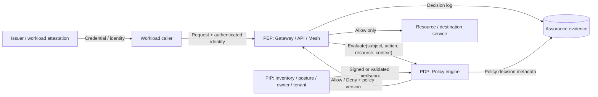
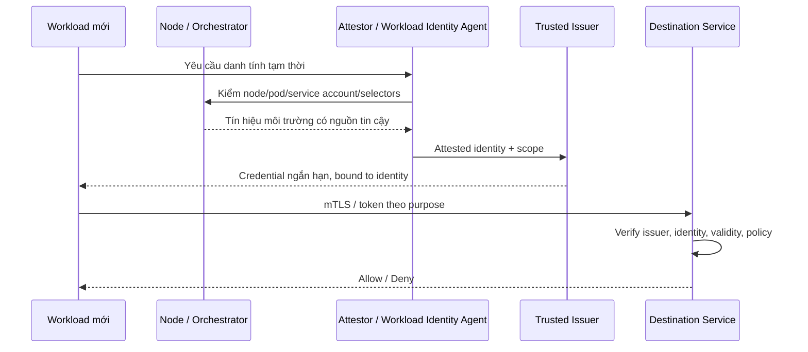

# Workload trust trong Zero Trust Assurance: xác minh danh tính và quyền của workload bằng bằng chứng

## 1. Workload trust là gì?

**Workload trust** là khả năng có căn cứ để tin rằng một tiến trình, dịch vụ, job, container, máy ảo hoặc tác vụ tự động đang giao tiếp với hệ thống **đúng là workload được kỳ vọng, xuất phát từ môi trường được chấp thuận, kiểm soát credential hợp lệ và chỉ thực hiện những hành động được phép**. Trong kiến trúc **Zero Trust**, trust không được cấp chỉ vì workload nằm trong VPC, một cluster Kubernetes, subnet nội bộ hoặc sau VPN.

Một workload có thể là:

- Microservice Spring Boot phục vụ đăng ký khóa học.
- Worker tính điểm và tổng hợp bài nộp qua queue.
- Batch job đồng bộ dữ liệu từ hệ thống học vụ.
- CI/CD runner build và deploy ứng dụng.
- Serverless function xử lý sự kiện.
- Database migration job, Kubernetes CronJob, service mesh sidecar.
- Máy ảo hoặc process dùng cloud service account để truy cập object storage.
- Một tác vụ AI inference/agent có thể đọc dữ liệu và gọi công cụ.

Trong module **SECURITY_SECURITY_ASSURANCE**, mục tiêu học là xây dựng **cách đánh giá có bằng chứng** rằng hệ thống đáp ứng mục tiêu bảo mật, từ risk assessment và requirements đến security controls, testing, audit, finding và remediation. Với *Workload trust*, câu hỏi không phải đơn giản là “có mTLS không?” mà là:

1. **Workload nào** đang yêu cầu truy cập và được nhận dạng bởi cơ quan nào?
2. **Bằng chứng bootstrap/attestation** nào cho phép cấp danh tính đó cho instance đang chạy?
3. Credential, token hoặc certificate có được bảo vệ, giới hạn audience, scope và thời gian không?
4. Client, gateway, API, resource server có thực sự kiểm tra issuer, key, audience, expiry, identity và policy?
5. Có kiểm soát **authorization theo tài nguyên, tenant, action, trạng thái và ngữ cảnh**, không chỉ theo tên service?
6. Container image, artifact, deployment và runtime posture có khớp các yêu cầu đã phê duyệt?
7. Khi pod/job/runner bị thay, quyền hết hạn, secret lộ hoặc policy đổi, hệ thống thu hồi và đánh giá lại được không?
8. Evidence nào chứng minh **design effectiveness, implementation correctness và operating effectiveness** trong đúng scope?

Ví dụ: `grade-worker` ở namespace `production` dùng mTLS để gửi kết quả điểm. mTLS có thể chứng minh peer nắm private key được cấp cho một identity, nhưng không tự chứng minh **pod được deploy từ image đúng nguồn**, **service account chưa bị lạm dụng**, **đối tượng điểm thuộc lớp được giao** hoặc **worker có quyền sửa tất cả bản ghi**.

> **Nguyên tắc cốt lõi:** “Đúng danh tính” khác “đúng provenance”, khác “đang ở trạng thái an toàn”, khác “được phép thao tác”. Zero Trust Assurance phải có control và evidence riêng cho từng khẳng định.

### Mục tiêu học tập

Sau bài học, người học có thể thiết kế workload identity inventory; phân biệt provisioning, attestation, authentication, authorization, runtime posture và supply-chain provenance; áp dụng nguyên tắc least privilege, short-lived credentials, mTLS và workload identity federation; hiểu SPIFFE/SPIRE, Kubernetes service accounts và OIDC; thiết kế các phép kiểm thử đường truy cập hợp lệ/sai; xây dựng assurance case, threat/control/evidence matrix và kế hoạch continuous assurance.

## 2. Zero Trust không phải “không bao giờ tin”, mà là kiểm chứng có điều kiện

Zero Trust Architecture thường được diễn đạt bằng các nguyên tắc: **không cấp trust ngầm theo vị trí mạng, xác thực và phân quyền rõ mỗi lần cần, áp dụng đặc quyền tối thiểu, giả định có khả năng bị xâm nhập và đánh giá tín hiệu liên tục**. NIST SP 800-207 và các hướng dẫn liên quan là tài liệu định hướng kiến trúc; không có một thiết bị hoặc sản phẩm đơn lẻ tự biến hệ thống thành “Zero Trust compliant”.

| Tư duy cũ | Workload trust theo Zero Trust |
| --- | --- |
| Pod nằm trong private subnet nên được tin. | Danh tính, credential và policy phải được kiểm dù cùng subnet. |
| Có mTLS nên được gọi mọi API của service đích. | mTLS xác thực peer; **authorization** quyết định hành động/tài nguyên. |
| Một service account dùng chung cho nhiều job. | Identity riêng theo workload/owner/purpose, phạm vi quyền có thể kiểm toán. |
| Credential tĩnh sống nhiều năm để dễ vận hành. | Ưu tiên short-lived credentials, rotation và cơ chế cấp theo nguồn đáng tin. |
| CI runner có secret production nên được deploy. | Xác minh provenance/attestation của run, repo/ref/environment, approval và trust policy. |
| Security review chỉ lúc go-live. | Kiểm định chính sách và posture sau mỗi deploy/thay workload, phát hiện drift. |

**Cần phân biệt hai nghĩa của trust:**

- **Trust establishment:** một workload được cấp danh tính và credential dựa trên điều kiện nào?
- **Trust evaluation/enforcement:** một yêu cầu cụ thể từ danh tính đó có được phép ở thời điểm hiện tại không?

Trust không phải điểm bất biến gắn mãi cho một workload. Nó là **kết luận có phạm vi, thời gian, nguồn chứng cứ và điều kiện**.

## 3. Workload identity khác human identity thế nào?

Người dùng có thể xác minh giấy tờ hoặc đăng nhập bằng authenticator. Workload không có giấy tờ hay MFA theo nghĩa con người; nó cần **identity của tiến trình/service** được gắn với nền tảng điều phối, môi trường thực thi, artifact hoặc chính sách phát hành.

| Thành phần | Workload | Human account |
| --- | --- | --- |
| Chủ thể | Pod, VM, function, service, job, runner. | Nhân viên, giáo viên, học viên. |
| Identity | SPIFFE ID, service account principal, cloud role, workload subject. | Human account, subject tại IdP. |
| Bootstrap | Node/workload attestation, orchestrator metadata, runtime trust chain. | Proofing, enrollment, authenticators. |
| Credential | X.509-SVID, JWT-SVID, OIDC token, short-lived cert/key, cloud temporary credentials. | Passkey, password, MFA, session. |
| Authentication | mTLS, signed assertion, token validation, key possession. | Authentication event theo policy. |
| Authorization | Service/operation/object/tenant/resource/role/attribute. | Vai trò, business relationship, đối tượng. |
| Lifecycle | Deploy/scale/rollout/terminate, runner/job expiry, key rotation. | Joiner/mover/leaver, account recovery. |
| Compromise | Pod escape, stolen token, malicious build/deployment, confused deputy. | Phishing, credential/session theft. |

**Service name ≠ identity:** header `X-Service-Name: grade-worker` hoặc tên pod không phải bằng chứng xác thực. **Identity ≠ quyền:** certificate hợp lệ cho `grade-worker` không tự cho phép sửa điểm ở tenant khác.

## 4. Phạm vi, tài sản và trust boundaries

Trước khi chọn công nghệ, lập bản đồ **ai gọi ai, dùng credential gì, có quyền nào và dữ liệu nào sẽ bị ảnh hưởng**.

| Asset/trust boundary | Ví dụ ở nền tảng học tập | Câu hỏi assurance |
| --- | --- | --- |
| **Source/build** | Git repository và CI pipeline tạo `grade-worker`. | Ai được đổi source/workflow, run đến từ branch/ref nào? |
| **Artifact registry** | Container image đã build/signed. | Digest, provenance, registry trust và admission rules? |
| **Orchestrator** | Kubernetes namespace, service account, scheduler, node. | Ai được tạo pod/service account, gắn label và mount token? |
| **Identity provider/issuer** | SPIRE server, Kubernetes issuer, cloud workload identity federation. | Trust anchor, attestation, issuer config, rotation? |
| **Runtime process** | Container chạy image revision R. | Runtime posture và nguồn deploy có đúng? |
| **Network channel** | mTLS service-to-service. | Client/server auth, cert validation, peer identity, mọi hop? |
| **API/PDP/PEP** | `grade-api` quyết định quyền `write-grade`. | Ai quyết định, ai enforce, fail closed ra sao? |
| **Data/resource** | Grade DB, object storage, secret vault, queue. | Workload có quyền tối thiểu đến object/action cụ thể? |
| **Logs/evidence** | IdP events, mesh telemetry, KMS logs, policy decisions. | Có đầy đủ, nguyên vẹn, đúng release/time window? |
| **External boundary** | Cloud account, vendor API, partner tenant. | Trust contract, audience, issuer, claims và reassessment? |

### Scope statement mẫu

> **WLT-SCOPE-01:** Đánh giá workload identity và authorization cho chuỗi `grade-worker → grade-api → grade-database` trong production namespace `learning-prod`, bao gồm CI artifact provenance, Kubernetes service accounts, mTLS, access token, IAM/KMS policy, audit và rotation trong release R. Ngoài scope: account người học, hạ tầng của đối tác analytics và kiểm soát vật lý của datacenter. Các đường batch/legacy bypass API được kiểm kê riêng, không mặc nhiên coi là an toàn.

Một scope tốt nêu rõ **những gì chứng minh được và những gì chưa kiểm**. Nếu không đo traffic khi service mesh bị tắt, không thể kết luận toàn bộ service paths được bảo vệ.

## 5. Các lớp niềm tin cần chứng minh độc lập

| Lớp | Claim cần chứng minh | Evidence gợi ý | Giới hạn |
| --- | --- | --- | --- |
| **Identity assignment** | Danh tính workload được cấp cho đúng instance. | Attestation policy, issuer logs, service account/selector tests. | Identity đúng không bảo đảm image sạch. |
| **Credential possession** | Peer có key/token hợp lệ. | mTLS/JWT validation, test cert/key sai. | Token có thể bị đánh cắp. |
| **Provenance** | Artifact xuất phát từ workflow/source được duyệt. | Signed provenance, digest, build logs, admission attestation. | Build tốt không bảo đảm runtime chưa bị khai thác. |
| **Runtime posture** | Instance đáp ứng điều kiện runtime tại thời điểm đo. | Admission/runtime checks, node configuration, alerts. | Snapshot có thể nhanh chóng lỗi thời. |
| **Authorization** | Action/resource/tenant được phép. | Policy-as-code, negative access tests, decision logs. | Policy đúng nhưng PEP không áp dụng sẽ không hiệu quả. |
| **Data protection** | Kênh/dữ liệu/secret được bảo vệ. | TLS config, KMS/IAM, data classification. | mTLS không ngăn đọc dữ liệu trái quyền. |
| **Operational effectiveness** | Controls thực sự hoạt động trong một kỳ. | Telemetry coverage, drift, incident/retest records. | Dashboard “0 alerts” có thể do log mất. |

**Không cộng các lớp này thành một nhãn `trusted=true` vô điều kiện**. Tổ chức có thể dùng policy decision có điều kiện, nhưng phải lưu ý nguồn, độ mới, khả năng giả mạo và mức bất định của từng tín hiệu.

## 6. Zero Trust Policy Decision và Enforcement

Một mô hình phổ biến dùng:

- **Policy Administrator (PA):** cấu hình hoặc tạo điều kiện thiết lập phiên/kết nối theo policy.
- **Policy Engine / Decision Point (PE/PDP):** quyết định cho phép/từ chối dựa trên danh tính, posture, tài nguyên và chính sách.
- **Policy Enforcement Point (PEP):** thực thi quyết định tại gateway, proxy, mesh sidecar, API, DB/IAM hoặc nơi phù hợp.
- **Policy Information Point (PIP):** cung cấp thuộc tính nguồn như inventory, deployment labels đã được kiểm, environment, vulnerability posture, business authorization.

Các tên có thể khác tùy kiến trúc; quan trọng là **ai cung cấp tín hiệu, ai quyết định, ai thực thi và ai chứng minh**.



### Tính chất cần kiểm

1. PEP có nằm trên **mọi đường truy cập thuộc scope**, không chỉ đường HTTP chính?
2. PEP có kiểm xác thực trước khi tin workload attributes?
3. PDP/PIP có lấy attributes từ **nguồn đáng tin**, không từ request tự khai?
4. Chính sách có kiểm scope/action/resource/tenant/time/revision?
5. Khi PDP mất kết nối, policy không đọc được hoặc tín hiệu posture quá hạn, có **failure behavior được phê duyệt**?
6. Cache authorization có TTL và invalidation phù hợp?
7. Quyết định được audit với policy version, caller, resource và reason code nhưng không ghi secret?

**Không nhầm network allow/deny với data authorization:** Có thể cho kết nối mTLS giữa hai service nhưng vẫn cần object-level authorization trong application.

## 7. Identity bootstrap và workload attestation

**Bootstrap problem:** khi một process mới khởi động, làm sao issuer biết nó là workload thật để cấp credential? Nếu đưa một API key tĩnh vào mọi image, bất kỳ bản sao image nào cũng có thể mạo danh.

**Workload attestation** dùng các tín hiệu về môi trường thực thi được một **attestor/issuer tin cậy** xác minh, ví dụ:

- Node identity, cloud instance metadata được xác thực.
- Kubernetes service account, namespace, pod UID, workload selectors và API server attestations.
- Container orchestration state từ nguồn có authority.
- Host/VM attestation hoặc hardware-backed evidence khi kiến trúc và risk yêu cầu.
- CI job identity từ OIDC issuer với repository/ref/environment claims được kiểm.

**Không phải mọi tín hiệu đều tương đương.** Label trên pod do developer có thể sửa không thể tự là proof đủ cho production role nếu attacker cũng có quyền tạo pod/label. Độ tin cậy phụ thuộc **quyền tạo/chỉnh tín hiệu và chain of trust của attestor**.

### Một enrollment flow



Đây là mô hình logic; không phải mọi SPIRE/Kubernetes/cloud federation triển khai đúng từng hop như vậy. Phải xác định **trust anchors, bootstrap credentials và selectors** theo sản phẩm/phiên bản thực tế.

### Attestation không chứng minh toàn bộ runtime integrity

Attestor có thể xác nhận pod được scheduler cấp một service account cụ thể. Điều đó không tự chứng minh binary trong pod chưa bị khai thác sau khi chạy hoặc CPU/kernel là đáng tin. Nếu muốn tăng yêu cầu, cần thêm **artifact admission, runtime posture và/hoặc hardware-backed attestation** theo risk.

## 8. SPIFFE/SPIRE: định danh workload nhất quán giữa môi trường

**SPIFFE (Secure Production Identity Framework For Everyone)** định nghĩa danh tính workload, thường dưới dạng **SPIFFE ID**: `spiffe://trust-domain/path`. Một SPIFFE ID mô tả identity theo trust domain; nó **không mặc nhiên là quyền truy cập**.

**SPIRE (SPIFFE Runtime Environment)** là một implementation hỗ trợ đăng ký, attestation và phát credentials cho workloads. Việc triển khai SPIRE hoặc một issuer tương đương **không bảo đảm** policies/authz đúng nếu selectors dễ bị giả hoặc credentials bị cấp quá rộng.

| Thành phần | Chức năng | Điểm cần đánh giá |
| --- | --- | --- |
| **Trust domain** | Namespace tin cậy của SPIFFE IDs. | Root bundle, boundaries, federation, ownership. |
| **SPIFFE ID** | Danh tính logic của workload. | Naming, uniqueness, isolation theo env/tenant, owner. |
| **X.509-SVID** | X.509 certificate chứa SPIFFE ID, dùng được với mTLS. | Expiry, key/chain, SAN verification, rotation. |
| **JWT-SVID** | JWT mang identity theo profile SPIFFE. | Audience, issuer, signature, expiration, replay/transport policy. |
| **Workload API** | Cung cấp identity credentials cho workload được attest. | Socket access, caller binding, secret handling. |
| **Registration entries/selectors** | Quy tắc mapping attested workloads sang identity. | Ai được tạo/sửa, độ chặt và conflict. |
| **Trust bundle** | Trust roots cần thiết để xác minh certificates/identities. | Distribution, rotation, stale roots, federation boundaries. |

### Cấu trúc định danh minh họa

```text
spiffe://learning.example/workload/grade-api/production
spiffe://learning.example/workload/grade-worker/production
spiffe://learning.example/workload/course-recommendation/production
```

Các chuỗi trên là ví dụ tên, không phải bắt buộc theo SPIFFE hay xác nhận domain đang tồn tại. Trong triển khai thật phải đặt rules **không cho cùng identity được cấp cho nhiều workloads khác trust level**, và kiểm namespace, cloud account, cluster, tenant, selectors.

### X.509-SVID và JWT-SVID không hoán đổi tùy tiện

- **X.509-SVID** thường phù hợp xác thực peers qua TLS/mTLS; kiểm trust bundle, certificate chain, SPIFFE ID và policy.
- **JWT-SVID** phù hợp một số tương tác token-based; phải kiểm **audience** và signatures/validity, không đưa cùng một token đến mọi resource.
- Một ứng dụng chỉ cần một trong hai không có nghĩa phải triển khai cả hai. Baseline phải chọn theo protocol, threat model và hạn chế thực tế.

## 9. Kubernetes workload identity và service accounts

Trong Kubernetes, **ServiceAccount (SA)** là danh tính API của workload/pod theo namespace. Các workload có thể nhận **projected service account tokens** được ràng buộc với đối tượng và audience/thời hạn theo cấu hình; việc dùng hiệu quả phụ thuộc **phiên bản cluster, issuer, API server, RBAC, token projection và consumer validation**.

### Rủi ro thường gặp

- Dùng `default` service account cho nhiều ứng dụng không liên quan.
- Mount Kubernetes API token dù workload không cần gọi Kubernetes API.
- Gán `cluster-admin` hoặc wildcard RBAC cho worker.
- Dùng namespace/name string từ HTTP header thay cho identity được xác minh.
- Token dài hạn copy vào image/CI secrets.
- Cho developer tạo pod trong namespace production với service account có quyền rộng.
- Dùng một service account cho jobs từ untrusted pull requests và protected release workflows.
- Consumer xác minh signature nhưng bỏ qua issuer, audience, expiry, token binding hoặc trust domain.

### Kubernetes manifest tối giản để giảm quyền mặc định

```yaml
apiVersion: v1
kind: ServiceAccount
metadata:
  name: grade-worker
  namespace: learning-prod
automountServiceAccountToken: false
---
apiVersion: apps/v1
kind: Deployment
metadata:
  name: grade-worker
  namespace: learning-prod
spec:
  replicas: 2
  selector:
    matchLabels:
      app: grade-worker
  template:
    metadata:
      labels:
        app: grade-worker
    spec:
      serviceAccountName: grade-worker
      automountServiceAccountToken: false
      containers:
        - name: worker
          image: registry.example/grade-worker@sha256:REPLACE_WITH_REAL_DIGEST
          # Secure runtime, resource limits, image admission,
          # and network policies need separate configuration.
```

**Ý nghĩa:** Nếu workload không cần Kubernetes API token thì có thể tắt automount. **Không tự suy** rằng tắt automount vẫn cho phép service lấy token cho cloud workload identity federation. Nếu service cần projected token, phải cấu hình **projected volume** với đúng audience/expiration và quyền truy cập; đồng thời kiểm cách provider cấp token/cert. Cấu hình trên chỉ là minh họa, **chưa phải Deployment production đầy đủ** (chưa có probes, resources, pod security, network policy, admission, secrets policy).

### RBAC và cloud IAM là hai lớp khác nhau

Kubernetes RBAC quyết định quyền đối với Kubernetes API. Quyền gọi cloud storage/KMS/DB có thể đến từ IAM role hoặc identity federation riêng. **Một service account không có quyền Kubernetes API vẫn có thể bị cấp cloud role quá rộng**, nên phải đánh giá cả hai.

## 10. mTLS và service mesh: chứng minh peer, chưa chứng minh authorization

**Mutual TLS (mTLS)** xác thực cả client và server bằng credentials phù hợp, đồng thời bảo vệ kênh truyền. Trong service mesh, proxy/sidecar hoặc ambient data plane có thể thực hiện mTLS và áp chính sách lưu lượng.

| Claim | Điều mTLS có thể hỗ trợ | Điều mTLS không tự chứng minh |
| --- | --- | --- |
| Confidentiality in transit | Kênh được mã hóa khi đúng thiết kế TLS. | Plaintext sau termination, log, DB hoặc hop ngoài mesh an toàn. |
| Peer authentication | Peer sở hữu private key/cert do trust domain cấp. | Runtime chưa bị attacker chiếm. |
| Workload identity | Cert chứa SPIFFE ID được xác minh theo trust bundle. | Service có quyền gọi method/resource bất kỳ. |
| Rotation | Short-lived cert và tự động renew giảm thời gian credential tồn tại. | Compromised workload không thể dùng cert còn hiệu lực. |
| Policy enforcement | Proxy có thể chặn traffic không phù hợp nếu PEP nằm trên đường đi. | In-process/backdoor/host network/batch path đều được chặn. |

### Kiểm tra vận hành mTLS

1. Hai phía xác thực trust chain, SPIFFE ID/SAN, expiry và trust bundle.
2. Không hỗ trợ **plaintext fallback** ở những đường được quy định mTLS-only.
3. Sidecar injection/mesh enrollment được áp đúng workloads/namespaces.
4. Pod có thể bypass sidecar bằng hostNetwork, direct endpoint, egress gateway hoặc policy exception không?
5. Chính sách mesh có trùng khớp chính sách application-level không?
6. Rotation cert/roots diễn ra không gián đoạn và không mở rộng trust vô ý.
7. Logs/metrics cho thấy connection negotiation, denied requests, coverage, và telemetry health.

**Không đặt một trust domain chung cho mọi môi trường** mà không xem blast radius. Một compromised development workload không được tự động nhận quyền gọi production API chỉ vì cùng root bundle.

## 11. Workload identity federation với cloud và CI/CD

**Workload Identity Federation** cho phép bên tin cậy (cloud IAM, API, external service) chấp nhận assertion từ issuer workload đã được cấu hình, thay vì giữ một secret tĩnh lâu dài. Trong CI/CD, **OIDC tokens ngắn hạn** có thể trao đổi lấy temporary cloud credentials.

### Những claims/điều kiện cần kiểm

| Thành phần | Ví dụ | Kiểm tra |
| --- | --- | --- |
| **Issuer** | CI OIDC issuer hoặc cluster issuer. | Trusted issuer chính xác, JWKS/key rotation được quản lý. |
| **Audience** | Cloud token exchange service, một API cụ thể. | Token dành cho đúng relying party. |
| **Subject** | Repo/ref/environment/workload identity theo provider. | Trust policy match pattern chặt, không wildcard quá rộng. |
| **Token freshness** | `exp`, `nbf`, `iat` và TTL. | Không chấp nhận expired/replayed/stale tokens ngoài policy. |
| **Source authorization** | Protected branch, release environment, approvals. | Chỉ run được phép mới nhận production role. |
| **Assumed role** | IAM role với resource/actions. | Không có privilege escalation/cross-account vượt phạm vi. |
| **Revocation/reassessment** | Workflow bị xóa, repo đổi owner, issuer policy đổi. | Trust policy được cập nhật và negative tests. |

### Một trust policy sai

Một role production chấp nhận **mọi token phát từ CI issuer** hoặc mọi repository cùng organization. Attacker chỉ cần chạy workflow trong repository kém bảo vệ để nhận production privilege.

### Một trust policy tốt hơn

Giới hạn **issuer + audience + repository/project + protected ref/environment + subject format** theo provider, cùng IAM permissions tối thiểu và các bước phê duyệt release. Claims cụ thể khác nhau giữa GitHub Actions, GitLab CI, cloud providers hoặc internal CI; **không copy policy mẫu của provider này sang provider khác mà không xác minh semantics**.

**OIDC token chỉ xác thực run theo claims mà issuer phát hành; không chứng minh source code không độc hại, artifact không bị sửa hoặc deployment đã được phê duyệt**. Phải kết hợp pipeline security, code review, artifact provenance và admission.

## 12. Policy-as-code và authorization theo đối tượng

Một workload identity hợp lệ chỉ là input của quyết định. Ví dụ, `grade-worker` có thể cần `grade.write` cho các lớp được hệ thống giao; `recommendation-worker` chỉ cần `learning-history.read` dưới purpose và tenant cho phép.

### Mẫu quyết định

```text
subject:
  spiffeId: spiffe://learning.example/workload/grade-worker/production
  environment: production
  trustDomain: learning.example
action: grade.write
resource:
  type: grade-record
  tenant: university-A
  classId: class-42
context:
  tokenAudience: grade-api
  requestTime: 2026-11-28T00:00:00Z
  policyVersion: zta-workload-v3

decision: ALLOW only if:
  - identity has valid issuer/chain and is in approved environment
  - action allowed for workload service role
  - resource tenant/class is within authorized assignment
  - workload posture or attestation requirement is met when mandated
  - denial, expiry and emergency revocation override grants
```

Đây là mô hình hóa logic, không phải policy language chuẩn. **Không nhận `environment`, `tenant`, `spiffeId` hay `approved=true` từ JSON request rồi coi là tín hiệu tin cậy.** Các thuộc tính phải đến từ identity/authentication và nguồn authority được xác minh.

### Defense in depth

- **Network/mesh:** kiểm source/destination workloads và protocol.
- **API gateway:** kiểm token, audience, scope, method, route.
- **Application:** kiểm tenant, class, object state, business permission.
- **Cloud IAM/KMS:** giới hạn resource/action ở storage, secret, key.
- **Data layer:** role, row-level protections khi thích hợp, monitoring query và exports.

Cho phép mTLS kết nối `grade-worker → grade-api` **không tự cho phép** sửa điểm của mọi học viên.

## 13. PDP/PEP failure modes và policy freshness

Khi policy engine hoặc identity issuer tạm mất kết nối, “để service không lỗi” là lý do phổ biến để **bypass Zero Trust**.

| Failure scenario | Hành vi cần đánh giá | Risk |
| --- | --- | --- |
| PDP unavailable | Deny hoặc giới hạn hành động theo failure policy được phê duyệt; tránh auto allow nhạy cảm. | Bypass authorization nếu fail-open. |
| JWKS/trust bundle không cập nhật | Tôn trọng freshness/rotation policy và expiry, có alert. | Chấp nhận key cũ quá hạn hoặc outage do rotation. |
| Token hết hạn khi job chạy dài | Renewal/reauthentication theo protocol và job lifecycle. | Copy token tĩnh với TTL quá dài. |
| Runtime posture telemetry mất | Ghi trạng thái UNKNOWN, áp policy cho tín hiệu thiếu. | Coi “không có alert” là an toàn. |
| Permission mới bị revoke | Cache policy phải invalidate trong giới hạn được duyệt. | Tiếp tục cho quyền cũ. |
| Clock skew/time desync | Time validation theo profile, monitoring NTP và window hợp lý. | Chấp nhận token expired hoặc từ chối hàng loạt. |

**Fail closed có điều kiện:** với thao tác nhạy cảm chưa được xác minh, ưu tiên từ chối; tuy nhiên hệ thống cần availability/recovery design và break-glass có owner/approval/evidence khi cần. Không quy định một hành vi chung cho mọi use case mà không phân tích rủi ro.

## 14. Runtime posture và continuous verification

Identity được cấp lúc deploy không thể là bằng chứng mãi mãi. Workload có thể thay image, kernel, secrets, process state hoặc bị khai thác runtime.

### Posture signals

| Tín hiệu | Điều cần xác minh | Giới hạn |
| --- | --- | --- |
| Image digest + admission result | Chỉ image đã duyệt được deploy. | Không chứng minh process chưa bị khai thác. |
| Container security context | Non-root, privilege, capabilities, seccomp, mounts. | Admission pass có thể thiếu runtime drift. |
| Node/host trust | Node identity, patching, isolation, attestation khi áp dụng. | Compromised node có thể làm suy tín hiệu pod. |
| Runtime behavior | Unexpected exec, egress, file access, privilege change. | Telemetry có false positive/negative và coverage gap. |
| Vulnerability findings | Critical vulnerabilities và exposure, remediation. | Scanner không chứng minh exploitability hoặc không compromise. |
| IAM usage | API actions, key use, denied attempts, unusual scope. | Logs thiếu hoặc credentials bị dùng từ nơi khác. |
| Network flows | mTLS coverage, unauthorized destinations, policy denies. | Không thay business-level authorization. |

**Zero Trust không nhất thiết có nghĩa mỗi API request phải kiểm lại toàn bộ image scan.** Cần thiết kế tín hiệu có độ mới và policy rõ: request-time checks cho những yếu tố cần nhanh, event-driven reassessment khi deploy/attestation thay đổi, periodic review cho các nguồn chậm.

### Confidential computing/hardware attestation

TPM, TEE hay remote attestation có thể bổ sung bằng chứng về môi trường thực thi theo công nghệ và threat model. **Không tự suy “hardware attested” đồng nghĩa mã nguồn không có lỗ hổng, dữ liệu không lộ hoặc workload được phép làm gì cũng được.** Phải kiểm attestation statement, freshness/challenge, trust roots, measurement/policy, verifier và boundary của phần mềm.

## 15. Supply-chain provenance khác runtime workload identity

**Software supply-chain assurance** xác minh nguồn và quá trình tạo artifact. **Workload identity** xác minh tiến trình giao tiếp theo trust chain lúc chạy. Hai lĩnh vực liên quan nhưng không thay nhau.

| Claim | Evidence gợi ý | Không tự chứng minh |
| --- | --- | --- |
| Source code được review. | Protected branch, approval, review events. | Build thật dùng đúng commit. |
| Build diễn ra bằng workflow được kiểm soát. | Signed provenance, builder identity, input/source digest. | Artifact được deploy chưa bị thay thế. |
| Image digest được phê duyệt. | Registry signature, digest, admission evaluation. | Container hiện chạy không bị compromise. |
| Pod được cấp đúng workload identity. | Attestation/registration, identity issuer logs. | Pod chạy đúng image đã phê duyệt nếu attestor không ràng buộc image. |
| API request đến từ workload có credential. | mTLS/token validation logs. | Caller còn nằm trong approved business scope. |

**SLSA, in-toto, Sigstore** hoặc artifact signing có thể hỗ trợ provenance và policy gates khi triển khai đúng. Chữ ký image chứng minh sự ràng buộc giữa artifact và signer trong trust model; không tự chứng minh software vô hại. Cần kiểm **trusted signer identity, source, build recipe, digest, approval và admission policy**.

### Quy trình kiểm chứng chain of custody

1. Source repository/ref/commit được định danh.
2. Build job identity và environment được chứng thực.
3. Artifact digest/provenance được tạo bởi trusted builder.
4. Registry lưu artifact và chữ ký/attestation.
5. Admission policy chỉ chấp nhận artifact từ nguồn được duyệt.
6. Pod identity mapping chỉ cấp quyền phù hợp với deployment.
7. Runtime policy và telemetry phát hiện drift/incident.

Mọi bước cần owner và evidence; bỏ một mắt xích làm giới hạn claim cuối.

## 16. Secrets, KMS và credential custody

Trong Zero Trust, **credential custody** ảnh hưởng trực tiếp đến khả năng mạo danh workload:

- Tránh đưa production secrets vào image, repository, CI logs hoặc environment quá rộng.
- Ưu tiên **short-lived credentials** hoặc dynamic secrets nếu phù hợp thay static API keys.
- Secret/KMS access phải gắn với authenticated workload identity, resource và operation.
- Key/secret nên tách môi trường, ứng dụng và mục đích; kiểm blast radius.
- Khi service compromise, rotate/revoke credential, đánh giá token/session/key còn hiệu lực.
- Giới hạn quyền truy cập metadata services, instance roles, secret mounts và sidecar sockets.
- Monitoring phải nhận diện decrypt/get-secret bất thường, không ghi giá trị bí mật vào log.

### Envelope encryption và KMS authorization

Một grade service có thể dùng KMS để unwrap DEK. Việc credential của service hợp lệ không có nghĩa được decrypt **mọi KEK của production**. IAM/KMS policy cần giới hạn key, context, action, tenant hoặc workload identity khi provider hỗ trợ. Test cả positive và negative.

**Mã hóa không tự giải quyết authorization:** nếu workload có quyền giải mã dữ liệu không thuộc phạm vi công việc, KMS có thể giúp attacker đọc hàng loạt dữ liệu sau khi workload bị chiếm.

## 17. Lifecycle: deploy, scale, rotation, termination và thu hồi

Workload có tuổi đời ngắn và số lượng instance thay đổi liên tục. Cần quản lý vòng đời cho **identity, credentials, authorization và artifact trust**.

| Sự kiện | Việc cần làm | Evidence |
| --- | --- | --- |
| Deploy service mới | Phê duyệt identity, selectors, SA/role, resource permissions và image. | Change record, admission, attestation, IAM policy. |
| Scale out | Instance mới nhận đúng identity và credential riêng/đúng phạm vi. | Issuance logs, nonce/keys, test deny cross-workload. |
| Rollout image mới | Xem provenance, vulnerabilities, posture và policy compatibility. | Digest/signature, deployment/admission evidence. |
| Credential expiry | Renew có kiểm soát; fail safely khi không thể refresh. | Rotation tests, issuance/expiry observations. |
| Workload termination | Revoke hoặc để short-lived credentials hết hiệu lực phù hợp risk; remove access. | Offboarding, IAM changes, outstanding credential inventory. |
| Service ownership change | Review owner, role/tenant/permissions và trust selectors. | Review/approval history. |
| Incident/secret exposure | Contain identity, tokens, certs, keys và dependent services. | Incident timeline, revoke/rotation/retest evidence. |
| Trust root/issuer rotation | Phân phối bundle, overlap an toàn, retire roots đúng thời điểm. | Compatibility and negative verification tests. |

### Short-lived không đồng nghĩa immediate revocation

Một JWT hoặc X.509 certificate tự chứa có thể được chấp nhận cho đến lúc hết hạn nếu verifier không có cơ chế revoke tương ứng. Cần mô tả **độ trễ thu hồi thực tế**, cache TTL và hậu quả nếu workload bị compromise. Với thao tác nhạy cảm, có thể cần token exchange theo audience hoặc policy checks thường xuyên hơn.

### Không tái sử dụng service account tùy tiện

Nếu job cũ bị retire rồi identity/role được gán cho job mới có trust thấp hơn, audit history và permissions có thể dẫn đến privilege confusion. Quản lý identity reuse, naming/version, owner transfer và review trước khi cấp quyền.

## 18. Cross-cluster, multi-cloud và trust domain federation

Workloads thường chạy trên nhiều Kubernetes clusters, cloud accounts, regions hoặc datacenters. Khi các bên không cùng trust anchor, cần **thiết lập và giới hạn trust** một cách có chủ đích.

| Tình huống | Vấn đề | Yêu cầu assurance |
| --- | --- | --- |
| Cluster A gọi API ở cluster B cùng tổ chức. | Trust bundle/issuer và mapping identity khác nhau. | Cross-cluster authentication, audience và policy theo service/environment. |
| Service on-prem truy cập cloud object store. | Static credentials hoặc cloud role rất rộng. | Federation có identity và audience cụ thể, temporary credentials, IAM least privilege. |
| Vendor chạy workload trong tenant của họ. | Không kiểm soát trực tiếp attestation và IAM của vendor. | Trust agreement, evidence provider, contract/scope, explicit external identity mapping. |
| Multi-tenant SaaS dùng chung mesh. | Hai tenant có cùng service name hoặc shared trust roots. | Tenant isolation, resource authorization và negative cross-tenant tests. |
| DR region nhận backup workload. | Credential/root bị copy hoặc trust policy nới rộng trong recovery. | DR authorization review, secrets separation, drill và audit. |

**Federation không phải phép cộng hai miền tin cậy thành một miền chung.** Bên A chỉ nên chấp nhận **danh tính, issuer, constraints và action** được hợp đồng/policy duyệt; không tin tất cả identities của miền B.

### Một trust agreement tối thiểu

1. Danh tính và thẩm quyền của từng issuer, trust roots và vòng đời rotation.
2. Định dạng subject, namespace, tenant/environment và cách chống collision.
3. Audience, token/cert lifetime, accepted algorithms, validation semantics.
4. Các use cases/action/resource được phép và trách nhiệm owner.
5. Quy trình onboarding, re-attestation, incident notification và revocation.
6. Evidence provider cung cấp, tần suất review và quyền audit.
7. Break-glass/DR/termination procedures và mục tiêu thời gian thu hồi.

Khi trust root hết hạn hoặc một issuer bị compromise, cần kế hoạch thu hồi mà **không vô tình chấp nhận trust chain chưa được phê duyệt**.

## 19. Egress, data exfiltration và mục đích sử dụng dữ liệu

Một workload có thể sở hữu identity hợp lệ nhưng gửi dữ liệu ra một endpoint ngoài dự kiến, ví dụ:

- `grade-worker` gửi điểm đến hostname do attacker kiểm soát.
- Job có quyền `storage.objects.get` trên cả bucket production thay vì một prefix.
- Recommendation service truy cập bảng chứa PII không cần thiết cho tính năng.
- Service bị SSRF và dùng role cloud để đọc metadata/KMS/secret.

### Defense-in-depth

| Lớp | Control | Evidence/test |
| --- | --- | --- |
| **Network egress** | Chỉ cho destinations/protocols được duyệt; DNS/egress gateway controls. | Network flow logs, deny unknown destination test. |
| **Service-to-service authentication** | mTLS, issuer and audience verification. | Wrong-peer/trust-domain tests. |
| **Data authorization** | Data class, purpose, tenant, object and action policy. | Cross-tenant read/export negative tests. |
| **Cloud IAM** | Resource-scoped permissions; deny wildcard keys/buckets when unnecessary. | Effective policy tests; least privilege reviews. |
| **KMS/secrets** | Workload-bound decrypt/read permissions, audit unusual access. | Unauthorized decrypt tests and key-use telemetry. |
| **Response/data filtering** | Data minimization, masking, volume/rate controls. | Sample outputs and data-flow testing. |
| **Runtime monitoring** | Detect unexpected outbound hosts, bulk data reads and anomalous decrypt volume. | Alert/telemetry health and incident drills. |

**Chặn mọi kết nối ngoài không tự đủ**: nếu workload được phép gửi đến vendor nhưng vendor credentials lộ hoặc payload chứa thêm dữ liệu ngoài mục đích, phải đánh giá **what data**, không chỉ destination.

## 20. Async messaging, batch jobs và token scope

Zero Trust không chỉ áp dụng HTTP request/response. Một worker nhận message từ queue có thể cần kiểm:

1. **Queue-level authentication:** workload nào được publish/consume?
2. **Message provenance:** producer identity được xác minh ở broker hay trong signed envelope? Header tự khai có đáng tin không?
3. **Authorization:** producer có quyền yêu cầu action của consumer trên resource cụ thể không?
4. **Replay/idempotency:** message bị gửi lại/đến sai thứ tự có gây cập nhật trái quyền?
5. **Data scope:** payload có chứa PII/secret ngoài mục đích?
6. **Message integrity:** TLS/channel security và signature/MAC khi cần theo trust boundary.
7. **Dead-letter/retry:** message cũ có tiếp tục được xử lý sau permission revoke hoặc job expiry?
8. **Audit chain:** trace correlation có thể đối chiếu producer → queue → consumer → DB change?

### Confused deputy qua queue

Một API public chấp nhận message kiểu `{"studentId": "...", "action": "grade.write"}` rồi enqueue trực tiếp vào worker đặc quyền. Worker tin `studentId` và thực hiện ghi vì queue producer được xác thực. Đây là **confused deputy**: caller ít quyền mượn service mạnh quyền.

Biện pháp: API phải xác thực và phân quyền yêu cầu; message mang **context có nguồn đã kiểm**, consumer kiểm scope/business authorization hoặc một capability/token hạn chế được thiết kế đúng; không coi “đến từ queue nội bộ” là đủ.

### Scheduled jobs

CronJob có thể dùng ephemeral identity bound to pod/job, tách quyền khỏi interactive service. Khi job kết thúc, credential không nên bị sao chép sang job khác. Cần xem lifetime, retry window, privileged database migrations, manual rerun và emergency access.

## 21. Workload risk profile theo use case

Không phải mọi workload cần hardware attestation hoặc cùng độ dài TTL. Chọn mục tiêu theo hậu quả nếu **mạo danh, chiếm quyền hoặc lạm dụng một principal**.

| Use case | Hậu quả nếu bị chiếm | Assurance objective |
| --- | --- | --- |
| Public content renderer | Thay nội dung/gắn mã độc cho người dùng. | Artifact provenance, minimal read-only identity, integrity, egress controls. |
| Course recommendation worker | Đọc nhầm dữ liệu cá nhân hoặc profiling ngoài purpose. | Workload-bound identity, purpose-aware data permissions, egress, logs. |
| Grade writer | Sửa điểm và thao túng kết quả học tập. | Strong origin/binding, scoped API permissions, object-level authorization, tamper-proof audit. |
| Identity synchronizer | Tạo account/quyền trái phép. | Tight issuer/role, provenance, separation of duties, anomaly monitoring. |
| CI deployer | Cài image bất kỳ vào production. | Restricted OIDC subject, release approvals, artifact attestations, admission gates. |
| Database migration job | Thay schema hoặc xóa dữ liệu hàng loạt. | JIT authorization, approvals, bounded duration, backup/rollback and audit. |
| Backup/restore worker | Đọc toàn bộ dữ liệu và keys; ransomware impact. | Separate high-privilege identity, protected storage/KMS, tested restore. |
| External vendor processor | Truy cập dữ liệu vượt phạm vi contract. | Federation/contract trust, data minimization, scoped credentials, periodic assurance. |

### Risk assessment cần xét

Threat actor, entry points, key/token exposure, resource sensitivity, identity issuer trust, node/CI compromise, lateral movement, blast radius, data lifetime, logging coverage, dependencies và failure modes.

**Một policy “mTLS required” giống nhau cho mọi use case có thể cần, nhưng chưa đủ:** quyền sửa điểm và quyền đọc tài liệu công khai phải khác nhau.

## 22. Bộ control mẫu cho Workload Trust Assurance

Các ID `WLT-01` tới `WLT-20` sau đây là **mã control nội bộ minh họa**, không phải số điều khoản NIST/SPIFFE/ISO.

| Control ID | Yêu cầu có thể kiểm chứng | Owner / evidence chủ yếu |
| --- | --- | --- |
| **WLT-01** | Mỗi workload thuộc scope có identity, owner, environment, business purpose và inventory. | IAM/app owner; inventory reconciled với runtime. |
| **WLT-02** | Identity bootstrap gắn với attestation signals có nguồn/authority phù hợp. | Platform/identity owner; attestation config/tests. |
| **WLT-03** | Mỗi trust domain/issuer có root/bundle, naming và rotation policy. | PKI/IAM owner; trust bundle review. |
| **WLT-04** | Không chấp nhận danh tính tự khai, unsigned/mismatched credential. | App/mesh owner; negative authn tests. |
| **WLT-05** | Credential có TTL/audience/scope tối thiểu; secret tĩnh là ngoại lệ có risk review. | IAM/security; token/config and rotation evidence. |
| **WLT-06** | Kubernetes SA, RBAC, pod token projection và cloud IAM được phân quyền tối thiểu. | Platform/cloud owner; effective privilege tests. |
| **WLT-07** | mTLS/transport trust bắt buộc đúng mọi paths thuộc scope, không plaintext bypass. | Mesh/network owner; runtime handshake tests. |
| **WLT-08** | API/resource server kiểm issuer, audience, key, expiry và token use. | API owner; JWT/cert negative tests. |
| **WLT-09** | Authorization tách khỏi authentication, kiểm action/resource/tenant/context. | App/data owner; object-level negative tests. |
| **WLT-10** | PEP nằm trên mọi path; PDP/PIP có nguồn đáng tin, fail behavior rõ. | Security architecture; bypass/failure tests. |
| **WLT-11** | Artifact được gắn source/build provenance và admission được kiểm theo risk. | Supply-chain/DevSecOps; signed provenance + admission tests. |
| **WLT-12** | Runtime posture và privilege của container/node được giám sát trong scope. | Platform/runtime owner; admission/runtime evidence. |
| **WLT-13** | Secrets, KMS and key use scoped theo workload/resource, không lộ trong image/log. | Secrets/KMS owner; IAM and secret-scan tests. |
| **WLT-14** | Egress và data access chỉ đáp ứng mục đích đã duyệt. | Network/data owner; egress and tenant isolation tests. |
| **WLT-15** | Queue, batch, CI và serverless paths không bypass identity/policy. | App/platform owner; async, CI, cold-start tests. |
| **WLT-16** | Credential, trust roots, workload roles được rotate/revoke và deprovision theo trigger. | IAM/platform owner; revocation/rotation tests. |
| **WLT-17** | Federation giữa clusters/clouds/vendors có trust agreements, issuer và constraints. | Third-party/identity owner; cross-domain negatives. |
| **WLT-18** | Logs/telemetry có source, correlation, decision, policy version, retention và coverage. | SOC/observability; evidence sampling. |
| **WLT-19** | Incidents và findings có containment, owner, remediation và retest. | Incident/control owner; issue closure evidence. |
| **WLT-20** | Có continuous assurance, changes/drift triggers và exception expiry review. | GRC/control owner; monitoring and reassessment records. |

**Assessment outcome là riêng từng control.** Một service vượt qua `WLT-07` (mTLS) vẫn có thể FAIL `WLT-09` (quyền vượt tenant) và NOT VERIFIED `WLT-11` (không có đủ provenance). Không tạo kết luận “workload trusted” chỉ từ một phần nhỏ.

## 23. Kubernetes projected token: scope audience và lifetime

Khi workload thực sự cần service account token, có thể dùng projected token với audience dành cho verifier xác định, thay vì mặc nhiên dùng token Kubernetes API. Manifest sau là **mẫu cấu trúc** cần điều chỉnh theo cluster version/issuer và workload federation provider.

```yaml
apiVersion: v1
kind: Pod
metadata:
  name: grade-export-job-example
  namespace: learning-prod
spec:
  serviceAccountName: grade-export-job
  automountServiceAccountToken: false
  restartPolicy: Never
  containers:
    - name: exporter
      image: registry.example/grade-exporter@sha256:REPLACE_WITH_APPROVED_DIGEST
      volumeMounts:
        - name: workload-identity-token
          mountPath: /var/run/workload-identity
          readOnly: true
      # The application exchanges this audience-bound token with
      # the explicitly configured relying party; never log the token.
  volumes:
    - name: workload-identity-token
      projected:
        sources:
          - serviceAccountToken:
              path: token
              audience: grade-export-token-exchange
              expirationSeconds: 3600
```

**Giới hạn:** Manifest chưa gồm securityContext, resource limits, node/admission controls, network policy, RBAC, policy cho token exchange hoặc IAM bindings; `expirationSeconds` là **request** theo Kubernetes/provider constraints và không bảo đảm JWT được issuer cấp đúng TTL mong muốn. Hệ thống cần kiểm issuer, token audiences, API server trust và rotation behavior; token mount vẫn là secret có thể bị đọc nếu container bị chiếm.

### Không cấu hình token audience tùy tiện

Verifier khác nhau phải chấp nhận **đúng intended audience**. Một access token/SA token được cấp cho Kubernetes API không tự được chấp nhận bởi external cloud role exchange. Việc cùng token có nhiều audience nếu được hỗ trợ phải qua risk review, vì tăng phạm vi sử dụng khi lộ.

## 24. Policy-as-code: ràng buộc identity với action và tenant

Đây là **pseudo-policy** mang cú pháp YAML để minh họa rule nội bộ, không phải Kubernetes `NetworkPolicy`, Istio `AuthorizationPolicy`, OPA Rego hoặc syntax production của một engine cụ thể:

```yaml
policyId: WLT-GRADE-WRITE
version: "v3"
defaultDecision: DENY
trust:
  acceptedIssuers:
    - "https://issuer.learning.example"
  acceptedTrustDomains:
    - "learning.example"
  acceptedAlgorithms:
    - "RS256"
    - "ES256"
  audiences:
    - "grade-api"
  rejectExpiredCredentials: true
  requireVerifiedIdentity: true
rules:
  - id: only-grade-writer-can-write
    effect: ALLOW
    subject:
      spiffeId: "spiffe://learning.example/workload/grade-worker/production"
      environment: "production"
    action: "grade.write"
    resource:
      type: "grade-record"
      tenantFromTrustedPolicySource: "assigned-tenant"
      classFromTrustedPolicySource: "assigned-class"
    conditions:
      - identityBindingCurrent
      - workloadRoleApproved
      - deploymentProvenanceApproved
      - noActiveRevocation
evidence:
  requireDecisionLog: true
  includePolicyVersion: true
```

Hai trường `tenantFromTrustedPolicySource` và `classFromTrustedPolicySource` là **biến mô tả giả định**, không phải quy tắc tự động; phải lấy từ nguồn trusted authorization data và được validate. Token role, tenant hoặc posture do client tự gửi không được dùng làm nguồn thẩm quyền. Nếu policy engine không hỗ trợ điều kiện trên, cần triển khai bằng cơ chế thực tế và test PEP đường đi.

### Rủi ro khi policy chỉ kiểm prefix

Rule kiểu “mọi SPIFFE ID bắt đầu bằng `spiffe://learning.example/` đều được quyền `grade.write`” dễ cấp quyền cho recommendation job, staging workload hoặc external federated identity. Phải match service identity cùng **trust domain, environment, purpose, tenant/resource attributes** theo requirements.

## 25. Java/Spring Boot: workload JWT validation và policy trong ứng dụng

Xét một Java API `grade-api` nhận **JWT access tokens** của workloads từ issuer đã phê duyệt. Spring Security Resource Server có thể hỗ trợ kiểm chữ ký/token lifecycle; ứng dụng vẫn cần đúng issuer, audience, token purpose, identity mapping và **business authorization**.

### 25.1. Resource server kiểm issuer và audience

Đoạn sau minh họa **một cấu hình Spring Security**, phải kiểm lại API và dependencies theo Spring Boot/Spring Security phiên bản dự án, không coi là production-ready template.

```java
import org.springframework.boot.context.properties.ConfigurationProperties;
import org.springframework.boot.context.properties.EnableConfigurationProperties;
import org.springframework.context.annotation.Bean;
import org.springframework.context.annotation.Configuration;
import org.springframework.security.config.Customizer;
import org.springframework.security.config.annotation.web.builders.HttpSecurity;
import org.springframework.security.oauth2.core.OAuth2Error;
import org.springframework.security.oauth2.core.OAuth2TokenValidator;
import org.springframework.security.oauth2.core.OAuth2TokenValidatorResult;
import org.springframework.security.oauth2.core.DelegatingOAuth2TokenValidator;
import org.springframework.security.oauth2.jwt.Jwt;
import org.springframework.security.oauth2.jwt.JwtDecoder;
import org.springframework.security.oauth2.jwt.JwtValidators;
import org.springframework.security.oauth2.jwt.NimbusJwtDecoder;
import org.springframework.security.web.SecurityFilterChain;

@ConfigurationProperties(prefix = "security.workload")
record WorkloadSecurityProperties(String issuer, String audience) {}

@Configuration
@EnableConfigurationProperties(WorkloadSecurityProperties.class)
public class WorkloadApiSecurity {

    @Bean
    SecurityFilterChain workloadFilterChain(HttpSecurity http)
            throws Exception {
        http.authorizeHttpRequests(auth -> auth
            .requestMatchers("/actuator/health").permitAll()
            .requestMatchers("/internal/grades/**").authenticated()
            .anyRequest().denyAll());
        http.oauth2ResourceServer(oauth ->
            oauth.jwt(Customizer.withDefaults()));
        return http.build();
    }

    @Bean
    JwtDecoder workloadJwtDecoder(WorkloadSecurityProperties props) {
        NimbusJwtDecoder decoder = NimbusJwtDecoder
            .withIssuerLocation(props.issuer()).build();
        OAuth2TokenValidator<Jwt> issuerAndTime =
            JwtValidators.createDefaultWithIssuer(props.issuer());
        OAuth2TokenValidator<Jwt> intendedAudience = jwt ->
            jwt.getAudience().contains(props.audience())
                ? OAuth2TokenValidatorResult.success()
                : OAuth2TokenValidatorResult.failure(
                    new OAuth2Error("invalid_token",
                        "Wrong workload audience", null));
        decoder.setJwtValidator(
            new DelegatingOAuth2TokenValidator<>(
                issuerAndTime, intendedAudience));
        return decoder;
    }
}
```

**Bảo đảm nào chưa có trong snippet?**

- Chỉ dùng **access token với đúng intended-use/issuer/token type**, cấu hình algorithm/JWK pinning hoặc allowlist theo protocol; không chấp nhận mọi JWT có chữ ký.
- `security.workload.issuer` và `security.workload.audience` phải đến từ configuration management được bảo vệ, có change review, không từ request.
- Chỉ authenticating HTTP request ở filter chain chưa xử lý **service-to-service mTLS** nếu kiến trúc yêu cầu; cần kết hợp đúng với mesh/gateway và trust boundaries.
- Role/tenant/object authorization, rate limits, CSRF (nếu dùng cookie/browser), error handling, availability/JWKS cache/rotation, token revocation, telemetry cần được thiết kế ngoài snippet.
- Spring framework có thể xác minh `iss`/`exp` theo decoder; không được suy rằng một claim `sub` có thể dùng làm role production nếu identity linking chưa được approve.

### 25.2. Kiểm principal workload và authorization theo class

```java
// Illustrative application interfaces and types, not standalone code.
@Service
public class GradeWriter {
    private final ApprovedWorkloadRegistry registry;
    private final ClassAssignmentPolicy assignmentPolicy;
    private final GradeRepository gradeRepository;

    @Transactional
    public void updateGrade(
            JwtAuthenticationToken authentication,
            UUID gradeId,
            GradePatch patch) {

        Jwt verifiedJwt = authentication.getToken();
        String issuer = verifiedJwt.getIssuer().toString();
        String subject = verifiedJwt.getSubject();

        // This lookup is managed by authorized provisioning,
        // not by request-supplied display names or labels.
        WorkloadPrincipal principal =
            registry.requireActiveWorkload(issuer, subject);
        Grade grade = gradeRepository.requireById(gradeId);

        if (!assignmentPolicy.mayWriteGrade(
                principal, grade.getTenantId(),
                grade.getClassId(), grade.getStatus())) {
            throw new AccessDeniedException(
                "Workload not authorized for this grade");
        }
        grade.apply(patch);
    }
}
```

**Vì sao cần logic này?** JWT xác minh được là của `grade-worker` không có nghĩa `gradeId` bất kỳ đều thuộc tenant/class mà worker xử lý. Nếu attacker chiếm một instance hợp lệ, object-level permission có thể giảm blast radius.

**Giới hạn:** Các lớp `ApprovedWorkloadRegistry` và `ClassAssignmentPolicy` do ứng dụng tự thiết kế; phải kiểm issuer/subject namespace, policy freshness, transaction/race, audit và revocation. Không dùng decoded-but-unverified JWT hoặc HTTP header `X-Workload-ID` làm principal.

## 26. CI/CD OIDC trust policy: không mở wildcard production

Một chính sách minh họa **ở mức yêu cầu**, không phải IAM syntax của AWS/GCP/Azure/GitHub/GitLab:

```yaml
role: learning-prod-deployer
tokenExchange:
  issuer: "https://ci-issuer.example"
  audience: "cloud-sts-prod"
  allowedSubjects:
    - "repo:learning-platform:environment:production"
  requiredClaims:
    repositoryId: "approved-repo-id"
    ref: "refs/heads/main"
    workflow: "release-deploy"
    environment: "production"
  maxSessionDurationSeconds: 900
authorization:
  actions:
    - "deploy:approved-artifact"
  resources:
    - "learning-prod/grade-service"
  requireArtifactDigestApproved: true
  requireReleaseApproval: true
  defaultDecision: DENY
```

**Không copy trực tiếp:** Claim names, subject format và điều kiện mà STS kiểm được tùy provider; một số thuộc tính chỉ có thể kiểm ở CI policy/admission chứ không ở IAM trust policy. Cần tách **claims thật được issuer ký** khỏi metadata dễ giả, và xác minh các hạn chế bằng negative tests.

### Quy tắc không được bỏ qua

1. Untrusted pull requests/forks không được assume production role.
2. Chỉ approved repository/workflow/environment/ref được token exchange.
3. Token ngắn hạn, audience rõ, permission tối thiểu, không lưu static cloud access key trong pipeline.
4. Build artifact được ràng buộc digest/provenance và deploy policy.
5. Workflow files/permissions và protected branch/env có review; không chỉ tin tên workflow.
6. Logs ghi role assumptions, claims đủ an toàn để audit nhưng không ghi raw token.
7. Khi project/team bị retire, trust policy/IAM roles được revoke và monitor.

## 27. Bộ kiểm thử Workload Trust: đường hợp lệ, sai và lỗi

Một assessment nghiêm túc cần kiểm **positive, negative, failure, race và lifecycle paths**, không chỉ một screenshot “mTLS: ON”.

| Test ID | Tình huống | Expected result |
| --- | --- | --- |
| **TC-WLT-01** | Workload đúng SA/namespace/issuer nhận identity đã duyệt. | Attestor cấp đúng subject, TTL/audience và log. |
| **TC-WLT-02** | Pod dùng SA khác nhưng giả labels/name của workload hợp lệ. | Không được cấp cùng privileged identity nếu selectors/policy không cho. |
| **TC-WLT-03** | Một workload từ staging xin credential production. | Từ chối dù tên service giống nhau. |
| **TC-WLT-04** | Certificate không tin cậy hoặc SPIFFE ID sai. | mTLS handshake/policy từ chối. |
| **TC-WLT-05** | Workload gọi plaintext vào endpoint mTLS-only. | Không có plaintext fallback. |
| **TC-WLT-06** | Service có cert hợp lệ nhưng không có quyền `grade.write`. | API/PEP từ chối action. |
| **TC-WLT-07** | Grade worker hợp lệ yêu cầu sửa điểm tenant khác. | Deny tại application/data policy, audit phù hợp. |
| **TC-WLT-08** | JWT bị sửa chữ ký hoặc dùng key từ issuer không được tin. | Resource server từ chối. |
| **TC-WLT-09** | JWT có signature hợp lệ nhưng `aud` dành cho API khác. | Resource server từ chối. |
| **TC-WLT-10** | JWT hết hạn, `nbf` chưa tới hoặc sai issuer. | Từ chối theo policy/time skew được duyệt. |
| **TC-WLT-11** | User ID token được gửi thay workload access token. | Từ chối theo intended-use/type policy. |
| **TC-WLT-12** | Đường API legacy bypass proxy/mesh PEP. | Network/API policy hoặc test phát hiện/chặn bypass. |
| **TC-WLT-13** | Pod service account thiếu Kubernetes API permissions thử đọc secrets. | RBAC deny và alert/audit phù hợp. |
| **TC-WLT-14** | Workload không có quyền dùng cloud KMS key khác. | KMS decrypt bị deny. |
| **TC-WLT-15** | CI OIDC token đến từ untrusted branch/repo. | Token exchange sang production role bị từ chối. |
| **TC-WLT-16** | CI job đúng claims nhưng artifact digest không được duyệt. | Admission/deploy bị chặn. |
| **TC-WLT-17** | Container image có chữ ký giả hoặc provenance không phù hợp. | Supply-chain policy từ chối/đưa review. |
| **TC-WLT-18** | Image được duyệt nhưng runtime yêu cầu privilege hoặc mount trái policy. | Admission/runtime policy chặn hoặc cảnh báo. |
| **TC-WLT-19** | Node/attestor không chứng minh được trust source. | Không cấp privileged identity, trạng thái NOT VERIFIED. |
| **TC-WLT-20** | Trust bundle/issuer key rotation khi services đang chạy. | Hợp lệ vẫn kết nối; expired/retired roots bị từ chối theo transition. |
| **TC-WLT-21** | Credential cũ được dùng sau termination/role revoke. | Đúng TTL/revocation policy; ghi rõ latency thực tế. |
| **TC-WLT-22** | JWT/policy cache còn grant cũ sau ACL update. | Invalidation/freshness đáp ứng giới hạn. |
| **TC-WLT-23** | PDP hoặc PIP nguồn policy bị mất kết nối. | Không auto-allow thao tác nhạy cảm, logging/recovery. |
| **TC-WLT-24** | Service gửi dữ liệu đến outbound host không được duyệt. | Egress policy chặn và ghi evidence. |
| **TC-WLT-25** | Worker tiêu thụ message do producer không được phép gửi. | Consumer/broker policy từ chối hoặc quarantine. |
| **TC-WLT-26** | Message retry/replay sau khi permission bị thu hồi. | Không thực hiện action trái quyền; idempotency và audit. |
| **TC-WLT-27** | Workload có quyền đọc object A yêu cầu object B cùng API. | Object/tenant policy từ chối. |
| **TC-WLT-28** | Workload Identity provider outage ở lúc scale up. | Failure behavior được duyệt; không fallback static privileged secret. |
| **TC-WLT-29** | Pod/runner đổi identity/môi trường sau deploy. | Drift detection và reassessment/containment. |
| **TC-WLT-30** | Signed image nhưng không có proof của image runtime thực tế. | Không kết luận running workload đã được verify toàn diện. |
| **TC-WLT-31** | External federated identity có cùng tên service nhưng trust domain khác. | Không collision/cross-domain escalation. |
| **TC-WLT-32** | Secret/token của workload xuất hiện trong log test. | Secret scan/redaction alert và rotate policy. |
| **TC-WLT-33** | Incident mô phỏng credential compromise. | Revoke/rotate, blast-radius assessment, recovery và retest. |
| **TC-WLT-34** | Telemetry pipeline mất logs nhưng dashboard không báo lỗi. | Sensor-health check phát hiện evidence gap. |
| **TC-WLT-35** | Policy version mới mở rộng quyền và rollback. | Approval, regression tests, decision evidence, old policy không chạy ngoài scope. |

### Yêu cầu về kết quả test

- **Expected:** policy/control ID, subject, action, resource, context, time window.
- **Actual:** allow/deny ở PEP, status code và trạng thái tài nguyên, không chỉ network error.
- **Evidence:** identity/issuer/policy version, build/image digest, cluster/namespace, test fixture, request/trace ID, timestamp.
- **Limitations:** trust paths, cache/TTL windows, chưa kiểm external/vendor, failure khi thiếu telemetry.
- **Safety:** dùng synthetic identities, namespaces, test keys và môi trường được phép; không thử secrets thật hoặc phá production ngoài scope.

## 28. Traceability: từ threat tới claim, control và bằng chứng

| Risk/threat | Claim có thể kiểm chứng | Control | Test và evidence |
| --- | --- | --- | --- |
| Pod giả SA/label nhận production identity. | Issuer chỉ cấp identity khi attestation rules thực sự đúng. | WLT-02/03 | TC-WLT-02/03, registration rules, issuance logs. |
| Valid mTLS client viết mọi grade. | Resource/object authz hạn chế đúng phạm vi. | WLT-09 | TC-WLT-06/07/27, policy and negative results. |
| Runner untrusted assume production role. | STS chỉ tin approved CI subject/environment/ref. | WLT-05/11/17 | TC-WLT-15/16, issuer/JWT claim and IAM policy tests. |
| Mesh bị bypass qua direct IP/port. | Mọi paths trong scope đều bị PEP enforce. | WLT-07/10 | TC-WLT-05/12, traffic/topology traces. |
| Token còn quyền sau service retire. | Credentials/roles expire/revoke theo risk-approved bounds. | WLT-16 | TC-WLT-20/21/22, revocation events/time logs. |
| Worker giả message từ queue. | Chỉ producer được cấp quyền và action hợp lệ được xử lý. | WLT-15/09 | TC-WLT-25/26, broker ACL + application logs. |
| Service egress dữ liệu PII ngoài mục đích. | Network và data access giới hạn theo scope. | WLT-14/13 | TC-WLT-24/27, data lineage/flow logs. |
| Runtime compromised dù image signed. | Admission và runtime posture có monitoring, findings được xử lý. | WLT-11/12/19 | TC-WLT-17/18/29, runtime telemetry and retests. |
| IdP/PDP down dẫn đến fail-open. | Failure paths không tự cấp quyền nhạy cảm. | WLT-10/20 | TC-WLT-23/28, chaos/failure evidence. |

### Kết luận phải giới hạn theo claim

Nếu đã kiểm token validation trên một HTTP API, có thể kết luận API **đã từ chối một tập token sai trong release/cluster được kiểm**. Không được suy ra:

- Mọi client và mọi protocol đã được kiểm.
- Mọi runtime đã được attest.
- Chữ ký image và chain of custody đã đúng.
- Mọi object-level authorization đều đúng.
- Revocation có hiệu lực tức thì.
- Mọi external processor/vendor đều tuân thủ.

Security assurance cần một **chuỗi claim–evidence có giới hạn rõ**, không một biểu tượng ổ khóa thay kết luận.

## 29. Evidence package: chứng minh workload identity và policy đang hoạt động

Một audit có chất lượng cần **bằng chứng có nguồn, phạm vi, thời điểm và phương pháp**, không chỉ mô tả kiến trúc hoặc dashboard “green”.

| Artifact | Nó hỗ trợ claim nào? | Những điều cần xem |
| --- | --- | --- |
| **Workload inventory** | Danh tính nào được phép tồn tại và owner là ai. | Reconcile với runtime, service accounts, IAM roles, ephemeral jobs. |
| **Trust/attestation configuration** | Issuer cấp identity cho workload đúng điều kiện. | Registration selectors, namespace/SA/host controls, change permissions. |
| **Trust bundles/JWKS/certificate inventory** | Peer verification dựa trên root/key đáng tin. | Versions, rotations, expiries, trust domains và effective config. |
| **Runtime mTLS telemetry** | Connections dùng mTLS đúng scope/time. | Positive/negative handshake, missing sidecars, direct paths. |
| **JWT validation test reports** | API từ chối issuer/audience/type/signature/lifetime sai. | Build/runtime config, test data, expected/actual. |
| **Authorization decision logs** | PDP/PEP quyết định và thực thi đúng action/resource. | Correlation, policy version, input provenance, bypass paths. |
| **Kubernetes SA/RBAC/IAM reviews** | Quyền service account/role không vượt nhu cầu. | Effective policy, namespace, cloud account, permissions. |
| **Build and artifact provenance** | Artifact xuất phát từ builder/source được duyệt. | Signer identity, artifact digest, issuance, admission matching. |
| **Runtime posture/EDR/admission** | Posture và thay đổi sau deploy được quản trị. | Sensor coverage, false positives, enforcement và exceptions. |
| **Secret/KMS access logs** | Chỉ workloads đúng quyền sử dụng keys/secrets. | Key IDs, decrypt anomalies, denied tests, log retention. |
| **Issuer/role/credential lifecycle** | Renew, expire, revoke, retire theo policy. | Actual TTL/revocation latency, root rotation tests. |
| **Third-party reports/contracts** | Shared responsibility và control tại vendor trong scope. | Coverage, audit period, exceptions, customer controls. |
| **Findings, changes, retests** | Những sai lệch được phát hiện, xử lý và kiểm lại. | Ticket closed khác retest PASS; owner/approval/limits. |

### Bảy tiêu chí chất lượng evidence

1. **Relevance:** bằng chứng gắn đúng claim/control nào? Một log mTLS không chứng minh business authorization.
2. **Provenance:** ai tạo, nguồn/collector nào, có thể đối chiếu/kiểm integrity không?
3. **Completeness:** bao phủ tất cả services, namespaces, clusters, routes, async paths và versions thuộc scope?
4. **Freshness:** policy/trust bundle, image digest và IAM role còn đúng với trạng thái đang vận hành không?
5. **Repeatability:** có thể tái hiện test với fixtures được phép, expected/actual và bước cấu hình?
6. **Confidentiality:** không đưa raw tokens, private keys, PII hoặc secret vào report công khai?
7. **Limitations:** những ngoại lệ, tuyến bypass, mất telemetry, vendor unknown và timing windows nào?

**Evidence có thể lỗi thời rất nhanh** khi workload được rollout hàng chục lần một ngày. Cần ràng buộc artifact với **build ID, image digest, issuer/trust domain, namespace, policy version, timestamp và assessed environment**, không dùng kết luận tháng trước cho cấu hình mới mà thiếu impact review.

## 30. Assurance case: claim, argument, evidence và limitations

Một **assurance case** là cách trình bày lập luận về mục tiêu an toàn dựa trên bằng chứng. Với Workload trust, có thể mô tả:

### Claim cấp cao

> **CLAIM-WLT-01:** Trong production release R, các lời gọi từ `grade-worker` đến `grade-api` chỉ được chấp nhận nếu workload được xác thực theo issuer/identity đã duyệt, credentials còn hiệu lực, policy cho phép action và dữ liệu thuộc class/tenant được giao.

### Cấu trúc lập luận

| Subclaim | Bằng chứng tối thiểu | Trạng thái ví dụ |
| --- | --- | --- |
| **SC-01:** Issuer chỉ cấp identity cho đúng workload. | Attestation selectors, registration review, TC-WLT-01/02/03. | PASS trong cluster A. |
| **SC-02:** Kênh service-to-service chống peer giả. | mTLS runtime config, TC-WLT-04/05/20. | PASS trên HTTP path chính. |
| **SC-03:** JWT không chấp nhận token từ bên khác. | Issuer/audience/type/signature/expiry negative tests. | PASS trên API v2. |
| **SC-04:** Business authorization ngăn cross-tenant/class writes. | Policy config, TC-WLT-06/07/27, DB side-effect test. | PASS trên fixtures đã kiểm. |
| **SC-05:** Batch/legacy path không bypass. | API topology, queue tests, egress tests. | NOT VERIFIED: legacy export job. |
| **SC-06:** Revocation và posture drift được kiểm soát. | TC-WLT-21/22/29, telemetry và runbooks. | FAIL: policy cache giữ quyền cũ quá giới hạn. |

**Kết luận chính xác:** Claim cấp cao **chưa thể đánh PASS** nếu SC-05 thiếu evidence và SC-06 fail, cho dù các kiểm tra mTLS/JWT đã đạt. Cần mở finding, remediation và retest để nâng độ tin cậy.

### Ba loại đánh giá

- **Design adequacy:** kiến trúc identity/attestation/PEP/PDP có giải quyết threat scenarios đã chọn?
- **Implementation effectiveness:** issuer, trust policy, proxy, application code và IAM có hoạt động đúng trên build/cluster?
- **Operating effectiveness:** các quy tắc có được duy trì khi workloads thay đổi, certificates rotate, incidents xảy ra và telemetry mất?

Một tài liệu thiết kế đẹp **không thay** negative tests; một bộ test PASS trong staging **không tự chứng minh** production operating effectiveness.

## 31. Operational audit record minh họa

Một quyết định workload authorization có thể ghi các trường theo cấu trúc sau. Đây là **mẫu audit**; không phải schema log bắt buộc của mọi policy engine.

```yaml
eventId: "synthetic-event-001"
timestamp: "2026-11-28T00:00:00Z"
environment: "production"
cluster: "learning-prod-a"
policy:
  id: "WLT-GRADE-WRITE"
  version: "v3"
subject:
  kind: "workload"
  issuer: "https://issuer.learning.example"
  spiffeId: "spiffe://learning.example/workload/grade-worker/production"
  credentialReference: "redacted-fingerprint-or-key-id"
  attestationReference: "attestation-event-ref"
request:
  action: "grade.write"
  resourceType: "grade-record"
  tenant: "university-A"
  resourceReference: "synthetic-grade-id"
  correlationId: "synthetic-correlation"
decision:
  result: "DENY"
  reasonCode: "RESOURCE_SCOPE_MISMATCH"
  enforcedBy: "grade-api"
assurance:
  sourceVerified: true
  runtimePosture: "NOT_VERIFIED"
  evidenceReference: "test-TC-WLT-07"
  limitations:
    - "This event does not prove all requests were gated"
```

### Yêu cầu logging

- Chỉ ghi **identity identifiers, key references, policy/decision metadata** đủ cho audit, không ghi raw access tokens, private keys, passwords hoặc đầy đủ payload nhạy cảm.
- Nếu ghi `attestationReference`, xác minh nó trỏ đến evidence gốc được bảo vệ và có retention.
- Không tự tin mọi log là trustworthy: application có thể bị compromise và giả log; xem nguồn, ký/integrity, collector pipeline, access controls và đối soát bên ngoài khi cần.
- “DENY” ở API chỉ chứng minh request cụ thể bị từ chối; cần xác minh **không có side effect** lên DB/queue/downstream.
- Correlation IDs hỗ trợ điều tra nhưng không chứng minh identity; không dùng chúng làm authorization token.
- Độ mới của runtime posture và nguồn attributes phải được ghi/có tham chiếu khi dùng để ra quyết định.

## 32. Case study: CI OIDC wildcard làm lộ production role

### Bối cảnh

Một nền tảng học tập chuyển từ static cloud access key sang **OIDC workload federation** cho CI/CD. Team cấu hình production IAM role tin tất cả OIDC tokens từ cùng CI issuer và organization, nhưng không giới hạn repository, workflow, protected branch hoặc environment.

Kẻ tấn công có khả năng chỉnh sửa workflow ở một repository ít được bảo vệ trong organization. Run đó nhận OIDC token hợp lệ rồi assume production deploy role. Không cần đánh cắp long-lived secret.

### Vì sao control thất bại?

| Thành phần | Quan sát | Kết luận |
| --- | --- | --- |
| OIDC signature | Token có chữ ký hợp lệ từ issuer được tin. | Authentication của issuer đúng, nhưng **scope of trust quá rộng**. |
| Subject/claims policy | Trust policy chỉ kiểm issuer/org. | Thiếu repo/ref/environment restrictions. |
| IAM permissions | Role cho deploy nhiều services production. | Blast radius cao, thiếu least privilege. |
| Artifact provenance | Chỉ kiểm image tồn tại trên registry, không verify approved digest/build. | Một run không được duyệt có thể deploy artifact mới. |
| Release controls | Không yêu cầu environment approval/independent verification. | Thiếu separation of duties theo risk. |
| Assurance tests | Chỉ thử token từ workflow hợp lệ. | Thiếu negative test `TC-WLT-15/16`. |

### Chuỗi remediation

1. **Containment:** giới hạn/disable trust role bị mở rộng theo incident/change process, xác định các role assumptions và deployments có thể bị ảnh hưởng.
2. **Scope analysis:** đối chiếu issuer, claims thực tế, repositories/workflows/branch protection, IAM resources, audit records, tokens/temporary credentials và artifact digests.
3. **Policy correction:** buộc issuer/audience, subject/repo ID, protected ref/environment theo provider; hạn chế resources/actions của assumed role.
4. **Supply-chain gate:** xác minh provenance/signer/digest và admission policy, tách approval của production deploy.
5. **Negative tests:** các repo/branch/fork/untrusted workflow phải bị DENY; allowed workflow vẫn deploy được artifact được duyệt.
6. **Revocation:** xem thời hạn temporary credentials đã cấp, revoke sessions/roles nếu có khả năng, theo provider, và ghi giới hạn thu hồi.
7. **Evidence:** before/after trust policies, CI claims fixtures, role assumption logs, actual DENY/ALLOW decisions, build/digest and owner sign-off.
8. **Continuous assurance:** trigger khi repo/branch policies, issuer semantics, workflow hoặc role scope thay đổi; alert role assumptions bất thường.

### Claim sau khi sửa

> “Trong cloud account và CI provider thuộc phạm vi release R, những token OIDC từ repositories/refs/environments không nằm trong trust policy bị từ chối assume production role; artifact gate từ chối digest không được duyệt. Bộ negative tests và logs được ghi với policy version. Đường third-party deploy và DR chưa nằm trong kết luận này.”

**Bài học:** Thay static key bằng OIDC có thể giảm rủi ro mất secret lâu dài, nhưng **trust policy quá rộng** vẫn cho attacker mạo danh workload hợp lệ theo một issuer.

## 33. Incident response: khi workload hoặc issuer bị compromise

### Loại sự cố thường gặp

- Token/cert bị lấy từ pod, runner hoặc logs.
- Service account/IAM role bị cấp quyền vượt nhu cầu.
- Source/build pipeline bị thay đổi hoặc artifact registry bị lạm dụng.
- SPIRE issuer/trust root, Kubernetes API server hoặc CI OIDC issuer bị compromise.
- Host/node bị chiếm khiến attestation signals không còn đáng tin.
- PEP/PDP policy bị disable hoặc cache giữ quyền sau revoke.
- Workload bị khai thác và dùng chính identity hợp lệ để gọi API trái nghiệp vụ.

### Quy trình xử lý có bằng chứng

| Bước | Hoạt động | Artifact |
| --- | --- | --- |
| **Detect** | Tập hợp signals từ IAM, CI, registry, mesh, EDR, DB và KMS. | Alert/trace/identity references; sensor health. |
| **Scope** | Xác định identity, key/token, workloads, trust domains, cloud accounts và objects bị ảnh hưởng. | Inventory/relationship graph, timeline. |
| **Contain** | Giảm quyền, deny policy, isolate workload, disable token exchange hoặc revoke theo khả năng. | Change/incident record, applied config. |
| **Preserve evidence** | Bảo vệ logs, attestation, image digests, signed provenance và snapshots được phép. | Chain of custody, restricted evidence store. |
| **Eradicate** | Vá lỗ hổng, rebuild from trusted source, rotate keys, reset trust policy. | Approved build/deploy, new issuer/key references. |
| **Recover** | Restore service có kiểm soát, verify identity/authz/PEP và test business behavior. | Negative regression, post-incident validation. |
| **Reassess** | Cập nhật threat model, assumptions, controls, exceptions và root cause. | Finding, risk decision, lessons learned. |

**Không chỉ “restart pod” để tuyên bố đã xử lý.** Nếu attacker có cloud token còn hiệu lực hoặc IAM role quá rộng, workload mới vẫn có thể bị lợi dụng. Nếu root issuer bị compromise, phạm vi có thể bao trùm nhiều services và đòi trust-bundle/credential migration.

### Kiểm tra thực sự thu hồi được gì?

Kubernetes token bound to pod có thể có giới hạn riêng, JWT access tokens có thể tồn tại đến expiry, cert mTLS có thể vẫn được một số verifiers chấp nhận khi root còn trust. Báo cáo incident phải ghi **observed revocation effect** theo API/service, không khẳng định “tất cả credentials đã bị vô hiệu ngay lập tức” khi chưa kiểm.

## 34. Owners, RACI và ngoại lệ

| Vai trò | Trách nhiệm |
| --- | --- |
| **Workload trust control owner** | Mục tiêu, baseline, scope, control/evidence coverage và remediation. |
| **Platform/Kubernetes owner** | SA, namespaces, nodes, projected tokens, admission, runtime policies. |
| **Workload identity/PKI owner** | SPIFFE/SPIRE, issuers, registration, trust bundles, certificate/token lifecycle. |
| **Cloud/IAM owner** | Federation, STS, roles, KMS/secrets IAM, trust policies và review. |
| **Application owner** | Token validation, business authorization, queue security và service-to-service contract. |
| **Supply-chain/CI owner** | Protected workflows, artifact attestations, image registry, release approvals. |
| **Network/mesh owner** | mTLS, PEP coverage, routing, egress, proxy policies và direct-path bypass tests. |
| **Security assessor/GRC** | Kiểm chứng thiết kế/triển khai/vận hành, evidence và finding. |
| **Risk owner** | Chọn treatment, residual risk và exceptions trong đúng thẩm quyền. |
| **SOC/incident response** | Detection, containment, investigation, evidence preservation, retest. |
| **Third-party owner** | Trust agreements, provider reports, federation changes, nghĩa vụ hợp đồng. |

### RACI minh họa

R = Responsible; A = Accountable; C = Consulted; I = Informed. Đây là mẫu để điều chỉnh theo tổ chức.

| Hoạt động | WLT control owner | Platform/IAM | App/CI teams | Assessor | Risk owner |
| --- | :---: | :---: | :---: | :---: | :---: |
| Định nghĩa assurance profile và control scope | **A/R** | C | C | C | C |
| Workload identity/bootstrap/trust policy | **A** | **R** | C | C | I |
| Token validation và object authorization | **A** | C | **R** | C | I |
| CI provenance, image admission, runtime posture | **A** | R | **R** | C | I |
| Independent control testing và review evidence | C | C | C | **A/R** | I |
| Remediation finding/legacy bypass | **A** | R | **R** | C | C |
| Residual risk/exception decision | C | C | C | C | **A/R** |
| Monitoring/reassessment trigger và reporting | **A** | R | R | C | I |

### Ngoại lệ có quản trị

Một legacy batch service phải dùng static API key vì chưa hỗ trợ OIDC/mTLS. Nếu tổ chức cho phép ngoại lệ, cần có:

- Requirement không đạt, use case, owner và dữ liệu/tài nguyên liên quan.
- Thời hạn, rủi ro, exposure và lý do technical/contractual.
- Compensating controls được kiểm: secret vault, network isolation, least privilege, token rotation, monitoring.
- Kế hoạch migration, milestone/expiry và trách nhiệm người phê duyệt.
- Test/monitoring, criteria đóng finding và cách phản ứng khi xảy ra compromise.

**Exception không biến control FAIL thành PASS.** Không dùng ngoại lệ để bỏ qua nghĩa vụ bắt buộc nếu quy định/contract không cho phép.

## 35. Continuous Workload Trust Assurance

Workload trust cần theo dõi **độ mới và độ bao phủ của bằng chứng**, không chỉ số lượng policy đã tạo.

| KPI/KRI | Ý nghĩa | Cảnh báo diễn giải |
| --- | --- | --- |
| **Identity inventory coverage** | Workloads có owner, issuer, SA/role, môi trường và purpose. | Inventory thiếu ephemeral jobs gây coverage cao giả. |
| **Attestation issuance coverage** | Credential được cấp qua attestation policy đã duyệt. | Issuance logs không chứng minh runtime un-compromised. |
| **Short-lived credential coverage** | Tỷ lệ workloads bỏ static secrets không cần thiết. | Token TTL ngắn vẫn có rủi ro nếu có đường bypass. |
| **mTLS enforcement coverage** | Paths/hops có peer authentication theo policy. | Không bao phủ batch/direct paths nếu chỉ đo mesh traffic. |
| **Authz negative-test coverage** | Services/resources đã kiểm deny cross-tenant/action. | Test count không bằng risk-based coverage. |
| **Least-privilege violations** | IAM/RBAC wildcard, unused high permissions và stale roles. | Chỉ phân tích cấu hình, thiếu effective permissions. |
| **Artifact provenance coverage** | Runtime images có digest/provenance/admission được kiểm. | Chữ ký không thay runtime posture. |
| **Policy drift/freshness** | Delta giữa approved policy và effective runtime state. | Dashboard “all green” khi telemetry offline là sai. |
| **Revocation effectiveness** | Từ revoke đến denial thực tế trên APIs và cloud resources. | TTL averages che những token sống lâu bất thường. |
| **Issuer/key rotation errors** | Failed renewals, stale bundles, unexpected trusts. | Không được mở fail-open khi rotation lỗi. |
| **Sensitive data egress anomalies** | Unexpected read/export and destination patterns. | Cần privacy review để không thu logs chứa PII thừa. |
| **Finding closure quality** | Remediation có retest/operating evidence. | Ticket đóng không đồng nghĩa permission đã bị thu hồi. |
| **Exception aging** | Những static credentials/legacy paths quá hạn. | Acceptance không làm giảm nguy cơ tự động. |

### Trigger bắt buộc đánh giá lại

1. Thay issuer, trust domain, root bundle, workload ID naming hoặc attestation selector.
2. Kubernetes/cloud/CI provider upgrade, API server OIDC issuer/JWKS config đổi.
3. Tạo service account, IAM role, cross-account trust hoặc developer permissions mới.
4. Thay protected branch/workflow, build signer, artifact registry hoặc admission policy.
5. Mesh sidecar/network architecture đổi, thêm route/direct port/egress destination.
6. Thay business action/resource/tenant scope, queue producer, job scheduler hoặc data class.
7. Key/cert/token leak, role assumption bất thường, workload compromise hoặc issuer incident.
8. Provider control report hết hạn, vendor federation đổi, exception đến hạn.
9. Mất telemetry, detection sensor, integrity/log shipping hoặc posture verification.

**Đánh giá lại theo tác động**: không phải deploy nào cũng cần audit toàn bộ, nhưng những claims và controls chịu ảnh hưởng phải có regression evidence gắn với build/policy mới.

## 36. Các nhầm lẫn phổ biến

| Nhầm lẫn | Vì sao không đúng? | Cách khắc phục |
| --- | --- | --- |
| “Nằm trong private network nên workload trusted.” | Lateral movement, malicious insider/compromised pod vẫn có thể xảy ra. | Identity + PEP + explicit authorization. |
| “mTLS chứng minh code không độc hại.” | mTLS chỉ chứng minh peer key/identity trong trust chain. | Provenance, admission và runtime posture riêng. |
| “Có valid JWT nghĩa có quyền mọi API.” | Audience, scope, resource, tenant và policy vẫn phải kiểm. | Token validation và object-level authz. |
| “Service name/header là identity.” | Client có thể tự khai tên. | Trusted issuer/attestation/cryptographic authentication. |
| “SPIFFE ID luôn tương đương role production.” | ID là identity; quyền do policy quyết định. | Least privilege và scope-bound policy. |
| “Label và namespace đủ để attest.” | Ai có quyền tạo/sửa label/pod có thể giả signals. | Attestor provenance, RBAC và selector risk review. |
| “Tắt SA automount thì workloads không thể có identity.” | Có phương thức identity riêng; projected tokens có thể mount có chủ đích. | Thiết kế theo nhu cầu token/issuer và provider. |
| “Có signed image là runtime an toàn.” | Runtime có thể bị khai thác; signer có thể không được duyệt. | Trusted provenance, admission, runtime monitoring. |
| “OIDC CI thay static keys thì chắc chắn an toàn.” | Trust policy wildcard vẫn tạo privilege escalation. | Repo/ref/env claims và production IAM scope. |
| “Short-lived token đồng nghĩa revoke tức thì.” | Token có thể còn hiệu lực tới expiry; cache chậm. | Measured revocation latency và compensating controls. |
| “Issuer failure thì tạm cho phép để đảm bảo uptime.” | Có thể tạo fail-open cho action nhạy cảm. | Failure policy có phê duyệt và disaster recovery. |
| “Tất cả pods cùng mesh nên đều có quyền gọi nhau.” | Mesh trust chưa phải service/resource policy. | Mesh AuthorizationPolicy và application PDP/PEP. |
| “Queue nội bộ nên payload đáng tin.” | Untrusted producer/confused deputy và replay vẫn có thể xảy ra. | Broker ACL, signed context, action authz, idempotency. |
| “Không thấy alert nghĩa không có exploit.” | Sensor coverage/health có thể bị mất. | Synthetic tests, telemetry liveness và audits. |
| “Không có tài liệu của vendor nghĩa PASS.” | Thiếu evidence là NOT VERIFIED. | Shared responsibility/evidence request. |
| “Exception đã ký nghĩa policy đạt.” | Không thay implementation và rủi ro còn lại. | Giữ gap, deadline và retest. |

## 37. Bài tập và gợi ý giải

### A. Mesh mTLS nhưng lộ điểm giữa hai tenants

`recommendation-worker` có cert được cấp hợp lệ và có thể kết nối `grade-api` qua mTLS, rồi dùng ID của tenant B để đọc điểm.

**Câu hỏi:** Control nào thiếu?

**Gợi ý:** Authentication/transport có thể đúng, nhưng **authorization theo action/object/tenant** sai; kiểm `WLT-09`, `TC-WLT-06/07/27`, business source/role và negative DB side effects.

### B. Kẻ gian tạo pod trùng labels

Attestor cấp SPIFFE ID bằng selector `app=grade-worker`; developer có thể tạo pod với label đó trong namespace production.

**Câu hỏi:** Bằng chứng nào cần xem?

**Gợi ý:** Ai được phép tạo/sửa pod, SA, labels, registration entries? Binding với pod UID, node/orchestrator identity, namespace authority và admission policy có phù hợp? Test `TC-WLT-02/03`.

### C. CI trust policy cho mọi repository trong organization

Production role chỉ kiểm issuer và organization; một repo demo cũng assume role.

**Câu hỏi:** Cách giảm rủi ro?

**Gợi ý:** Giới hạn subject/repo/ref/protected environment, approvals, artifact digest/provenance, STS audience và IAM resource scope; negative tests với untrusted repositories.

### D. Pod bị xóa nhưng token cũ vẫn gọi API

Sau khi job hoàn thành, một JWT có thời hạn còn 30 phút vẫn được API chấp nhận.

**Câu hỏi:** Điều này chứng minh gì?

**Gợi ý:** Revocation không ngay lập tức. Phải xác định TTL, audience, risk tolerance, verifier cache/token revocation model, đo thực tế và giảm quyền/scope; không tuyên bố job terminated đồng nghĩa credential invalid.

### E. Signed image nhưng runtime có process độc hại

Image digest và provenance đúng, nhưng một vulnerability bị khai thác tạo process đọc KMS.

**Câu hỏi:** Vì sao signing không ngăn được?

**Gợi ý:** Artifact provenance khác runtime integrity. Áp posture, least privilege, KMS context restrictions, anomaly detection, incident/rotation và blast-radius assessment.

### F. Queue worker nhận event giả

Một producer ít quyền gửi message `grade.write` có target ID tùy ý, worker đặc quyền làm theo.

**Câu hỏi:** Chặn ở đâu?

**Gợi ý:** Producer ACL, identity-authenticated message provenance, API/broker policy, action/object/tenant authorization ở consumer, idempotency/replay controls và audit.

### G. KMS outage, ứng dụng fallback sang secret tĩnh

Trong đợt outage, service dùng một key lưu sẵn trong image để tiếp tục giải mã.

**Câu hỏi:** Kiến trúc này có chấp nhận không?

**Gợi ý:** Đánh giá threat/risk về secret extraction, key separation, fail-open, DR có phê duyệt, encryption data class; không tự fallback hard-coded key. Test outage, evidence và incident decision.

### H. Chỉ có ảnh chụp “mTLS: STRICT”

Assessor nhận screenshot mesh policy, không có runtime traffic test hoặc danh sách services bypass.

**Câu hỏi:** Trạng thái hợp lý?

**Gợi ý:** Design/config có thể được xem; operating effectiveness của toàn scope là **NOT VERIFIED** khi thiếu route/endpoint coverage, PEP bypass và negative handshake tests.

## 38. Checklist cuối bài và tài liệu tham khảo

Trước khi tuyên bố workload trust đáp ứng Zero Trust Assurance, hãy kiểm:

1. **Scope:** Workloads, environments, clusters, cloud accounts, API/queue/batch paths và exclusion được định nghĩa?
2. **Inventory:** Identity IDs, service accounts, IAM roles, owners, purpose và short-lived jobs có được reconcile với runtime?
3. **Threat model:** Attacker capabilities, issuer compromise, credential theft, lateral movement và blast radius?
4. **Attestation:** Các signals để cấp identity có được kiểm nguồn/authority/selector và anti-spoofing?
5. **SPIFFE/issuer:** Trust domains, bundles/JWKS, SPIFFE IDs/subjects, federation và key rotation rõ?
6. **Credentials:** Token/cert TTL, audience, key custody, renewal và revocation limits phù hợp risk?
7. **Kubernetes:** Service account, token automount/projection, RBAC, namespace và node assumptions được kiểm?
8. **Cloud/CI:** STS federation, protected repo/ref/environment claims, IAM role và build approval có negative tests?
9. **mTLS:** Peer verification, plaintext downgrade, direct path/sidecar bypass và mọi hops?
10. **PDP/PEP:** Decision points, trusted attributes, enforcement coverage và fail behavior có kiểm?
11. **Business authorization:** Đúng action, tenant, class/object, state, purpose và approval?
12. **Supply chain:** Trusted source/build, artifact digest/signature, admission và running image mapping?
13. **Runtime posture:** Container privileges, node trust, drift, vulnerability/EDR sensor coverage?
14. **Secrets/KMS:** No hard-coded secret, key IAM scope, encryption context, audit và incident rotate?
15. **Network/data:** Egress allowlist và data access/export hạn chế theo purpose?
16. **Async paths:** Queue producers, workers, batch/cron, serverless và message replay không bypass?
17. **Lifecycle:** Rollout/scale/terminate/root rotation/role changes có trigger reassessment, actual revocation test?
18. **Third parties:** Federation contracts, provider scope, customer controls và evidence/expiry rõ?
19. **Tests/evidence:** Positive/negative/failure/drift cases gắn build, trust/policy version, time và limitations?
20. **Findings:** PASS/FAIL/NOT VERIFIED/EXCEPTION rõ, owner/remediation/retest và risk decision?
21. **Continuous assurance:** Inventory drift, trust bundle/role change, logs health, incident triggers và exception reviews?

**Ghi nhớ:** Workload trust không phải một certificate, service account hay security product. Đó là **chuỗi liên tục có thể chứng minh**: *nguồn workload → attestation → cấp identity/credential → xác thực peer → quyết định quyền theo đối tượng → enforcement → giám sát và thu hồi*. Một Zero Trust Assurance program có giá trị khi mỗi mắt xích có yêu cầu, owner, test, evidence và phạm vi kết luận rõ ràng, đồng thời chủ động kiểm lại khi workload hoặc rủi ro thay đổi.

### Tài liệu tham khảo định hướng

- **NIST SP 800-207 – Zero Trust Architecture:** nguyên tắc Zero Trust, policy engine, administrator, enforcement và decisions.
- **NIST SP 800-207A – A Zero Trust Architecture Model for Access Control in Cloud-Native Applications in Multi-Cloud Environments:** mô hình cloud-native, identity/policy access; đối chiếu bản chính thức đang áp dụng.
- **SPIFFE Specifications:** SPIFFE IDs, X.509-SVID, JWT-SVID, Workload API, trust domains và federation.
- **SPIRE Documentation:** node/workload attestation, registration, credential issuance, identity lifecycle và operational caveats.
- **Kubernetes Documentation:** ServiceAccounts, TokenRequest API, projected service account tokens, RBAC, admission và Pod Security Standards.
- **OAuth 2.0 / OpenID Connect và RFC 8725 (JWT Best Current Practices):** issuer/audience/token handling, cryptographic validation, algorithm confusion và trust policy.
- **NIST SP 800-53 và SP 800-53A:** identity/access controls, assessment methods, supplier/risk và evidence.
- **OWASP Kubernetes Security Cheat Sheet, API Security Top 10 (BOLA), Authorization Cheat Sheet:** hardening, identity, business authorization và negative tests.
- **SLSA Framework, in-toto, Sigstore:** provenance/signing và software supply-chain integrity trong phạm vi cơ chế được triển khai.
- **CNCF/Service Mesh documentation theo implementation được chọn:** mTLS, authorization policy, certificate rotation, proxy coverage và runtime behavior.
- **Cloud provider workload identity federation/IAM/STS/KMS documentation:** dùng đúng issuer/claim semantics và policy syntax của provider/phiên bản, không sao chép pseudo-policy.

Các manifest YAML, Java snippets, control IDs và case study trong bài là **mẫu học tập**. Chúng **không thay thế** security architecture review, đánh giá cryptographic trust, policy của provider hoặc thử nghiệm trên hạ tầng thật. STEP 4 xây dựng nội dung nền; kết luận assurance thực tế đòi hỏi đánh giá **scope, configuration, version, threat model, bằng chứng và operating effectiveness**.
