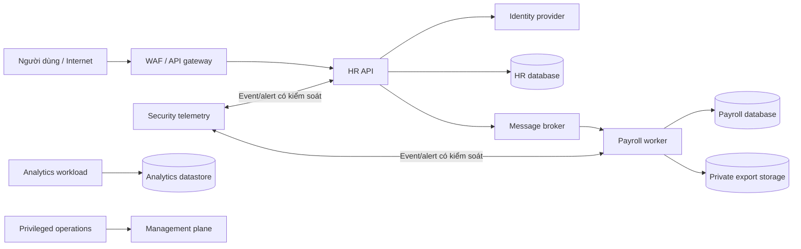
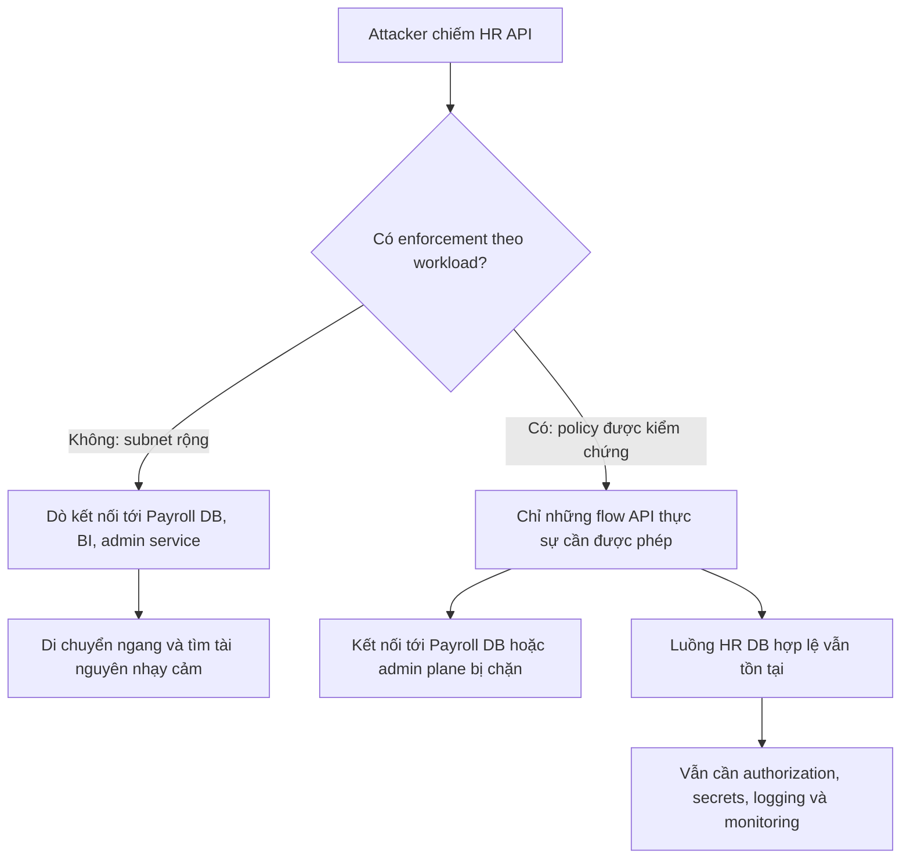
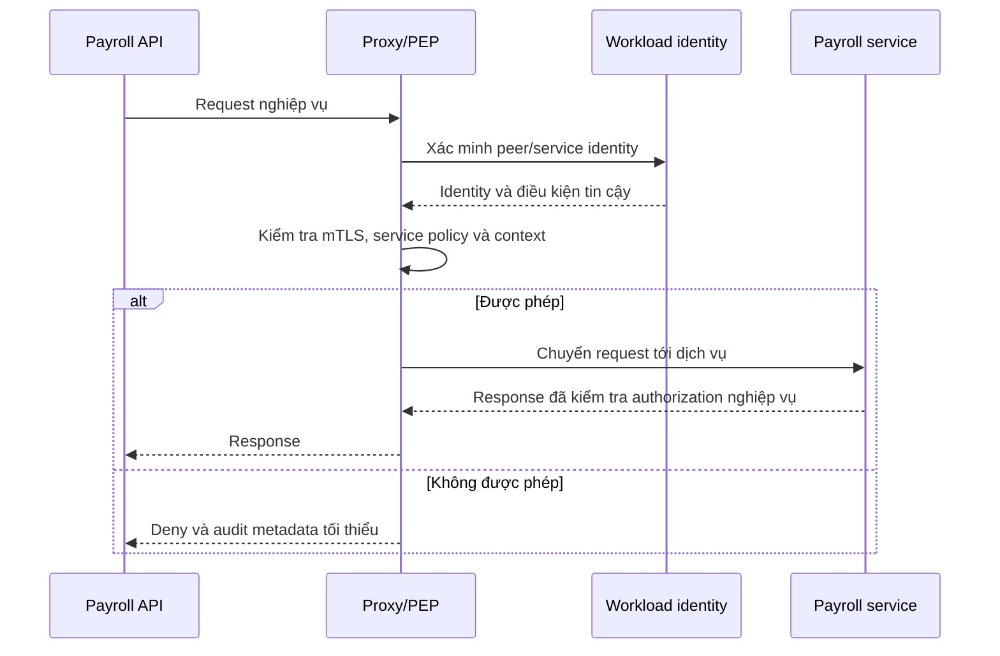
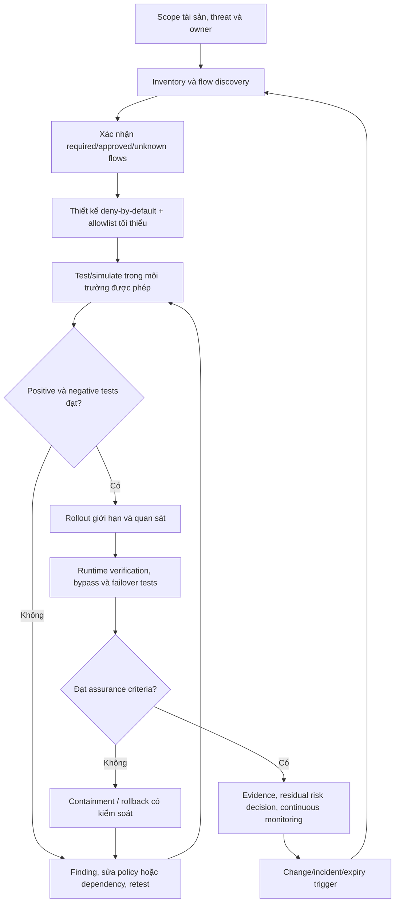

# Micro-segmentation trong Zero Trust: giới hạn đường di chuyển ngang và chứng minh hiệu lực kiểm soát

## 1. Vấn đề: một workload bị xâm nhập không được trở thành chìa khóa của cả hệ thống

Một hệ thống HR SaaS chạy trên cloud có web frontend, API, dịch vụ tính lương, cơ sở dữ liệu, message broker, hệ thống analytics và kho backup. Các dịch vụ được đặt trong mạng private. Nếu một API bị khai thác, kẻ tấn công có thể thử kết nối tới những dịch vụ còn lại: dò cổng database, gọi endpoint quản trị, truy cập queue hoặc gửi dữ liệu đến đích bên ngoài. **Private subnet không tự giới hạn các đường kết nối nội bộ**. Điều quan trọng là workload bị xâm nhập có thể kết nối tới đâu và thực hiện được hành động gì sau khi chiếm được một điểm.

**Micro-segmentation** là phương pháp chia môi trường thành các ranh giới truy cập nhỏ theo ứng dụng, workload, vai trò, tài nguyên hoặc nhãn tin cậy, rồi **chỉ cho phép những luồng thật sự cần thiết**. Thay vì coi mọi host trong một VLAN/VPC/namespace là đáng tin, chính sách có thể quy định: frontend chỉ gọi API, payroll-api chỉ gọi payroll-db trên cổng phù hợp, analytics không thể kết nối trực tiếp database lương, workload không có nhiệm vụ không thể mở kết nối tới management plane.

Trong chương **Zero Trust assurance** của module **SECURITY_SECURITY_ASSURANCE**, micro-segmentation không chỉ là việc tạo firewall rules. Đích học tập là **xây dựng cách đánh giá có bằng chứng rằng hệ thống đáp ứng các mục tiêu bảo mật**: xuất phát từ threat/risk, xác định yêu cầu và security controls, triển khai, kiểm thử allow/deny, audit, xử lý findings và đánh giá residual risk liên tục trong phát triển/vận hành.

### Kết quả học tập

Sau bài này, bạn có thể:

1. Phân biệt segmentation truyền thống, micro-segmentation và resource authorization trong Zero Trust.
2. Lập **workload inventory, communication graph và trust boundaries** để phát hiện east–west traffic cần bảo vệ.
3. Thiết kế chính sách theo nguyên tắc **default deny, allowlist tối thiểu, phân quyền theo identity/labels, ingress và egress**.
4. Hiểu giới hạn thực tế của cloud security groups, host firewall, Kubernetes NetworkPolicy, service mesh và các policy L7.
5. Viết test plan **positive/negative/bypass/failure**, có yêu cầu cụ thể và expected/actual.
6. Thu thập evidence, phát hiện drift, quản lý ngoại lệ và quyết định rủi ro còn lại.

> **Phạm vi:** ví dụ về Kubernetes, cloud và service mesh trong bài chỉ minh họa. Semantics enforcement phụ thuộc CNI, nhà cung cấp, phiên bản, topology và cấu hình đang chạy. Muốn đưa kết luận assurance phải xác minh hành vi **trong chính môi trường được đánh giá**, không mặc định một YAML hoặc sơ đồ là bằng chứng hệ thống đã được bảo vệ.

## 2. Micro-segmentation là gì, và không phải là gì?

### 2.1. Từ segmentation lớn đến ranh giới workload

**Network segmentation** thường chia mạng thành các vùng như Internet-facing, application, database, management hoặc production và test. Các vùng có thể dùng subnet, VLAN, routing, firewall và access control lists.

**Micro-segmentation** đi sâu hơn: trong cùng vùng application hoặc cùng cụm container, các workload vẫn có quy tắc kết nối riêng. Policy có thể dựa trên labels, service identities, nhóm workload, host agents, tags, security groups hoặc thuộc tính được kiểm chứng. Một máy trong vùng ứng dụng không tự có quyền kết nối tới mọi máy khác trong vùng.

| Tiêu chí | Segmentation truyền thống | Micro-segmentation | Authorization tại ứng dụng/tài nguyên |
| --- | --- | --- | --- |
| Đối tượng | VLAN, subnet, zone, network boundary | Workload, service, pod, host, nhóm app hoặc tài nguyên rất cụ thể | Principal, action, object/record, tenant, purpose |
| Quyết định thường thấy | Mạng A có thể kết nối mạng B? | Workload A được kết nối workload B, cổng/protocol nào? | Người/service X có thể đọc/sửa bản ghi Y không? |
| Điểm thực thi | Router, firewall, network ACL | Host agent, cloud policy, distributed firewall, CNI, sidecar/mesh | API/service, database, resource policy |
| Giá trị | Ngăn giao tiếp giữa các khu vực lớn | Giảm lateral movement và blast radius trong từng khu vực | Chặn BOLA/IDOR, sai tenant, sai hành động |
| Giới hạn | Trong một zone vẫn có thể quá tin cậy | Một kết nối hợp lệ vẫn có thể mang hành động/dữ liệu trái quyền | Không tự chặn mọi kết nối mạng tới dịch vụ |

Ba lớp có thể cần thiết **đồng thời**. Micro-segmentation không thay MFA, authorization trên từng record, mã hóa, kiểm soát secrets, patching, monitoring hoặc backup.

### 2.2. Cốt lõi là giảm implicit trust

Nguyên tắc Zero Trust: không cấp niềm tin mặc định do vị trí mạng, luôn xác minh điều kiện cần, cấp quyền tối thiểu và giả định một phần hệ thống có thể bị xâm nhập. Micro-segmentation thực thi một phần nguyên tắc này bằng cách **đóng những đường giao tiếp không có lý do nghiệp vụ được duyệt**.

Không nhất thiết mọi process phải có một firewall riêng. Độ hạt phù hợp là mức giúp **giảm hậu quả rủi ro có ý nghĩa** mà vẫn đủ khả năng vận hành, thay đổi và chứng minh. Một chính sách quá chi tiết nhưng không có owner, thiếu telemetry hoặc không thể khôi phục khi lỗi có thể tạo gián đoạn mà không tăng assurance.

### 2.3. “Không thể kết nối” khác “không thể lộ dữ liệu”

Nếu workload A không mở kết nối được tới database B, đó là evidence hỗ trợ **network isolation**. Nhưng nếu A có thể gọi payroll-api hợp lệ và API đó trả bảng lương sai tenant, lỗi bảo mật vẫn tồn tại. Ngược lại, authorization mạnh ở API không loại bỏ rủi ro port database đang mở cho mọi workload.

**Kết luận phải tách:** network reachability, peer identity, API authorization, data confidentiality, resilience và khả năng phát hiện sự cố.

## 3. Đông–tây, bắc–nam và các ranh giới cần xét

**North–south traffic** thường chỉ luồng giữa bên ngoài với môi trường ứng dụng; **east–west traffic** thường chỉ luồng giữa các workload trong hoặc giữa các vùng hệ thống. Cách gọi hữu ích để phân tích nhưng không phải ranh giới an toàn tuyệt đối: một API đi qua gateway vẫn có thể mở đường tới các tài nguyên phía sau.

### 3.1. Communication graph minh họa



Trên đây là **luồng mong muốn**, chưa phải traffic quan sát từ production. Mỗi cạnh phải được đối chiếu với cấu hình thực tế. Ví dụ payroll worker có thể cần gọi một secret manager hoặc DNS resolver, nhưng **không có lý do mặc định** để analytics gọi payroll database hoặc frontend gọi KMS.

### 3.2. Ma trận luồng cần thiết

| Nguồn | Đích | Hành động/luồng | Điều kiện được duyệt | Điều cần chặn |
| --- | --- | --- | --- | --- |
| API gateway | HR API | HTTPS trên cổng dịch vụ | Gateway identity được duyệt, request policy | Gọi thẳng từ nguồn chưa được phép |
| HR API | HR database | Query ứng dụng qua DB endpoint | Identity và quyền DB hẹp, đúng môi trường | Truy cập admin DB từ mọi pod |
| HR API | Broker | Publish sự kiện nghiệp vụ | Topic/credential đúng nhiệm vụ | Đọc topic nội bộ không cần thiết |
| Payroll worker | Payroll DB | Truy xuất bảng chi trả | Worker identity, cổng/protocol đúng | Analytics hoặc frontend truy cập DB |
| Payroll worker | Export storage | Ghi object trong prefix được phép | IAM/resource policy, encryption | Ghi hoặc đọc tất cả bucket |
| Analytics | Analytics datastore | Query đã được duyệt | Dataset/role/tenant policy | Kết nối trực tiếp payroll DB |
| Operations | Management plane | Quản trị theo ticket/JIT | Identity, MFA, device posture, audit | Workload thường vào control plane |

**Flow allowlist phải đi hai chiều về ý nghĩa nghiệp vụ nhưng kiểm tra riêng ingress/egress** theo nền tảng. Một chiều “đã cho phép” không bảo đảm chiều còn lại, DNS hoặc phản hồi được xử lý đúng. Các firewall stateful thường cho phép response traffic của kết nối đã được thiết lập, nhưng phải xác minh statefulness của cơ chế thực tế.

### 3.3. Ranh giới bảo vệ cần nêu rõ

- **Mạng:** Internet, VPC/VNet, subnet, cluster, node, namespace, host.
- **Danh tính:** user/service, workload, certificate và cloud role.
- **Tài nguyên:** database, topic, object, API, admin plane, KMS.
- **Quản trị:** ai có thể thêm label, sửa policy, tạo route, mở port hoặc tắt agent.
- **Dữ liệu:** tenant nào, classification gì, luồng có nhận plaintext không.

Không vẽ ranh giới chỉ theo hình mạng nếu người quản trị một label có thể tự gắn nhãn “trusted” để vượt policy. **Authority to assign labels/identity** là một phần của trust boundary.

## 4. Inventory và quan sát trước khi chặn

Micro-segmentation hiệu quả bắt đầu bằng **khả năng xác định workload và luồng giao tiếp hiện có**. Nếu áp default deny ngay khi chưa biết dependencies, có thể vô tình chặn DNS, health checks, CI/CD, service discovery, backup hoặc hoạt động phục hồi.

### 4.1. Mẫu workload inventory

| Thuộc tính | Ý nghĩa |
| --- | --- |
| Workload ID | Tên ổn định hoặc service identity, không chỉ IP tạm thời |
| Owner / team | Ai chịu trách nhiệm thay policy và xử lý sự cố |
| Environment | Production, staging, test, DR; account/region/cluster |
| Labels/tags | App, tier, environment, tenant scope nếu áp dụng, mức tin cậy |
| Runtime | VM, container, function, bare metal, managed service |
| Data classification | Loại dữ liệu được đọc/xử lý/trả ra |
| Allowed initiators | Nguồn nào thật sự cần tạo kết nối |
| Allowed destinations | Đích, port, protocol, direction, purpose |
| Service identity | Certificate, workload identity, cloud role, DB account |
| Dependencies | DNS, time, KMS, IdP, metrics, broker, backup |
| Policy/evidence refs | Mã policy, test, finding và review gần nhất |

### 4.2. Các nguồn để khám phá traffic

- Network flow logs từ cloud/VPC và firewall.
- Kubernetes service/endpoint, network policy, CNI telemetry.
- Service mesh telemetry, mTLS identity và tracing.
- Host-level process/socket telemetry có thẩm quyền.
- API gateway logs, database connection logs, broker topic subscriptions.
- App architecture/data-flow diagrams và owner interviews.
- CI/CD deployment manifests, resource tags, cloud IAM inventory.
- DNS/service discovery logs và đường đi của job theo lịch.

**Observed traffic không đồng nghĩa authorized traffic.** Một kết nối đã diễn ra có thể là artifact của quyền quá rộng, scan hoặc luồng cũ. Mọi cạnh phải được owner xác minh có cần thiết không và đối chiếu với mục tiêu nghiệp vụ.

### 4.3. Các dòng dễ bị thiếu

Đừng chỉ quan sát trong giờ hành chính. Các job đêm, payroll cuối tháng, data migration, backup restore, health checks, certificate rotation, incident response và failover có thể tạo traffic hiếm nhưng quan trọng. Cần chọn khoảng quan sát hoặc dùng test/sơ đồ thiết kế để bù các luồng ít xuất hiện.

Đối với **unknown flows**, ghi nguồn chưa kiểm chứng, giả thuyết, owner và thời hạn review. Không đưa vào allowlist vĩnh viễn chỉ vì một lần thấy traffic, cũng không xóa khỏi tài liệu khi chưa biết tác động.

## 5. Threat modeling: đường đi của kẻ tấn công trước và sau khi chia nhỏ mạng

### 5.1. Bắt đầu bằng tình huống compromise cụ thể

Giả định HR API có lỗ hổng remote code execution và attacker chiếm một container. Threat cần đánh giá không chỉ “API bị chiếm” mà còn:

1. API có thể gọi database hoặc admin endpoint nào?
2. Có service credentials, token hoặc secret nào trong process?
3. Có thể kết nối trực tiếp payroll DB hoặc backup vault không?
4. Có thể quét port/dịch vụ nội bộ, mở reverse connection hoặc gửi dữ liệu ra Internet không?
5. Policy nào chặn các đường không cần thiết và policy nào vẫn phải cho business traffic?
6. Nếu một chính sách bị thay, ai phát hiện và mức độ lan rộng là bao nhiêu?

### 5.2. Attack path: mô tả thay đổi rủi ro



Micro-segmentation giảm số đường **reachable** nhưng không triệt tiêu khả năng attacker lạm dụng các kết nối hợp lệ. Cần kiểm thử quyền ứng dụng, secrets, data access và exfiltration controls tương ứng.

### 5.3. Risk và requirements

| Risk ID | Mối đe dọa | Yêu cầu kiểm soát | Test chứng minh |
| --- | --- | --- | --- |
| **ZT-MS-R01** | Một pod HR API gọi thẳng Payroll DB. | Chặn kết nối không có nhiệm vụ giữa hai workload. | Negative TCP/connectivity test từ HR API tới Payroll DB. |
| **ZT-MS-R02** | Analytics service quét nội bộ, truy cập broker/job. | Chỉ các flow analytics được duyệt; không mở rộng theo subnet. | Connectivity matrix và deny tests từ analytics. |
| **ZT-MS-R03** | Workload bị chiếm gửi dữ liệu tới đích Internet tùy ý. | Egress theo policy, kiểm soát đích và dữ liệu. | Egress test tới đích được/không được duyệt; proxy/DNS evidence. |
| **ZT-MS-R04** | Label bị kẻ tấn công sửa để lọt allowlist. | Chỉ role có thẩm quyền mới được thay selectors/tags. | RBAC/admission/permission negative tests và audit. |
| **ZT-MS-R05** | Policy chưa được thực thi vì CNI/agent thiếu khả năng. | Kiểm tra enforcement thực tế cho resource trong scope. | Positive/negative tests trên đúng node/cluster. |
| **ZT-MS-R06** | Failover hoặc DR mở đường truy cập quá rộng. | Policy có hiệu lực trong DR và kịch bản scale/failover. | Restore/failover drill kèm flow tests. |
| **ZT-MS-R07** | Chặn nhầm DNS/KMS làm dịch vụ ngừng hoạt động. | Luồng phụ thuộc cần thiết được nhận diện, có rollback. | Positive dependency tests, change rehearsal. |
| **ZT-MS-R08** | Policy drift mở cổng DB hoặc management. | Phát hiện và xử lý thay đổi policy ngoài phê duyệt. | Runtime/IaC diff, alert và retest. |

**Rủi ro còn lại** phụ thuộc cả độ nhạy của resource và mức độ quyền bên trong service. Không hạ risk chỉ vì đã triển khai một rule nếu chưa chứng minh rule có hiệu lực ở đúng đường attack.

## 6. Thiết kế policy: nguồn, đích, identity, action và ngữ cảnh

Một policy micro-segmentation nên trả lời: **workload nào được khởi tạo luồng tới workload/tài nguyên nào, trên giao thức/cổng nào, theo điều kiện gì, và tại đâu được thực thi**. Với policy L7 có thể cần thêm HTTP method, path, service identity hoặc điều kiện hành động; với network policy L3/L4, không được giả định nó đọc hiểu nội dung ứng dụng.

### 6.1. Đặc tả một policy có thể kiểm tra

| Trường | Mục đích | Ví dụ |
| --- | --- | --- |
| `policy_id`, `version` | Truy vết thay đổi, rollback và test | `MS-PAYROLL-DB-01/v2` |
| `owner`, `approval_ref` | Người được quyền xác nhận cần thiết | Payroll service owner |
| `source_selector` | Workload/service identity được khởi tạo kết nối | `app=payroll-api, env=prod` |
| `destination_selector` | Resource được bảo vệ | `app=payroll-db, env=prod` |
| `protocol` / `port` | Điều kiện kết nối | TCP/5432 |
| `direction` | Ingress, egress hoặc cả hai | Ingress DB; egress API |
| `security_conditions` | mTLS/identity/namespace/region nếu áp dụng | Peer identity đúng workload |
| `purpose_and_risk_ref` | Lý do nghiệp vụ và kịch bản cần giảm | Payroll DB query; ZT-MS-R01 |
| `enforcement_point` | Nơi kiểm soát và nguồn policy | CNI, host firewall, SG, proxy |
| `evidence_refs` | Test/traffic logs/runtime config | ZT-MS-T01, EV-MS-01 |
| `expiry_or_review_trigger` | Tránh quyền tồn tại vĩnh viễn | Khi đổi API, data flow hoặc owner |

Nếu chọn IP/CIDR làm selector, cần đánh giá IP động, scale, NAT, mạng khác và trách nhiệm quản lý. Khi dùng **workload labels** hoặc **service identities**, phải kiểm tra ai có quyền cấp hoặc sửa chúng. Selector không đáng tin có thể biến allowlist thành đường vượt ranh giới.

### 6.2. Default deny và allowlist

**Default deny** là trạng thái không cho phép những luồng chưa có policy cho phép trong phạm vi kiểm soát. Kế tiếp tạo **allowlist** cho những phụ thuộc thực sự cần. Cách này giúp luồng mới không tự xuất hiện chỉ vì chung mạng.

Quy trình:

1. Định nghĩa tài nguyên và traffic thuộc scope.
2. Liệt kê đúng các luồng được owner phê duyệt.
3. Xác định chiều ingress/egress và policy thực thi ở mỗi đầu.
4. Test luồng **được phép** hoạt động và luồng **không được phép** bị chặn.
5. Kiểm tra đường bypass và hoạt động khi policy service/agent gặp lỗi.
6. Giám sát các flow bị deny, thay đổi topology và sự kiện DR.

**Không được hiểu default deny là “chặn tất cả trong production trước rồi sửa dần”.** Đặc biệt với các cluster dùng default allow, cần khám phá dependencies, thử nghiệm trong môi trường đại diện, áp theo từng vùng với rollback và owner chịu trách nhiệm.

### 6.3. Ingress và egress là hai kiểm soát khác nhau

**Ingress** hạn chế ai có thể kết nối vào workload được bảo vệ. **Egress** hạn chế workload được kết nối đi đâu. Khi một hệ thống có default-deny trên cả hai chiều, một kết nối có thể cần được cho phép tại phía nguồn và phía đích tùy semantics.

| Tình huống | Nếu chỉ kiểm soát ingress | Nếu chỉ kiểm soát egress |
| --- | --- | --- |
| Workload bị chiếm mở kết nối tới đích Internet mới | Resource nội bộ khác có thể được bảo vệ nhưng exfiltration vẫn khả thi | Có thể hạn chế exfiltration nhưng nguồn không được phép khác vẫn gọi service nếu đích không hạn chế |
| Database chỉ nhận từ payroll-api | Chặn caller lạ vào DB | Nếu chỉ chặn ở caller, workload khác không có policy có thể vẫn gọi DB |
| Service được phép dùng DNS/KMS/IdP | Không biết chính xác những đích outbound được phép | Có thể kiểm soát outbound nhưng cần bảo vệ điểm nhận quan trọng |

Một số nền tảng xử lý response traffic của kết nối đã thiết lập theo trạng thái, một số khác có semantics riêng hoặc khác biệt theo CNI/host/network implementation. **Không suy diễn hành vi response, conntrack hoặc NAT mà chưa kiểm chứng.**

### 6.4. L3/L4 so với L7

| Lớp | Có thể kiểm soát | Không nên tự suy |
| --- | --- | --- |
| **L3** | IP, CIDR, routing hoặc endpoint network identity. | Người dùng, HTTP method hoặc quyền xem record. |
| **L4** | TCP/UDP port và hướng kết nối. | API operation hoặc loại dữ liệu trong payload. |
| **L7** | HTTP host/path/method, service identity hoặc thông tin giao thức được proxy hiểu. | Quyền nghiệp vụ trên tenant/record nếu policy không có resource context. |
| **Application/resource** | Subject, tenant, object, action, workflow và purpose. | Mọi kết nối mạng không được phép đã bị chặn. |

**Điểm mấu chốt:** một rule cho phép TCP/443 không có nghĩa mọi hành động HTTPS đều được phép. Khi workload hợp lệ nhưng request sai tenant, backend vẫn phải kiểm tra resource authorization.

### 6.5. Mã hóa đường truyền và identity

mTLS có thể xác minh danh tính peer và bảo vệ kênh giữa service theo trust model. Nó **không thay thế** allowlist hoặc quyền trên resource. Một caller có certificate hợp lệ vẫn phải bị từ chối nếu không được phép gọi dịch vụ/endpoint đó.

## 7. Chọn điểm enforcement theo hạ tầng

Micro-segmentation có thể thực hiện ở nhiều lớp; lựa chọn phụ thuộc vị trí workload, mức bảo vệ, identity có sẵn, khả năng quan sát và nguồn lực vận hành.

| Cơ chế | Enforcement thường thấy | Điểm mạnh | Giới hạn cần đánh giá |
| --- | --- | --- | --- |
| **Host-based firewall/agent** | Rule theo host, process hoặc workload khi nền tảng hỗ trợ | Gần workload, hữu ích cho VM/bare metal | Bypass khi host/agent compromise; cấu hình/telemetry khác nhau |
| **Distributed virtual firewall/SDN** | Chính sách ở hypervisor/virtual switch | Bao phủ east–west giữa VM mà không chỉ tại firewall biên | Identity mapping, VM mobility, agent/control-plane failure |
| **Cloud security group** | Network interface/resource policy | Dễ dùng với VM/managed services, tích hợp IAM/automation | Granularity và east–west coverage phụ thuộc service, account và nền tảng |
| **Cloud network ACL/routing firewall** | Subnet/route/packet filtering | Tạo lớp bao quanh network zone | Có thể quá thô cho service nhỏ; semantics stateful/stateless khác nhau |
| **Kubernetes NetworkPolicy/CNI** | Ingress/egress tại pod network | Selector dựa trên pod/namespace, tích hợp deployment | CNI phải thực thi; network policy chuẩn không có ý nghĩa FQDN/L7 tổng quát |
| **Service mesh** | Proxy/waypoint/sidecar và policy theo service identity | mTLS, service identity và một số policy L7 | Không bảo vệ mặc định traffic không đi qua mesh; proxy failure/bypass |
| **Identity-aware/application PEP** | API gateway, proxy, middleware, resource policy | Có thể đánh giá user/action/resource | Có thể bỏ sót direct database, node hoặc legacy traffic |

### 7.1. Defense in depth không phải chồng rule tùy tiện

Ví dụ với payroll-db, có thể dùng:

- Cloud/network layer chỉ cho phép các nguồn hạ tầng cần thiết.
- Kubernetes/host-level policy chỉ cho phép payroll-api hoặc workload được đăng ký.
- Service identity/mTLS để xác minh caller trong các luồng áp dụng.
- Database role chỉ được truy cập schema/operation cần thiết.
- Application authorization kiểm tra user, tenant, hành động và bản ghi.

Các lớp giảm rủi ro khác nhau. Tuy nhiên, nếu tất cả lớp cùng phụ thuộc vào một label do attacker kiểm soát, chúng không độc lập như vẻ ngoài. Assessor cần xem **common trust dependencies**.

### 7.2. Chọn mức độ hạt

Chia đến từng workload giúp giới hạn blast radius tốt hơn nhưng làm policy nhiều hơn, thay đổi thường xuyên và có thể khó debug. Nhóm theo application, tier hoặc trust domain có thể phù hợp nếu có lý do rủi ro và có kiểm tra ngăn lateral movement. Không được dùng “quá nhiều policy” làm lý do để mọi workload chung namespace được mở toàn bộ.

## 8. Kubernetes NetworkPolicy: ví dụ có thể hiểu và kiểm chứng

Trong Kubernetes, đối tượng `NetworkPolicy` dùng các selectors để mô tả lưu lượng được phép cho những pod được chọn, theo ingress/egress và protocol/port. **Việc API chấp nhận object không có nghĩa cluster đang thực thi**: phải có network plugin/CNI hỗ trợ enforcement và cần kiểm thử hành vi trong chính cluster.

### 8.1. Mẫu default deny cho namespace payroll

```yaml
apiVersion: networking.k8s.io/v1
kind: NetworkPolicy
metadata:
  name: deny-by-default
  namespace: payroll
spec:
  podSelector: {}
  policyTypes:
    - Ingress
    - Egress
  ingress: []
  egress: []
```

Ý nghĩa: đối với các pod được chọn trong namespace payroll, không có luồng ingress/egress được allow bởi riêng policy này; những policy khác có thể bổ sung allowed flows. **Nó không tự chặn mọi traffic node-level, host-network hoặc mọi luồng ngoài model Kubernetes NetworkPolicy**, và behavior ngoài phạm vi phải được xác minh theo CNI.

### 8.2. Cho payroll-api gọi payroll-db trên TCP/5432

```yaml
apiVersion: networking.k8s.io/v1
kind: NetworkPolicy
metadata:
  name: allow-payroll-api-to-db
  namespace: payroll
spec:
  podSelector:
    matchLabels:
      app: payroll-db
  policyTypes:
    - Ingress
  ingress:
    - from:
        - podSelector:
            matchLabels:
              app: payroll-api
      ports:
        - protocol: TCP
          port: 5432
---
apiVersion: networking.k8s.io/v1
kind: NetworkPolicy
metadata:
  name: allow-payroll-api-egress-to-db
  namespace: payroll
spec:
  podSelector:
    matchLabels:
      app: payroll-api
  policyTypes:
    - Egress
  egress:
    - to:
        - podSelector:
            matchLabels:
              app: payroll-db
      ports:
        - protocol: TCP
          port: 5432
```

Hai policy minh họa **ingress cho DB** và **egress cho API**, theo pod labels trong cùng namespace payroll. Chúng **không cấu thành cấu hình production đầy đủ**. Ví dụ default deny phía trên sẽ còn chặn các luồng cần thiết khác như gateway → API, DNS, metrics, secrets, IdP, broker hoặc backup, nếu chưa khai báo những allow rules phù hợp.

### 8.3. Namespace và pod selectors dễ bị cấu hình nhầm

Khi một rule `from` có một phần tử chứa **cả** `namespaceSelector` và `podSelector`, hai điều kiện thường cần đồng thời thỏa. Nếu tách thành **hai phần tử riêng** trong danh sách `from`, ý nghĩa là **hoặc** namespace match, **hoặc** pod match, có thể rộng hơn dự kiến. Đây là lỗi cần review kỹ trước release.

Các pod labels và namespace labels phải được bảo vệ bằng RBAC, admission policy và quyền deployment phù hợp; nếu attacker có thể tự tạo pod gắn `app=payroll-api` trong namespace payroll, selector thuần nhãn có thể không đạt ranh giới tin cậy mong muốn.

### 8.4. Những giới hạn của NetworkPolicy chuẩn

- Không tự xác thực người dùng, token hoặc quyền trên record.
- Policy mạng chuẩn chủ yếu biểu đạt selectors/IP/protocol/ports; **FQDN và HTTP method không phải khả năng chung có thể mặc định trông đợi**. Một số CNI có extension riêng phải xác minh và ghi rõ.
- Không mặc định bảo vệ traffic host networking, node services, các giao thức ngoài phạm vi hoặc đường bypass do nền tảng cụ thể cung cấp.
- Không cung cấp audit deny/allow chi tiết giống nhau ở mọi CNI.
- Service IP, pod IP, NAT, external IP, DNS và service discovery có thể ảnh hưởng cách rule khớp; cần test end-to-end.
- Khi nhiều NetworkPolicy cùng chọn pod, các allowed rules tạo hiệu lực kết hợp theo semantics Kubernetes; không giả định có một rule “deny override” như firewall ưu tiên theo thứ tự.

### 8.5. Hướng kiểm thử triển khai

Với identity/pod được cấp phép trong môi trường thử:

1. Payroll-api gọi payroll-db trên TCP/5432: **expected allow**, đồng thời DB auth vẫn kiểm tra.
2. Analytics pod gọi payroll-db cùng cổng: **expected deny**.
3. Frontend gọi payroll-db: **expected deny**.
4. Payroll-api gọi payroll-db cổng không đăng ký: **expected deny**.
5. Payroll-api dùng DNS để phân giải service: **expected allow sau khi có DNS policy phù hợp**.
6. Scale/rolling update tạo pod mới: policy phải áp dụng không phụ thuộc IP cũ.
7. CNI agent/controller mất kết nối theo failure scenario được phép: quan sát policy còn enforce và recovery behavior.

Ghi pod identity, namespace/labels, policy version, node/cluster, CNI version, test time, expected/actual, kết quả và limitations. **Test thất bại vì thiếu DNS chưa tự chứng minh DB policy sai**; cần tách lỗi connectivity dependency với mục tiêu deny/allow đang đánh giá.

## 9. Service mesh: service identity, mTLS và chính sách L7

Service mesh có thể cung cấp workload identity, mTLS và policy ở proxy cho service-to-service. Đây là công cụ bổ sung micro-segmentation ở tầng kết nối và ứng dụng, nhưng chỉ bảo vệ những traffic mà mesh thực sự có khả năng quan sát và thực thi.

### 9.1. Dòng truy cập minh họa



Sơ đồ mang tính khái niệm; chi tiết handshake, danh tính và thời điểm đánh giá thay đổi theo sản phẩm/mode. Cần xác minh policy đang chạy trên đúng proxy/waypoint và không có đường gọi direct bypass.

### 9.2. Những điều cần kiểm tra

- Workload có danh tính độc lập với IP và được gắn với namespace/service account đúng không?
- Certificate/token có issuer, trust domain, expiry, renewal và revoke path hợp lệ không?
- Peer identity được xác thực trước khi policy allow?
- Rule cho phép theo service identity và resource, không chỉ theo tên DNS?
- L7 policy có đúng method/path/host và bảo vệ các endpoint tương đương không?
- Nếu sidecar/waypoint không tham gia hoặc ứng dụng gọi bypass, có network/resource controls khác chặn không?
- Nếu policy controller không sẵn sàng, trạng thái enforcement và TTL quyết định thế nào?
- Audit có actor, target, action, result, policy version mà không lộ token/payload không?

**mTLS không tự phân biệt quyền tenant A và tenant B** khi cả hai đi qua cùng một service. Backend vẫn phải kiểm tra tenant/resource authorization.

## 10. Cloud security groups, VM, host firewall và các môi trường hỗn hợp

Micro-segmentation không phải công nghệ riêng cho container. Nhiều tổ chức còn có VM lâu đời, managed database, máy vật lý, mạng trung tâm dữ liệu, SaaS hoặc những hệ thống không thể cài sidecar.

### 10.1. Cloud-native boundaries

Các cloud security group/firewall policy có thể liên kết với network interface, VM, database hoặc service tùy nhà cung cấp. Một thiết kế tốt thường:

- Chỉ cho ứng dụng cụ thể gọi DB trên cổng cần thiết, thay vì toàn bộ CIDR VPC.
- Giới hạn admin access vào đường quản trị có kiểm soát.
- Hạn chế egress hoặc định tuyến qua điểm kiểm soát khi yêu cầu.
- Dùng identity/tags/security-group reference nếu có thay vì danh sách IP động thủ công.
- Kiểm tra **cross-account/cross-region/VPC peering/private endpoint** như những đường đi riêng.
- Đối chiếu rule hiệu lực, inherited policy, routes và các đường public hoặc NAT.

Đừng coi security group và network ACL giống nhau. Chẳng hạn, một số dịch vụ sử dụng stateful groups và stateless ACL, có semantics với response traffic khác nhau; phải xác minh theo nền tảng.

### 10.2. Host-based segmentation cho VM/bare metal

Host agent có thể tạo rule theo workload/process/host identity và cho phép áp dụng sát tài nguyên. Tuy nhiên cần kiểm tra:

1. Agent có hoạt động trên **tất cả host thuộc scope** không?
2. Khi host mới được tạo hoặc đổi IP, rule có tự theo workload không?
3. Agent có quyền chống bị dừng/sửa trái phép theo threat model không?
4. Khi controller mất kết nối hoặc host restart, policy nào vẫn có hiệu lực?
5. Có tương thích với OS, network stack, interface và workload legacy không?
6. Có đủ logs để chứng minh deny và điều tra không?

Host compromise có thể làm mất tin cậy của một agent đặt trên chính host đó; cần defense in depth và giới hạn nguồn quyền quản trị.

### 10.3. Hybrid và multi-cloud

Khi workload đi qua on-prem ↔ cloud ↔ SaaS, chính sách chỉ áp ở một bên có thể không bao phủ toàn tuyến. Phải xác định:

- Source identity có nhất quán qua gateways/NAT/proxies không?
- IP hoặc service principal có được dịch/đổi tại ranh giới nào?
- Managed services nào không hỗ trợ cùng granularity policy?
- Traffic backup, monitoring, admin và disaster recovery đi qua tuyến nào?
- Policy và evidence có thể được đối chiếu giữa các nhà cung cấp không?

Nếu một cloud cung cấp policy theo tag nhưng hệ thống on-prem chỉ có subnet ACL, không thể mặc định hai nơi đạt mức assurance như nhau. Nêu rõ chênh lệch coverage và biện pháp bù đắp.

## 11. SaaS đa tenant: micro-segmentation không thay cách ly dữ liệu

Đối với một SaaS đa tenant, có thể có hai chiến lược kết hợp:

- **Shared infrastructure:** nhiều tenant dùng chung API, worker và database nhưng tenant access được kiểm tra ở ứng dụng/data layer.
- **Dedicated resources:** tenant hoặc nhóm tenant có workload, database, network và key boundary tách biệt theo yêu cầu/rủi ro.

Không mặc định phải có một namespace, VPC hay database riêng cho từng tenant; lựa chọn phụ thuộc risk assessment, hợp đồng, hiệu năng, quy mô và yêu cầu vận hành. Nhưng nếu dùng hạ tầng chung, micro-segmentation **chỉ tách các thành phần workload**, không tự ngăn user tenant A đọc record tenant B qua cùng một API được phép.

### 11.1. Bốn lớp cách ly cần đánh giá

| Lớp | Câu hỏi | Evidence |
| --- | --- | --- |
| Network/workload | Analytics có thể kết nối tới payroll DB không? | Policy effective state và negative reachability test |
| Workload identity | Payroll job có danh tính/credential riêng và đúng scope không? | Service account/IAM, certificate và token checks |
| Application/data | Request tenant A có thể đọc/sửa resource tenant B không? | BOLA/IDOR negative tests, DB grants, record-level checks |
| Cryptographic/data storage | Export, backup và keys có ranh giới truy cập phù hợp không? | Object/KMS policy, decrypt denial và restore evidence |

Một finding của application authorization **không được đóng** bằng việc chứng minh network segmentation đạt. Ngược lại, một API kiểm tra tenant tốt không có nghĩa có thể bỏ qua các kết nối database/admin rộng không cần thiết.

### 11.2. Thiết kế với dữ liệu nhạy cảm

Một luồng payroll-export có thể gồm user → gateway → payroll-api → job → DB → storage → download service. Cần policy cho từng đoạn, service identities, queue topic, object/key permissions, user authorization và TTL của file. Nếu download service có kết nối được tới storage đúng cổng nhưng trả sai object ID, đây là lỗi **resource authorization**.

### 11.3. Trust boundary của labels và deployment

Trong một cluster shared, nếu CI/CD hoặc developer từ tenant/product khác có thể tự đổi labels, namespace hoặc role để khớp allowlist, micro-segmentation có thể bị vượt qua. Bảo vệ:

- Kubernetes RBAC và admission/namespace ownership.
- CI/CD deployment identities và approval.
- Quyền sửa NetworkPolicy, cloud tags và service accounts.
- Image provenance, pod/host security và service identity issuance.
- Audit các thay đổi labels/selectors/policies và quy trình review.

## 12. Từ traffic discovery tới enforcement: quy trình bảy bước

Áp dụng micro-segmentation theo một vòng **discovery → design → validate → rollout → monitor → improve**, không phải viết một lần rồi quên.

### Bước 1 — Xác định phạm vi, chủ sở hữu và mục tiêu

Chọn các tài sản ưu tiên theo rủi ro: database lương, KMS, control plane, backup, CI/CD và workloads có dữ liệu nhạy cảm. Xác định owner, môi trường, tenant model, criticality, downtime tolerance và success criteria. Lập risk scenarios cụ thể, không chọn phạm vi chỉ vì có sẵn một CNI.

### Bước 2 — Khám phá luồng và phụ thuộc

Thu flow logs/traces/config, ghép với application architecture và xác nhận của owner. Bao gồm các luồng **hiếm theo thời gian**, ví dụ payroll cuối tháng, restore, certificate rotation và failover. Phân loại:

- **Required and approved**
- **Observed but unapproved**
- **Expected but not observed yet**
- **Unknown or suspected malicious**

Không đưa mọi observed flow thành allow policy.

### Bước 3 — Thiết kế policy và defense in depth

Cho từng workload group:

1. Xác định identity/selector và nguồn phát hành đáng tin.
2. Thiết lập ingress/egress default deny ở phạm vi phù hợp.
3. Chỉ allow các flow có owner, mục đích, port/protocol và thời gian.
4. Xem các luồng data egress, management, logs, DNS, KMS, IdP và DR.
5. Liên kết với API authorization và database/IAM grants.
6. Chuẩn bị test cases, exception/rollback và telemetry.

### Bước 4 — Mô phỏng hoặc quan sát trước khi enforce

Một số nền tảng có khả năng audit/observe policy trước khi block; nơi khác cần dựng staging hoặc canary. Đối chiếu would-be deny với luồng nghiệp vụ thực. Đừng coi absence of flow trong vài giờ là bằng chứng không có dependency.

### Bước 5 — Rollout theo nhóm rủi ro và phạm vi được kiểm soát

Bắt đầu ở staging hoặc nhóm workload ít rủi ro, sau đó từng service/tier có owner và điều kiện rollback. Theo dõi health, error rate, transaction success, latency, policy deny, SLO và thay đổi topology. **Không hạ policy về allow-all vô thời hạn khi gặp lỗi**; tìm root cause, bổ sung rule hẹp hoặc rollback có kiểm soát.

### Bước 6 — Kiểm chứng positive, negative, bypass và failure

Kiểm thử đường được phép và bị chặn, các ngữ cảnh namespace/host khác nhau, đường qua proxy/mesh và trực tiếp, stateful response, DNS, failover và policy controller failure. Lưu bằng chứng với resource/identity/policy version và expected/actual.

### Bước 7 — Theo dõi, đánh giá lại và cải tiến

Khi release thêm service, đổi ports, di chuyển cluster/region, thay identity hoặc phát hiện compromise, cần đánh giá lại policy và evidence. Rà soát unused allow rules, stale exceptions, wildcard, shadow IT flows và policy drift. Findings phải có owner, hạn và retest; residual risk cần dựa trên evidence mới.

### 12.1. Sơ đồ luồng quyết định triển khai



## 13. Test matrix: chứng minh allow đúng và deny đúng

**Positive test** chứng minh luồng được duyệt vẫn chạy. **Negative test** chứng minh đường không có nhu cầu bị chặn. Bên cạnh đó cần **bypass test** và **failure test** để kiểm tra chính sách thực sự bao phủ các luồng có thể xảy ra.

| Test ID | Nguồn → đích | Điều kiện thử | Expected | Evidence cần có |
| --- | --- | --- | --- | --- |
| **ZT-MS-T01** | Payroll-api → Payroll DB | Identity/labels đúng, TCP/5432 | Allow, DB vẫn kiểm tra credential | Workload refs, policy version, handshake/test result |
| **ZT-MS-T02** | Frontend → Payroll DB | Không có flow nghiệp vụ | Deny | Source/destination, effective policy, timeout/deny result |
| **ZT-MS-T03** | Analytics → Payroll DB | Cùng private subnet/cluster | Deny | Connectivity negative test, CNI/firewall telemetry |
| **ZT-MS-T04** | Payroll-api → Payroll DB | Sai port/protocol | Deny | Test port và policy |
| **ZT-MS-T05** | Payroll-api → DNS/KMS | Phụ thuộc đã được owner duyệt | Allow theo scope | Dependency check, service logs |
| **ZT-MS-T06** | Payroll-api → Internet ngoài allowlist | Egress không được duyệt | Deny | Egress route/proxy/policy, test destination giả |
| **ZT-MS-T07** | HR API → management plane | Không có nhiệm vụ quản trị | Deny | Network/host enforcement evidence |
| **ZT-MS-T08** | Pod giả cùng namespace gắn label nhạy cảm | Identity/label không được ủy quyền | Không thể cấp label hoặc không vượt policy | Admission/RBAC deny và runtime test |
| **ZT-MS-T09** | Service A → B qua mesh | Service identity đúng | Allow theo L7/identity policy | Peer identity, mTLS, decision trace |
| **ZT-MS-T10** | Service không có quyền → B | Có mTLS nhưng sai service identity | Deny | Proxy/PEP policy decision |
| **ZT-MS-T11** | Pod mới sau rolling update → dependency | IP thay, labels/identity đúng | Allow theo workload | Before/after rollout, pod/node refs |
| **ZT-MS-T12** | Direct DB IP thay vì service DNS | Thử bypass hostname/proxy | Không vượt chính sách | Direct endpoint test, policy/log |
| **ZT-MS-T13** | Pod qua hostNetwork/node interface | Đường có nguy cơ ngoài policy scope | Không tạo đường bypass hoặc có compensating control | Node/host/CNI-specific checks |
| **ZT-MS-T14** | Workload ở DR region → DB phục hồi | Failover đã được duyệt | Allow đúng nguồn, deny nguồn ngoài scope | Failover drill, policy mapping |
| **ZT-MS-T15** | Unapproved pod → broker topic | Có network allow do rule lỗi | Network deny nếu không cần; broker auth vẫn chặn | Network + broker authorization tests |
| **ZT-MS-T16** | Controller/agent bị ngắt | Failure mode đã được duyệt | Policy không tự biến thành allow rộng | Fault injection được phép, dataplane state |
| **ZT-MS-T17** | Policy mới được deploy | Rule cũ không còn nhu cầu | Effective rules khớp version duyệt | IaC diff, runtime readback, deny retest |
| **ZT-MS-T18** | Workload với credential bị thu hồi | Có đường mạng nhưng identity invalid | API/DB/resource từ chối; network policy vẫn đúng scope | Credential revoke + auth result |
| **ZT-MS-T19** | Service gọi đường job/backup hiếm | Kịch bản định kỳ/DR | Luồng hợp lệ hoạt động khi cần | Scheduled-job/restore rehearsal |
| **ZT-MS-T20** | Tạo sự kiện deny giả | Nguồn không có quyền tới tài nguyên nhạy cảm | Event được ghi, alert/triage theo mục tiêu | Event-to-alert-to-response trace |

### 13.1. Phân loại kết quả đúng cách

- **Pass in scope:** test chứng minh expected behavior tại resource, cluster, node, policy version và thời điểm đã ghi.
- **Failed:** có bằng chứng behavior không đạt, ví dụ analytics vẫn kết nối Payroll DB.
- **Partial:** ingress đạt nhưng egress/DR chưa đạt hoặc chưa bao phủ.
- **Implemented, unverified:** đã áp policy nhưng chưa có behavioral test đáng tin.
- **Unknown:** thiếu quyền đọc policy, thiếu telemetry hoặc thiếu thông tin đường đi.
- **Not applicable:** chỉ khi chứng minh có lý do không thuộc phạm vi kiểm tra.

Một kết quả `connection refused` cần được giải thích: có thể do **service không lắng nghe** chứ không phải policy deny. Để chứng minh enforcement, phối hợp kiểm tra **effective rule và phép thử có đối chứng**, ví dụ cùng đích có listener và một source hợp lệ kết nối thành công.

### 13.2. Negative tests cần độc lập với thao tác nghiệp vụ

Nếu DB password sai, test không chứng minh firewall chặn đường kết nối. Nếu workload chỉ thất bại vì DNS không phân giải, không thể suy ra L3/L4 segmentation đã deny đúng. Khi khả thi, kiểm tra network reachability và authentication/authorization như **hai lớp riêng**; tránh false pass.

### 13.3. Không dùng kiểm thử gây gián đoạn ngoài thẩm quyền

Các negative/fault/compromise simulation phải ở môi trường, tài khoản và thời gian được phép, có rollback và giám sát. Không tự quét mạng production của bên thứ ba hoặc disable agent/firewall để “chứng minh” trong lúc vận hành bình thường.

## 14. Bypass, edge cases và failure behavior: nơi segmentation dễ mất tác dụng

Một ma trận kết nối mẫu đạt trên vài pod không đủ kết luận ranh giới đã kín. Micro-segmentation vận hành trong một hệ thống liên tục thay đổi: địa chỉ động, service discovery, sidecar, node traffic, managed services, cơ chế kết nối có trạng thái, backup và network paths dự phòng.

### 14.1. Danh mục bypass cần xem theo nền tảng

| Tình huống | Vì sao dễ lọt? | Điều cần xác minh |
| --- | --- | --- |
| **Direct IP/alternate port** | Workload bỏ hostname hoặc gateway, gọi thẳng endpoint khác | Các đường trực tiếp bị policy chặn hoặc có PEP tương đương |
| **HostNetwork/node/host processes** | Một số traffic không đi qua cùng dataplane với pod policy | CNI/host firewall semantics, node access và compensating controls |
| **Proxy/sidecar bypass** | Service có thể dùng network path không được mesh bảo vệ | Đường out-of-mesh bị chặn hoặc được quản lý riêng |
| **IP/NAT/SNAT** | Source IP bị đổi, rule match sai hoặc rộng | Trace packet path và effective selectors |
| **DNS/service discovery** | Egress deny làm hỏng DNS, hoặc DNS được mở quá rộng | Dòng DNS cần thiết, resolver identity, destination filtering và test |
| **Ephemeral ports** | Response traffic/side channel có thể khác dự kiến | Stateful/stateless behavior và established connections |
| **Cross-namespace/account/region** | Policy chỉ áp cho một môi trường | Inventory và test từng ranh giới/DR path |
| **Managed service/private endpoint** | Nền tảng trung gian có control riêng | Effective provider policy, route, IAM/resource authorization |
| **Policy/cache/version drift** | Data plane và desired state không đồng bộ | Runtime readback và propagation/rollout test |
| **Shared labels/service accounts** | Caller không đáng tin có thể mang selector hợp lệ | Quyền gán labels/identity, RBAC và identity attestation |
| **Existing connections** | Kết nối trước khi policy đổi có thể còn hoạt động tùy implementation | Test hành vi established flows và thời gian revoke |
| **IPv4/IPv6 hoặc giao thức khác** | Chỉ kiểm tra một address family hoặc TCP | Resource-specific traffic inspection, protocol coverage |
| **Break-glass/diagnostic paths** | Rule tạm được giữ lại sau sự cố | Expiry, approval, activity audit và review |

### 14.2. Lỗi do DNS và FQDN

Nhiều ứng dụng dùng tên dịch vụ, nhưng network policies L3/L4 thông thường thực thi theo address/selector, không mặc định theo FQDN. Cho phép kết nối DNS **chỉ giúp resolve**, không tự giới hạn workload chỉ được truy cập một domain. Ngược lại, một proxy egress có thể có policy FQDN/L7 nhưng cần kiểm chứng các đường không qua proxy, DNS tunneling và sự thay đổi IP phía đích trong threat model.

### 14.3. Egress cần xem cả đường exfiltration

Chặn analytics → payroll-db ngăn một đường truy cập trái nhiệm vụ, nhưng nếu payroll-api hợp lệ có thể gửi bất kỳ dữ liệu nào ra Internet, attacker chiếm API vẫn có đường exfiltration. Egress policy có thể giới hạn destinations, network routes hoặc buộc qua proxy, song không thay **data minimization, authorization, DLP, log redaction, secret protection và incident response**.

### 14.4. Khi policy/control plane gặp lỗi

Cần phân biệt:

- **Control plane unavailable:** controller không cập nhật được policy; dataplane hiện tại còn thực thi thế nào?
- **Dataplane/agent unavailable:** rule đang áp có còn hiệu lực hay fail-open?
- **PIP/identity unavailable:** policy dựa trên identity mới không xác minh được thì xử lý ra sao?
- **Policy rollout inconsistent:** một số node nhận rule mới, node khác còn rule cũ.
- **Emergency change:** có quy trình giới hạn phạm vi, thời gian và hậu kiểm không?

**Không mặc định rằng mọi nền tảng đều fail closed.** Phải biết kiến trúc cụ thể, thử nghiệm trong scope được phép, có số liệu availability và mô tả residual risk. Một fallback cho dịch vụ quan trọng có thể tồn tại nhưng phải được duyệt, giới hạn quyền/thời gian, giám sát và kiểm thử.

## 15. Telemetry và detection: thấy được luồng bị chặn và policy bị thay

Thiết kế micro-segmentation không hoàn chỉnh nếu thiếu khả năng quan sát. **Deny đúng nhưng không có telemetry** gây khó điều tra và điều chỉnh; **log đầy đủ nhưng không có triage/response** cũng chưa chứng minh khả năng xử lý sự cố.

### 15.1. Các tín hiệu có ích

- Allow/deny events theo source/destination workload, rule ID, port/protocol và time.
- Policy add/update/delete, label/tag change, service account và RBAC change.
- Workload mới xuất hiện, thay node, IP, service/namespace và chưa được map vào policy.
- Traffic không khớp catalog: kết nối hiếm, quét nhiều đích, luồng sang region/recipient mới.
- Policy controller/agent health, coverage, sync status và version skew.
- API/DB access logs để tách network allow khỏi quyền dữ liệu.
- Privileged actions, break-glass, ingress/egress policy exceptions.
- Sự kiện failover/backup/restore khiến đường mạng thay đổi.

### 15.2. Event schema tối thiểu

| Field | Ý nghĩa |
| --- | --- |
| `event_id` / `timestamp` | Định danh và mốc thời gian |
| `source_workload_ref` / `source_identity` | Danh tính nguồn được đối chiếu |
| `destination_workload_ref` | Tài nguyên nhận hoặc đích được quản trị |
| `protocol` / `port` / `direction` | Đặc điểm traffic và hướng |
| `policy_id` / `version` | Rule hoặc decision có hiệu lực |
| `decision` / `reason` | Allow/deny, lý do đủ để điều tra |
| `environment` / `cluster` / `node` | Phạm vi kỹ thuật |
| `correlation_id` | Nối với trace, API event và finding |
| `collector` / `source_integrity` | Nguồn và bảo đảm độ tin cậy |

Không ghi request payload chứa dữ liệu lương, token, private key hay bí mật chỉ để chứng minh có deny event. Dùng **mã resource/identity** và lưu evidence trong kho phân quyền.

### 15.3. Event-to-response test

1. Tạo một kết nối thử không được phép từ workload test.
2. Kiểm tra policy thực sự deny và có event tương ứng.
3. Xác nhận event xuất hiện ở hệ thống log/SIEM với ID/source/destination đúng.
4. Kiểm tra alert rule hoặc triage workflow theo severity.
5. Đo thời gian event → alert → acknowledgement → action.
6. Kiểm tra ai có thể sửa/xóa log, thời gian lưu và mất tín hiệu khi pipeline lỗi.

Nếu chỉ có rule “alert enabled” nhưng test không tạo cảnh báo, đó mới là **design/implementation evidence**, chưa đủ kết luận detection hoạt động.

## 16. Thiết kế gói bằng chứng Micro-segmentation Assurance

### 16.1. Traceability bắt buộc

Đối với mỗi luồng quan trọng, liên kết:

**Workload/data asset → trust boundary → threat/risk → requirement → policy/control → enforcement point → behavioral test → raw evidence → finding/action → retest → residual risk → authorized decision.**

Một policy có 200 dòng nhưng không biết **những nguồn nào nằm trong selector** khó có thể đánh giá đầy đủ. Một screenshot “network isolated” không cho thấy bypass paths, chính sách đang chạy hay kịch bản nào đã được thử.

### 16.2. Bốn tầng evidence

| Tầng | Các câu hỏi | Artifact ví dụ | Không tự chứng minh |
| --- | --- | --- | --- |
| **Design** | Vì sao chặn/allow? Tài sản/flow nào được bảo vệ? | Threat model, DFD, flow allowlist, policy spec, owner approval | Data plane thực sự áp rule |
| **Implementation** | Quy tắc nào đã được khai báo và triển khai? | IaC, NetworkPolicy/SG config, service mesh policy, release change | Không có drift, đúng tất cả node |
| **Operating** | Request allow/deny đúng trong phạm vi nào? | Runtime policy, connection tests, logs, negative/bypass/failure tests | Các môi trường/flow không test đều đạt |
| **Remediation/decision** | Sai lệch được xử lý và đánh giá lại chưa? | Finding, action owner, before/after, retest, exception, risk decision | Rủi ro bằng 0 |

### 16.3. Evidence metadata tối thiểu

| Trường | Mục đích |
| --- | --- |
| Evidence ID và requirement/control/risk refs | Truy vết claim đang được kiểm tra |
| Source và destination resource IDs | Xác định chính xác flow nào |
| Labels/identity và authority | Xác minh selectors có đáng tin không |
| Policy ID/version và enforcement point | Biết rule nào được áp tại đâu |
| Cluster/account/region/node/environment | Giới hạn kết luận |
| CNI/agent/mesh/cloud service version khi liên quan | Hiểu semantics/platform dependencies |
| Collected/tested at, collector và source | Nguồn gốc và độ mới |
| Expected/actual, result, logs và limitations | Phân biệt pass/fail/unknown |
| Source snapshot hoặc immutable artifact reference | Kiểm chứng lại được |
| Reviewer, finding, retest và risk decision refs | Khép vòng governance |

### 16.4. Sáu tiêu chí chất lượng

**Completeness:** workloads/entry points, east–west flows, DR/legacy paths và policy owners đã được đối chiếu chưa?

**Accuracy:** kiểm tra effective rules và behavior, hay chỉ đọc cấu hình trong Git?

**Freshness:** evidence có còn đại diện sau khi thay labels, cluster, CNI, app release hoặc firewall không?

**Provenance:** biết nguồn, thời gian, phương pháp, filters và người thu thập không?

**Reproducibility:** reviewer được phép có thể chạy lại test với synthetic data và cùng điều kiện không?

**Protection:** hồ sơ có làm lộ sơ đồ nhạy cảm, credentials, tên tài sản có thể bị lạm dụng hoặc dữ liệu cá nhân không?

Hash của artifact có thể giúp phát hiện thay đổi nội dung sau mốc tham chiếu, nhưng **không tự chứng minh đúng nguồn hoặc đúng phạm vi**. Kiểm tra log/test và control plane từ nguồn đáng tin.

### 16.5. Tách coverage khỏi kết quả control

Ví dụ, “90% workload đã có network policy” có thể che 10% còn lại là payroll DB và key service. Cần nêu:

- Những workload/tài sản **đã có policy**.
- Những đường đã **test hành vi**.
- Những đường có **evidence fail**.
- Những đường **không xác minh được** và nguyên nhân.
- Mức hậu quả, owner, action và hạn xử lý.

Một chính sách default deny áp cho namespace nhưng không có CNI thực thi **không được tính là operating pass**.

## 17. Mẫu YAML evidence manifest và policy review

Đây là **mẫu mô tả phục vụ học tập**, không phải manifest áp cho hệ thống kiểm toán hay cấu hình enforcement chạy được. Mã, thời điểm, tên workload và kết quả đều giả định.

```yaml
assessment_id: "ZT-MS-HR-2026-Q4"
service: "HR SaaS multi-tenant"
assessment_scope:
  environment: "staging"
  cluster: "hr-staging-cluster"
  network_stack_ref: "CNI-STACK-REVIEW-04"
  namespaces: ["payroll", "analytics", "hr-app"]
  resources: ["payroll-api", "payroll-db", "analytics-job"]
  observation_window: "2026-Q4"
  exclusions:
    - "Production DR failover chưa kiểm thử"
inventory:
  workload_catalog_ref: "INV-HR-WL-01"
  flow_allowlist_ref: "FLOW-HR-02"
  owner_review_ref: "APPROVAL-FLOW-03"
policy:
  policy_id: "MS-PAYROLL-DB-01"
  policy_version: "v2"
  control_id: "ZT-MS-C01"
  risk_refs: ["ZT-MS-R01", "ZT-MS-R02"]
  enforcement_type: "kubernetes-cni-networkpolicy"
  runtime_policy_ref: "EV-MS-RUNTIME-01"
  expected:
    payroll_api_to_db_tcp_5432: "allow"
    analytics_to_db_tcp_5432: "deny"
evidence:
  - id: "EV-MS-TEST-01"
    test_ref: "ZT-MS-T01"
    type: "positive_connection_test"
    source_workload: "payroll-api"
    destination_workload: "payroll-db"
    protocol: "TCP"
    port: 5432
    executed_at: "2026-11-28T09:30:00+07:00"
    expected: "allow"
    actual: "allow"
    result: "pass_for_test_scope"
    artifact_ref: "protected-evidence-store:EV-MS-TEST-01"
  - id: "EV-MS-TEST-02"
    test_ref: "ZT-MS-T03"
    type: "negative_connection_test"
    source_workload: "analytics-job"
    destination_workload: "payroll-db"
    protocol: "TCP"
    port: 5432
    executed_at: "2026-11-28T09:45:00+07:00"
    expected: "deny"
    actual: "allow"
    result: "failed"
    finding_ref: "FIND-MS-01"
    artifact_ref: "protected-evidence-store:EV-MS-TEST-02"
  - id: "EV-MS-DR-03"
    type: "dr_bypass_review"
    expected: "deny-unapproved-dr-sources"
    actual: "not_tested"
    result: "unverified"
    action_ref: "ACTION-MS-03"
findings:
  - id: "FIND-MS-01"
    risk_ref: "ZT-MS-R02"
    owner_role: "Platform security engineer"
    verifier_role: "Security QA"
    state: "open"
decision:
  risk_owner_role: "HR product risk owner"
  current_residual_risk: "Chưa giảm cho analytics-to-payroll-db"
  target_residual_risk: "Đánh giá sau khi retest runtime"
  decision_ref: "DEC-MS-01"
review_triggers:
  - "Service identity hoặc labels thay đổi"
  - "New resource/flow/tenant hoặc region"
  - "CNI/mesh upgrade và policy drift"
  - "Incident hoặc finding mới"
```

Mẫu cố ý có một positive pass, một negative fail và một DR unverified. **Không tổng hợp thành “2/3 pass”**: lỗi analytics truy cập payroll DB có thể là rủi ro cao hơn tất cả policy tests khác. Gói evidence thực phải chứa artifact gốc, nguồn, context, policy effective state và reviewer.

## 18. Case study: triển khai micro-segmentation cho HR SaaS

### 18.1. Kiến trúc ban đầu

Giả sử ứng dụng HR SaaS nhiều tenant chạy trong hai cluster production và staging. Các workloads gồm `web-frontend`, `hr-api`, `payroll-api`, `payroll-worker`, `analytics-job`, `audit-collector`, `backup-agent`. Tài nguyên gồm HR DB, payroll DB, broker, object storage, KMS và management API.

Ban đầu nhiều workload trong cùng private network có thể kết nối vào database trên TCP/5432 vì một rule mở từ cả subnet. Service accounts được tái sử dụng, flow logs có nhưng chưa được map về business owners. Mục tiêu không chỉ là đóng port: cần **đi từ bản đồ rủi ro tới kết luận enforcement có bằng chứng**.

### 18.2. Bảng luồng đích

| Flow ID | Nguồn | Đích | Điều kiện cho phép | Mối đe dọa bị giảm |
| --- | --- | --- | --- | --- |
| **FLOW-01** | Gateway | HR API | HTTPS, gateway identity được duyệt | Direct entry point ngoài scope |
| **FLOW-02** | HR API | HR DB | TCP DB, workload và DB role đúng | Lateral movement giữa app và payroll |
| **FLOW-03** | Payroll API | Payroll DB | TCP DB, workload riêng | Analytics/HR API đọc DB lương trực tiếp |
| **FLOW-04** | Payroll worker | Broker | Topic/job identity được duyệt | Worker khác nhận job nhạy cảm |
| **FLOW-05** | Payroll worker | Export storage | Endpoint và resource permission hẹp | Arbitrary data copy/egress |
| **FLOW-06** | Audit collector | Log platform | Pipeline logging kiểm soát | Truy cập trái quyền hoặc log loss |
| **FLOW-07** | Backup agent | Backup/DB snapshot | Identity, lịch và quyền restore được duyệt | Backup bị đọc/sửa/xóa tùy ý |
| **FLOW-08** | Privileged admin | Management plane | JIT approval, audited session | Workload thường vào control plane |

### 18.3. Policy strategy

- **L3/L4 default deny** ở những workload/namespace thuộc scope.
- **Allowlist theo workload identity/labels** cho các luồng đã được owner duyệt.
- **Egress restriction** cho workload nhạy cảm, tránh arbitrary external destinations.
- **Cloud IAM/DB roles** để hạn chế hành vi bên trong một kết nối hợp lệ.
- **mTLS/service identity** cho service-to-service khi kiến trúc hỗ trợ.
- **Backend resource authorization** theo tenant/record; không dựa vào network tag để cách ly dữ liệu đa tenant.
- **CI/CD policy review và runtime reconciliation** trước/sau release.
- **Monitoring và response** cho denied flows bất thường, thay đổi rule và policy agent health.

### 18.4. Evidence kỳ kiểm tra giả định

| Risk | Evidence đã có | Quan sát | Kết luận |
| --- | --- | --- | --- |
| **R01 HR API → Payroll DB** | Effective CNI policy + negative test | HR API không thể kết nối; payroll-api kết nối được | Pass trong cluster được thử |
| **R02 Analytics → Payroll DB** | Effective cloud SG cho subnet, CNI policy | Analytics vẫn kết nối được do policy rộng ở một namespace cũ | Failed – mở finding |
| **R03 Egress Internet** | Proxy config/IaC | Runtime chưa kiểm tra direct outbound route | Implemented, unverified |
| **R04 Spoofed labels** | Kubernetes RBAC review | Developer role có thể đổi label trên workload nhạy cảm | Failed/High concern |
| **R05 Production DR** | Design diagram | Chưa chạy failover drill | Unknown/Unverified |
| **R06 API tenant isolation** | API authorization tests | Đạt test tenant A/B ở staging | Pass cho application scope, không kết luận policy mạng |
| **R07 Policy change logging** | Collector config | Có events nhưng chưa test alert/triage | Partial |

**Kết luận:** micro-segmentation đã giảm một số đường di chuyển ngang trong staging, nhưng còn **analytics bypass, quyền sửa labels rộng và DR chưa được xác minh**. Không được gọi “Zero Trust complete” hay giảm current residual risk cho R02/R04 chỉ vì đã triển khai default deny trên phần khác.

## 19. Finding, containment, remediation và retest

### 19.1. Không đóng finding từ một thay đổi cấu hình chưa được chứng minh

Giả sử `FIND-MS-01` ghi nhận analytics workload kết nối được Payroll DB trái policy. Một pull request sửa `NetworkPolicy` thành công trong CI chỉ cho thấy thay đổi đã qua một số kiểm tra khai báo. Để đóng finding, cần biết **rule hiệu lực, identity/labels và tất cả đường truy cập liên quan** có thực sự bị chặn sau deploy không.

### 19.2. Quy trình xử lý

1. **Triage:** xác định chính xác source, destination, port, environment, data class và biểu hiện ngoài mong đợi. Dùng logs/test evidence có nguồn; phân biệt kết nối mạng với truy cập dữ liệu thực.
2. **Đánh giá tác động:** analytics có credential DB không? Có dấu hiệu query, export hoặc truy cập dữ liệu thật chưa? Nếu có tín hiệu compromise/lộ dữ liệu, đánh giá kích hoạt incident response theo tiêu chí tổ chức.
3. **Giới hạn phơi nhiễm:** thu hẹp rule hoặc quyền IAM/DB theo thẩm quyền, bảo đảm không cắt các luồng nghiệp vụ thiết yếu ngoài kế hoạch.
4. **Tìm nguyên nhân gốc:** selector rộng, policy không chọn pod, namespace legacy, CNI enforcement sai, alternate route, SG/mesh bypass hay rule được tạo ngoài IaC?
5. **Review phạm vi tương tự:** các namespace, cluster, tài khoản, region, legacy workloads và service accounts có cùng mẫu lỗi.
6. **Triển khai remediation:** sửa đúng tầng gây lỗi, có owner, approval, version và rollback.
7. **Retest:** negative tests từ analytics/HR API/nguồn không hợp lệ, positive từ payroll-api, bypass/direct path và regression tests.
8. **Risk decision:** reviewer và risk owner xem evidence, đánh giá current residual risk, quyết định bước tiếp theo/ngoại lệ có thẩm quyền và theo dõi drift.

### 19.3. Mẫu record finding

| Field | Giá trị minh họa |
| --- | --- |
| Finding ID | `FIND-MS-01` |
| Risk / requirement | `ZT-MS-R02` / “Analytics không được kết nối Payroll DB” |
| Source / destination | `analytics-job` → `payroll-db`, TCP/5432 |
| Expected / actual | Deny / Allow trong staging namespace legacy |
| Evidence | `EV-MS-TEST-02`, effective policy snapshot, job/connection trace |
| Data impact | DB lương nhạy cảm; chưa xác minh truy cập record thật |
| Root-cause hypothesis | Policy selector không chọn pod legacy hoặc rule khác cấp rộng |
| Immediate action | Giới hạn đường kết nối sau khi xác nhận ảnh hưởng nghiệp vụ |
| Remediation owner | Platform security engineer |
| Verifier | QA/Security assurance reviewer |
| Retest criteria | Analytics deny; payroll-api allow; direct paths/DR scope được kiểm chứng |
| Current residual | Chưa giảm vì đường trái phép có thể kết nối |
| Target residual | Mức dự kiến sau khi đóng đường và kiểm tra quyền DB |
| Decision authority | Product/data risk owner hoặc cấp được ủy quyền |

### 19.4. Current, target và inherent risk

- **Inherent risk:** mức rủi ro dự kiến trước các controls, dựa trên giả định rõ.
- **Current residual risk:** mức còn lại theo controls và bằng chứng **hiện có**.
- **Target residual risk:** mức kỳ vọng sau remediation, chỉ đạt khi những điều kiện dự kiến đã được xác minh.

| Trạng thái | Cách đánh giá |
| --- | --- |
| NetworkPolicy được thiết kế và review | Có design evidence, chưa hạ current tự động |
| IaC đã merge, chưa deploy | Implementation dự kiến, current vẫn theo thực tế đang biết |
| Đã deploy nhưng chưa test dataplane | Implemented/unverified, không tự tuyên bố Pass |
| Positive/negative/bypass tests đạt đúng scope | Có căn cứ điều chỉnh current residual theo đánh giá có thẩm quyền |
| Phát hiện label spoofing hoặc alternate route | Mở lại finding/risk, xem lại hiệu lực và blast radius |

Không cộng điểm giảm rủi ro cơ học nếu CNI, mesh và cloud groups cùng phụ thuộc một control plane/identity mapping dễ bị compromise. **Control independence** cần được chứng minh theo kiến trúc.

## 20. Policy as Code, CI/CD và kiểm soát thay đổi

### 20.1. Vì sao cần quản lý policy như một artifact phần mềm?

Micro-segmentation thay đổi khi deploy service mới, tạo worker, thay cổng, chuyển cluster, đổi region, scale và khôi phục DR. Policy cần versioning, review, kiểm thử và triển khai có kiểm soát để tránh cả **mở quyền ngoài ý muốn** lẫn **làm gián đoạn nghiệp vụ**.

Một quy trình hợp lý:

1. Owner đề xuất luồng: nguồn, đích, protocol, dữ liệu, lý do, thời gian, rủi ro và người nhận trách nhiệm.
2. Security/platform review xem selector/identity, quyền gán label, egress và bypass.
3. Static checks phát hiện wildcard, open-all, empty selectors, missing owners hoặc policy ngoài scope theo chuẩn nội bộ.
4. Positive/negative tests trong môi trường đại diện; test dependency như DNS, KMS, logging và backup.
5. Approve theo mức độ rủi ro; lưu policy version, commit/build, release context.
6. Rollout canary/phân đoạn có rollback; thu telemetry và xác minh effective state.
7. Reconcile Git/IaC với runtime; mở finding khi drift.
8. Rà soát định kỳ unused allow rules và ngoại lệ quá hạn.

### 20.2. Static checks chưa đủ

Một linter có thể thấy rule `ingress: []` hoặc selector theo label chính xác. Nhưng linter **không biết chắc** pod có được chọn không, CNI có enforce không, nguồn có thể tự giả label hay production còn rule rộng khác không. Test cần phối hợp:

| Kiểm tra | Giá trị | Giới hạn |
| --- | --- | --- |
| YAML/schema validation | Chính sách đúng cấu trúc API | Không chứng minh semantics runtime |
| Policy-as-code static rules | Tìm rule mở rộng, thiếu owner/expiry | Có thể không thấy tất cả inherited permissions |
| Unit/policy decision tests | Test matching selectors và intended rules | Không chứng minh traffic bị chặn |
| Integration/behavioral tests | Kiểm tra kết nối thực trong môi trường đại diện | Chỉ đại diện cho CNI/topology/test scope |
| Runtime reconciliation | Phát hiện drift giữa desired và effective policy | Cần biết nguồn nào là authoritative |
| Event-to-response test | Chứng minh giám sát và xử lý hoạt động | Không bảo đảm phát hiện mọi hành vi |

### 20.3. Change triggers

Đánh giá lại khi:

- Thêm service, API, database, queue, storage hoặc port.
- Chuyển workload sang host, cluster, account, region hoặc cloud khác.
- Thay CNI/mesh/agent hoặc cơ chế NAT/service discovery.
- Sửa labels, namespace structure, service account, RBAC, identity issuance.
- Thay backup/restore, failover hoặc management plane.
- Phát hiện attack path, bypass, incident, drift hay policy-related outage.
- Chính sách/ngoại lệ hết hạn hoặc owner thay đổi.

Không giữ evidence cũ như Pass sau một thay đổi làm nó không còn đại diện.

## 21. Ngoại lệ, legacy systems và cân bằng availability

Không phải workload nào cũng có thể chuyển ngay sang policy theo service identity. Ví dụ một database legacy có IP tĩnh, một vendor agent yêu cầu cổng riêng, hoặc job chỉ chạy cuối tháng. **Ngoại lệ không tự là thất bại** nếu được quản trị minh bạch, giới hạn và có cơ chế giảm rủi ro tương ứng. Vấn đề là ngoại lệ vĩnh viễn, không owner hoặc không kiểm chứng.

### 21.1. Mẫu ngoại lệ có thể đánh giá

| Trường | Điều cần ghi |
| --- | --- |
| Exception ID | Mã và version |
| Asset / workload / flow | Nguồn, đích, protocol, environment, tenant |
| Business justification | Vì sao chưa thể dùng control chuẩn |
| Risk and impact | Đường attack được mở thêm và hậu quả |
| Compensating controls | IAM/DB ACL, JIT, monitoring, proxy hoặc network path hẹp |
| Approval authority | Người có thẩm quyền chấp nhận trong phạm vi |
| Validity | Ngày hiệu lực, thời hạn và trigger hết hạn |
| Review and removal plan | Owner, milestone thay thế, deadline |
| Evidence | Rule runtime, access test, review và audit |

### 21.2. Ví dụ ngoại lệ nguy hiểm

“Cho phép mọi workload truy cập DB trên TCP/5432 vì một job cũ đôi khi cần” **không phải ngoại lệ chất lượng**. Cần tìm service identity thật của job, thời gian hoạt động, nguồn/đích và lý do; nếu không có enforcement theo identity, dùng policy hẹp hơn và biện pháp bù đắp có expiry.

### 21.3. Availability cũng là mục tiêu assurance

Default deny có thể ngăn malware, nhưng một allowlist thiếu phụ thuộc DNS, KMS hoặc health probes có thể gây outage. Do đó phải có:

- Business SLO và tiêu chí chấp nhận về downtime/latency.
- Impact analysis của policy change.
- Positive tests và dependency rehearsal.
- Canary/gradual rollout, monitoring, rollback có phê duyệt.
- Kịch bản phục hồi/DR đã xác minh.

Không có nghĩa khi gặp outage được phép bật allow-all tùy ý. Quy trình khẩn phải xác định authority, scope, time limit, telemetry và hậu kiểm.

## 22. RACI: ai sở hữu luồng, ai kiểm chứng?

**R = Responsible**, **A = Accountable**, **C = Consulted**, **I = Informed**. Ma trận là ví dụ cho một tổ chức có Product owner (PO), Security architecture (SEC), Platform/network (PLAT), Application engineering (ENG), QA/Assurance (QA), Operations/SOC (OPS) và Risk authority (RISK).

| Hoạt động | PO | SEC | PLAT | ENG | QA | OPS | RISK |
| --- | :---: | :---: | :---: | :---: | :---: | :---: | :---: |
| Xác định tài sản, yêu cầu và business flows | **A/R** | C | R | R | C | C | I |
| Threat modeling và risk scenarios | R | **A/R** | C | R | C | C | C |
| Thiết kế policy ingress/egress theo workload | C | **A** | **R** | R | C | C | I |
| Bảo vệ labels/identity/policy privileges | I | C | **A/R** | R | C | R | I |
| Triển khai và rollback CNI/cloud/host policies | C | C | **A/R** | R | C | R | I |
| Kiểm thử positive/negative/bypass/failure | C | C | R | R | **A/R** | R | I |
| Giám sát events/drift và triage | I | C | R | C | C | **A/R** | I |
| Khắc phục lỗi policy và xác minh triển khai | C | C | **A/R** | R | R | R | I |
| Tổng hợp assurance/evidence/gaps | C | **A** | R | R | **R** | C | I |
| Quyết định residual risk trong thẩm quyền | R | R | C | C | C | C | **A** |
| Rà soát exception expiry và kế hoạch bỏ legacy | R | **A** | R | R | C | C | C |

Mỗi hàng ví dụ có một A để người đánh giá biết ai giải trình. Trong thực tế người chịu trách nhiệm cuối cùng có thể khác theo tổ chức và dữ liệu; cần cập nhật ma trận theo thẩm quyền được giao. Người tạo policy và người phê duyệt rủi ro cao nên có mức độc lập phù hợp, tránh tự duyệt ngoại lệ của mình.

### 22.1. Trách nhiệm đối với managed services và nhà cung cấp

Cloud provider có thể chịu trách nhiệm một phần enforcement và logging ở hạ tầng, nhưng tổ chức vẫn phải xác định **cấu hình, key/identity policy, route và network rule phía mình**, đối chiếu bằng chứng provider với scope tích hợp và ghi rõ shared responsibilities. Một chứng nhận của provider không tự chứng minh policy cho payroll DB của khách hàng đã đúng.

## 23. Metrics: đo việc giảm lateral movement có căn cứ

Chỉ số phải đi cùng **mẫu số, tài sản trọng yếu, cách thu thập, thời điểm và giới hạn**, không chỉ đếm rules.

| KPI/KRI | Cách đo | Điều cần tránh |
| --- | --- | --- |
| **Workload inventory coverage** | Workloads có owner/classification/identity/flow map / tổng workloads phát hiện | Bỏ workload legacy, DR hoặc jobs hiếm |
| **Flow ownership coverage** | Approved flows có owner và purpose / tổng flows cần quyết định | Biến observed flow thành approved mặc định |
| **Policy enforcement coverage** | Critical workloads có dataplane enforcement đã xác minh / tổng critical workloads | Đếm YAML policy dù CNI không enforce |
| **East–west deny test coverage** | Đường trái phép quan trọng đã negative test / tổng kịch bản cần test | Chỉ test cùng một node/cluster |
| **Positive dependency pass rate** | Luồng nghiệp vụ bắt buộc pass test / tổng dependency cases | Chặn nhầm nhưng báo security đạt |
| **Bypass path coverage** | Direct/alternate/node/mesh/DR paths được kiểm chứng / tổng paths có thể ảnh hưởng | Giả định mọi traffic đi qua PEP |
| **Overbroad allow rules** | Wildcard/subnet rộng/no owner theo rủi ro và thời gian tồn tại | Chỉ đếm số rule, không xét blast radius |
| **Policy drift time-to-detect** | Thời gian từ thay runtime không duyệt tới event/triage | Không xem các thay đổi bị missed |
| **Policy propagation lag** | Thời gian từ approved change tới effective state ở node/region | Chỉ theo dõi controller báo success |
| **Unverified/stale evidence** | Controls không có test hoặc hết đại diện sau change | Chuyển Unknown thành N/A |
| **Exception age** | Ngoại lệ quá hạn, thiếu compensating controls hoặc owner | Để allow-all tồn tại vô thời hạn |
| **Policy-related incident recovery** | Thời gian khôi phục sau outage do rule và mức ảnh hưởng | Dùng availability bỏ qua mục tiêu bảo mật |
| **Event-to-response effectiveness** | Deny/test events được ghi, phát alert, triage, action đúng mục tiêu / tổng test events | Chỉ tính logged events mà bỏ event không ghi |
| **High-risk findings aging** | Lỗi còn mở chưa retest, theo severity và affected assets | Đóng ticket mà không xác minh runtime |

### 23.1. Giải thích chỉ số theo rủi ro

Giả sử 96/100 workloads có NetworkPolicy, nhưng bốn workload còn lại là Payroll DB, KMS proxy, backup agent và privileged management service. Không thể báo “96% workload đã an toàn”. Cần đưa ra:

> “96/100 workloads đã phát hiện có policy khai báo; trong số đó chỉ một phần đã có behavioral test. Bốn workload còn thiếu gồm các tài sản nhạy cảm nhất, cần owner, biện pháp giảm phơi nhiễm và kiểm chứng ưu tiên. Chưa có căn cứ kết luận 96% lateral movement đã bị ngăn.”

Một network connection deny không chứng minh dữ liệu không bị lộ qua API hợp lệ; một số tiền sự cố giảm cũng không tự chứng minh chỉ nhờ micro-segmentation. **KPI phải gắn với claim được kiểm tra**, không suy diễn quá mức.

## 24. Những sai lầm thường gặp khi làm micro-segmentation

| Sai lầm | Hệ quả | Cách khắc phục |
| --- | --- | --- |
| Chỉ chia subnet/VLAN và gọi đó là micro-segmentation. | Trong từng vùng vẫn có kết nối rộng. | Kiểm kê và giới hạn workload-to-workload flows. |
| Coi private subnet là trusted. | Host compromise có đường lateral movement. | Xác minh nguồn, đích, action và policy ở tài nguyên. |
| Chấp nhận mọi observed traffic làm allowlist. | Hợp thức hóa các luồng thừa hoặc đáng ngờ. | Owner approval, threat/risk và necessity review. |
| Bật default deny một lần trên toàn production. | Chặn DNS, backup, payroll jobs và gây outage. | Discovery, simulation, canary, rollback và positive tests. |
| Chỉ khóa ingress, bỏ egress. | Workload bị chiếm vẫn có thể gửi dữ liệu đi. | Egress risk assessment, proxy/allowlist và monitoring. |
| Đặt allowlist theo CIDR quá rộng. | Scale/host trong cùng CIDR vượt quyền. | Dùng workload/identity selectors phù hợp và kiểm soát cấp label. |
| Tin rằng CNI chấp nhận YAML là policy đang enforce. | Tạo cảm giác an toàn giả. | Kiểm tra CNI capability, dataplane và behavioral tests. |
| Không xem các policy khác cũng chọn pod. | Có allow rule rộng hơn dự kiến. | Kiểm tra effective combination và test từ nguồn không được phép. |
| Nhầm AND/OR của namespaceSelector và podSelector. | Cho nhiều namespace/pod hơn intended. | Review cấu trúc YAML và test danh sách nguồn. |
| Cho quyền thay labels/tags quá rộng. | Attacker tự gắn nhãn trusted để được allow. | RBAC/admission, deployment identity và audit. |
| Coi mTLS là đủ phân quyền. | Caller hợp lệ vẫn gọi endpoint sai hoặc đọc sai tenant. | L7/service policy và resource authorization. |
| Chỉ test qua hostname, không test direct IP. | Alternate endpoint bypass. | Kiểm tra direct routes, storage, node/host và admin plane. |
| Không xem DNS, NAT, proxy và response traffic. | Test lỗi giả hoặc policy thực thi sai. | Trace đường đi, statefulness và test trong môi trường thật. |
| Chỉ test happy path. | Không biết unauthorized flows có bị chặn. | Positive, negative, bypass và failure tests. |
| Dùng connection refused làm bằng chứng deny. | Có thể chỉ vì service không lắng nghe. | Có đối chứng listener/allowed source và effective policy. |
| Không test DR, job định kỳ hoặc legacy agents. | Flow hiếm bị chặn khi thực sự cần. | Rehearsal theo thời gian và kịch bản failover. |
| Policy controller lỗi thì allow-all. | Fail-open tạo blast radius lớn. | Bounded fail-safe/fallback được phê duyệt và test. |
| Báo cáo “100% coverage” theo số lượng policy. | Có thể chưa bao phủ mọi tài sản quan trọng. | Dùng inventory denominator, effective coverage và risk weighting. |
| Đóng finding khi PR merged. | Rule runtime có thể chưa đổi hoặc có bypass. | Deploy verification, retest và risk decision. |
| Bỏ data authorization vì đã phân đoạn mạng. | BOLA/IDOR và wrong-purpose access vẫn tồn tại. | Kiểm tra quyền ở API, DB, storage và key. |

## 25. Bài tập thực hành: triển khai micro-segmentation cho nền tảng quản lý bệnh viện

**Tình huống:** một hệ thống phục vụ nhiều cơ sở y tế dùng frontend, appointment-api, patient-record-api, payroll-api, database hồ sơ, database lương, notification-worker, analytics, audit platform, object storage, KMS, backup vault và CI/CD runner. Một số workload ở Kubernetes, một số VM legacy và managed database trên cloud.

Quản trị viên cho biết tất cả hạ tầng đều nằm trong private network. Tuy nhiên, kiểm tra sơ bộ phát hiện:

- Notification-worker có thể mở TCP connection tới database bệnh án dù chỉ cần gọi API thông báo.
- Analytics job dùng cloud role chung với patient-record-api; có thể gọi nhiều tài nguyên.
- Kubernetes NetworkPolicy đã khai báo default deny, nhưng một namespace legacy không có policy được chọn.
- Một developer có quyền tự thay label của workload production để match allowlist.
- Service mesh chỉ bao phủ ứng dụng mới; VM legacy và đường đi qua backup agent nằm ngoài mesh.
- Một rule egress cho phép toàn bộ CIDR outbound vì “cần DNS”.
- Network policy mới làm failover DR không hoạt động; chưa có bài diễn tập.
- Audit có deny logs nhưng không có alert owner hoặc phương án triage.
- Cơ sở dữ liệu bệnh án chỉ cho service hợp lệ truy cập nhưng API có nguy cơ trả record của cơ sở y tế khác nếu biết ID.

### 25.1. Bộ nhiệm vụ

1. **Phân loại tài sản:** liệt kê tối thiểu 12 assets/workloads, owner, classification, identity, environment, tenant/cơ sở y tế, data flow và criticality.
2. **Threat model:** ít nhất tám tình huống: host compromise, lateral movement, label spoofing, service account misuse, arbitrary egress, VM/mesh bypass, DR failure và wrong-tenant data access.
3. **Communication graph:** vẽ sơ đồ north–south/east–west cho user, API, database, broker, object storage, backup, admin plane; gắn flow IDs.
4. **Flow allowlist:** mỗi flow có source, destination, protocol/port, direction, owner, business justification, effective identity và review trigger.
5. **Phân tầng policy:** chọn Kubernetes, cloud SG, VM host firewall, service mesh hoặc application resource policy cho từng đường; nêu phần chưa có enforcement.
6. **Kubernetes rules:** viết default deny và allow policy cho patient-record-api → patient DB; giải thích tại sao ingress/egress cần xem riêng, semantics selectors và quy tắc cấp labels.
7. **Kiểm soát egress:** thay rule CIDR rộng bằng phương án đích tối thiểu, DNS phụ thuộc được duyệt và telemetry; ghi giới hạn FQDN nếu dùng NetworkPolicy chuẩn.
8. **Test plan:** tối thiểu 12 phép thử positive/negative/bypass/failure, bao gồm direct IP, workload sai label, DNS, host/VM legacy, managed DB, DR và policy controller outage.
9. **Evidence manifest:** có source/destination IDs, policy version, CNI/agent scope, environment, timestamp, expected/actual, reviewer, limitations, finding refs và protected artifact store.
10. **Remediation:** ghi finding cho developer có thể sửa label production và notification-worker kết nối bệnh án; nêu containment, owner, deadline, retest, risk decision.
11. **Tách Zero Trust layers:** chứng minh segmentation chặn một đường network nhưng **không** thay authorization trên từng record bệnh án hoặc quyền dữ liệu đa tenant.
12. **Governance:** viết RACI, exception cho VM legacy, trigger thay đổi, lộ trình enforcement theo rủi ro, rollback/DR rehearsal.
13. **Báo cáo assurance:** phân biệt Pass, Partial, Failed và Unknown; nêu network control coverage, admin bypass, khả năng phục hồi và residual risk.

### 25.2. Tiêu chí chấm

Một bài làm đạt phải cho phép reviewer lần theo:

**Asset + workload identity → approved flow → threat/risk → policy/control → actual enforcement point → test & evidence → finding → remediation/retest → residual risk → authorized decision.**

Không đủ khi chỉ có sơ đồ kiến trúc hoặc YAML đúng cú pháp. Bài làm phải có **đường hợp lệ được cho qua, đường trái phép bị chặn và bằng chứng cho cả hai**. Mọi thử nghiệm phải dùng môi trường/tài khoản và dữ liệu giả được phép, tránh gây gián đoạn hoặc lộ dữ liệu bệnh nhân thật.

## 26. Câu hỏi tự kiểm tra

**1. Micro-segmentation khác chia VLAN/subnet như thế nào?**  
Micro-segmentation giới hạn giao tiếp chi tiết hơn theo workload/service/identity hoặc nhóm nhỏ; segmentation truyền thống thường kiểm soát vùng mạng lớn. Cả hai có thể phối hợp.

**2. Vì sao micro-segmentation phù hợp Zero Trust?**  
Vì nó loại bỏ giả định workload cùng mạng được tự do kết nối, chỉ allow flow có nhu cầu và giảm blast radius khi một workload bị xâm nhập.

**3. East–west traffic là gì?**  
Là luồng giữa các workload/service trong hoặc giữa các vùng nội bộ. Micro-segmentation đặc biệt quan trọng với các luồng này, ngoài north–south traffic từ bên ngoài.

**4. Một rule ingress allow TCP/5432 có đủ cho mọi luồng DB không?**  
Không. Còn phải xem source identity, egress phía nguồn, policy khác, DB credential và authorization nghiệp vụ.

**5. “NetworkPolicy đã được Kubernetes API chấp nhận” có chứng minh enforcement không?**  
Không. CNI/network plugin phải hỗ trợ và thực thi; cần runtime policy readback cùng behavioral tests.

**6. Tại sao labels là một trust boundary?**  
Vì nếu attacker hoặc workload không được phép có thể tự gắn nhãn được allow, selector có thể cấp quyền sai. Cần RBAC/admission và deployment identity phù hợp.

**7. Một namespace có default deny có chặn tất cả traffic trong mọi trường hợp không?**  
Không mặc định. Còn những allow policies khác và những traffic/path nằm ngoài semantics enforcement, tùy CNI/nền tảng.

**8. NetworkPolicy chuẩn có chặn theo hostname và HTTP method một cách phổ quát không?**  
Không. Những khả năng FQDN/L7 có thể thuộc extension riêng hoặc proxy/service mesh và phải xác minh.

**9. mTLS giữa hai service có thay API authorization không?**  
Không. mTLS giúp xác minh peer/bảo vệ kênh; backend vẫn phải kiểm tra action, tenant và record.

**10. Vì sao chỉ có negative tests là không đủ?**  
Vì hệ thống có thể chặn cả luồng hợp lệ. Cần positive tests để chứng minh phụ thuộc nghiệp vụ hoạt động trong phạm vi cho phép.

**11. Tại sao `connection refused` không luôn chứng minh firewall đã deny?**  
Vì không có listener hoặc lỗi service cũng gây refused. Cần đối chứng, effective rule và telemetry để phân biệt nguyên nhân.

**12. Egress restriction giúp ngăn điều gì?**  
Giúp giới hạn những đích workload có thể gọi, giảm một số đường exfiltration/lateral movement. Nó không thay minimization, DLP, encryption và data authorization.

**13. Làm sao chứng minh một policy mới không làm hỏng backup/DR?**  
Kiểm kê dependency, thực hiện positive tests và failover/restore drill theo scope, đo availability và đối chiếu expected/actual.

**14. Có thể dùng một số “policy coverage 98%” để kết luận dữ liệu an toàn không?**  
Không. Phải xét asset criticality, dataplane enforcement, bypass coverage, findings và những đường chưa xác minh.

**15. Khi nào được đóng finding về analytics truy cập Payroll DB?**  
Khi effective policy đã được sửa/triển khai, test analytics deny và payroll-api allow đúng scope, các đường tương tự được xem, reviewer xác minh và risk decision cập nhật.

**16. Khi nào phải đánh giá lại policy và evidence?**  
Khi workloads, labels, identity, port, cluster/region, CNI/mesh, data flow, DR, owner, threat hoặc incident thay đổi; đồng thời theo lịch review đã được duyệt.

## 27. Tổng kết

**Micro-segmentation là cách chia nhỏ và kiểm soát các đường kết nối giữa workload để giảm implicit trust, ngăn các luồng không cần thiết và hạn chế di chuyển ngang khi một phần hệ thống bị xâm nhập.** Bản chất không phải tạo thật nhiều firewall rules, mà là xác định **tài sản và các luồng cần thiết**, đặt enforcement gần nguồn/đích, bảo vệ identity/labels, quản lý ingress và egress, và duy trì mức phân tách có thể chứng minh.

Trong **SECURITY_SECURITY_ASSURANCE**, cần theo chuỗi **workload inventory và communication graph → threat model/risk → requirement → policy design/owner → CNI/cloud/host/mesh enforcement → positive/negative/bypass/failure tests → evidence/provenance → finding/remediation/retest → residual risk → decision → continuous monitoring**. Một NetworkPolicy tồn tại hoặc một service mesh đã bật chưa đủ kết luận thành công. Khi có bằng chứng cho cả luồng được phép và luồng cần bị chặn, nhận diện phần chưa kiểm chứng, và thực hiện review mỗi khi hệ thống thay đổi, micro-segmentation mới đóng góp thực chất cho Zero Trust assurance trong phát triển và vận hành.
