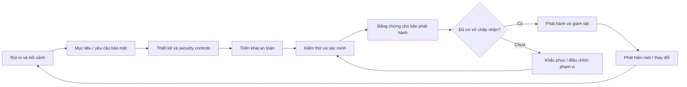
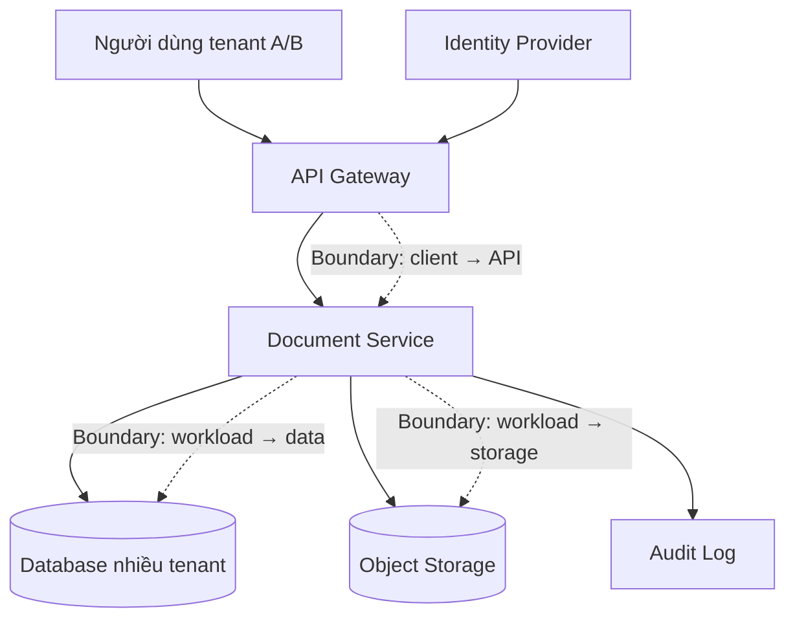
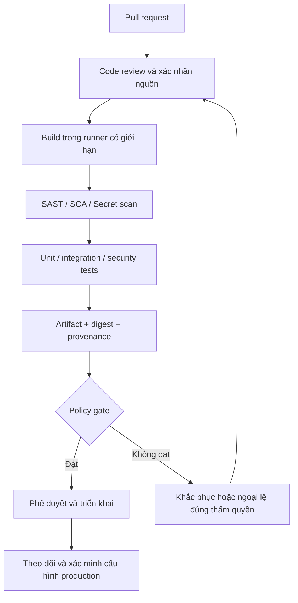

# Secure SDLC

Một nhóm phát triển xây dựng API quản lý hồ sơ khách hàng. Unit test đạt, mã nguồn được review, pipeline CI hiển thị màu xanh và bản phát hành chạy ổn định. Vài tuần sau, nhóm bảo mật phát hiện người dùng thuộc tổ chức B có thể sửa định danh tài liệu trong URL để đọc tài liệu của tổ chức A. Lỗi phát sinh từ một quyết định thiết kế và kiểm tra phân quyền chưa đầy đủ; việc thêm một công cụ quét lỗ hổng vào cuối quy trình chưa chắc phát hiện được nó.

**Secure Software Development Life Cycle (Secure SDLC)** là cách tích hợp những hoạt động bảo mật có trách nhiệm, tiêu chí rõ ràng và bằng chứng kiểm chứng vào **toàn bộ vòng đời phát triển phần mềm**: lập kế hoạch, xác định yêu cầu, thiết kế, triển khai, kiểm thử, phát hành, vận hành, bảo trì và ngừng sử dụng. Mục tiêu không chỉ là tìm lỗi trước ngày phát hành, mà còn tạo ra phần mềm có các thuộc tính bảo mật được thiết kế, thực thi, xác minh và duy trì có hệ thống.

Trong module **SECURITY_SECURITY_ASSURANCE**, Secure SDLC là nền tảng của *security assurance liên tục*: tổ chức phải có căn cứ để tin rằng hệ thống đáp ứng các mục tiêu bảo mật đã xác định, dựa trên phân tích rủi ro, yêu cầu, security controls, kiểm thử, audit và kết quả khắc phục phát hiện.

## 1. Secure SDLC giải quyết vấn đề gì?

Trong một SDLC thông thường, nhóm đặt mục tiêu đáp ứng yêu cầu chức năng, tiến độ, chất lượng, hiệu năng và vận hành. Secure SDLC bổ sung câu hỏi **“Điều kiện nào cần đúng để hệ thống đủ an toàn trong bối cảnh sử dụng của nó, và ta chứng minh điều đó bằng cách nào?”** vào mỗi quyết định quan trọng.

Nếu bảo mật chỉ được xem xét ở cuối dự án, nhóm dễ gặp các vấn đề:

- **Yêu cầu bị bỏ sót:** không có yêu cầu kiểm tra quyền trên từng hồ sơ, nên kiểm thử chức năng hợp lệ đều đạt dù còn lỗ hổng truy cập chéo tổ chức.
- **Thiết kế khó sửa:** dữ liệu của nhiều tenant bị trộn trong cùng truy vấn hoặc luồng xuất file, buộc sửa kiến trúc sau khi sản phẩm đã triển khai.
- **Quy trình kiểm chứng thiếu trọng tâm:** chỉ chạy quét dependency mà không có kiểm thử phân quyền, thiết kế khóa hay logic nghiệp vụ.
- **Bằng chứng phân tán:** có nhiều báo cáo CI, ticket và log nhưng không chứng minh được yêu cầu bảo mật nào đã được kiểm tra cho bản phát hành nào.
- **Lỗ hổng tái xuất hiện:** bug được sửa một lần nhưng không có regression test, không xác minh root cause và không theo dõi thay đổi tiếp theo.
- **Bảo mật hết hiệu lực sau phát hành:** phụ thuộc mới có lỗ hổng, cấu hình thay đổi, quyền bị mở rộng hoặc môi trường vận hành không còn giống lúc kiểm thử.

Secure SDLC tạo một chuỗi truy vết từ **rủi ro → mục tiêu → yêu cầu → control → kiểm chứng → bằng chứng → quyết định → giám sát và khắc phục**.



### 1.1. Một số khái niệm dễ nhầm

| Khái niệm | Trọng tâm | Quan hệ với Secure SDLC |
| --- | --- | --- |
| **Secure SDLC** | Xây dựng và duy trì phần mềm an toàn xuyên suốt vòng đời | Bao quát yêu cầu, thiết kế, phát triển, kiểm chứng, phát hành và vận hành |
| **DevSecOps** | Kết hợp bảo mật vào sự cộng tác và cơ chế tự động hóa DevOps | Là cách thực hiện nhiều hoạt động Secure SDLC trong chu kỳ giao hàng thường xuyên |
| **Security testing** | Tìm lỗi và xác minh hành vi bảo mật bằng các phương pháp kiểm thử | Cung cấp một phần bằng chứng, không thay thế các bước xác định mục tiêu và thiết kế |
| **Security assurance** | Xây dựng lập luận có căn cứ rằng mục tiêu bảo mật được đáp ứng trong phạm vi đã xác định | Sử dụng bằng chứng và quyết định thu được từ Secure SDLC |
| **Compliance / audit** | Đánh giá việc đáp ứng tiêu chí chính sách, chuẩn hoặc nghĩa vụ được đặt ra | Có thể cung cấp thêm bằng chứng, nhưng kết quả tuân thủ không tự chứng minh mọi rủi ro đã được xử lý |

“Shift left” nghĩa là đưa các quyết định và phép kiểm chứng bảo mật đến sớm hơn trong phát triển; “shift right” tiếp tục kiểm chứng các giả định khi phần mềm vận hành trong điều kiện thật. Secure SDLC cần **cả hai**, vì một số lỗi có thể ngăn ngay từ thiết kế, còn những rủi ro như thay đổi cấu hình hoặc dependency mới chỉ xuất hiện sau phát hành.

## 2. Nguyên tắc xây dựng Secure SDLC có thể kiểm chứng

### 2.1. Bắt đầu từ rủi ro, không bắt đầu từ danh sách công cụ

Một hệ thống quản lý thông tin y tế, cổng giao dịch tài chính và trang giới thiệu sản phẩm có tài sản, tác động và nghĩa vụ khác nhau. Bộ công cụ quét giống nhau không đồng nghĩa với mức bảo đảm phù hợp.

Trước khi chọn control, cần nêu rõ tài sản, chủ thể, luồng dữ liệu, mối đe dọa, hậu quả và ngưỡng rủi ro chấp nhận. Hoạt động bảo mật có thể được phân tầng: hệ thống có dữ liệu nhạy cảm hoặc quyền quản trị cần review độc lập và kiểm thử sâu hơn một trang nội dung công khai.

### 2.2. Bảo mật là trách nhiệm chung có chủ sở hữu

Product owner xác định giá trị và ràng buộc nghiệp vụ; kiến trúc sư và developer thiết kế, thực thi control; QA kiểm chứng hành vi; security champion hoặc security team hướng dẫn phương pháp và review rủi ro; platform/DevOps bảo vệ pipeline và môi trường; vận hành theo dõi, ứng cứu và phục hồi.

“Cùng chịu trách nhiệm” không có nghĩa là không ai chịu trách nhiệm. Mỗi yêu cầu, phát hiện, ngoại lệ và quyết định cần có **người sở hữu** và **thẩm quyền phê duyệt** rõ ràng.

### 2.3. Kiểm chứng gồm cả trường hợp bị cấm

Một API trả đúng tài liệu cho chủ sở hữu chỉ chứng minh luồng cho phép. Muốn kiểm chứng phân quyền, phải thử tài khoản không có quyền, tài khoản thuộc tenant khác, phiên hết hạn, quyền vừa bị thu hồi và các endpoint phụ như export, search, tải file.

Cần thiết kế **negative test** và abuse case cùng với happy path. Kết quả “không có phát hiện” chỉ có giá trị trong phạm vi và khả năng của phương pháp đã sử dụng.

### 2.4. Phòng ngừa, phát hiện và ứng cứu đi cùng nhau

Input validation, phân quyền và kiểm soát dependency giúp giảm xác suất xâm phạm. Logging, giám sát và phát hiện giúp nhận biết khi control thất bại. Thu hồi quyền, cô lập, vá và phục hồi giúp giảm tác động. Một quy trình chỉ có bước phòng ngừa chưa đủ để chứng minh hệ thống duy trì khả năng bảo vệ trong vận hành.

### 2.5. Mọi kết luận gắn với phiên bản và phạm vi

Một báo cáo SAST của commit A không tự chứng minh artifact phát hành từ commit B. Một kiểm thử staging chưa bảo đảm cấu hình production giống hệt. Bằng chứng cần truy vết được đến nguồn, thời điểm, cấu hình, phạm vi và tiêu chí đánh giá.

## 3. Các giai đoạn Secure SDLC và kết quả cần có

| Giai đoạn | Câu hỏi bảo mật | Hoạt động chính | Hiện vật / bằng chứng |
| --- | --- | --- | --- |
| **Lập kế hoạch** | Tài sản, hậu quả và nghĩa vụ quan trọng là gì? | Phân loại dữ liệu, đánh giá mức quan trọng, xác định chủ sở hữu và chính sách | Risk register, phạm vi hệ thống, vai trò |
| **Xác định yêu cầu** | Hành vi bảo mật nào phải được bảo đảm? | Security requirements, abuse cases, tiêu chí chấp nhận | Yêu cầu có mã, acceptance criteria |
| **Thiết kế** | Những đường tấn công và ranh giới tin cậy nào cần xử lý? | Threat modeling, review kiến trúc, phân tích phương án và control | Sơ đồ luồng dữ liệu, threat model, quyết định thiết kế |
| **Triển khai** | Code và dependency có tuân theo yêu cầu không? | Secure coding, review thay đổi, quản lý secret, SCA/SAST | Pull request, review record, scan result |
| **Xác minh** | Control có thực sự hoạt động trong tình huống được phép và bị cấm? | Unit/integration/security testing, DAST, manual testing, pentest theo rủi ro | Test results, finding tickets, retest |
| **Build và phát hành** | Artifact có đáng tin và được phê duyệt để triển khai? | Bảo vệ CI/CD, kiểm tra artifact, release gates, provenance | Build ID, artifact digest, approval, release decision |
| **Vận hành** | Rủi ro mới hoặc control suy giảm có được phát hiện? | Monitoring, vulnerability management, incident response, kiểm tra cấu hình | Log/alert, incident records, patch evidence |
| **Thay đổi hoặc ngừng dùng** | Tài sản, dữ liệu và quyền còn tồn đọng có được xử lý? | Review thay đổi, thu hồi credential, xóa/di chuyển dữ liệu, hủy hạ tầng | Decommission checklist, deletion/retention evidence |

Các giai đoạn có thể lặp lại trong mỗi sprint và mỗi lần triển khai. Secure SDLC không yêu cầu mọi nhóm phải chờ đến một “giai đoạn kiểm thử cuối” mới được làm việc bảo mật.

## 4. Giai đoạn lập kế hoạch: xác định bối cảnh và mức bảo vệ

Một kế hoạch bảo mật có ích cần đủ cụ thể để dẫn đến quyết định về nguồn lực và phạm vi đánh giá.

Các bước thực hiện:

1. **Liệt kê tài sản và luồng dữ liệu:** danh tính người dùng, hồ sơ nhạy cảm, secret, hệ thống thanh toán, cấu hình, audit log, dữ liệu backup.
2. **Phân loại dữ liệu:** dữ liệu công khai, nội bộ, nhạy cảm, dữ liệu cá nhân và những đối tượng có nghĩa vụ xử lý đặc biệt.
3. **Xác định chủ thể và ranh giới tin cậy:** người dùng, quản trị viên, API bên ngoài, third-party service, workload, tenant và máy chủ.
4. **Đánh giá tác động:** mất bí mật, sai lệch dữ liệu, gián đoạn dịch vụ, ảnh hưởng khách hàng và nghĩa vụ hợp đồng.
5. **Xác định ngưỡng chấp nhận:** những điều không được phép xảy ra, yêu cầu bắt buộc và những rủi ro có thể xử lý theo kế hoạch.
6. **Phân công trách nhiệm:** người nhận phát hiện, người quyết định mức ưu tiên và người có quyền chấp nhận rủi ro còn lại.

Ví dụ, API hồ sơ đa tenant có thể coi *truy cập chéo tenant* là rủi ro không được chấp nhận trong phạm vi phát hành. Khi đó, các thử nghiệm phân quyền theo đối tượng là điều kiện bắt buộc, ngay cả khi công cụ quét dependency không phát hiện gì.

### 4.1. Dùng risk register làm điểm tựa

Một dòng risk register tối thiểu nên có: mã rủi ro, tài sản, kịch bản, tác động, khả năng xảy ra (hoặc căn cứ đánh giá), control dự kiến, chủ sở hữu, trạng thái, rủi ro còn lại và thời điểm xem xét lại.

| Risk ID | Kịch bản | Mục tiêu bảo mật | Hướng xử lý |
| --- | --- | --- | --- |
| `R-01` | Người dùng B đọc hồ sơ của tenant A qua IDOR/BOLA | Bí mật, quyền riêng tư | Authorization theo đối tượng, tenant scoping, negative test |
| `R-02` | Package phụ thuộc có mã độc hoặc lỗ hổng đã biết | Toàn vẹn, bí mật, sẵn sàng | Review dependency, SCA, pin version, kiểm soát provenance |
| `R-03` | Token bị lộ trong log hoặc artifact | Bí mật, xác thực | Secret scanning, redaction, quyền truy cập tối thiểu |
| `R-04` | Phát hành mới làm tắt audit log | Khả năng truy vết | Test cấu hình, deployment validation, alert khi log gián đoạn |

Risk register phải được cập nhật khi thêm tính năng, thay đổi kiến trúc, có phát hiện mới hoặc xảy ra sự cố. Nó là đầu vào cho ưu tiên assurance, không phải tài liệu lập một lần rồi bỏ quên.

## 5. Giai đoạn yêu cầu: viết điều kiện bảo mật có thể kiểm chứng

Một câu như “hệ thống phải an toàn” không đủ để developer triển khai hay QA kiểm thử. Yêu cầu bảo mật tốt cần nêu **chủ thể, tài sản, hành vi, điều kiện, phạm vi và tiêu chí đạt**.

Ví dụ:

- **Yêu cầu mơ hồ:** “API có phân quyền.”
- **Yêu cầu cụ thể – `SR-01`:** “Mọi API đọc, sửa, tải hoặc xuất tài liệu phải kiểm tra danh tính và quyền của người yêu cầu đối với tài liệu; người không thuộc tenant sở hữu không được nhận nội dung hoặc metadata ngoài chính sách cho phép.”
- **Acceptance criteria:** “Các trường hợp truy cập hợp lệ thành công; truy cập không có quyền, không xác thực và chéo tenant bị từ chối; không rò rỉ nội dung trong phản hồi lỗi; kiểm tra áp dụng cho các endpoint trong danh mục phạm vi.”

Không nên mặc định `403` luôn tốt hơn `404` hay ngược lại; cách trả lỗi phụ thuộc hợp đồng API và chính sách tránh lộ sự tồn tại của tài nguyên. Quan trọng là không trả dữ liệu trái quyền.

### 5.1. Chuyển nguy cơ thành abuse case

User story mô tả điều người dùng hợp lệ muốn làm. *Abuse case* mô tả cách một chủ thể có thể cố tình sử dụng sai chức năng.

| User story | Abuse case tương ứng | Security requirement |
| --- | --- | --- |
| Nhân viên xem tài liệu của tổ chức mình | Thay `documentId` để đọc tài liệu tổ chức khác | Phân quyền theo đối tượng và tenant |
| Quản trị viên mời thành viên | Người không có quyền gửi lời mời mang vai trò admin | Kiểm tra cấp quyền phía server, giới hạn role |
| Hệ thống xuất báo cáo | Người dùng lạm dụng export để lấy số lượng lớn dữ liệu | Authorization, rate limit, logging và step-up theo rủi ro |
| Dịch vụ gọi API đối tác | Credential bị rò rỉ và dùng ngoài môi trường hợp lệ | Secret management, scope và luân chuyển credential |

Một yêu cầu nên liên kết được với risk ID, control ID, test ID và evidence ID. Liên kết đó làm rõ khi thay đổi một API thì những phép kiểm thử nào phải chạy lại.

### 5.2. Đặt “Definition of Done” cho công việc nhạy cảm

Một tính năng có dữ liệu hoặc quyền nhạy cảm chỉ được xem là hoàn tất khi:

- Yêu cầu bảo mật và luồng trái quyền liên quan đã được mô tả.
- Threat model hoặc đánh giá rủi ro đã được cập nhật nếu thay đổi trust boundary.
- Code review đã kiểm tra điểm thực thi phân quyền, xử lý dữ liệu và secret.
- Positive/negative tests phù hợp đã chạy và kết quả được lưu.
- Các phát hiện vượt ngưỡng phát hành đã được khắc phục hoặc xử lý theo quy trình ngoại lệ.
- Chủ sở hữu có thể trỏ đến bằng chứng áp dụng cho đúng phiên bản.

Với thay đổi nhỏ, có thể sử dụng checklist ngắn; với thay đổi kiến trúc có rủi ro cao, cần review chuyên sâu. Tỷ lệ chi tiết của quy trình phải dựa trên rủi ro, tránh biến Secure SDLC thành thủ tục làm chậm mọi thay đổi.

## 6. Giai đoạn thiết kế: threat modeling và security architecture

Thiết kế an toàn có chi phí hiệu chỉnh thấp hơn khi vấn đề được phát hiện trước khi triển khai rộng. Ở giai đoạn này, cần xác định các ranh giới tin cậy (*trust boundaries*), luồng dữ liệu, điểm xử lý nhạy cảm và vị trí control.

### 6.1. Threat modeling theo hệ thống cụ thể

Một quy trình dễ áp dụng gồm:

1. **Vẽ hệ thống:** client, API gateway, service, database, object storage, IdP, external APIs và điểm truy cập quản trị.
2. **Đánh dấu ranh giới tin cậy:** Internet → gateway; gateway → service; service → database; tenant A ↔ tenant B; workload → secret manager.
3. **Đặt câu hỏi “điều gì có thể sai?”** theo từng luồng: giả mạo danh tính, sửa thông điệp, phủ nhận hành vi, lộ thông tin, từ chối dịch vụ, nâng quyền.
4. **Đánh giá mức quan trọng:** xem xét khả năng khai thác, mức phơi nhiễm, giá trị tài sản và tác động.
5. **Đề xuất control và phép xác minh:** xác định vị trí thực thi, owner, test và bằng chứng cần có.
6. **Ghi giả định và đánh giá lại:** token đã được xác thực ở đâu, tenant ID lấy từ nguồn nào, endpoint nào chưa bao phủ.

Nhóm có thể dùng STRIDE làm gợi ý kiểm tra các nhóm mối đe dọa. STRIDE hỗ trợ cấu trúc câu hỏi, nhưng không thay thế hiểu biết về logic nghiệp vụ, cấu hình cloud hoặc kịch bản tấn công thực tế.



Từ sơ đồ, nhóm đặt câu hỏi: JWT được xác minh ở gateway hay service? Có luồng nội bộ đi vòng qua gateway không? Dịch vụ có tin `tenantId` do client gửi không? Object storage có URL tải trực tiếp không? Có khả năng một cache key dùng chung giữa các tenant không? Audit log có chứa nội dung tài liệu hay secret không?

### 6.2. Thiết kế control theo rủi ro

Một số nguyên tắc quan trọng:

- **Least privilege:** người dùng, service account, token và CI runner chỉ có quyền cần thiết.
- **Defense in depth:** kiểm soát ở những ranh giới khác nhau; API authorization không phụ thuộc hoàn toàn vào firewall.
- **Secure defaults:** hành vi mặc định phải được cân nhắc theo rủi ro; từ chối thao tác nhạy cảm khi không xác minh được quyền.
- **Separation of duties:** phân tách quyền phát triển, phê duyệt bản phát hành, quản trị môi trường và truy cập production.
- **Isolation:** giới hạn blast radius giữa tenant, workload và môi trường.
- **Fail-safe behavior:** kiểm soát hành vi khi phụ thuộc bảo mật gặp lỗi; không mặc định bỏ qua kiểm tra.
- **Recoverability:** có backup, luồng khôi phục đáng tin, runbook và diễn tập.
- **Observability:** sự kiện quan trọng có thể được ghi nhận và dẫn đến phản ứng, với dữ liệu log được bảo vệ phù hợp.

### 6.3. Ghi quyết định thiết kế

Ví dụ, nhóm chọn không sử dụng cache phân quyền cho thao tác xuất dữ liệu, dù điều đó làm tăng độ trễ. Bản ghi thiết kế cần nêu rủi ro token/role bị thu hồi chậm, tác động hiệu năng, các phương án, tiêu chí đo và điều kiện xem xét lại.

Một quyết định “dùng MFA” thiếu ngữ cảnh sẽ khó kiểm chứng. Quyết định “yêu cầu xác thực tăng cường trước khi xuất dữ liệu nhạy cảm vượt ngưỡng, kiểm tra quyền theo đối tượng, ghi sự kiện xuất” có tiêu chí kiểm thử rõ hơn.

## 7. Giai đoạn triển khai: secure coding, review và dependency

Trong triển khai, developer chuyển yêu cầu thành code và cấu hình. Các lỗ hổng có thể nằm ở xử lý input, truy vấn dữ liệu, phân quyền, xử lý file, deserialization, logic nghiệp vụ, race condition, quản lý secret, logging và tích hợp bên thứ ba.

### 7.1. Code review có trọng tâm bảo mật

Ngoài chất lượng và tính dễ bảo trì, reviewer nên xem:

- API nào mới hoặc thay đổi kiểm tra quyền? Có đường xử lý bỏ qua authorization không?
- Dữ liệu nhận từ client có được xác thực và ràng buộc đúng ngữ cảnh không?
- Truy vấn có bảo vệ tenant và quyền ở mức đối tượng không?
- Dữ liệu xuất ra HTML, SQL hoặc lệnh hệ thống có được xử lý theo ngữ cảnh phù hợp không?
- Thao tác nhiều bước có cần transaction, idempotency hoặc chống race condition không?
- Thông điệp lỗi có rò rỉ dữ liệu hoặc thông tin nội bộ không?
- Có secret, token, private key hay dữ liệu cá nhân trong commit, log hoặc test fixture không?
- Dependency mới có nguồn, version, giấy phép và rủi ro phù hợp không?
- Một thay đổi bảo mật có regression test tương ứng không?

Checklist nên điều chỉnh theo công nghệ và tài sản, thay vì dùng cùng một danh sách cho tất cả repository.

### 7.2. Ví dụ Java: phân quyền theo đối tượng và tenant

Giả sử ứng dụng dùng Java và Spring để phục vụ tài liệu cho nhiều tenant. Yêu cầu: danh tính của tenant B không thể đọc tài liệu tenant A.

**Mẫu dễ tạo lỗi:**

```java
// Ví dụ minh họa hành vi không an toàn
public DocumentView getDocument(UUID documentId) {
    Document document = repository.findById(documentId)
            .orElseThrow(DocumentNotFoundException::new);
    return toView(document);
}
```

Nếu route có xác thực nhưng service không kiểm tra quyền đối tượng, bất kỳ người dùng đăng nhập nào đoán được `documentId` có thể lấy tài liệu ngoài phạm vi, tùy các control khác của hệ thống.

**Hướng triển khai có kiểm soát:**

```java
// Minh họa: AuthenticatedPrincipal phải đến từ cơ chế xác thực tin cậy.
public DocumentView getDocument(
        UUID documentId,
        AuthenticatedPrincipal principal) {

    if (!principal.hasPermission("document:read")) {
        throw new AccessDeniedException("Access denied");
    }

    Document document = repository
            .findByIdAndTenantId(documentId, principal.tenantId())
            .orElseThrow(DocumentNotFoundException::new);

    return toView(document);
}
```

Truy vấn gắn `documentId` với `tenantId` từ principal đã xác thực, thay vì tin `tenantId` từ header hoặc query do client tự khai. Mẫu này chỉ hỗ trợ một phần yêu cầu: với hệ thống thực tế cần kiểm tra quyền theo tài liệu, trạng thái chia sẻ liên tổ chức, đường tải file, truy vấn danh sách, search, cache và quyền của admin. Không nên xem riêng đoạn code là bằng chứng toàn bộ hệ thống đã an toàn.

**Kiểm thử tích hợp có ý nghĩa** cần chuẩn bị dữ liệu: `docA` thuộc `tenant-a`, danh tính A được cấp quyền và danh tính B không được cấp quyền. Bài test xác minh A đọc được, B không đọc được, cả API lấy nội dung lẫn URL tải đều không tiết lộ tài liệu cho B. Nếu dùng mock repository trả cùng kết quả cho mọi tenant, test có thể xanh dù điều kiện tenant chưa được kiểm tra đúng.

### 7.3. Quản lý secret và cấu hình

Không đặt password, token, private key hoặc cloud credential trong mã nguồn, test fixture công khai, Docker image hay cấu hình được commit. Dùng cơ chế quản lý secret phù hợp; giới hạn quyền của workload; định nghĩa vòng đời tạo, cấp, luân chuyển, thu hồi và xử lý khi rò rỉ.

Secret scanning có thể phát hiện một số mẫu giá trị nhạy cảm, nhưng không đủ để chứng minh repository không chứa secret. Cần kết hợp review, quyền truy cập, kiểm tra cấu hình và quy trình ứng cứu khi phát hiện rò rỉ.

### 7.4. Quản lý dependency và software supply chain

Phần mềm thường sử dụng thư viện nguồn mở, plugin build, container base image, dịch vụ CI và package registry. Chúng mở rộng chuỗi tin cậy của hệ thống.

Các hoạt động nên có:

1. Quản lý dependency và phiên bản bằng công cụ build chính thức; tránh tải binary tùy ý không xác minh nguồn.
2. Kiểm tra lỗ hổng đã biết bằng Software Composition Analysis (SCA), đồng thời đánh giá khả năng khai thác trong ngữ cảnh hệ thống.
3. Tạo và lưu **SBOM** (*Software Bill of Materials*) khi có nhu cầu truy vết thành phần, rủi ro supply chain hoặc nghĩa vụ tổ chức.
4. Xác định cách xử lý package không còn được duy trì, phiên bản dễ bị khai thác hoặc dependency không cần thiết.
5. Bảo vệ quyền publish package, tài khoản CI và token truy cập registry.
6. Gắn artifact với commit, build run và nguồn đáng tin cậy; cân nhắc chữ ký, provenance/attestation và xác minh tại bước triển khai.
7. Quét lại hoặc đánh giá lại khi có thông tin lỗ hổng mới, kể cả khi code không đổi.

SCA chỉ cho biết các điểm yếu mà nguồn dữ liệu và công cụ có thể nhận diện ở thời điểm chạy. Một dependency có CVE chưa chắc khai thác được trong ứng dụng, nhưng việc gắn nhãn “không ảnh hưởng” phải có phân tích và bằng chứng; ngược lại, không thấy CVE chưa đồng nghĩa dependency hoàn toàn an toàn.

## 8. Giai đoạn xác minh: chọn phương pháp theo loại rủi ro

Security verification bao gồm nhiều phương pháp bổ sung cho nhau. Mỗi phương pháp có phạm vi và điểm mù.

| Phương pháp | Thường phát hiện hoặc kiểm chứng | Giới hạn cần hiểu |
| --- | --- | --- |
| **Code review thủ công** | Logic nghiệp vụ, authorization, luồng dữ liệu, thiết kế control | Phụ thuộc người review, phạm vi và thời gian |
| **SAST** | Một số mẫu lỗi trong source hoặc bytecode, luồng dữ liệu đáng ngờ | Có false positive/false negative; không hiểu hết ngữ cảnh nghiệp vụ |
| **SCA** | Dependency có lỗ hổng đã biết, thông tin thành phần | Không kiểm chứng logic ứng dụng; kết quả phụ thuộc dữ liệu và inventory |
| **Secret scanning** | Một số loại token/secret lộ trong commit và artifact | Không tìm mọi secret, không tự thu hồi secret đã rò rỉ |
| **Unit testing** | Logic security function ở phạm vi hẹp | Có thể bỏ sót wiring, policy và cấu hình runtime |
| **Integration/API testing** | Hành vi nhiều thành phần, authorization, error path | Chỉ chứng minh các kịch bản, dữ liệu và cấu hình đã kiểm tra |
| **DAST** | Một số lỗ hổng quan sát được từ ứng dụng đang chạy | Phụ thuộc cấu hình, quyền truy cập và coverage; khó suy luận nguyên nhân |
| **Fuzz testing** | Lỗi khi xử lý đầu vào bất thường hoặc không dự đoán trước | Cần mục tiêu và oracle phù hợp; không thay thế test logic nghiệp vụ |
| **Pentest/red team** | Chuỗi khai thác và phương án tấn công trong phạm vi được duyệt | Hữu hạn theo thời gian, giả định và kỹ năng; không chứng minh không có lỗ hổng |
| **Configuration / policy testing** | IAM, network, encryption, audit, container và cloud policy | Cấu hình khai báo chưa chứng minh mọi hành vi runtime |
| **Incident/restore exercise** | Phát hiện, ứng cứu, cô lập, phục hồi | Kết quả chỉ đại diện cho kịch bản và thời điểm đã diễn tập |

### 8.1. Thiết kế test theo mục tiêu, không theo công cụ

Ví dụ với `SR-01` (không đọc chéo tenant), kế hoạch kiểm thử có thể gồm:

| Test ID | Kịch bản | Kết quả mong đợi |
| --- | --- | --- |
| `T-01` | Người dùng A đọc tài liệu A được cấp quyền | Thành công, dữ liệu đúng |
| `T-02` | Người dùng B yêu cầu tài liệu A | Từ chối theo chính sách, không lộ nội dung |
| `T-03` | Người dùng không xác thực yêu cầu tài liệu A | Từ chối, không lộ dữ liệu |
| `T-04` | Người dùng A vừa bị thu hồi quyền truy cập | Từ chối trong giới hạn thu hồi đã định |
| `T-05` | Người dùng B thử export, search hoặc URL tải của A | Từ chối trên từng đường truy cập thuộc phạm vi |
| `T-06` | Yêu cầu qua cache hoặc đường API nội bộ | Không trả dữ liệu chéo tenant hoặc đi vòng kiểm soát |

Một bộ test đáng tin cần có fixture đúng, assertion đủ chặt, cơ chế xác thực và authorization thực sự được kích hoạt. Nếu dùng mock để bỏ qua control cần đánh giá, test không thể là bằng chứng cho control đó.

### 8.2. Quản lý phát hiện và kiểm tra lại

Mỗi phát hiện nên có mã, nguồn, mô tả ảnh hưởng, tài sản, khả năng khai thác, mức ưu tiên, người chịu trách nhiệm, bằng chứng, cách tái hiện an toàn, trạng thái, kế hoạch sửa và kết quả xác minh lại.

Quy trình thường gồm: **ghi nhận → phân loại → phân tích nguyên nhân → khắc phục hoặc giảm thiểu → regression test → xác nhận → đóng hoặc theo dõi rủi ro còn lại**.

Đừng đóng một phát hiện ngay khi pull request được merge nếu chưa xác minh bản sửa hoạt động trên phạm vi liên quan. Một lỗ hổng logic nghiệp vụ có thể tồn tại ở endpoint khác và cần kiểm tra cùng nguyên nhân gốc.

## 9. Bảo vệ CI/CD và phát hành

CI/CD vừa là nơi tự động hóa assurance vừa là mục tiêu tấn công. Nếu pipeline bị xâm phạm, kẻ tấn công có thể thay artifact, đọc secret hoặc triển khai code độc hại. Vì vậy, cần bảo vệ pipeline trước khi dùng kết quả của nó làm bằng chứng đáng tin.

### 9.1. Những ranh giới bảo mật trong pipeline

- **Nguồn thay đổi:** branch protection, pull request review, xác định ai có quyền sửa workflow và file build.
- **Danh tính build:** CI identity có quyền tối thiểu; dùng credential ngắn hạn khi có thể; không cấp token production cho build không tin cậy.
- **Môi trường chạy:** cô lập job từ fork/untrusted code; không để job chưa được phê duyệt đọc secret hoặc có quyền deploy.
- **Dependency và công cụ:** kiểm soát nguồn, phiên bản action/plugin, image và runner.
- **Artifact:** gắn với commit và build run, lưu digest, bảo đảm artifact triển khai đúng artifact đã được kiểm tra.
- **Quyền phát hành:** tách quyền tạo artifact với quyền phê duyệt production khi rủi ro yêu cầu.
- **Bằng chứng:** lưu kết quả test, scan, review, policy check, exemption và approval theo release.
- **Giám sát:** phát hiện thay đổi bất thường đối với workflow, biến môi trường, quyền và quá trình triển khai.

### 9.2. Ví dụ luồng kiểm soát phát hành



Một pipeline mẫu ở mức khái niệm:

```yaml
# Pseudocode minh họa trình tự; không phải cấu hình chạy trực tiếp.
stages:
  - review_source_and_build_permissions
  - build_reproducible_artifact
  - run_unit_and_integration_tests
  - run_security_tests_and_scan_dependencies
  - verify_artifact_identity_and_policies
  - evaluate_release_gate
  - approve_production_deployment
  - deploy_same_verified_artifact
  - verify_runtime_controls_and_monitor
evidence:
  - source_commit
  - build_run_id
  - artifact_digest
  - test_results
  - security_findings
  - approvals_or_exceptions
```

Với một pipeline thực tế, cách bảo vệ fork, pull request và secret phụ thuộc hệ thống CI/CD được sử dụng. Đặc biệt cần tránh cho mã chưa đáng tin truy cập credential có quyền phát hành.

### 9.3. Release gate theo chính sách rủi ro

Release gate là điều kiện để quyết định phát hành, ví dụ:

- Test phân quyền quan trọng phải đạt trên artifact hoặc phiên bản được đánh giá.
- Không có phát hiện vượt ngưỡng chấp nhận chưa được xử lý theo chính sách.
- Thay đổi kiến trúc nhạy cảm đã có threat model và review.
- Artifact có nguồn, commit, cấu hình và bằng chứng liên kết.
- Các control bắt buộc trong môi trường đích đã được kiểm tra.
- Ngoại lệ có thời hạn, chủ sở hữu và thẩm quyền phê duyệt.

Ngưỡng phải phù hợp với tài sản và rủi ro. Không nên đặt một con số “cho phép N lỗ hổng” cho tất cả loại hệ thống mà không xét khả năng khai thác và tác động. Phát hiện mức nghiêm trọng cao nhưng có bằng chứng không thể khai thác trong cấu hình hiện tại có thể được xử lý khác phát hiện cho phép truy cập trái phép dữ liệu nhạy cảm đang phơi nhiễm.

Ngoại lệ **không biến control thất bại thành đã đạt**. Nó là quyết định chấp nhận rủi ro còn lại trong phạm vi và thời gian xác định, có điều kiện giảm thiểu và lịch đánh giá lại.

## 10. Vận hành và bảo trì: Secure SDLC tiếp tục sau triển khai

Khi hệ thống đang chạy, dependency và mối đe dọa thay đổi, dữ liệu tăng, tài khoản và quyền dịch chuyển, cấu hình có thể lệch khỏi thiết kế. Những phát hiện sau phát hành phải quay lại quy trình development.

### 10.1. Vulnerability management liên tục

Quy trình nên có nguồn phát hiện từ scanner, bug bounty (nếu áp dụng), nghiên cứu công khai, incident, vendor advisory và báo cáo nội bộ. Với mỗi phát hiện cần:

1. Xác định hệ thống, phiên bản và tài sản bị ảnh hưởng.
2. Xác thực mức phơi nhiễm và điều kiện khai thác trong môi trường thực.
3. Ưu tiên xử lý dựa trên tác động, mức khẩn cấp và rủi ro.
4. Vá, thay thế, loại bỏ dependency hoặc áp dụng biện pháp giảm thiểu có thời hạn.
5. Xác minh lại và kiểm tra hồi quy.
6. Cập nhật bằng chứng, risk register, SBOM/inventory và trạng thái.
7. Xem xét nguyên nhân gốc để ngăn cùng lớp lỗi tái diễn.

Không nên xử lý mọi CVE chỉ theo điểm CVSS đơn lẻ; một lỗ hổng dễ khai thác trên thành phần phơi nhiễm có thể cần ưu tiên cao hơn lỗ hổng có điểm kỹ thuật cao nhưng không có đường khai thác trong phạm vi.

### 10.2. Runtime verification và incident response

Có thể kiểm tra định kỳ:

- Chính sách IAM và network có bị drift không?
- TLS, quản lý khóa, secret rotation và backup có hoạt động không?
- Audit log có được gửi, lưu, bảo vệ và chuyển thành cảnh báo không?
- Có thể phát hiện hành vi export bất thường, leo thang quyền hoặc thay đổi cấu hình không?
- Khi nghi ngờ tài khoản bị chiếm, có thể thu hồi credential và cô lập workload không?
- Restore exercise có đạt mục tiêu RTO/RPO và bảo đảm dữ liệu phục hồi đáng tin không?

Một sự cố cần dẫn đến sửa code/cấu hình, cập nhật threat model và test, cải tiến giám sát, rồi xác minh lại. “Đã khôi phục dịch vụ” chưa đồng nghĩa root cause đã được xử lý.

### 10.3. Ngừng sử dụng và thay thế hệ thống

Secure SDLC còn bao gồm xóa hoặc chuyển dữ liệu theo chính sách lưu giữ, thu hồi khóa và credential, gỡ endpoint, ngắt quyền truy cập, xóa tài nguyên cloud không còn sử dụng và bảo vệ bằng chứng cần lưu. Một môi trường thử nghiệm bị bỏ quên hoặc tài khoản dịch vụ không dùng nữa vẫn có thể là đường tấn công.

## 11. Security assurance: chuyển hoạt động thành kết luận có căn cứ

Một checklist ghi “đã chạy SAST, SCA, DAST” không giải thích được hệ thống có đáp ứng mục tiêu bảo mật hay không. Cần liên kết **Claim – Argument – Evidence**:

- **Claim (khẳng định):** thuộc tính bảo mật cần đúng trong phạm vi, phiên bản và môi trường xác định.
- **Argument (lập luận):** lý do các control và phương pháp kiểm chứng có liên quan, các giả định cần đúng và phần còn thiếu.
- **Evidence (bằng chứng):** hiện vật cụ thể có thể kiểm tra: code review, threat model, kết quả test, cấu hình, audit log, release approval, bằng chứng khắc phục.

Ví dụ:

> **Claim `CLM-01`:** Trong bản phát hành `document-api` được đánh giá, người dùng tenant B không thể đọc, tải hoặc xuất tài liệu của tenant A qua các luồng trong danh sách phạm vi.

Lập luận: danh tính và tenant được xác thực; mọi API trong phạm vi thực thi authorization theo tài nguyên; truy vấn và đường tải file giới hạn theo tenant; các luồng hợp lệ và trái quyền đều được kiểm tra. Bằng chứng cần có: danh sách endpoint, review, test tích hợp chéo tenant, policy/config thực tế và kết quả xác minh artifact phát hành.

### 11.1. Ma trận truy vết mẫu

| Risk / Requirement | Control | Verification | Evidence | Trạng thái minh họa |
| --- | --- | --- | --- | --- |
| `R-01 / SR-01` Truy cập chéo tenant | API authorization, tenant-scoped query | `T-01..T-06`, review file-export | CI run + review + cấu hình | Chờ kiểm tra export |
| `R-02 / SR-02` Dependency bị ảnh hưởng | Inventory, SCA, update process | Quét theo phiên bản, phân tích tính khai thác | SBOM + SCA report + ticket | Đã xem xét |
| `R-03 / SR-03` Secret bị lộ | Secret manager, CI permissions | Secret scan và review pipeline | Scan result + IAM review | Đã xem xét |
| `R-04 / SR-04` Mất audit trail | Central logging, monitoring | Test event-to-alert, runtime check | Alert/ticket và config snapshot | Chờ diễn tập |

Các trạng thái trên chỉ nhằm minh họa cách ghi hồ sơ. Khi triển khai thực tế, trạng thái chỉ được cập nhật từ bằng chứng đã kiểm tra, có thời điểm và người đánh giá rõ ràng.

### 11.2. Mẫu evidence manifest

```yaml
assurance_record:
  claim_id: CLM-01
  release_id: "<release-id>"
  source_commit: "<commit-sha>"
  artifact_digest: "<sha256-digest>"
  environment: "<target-environment>"
  scope:
    services: ["document-api"]
    endpoints: ["<inventory-of-in-scope-endpoints>"]
  linked_risks: ["R-01"]
  requirements: ["SR-01"]
  controls: ["<authz-control-id>", "<tenant-scoping-control-id>"]
  verification:
    - method: "code-review"
      evidence_ref: "<review-id>"
    - method: "authorization-integration-tests"
      evidence_ref: "<ci-run-id>"
    - method: "runtime-policy-review"
      evidence_ref: "<deployment-evidence-id>"
  open_findings: ["<finding-if-any>"]
  exclusions: ["<not-yet-assessed-scope>"]
  assumptions: ["<important-assumptions>"]
  residual_risk: "<description>"
  assessed_by: "<reviewer>"
  assessed_at: "<timestamp>"
  decision: "<pending|accepted|rejected>"
```

Manifest chỉ giúp tìm và kết nối hiện vật; nó không thay thế báo cáo, log hoặc kết quả test gốc. Evidence repository cần có kiểm soát truy cập, bảo vệ tính toàn vẹn, phân loại dữ liệu, thời hạn lưu giữ và khả năng tìm lại theo release.

### 11.3. Bằng chứng chất lượng phải đáp ứng những gì?

| Tiêu chí | Câu hỏi kiểm tra |
| --- | --- |
| **Relevant** | Bằng chứng có trực tiếp hỗ trợ claim và kịch bản rủi ro không? |
| **Complete enough** | Các đường truy cập, vai trò, môi trường và trường hợp bị cấm quan trọng đã được bao phủ chưa? |
| **Traceable** | Có mã test, commit, build, artifact, người kiểm tra, thời điểm và link kết quả không? |
| **Reproducible** | Có thể tái hiện điều kiện và đánh giá kết quả không? |
| **Reliable** | Công cụ và test được cấu hình đúng, dữ liệu kiểm thử có ý nghĩa, có review độc lập khi cần không? |
| **Current** | Bằng chứng có còn áp dụng sau thay đổi code, dependency, policy và deployment không? |
| **Transparent** | Có ghi lại negative result, ngoại lệ, thiếu sót và rủi ro còn lại không? |

“100% test pass” chỉ có nghĩa các phép kiểm tra đã chạy đạt tiêu chí của chúng. Nó không có nghĩa hệ thống an toàn 100% hay mọi đường tấn công đã được bao phủ.

## 12. Ví dụ xuyên suốt: một tính năng xuất tài liệu an toàn

Giả sử nhóm bổ sung endpoint `POST /api/documents/export` cho hệ thống SaaS đa tenant. Người dùng chọn nhiều tài liệu và nhận đường dẫn tải file trong thời gian ngắn.

### 12.1. Xác định rủi ro

Các kịch bản đáng chú ý:

- Người dùng B đưa ID tài liệu A vào yêu cầu xuất để lấy dữ liệu trái quyền.
- Job xuất chạy bất đồng bộ với service account có quyền đọc quá rộng.
- URL tải được tạo nhưng không gắn với người được phép hoặc có hiệu lực quá lâu.
- Tệp xuất nằm trong object storage với quyền công khai hoặc cấu hình chia sẻ sai.
- Log job xuất chứa nội dung tài liệu hoặc token tải.
- Job lớn làm cạn tài nguyên và ảnh hưởng tính sẵn sàng của dịch vụ.
- Khi người dùng bị thu hồi quyền, job đã xếp hàng vẫn tiếp tục xuất dữ liệu.

### 12.2. Chuyển thành yêu cầu

| ID | Yêu cầu | Kiểm chứng |
| --- | --- | --- |
| `SR-EXP-01` | Chỉ xuất tài liệu mà người yêu cầu được quyền xem tại thời điểm kiểm tra theo chính sách | Test trộn ID A/B; test đổi quyền |
| `SR-EXP-02` | Worker export có quyền tối thiểu theo job hoặc tenant | IAM/service identity review, negative test |
| `SR-EXP-03` | Tệp xuất được lưu riêng tư, URL tải có giới hạn thời gian và phạm vi | Config test, test URL hết hạn và truy cập trái quyền |
| `SR-EXP-04` | Sự kiện xuất được ghi nhận đủ để điều tra nhưng không lộ nội dung nhạy cảm | Audit log review, test redaction |
| `SR-EXP-05` | Số lượng job và tài nguyên được giới hạn theo chính sách | Load test, quota/rate-limit test |
| `SR-EXP-06` | Các job đang chờ xử lý phải có chính sách rõ khi quyền bị thu hồi | Test revoked-session/permission và mô tả hành vi hệ thống |

### 12.3. Áp dụng Secure SDLC

**Thiết kế:** threat model luồng request → export job → object storage → download; đánh dấu trust boundary; xác định người/worker nào được đọc dữ liệu. Cần quyết định rõ thời điểm đánh giá quyền và cách xử lý khi quyền thay đổi trong quá trình xử lý bất đồng bộ.

**Triển khai:** authorization tại API và trong worker theo thiết kế; phân vùng dữ liệu theo tenant; tránh lưu URL nhạy cảm trong log; token/URL có thời hạn và phạm vi; service account giới hạn quyền.

**Kiểm chứng:** test quyền của người tạo job và người tải; test URL hết hạn và tải trái tenant; test thao tác song song; test đường lỗi và cleanup; review IAM, object storage policy và audit.

**Phát hành:** đánh giá kết quả test đối với artifact cụ thể; xác nhận không còn phát hiện vượt ngưỡng và control của môi trường triển khai đang hoạt động; ghi quyết định có thẩm quyền.

**Vận hành:** theo dõi số lần xuất dữ liệu, truy cập bất thường, thất bại kiểm tra quyền, chi phí và độ trễ; khi có sự cố, thu hồi URL/credential theo cơ chế đã thiết kế, điều tra và cập nhật regression test.

### 12.4. Khi một mắt xích chưa đạt

Giả sử negative test `T-EXP-04` phát hiện worker có thể xuất tài liệu từ tenant khác dù API đã chặn đúng. Khi đó, không thể kết luận yêu cầu `SR-EXP-01` đã đạt chỉ vì unit test ở API pass. Cần sửa cơ chế kiểm tra trong worker, xác minh tất cả đường truy cập và test lại trên bản phát hành liên quan.

Nếu tổ chức muốn tạm thời vô hiệu hóa export và chỉ phát hành các tính năng khác, cần **thu hẹp phạm vi quyết định** rõ ràng, có bằng chứng export thực sự bị khóa trong production. Không nên đánh dấu toàn bộ claim là “đạt” khi vẫn còn đường chưa được xác minh.

## 13. Vai trò, quyền quyết định và trách nhiệm

Một mô hình trách nhiệm có thể điều chỉnh theo quy mô tổ chức:

| Vai trò | Đóng góp chính | Bằng chứng hoặc quyết định thường sở hữu |
| --- | --- | --- |
| **Product / Business owner** | Xác định tài sản, tác động, yêu cầu nghiệp vụ và mức ưu tiên | Business impact, yêu cầu, acceptance criteria |
| **Engineering lead / Architect** | Thiết kế control, kiểm soát trust boundary và trade-off | Threat model, ADR, architecture review |
| **Developer** | Triển khai code an toàn và bổ sung kiểm thử | Pull request, secure code review, unit/integration tests |
| **QA / Test engineer** | Xác minh hành vi, negative test và regression | Test plan, test results, bug tickets |
| **Security team / Champion** | Phương pháp đánh giá, tư vấn rủi ro, review sâu, kiểm tra độc lập | Security review, findings, assurance assessment |
| **Platform / DevOps / SRE** | Bảo vệ CI/CD, artifact, deployment, runtime policy và phục hồi | Build/deploy evidence, policy validation, restore exercise |
| **Operations / Incident response** | Giám sát và xử lý sự cố, phản hồi phát hiện mới | Alert, incident timeline, remediation evidence |
| **Risk owner / Approver** | Chấp nhận hoặc từ chối rủi ro còn lại theo thẩm quyền | Quyết định, phạm vi ngoại lệ, thời hạn xem lại |

Trong nhóm nhỏ, một người có thể đảm nhận nhiều vai trò, nhưng các quyền nhạy cảm vẫn nên được phân tách hoặc có kiểm tra độc lập phù hợp với rủi ro. Người tạo ra control không nên là người duy nhất xác nhận control đó trong mọi tình huống có tác động cao.

## 14. Tổ chức thực hành theo mức trưởng thành

Secure SDLC có thể phát triển từng bước theo năng lực thực tế.

| Mức thực hành | Dấu hiệu | Ưu tiên cải thiện |
| --- | --- | --- |
| **Ban đầu** | Xử lý bảo mật khi có sự cố, review không nhất quán | Định nghĩa owner, yêu cầu quan trọng và phương pháp ghi nhận phát hiện |
| **Có cấu trúc** | Checklist PR, test tối thiểu, SCA/SAST và threat review cho thay đổi lớn | Liên kết risk → requirement → test, bổ sung release gate |
| **Được tích hợp** | Bảo mật vào sprint, CI/CD, IaC và theo dõi phát hiện | Tăng coverage các đường rủi ro cao, chuẩn hóa evidence |
| **Được đo và duy trì** | Có chính sách rủi ro, telemetry, review sau sự cố, kiểm tra lại khi thay đổi | Cải tiến theo dữ liệu thực, rút ngắn thời gian phát hiện/khắc phục |
| **Có assurance xuyên vòng đời** | Claim có phạm vi, bằng chứng đúng phiên bản và quyết định truy vết được | Tự động liên kết evidence, đánh giá lại theo thay đổi/rủi ro |

Đây là thang minh họa, không phải chứng chỉ hay điểm maturity chuẩn hóa. Khung tham khảo thường được dùng để xây dựng hoặc đánh giá chương trình gồm **NIST Secure Software Development Framework (SSDF)** với các nhóm hoạt động về chuẩn bị tổ chức, bảo vệ phần mềm, tạo phần mềm an toàn và ứng phó lỗ hổng; và **OWASP SAMM** để tự đánh giá, lập kế hoạch cải thiện các thực hành bảo mật phần mềm. Cần đối chiếu phiên bản chuẩn cụ thể khi sử dụng trong audit hoặc nghĩa vụ hợp đồng.

### 14.1. Chỉ số hữu ích

Các chỉ số chỉ có ý nghĩa khi có mẫu số, thời điểm đo và phạm vi:

- Tỷ lệ yêu cầu bảo mật quan trọng có test và evidence còn hiệu lực.
- Tỷ lệ thay đổi ranh giới tin cậy được threat review trước phát hành.
- Thời gian từ phát hiện lỗ hổng đến khắc phục **và xác minh lại**.
- Số phát hiện nghiêm trọng còn mở, phân loại theo tài sản và khả năng khai thác.
- Tỷ lệ security gates hoạt động trên pipeline có quyền phát hành production.
- Tỷ lệ dependency có inventory và người chịu trách nhiệm.
- Số lỗi cùng nguyên nhân gốc tái xuất hiện sau khi đã khắc phục.
- Thời gian thu hồi credential, phát hiện sự kiện và phục hồi trong các kịch bản diễn tập.

Một biểu đồ cho thấy “số lượng finding giảm” có thể do bảo mật cải thiện, nhưng cũng có thể do giảm phạm vi quét hoặc scanner bị tắt. Cần xem phương pháp, coverage và các chỉ số bổ trợ trước khi kết luận.

## 15. Những sai lầm thường gặp

| Ngộ nhận / sai lầm | Vì sao chưa đủ | Cách cải thiện |
| --- | --- | --- |
| “CI xanh nghĩa là Secure SDLC đã đạt” | CI chỉ chạy các bước được cấu hình; có thể bỏ sót logic nghiệp vụ | Đối chiếu gate và test với risk/threat model |
| Chỉ mua thêm scanner | Công cụ không thay thế yêu cầu, thiết kế và trách nhiệm | Xây chương trình theo rủi ro, rồi chọn công cụ hỗ trợ |
| Chỉ kiểm thử bảo mật trước release | Lỗi kiến trúc phát hiện muộn và thay đổi sau release không được kiểm tra | Review sớm và xác minh liên tục |
| Chỉ kiểm tra happy path | Truy cập trái quyền có thể không bị phát hiện | Viết abuse case và negative tests |
| Sửa một endpoint rồi đóng phát hiện | Lỗi cùng nguyên nhân có thể còn ở endpoint/export/cache khác | Phân tích root cause và kiểm tra toàn bộ đường liên quan |
| Để pipeline đọc secret production khi chạy code từ PR không tin cậy | Có thể làm lộ credential và chiếm chuỗi cung ứng | Phân tách quyền và bảo vệ runner, job, token |
| Chỉ lưu ảnh chụp báo cáo scanner | Khó truy vết commit, artifact, cấu hình và phương pháp | Lưu evidence có ID, phiên bản, thời gian, phạm vi và kết quả |
| Chấp nhận rủi ro mà không ghi thời hạn | Ngoại lệ có thể tồn tại vô hạn và mất chủ sở hữu | Ghi lý do, approver, biện pháp bù, hạn và điều kiện review |
| Không kiểm chứng lại sau thay đổi policy | Assurance case có thể không còn phù hợp | Đặt trigger review theo architecture, IAM, dependency, environment |
| Chỉ đo số lỗi tìm thấy | Bỏ qua coverage, thời gian khắc phục và chất lượng kiểm chứng | Dùng nhiều chỉ số gắn với rủi ro và kết quả |

## 16. Mẫu triển khai cho một sprint

Với một tính năng nhạy cảm mới, nhóm có thể dùng trình tự sau:

1. **Đầu sprint:** product owner và engineering xác định tác động; đánh dấu dữ liệu, quyền và dependency liên quan.
2. **Trước coding:** developer và security champion cập nhật threat model ngắn, xác định abuse case và acceptance criteria.
3. **Khi coding:** áp dụng secure coding, review quyền, kiểm soát secret và dependency; viết test các hành vi được phép/bị cấm.
4. **Ở pull request:** review thiết kế nếu đổi trust boundary; CI chạy kiểm thử và scan phù hợp; ghi nhận và phân loại finding.
5. **Trước release:** lập danh sách thay đổi, phiên bản, artifact, kết quả kiểm chứng, ngoại lệ và rủi ro còn lại; áp dụng release gate.
6. **Sau deploy:** xác minh cấu hình production, logging, cảnh báo, khả năng thu hồi/rollback và các tín hiệu quan trọng.
7. **Khi có phát hiện mới:** đưa về backlog ưu tiên theo rủi ro; vá, kiểm tra lại, cập nhật chứng cứ và threat model.

Một checklist tối thiểu để tự kiểm tra:

- [ ] Biết tài sản, chủ thể và hậu quả cần bảo vệ.
- [ ] Có yêu cầu bảo mật đủ cụ thể và gắn mã theo dõi.
- [ ] Có threat model hoặc đánh giá rủi ro cho thay đổi nhạy cảm.
- [ ] Có review code và control trên tất cả đường truy cập liên quan.
- [ ] Đã kiểm thử cả positive/negative cases quan trọng.
- [ ] Dependency, secret, CI identity và artifact được quản lý.
- [ ] Có kết quả kiểm chứng gắn commit, build, release và môi trường.
- [ ] Phát hiện và ngoại lệ có owner, quyết định, thời hạn và evidence khắc phục.
- [ ] Có kiểm tra runtime, cơ chế phản ứng sự cố và điều kiện đánh giá lại.
- [ ] Người phê duyệt có thể truy vết từ rủi ro đến bằng chứng và rủi ro còn lại.

## 17. Tự đánh giá kiến thức

**Tình huống 1:** Một ứng dụng có đủ SAST, SCA và DAST trong CI, nhưng chưa có negative test phân quyền. Có thể kết luận đã đáp ứng mục tiêu ngăn truy cập chéo tenant không?

Không. Các công cụ hỗ trợ một số loại kiểm tra nhưng chưa chứng minh logic authorization theo đối tượng và tenant được thực thi cho tất cả đường truy cập quan trọng. Cần claim rõ, danh sách endpoint, kiểm thử quyền và bằng chứng từ bản phát hành thực tế.

**Tình huống 2:** Pipeline đã kiểm tra artifact A, nhưng production triển khai artifact B được build lại sau đó. Bằng chứng có áp dụng trực tiếp không?

Chưa đủ cơ sở. Cần xác minh provenance, commit, dependency, cấu hình build và artifact được triển khai. Nếu artifact khác với cái đã kiểm tra, phải đánh giá sự khác biệt hoặc kiểm chứng lại theo chính sách.

**Tình huống 3:** Một CVE mới xuất hiện trong dependency dù phần mềm không thay đổi. Đây có phải việc của Secure SDLC không?

Có. Secure SDLC bao gồm bảo trì và vulnerability response. Nhóm cần xác định phạm vi ảnh hưởng, đánh giá khả năng khai thác, ưu tiên khắc phục hoặc giảm thiểu, xác minh lại và cập nhật hồ sơ rủi ro.

**Tình huống 4:** Lỗ hổng được sửa nhưng chưa chạy regression test. Có nên đánh dấu finding là đóng?

Chưa nên kết luận khắc phục đã được xác minh. Cần bằng chứng chạy lại đúng kịch bản, xem xét các đường cùng nguyên nhân và ghi nhận bản phát hành áp dụng.

## 18. Kết luận

Secure SDLC đặt bảo mật vào từng quyết định và hoạt động của vòng đời phần mềm. Một chương trình hiệu quả bắt đầu từ rủi ro và yêu cầu đo được, thiết kế control ở đúng ranh giới, triển khai và kiểm thử có mục tiêu, bảo vệ chuỗi cung ứng và pipeline, rồi tiếp tục giám sát và xử lý phát hiện trong production.

Đối với **security assurance**, giá trị quyết định nằm ở **khả năng chứng minh**: mỗi claim bảo mật phải có phạm vi, lập luận, bằng chứng đúng phiên bản, giới hạn được công khai và quyết định về rủi ro còn lại. Nhóm cần xác minh lại khi code, kiến trúc, dependency, chính sách hoặc môi trường thay đổi.

**Secure SDLC không kết thúc khi phần mềm được phát hành; đó là cách tổ chức duy trì niềm tin có căn cứ vào bảo mật của phần mềm trong suốt thời gian nó tồn tại.**
