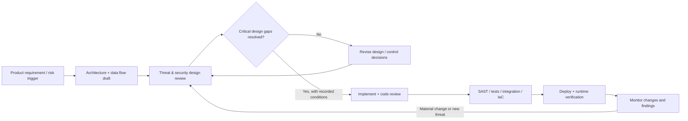
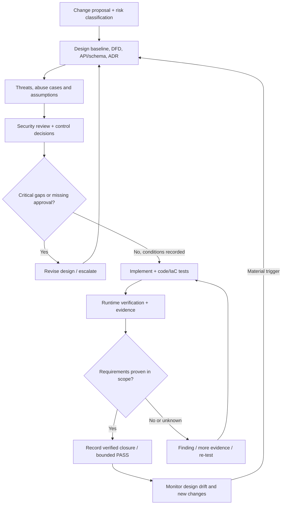
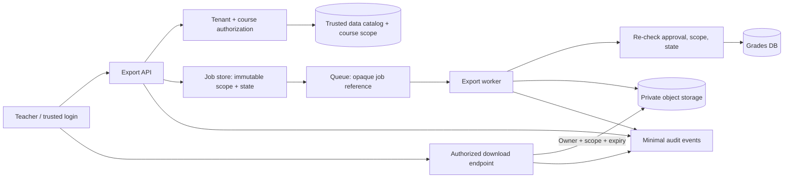

# Review thiết kế bảo mật

## Mục tiêu học tập

Sau bài học này, bạn có thể:

- Giải thích **security design review (rà soát thiết kế bảo mật)**, mục đích, đầu vào, đầu ra và vị trí trong Secure Software Development Lifecycle (Secure SDLC).
- Phân biệt rà soát thiết kế với **code review, threat modeling, architecture review định kỳ, vulnerability scanning, penetration testing** và kiểm toán; biết hoạt động nào bổ sung cho hoạt động nào.
- Xác định **assets, actors, entry points, data flows, trust boundaries, security assumptions** và các tình huống lạm dụng trước khi thiết kế được triển khai.
- Dịch mục tiêu bảo mật và rủi ro thành **security requirements, control statements, design decisions** và **verification criteria** đo được.
- Thực hiện review theo rủi ro cho API, authentication/authorization, tenant isolation, dữ liệu cá nhân, cryptography, asynchronous jobs, integrations, cloud/network, CI/CD, logging và incident readiness.
- Tổ chức review có owner, reviewer, quyết định, findings, điều kiện release, ngoại lệ và quy trình kiểm tra lại.
- Minh họa một trường hợp **Java/Spring Boot** và tạo lập luận **Claim – Argument – Evidence** chứng minh thiết kế đã được đánh giá trong phạm vi xác định, không nhầm tài liệu thiết kế với hiệu lực vận hành.

## 1. Review thiết kế bảo mật là gì?

**Review thiết kế bảo mật** là quá trình kiểm tra một phương án thiết kế hoặc thay đổi kỹ thuật **trước khi hoặc trong khi triển khai**, nhằm phát hiện các quyết định có thể tạo lỗ hổng, vi phạm yêu cầu hoặc khiến hệ thống không có khả năng chứng minh mức bảo vệ mong muốn. Review phải tìm được **tại sao thiết kế an toàn hoặc chưa an toàn**, những giả định cần xác minh và **cách kiểm thử control sau khi triển khai**.

Ví dụ, nhóm phát triển nền tảng học tập đề xuất một API xuất bảng điểm: giáo viên gọi endpoint, hệ thống tạo job, worker sinh CSV, lưu vào object storage và trả URL tải. Một review thiết kế bảo mật cần hỏi ngay từ trước khi viết code:

- Giáo viên có quyền xuất **lớp nào**, trong **tenant/trường nào**, ở **thời điểm nào**?
- Một request có thể sửa `courseId` hoặc `exportId` để lấy bảng điểm lớp khác không?
- Ai chịu trách nhiệm kiểm quyền **khi tạo job, khi worker chạy và khi tải file**?
- CSV mang dữ liệu cá nhân nào, có cần tất cả các cột đó không, thuộc classification gì?
- Worker có quyền đọc dữ liệu và ghi storage rộng đến đâu?
- URL tải có thể bị chia sẻ; quyền truy cập có được thu hồi khi người dùng mất phân công không?
- Logs, queue payload, cache, backup và file hết hạn có gây ra bản sao chưa kiểm soát không?
- Nếu job bị retry hoặc policy service không khả dụng, hành vi fail-safe là gì?

Đó là các câu hỏi **thiết kế**: nếu phát hiện muộn trong penetration test, việc sửa có thể đòi thay API contract, storage model, authorization flow và hàng loạt service.

Trong chương **Secure development** của module **SECURITY_SECURITY_ASSURANCE**, đích cuối không phải “đã có cuộc họp review”, mà là xây dựng chuỗi:

```text
Business/security objectives + risk context
  → Design artifacts + data flows + trust boundaries
  → Threat/abuse cases + security assumptions
  → Review findings + control decisions
  → Security requirements + tests + evidence plan
  → Implementation + operating verification
  → Remediation / risk decision + continuous review
```

**Thiết kế được phê duyệt không đồng nghĩa control đã chạy đúng ở production.** Review thiết kế tạo căn cứ và tiêu chí; kiểm thử, cấu hình và vận hành mới cung cấp bằng chứng về implementation/operating effectiveness.

### 1.1. Tác dụng chính

| Giá trị | Điều được cải thiện | Ví dụ |
| --- | --- | --- |
| **Phát hiện lỗi sớm** | Giảm việc phải thiết kế lại sau phát hành. | Nhận ra endpoint chỉ kiểm role, thiếu object-level authorization. |
| **Làm rõ trust boundaries** | Không mặc định internal network hay queue là an toàn. | Worker xử lý job từ broker vẫn phải xác minh phạm vi dữ liệu. |
| **Gắn control với threat** | Tránh danh sách biện pháp chung chung không giải quyết đường tấn công. | Thêm server-side scope check để giảm IDOR/BOLA. |
| **Giảm dữ liệu và đặc quyền** | Giới hạn hậu quả khi một service bị chiếm. | Export worker chỉ cần quyền đọc lớp và ghi prefix cụ thể. |
| **Xây test từ yêu cầu** | Tạo phép thử đúng thứ cần chứng minh. | Test giáo viên lớp A không được xuất lớp B và không tạo job. |
| **Truy vết quyết định** | Biết vì sao lựa chọn được phê duyệt, ai chịu trách nhiệm. | ADR, finding, risk owner, approval và expiry. |
| **Hỗ trợ assurance** | Có phạm vi, luận cứ và evidence có thể kiểm toán. | Review record liên kết DFD, test run, runtime IAM snapshot. |

## 2. Phân biệt với các hoạt động kiểm tra khác

| Hoạt động | Trọng tâm | Thường thực hiện khi nào? | Không thay thế được điều gì? |
| --- | --- | --- | --- |
| **Security design review** | Quyết định, trust boundary, data flow, requirements và controls dự kiến. | Trước triển khai hoặc trước thay đổi quan trọng. | Không tự chứng minh mã/cấu hình đã hoạt động. |
| **Threat modeling** | Threat actors, attack paths, abuse cases và mitigations. | Khi thiết kế và khi có thay đổi đáng kể. | Không tự quyết định đầy đủ về triển khai, ownership và release evidence. |
| **Code review / secure coding review** | Chi tiết implementation, logic và cách dùng API/library. | Trong pull request, khi refactor hoặc audit mã. | Không bao phủ mọi sai lầm ở kiến trúc hoặc môi trường. |
| **SAST / dependency / IaC scan** | Dấu hiệu lỗi và sai lệch trong mã, dependency hoặc cấu hình. | Trong CI, định kỳ và khi có thay đổi. | Không hiểu đầy đủ quy tắc nghiệp vụ hoặc mục đích dữ liệu. |
| **DAST / penetration testing** | Hành vi của hệ thống chạy và các đường khai thác có thể thử. | Sau khi có bản chạy, trước release hoặc theo risk. | Không bảo đảm mọi đường thiết kế đã được nghĩ tới. |
| **Architecture review định kỳ** | Tính phù hợp của kiến trúc tổng thể qua thời gian. | Theo cadence hoặc trigger. | Không phải lúc nào cũng đi sâu một feature đang thiết kế. |
| **Compliance/audit review** | Đối chiếu nghĩa vụ/control trong một phạm vi xác định. | Theo kế hoạch assurance hoặc yêu cầu áp dụng. | Không tự làm thiết kế trở nên an toàn. |

**Threat modeling và security design review nên hỗ trợ nhau.** Một threat model có thể chỉ ra nguy cơ *replay* job; review thiết kế phải chốt control chống replay, nơi thực thi, trade-off và test chấp nhận. Một cuộc review có thể sử dụng STRIDE, misuse cases hoặc attack trees, nhưng không nhất thiết biến mọi review nhỏ thành workshop threat modeling toàn hệ thống.

## 3. Khi nào cần security design review?

### 3.1. Review theo rủi ro, không yêu cầu hội đồng cho mọi commit

Các trigger thường đáng xem xét:

- **Tài sản/luồng mới:** dữ liệu nhạy cảm, file upload, chức năng export, lưu trữ hoặc chia sẻ đối tác.
- **Trust boundary mới:** internet-facing API, webhook, message broker, public cloud endpoint, remote support, cross-tenant communication.
- **Identity/privilege mới:** thay IdP, token claims, service account, role, MFA, delegated administration, break-glass.
- **Cryptography và secrets:** chọn thuật toán, triển khai encryption/signing, đổi KMS, key usage hoặc rotation policy.
- **Thay đổi kiến trúc:** tách microservice, thêm queue/worker, cache, cluster, network path hoặc database.
- **Quyết định về third-party:** SDK analytics, vendor processor, webhook receiver, library có quyền cao.
- **Quy mô và mức độ phơi bày:** bulk operations, mở endpoint cho công chúng hoặc thêm dữ liệu nhiều tenant.
- **Phản hồi rủi ro:** incident, penetration finding, thay threat, thay nghĩa vụ hoặc nghi ngờ giả định cũ không còn đúng.

Một thay đổi giao diện thuần văn bản không làm đổi dữ liệu, quyền hoặc trust boundary có thể đủ review nhẹ và tests thông thường. Một endpoint download toàn bộ bảng điểm cần review chuyên sâu. **Độ sâu phải do risk và phạm vi quyết định**, không chỉ số dòng code.

### 3.2. Tiêu chí định tuyến mức review

| Mức ví dụ | Dấu hiệu | Cách review |
| --- | --- | --- |
| **Nhẹ** | Không thêm trust boundary/privilege/data category; dùng pattern đã phê duyệt. | Self-check + peer review có checklist và evidence tối thiểu. |
| **Trung bình** | Đổi API, model quyền, tích hợp hoặc dữ liệu có rủi ro vừa. | Service owner + security champion/architect review và test plan. |
| **Cao** | PII/bảng điểm bulk export, multi-tenant, signing keys, public endpoint, cross-border/vendor, admin flow. | Review liên chức năng, threat modeling có trọng tâm, risk/Privacy khi cần, explicit release conditions. |
| **Khẩn cấp** | Hotfix quan trọng đang xử lý sự cố. | Review nhanh theo runbook, owner approval hợp lệ, theo dõi risk và retrospective review; không bỏ qua requirements bắt buộc. |

Đây là **ví dụ cách tổ chức**. Không có quy tắc phổ quát rằng mọi team phải có đúng ba mức hoặc số ngày cố định để review.

### 3.3. Review ở các điểm trong SDLC



**Điểm quan trọng:** review nên xảy ra đủ sớm để còn nhiều lựa chọn thiết kế. Nếu yêu cầu kiểm tra quyền chỉ được phát hiện sau khi ứng dụng đã serialize entity ra mọi endpoint, thay đổi sẽ tốn kém hơn.

## 4. Đầu vào của một design review

Một review hữu ích cần **mô hình thiết kế đủ chi tiết để đặt câu hỏi đúng**, không nhất thiết cần tài liệu dài.

### 4.1. Bộ đầu vào tối thiểu

| Đầu vào | Điều cần ghi | Lý do |
| --- | --- | --- |
| **Business use case** | Actor, mục đích, hành động, điều kiện thành công/thất bại. | Xác định authorization và scope. |
| **Asset/data inventory** | Dữ liệu, classification, owner, retention và hệ thống chứa bản sao. | Xác định hậu quả khi lộ/sửa/mất. |
| **Architecture diagram** | Service, deployment, network zones, dependencies. | Nhìn entry points và ranh giới tin cậy. |
| **Data Flow Diagram (DFD)** | Các đường đọc/ghi, queue, export, log, storage và bên nhận. | Phát hiện nơi dữ liệu vượt boundary. |
| **API/contract/schema** | Routes, payload, identifiers, error responses, event schema. | Review BOLA, mass assignment, data leakage, injection. |
| **Identity/access model** | Principal, roles, object relationships, service identities và quyền đích. | Phân biệt RBAC với authorization tài nguyên. |
| **Design alternatives/ADR** | Lựa chọn, trade-offs, giả định và hệ quả. | Đánh giá phương án và residual risk. |
| **Threat/risk inputs** | Threat scenarios, findings cũ, attack surface, requirements. | Tập trung review theo rủi ro. |
| **Deployment/operations plan** | Cloud, IAM, network, secrets, monitoring, backup, DR. | Tránh thiết kế chỉ đúng trên sơ đồ ứng dụng. |
| **Verification plan** | Unit/integration/security tests và runtime evidence dự kiến. | Biết kết luận nào có thể được chứng minh sau release. |

### 4.2. Phạm vi, phiên bản và giả định

Review record phải xác định **feature/change ID, môi trường mục tiêu, release hoặc architecture revision, người sở hữu và những phần nằm ngoài scope**. Đừng dùng DFD của monolith cũ để phê duyệt một feature mới trong microservice nếu đã xuất hiện queue, storage và vendor khác.

Giả định phải được nêu và có người xác nhận: “queue message chỉ do API phát”, “bảng điểm không xuất qua log”, “object storage mặc định private”, “worker không thể gọi URL bên ngoài”. Những điều này **không tự là sự thật** vì người viết sơ đồ tin vậy.

## 5. Cách phân tích thiết kế: actors, assets, trust boundaries

### 5.1. Assets và mục tiêu bảo mật

Với hệ thống học tập, một số tài sản:

- Danh tính tài khoản, session/token, quyền giáo viên–lớp và quan hệ tenant.
- Bảng điểm, tiến độ, dữ liệu cá nhân, chứng chỉ và dữ liệu identity proofing.
- Signing keys, secrets, KMS permissions và tài khoản workload.
- Tệp CSV/PDF, download permissions, object storage và bản sao lưu.
- Audit trail, cấu hình hệ thống, chính sách kiểm soát và khả năng khôi phục.

Mỗi tài sản cần xét **confidentiality, integrity, availability** và khi phù hợp **privacy, authenticity, accountability, non-repudiation**. Không dùng một tiêu chí “dữ liệu có được mã hóa không?” để thay toàn bộ security objectives.

### 5.2. Actors và các mức tin cậy

Các actor có thể là học viên, giáo viên, nhân viên hỗ trợ, operator, service account, vendor processor hoặc attacker. **Không mặc định một actor đáng tin vì họ đã đăng nhập hoặc nằm trong VPC.** Vai trò nói điều kiện chung; quyền trên một object cần xác minh theo quan hệ nghiệp vụ, tenant và trạng thái.

### 5.3. Trust boundaries

Một *trust boundary* là nơi dữ liệu hoặc quyết định vượt từ miền có giả định/trách nhiệm này sang miền khác: trình duyệt → API, API → worker qua queue, worker → storage, hệ thống → SaaS, workload → KMS, admin → control plane.

Khi qua boundary, đặt các câu hỏi:

1. Ai có thể gửi dữ liệu? Identity nguồn có được xác thực và ràng buộc đúng không?
2. Input nào do bên không tin cậy kiểm soát? Có validation và giới hạn không?
3. Đích thực thi authorization nào, dựa trên nguồn chính sách nào?
4. Có replay, reorder, timeout, retry, duplicate hoặc concurrency không?
5. Dữ liệu nào được chuyển, ở dạng nào và có thể bị lưu/log không?
6. Nếu control tại boundary lỗi, có default deny, timeout policy và alert không?
7. Đường nào bypass control chính (batch, admin, debug, backup, direct storage)?

### 5.4. Phương pháp tìm threats

Có thể dùng **STRIDE** làm bộ gợi ý câu hỏi: spoofing, tampering, repudiation, information disclosure, denial of service, elevation of privilege. Với rủi ro quyền riêng tư, bổ sung các câu hỏi về **linkability, data minimization, unwanted disclosure và quyền cá nhân**. Không cần ép mọi issue vào một taxonomy; mục tiêu là nhận diện **đường có thể bị lạm dụng và điều kiện giảm rủi ro**.

Ví dụ:

| Threat scenario | Ranh giới liên quan | Control cần thiết |
| --- | --- | --- |
| Giáo viên thay `courseId` để lấy điểm lớp khác. | Browser → API → database. | Object-level authorization, tenant boundary, negative tests. |
| Job export bị sửa `datasetId`/`tenantId` trong queue. | API → broker → worker. | Trusted job metadata, queue permissions, worker-side reauthorization/validation. |
| File CSV tải bằng URL bị chia sẻ. | API → object storage → browser. | Private objects, download authorization, short-lived/scoped access và expiry. |
| Support/debug logger ghi toàn bộ điểm. | API/worker → log sink. | Data minimization, log allowlist/redaction, error-path tests. |
| Worker bị compromise gọi endpoint ngoài danh mục. | Workload → network egress. | Least-privilege IAM, egress policy, monitoring và outbound allowlist. |
| Credential KMS của worker cho phép ký mọi loại chứng chỉ. | Worker → KMS. | Key-purpose scope, service identity, audit và separation of duties. |

## 6. Từ threat đến security requirements có thể kiểm chứng

Một câu như “API phải an toàn” không kiểm thử được. Một control statement tốt nêu **ai, tài nguyên nào, điều kiện, hành vi mong đợi và cách xác nhận**.

### 6.1. Mẫu requirement

```text
CONTROL-ID:
Risk / asset:
Actors and action:
Entry point / trust boundary:
Trusted policy source:
Expected allow behavior:
Expected deny / failure behavior:
Test population and evidence:
Owner / review trigger:
```

### 6.2. Requirements minh họa cho export bảng điểm

| ID | Requirement | Verification |
| --- | --- | --- |
| `DES-AUTH-01` | Chỉ giáo viên được phân công lớp, thuộc tenant đúng và có quyền export mới yêu cầu xuất điểm của lớp. | Positive/negative tests theo class/tenant; deny phải không tạo job. |
| `DES-JOB-02` | Worker chỉ xử lý job có nguồn, dataset, scope, version và permission hợp lệ; kiểm lại các điều kiện cần thiết tại thời điểm chạy. | Tampered/replayed/expired job tests; quyền bị thu hồi trong queue. |
| `DES-DATA-03` | CSV chỉ có các trường được duyệt theo mục đích; có classification, owner và retention. | Schema/field tests, object metadata, data mapping review. |
| `DES-STOR-04` | File export private; đường tải kiểm quyền người nhận và expiry/revocation. | Direct storage denial, cross-user download, expired/revoked tests. |
| `DES-LOG-05` | Event/log không chứa dữ liệu bảng điểm hoặc secrets ngoài policy. | Error-path and log-to-sink tests, structured event review. |
| `DES-IAM-06` | Export worker chỉ có workload/network/queue/storage/KMS permissions cần thiết. | Effective IAM/network review, negative permission tests. |
| `DES-RES-07` | Retry và partial failure không tạo file thừa/trùng hoặc giữ dữ liệu vô thời hạn. | Idempotency, timeout, cleanup, DLQ và recovery tests. |
| `DES-AUD-08` | Việc yêu cầu, tạo và tải export có audit trail đủ cho điều tra, không chép raw PII. | Event consistency, timestamp, actor/resource/outcome và log access tests. |

Các ID này là **ví dụ nội bộ**, không phải điều khoản từ chuẩn bên ngoài. Chúng giúp nối **threat → control → test → evidence**. Test chỉ được đánh dấu đạt khi chạy trên build/config trong phạm vi có thể chứng minh.

## 7. Quy trình review thiết kế theo từng bước

### Bước 1 – Tiếp nhận thay đổi và phân mức rủi ro

Service owner gửi mục đích, phạm vi, dữ liệu, exposure, integration và thay đổi quyền. Security lead xác định loại review cần thiết, thành phần tham gia, tiêu chí và điều kiện bắt buộc. Nếu chưa có thiết kế, tạo bản phác thảo tối thiểu trước khi review.

### Bước 2 – Xác minh design baseline

Đối chiếu sơ đồ, API contract, DFD, data classification, ADR và deployment plan; ghi missing assumptions. Nếu có nhiều phiên bản thiết kế, chọn **một baseline được định danh** để reviewer không đánh giá hai phương án khác nhau trong cùng một kết luận.

### Bước 3 – Vẽ data flow và xác định ranh giới

Lần theo dữ liệu và quyết định từ client qua API, DB, queue, worker, storage, log, backup, vendor tới người nhận. Không giới hạn ở luồng thành công: đánh giá cả **error path, replay, retries và recovery**.

### Bước 4 – Tạo attack/abuse cases

Xem actor không có quyền, input bị giả mạo, đối tượng sai tenant, key bị lộ, service bị compromise, vendor bị lỗi, rate limit bị bypass hoặc dữ liệu bị dùng ngoài mục đích. Ưu tiên threat có **hậu quả cao, đường khai thác thực tế hoặc ít controls hiện hữu**.

### Bước 5 – Đánh giá lựa chọn và controls

Với mỗi threat, xác định phương án:

- **Tránh** rủi ro: bỏ dữ liệu/feature không cần hoặc đổi thiết kế để không mở boundary.
- **Giảm** rủi ro: authorization, segmentation, cryptography, minimization, throttling, monitoring.
- **Chuyển/điều phối** trách nhiệm phù hợp hợp đồng mà vẫn giữ accountability theo nghĩa vụ.
- **Chấp nhận residual risk** khi chính sách cho phép và đúng authority, không tự miễn nghĩa vụ bắt buộc.

Ghi trade-off về security, performance, complexity, reliability và user experience; giải thích tại sao lựa chọn được chấp nhận.

### Bước 6 – Tạo decision và verification plan

Mỗi quyết định nên có **owner, control ID, nơi thực thi, test, evidence, deadline và release condition**. Với issue trọng yếu, yêu cầu sửa thiết kế hoặc biện pháp bù trừ được phê duyệt trước khi triển khai.

### Bước 7 – Theo dõi implementation và re-review

Developer triển khai, peer/code review, chạy tests, cấu hình IAM/network và thu evidence. Reviewer kiểm tra những thay đổi so với baseline. Nếu implementation đổi trust boundary hoặc security property, **review lại phần liên quan**, không mặc định quyết định thiết kế cũ còn hiệu lực.

### Bước 8 – Xác minh sau triển khai và đóng finding

Xem build/config đang chạy, quyền thực tế, log/egress, storage và negative tests. Không đóng finding chỉ vì PR merge hoặc ticket Done. Kết luận rõ **PASS trong phạm vi, FAIL, INSUFFICIENT_EVIDENCE hoặc ngoại lệ riêng**.



## 8. Checklist review theo các miền bảo mật

### 8.1. Authentication, session và identity

- Ai là issuer/identity provider và consumer xác minh issuer/audience/token signature thế nào?
- Session/token có thời hạn, scope, refresh/revocation và quản lý key thích hợp không?
- MFA hoặc step-up cần áp dụng cho hành động nào?
- Có cách liên kết identity với tenant và resource an toàn không?
- Service-to-service authentication dựa trên workload identity hay chỉ private IP/shared secret?
- Khi IdP outage, unknown claim hoặc token không hợp lệ, hệ thống có fail-safe?

### 8.2. Authorization và multi-tenancy

- Authorization có kiểm tra **object-level**, không chỉ role hay logged-in state?
- Tenant được suy ra từ nguồn tin cậy hay lấy thẳng từ request?
- Có IDOR/BOLA khi thay path variable, query, object key hoặc export ID?
- Có mass assignment khi client gửi field `ownerId`/`role`/`status`?
- Batch/worker có kiểm quyền tại thời điểm thực thi hoặc binding quyết định đúng phạm vi?
- Có direct storage/API path bypass business authorization?
- Có tests đối chứng cùng role nhưng khác tenant/resource?

### 8.3. Input, output và API surface

- API có schema validation, bounds, allowlist các field và định dạng lỗi an toàn?
- Dữ liệu đi vào SQL, template, command, file path hoặc URL có được xử lý bằng API an toàn theo context?
- Có nguy cơ SSRF khi gọi URL do client hoặc webhook quyết định?
- Upload có hạn loại file, size, storage isolation, scanning/risk review và download policy?
- Output có trả thừa entity, debug details, stack traces hoặc PII?
- Có rate limiting, pagination, query complexity hoặc limit bulk operations?

### 8.4. Data protection và privacy

- Data classification, purpose, owner, minimization và retention đã được định nghĩa?
- Dữ liệu cá nhân có được che/bỏ khỏi log, metrics, traces và error reports?
- Encryption at rest/in transit có phù hợp threat model, key usage và KMS policies?
- Dữ liệu dẫn xuất/CSV/PDF/queue/cache/backup có kế thừa handling rules?
- Analytics/vendor/cross-border processing có review đúng nghĩa vụ và hợp đồng áp dụng?
- Các yêu cầu sửa/xóa/truy cập dữ liệu được thực thi qua các bản sao theo scope?

### 8.5. Cryptography, secrets và supply chain

- Thuật toán/mode/parameters đã được phê duyệt và sử dụng qua thư viện đáng tin?
- Secrets/key material có nằm ngoài source/config/log và có lifecycle rotation/revoke?
- Signing key và JWT/JWKS có version, verify compatibility và compromise response?
- Dependencies, container images, build pipelines và artifact provenance có được kiểm soát?
- CI/CD runner/deploy credentials có quyền tối thiểu, không thể bypass release gate trái phép?
- Môi trường test/staging có nhận dữ liệu thật hoặc secrets production không?

### 8.6. Deployment, infrastructure và resilience

- Network segmentation và ingress/egress có default deny ở boundary cần thiết?
- Cloud IAM, security groups, Kubernetes RBAC/NetworkPolicy có thực thi thật?
- Backup/restore có khả năng khôi phục dữ liệu và key version cần thiết?
- Queue, retries, timeouts, partial failure, idempotency và DLQ xử lý an toàn?
- Config/policy unavailable thì deny, degrade hay queue; quyết định được phê duyệt chưa?
- Monitoring có audit đủ điều tra và phát hiện drift mà không làm lộ dữ liệu?
- Management/break-glass access có JIT, approval, MFA và session audit theo rủi ro?

### 8.7. Những câu hỏi có tính phản biện

“Nếu attacker chiếm tài khoản giáo viên nhưng không được phân công lớp này, điều gì chặn họ?” khác “endpoint có authentication không?”. “Nếu worker bị chiếm, KMS và object storage giới hạn quyền gì?” khác “worker ở subnet private không?”. Một design review tốt hỏi **bằng cơ chế nào, ở đâu, hoạt động khi lỗi không, và cách nào chứng minh**.

## 9. Ví dụ thiết kế Spring Boot: export bảng điểm an toàn

### 9.1. Thiết kế ban đầu và lỗ hổng tiềm ẩn

Đề xuất đầu tiên:

1. Client gửi `courseId` và `tenantId` để tạo export job.
2. Controller chỉ kiểm `hasRole('TEACHER')`, ghi payload nguyên vẹn vào queue.
3. Worker lấy `tenantId` và `courseId` từ payload, truy vấn DB bằng tài khoản có quyền đọc toàn bảng.
4. Worker upload CSV vào bucket và trả một URL trực tiếp không kiểm quyền tải.
5. Exception handler ghi nguyên job payload và dữ liệu CSV để debug.

**Lỗ hổng thiết kế**: việc có role giáo viên không chứng minh quyền với lớp; `tenantId` client không đáng tin; queue message có thể bị replay/tamper; worker có thể bypass API; file và logs tạo ra bản sao ngoài policy. Chỉ thêm SSL/TLS không sửa được lỗi authorization này.

### 9.2. Thiết kế sau review



Thiết kế này dùng queue chỉ chuyển **job reference** thay vì toàn bộ dữ liệu nhạy cảm. Job record lưu scope và trạng thái do server xác định. Worker kiểm lại điều kiện theo yêu cầu chính sách. Download endpoint cũng xác nhận quyền. Dù vậy, object storage, KMS, IAM, queue và log sink vẫn cần review/verification riêng.

### 9.3. Service-layer authorization (mã minh họa)

```java
@Configuration
@EnableMethodSecurity
class MethodSecurityConfiguration {}

@Service
class GradeExportService {
    private final ExportJobRepository jobs;
    private final CourseCatalog courses;

    GradeExportService(ExportJobRepository jobs, CourseCatalog courses) {
        this.jobs = jobs;
        this.courses = courses;
    }

    @PreAuthorize(
        "@gradeExportPolicy.canRequest(authentication, #courseId)"
    )
    public ExportJobId requestExport(long courseId) {
        CourseScope scope = courses.getTrustedScope(courseId);
        // Server tự xác định tenant, dataset và classification.
        return jobs.createWithTrustedScope(
                scope.courseId(),
                scope.tenantId(),
                scope.datasetRevision(),
                "COURSE_GRADE_EXPORT"
        );
    }
}
```

`GradeExportPolicy`, `ExportJobRepository`, `CourseCatalog`, `CourseScope` và `ExportJobId` là **thành phần giả định**, không phải API có sẵn. Policy phải dùng identity tin cậy và quan hệ phân công còn hiệu lực, kiểm tra tenant/resource/action và trạng thái nghiệp vụ; không được chỉ hỏi principal có role TEACHER không.

**Giới hạn:** `@PreAuthorize` dựa trên Spring Method Security và proxy invocation; nếu self-invocation hoặc một đường worker không đi qua điểm kiểm tra, annotation này không bảo vệ được. `@EnableMethodSecurity` phải được kích hoạt đúng và cần integration test qua đường gọi thực. Khi xác định tenant, **không tin `tenantId` do client gửi**.

### 9.4. Worker-side policy và state transitions

```java
@Service
class GradeExportWorker {
    private final ExportJobRepository jobs;
    private final ExportPolicy policy;
    private final GradeExportEngine engine;

    GradeExportWorker(ExportJobRepository jobs,
                      ExportPolicy policy,
                      GradeExportEngine engine) {
        this.jobs = jobs;
        this.policy = policy;
        this.engine = engine;
    }

    public void handle(ExportJobId id) {
        ExportJob job = jobs.loadForProcessing(id);
        if (!policy.isJobStillAllowed(job)) {
            jobs.markDenied(id);
            return;
        }
        if (!jobs.tryClaimIdempotently(id, job.version())) {
            return;
        }
        engine.generateToPrivateStorage(job);
        jobs.markReadyIfStillCurrent(id, job.version());
    }
}
```

Đây là **pseudo-implementation** ở mức thiết kế, chưa giải quyết mọi race condition. Một triển khai production phải định nghĩa transaction boundaries, idempotency key, job lease, duplicate delivery, concurrent updates, object cleanup khi commit lỗi và quyền bị thu hồi giữa bước kiểm tra và upload. Khi cần bảo đảm nghiêm ngặt, thiết kế phải có **điểm kiểm quyền sát hành động nhạy cảm** và cách ngăn download khi quyền thay đổi.

Worker không nên tin mọi thuộc tính từ message broker là nguồn xác thực. Quyền đọc theo dataset/tenant, quyền lưu trữ theo prefix, egress tới KMS/storage và TTL của CSV phải được review độc lập. Một job từ trước lúc thay policy không mặc nhiên được tiếp tục.

### 9.5. Kiểm thử để chứng minh đúng requirement

Giả sử fixtures tạo lớp 42 thuộc tenant A, giáo viên `teacher-a` được phân công lớp 42, `teacher-b` không được phân công và lớp 99 thuộc tenant B:

```java
@SpringBootTest
@AutoConfigureMockMvc
class GradeExportSecurityIT {
    @Autowired
    MockMvc mockMvc;

    @Test
    @WithMockUser(username = "teacher-a", roles = "TEACHER")
    void assignedTeacherMayRequestExport() throws Exception {
        mockMvc.perform(post("/api/courses/42/grades/exports")
                .with(csrf()))
            .andExpect(status().isAccepted());
    }

    @Test
    @WithMockUser(username = "teacher-b", roles = "TEACHER")
    void anotherTeacherCannotRequestExport() throws Exception {
        mockMvc.perform(post("/api/courses/42/grades/exports")
                .with(csrf()))
            .andExpect(status().isForbidden());
    }

    @Test
    @WithMockUser(username = "teacher-a", roles = "TEACHER")
    void otherTenantGradesCannotBeExported() throws Exception {
        mockMvc.perform(post("/api/courses/99/grades/exports")
                .with(csrf()))
            .andExpect(status().isForbidden());
    }
}
```

Đây là **mẫu test**, yêu cầu controller, security filter, fixtures, static imports và Spring Security Test đúng cấu hình. Test deny cần xác minh **không có job được tạo**; chỉ thấy HTTP 403 không chứng minh nguyên nhân deny nếu route hoặc CSRF sai. Test positive chứng minh đường hợp lệ hoạt động, test negative phân biệt quyền và lớp/tenant.

Các test cần thiết khác:

- Không đăng nhập, token sai audience, token hết hạn hoặc identity bị vô hiệu.
- Giáo viên có role đúng nhưng vừa mất phân công; job cũ trong queue bị từ chối.
- Message bị replay, thay `jobId` hoặc cố gửi `tenantId`/`datasetId` ngoài scope.
- Worker retry sau lỗi storage/DB: không tạo file trùng hoặc giữ dữ liệu không được phép.
- User A thử tải `exportId` của user B, file hết hạn hoặc bị revoke.
- Bucket private và workload sai identity bị từ chối khi đọc object trực tiếp.
- CSV chứa đúng field theo classification; logs/traces không chứa điểm hoặc token.
- Policy unavailable: không tạo hoặc gửi export trái quyền; có log/alert phù hợp.

**MockMvc không chứng minh IAM, bucket policy, network, KMS hay worker runtime.** Cần integration/system tests và kiểm tra effective configuration trên môi trường thực.

## 10. Review các trường hợp lỗi, race condition và trust degradation

Các lỗ hổng nghiêm trọng thường nằm ngoài “happy path”. Hỏi một cách có hệ thống:

| Tình huống | Thiết kế dễ sai | Hành vi cần xác định |
| --- | --- | --- |
| **Policy store timeout** | Mặc định allow để duy trì availability. | Deny/hold theo policy; không tự hạ bảo vệ khi thiếu bằng chứng. |
| **Access revoked after enqueue** | Worker dùng quyền snapshot không còn hợp lệ. | Re-check điều kiện tại điểm xử lý/tải, hoặc thiết kế snapshot có điều kiện rõ. |
| **Duplicate queue delivery** | Tạo nhiều CSV, gửi link nhiều lần. | Idempotency và state transition nguyên tử. |
| **Concurrent updates** | Job export dữ liệu trong khi enrollment/grade thay đổi. | Snapshot/consistency model phù hợp; ghi revision, tránh dữ liệu trộn sai. |
| **Storage partial success** | Upload thành công nhưng DB job update lỗi. | Cleanup/reconciliation và quyền/TTL cho orphaned object. |
| **KMS unavailable** | Ghi plaintext tạm hoặc dùng key hardcoded. | Fail safely, retry/alert và recovery phù hợp. |
| **Vendor/region changes** | Transfer sang bên nhận chưa được phê duyệt. | Destination allowlist, change trigger và re-review. |
| **Logging debug enabled** | In payload có điểm, secret hoặc PII. | Structured audit allowlist, log-to-sink tests, retention. |
| **Malicious CSV content** | Formula được thực thi khi mở spreadsheet. | Output encoding/sanitization theo ngữ cảnh và kiểm thử file. |
| **Cache/URL shared** | File truy cập được sau khi mất quyền. | Download authz, expiry/revocation và scoped storage. |
| **Resource exhaustion** | Người dùng tạo hàng nghìn job lớn. | Quota, rate limits, backpressure và batch size limits. |

**Failure-mode review** không chỉ hỏi “khi lỗi có trả 500 không?”, mà hỏi “lỗi này có khiến hệ thống vô tình cho phép hành động, tiết lộ dữ liệu hoặc mất bằng chứng không?”.

## 11. Phân vai và điều hành review

### 11.1. RACI đơn giản

| Vai trò | Trách nhiệm |
| --- | --- |
| **Feature/service owner** | Chuẩn bị thiết kế, scope, threat assumptions, trade-off và kế hoạch remediation. |
| **Security reviewer/architect** | Đặt câu hỏi độc lập, đánh giá threats, controls và acceptance criteria. |
| **Developer/tech lead** | Giải thích implementation, API contracts, feasibility và test design. |
| **Data owner/Privacy** | Xác nhận mục đích, classification, retention, quyền cá nhân và data transfer khi cần. |
| **Platform/Operator** | Xác nhận cloud/network/IAM, secrets, logging, backup và thực thi runtime. |
| **Risk owner** | Quyết định residual risk trong thẩm quyền và theo risk appetite; không tự miễn nghĩa vụ bắt buộc. |
| **Assurance reviewer/auditor** | Kiểm tra evidence, findings và kết quả sau remediation. |

Ở team nhỏ, một người có thể kiêm vai trò, nhưng với quyết định rủi ro cao nên có mức **independent challenge** phù hợp. Không để tác giả duy nhất vừa thiết kế, tự approve security exception và tự xác nhận đã kiểm thử trong khi không có evidence.

### 11.2. Agenda review đề xuất

1. **Context:** vì sao feature cần tồn tại, người dùng, dữ liệu, security objectives.
2. **Baseline:** architecture diagram, DFD, API contract, assumptions và alternatives.
3. **Attack surface:** trust boundaries, abuse cases, threats và risk ranking.
4. **Controls:** authorization, cryptography, workload IAM, logging, network, data handling, failure modes.
5. **Verification:** test population, positive/negative cases, runtime evidence và owner.
6. **Decisions:** accepted design, changes required, blocked items, exceptions và release conditions.
7. **Follow-up:** remediation owners, deadlines, re-test, approval và next trigger.

### 11.3. Khi nào review không được phê duyệt?

- Thiếu owner hoặc chưa xác định tài sản/luồng quan trọng.
- Thiết kế tạo quyền truy cập trái phạm vi mà chưa có biện pháp xử lý.
- Không có cơ sở tin cậy cho quyết định authorization quan trọng.
- Không có giải pháp bảo vệ dữ liệu hoặc credential trên đường mới.
- Có nghĩa vụ bắt buộc chưa được đáp ứng hoặc chưa được người có thẩm quyền đánh giá.
- Threat có tác động cao chưa được xử lý, chưa có decision hợp lệ hoặc review evidence quan trọng không đủ.

Không nên cố “PASS” để đáp ứng ngày phát hành. Có thể phân biệt **design readiness**, **implementation readiness** và **release readiness** để team biết phải xử lý vấn đề ở giai đoạn nào.

## 12. Design decisions, findings, exceptions và release gate

### 12.1. Một finding hữu ích

Finding nên gồm:

- **ID, title và mô tả** sai lệch/rủi ro hoặc thiếu evidence.
- **Asset và trust boundary** liên quan; entry point/abuse case.
- **Requirement bị ảnh hưởng** và threat/hậu quả.
- **Evidence hiện có**: DFD, schema, code/config, test hoặc quyết định.
- **Severity/risk rationale** và người chịu trách nhiệm.
- **Remediation/options** cùng acceptance criteria, due date và dependency.
- **State**: OPEN, IN_PROGRESS, READY_FOR_RETEST, CLOSED_VERIFIED, RISK_ACCEPTED hoặc INSUFFICIENT_EVIDENCE.
- **Re-test và decision record** có nguồn, version và reviewer.

### 12.2. Quyết định và trạng thái không được lẫn

| Trạng thái | Ý nghĩa | Có được gọi control PASS không? |
| --- | --- | --- |
| **DESIGN_APPROVED** | Thiết kế và điều kiện đã được chấp nhận cho bước tiếp theo. | Chưa: implementation/runtime cần kiểm chứng. |
| **CHANGES_REQUIRED** | Có vấn đề thiết kế cần sửa trước khi triển khai/phát hành. | Không. |
| **BLOCKED** | Có điều kiện bắt buộc/rủi ro chưa được giải quyết. | Không. |
| **INSUFFICIENT_EVIDENCE** | Chưa xác định được scope, threat hoặc hiệu quả control. | Không. |
| **RISK_ACCEPTED / EXCEPTION_APPLIED** | Có quyết định nội bộ hợp lệ trong phạm vi và thời hạn, residual risk còn tồn tại. | Không đồng nghĩa PASS kỹ thuật. |
| **IMPLEMENTATION_VERIFIED** | Những control đã thiết kế được kiểm chứng trên build/env/scope xác định. | Có thể kết luận đạt **trong đúng phạm vi**. |
| **CLOSED_VERIFIED** | Finding đã sửa và re-test có bằng chứng. | Chỉ với yêu cầu/scope được sửa và xác minh. |

**Ngoại lệ nội bộ không miễn yêu cầu luật hoặc nghĩa vụ hợp đồng bắt buộc.** Khi không có thẩm quyền chấp nhận sai khác, phải dừng hoặc chuyển cấp thay vì tự tạo exception để đi tiếp.

### 12.3. Gate theo rủi ro

Một release gate nên dựa trên **loại thay đổi, risk level, findings còn mở và evidence**, không chỉ có một checkbox “Security review completed”. Có thể định nghĩa:

```text
DESIGN_GATE:
  require reviewed design baseline and threat/control mapping
  block critical unresolved design flaws without valid authority
  record conditions to implement and test

IMPLEMENTATION_GATE:
  require relevant code, API, IAM, IaC and security tests
  reject missing owner or evidence for mandatory controls

RELEASE_GATE:
  require runtime/config verification appropriate to risk
  keep residual risk and exceptions visible
  identify rollback and monitoring ownership
```

**Policy-as-code hỗ trợ kiểm tra sự tồn tại và tính nhất quán**, nhưng không tự đánh giá được mọi trade-off của quyền riêng tư, cryptography hoặc logic phân quyền nghiệp vụ. Không tin một file YAML do người tạo PR tự đổi `approved: true` mà không có quyết định đã xác thực.

## 13. Tài liệu hóa review có thể audit

### 13.1. Mẫu security design review record

```yaml
review_id: "SDR-EXAMPLE-003"
service: "learning-platform"
feature: "course-grade-export"
status: "PENDING_REVIEW"
scope:
  environment: "production-target"
  design_revision: "<versioned-design-id>"
  changed_components: ["grade-export-api", "worker", "object-storage"]
  affected_assets: ["academic-grades", "export-files"]
  excluded_flows: ["<explicit-out-of-scope-and-reason>"]
business_context:
  owner_role: "academic-service-owner"
  purpose: "Authorized teacher exports grades for assigned courses"
  data_classification: "CONFIDENTIAL"
inputs:
  architecture_ref: "<architecture-diagram-version>"
  dfd_ref: "<data-flow-version>"
  api_contract_ref: "<contract-revision>"
  threat_model_ref: "<reviewed-threat-scenarios>"
  requirements_ref: "<security-control-matrix>"
reviewers:
  security_role: "security-architect"
  privacy_role: "privacy-reviewer-if-applicable"
  platform_role: "platform-operator"
  risk_owner_role: "authorized-risk-owner"
decision:
  design_result: "INSUFFICIENT_EVIDENCE"
  rationale: "Awaiting effective IAM and worker authorization design"
  conditions: ["<design-condition>", "<verification-condition>"]
  exceptions: []
findings:
  - id: "SDR-F-001"
    topic: "Worker-side authorization"
    state: "OPEN"
    owner_role: "export-service-owner"
    remediation_ref: "<implementation-plan>"
    due_date: "<approved-date>"
verification:
  code_review_ref: "<actual-review-artifact>"
  authorization_test_ref: "<actual-ci-test-run>"
  bucket_policy_ref: "<actual-runtime-evidence>"
  log_to_sink_ref: "<actual-observation>"
  status: "INSUFFICIENT_EVIDENCE"
release:
  allowed: false
  authority_ref: "<approval-workflow-reference>"
reassess_on:
  - "Tenant/permission model change"
  - "Queue, worker or storage architecture change"
  - "New personal data field or vendor"
```

**Đây là mẫu học tập, không phải bằng chứng đã phê duyệt.** Trạng thái chờ và placeholders là cố ý; không được tự điền PASS chỉ vì đã có biểu mẫu. Hồ sơ phải bảo vệ dữ liệu nội bộ của hệ thống; không đưa secrets hoặc dữ liệu học viên thực vào một tài liệu review chia sẻ rộng.

### 13.2. Mỗi artifact cần provenance

Để kiểm toán được, evidence tối thiểu nên có: **nguồn tạo, thời điểm, build/config/architecture revision, môi trường, scope, phương pháp kiểm tra, kết quả, reviewer và đường dẫn artifact**. Nếu một test trong staging khác IAM production, nêu giới hạn thay vì suy ra runtime production đã an toàn.

## 14. Claim – Argument – Evidence cho review thiết kế

### 14.1. Claim về chất lượng thiết kế

**Claim A:** “Thiết kế export bảng điểm phiên bản D đã được rà soát trong phạm vi API–queue–worker–storage, các trust boundaries và abuse cases trọng yếu đã được nhận diện, security controls và acceptance criteria đã được định nghĩa và quyết định thiết kế có owner.”

**Argument:**

1. Business use case, data categories và phân loại dữ liệu đã xác định.
2. DFD bao phủ API, database, broker, worker, storage, download và logging.
3. Threat model xét BOLA/cross-tenant access, job tampering/replay, exfiltration, URL sharing, log leakage và failure modes.
4. Control statements gắn với implementation points và positive/negative tests.
5. Reviewer phù hợp challenge giả định và ghi những gap/decision/residual risks.

**Evidence A:** versioned DFD/API schema, review comments, threat scenario list, control matrix, architecture decision, reviewer/owner record, findings và plan.

### 14.2. Claim về hiệu lực triển khai

**Claim B:** “Trên bản build R và cấu hình đã kiểm trong môi trường X, các yêu cầu authorization, job handling, private storage và log minimization của design D hoạt động theo phép thử trong scope.”

**Argument:**

1. Code review chứng minh enforcement points được triển khai trên đường gọi thật.
2. Integration tests xác minh tài khoản có/không quyền, cross-tenant và negative cases.
3. Worker tests chứng minh replay, revoked approval và retry behavior theo design.
4. Effective IAM/storage/network tests xác minh quyền workload và đường tải.
5. Log-to-sink tests và runtime snapshot xác nhận không ghi nội dung cấm trong những trường hợp đã kiểm.

**Evidence B:** CI runs có build ID, positive/negative tests, effective IAM/bucket policy, job audit, log sink review, deployment/config revision và re-test report.

### 14.3. Vì sao phải có hai claim?

**Claim A không suy ra Claim B.** Một thiết kế tốt vẫn có thể bị triển khai sai hoặc bị cấu hình mở. Ngược lại, vài integration tests pass không chứng minh toàn bộ kiến trúc đã được đánh giá threat, data flow và residual risk. Hai lớp claim bổ sung nhau trong chương trình **security assurance liên tục**.

| Điều cần chứng minh | Evidence mạnh hơn | Giới hạn phổ biến |
| --- | --- | --- |
| Threat được nhận diện đúng | DFD + attack scenarios + reviewer challenge. | Review có thể bỏ sót threat chưa biết. |
| Authorization thiết kế đúng | Quan hệ role–resource–tenant + deny behavior. | Cần kiểm cả worker/download, không chỉ API. |
| Implementation đúng | Code review + integrated authorization tests. | Mock hoặc fixture sai có thể tạo PASS giả. |
| Storage/network hiệu lực | Runtime IAM/config và negative access tests. | IaC YAML không tự chứng minh runtime. |
| Logs không rò dữ liệu | Event-to-sink tests và error-path sample. | Một số log paths/vendor sinks có thể chưa bao phủ. |
| Finding đã sửa | Build/release evidence + re-test theo acceptance criteria. | Ticket Done chưa phải evidence. |

**Giới hạn claim:** không tuyên bố “thiết kế không có lỗ hổng”. Kết luận phải mô tả **điều đã review, giả định chưa xác minh và phần không nằm trong scope**; mọi requirement chưa có artifact cần ở trạng thái thiếu bằng chứng tương ứng.

## 15. Continuous review, metrics và kỹ thuật giữ thiết kế cập nhật

### 15.1. Review không kết thúc sau cuộc họp

Security design review cần kết nối với **pull request, CI/CD, deployment và vận hành**:

- Thiết kế được lưu version và liên kết với ticket/ADR.
- Control IDs theo từ requirement tới code/config/test.
- Thay đổi schema/API/identity/storage có trigger re-review.
- Reviewer theo dõi findings đến re-test và lưu evidence.
- Platform kiểm tra config drift, KMS/IAM/network permissions và data flows.
- Security/Privacy cập nhật khi threat, vendor, mục đích dữ liệu hoặc nghĩa vụ thay đổi.

### 15.2. Metrics nên dùng

| KPI/KRI | Câu hỏi | Hạn chế cần nêu |
| --- | --- | --- |
| Tỷ lệ thay đổi rủi ro cao được review trước implementation/release | Review gate có bao phủ nhóm cần review? | Mẫu số phải lấy từ change inventory độc lập. |
| Thời gian từ yêu cầu tới quyết định review | Có cản trở delivery không? | Nhanh không đồng nghĩa review có chiều sâu. |
| Số design findings nghiêm trọng chưa xử lý | Rủi ro thiết kế tồn đọng ở đâu? | Ít findings có thể vì threat modeling yếu. |
| Tỷ lệ findings có test và owner cụ thể | Quyết định có chuyển thành việc kiểm chứng được? | Có test plan không chứng minh test đã chạy. |
| Tỷ lệ design requirements có runtime evidence | Controls có được triển khai và kiểm tra? | Scope/env/build phải trùng nhau. |
| Số exceptions quá hạn hoặc thiếu risk owner | Có residual risk không được kiểm soát? | Exception không biến FAIL thành PASS. |
| Số thiết kế phải sửa lớn sau pentest/incident | Những lớp lỗi có bị phát hiện quá muộn? | Phải phân loại root cause trước khi kết luận. |
| Số thay đổi security-relevant không trigger re-review | Kiến trúc có drift ngoài quy trình? | Phải phát hiện cả thay đổi hạ tầng và vendor, không chỉ code. |

**Chỉ số cần phục vụ quyết định.** “100% review completed” không đáng tin nếu nhóm chỉ đếm pull requests đã gắn nhãn `security-review` và bỏ qua những change không khai báo.

### 15.3. Khi nào phải xem lại kết luận?

- Thêm endpoint, role, object relationship, tenant hoặc privileged action.
- Đổi queue semantics, worker, storage, download URL hoặc data schema.
- Thay KMS, IdP, certificate, secret, network boundary hoặc public exposure.
- Thêm third-party, subprocessor, cross-border flow hoặc observability sink.
- Phát hiện incident, pen test finding, token leak, unauthorized access hoặc config drift.
- Thay requirements, risk appetite, luật/hợp đồng áp dụng hoặc data classification.

Trigger cần có **owner và action**, không chỉ là một dòng “review as needed” trong policy.

## 16. Những sai lầm thường gặp

| Sai lầm | Hậu quả | Cách cải thiện |
| --- | --- | --- |
| “Có authentication nghĩa là đã có authorization.” | BOLA/cross-tenant data exposure. | Test role + object + tenant + action ở server. |
| “Chỉ cần review controller, worker là nội bộ.” | Bypass policy qua queue/job hoặc storage. | Review tất cả trust boundaries và asynchronous paths. |
| “Sơ đồ đẹp nghĩa là architecture an toàn.” | Thiếu threat, assumptions và runtime evidence. | DFD, abuse cases, control mapping và verification plan. |
| “Chỉ scan code là đủ.” | Lỗ hổng design/business logic không dễ bị static scanner phát hiện. | Kết hợp design review, tests và runtime checks. |
| “HTTPS giải quyết mọi rủi ro dữ liệu.” | Không giải quyết sai người nhận, authz hay mục đích. | Security by design, minimization và least privilege. |
| “Dữ liệu trong private subnet luôn đáng tin.” | Internal service compromise có thể lateral movement. | Workload identity, segmentation, explicit authorization. |
| “Đã có `@PreAuthorize` thì mọi đường đều được bảo vệ.” | Self-invocation, batch, worker hoặc storage bypass. | Test điểm enforcement thật và các đường phụ. |
| “URL tải ngắn hạn thay được kiểm quyền.” | Link có thể bị chia sẻ trong thời hạn hiệu lực. | Scoped download authz và revoke/expiry theo policy. |
| “Logger chỉ chạy khi lỗi nên không cần review.” | Dữ liệu nhạy cảm có thể nằm trong logs/traces. | Error-path tests, structured allowlist và retention. |
| “Thiết kế được duyệt là release được duyệt.” | Implementation/config sai mà vẫn được phát hành. | Tách design gate và verified implementation/release gate. |
| “Không có finding là không có rủi ro.” | Coverage có thể thiếu hoặc reviewer không challenge. | Review scope và evidence quality, không chỉ số findings. |
| “Ngoại lệ là cách đổi FAIL thành PASS.” | Residual risk bị che giấu. | Ghi riêng exception, owner, expiry và compensating controls. |
| “Một test 403 chứng minh policy chặn đúng.” | Test có thể fail vì route/CSRF sai. | Positive controls, xác minh policy path và side effects. |
| “Sau PR merge, finding tự đóng.” | Code có thể chưa deploy hoặc worker cũ vẫn hoạt động. | Re-test trên build/config hiện hành và kiểm runtime. |

## 17. Bài tập tình huống: thiết kế chức năng xuất điểm giữa các tenant

**Bối cảnh:** nền tảng học tập Spring Boot phục vụ nhiều trường. Product team muốn phát hành chức năng **bulk grade export**:

1. Giáo viên nhập `courseId` và `tenantId` qua API; controller chỉ kiểm role `TEACHER`.
2. Job payload chứa nguyên email, điểm, learnerId và URL đích.
3. Worker có quyền đọc toàn bảng điểm ở database và dùng cùng service account với notification worker.
4. CSV được lưu vào bucket private nhưng endpoint trả **presigned URL** có thời hạn dài, không kiểm lại quyền sau khi tạo.
5. Lỗi export ghi request body, vài dòng điểm và token để debug.
6. Analytics nhận sự kiện gồm userId, courseId và grade; team chưa review mục đích hoặc bên nhận.
7. Job có thể chạy lại khi retry nhưng không có idempotency key.
8. Security team chỉ được mời sau khi code đã merge; review record hiện chỉ có dòng “JWT + TLS enabled”.

### 17.1. Nhiệm vụ

1. Xác định **assets, actors, trust boundaries** và phác thảo DFD có API, database, queue, worker, storage, download, analytics và logs.
2. Tạo **ít nhất tám abuse/threat scenarios**, bao gồm BOLA, tenant spoofing, replay, exfiltration, logging, URL sharing, privilege abuse và retries.
3. Viết **security requirements** rõ behavior của API authz, worker-side checks, private storage, file TTL, data minimization, audit và failure modes.
4. Đề xuất phương án thay `tenantId` do client gửi bằng nguồn thông tin tin cậy; xác định cách kiểm quyền giáo viên–lớp và quyền khi bị thu hồi.
5. Thiết kế job model có immutable server-defined scope, version/idempotency, trạng thái và chính sách xử lý job cũ.
6. Đánh giá worker IAM, segmentation, egress và quyền KMS/storage. Tại sao private subnet hoặc shared service account chưa đủ?
7. Lập bảng **positive/negative security tests** cho user đúng quyền, khác lớp, khác tenant, job bị replay/tamper, download sai owner và policy unavailable.
8. Chỉ ra phần nào **code review/MockMvc** có thể chứng minh và phần nào cần **runtime IAM, storage, network, logs và vendor evidence**.
9. Lập bản review decision và findings theo mức rủi ro: phần nào **block release**, phần nào có thể triển khai sau khi đủ điều kiện?
10. Viết **Claim – Argument – Evidence** tách thiết kế đã review và implementation đã verified; nêu rõ assumptions chưa xác minh.
11. Đề xuất triggers re-review khi thêm data fields, tenant relationship, third-party analytics hoặc thay worker/storage architecture.

### 17.2. Gợi ý tự đối chiếu

- Role giáo viên chưa đủ: phải kiểm **object-level authorization** theo lớp/tenant/action và trạng thái phân công.
- `tenantId`, URL đích, email/điểm do client/job không tin cậy cung cấp có thể làm mở rộng phạm vi dữ liệu; server cần thiết lập scope và kiểm tra theo trusted policy.
- Worker là một trust boundary riêng; phải có quyền hẹp và kiểm tra job trước tác vụ, không được tin “request đã qua API”.
- Private bucket không đủ nếu presigned URL bị chia sẻ và không có cách giới hạn người tải theo policy. Có thể dùng authorized download gateway để kiểm quyền sát thời điểm tải.
- Export và analytics cần data classification, purpose, minimization, người nhận và retention; TLS không làm dữ liệu hết nhạy cảm.
- Retry và partial failure cần idempotency, cleanup và đối soát orphaned objects.
- Debug logs không được chứa PII/secret ngoài yêu cầu; test cả error path và sink.
- “JWT + TLS enabled” không chứng minh BOLA, worker authorization, least privilege hay data minimization.
- Chưa có runtime evidence thì **không tự kết luận implementation PASS**, ngay cả khi design đã được phê duyệt.

## Tổng kết

**Review thiết kế bảo mật** là hoạt động phát hiện và xử lý **rủi ro do quyết định thiết kế** trước khi chúng trở thành lỗi trong code, hạ tầng hoặc luồng dữ liệu. Review có giá trị khi xác định được **assets, actors, trust boundaries, threat scenarios, security requirements, control ownership và verification criteria**; khi đó mới có cơ sở quyết định design readiness và các điều kiện phát hành.

Trong **security assurance**, phải nối được **mục tiêu/rủi ro → thiết kế và DFD → threat/abuse case → control decision → code/config/test → runtime evidence → finding/remediation/review lại**. Một cuộc họp được ghi biên bản không chứng minh hệ thống an toàn; một design approval cũng không thay thế kiểm chứng hoạt động. Kết luận cần nêu đúng phạm vi, bằng chứng, bất định và người chịu trách nhiệm để chương trình bảo đảm bảo mật duy trì được qua các lần thay đổi.
