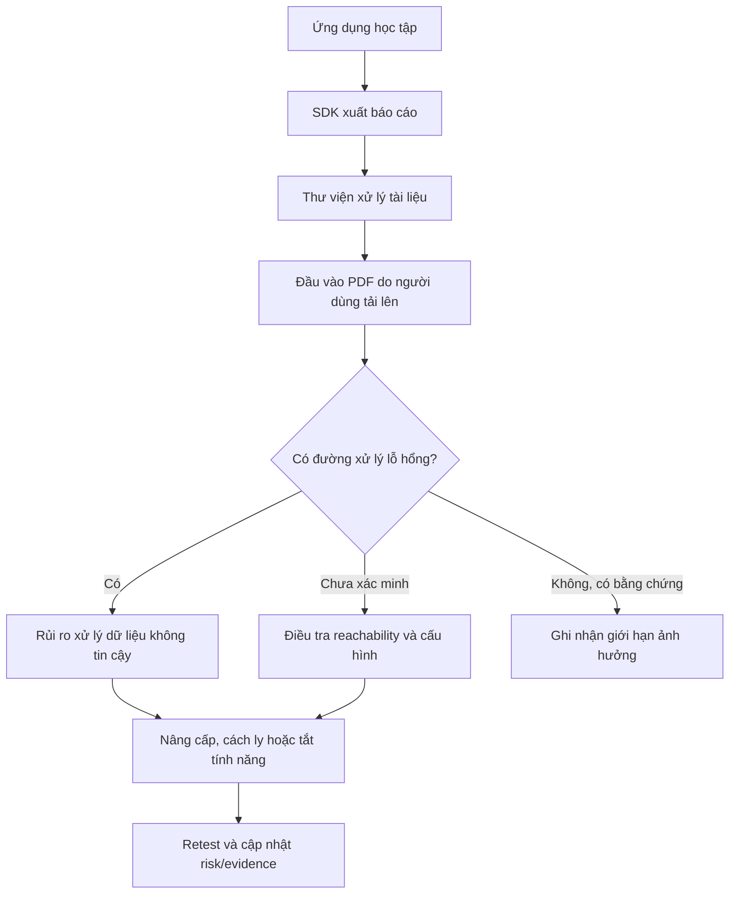
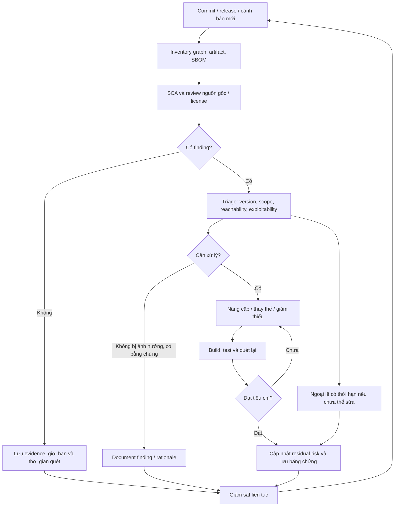

# Dependency review trong Secure development

## 1. Dependency review là gì và vì sao cần thiết?

Một ứng dụng Java có thể chỉ chứa vài chục lớp do nhóm phát triển tự viết, nhưng sử dụng hàng trăm thành phần phần mềm bên ngoài thông qua framework, thư viện, plugin build, SDK và container image. Khi một thành phần có lỗ hổng, bị thay thế bằng gói độc hại hoặc được cấu hình sai, rủi ro có thể truyền vào hệ thống dù phần mã do nhóm tự viết không thay đổi.

Giả sử nền tảng học tập bổ sung chức năng tải lên bài làm dạng PDF. Nhóm dùng một thư viện xử lý tài liệu thông qua SDK báo cáo. Một cảnh báo bảo mật xuất hiện cho thư viện đọc tài liệu ở tầng dependency gián tiếp. Nếu nhóm chỉ kiểm tra danh sách dependency khai báo trực tiếp trong `pom.xml`, vấn đề có thể bị bỏ sót. Ngược lại, nếu scanner báo một lỗ hổng trong thành phần không hề được đóng gói hoặc không có đường khai thác phù hợp, chặn mọi bản phát hành mà không phân tích cũng có thể gây gián đoạn không cần thiết.

**Dependency review** là quá trình kiểm kê, đánh giá và quyết định cách sử dụng các thành phần bên thứ ba hoặc thành phần nội bộ được tái sử dụng trong phần mềm. Quá trình này xem xét **lỗ hổng đã biết, độ tin cậy của nguồn cung, hành vi đáng ngờ, khả năng bảo trì, giấy phép, tương thích và mức ảnh hưởng đến hệ thống**. Kết quả cần đủ bằng chứng để giải thích vì sao một dependency được dùng, nâng cấp, thay thế, hạn chế hoặc chấp nhận rủi ro trong điều kiện cụ thể.

Trong chương **Secure development** của module **SECURITY_SECURITY_ASSURANCE**, dependency review là một hoạt động của chương trình **security assurance**: từ phân tích rủi ro chuỗi cung ứng, lựa chọn security controls, kiểm thử và rà soát, đến lưu bằng chứng, audit và khắc phục phát hiện trong phát triển cũng như vận hành. Chỉ có một lần quét thành công chưa đủ để khẳng định mọi dependency an toàn; cần xác định chính xác cái gì đã được kiểm tra, trên phiên bản nào, với nguồn dữ liệu và giới hạn nào.

### Mục tiêu học tập

Sau bài này, bạn có thể:

1. Nhận diện dependency trực tiếp, gián tiếp, runtime, build, test và các thành phần ngoài ngôn ngữ Java.
2. Phân biệt **dependency review**, **Software Composition Analysis (SCA)** và **Software Bill of Materials (SBOM)**.
3. Mô tả các nhóm rủi ro: lỗ hổng đã biết, thành phần độc hại, nguồn cung bị xâm nhập, phiên bản không kiểm soát, giấy phép và bỏ rơi bảo trì.
4. Thực hiện một quy trình review từ inventory, phát hiện, triage, xử lý đến retest và lưu evidence.
5. Đánh giá mức ưu tiên theo kịch bản khai thác và tác động kinh doanh, không chỉ theo điểm severity của scanner.
6. Thiết kế kiểm soát và assurance claims cho dependency review trong CI/CD, khi phát hành và trong vận hành.

## 2. Những khái niệm cần phân biệt

| Khái niệm | Ý nghĩa | Ví dụ |
|---|---|---|
| **Dependency** | Thành phần mà dự án cần để xây dựng, kiểm thử hoặc vận hành | Thư viện HTTP, JSON parser, JDBC driver |
| **Direct dependency** | Thành phần được dự án khai báo trực tiếp | `spring-boot-starter-web` trong `pom.xml` |
| **Transitive dependency** | Thành phần được kéo vào thông qua dependency khác | Thư viện logging đi kèm framework |
| **Dependency graph** | Đồ thị quan hệ giữa các thành phần và phiên bản được giải quyết | Ứng dụng → SDK → parser |
| **SCA** | Phân tích thành phần phần mềm để nhận diện thành phần, phiên bản và các rủi ro liên quan | Quét thư viện để đối chiếu advisory |
| **SBOM** | Danh mục thành phần phần mềm và quan hệ phụ thuộc, được tạo theo một phạm vi và thời điểm | CycloneDX hoặc SPDX của một bản build |
| **Security advisory** | Thông báo về vấn đề bảo mật và thông tin liên quan | Advisory từ nhà phát hành, kho cảnh báo hoặc nhà cung cấp |
| **CVE** | Định danh cho lỗ hổng được ghi nhận theo hệ thống CVE | Một CVE gắn với nhiều phiên bản bị ảnh hưởng |
| **CVSS** | Hệ thống mô tả và chấm mức nghiêm trọng kỹ thuật của lỗ hổng | Base score được scanner hiển thị |
| **EPSS** | Ước lượng xác suất bị khai thác trong thực tế theo mô hình xác suất | Một tín hiệu để sắp xếp ưu tiên điều tra |
| **KEV catalog** | Danh mục lỗ hổng đã được biết có khai thác thực tế, như CISA KEV | Tín hiệu khai thác cần quan tâm đặc biệt |
| **Provenance** | Thông tin nguồn gốc và cách artifact được tạo, phát hành | Repository, commit, pipeline, người phát hành |
| **Risk acceptance/exception** | Quyết định chấp nhận rủi ro còn lại có thẩm quyền và điều kiện | Cho phép tạm dùng thành phần chưa vá trong giới hạn |

**SBOM không phải báo cáo lỗ hổng.** SBOM trả lời “bản phát hành chứa thành phần nào?”; SCA dùng thông tin thành phần và nguồn tri thức khác để phát hiện vấn đề. Một SBOM đầy đủ hỗ trợ rà soát và ứng phó nhưng không chứng minh thành phần an toàn.

**Một kết quả SCA không đồng nghĩa bằng chứng khai thác được.** Scanner có thể phát hiện phiên bản khớp với advisory nhưng chưa xác nhận thành phần có mặt trong artifact cuối, nhánh code dễ tổn thương có được gọi, hay cấu hình hiện tại cho phép kẻ tấn công tiếp cận hay không. Đây là lý do triage và kiểm chứng kỹ thuật là bắt buộc.

## 3. Phạm vi review: không chỉ các thư viện trong pom.xml

### 3.1. Các nhóm dependency

| Nhóm | Ví dụ | Lý do phải review |
|---|---|---|
| **Application runtime** | Framework, HTTP client, parser, JDBC driver | Chạy cùng ứng dụng và có thể xử lý dữ liệu không tin cậy |
| **Transitive runtime** | Thư viện được SDK hoặc framework kéo vào | Có thể chứa lỗ hổng dù chưa được khai báo trực tiếp |
| **Build-time tools/plugins** | Maven plugin, compiler plugin, code generator | Có thể thực thi mã trong build và tiếp cận source, secret, artifact |
| **Test/development tools** | Test framework, test container, formatter | Tác động đến CI, máy phát triển và độ tin cậy của chuỗi build |
| **Container/base image** | Image JDK, hệ điều hành, thư viện native | Có thể mang package hệ điều hành hoặc runtime có vấn đề |
| **Frontend và tài sản web** | NPM package, JS bundle, CSS/JS từ CDN | Chạy trên trình duyệt hoặc được tải từ nguồn bên ngoài |
| **Hạ tầng và công cụ vận hành** | Agent, exporter, sidecar, IaC module | Có quyền truy cập hệ thống và tài nguyên vận hành |
| **SDK/API bên thứ ba** | SDK thanh toán, email, phân tích | Có thể chuyển dữ liệu, dùng token và kéo theo nhiều dependency |

**Dependency gián tiếp** có thể nhiều hơn dependency trực tiếp. Cần phân tích phiên bản *thực sự được resolve*, thay vì chỉ dựa vào cấu hình khai báo. Dependency management/BOM có thể áp phiên bản; conflict resolution có thể chọn phiên bản khác so với suy đoán ban đầu.

### 3.2. Cần xác định phạm vi artifact nào?

Một lần review nên ghi rõ:

- Tên service, repository, commit và tag/release.
- Dependency graph dùng cho build nào: production, test, CLI tool hoặc nhiều module.
- Artifact được phát hành: JAR/WAR, container image, frontend bundle và thành phần runtime khác.
- Môi trường triển khai và điều kiện vận hành: hệ điều hành, Java runtime, feature flags, đường xử lý dữ liệu.
- Nguồn registry, mirror và repository nội bộ đang sử dụng.
- Những thành phần chưa quan sát được: thư viện tải động, JAR được chép thủ công, native library, script cài đặt hoặc plugin riêng.

Một dependency chỉ xuất hiện trong bài test có thể tạo rủi ro cho CI nhưng không đi vào runtime production. Ngược lại, thư viện có sẵn trong container image hoặc được tải lúc chạy có thể không xuất hiện trong `mvn dependency:tree`. Vì vậy, cần tách phạm vi build, runtime và môi trường thay vì kết luận từ một danh sách.

## 4. Threat model cho software supply chain

Dependency review không chỉ tìm CVE. Các kịch bản cần xem xét gồm:

| Kịch bản | Đường rủi ro | Kiểm soát có liên quan |
|---|---|---|
| **Known vulnerable component** | Phiên bản có lỗ hổng được dùng trên đường xử lý có thể bị khai thác | SCA, triage reachability, nâng cấp và regression test |
| **Malicious package** | Kẻ tấn công phát hành gói chứa hành vi độc hại | Registry đáng tin, review nguồn gốc, đánh giá hành vi, policy gói |
| **Dependency confusion** | Build tải gói giả mạo tên gói nội bộ từ registry công khai | Quản lý namespace và thứ tự nguồn, registry/mirror được kiểm soát |
| **Typosquatting** | Người phát triển thêm gói có tên gần giống gói hợp lệ | Review thay đổi manifest/lockfile, allowlist nếu phù hợp |
| **Maintainer/repository compromise** | Tài khoản phát hành hoặc kho mã của thành phần bị chiếm | Kiểm tra provenance, hành vi phát hành và quyền tin cậy |
| **Build-tool compromise** | Plugin trong CI thực thi mã khi build và lấy secret | Pin phiên bản, kiểm soát plugin, quyền tối thiểu, CI isolation |
| **Uncontrolled version drift** | Build hôm nay resolve phiên bản khác hôm qua | Lock/constraint, quản lý BOM, build reproducibility |
| **Unmaintained dependency** | Thành phần không được vá, phụ thuộc quá cũ | Theo dõi lịch sử bảo trì, kế hoạch thay thế |
| **License/contract issue** | Giấy phép hoặc điều khoản không phù hợp cách phân phối | Rà soát license và nghĩa vụ cùng legal/compliance |
| **Incomplete inventory** | Thành phần trong image, fat JAR hoặc tải động không được ghi nhận | SBOM nhiều lớp, quét artifact, kiểm tra thủ công đường đi |

**Checksum và chữ ký artifact** giúp kiểm tra tính toàn vẹn và nguồn gốc theo cơ chế được thiết kế. Chúng không chứng minh mã nguồn không có lỗ hổng hay không chứa chức năng nguy hiểm. Một gói độc hại được ký bởi tài khoản phát hành đã bị chiếm vẫn có thể gây hại.

### Ví dụ chuỗi rủi ro



Đường A → B → C cho thấy vì sao review gián tiếp quan trọng. Mối liên kết từ tài liệu PDF đến code xử lý quyết định khả năng khai thác. Việc đánh giá chỉ dựa trên tên thư viện và điểm severity sẽ bỏ qua điều kiện thực tế.

## 5. Quy trình dependency review có thể kiểm chứng

Một quy trình đầy đủ gồm các bước có thể tái hiện:

1. **Inventory:** xác định scope, giải quyết dependency graph và thu thập artifact/SBOM.
2. **Detect:** đối chiếu advisory, quét thành phần, kiểm tra license, provenance và tín hiệu chuỗi cung ứng.
3. **Validate:** xác minh tên gói, phiên bản, đường dependency, kết quả quét, cấu hình và phạm vi ảnh hưởng.
4. **Prioritize:** đánh giá exploitability, reachability, mức phơi lộ, tác động tài sản và tình trạng khai thác.
5. **Decide:** chọn nâng cấp, thay thế, loại bỏ, giảm thiểu tạm, chấp nhận có điều kiện hoặc kết luận không bị ảnh hưởng có bằng chứng.
6. **Implement:** cập nhật dependency/BOM/plugin/image hoặc cấu hình phòng vệ.
7. **Verify:** build lại, kiểm thử tương thích, test bảo mật, quét lại và kiểm tra artifact cuối.
8. **Record:** liên kết finding, quyết định, owner, ngày hết hạn, evidence và trạng thái residual risk.
9. **Monitor:** theo dõi advisory mới, thay đổi version, provenance, registry và độ mới của evidence.



Kết quả “không có finding” chỉ áp dụng cho danh mục thành phần, cơ sở dữ liệu advisory, phiên bản artifact và thời điểm quét cụ thể. Không có advisory hôm nay không bảo đảm ngày mai không xuất hiện vấn đề.

## 6. Kiểm kê dependency trong dự án Maven/Java

### 6.1. Đọc khai báo, nhưng phải kiểm tra phiên bản được resolve

Ví dụ ứng dụng có dependency trực tiếp:

```xml
<dependencies>
    <dependency>
        <groupId>org.springframework.boot</groupId>
        <artifactId>spring-boot-starter-web</artifactId>
    </dependency>

    <dependency>
        <groupId>com.example.reporting</groupId>
        <artifactId>report-sdk</artifactId>
        <version>2.4.0</version>
    </dependency>
</dependencies>
```

Trong ví dụ giả định, `report-sdk` phụ thuộc vào `document-parser`. Chỉ đọc `pom.xml` không cho thấy đầy đủ thư viện được kéo theo. Có thể dùng Maven để xem graph của dự án:

```bash
# Chạy tại thư mục gốc của dự án Maven.
mvn -B dependency:tree

# Lưu kết quả để tham chiếu trong quá trình review.
mvn -B dependency:tree -DoutputFile=target/dependency-tree.txt
```

Ví dụ kết quả đã rút gọn, **toàn bộ tọa độ gói và số phiên bản com.example là giả định**:

```text
com.example:learning-platform:jar:1.0.0
+- org.springframework.boot:spring-boot-starter-web:jar:<resolved-version>
\- com.example.reporting:report-sdk:jar:2.4.0
   \- com.example.reporting:document-parser:jar:1.7.0
```

Cần chú ý đến *effective POM*, `dependencyManagement`, BOM được import, scope, optional dependency, exclusion và các profile Maven đang bật. Phiên bản được chọn trong dependency graph có thể chịu ảnh hưởng của version mediation. Khi review bản phát hành, nên kiểm tra cả artifact được đóng gói thay vì mặc định mọi thành phần trong graph đều đi vào production.

### 6.2. Plugin build cũng là dependency đáng xem xét

Maven plugins có thể thực thi code trong build với quyền của quá trình CI. Cần:

- Có danh sách plugin và phiên bản thực sự được dùng trong pipeline.
- Pin phiên bản plugin và nguồn repository phù hợp với chính sách.
- Kiểm tra thay đổi plugin trong pull request, nhất là plugin mới hoặc plugin có hành vi tải mã từ mạng.
- Hạn chế secret, quyền ghi và token CI cung cấp cho job có thể thực thi mã bên ngoài.
- Rà soát checksum, cấu hình mirror/registry và provenance nếu có.

Một plugin có phiên bản mới nhất vẫn cần được đánh giá theo độ tin cậy và tương thích. Tự động “nâng lên latest” không đủ thay thế quản lý thay đổi.

### 6.3. Xây dựng SBOM từ artifact

Các định dạng phổ biến để trao đổi SBOM gồm **CycloneDX** và **SPDX**. Khi thiết kế pipeline, có thể sử dụng plugin Maven tương ứng đã được phê duyệt và pin phiên bản để tạo SBOM cho đúng build/release. Một SBOM hữu ích thường chứa:

- Tên thành phần, version, hệ sinh thái, định danh gói như **Package URL (purl)** nếu có.
- Quan hệ dependency, scope hoặc mục đích sử dụng.
- Hash hoặc thông tin nhận diện artifact phù hợp.
- Dấu thời gian, công cụ và phiên bản công cụ tạo SBOM.
- Build/release, commit và artifact mà SBOM mô tả.
- Thông tin license và nguồn gốc khi thu thập được.

SBOM của Maven chưa chắc bao phủ package hệ điều hành trong container image hoặc thành phần JavaScript frontend. Với ứng dụng nhiều lớp, cần inventory riêng hoặc hợp nhất có kiểm soát để tránh tưởng rằng SBOM một lớp phản ánh toàn bộ runtime.

## 7. Tìm và xác minh các vấn đề trong dependency

### 7.1. SCA và nguồn advisory

SCA thường nhận diện thành phần dựa trên manifest, lockfile, dependency graph, binary/artifact hoặc SBOM, rồi đối chiếu với nguồn advisory. Ví dụ hệ sinh thái công cụ và dữ liệu thường được dùng:

- **OWASP Dependency-Check:** hỗ trợ nhận diện dependency và các lỗ hổng đã biết trong nhiều loại thành phần.
- **OSV:** cơ sở thông tin lỗ hổng gắn với các package/ecosystem và phiên bản.
- **Nguồn advisory của dự án/nhà cung cấp:** mô tả phiên bản ảnh hưởng, cấu hình và phiên bản sửa lỗi.
- **CVE/NVD:** định danh và dữ liệu mô tả lỗ hổng.
- **CISA KEV:** tín hiệu rằng lỗ hổng được liệt kê đã có bằng chứng khai thác thực tế theo tiêu chí của danh mục.
- **EPSS:** tín hiệu dự báo mức độ có khả năng bị khai thác; cần xem cùng bối cảnh và phương pháp đánh giá.

Không một cơ sở dữ liệu hay scanner nào bao phủ mọi vấn đề. Các nguồn có độ trễ cập nhật, khác biệt về định danh hoặc phiên bản, đôi khi gán kết quả sai. Cần lưu nguồn advisory, thời điểm cập nhật và phiên bản dữ liệu được sử dụng.

### 7.2. Kiểm tra tính đúng của finding

Khi nhận cảnh báo, nên xác minh:

1. **Identity:** tọa độ gói, ecosystem và phiên bản có được nhận diện chính xác?
2. **Presence:** gói có trong artifact, runtime hoặc môi trường bị ảnh hưởng không?
3. **Affected range:** phiên bản/cấu hình có nằm trong phạm vi advisory mô tả không?
4. **Reachability:** ứng dụng có gọi đến chức năng bị ảnh hưởng hoặc cung cấp đường tới nó không?
5. **Exploit prerequisites:** khai thác đòi hỏi input, quyền, cấu hình hoặc điều kiện nào?
6. **Exposure:** thành phần có tiếp nhận dữ liệu không tin cậy, nằm trên Internet-facing path hay có quyền cao?
7. **Controls:** phân quyền, sandbox, giới hạn input, network segmentation hoặc biện pháp hiện tại có thực sự giảm rủi ro?
8. **Fix availability:** đã có bản vá, phiên bản thay thế hoặc mitigation chính thức chưa?

**Không chứng minh được reachability không đồng nghĩa đã chứng minh không bị ảnh hưởng.** Phân tích tĩnh hoặc runtime tracing có thể bỏ sót reflection, dynamic loading, native code, feature flags hay luồng hiếm. Kết luận “not affected” phải nêu phương pháp, phạm vi và giới hạn.

### 7.3. Các trạng thái triage cần rõ ràng

| Trạng thái | Khi nào sử dụng? | Bằng chứng tối thiểu |
|---|---|---|
| **Confirmed affected** | Thành phần/cấu hình có trong phạm vi ảnh hưởng; có kịch bản tác động hợp lý | Artifact, version, advisory, đường ảnh hưởng |
| **Potentially affected** | Chưa đủ thông tin để kết luận | Khoảng trống, owner, kế hoạch điều tra |
| **Not affected (verified)** | Có căn cứ kỹ thuật cho thấy điều kiện ảnh hưởng không thỏa | Version/cấu hình/đường thực thi và kiểm tra xác nhận |
| **False positive** | Công cụ gán sai package, version hoặc advisory | Dấu vết nhận diện, nguồn kiểm chứng và lý do |
| **Fixed and verified** | Đã triển khai xử lý và test/quét lại đạt | Build mới, evidence test, scan, release mapping |
| **Accepted with conditions** | Residual risk được người có thẩm quyền chấp nhận tạm thời | Risk assessment, biện pháp bù đắp, hạn, approver |

Các trạng thái này là ví dụ quản lý finding; tổ chức có thể dùng nhãn khác nhưng cần tránh nhập nhằng giữa “đã sửa”, “chưa thấy khai thác” và “đã chấp nhận”.

## 8. Ưu tiên xử lý dựa trên risk

**CVSS là thước đo severity kỹ thuật, không phải điểm rủi ro kinh doanh của hệ thống.** Một lỗ hổng có CVSS cao trong thư viện không dùng tại runtime có thể có mức ưu tiên khác với lỗ hổng có severity thấp hơn nhưng cho phép lộ dữ liệu người học qua API công khai.

Mô hình triage nên kết hợp:

| Yếu tố | Câu hỏi | Tác dụng đối với quyết định |
|---|---|---|
| **Technical severity** | Advisory và CVSS phản ánh tác động kỹ thuật nào? | Ước lượng độ nghiêm trọng của vấn đề |
| **Known exploitation** | Có tín hiệu đang bị khai thác hoặc thuộc danh mục KEV? | Có thể tăng ưu tiên và yêu cầu phản ứng nhanh |
| **Exploit probability** | EPSS và thông tin đe dọa nói gì, có đáng tin tại thời điểm xét? | Hỗ trợ sắp xếp điều tra, không thay thế đánh giá |
| **Reachability** | Thành phần và chức năng lỗi có nằm trên luồng có thể tiếp cận? | Phân biệt hiện diện với khả năng tác động |
| **Exposure** | Dữ liệu đầu vào do ai kiểm soát, có mở Internet hay nội bộ? | Xem xét đường tấn công thực tế |
| **Privilege and blast radius** | Thành phần chạy với quyền nào, ảnh hưởng bao nhiêu tenant/dịch vụ? | Đánh giá hậu quả và phạm vi |
| **Compensating controls** | Có biện pháp giảm thiểu được xác minh không? | Điều chỉnh khả năng khai thác hoặc tác động |
| **Asset and business impact** | Có ảnh hưởng dữ liệu, kỳ thi, thanh toán hoặc nghĩa vụ không? | Gắn mức ưu tiên với mục tiêu tổ chức |
| **Remediation feasibility** | Có bản vá, có tương thích, có cách cô lập tạm thời? | Chọn kế hoạch xử lý khả thi và thời hạn |
| **Uncertainty** | Thiếu những bằng chứng gì và rủi ro của việc chờ là bao nhiêu? | Quyết định điều tra thêm, giảm thiểu hoặc escalation |

Không nên tính một điểm rủi ro bằng cách nhân các giá trị tùy ý mà không định nghĩa thang đo. Tổ chức có thể dùng ma trận likelihood × impact hoặc cách khác, nhưng phải ghi rõ giả định, owner, căn cứ đánh giá và tiêu chí vượt ngưỡng.

### Ma trận ưu tiên minh họa

| Finding giả định | Phân tích | Hướng xử lý |
|---|---|---|
| Parser trong API nhận PDF không tin cậy, có advisory nghiêm trọng và bản vá | Đường đầu vào dễ tiếp cận; tác động đến dịch vụ có dữ liệu nhạy cảm | Ưu tiên xử lý cao, có thể hạn chế tính năng tạm thời |
| Dependency chỉ xuất hiện trong test nhưng plugin chạy cùng token CI có quyền cao | Không ảnh hưởng trực tiếp runtime nhưng có rủi ro chuỗi build | Rà soát quyền CI, nguồn gói, cập nhật và cô lập pipeline |
| Scanner gán nhầm CVE của package khác cùng tên | Có bằng chứng package identity không khớp | Ghi false positive có giải thích; điều chỉnh mapping nếu cần |
| Thư viện runtime có severity trung bình nhưng được dùng ở đường admin | Tác động kinh doanh và quyền cao có thể lớn | Điều tra điều kiện khai thác; ưu tiên theo rủi ro thực tế |
| Không có advisory nhưng gói mới có nguồn gốc mơ hồ và cài script tùy ý | Rủi ro malicious package không được phản ánh bởi CVE | Review provenance, hành vi script và nguồn phát hành trước khi dùng |

Mức ưu tiên nên được cập nhật khi có advisory mới, bằng chứng exploit mới, thay đổi feature, thay đổi exposure hoặc khi controls không còn hiệu lực.

## 9. Lựa chọn cách xử lý và xác minh kết quả

Các hướng xử lý thường gặp:

| Biện pháp | Khi nào phù hợp? | Cần xác minh |
|---|---|---|
| **Upgrade/Patch** | Có phiên bản sửa lỗi hoặc bản phát hành an toàn được hỗ trợ | Build, test, dependency graph, artifact, SCA lại |
| **Replace** | Dependency bị bỏ rơi, không đáng tin hoặc khó vá | Chức năng tương đương, tác động API, performance, license |
| **Remove** | Tính năng/gói không còn dùng | Không còn đường dependency, artifact không chứa gói |
| **Constrain/Override transitive version** | Phụ thuộc gián tiếp kéo phiên bản lỗi, có thể kiểm soát version | Tương thích API/ABI, regression, graph cuối |
| **Mitigate** | Chưa thể cập nhật ngay hoặc đang điều tra | Tính hiệu lực của WAF, cô lập, disable feature hoặc giới hạn input |
| **Temporarily disable** | Chức năng có rủi ro cao và chưa có cách giảm đủ mạnh | Endpoint/feature thực sự không còn đường truy cập |
| **Accept with conditions** | Residual risk trong giới hạn và có thẩm quyền chấp nhận | Approval, owner, expiry, controls, theo dõi và trigger review |

### 9.1. Khi nâng cấp dependency

Nên thực hiện:

1. Xác định phiên bản mục tiêu theo advisory, ghi chú phát hành và nguồn chính thức.
2. Kiểm tra thay đổi API, hành vi, serialization, logging, cơ chế bảo mật, license và yêu cầu runtime.
3. Cập nhật khai báo hoặc BOM/`dependencyManagement` của nguồn tạo version.
4. Build lại; xem dependency graph có thực sự chọn phiên bản mong muốn.
5. Chạy unit, integration, security regression và test nghiệp vụ bị ảnh hưởng.
6. Kiểm tra artifact/container cuối; scan lại và tạo SBOM mới.
7. Liên kết commit, pull request, build, kết quả test và finding để chứng minh xử lý hoàn tất.

Với Maven, override dependency gián tiếp có thể giúp vá nhanh, nhưng phải xác minh tương thích với SDK cấp trên. Một bản vá chỉ thay số phiên bản trong `pom.xml` mà không thay thành phần được đóng gói không được xem là hoàn tất.

### 9.2. Khi chưa có bản vá

Có thể tạm thời giảm rủi ro bằng cách tắt chức năng nhận input không tin cậy, giới hạn đường truy cập, giảm quyền tiến trình, cách ly xử lý tài liệu hoặc tăng giám sát. Các biện pháp này cần được test theo kịch bản khai thác dự kiến và có hạn xem xét. Không mặc định WAF hoặc network policy sẽ loại bỏ mọi kiểu khai thác ở thư viện.

Nếu rủi ro vượt ngưỡng hoặc rơi vào loại không được phép chấp nhận, quyết định có thể là trì hoãn phát hành hoặc vô hiệu hóa tính năng cho đến khi có biện pháp phù hợp.

## 10. Assurance case cho dependency review

Trong security assurance, cần chuyển lời khẳng định chung thành các **claim** có thể đánh giá bằng evidence.

| Claim | Tiêu chí kiểm chứng | Evidence phù hợp |
|---|---|---|
| **CLM-01: Thành phần trong release được kiểm kê** | Phạm vi và định danh dependency đầy đủ cho các lớp chính | Graph, SBOM, manifest/lockfile, binary/container scan |
| **CLM-02: Component nguồn gốc không xác định được kiểm soát** | Gói được lấy qua nguồn đã phê duyệt, có thông tin provenance đủ theo policy | Registry config, allowlist/approval, provenance, hash/signature khi có |
| **CLM-03: Advisory liên quan được đánh giá** | Finding được phân loại, có owner và lý do xác minh | SCA report, advisory mapping, triage record |
| **CLM-04: Rủi ro vượt ngưỡng được xử lý trước release** | Có patch/mitigation hoặc quyết định theo thẩm quyền | Risk record, PR, test, exception approval |
| **CLM-05: Dependency được cập nhật và kiểm chứng** | Phiên bản/đường dependency và artifact cuối phản ánh sửa đổi | Build output, tree, SBOM mới, scan và test pass |
| **CLM-06: Hoạt động giám sát tiếp tục sau phát hành** | Có trigger và owner khi advisory mới hoặc gói thay đổi | Alert subscription, backlog, dashboard, lịch review |
| **CLM-07: Ngoại lệ không tồn tại vô thời hạn** | Mỗi exception có hạn, control, approver và trigger tái đánh giá | Exception register, expiry review, evidence bù đắp |

### 10.1. Ví dụ assurance case nhỏ

```text
CLAIM: Release R không còn phụ thuộc runtime vào phiên bản parser dễ tổn thương
  |
  +-- ARGUMENT: Dependency graph đã resolve phiên bản đã sửa
  |     +-- EVIDENCE: dependency:tree của commit/release R
  |
  +-- ARGUMENT: Artifact được triển khai không chứa bản cũ
  |     +-- EVIDENCE: SBOM và quét JAR/container của bản build R
  |
  +-- ARGUMENT: Thay đổi không phá chức năng hay control liên quan
  |     +-- EVIDENCE: Unit, integration, negative security regression tests
  |
  +-- ASSUMPTION: Không tải thêm parser khác trong runtime
  +-- LIMITATION: SBOM chưa bao phủ một plugin tự tải động
```

Khi limitation còn ảnh hưởng claim, không nên kết luận “đã kiểm tra toàn bộ”. Có thể thu hẹp claim hoặc bổ sung kiểm tra để xử lý khoảng trống.

### 10.2. Evidence cần truy vết được

Một hồ sơ dependency review nên ghi:

- Service/repository, PR/commit, release, build ID, artifact digest và môi trường.
- Manifest, dependency graph, SBOM, công cụ và phiên bản scanner.
- Thời điểm quét, thời điểm dữ liệu advisory cập nhật, nguồn advisory.
- Danh sách finding và định danh package/version/đường phụ thuộc.
- Severity và phân tích risk, lý do ưu tiên, owner và hạn xử lý.
- Quyết định sửa, giảm thiểu, không ảnh hưởng hoặc chấp nhận có điều kiện.
- Commit xử lý, kết quả test, quét lại, reviewer và trạng thái cuối.
- Phạm vi chưa bao phủ, giả định và trigger đánh giá lại.

Lưu artifact ở nơi được kiểm soát quyền và chống sửa đổi trái phép, với retention tương ứng nhu cầu audit/điều tra. Không ghi secret, token registry hoặc thông tin nhạy cảm vào báo cáo được chia sẻ rộng rãi.

## 11. Ví dụ xuyên suốt: SDK báo cáo kéo parser có lỗ hổng

Giả sử một nền tảng học tập đa tenant dùng Java/Spring Boot có chức năng cho giảng viên tải PDF kết quả. Dịch vụ `report-service` khai báo dependency `com.example.reporting:report-sdk:2.4.0`; SDK kéo `com.example.reporting:document-parser:1.7.0`.

**Tất cả tên nhóm `com.example`, phiên bản và finding trong ví dụ này là dữ liệu giả định để học quy trình, không phải thông báo về lỗ hổng có thật.**

### 11.1. Phát hiện

Sau pull request, SCA báo:

```text
Finding: DEMO-PARSER-001 (minh họa)
Component: com.example.reporting:document-parser:1.7.0
Introduced by: report-sdk:2.4.0
Affected range: < 1.8.0 (giả định)
Fixed version: 1.8.0 (giả định)
Possible impact: xử lý dữ liệu đầu vào độc hại trong parser
Detection source: scanner và nguồn advisory giả định
```

Nhóm không vội kết luận service bị khai thác chỉ từ kết quả scanner. Reviewer xác minh SDK thực sự gọi parser, bản build runtime chứa thành phần đó, và API nhận PDF do người dùng cung cấp.

### 11.2. Phân tích risk

| Yếu tố | Kết quả điều tra giả định |
|---|---|
| Asset | Dữ liệu kết quả và tính sẵn sàng của dịch vụ báo cáo |
| Exposure | Endpoint upload PDF có thể được tài khoản đã xác thực sử dụng |
| Reachability | Luồng upload đưa file vào parser bị ảnh hưởng |
| Impact | Parser có thể làm gián đoạn xử lý; mức tác động thực tế cần xác minh thêm |
| Current controls | Giới hạn kích thước file, rate limit, quyền tenant, container có quyền hạn chế |
| Uncertainty | Chưa đánh giá đầy đủ điều kiện kích hoạt và phạm vi ảnh hưởng |
| Fix | Có bản 1.8.0 theo advisory giả định; cần test tương thích SDK |
| Decision | Ưu tiên xử lý, giới hạn upload nếu cần trước khi phát hành |

Controls như giới hạn file hoặc quyền tenant không chứng minh parser không lỗi. Chúng có thể giảm một số điều kiện, nhưng không thay thế bản sửa khi đường khai thác còn tồn tại.

### 11.3. Xử lý

Nhóm thử nâng cấp SDK lên phiên bản đã dùng parser sửa lỗi, hoặc nếu SDK chưa cập nhật, cân nhắc override phiên bản transitive có kiểm soát. Sau đó:

1. Chạy Maven dependency tree để xác nhận `document-parser` thực sự là phiên bản được sửa.
2. Build lại JAR/container và kiểm tra inventory của artifact cuối.
3. Chạy test mở PDF hợp lệ, PDF lỗi, tải lên bất thường, quyền tenant và xuất báo cáo.
4. Chạy lại SCA; rà soát thêm thay đổi dependency phát sinh.
5. Lưu SBOM mới, kết quả test, scan và kết luận risk.

Nếu SDK không tương thích với parser đã sửa, nhóm có thể cần thay SDK hoặc tạm dừng chức năng. Quyết định chấp nhận tạm thời phải có risk owner, biện pháp bù đắp đã kiểm chứng, thời hạn và cấp phê duyệt phù hợp.

### 11.4. Hồ sơ review minh họa

```yaml
finding_id: DEMO-PARSER-001
service: report-service
release: "2026.11-demo"
component:
  package: "com.example.reporting:document-parser"
  version_detected: "1.7.0"
  introduced_by: "report-sdk:2.4.0"
  environment: "production-runtime"
assessment:
  status: "CONFIRMED_AFFECTED"
  exposure: "PDF upload by authenticated users"
  reachability: "Observed in upload processing"
  impact: "Service disruption; further impact under review"
  owner: "report-service risk owner"
decision:
  action: "UPGRADE_AND_RETEST"
  target_version: "1.8.0"
evidence_required:
  - "Resolved dependency tree at release commit"
  - "Build artifact inventory and SBOM"
  - "SCA re-scan and parser regression tests"
verification:
  status: "PENDING"
  accepted_residual_risk: false
```

Hồ sơ này cố ý để `verification.status: PENDING`. Chỉ sau khi có kết quả kiểm chứng trên artifact mục tiêu và review, mới đổi thành trạng thái đã xác minh. Việc sửa phiên bản trên một nhánh code chưa triển khai chưa chứng minh bản đang chạy đã an toàn hơn.

## 12. Tích hợp dependency review vào SDLC và CI/CD

Review có hiệu quả nhất khi kết hợp các trigger tự động với quyết định có ngữ cảnh:

| Thời điểm | Hoạt động | Đầu ra |
|---|---|---|
| **Thiết kế/chọn thư viện** | Xác định nhu cầu, ưu tiên thư viện được duy trì và đáng tin; xét license, data flow | Decision record, dependency owner |
| **Pull request** | Kiểm tra thay đổi manifest/lockfile/BOM/plugins; scan và review gói mới | PR comment, SCA report, triage |
| **Build/CI** | Resolve graph, kiểm tra nguồn, quét artifact, tạo SBOM, test | Build evidence gắn commit |
| **Release gate** | Xem xét finding vượt ngưỡng và exception; xác minh artifact cuối | Release approval/evidence |
| **Vận hành** | Re-scan SBOM/artifact khi có advisory mới; theo dõi gói quá cũ | Alert, backlog, risk update |
| **Ứng phó sự cố** | Xác định dịch vụ nào dùng thành phần bị ảnh hưởng và phiên bản đang triển khai | Impact inventory, mitigation, retest |

### 12.1. Thay đổi dependency trong pull request

Reviewer nên hỏi:

- Dependency được thêm vì yêu cầu gì? Có thể dùng thư viện đã có hoặc API chuẩn không?
- Đã kiểm tra tên gói, nhà phát hành, registry, provenance và license?
- Version có được kiểm soát bằng BOM, lockfile hoặc cơ chế cố định phù hợp?
- Dependency kéo theo thành phần nào, kể cả plugin và native artifact?
- Có script cài đặt, code generator hoặc hành vi gọi mạng ở build time?
- Quyền và dữ liệu mà dependency có thể truy cập là gì?
- Có changelog, cách cập nhật, lịch sử bảo trì và chính sách báo lỗi bảo mật?
- Có test cho luồng nghiệp vụ và security boundary bị ảnh hưởng?
- Ai là owner sẽ theo dõi advisory và bảo trì về sau?

Không nên coi số sao, tuổi đời gói hoặc số download là bằng chứng tuyệt đối về chất lượng. Chúng chỉ là tín hiệu tham khảo bên cạnh nguồn gốc, quá trình phát hành, hoạt động bảo trì và phù hợp với nhu cầu.

### 12.2. Gate tự động và ngoại lệ có kiểm soát

Một policy CI có thể quy định:

```text
Trên mỗi PR:
  - Kiểm tra manifest, lockfile, BOM và plugin thay đổi.
  - Resolve dependency graph.
  - Scan thành phần và kiểm tra nguồn gói.
  - Tạo report gắn với commit.
  - Nếu có finding vượt ngưỡng: yêu cầu triage/approval.

Trước release:
  - Scan artifact cuối và tạo SBOM theo release.
  - Đối chiếu open findings và exception còn hiệu lực.
  - Chạy test phù hợp cho dependency đã sửa.
  - Chỉ cho phép phát hành khi đạt policy hoặc có quyết định đúng thẩm quyền.

Sau release:
  - Theo dõi advisory mới cho SBOM/artifact đang triển khai.
  - Tạo finding có owner và SLA theo mức rủi ro.
  - Retest sau remediation; cập nhật trạng thái và evidence.
```

Gate tự động nên kiểm tra điều kiện đo được. Những trường hợp đòi hỏi phân tích reachability, tính phù hợp của mitigation hoặc quyết định risk acceptance cần có con người và thẩm quyền rõ ràng. Việc tắt scanner để pipeline xanh hoặc duy trì allowlist vô thời hạn làm mất giá trị assurance.

### 12.3. Version pinning và reproducible builds

- Pin phiên bản dependency hoặc dùng BOM/lockfile/constraint theo ecosystem.
- Pin phiên bản plugin và kiểm soát nguồn tải.
- Kiểm tra registry/mirror để tránh thay đổi nguồn ngoài dự kiến.
- Gắn build với commit, toolchain và artifact digest.
- Ghi lại metadata đủ để tái hiện dependency graph.

Pin phiên bản giúp hạn chế drift nhưng **không tự vá lỗ hổng**. Một phiên bản cố định có thể trở nên rủi ro khi có advisory mới; cần lịch cập nhật và cơ chế theo dõi liên tục.

## 13. Quản lý finding, exception và quyết định rủi ro

Một finding nên có: ID, hệ thống và artifact bị ảnh hưởng, package/version, advisory, đánh giá mức ảnh hưởng, owner, thời hạn, trạng thái, biện pháp xử lý và evidence. Việc chuyển trạng thái cần theo tiêu chí nhất quán.

### 13.1. Ai quyết định?

| Vai trò | Trách nhiệm |
|---|---|
| **Development/service owner** | Hiểu đường dependency, chọn giải pháp kỹ thuật, thực hiện thay đổi |
| **Security/AppSec** | Cung cấp công cụ, triage, tư vấn threat và review bằng chứng |
| **Platform/CI owner** | Bảo vệ nguồn build, registry, plugin và pipeline |
| **Risk owner** | Đánh giá rủi ro của dịch vụ và đề xuất xử lý/chấp nhận trong thẩm quyền |
| **Legal/compliance** | Đánh giá license, hợp đồng và nghĩa vụ khi liên quan |
| **Người phê duyệt ngoại lệ** | Quyết định theo phân cấp risk appetite và lưu điều kiện |
| **Audit/assurance độc lập** | Kiểm tra quy trình, mẫu evidence và chất lượng quyết định theo phạm vi |

Không nên mặc định nhóm security là chủ sở hữu mọi rủi ro do dependency. Đơn vị sở hữu dịch vụ và dữ liệu cần chịu trách nhiệm đối với hậu quả trong phạm vi của mình; nhóm security hỗ trợ và giám sát phù hợp.

### 13.2. Ngoại lệ cần có hạn

Ví dụ một plugin được dùng trong CI nhưng chưa có bản vá. Nếu phải xin ngoại lệ, ghi:

- Phạm vi cụ thể: pipeline, plugin, phiên bản, repository và quyền liên quan.
- Kịch bản rủi ro, impact, lý do chưa xử lý và giả định.
- Biện pháp bù đắp như cô lập runner, hạn chế token, không cho PR không tin cậy truy cập secret.
- Người chịu trách nhiệm, người phê duyệt, thời hạn và lịch review.
- Trigger đánh giá lại: có patch, exploit mới, nguồn bị xâm nhập, thay đổi build hoặc ngoại lệ hết hạn.
- Bằng chứng rằng biện pháp bù đắp thực sự có hiệu lực.

Khi điều kiện thay đổi, phải review lại. Không nên để exception ở trạng thái “accepted” vô hạn hoặc tự động gia hạn mà không đánh giá.

## 14. Các chỉ số giúp đánh giá hiệu quả

| Chỉ số | Cách hiểu | Lưu ý |
|---|---|---|
| **Inventory coverage** | Tỷ lệ artifact/dịch vụ quan trọng có dependency inventory/SBOM cập nhật | Mẫu số phải rõ; cần kiểm tra cả lớp runtime và build |
| **Scan freshness** | Tuổi của kết quả quét so với build và dữ liệu advisory | Scan cũ có thể bỏ sót advisory mới |
| **Open risk by severity** | Số finding theo mức rủi ro sau triage | Không đồng nhất severity scanner với risk |
| **Mean/median time to remediate** | Thời gian từ nhận diện đến khi sửa và kiểm chứng | Theo nhóm mức độ; tránh đóng sớm để đẹp KPI |
| **SLA breach** | Tỷ lệ finding quá hạn xử lý theo policy | Kiểm tra lý do và mức ảnh hưởng |
| **Exception age/expiry** | Số ngoại lệ còn mở và quá hạn | Theo dõi điều kiện bù đắp và owner |
| **Transitive finding ratio** | Tỷ lệ finding xuất phát từ dependency gián tiếp | Hữu ích khi lên kế hoạch BOM và nâng cấp SDK |
| **Fix verification rate** | Tỷ lệ remediation có build, test và scan sau sửa | Kiểm tra cả artifact được triển khai |
| **Dependency update cadence** | Tần suất cập nhật thành phần trọng yếu | Tần suất cao không đồng nghĩa luôn tốt; cần test |
| **Supply-chain provenance coverage** | Tỷ lệ artifact quan trọng có nguồn gốc và dữ liệu build truy vết được | Nêu rõ mức độ tin cậy, phạm vi và cơ chế xác minh |

Đo lường nên phục vụ phát hiện khoảng trống và quyết định đầu tư. Nếu chỉ đánh giá số lượng finding giảm, nhóm có thể bị khuyến khích giảm quét hoặc trì hoãn ghi nhận. Hãy kết hợp coverage, chất lượng triage, mức rủi ro còn lại và bằng chứng khắc phục.

## 15. Sai lầm thường gặp và cách tránh

| Sai lầm | Hệ quả | Cách khắc phục |
|---|---|---|
| Chỉ đọc `pom.xml` mà bỏ qua dependency graph | Bỏ sót transitive dependency hoặc version conflict | Resolve graph và đối chiếu artifact cuối |
| Chỉ quét mã nguồn, không quét container/base image | Bỏ sót package runtime và native library | Inventory nhiều lớp và quét image đã build |
| Coi “scanner xanh” là toàn bộ assurance | Bỏ sót rủi ro chưa có advisory, nguồn gốc mơ hồ | Review provenance, behavior, license và risk |
| Chặn mọi cảnh báo mà không triage | Giảm tính khả dụng, tạo áp lực bỏ qua gate | Đánh giá version, exposure, reachability, impact |
| Đóng finding ngay sau khi đổi version | Artifact triển khai có thể vẫn chứa bản cũ | Build, test, re-scan và xác minh artifact mới |
| Dùng CVSS làm risk score cuối cùng | Thiếu bối cảnh tài sản và đường khai thác | Kết hợp exploitability, controls, business impact |
| Tự động nâng mọi gói lên bản mới nhất | Có thể làm hỏng tương thích, kéo gói không tin cậy | Review changelog, test và kiểm soát nguồn |
| Bỏ qua plugin/CI dependencies | Có thể lộ mã nguồn hoặc token pipeline | Review build tool và quyền CI |
| Exception không owner, không hết hạn | Rủi ro tồn tại kéo dài không ai theo dõi | Áp dụng approval, expiry, compensation và re-review |
| Dùng một SBOM cho mọi môi trường | Không phản ánh khác biệt artifact, image, cấu hình | Gắn SBOM với build/release và phạm vi |

## 16. Checklist thực hành cho một lần dependency review

Trước khi chấp thuận dependency hoặc một bản phát hành, kiểm tra:

- [ ] Đã xác định service, commit, release, artifact và môi trường được review?
- [ ] Có dependency graph và inventory cho dependency trực tiếp/gián tiếp?
- [ ] Build plugins, container image, frontend/native dependencies có được xét trong phạm vi phù hợp?
- [ ] Dependency mới có lý do sử dụng, owner, nguồn gốc và giấy phép được rà soát?
- [ ] Phiên bản đã resolve và phiên bản trong artifact cuối có khớp kỳ vọng?
- [ ] Có SCA report gắn nguồn advisory và thời gian cập nhật?
- [ ] Finding đã được xác minh package identity, affected range, exposure, reachability và impact?
- [ ] Mức ưu tiên có xét tín hiệu exploit thực tế, rủi ro kinh doanh và độ bất định?
- [ ] Có quyết định cụ thể: upgrade, remove, replace, mitigate hoặc accept theo thẩm quyền?
- [ ] Với thay đổi dependency, đã chạy test chức năng, tương thích và security regression?
- [ ] Đã quét lại artifact, tạo/cập nhật SBOM và xác minh remediation?
- [ ] Finding/exception có owner, hạn, lý do và bằng chứng?
- [ ] Có kế hoạch theo dõi advisory mới cho artifact đang vận hành?
- [ ] Evidence lưu đủ thông tin để truy vết và audit nhưng không làm lộ secret?

Checklist hỗ trợ tính đầy đủ. Kết luận assurance vẫn phải dựa trên bằng chứng và phạm vi thực sự được kiểm chứng.

## 17. Câu hỏi tự ôn tập

1. Vì sao lỗ hổng ở transitive dependency có thể ảnh hưởng đến ứng dụng dù nhóm không khai báo thư viện đó trực tiếp?
2. SBOM và SCA khác nhau ở chức năng nào? Có SBOM có đủ để khẳng định một release an toàn không?
3. Một scanner báo CVSS cao cho thư viện test-only. Những câu hỏi nào cần trả lời trước khi ưu tiên xử lý?
4. Vì sao không thể đóng finding chỉ dựa vào thay đổi phiên bản trong `pom.xml`?
5. Trong trường hợp plugin CI bị nghi ngờ có hành vi độc hại, những tài sản và controls nào cần đánh giá ngoài ứng dụng runtime?
6. Nếu một dependency chưa có bản vá, cần những nội dung gì trong hồ sơ ngoại lệ và assurance evidence?
7. Hãy lập ma trận claim → evidence cho việc chứng minh một phiên bản parser có lỗ hổng đã được loại khỏi artifact triển khai.

## 18. Ghi nhớ

- **Dependency review** xem xét cả lỗ hổng, nguồn cung, phiên bản, giấy phép, khả năng bảo trì và tác động của thành phần đối với hệ thống.
- **SCA** phát hiện và hỗ trợ phân tích vấn đề; **SBOM** kiểm kê thành phần theo một phạm vi/build. Cả hai đều có giới hạn.
- Review phải bao phủ dependency trực tiếp, gián tiếp, build/plugin, runtime và các lớp artifact liên quan.
- Ưu tiên xử lý dựa trên **risk**: affected range, reachability, exposure, khả năng khai thác, controls và tác động, thay vì chỉ dựa vào CVSS.
- Một remediation hoàn tất khi **artifact thực sự đã thay đổi** và có bằng chứng build, test, scan/review lại.
- Governance xác định owner, thẩm quyền, thời hạn và ngoại lệ; assurance liên kết **claim → control → evidence → residual risk → decision**.
- Dependency review cần chạy khi chọn thư viện, đổi dependency, phát hành và khi xuất hiện advisory mới cho phần mềm đang vận hành.

### Tài liệu tham khảo định hướng

- **NIST SP 800-218 — Secure Software Development Framework (SSDF):** thực hành phát triển phần mềm an toàn, quản lý thành phần và đáp ứng lỗ hổng.
- **OWASP Software Component Verification Standard (SCVS):** tham khảo các yêu cầu xác minh và quản trị thành phần phần mềm.
- **OWASP Dependency-Check:** công cụ hỗ trợ nhận diện dependency và đối chiếu lỗ hổng đã biết.
- **CycloneDX / SPDX:** các định dạng trao đổi thông tin SBOM và thành phần phần mềm.
- **OpenSSF Scorecard và SLSA:** nguồn tham khảo cho tín hiệu thực hành bảo mật dự án và provenance/chuỗi cung ứng build.
- **OSV, CVE, CISA KEV, EPSS:** các nguồn thông tin hỗ trợ nhận diện và ưu tiên lỗ hổng.

Các công cụ và cơ sở dữ liệu có phạm vi, hạn chế, lịch cập nhật và mức độ tin cậy khác nhau. Khi áp dụng, hãy kiểm tra tài liệu chính thức, chính sách tổ chức và khả năng tái hiện bằng chứng trên artifact thực tế.
