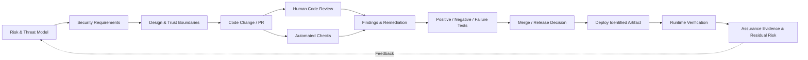
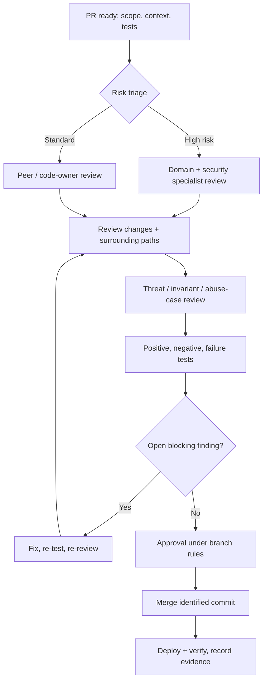

# Code review: Rà soát mã nguồn có bằng chứng trong Secure Development

## 1. Mục tiêu học tập

Sau khi học bài này, người học có thể:

1. Giải thích **code review** là gì, vì sao nó vừa hỗ trợ chất lượng phần mềm vừa là một **security control có thể đánh giá bằng bằng chứng**.
2. Phân biệt review về logic/maintainability với **security-focused code review**, design review, static analysis, dynamic testing, penetration testing và audit.
3. Xây dựng quy trình review dựa trên **risk, phạm vi thay đổi, trust boundary, dữ liệu, nghiệp vụ và độ nhạy cảm** thay vì chỉ dựa vào số dòng code.
4. Đọc một pull request theo luồng **requirements → data flow → attack surface → security invariant → code path → tests → evidence → decision**.
5. Nhận diện các lỗi phổ biến: authentication/authorization, IDOR/BOLA, injection, secret exposure, cryptography misuse, insecure deserialization, business logic, race condition, logging và insecure configuration.
6. Đặt câu hỏi review và yêu cầu **positive, negative, abuse-case và failure tests** có khả năng chứng minh hoặc bác bỏ một security claim.
7. Thực hiện review cho ứng dụng **Java/Spring Boot**, bao gồm Spring Security, repository, REST API, async jobs, transaction, KMS và tích hợp nhà cung cấp.
8. Phân biệt **reviewed, approved, merged, deployed, verified và assured**; biết vì sao một dấu phê duyệt không đồng nghĩa hệ thống an toàn.
9. Thiết lập quy tắc reviewers, separation of duties, branch protection, quản lý findings, ngoại lệ và evidence provenance.
10. Đo hiệu quả code review, đánh giá design/operating effectiveness và tích hợp review vào chương trình security assurance liên tục.

Bài thuộc chương **Secure development** của module **SECURITY_SECURITY_ASSURANCE**. Module xây dựng cách đánh giá **có bằng chứng** rằng hệ thống đáp ứng các mục tiêu bảo mật, từ phân tích rủi ro và yêu cầu, security controls tới kiểm thử, audit, remediation và vận hành security assurance liên tục. Vì vậy, trọng tâm không phải “đã có người bấm Approve chưa?” mà là **“những giả định và đường code tạo rủi ro đã được đánh giá ra sao; reviewer kiểm tra điều gì; phát hiện được xử lý thế nào; bằng chứng nào gắn kết review với code đang chạy?”**

## 2. Code review là gì?

**Code review** là hoạt động một hoặc nhiều người có năng lực phù hợp kiểm tra thay đổi mã nguồn và các thành phần liên quan, trước hoặc sau một mốc tích hợp theo quy trình, để phát hiện lỗi, xác nhận yêu cầu và cải thiện khả năng hiểu, bảo trì, kiểm thử và vận hành.

Đối với bảo mật, code review là việc phân tích cách code xử lý **identity, quyền, input, state, tài nguyên, dữ liệu, trust boundary, sự cố và hành vi thất bại** để xem security requirements và controls có được triển khai đúng hay không.

Ví dụ:

- User đăng nhập hợp lệ nhưng có thể yêu cầu dữ liệu tenant khác?
- Một request bị từ chối có tạo job hoặc ghi file trước khi kiểm tra quyền?
- Service token dùng để gọi provider có xuất hiện trong exception/log?
- Retry cùng một lệnh chuyển tiền có thực hiện giao dịch hai lần?
- Worker có chấp nhận payload giả mạo hoặc xử lý job sau khi quyền bị thu hồi?
- Một configuration default có mở endpoint quản trị trong production?
- Dữ liệu nhạy cảm có lọt qua debug log, queue, cache, export hoặc test fixture?

Code review có thể tìm ra vấn đề mà các scanner không suy ra được từ ngữ cảnh nghiệp vụ, chẳng hạn **“người lập giao dịch không được tự phê duyệt”** hoặc **“tenant A không được xuất hồ sơ của tenant B”**.

### 2.1. Review không phải bằng chứng duy nhất

Một reviewer xác nhận code có kiểm tra authorization là **design/implementation evidence**. Để kết luận control hoạt động khi chạy còn cần phù hợp với scope:

- Kiểm thử đúng chủ thể, tài nguyên, hành động và trường hợp sai.
- Kết quả CI/test report gắn commit/build.
- Bằng chứng branch/merge và artifact đã triển khai.
- Kiểm tra cấu hình/policy runtime.
- Audit logs hoặc independent retest khi rủi ro yêu cầu.

Không nên nâng trạng thái “review approved” thành “production security assured”.

### 2.2. Code review là control phòng ngừa và phát hiện

- **Preventive:** branch protection chặn merge nếu chưa có approval bắt buộc.
- **Detective:** reviewer hoặc tool phát hiện security gap.
- **Corrective:** tác giả sửa code và bổ sung test; reviewer retest hoặc kiểm tra diff.
- **Assurance:** lưu dấu vết người kiểm tra, tiêu chí, findings, actions, phiên bản code và giới hạn.

Một quy trình chỉ có check-box mà không có review chất lượng có thể tồn tại về mặt hình thức nhưng **operating effectiveness thấp**.

## 3. Code review liên hệ với SDLC và security assurance thế nào?



Trong vòng đời phát triển:

1. **Trước khi code:** xác định rủi ro, trust boundaries, security objectives, invariants và testable requirements.
2. **Khi thực hiện:** commit nhỏ, thay đổi có scope, không đưa secrets/PII vào repository.
3. **Khi mở PR:** tác giả mô tả hành vi trước/sau, risk impact, test/evidence, migration và rollback.
4. **Trong review:** kiểm tra logic, boundary, bypass paths và coverage của tests.
5. **Khi sửa finding:** lưu context của nhận xét, commit giải quyết và kết quả xác minh.
6. **Khi merge:** kiểm tra các điều kiện, approvals còn hiệu lực và branch/commit được bảo vệ.
7. **Khi release:** ràng buộc commit SHA, artifact digest, config và môi trường thực tế.
8. **Sau release:** kiểm chứng hoạt động trong scope và quan sát drift/sự cố để điều chỉnh checklist.

**Security code review** không thay thế một chương trình assurance toàn bộ; nó là một mắt xích trong chuỗi risk → requirements → controls → verification → evidence → decision.

## 4. Phân biệt các hoạt động review và kiểm thử

| Hoạt động | Đối tượng | Thế mạnh | Giới hạn |
| --- | --- | --- | --- |
| **General code review** | Diff, API/contract, logic, readability | Tính đúng, độ dễ bảo trì, tích hợp | Có thể không có security context |
| **Security-focused review** | Threat scenarios, data flows, authz, trust boundaries, failure paths | Hiểu nghiệp vụ và đường khai thác phức tạp | Phụ thuộc năng lực reviewer/scope |
| **Architecture/design review** | Mô hình, ADR, boundary, control choice | Phát hiện lỗi thiết kế trước khi code | Không chứng minh implementation |
| **SAST** | Source/bytecode | Rà soát mẫu lỗi có thể tự động, chạy lặp | False positives/negatives, thiếu business context |
| **SCA** | Dependencies/SBOM | Nhận diện package, version và thông tin lỗ hổng | Không xác nhận dependency có được khai thác trong use-case |
| **Secret scanning** | Source/history/artifacts | Tìm credential lộ hoặc mẫu secret | Không thay key management và kiểm tra hiệu lực |
| **DAST/API testing** | Hệ thống đang chạy | Kiểm tra hành vi ở API/network | Độ phủ theo endpoint/đầu vào và auth context |
| **Fuzzing/property testing** | Parser, input, invariant | Khám phá trường hợp không lường trước | Phải có oracle và kiểm soát runtime |
| **Penetration testing** | Paths đã xác định trong hệ thống triển khai | Phát hiện chuỗi khai thác thực tế | Có time/scope giới hạn; không thay review liên tục |
| **Audit/assurance assessment** | Control design/operation/evidence | Kết luận theo yêu cầu, kỳ và phạm vi | Không tự tạo ra coverage kỹ thuật |

Nên kết hợp các hoạt động; không đếm SAST pass, unit test pass và một approval là ba bằng chứng độc lập nếu chúng cùng phụ thuộc một giả định sai.

## 5. Những thay đổi nào cần security review sâu?

Không nhất thiết mọi thay đổi có cùng mức review. Cần **risk-based triage**.

Một PR thường có mức ưu tiên review bảo mật cao nếu thay đổi:

- Authentication, MFA, session, token, identity federation.
- Authorization, tenant isolation, permission mapping, access delegation.
- KMS, cryptography, certificates, secrets và key lifecycle.
- Payment, balance, approval, idempotency, fraud hoặc financial accounting.
- Input parsing, deserialization, file upload, template/rendering, shell execution.
- API public-facing hoặc điểm giao cắt trust boundary.
- PII, privacy purposes, data export, retention, deletion và analytics.
- External integrations, webhooks, signing, callbacks, supplier SDK.
- Broker/queue, worker, scheduled job và retry/concurrency.
- Cloud IAM, network, IaC, container, CI/CD pipeline, deployment config.
- Admin/debug/support/feature flags/break-glass.
- Logging, audit, monitoring và incident evidence.
- Dependency có security advisory hoặc phiên bản rủi ro.
- Migration làm thay đổi schema, permissions hoặc encryption của dữ liệu.

### 5.1. Risk cao không nhất thiết có diff lớn

Một dòng bỏ `@PreAuthorize`, thay `AND tenant_id = ?` thành truy vấn không có tenant predicate, hoặc đặt `permitAll()` cho route mới có thể mang rủi ro lớn hơn một PR refactor hàng nghìn dòng.

Một cách ưu tiên đơn giản:

```text
Review Priority ~
  Impact of misuse
  × Exposure / accessibility
  × Probability of control failure
  × Change complexity and novelty
  × Uncertainty / evidence gaps
```

Đây là mô hình tư duy, **không phải thang điểm chuẩn**. Tổ chức có thể đặt mức Critical/High/Standard với reviewer skills và gate tương ứng, nhưng không dùng phép nhân số giả làm độ chính xác khoa học.

### 5.2. Đánh giá impact theo đối tượng

Thay đổi tưởng chỉ tối ưu hiệu năng có thể ảnh hưởng authorization nếu cache không bao gồm tenant/subject; thay đổi logging có thể tạo disclosure; đổi transaction boundary có thể phá idempotency. Reviewer nên hỏi **“thay đổi này làm dịch chuyển những giả định an toàn nào?”** chứ không chỉ đọc tên ticket.

## 6. Scope của một review: nhìn rộng hơn diff

Chỉ đọc dòng xanh/đỏ rất dễ bỏ sót đường thực thi.

Các vùng cần khảo sát trong **chính PR và context liên quan**:

1. Requirement, ticket, threat model/ADR và acceptance criteria.
2. API routes, controllers, middleware/filters.
3. Service methods, policy decision/enforcement.
4. Repository/query và data model.
5. Async broker, producer, consumer, scheduler, DLQ.
6. Config, feature flags, IAM, IaC và environment.
7. Dependencies, generated code, serializers, schema/migration.
8. Error handling, logs, metrics, traces và audit.
9. Tests, fixtures, stubs và missing negative cases.
10. Callers/consumers của function được đổi và alternative entry points.

### 6.1. “Diff view” và “call graph view”

- **Diff view:** thay đổi được sửa ở đâu?
- **Call graph view:** ai có thể gọi code đó và với credential/context nào?
- **Data flow view:** dữ liệu đi từ nguồn nào tới sink nào và qua những boundaries nào?
- **State view:** trước/sau hành động, race/retry có thể đổi trạng thái gì?
- **Deployment view:** configuration/build nào thực sự chạy?

Reviewer có thể dùng công cụ tìm callers hoặc call graph trong scope đã cho phép, nhưng kết luận phải dựa trên **đường có thể thực thi**, không chỉ dựa trên kết quả tìm tên function.

### 6.2. Phạm vi review phải nêu giới hạn

Một review tập trung vào endpoint export không được suy ra đã xem toàn bộ user-management subsystem. Ghi scope cụ thể: packages/classes/routes, trust boundaries, data flows, versions, tests và exceptions. Khi bỏ qua phần lớn diff do thời gian hoặc generated files, phải nêu rõ chứ không báo review toàn diện.

## 7. Vai trò và separation of duties

| Vai trò | Trách nhiệm |
| --- | --- |
| **Author** | Giải thích thay đổi, risk, tests, remediation và giới hạn |
| **Peer Reviewer** | Đánh giá logic, code quality, maintainability và tests |
| **Security Reviewer/AppSec** | Threat scenarios, trust boundaries, crypto/authz/data handling và negative cases |
| **Service/Code Owner** | Xác nhận domain invariants, design, operational impact |
| **Data/Privacy Owner** | Kiểm tra purpose, classification, access, retention và quyền cá nhân |
| **Platform/IAM Reviewer** | Cloud permission, infrastructure, identity, delivery pipeline |
| **QA/Test Engineer** | Kiểm tra test strategy, regression, failure cases |
| **Risk Owner** | Quyết định residual risk/exception đúng thẩm quyền |
| **Release/Change Authority** | Kiểm tra release gate và evidence trước triển khai |
| **Independent Assessor/Audit** | Đánh giá tính hiệu lực và tính đủ của evidence theo scope |

Một số vai trò có thể do cùng người đảm nhận theo quy mô tổ chức, nhưng các thay đổi rủi ro cao nên có **independent challenge** thích hợp. Không để tác giả tự phê duyệt security-critical change theo cách lách quy trình.

### 7.1. Reviewer phù hợp hơn reviewer đông

Hai approval từ những người không hiểu authorization có thể kém giá trị hơn một review đúng chuyên môn kèm kiểm thử đáng tin. Code ownership, familiarity với hệ thống và training nên ảnh hưởng cách chọn reviewer.

### 7.2. Tránh “rubber-stamp approval”

Các dấu hiệu: approve tức thì cho PR lớn, không đọc diff, không xét test failure, không kiểm tra thread được resolve, hoặc reviewer không được cấp context. Cần cải thiện **review load, PR size, checklist và reviewer readiness**, không chỉ tăng con số approval bắt buộc.

## 8. Quy trình review một pull request



### 8.1. Bước 1 — chuẩn bị PR

Một mô tả PR có thể chứa:

- **Why:** yêu cầu và business objective.
- **What:** thay đổi behavior và data flow.
- **Risk:** dữ liệu nhạy cảm, users/tenants, permission/secret/network changes.
- **Security assumptions:** trust boundary và invariants phải giữ.
- **Tests:** command/result, negative scenarios và scope.
- **Migration/deployment:** config, rollout, rollback và key/schema dependencies.
- **Evidence:** issue/ADR, test report, design review và policy revision.
- **Known limitations:** môi trường chưa thử, dependencies hoặc open findings.

Khi viết mô tả tránh chép raw token, credential hoặc PII thực.

### 8.2. Bước 2 — review theo thứ tự

1. Hiểu yêu cầu và định nghĩa “đúng”.
2. Xác định actors và data classification.
3. Vẽ request/data flow và trust boundaries.
4. Nêu security invariants.
5. Đọc diff; mở code quanh call sites và sinks.
6. Thử nghĩ như một user hợp lệ nhưng cố dùng sai quyền.
7. Xem input, state, side effects và failure behavior.
8. Đọc test để biết điều gì thực sự được chứng minh.
9. Kiểm tra config/IAM/dependency/delivery changes.
10. Ghi finding có evidence, severity, remediation và owner.
11. Sau fix, xem lại **thay đổi mới**, không chỉ nhận câu “fixed”.
12. Chỉ approve trong phạm vi đã kiểm tra.

### 8.3. Bước 3 — kiểm tra sau approval

Phải xem xét review có còn hiệu lực sau force-push/commit mới không, branch protection có yêu cầu fresh approvals không, CI có chạy trên merge result/relevant commit không và mọi required checks có thực sự gắn đúng SHA.

## 9. Security invariants giúp review có tiêu chí

**Invariant** là điều kiện phải đúng trước, trong và sau luồng xử lý, kể cả lỗi và concurrency.

Ví dụ hệ thống chuyển tiền:

- User chỉ xem giao dịch thuộc tenant mà họ được ủy quyền.
- Người lập không thể tự phê duyệt nếu policy yêu cầu dual control.
- Một idempotency key với cùng business scope chỉ tạo một logical transfer.
- Transaction balance không được âm nếu nghiệp vụ cấm.
- Token/secret không xuất hiện trong response, logs và events.
- Worker không đọc dữ liệu tenant khác thông qua quyền service account rộng.
- API bị từ chối không tạo side effects nhạy cảm.
- Audit record quan trọng phải phản ánh đúng actor, action, resource và outcome.
- Thao tác lỗi không được tự động chuyển sang cấu hình kém an toàn.

### 9.1. Chuyển invariant thành reviewer question

| Invariant | Câu hỏi review | Negative/failure test |
| --- | --- | --- |
| Tenant isolation | Có nguồn tenant đáng tin và query predicate? | Token hợp lệ A truy cập object B |
| Approval separation | Trạng thái trước/sau và danh tính approver được kiểm tra? | Creator cố tự approve |
| Idempotency | Có unique business key và atomic state? | Retry/concurrent same-key requests |
| Data minimization | DTO có chỉ chứa allowed fields? | Caller quyền thấp không nhận PII |
| Fail secure | KMS/IdP/policy outage có fallback yếu? | Fault injection timeout |
| Audit integrity | Denied operation có log đúng, không chứa secrets? | Error/deny log inspection |
| Event authenticity | Worker xác minh message/provenance? | Fake producer/replayed job |

Reviewer không nên hài lòng với assert “HTTP 403” nếu token đã hết hạn, request không vào đúng code path hoặc side effect xảy ra trước khi bị chặn.

## 10. Checklist review authentication và session

Các câu hỏi:

- Token/cookie/certificate được xác minh bằng thư viện đáng tin?
- Issuer, audience, signature, expiry và allowed algorithms được kiểm tra?
- Có nguy cơ dùng access token cho mục đích không được phát hành?
- Session cookie có Secure/HttpOnly/SameSite phù hợp mô hình?
- CSRF được phòng vệ ở endpoints dựa vào cookie authentication?
- MFA/step-up được áp dụng đúng rủi ro; bypass/recovery được bảo vệ?
- Password xử lý bằng password hashing/KDF phù hợp chứ không lưu plaintext?
- Reset/change credentials có revoke/rotate sessions theo policy?
- Login errors có tạo user enumeration hoặc sensitive information disclosure?
- Tài khoản disabled hoặc role changed còn dùng session cũ tới khi nào?
- API client thực sự validate TLS/hostname, không có trust-all?
- Brute force/credential abuse được giám sát và hạn chế phù hợp?

**Lưu ý:** Không lấy “Spring Security dependency có mặt” làm bằng chứng rằng mọi route có authentication/authorization đúng. Cấu hình filter chain, matchers, method security, websocket/internal calls và path normalization cần được kiểm tra trong scope.

## 11. Checklist review authorization và tenant isolation

Đây là vùng rủi ro cao trong các hệ thống đa tenant.

- Mọi action nhạy cảm có server-side authorization?
- Policy phân biệt **subject–action–resource–context**, không chỉ role chung?
- Resource ID được tra từ trusted source, tránh tin resource owner/tenant do client khai?
- Service/repository queries có tenant/owner predicate?
- Bulk/search/export/download paths có cùng chính sách?
- Admin/debug/legacy endpoints có bypass?
- Object storage URLs và cache keys có kiểm tra đúng scope?
- Authorization chạy **trước side effects** (enqueue, publish, write, external call)?
- Worker/scheduler có thực thi policy tương ứng khi nhận job?
- Long-lived jobs có cần re-check khi permission/revocation đổi?
- Service account/batch job có quyền vượt user delegation quá rộng?
- Permission inheritance/group membership có tạo privilege creep?
- Row-level security hoặc application-layer controls có được kiểm thử đồng nhất?
- Denied responses có lộ tồn tại của resource hay metadata không?
- Có test với subject được xác thực và resource thực sự tồn tại ở tenant khác?

### 11.1. Nhận diện IDOR/BOLA

API nhận `GET /transactions/{id}` có thể dùng `findById(id)` rồi trả entity. Dù user đã authenticated, authorization theo record chưa chắc xảy ra. BOLA/IDOR là rủi ro **resource-level**; giải pháp cần kiểm tra subject/tenant/owner/relationship tại boundary đáng tin và giữ ràng buộc ở data layer.

### 11.2. Resource type khác nhau cần rules khác nhau

Quyền xem transaction có thể không đồng nghĩa quyền export CSV, approve refund, update beneficiary hoặc view audit evidence. Reviewer phải xét **action-level** permission và data classification, không suy luận một role cho mọi hoạt động.

## 12. Input validation, injection và output handling

### 12.1. Input validation

Kiểm tra:

- Kiểu, độ dài, encoding, schema, enum, allowed values và business constraints.
- ID, URL, file path, filename, header, content type và multipart handling.
- Giá trị null/empty, overflow/underflow, date/time zone và unexpected Unicode.
- Phân biệt validation syntax với authorization/business invariant.
- Giá trị dùng trong query, command, template, log hoặc external API có normalization rõ.
- Không dùng client-side validation như security boundary duy nhất.

### 12.2. Injection

Các đường cần xem:

| Vùng | Rủi ro | Cách review |
| --- | --- | --- |
| SQL/JPQL | Query concatenation từ input | Parameterized queries, allowlist cho identifier động |
| Shell/process | Command injection | Tránh shell, tách arguments, allowlist commands |
| HTML/template | XSS/SSTI | Context-aware output encoding, template sandbox |
| XML | XXE/entity expansion | Secure parser config, external entity disabled theo nhu cầu |
| JSON/query DSL | Injection vào search/filter | Strong schema và typed query builders |
| LDAP/NoSQL | Injection vào filter/query | Binding/structured query APIs |
| Path/file | Traversal, symlink | Canonical path, allowed root, secure file operations |
| SSRF | Server gọi URL do client kiểm soát | Endpoint allowlist, DNS/IP checks, egress policy |

**Parameterized SQL** không tự xử lý table/column name động: identifiers cần allowlist rõ. Input validation không thay authorization.

### 12.3. Output và error handling

- API trả DTO tối thiểu; tránh serialize nguyên entity nhạy cảm.
- HTML/JSON/CSV output cần xử lý encoding theo context.
- CSV xuất ra có thể bị formula injection khi người nhận mở bằng spreadsheet; cần policy/encoding phù hợp.
- Error messages không tiết lộ SQL, stack trace, tokens, keys hoặc internal topology.
- HTTP status/error body thống nhất, không phá monitoring hoặc user experience.
- Logging input không vô tình tạo log injection/PII exposure.

## 13. Secret, cryptography và key-management review

Các câu hỏi cho code chứa secrets/crypto:

- Secret/key có bị hard-code, commit trong fixtures hoặc đưa vào container image?
- Application lấy secret từ approved provider và runtime identity?
- Token/key có bị log ở exception/debug?
- Mã hóa có dùng approved algorithm/mode, nonce/IV strategy và authenticated encryption khi cần?
- AEAD tag được verify trước khi dùng plaintext; AAD có ràng buộc context phù hợp?
- Có phân biệt encrypt, hash, HMAC và digital signature theo mục tiêu?
- TLS client không bỏ qua certificate/hostname checks?
- Key version/rotation/revocation/expiry có được hỗ trợ?
- KMS role có least privilege; có quyền decrypt ngoài purpose không?
- Error/fallback có sử dụng plaintext hoặc khóa dự phòng yếu?
- Backup/export/logs còn plaintext copies?
- Crypto library có được duy trì và cấu hình theo baseline có phiên bản?

### 13.1. Secret scanning có giới hạn

Không tìm thấy secret trong commit mới không chứng minh secret chưa từng lộ trong history hoặc runtime. Nếu phát hiện credential thật, **không chỉ xóa dòng code**: revoke/rotate, đánh giá việc đã sử dụng, làm sạch khả năng truy cập và ghi incident/evidence theo quy trình.

### 13.2. Đừng phát minh crypto

Reviewer nên thách thức encryption/hash/signature tự viết, nonce ngẫu nhiên không được quản lý, so sánh signature bằng string tùy ý, mode không xác thực hoặc lựa chọn thuật toán “theo cảm tính”. Khi cần, yêu cầu chuyên gia crypto review và test vectors/phân tích threats.

## 14. Business logic, consistency và concurrency

Security vulnerabilities thường nằm ở logic nghiệp vụ, không phải hàm độc hại.

Ví dụ:

- Nhân viên tự approve giao dịch do họ tạo.
- Thay amount sau khi approval nhưng giữ approval cũ.
- Request đến trễ dùng token/quyền đã bị thu hồi.
- Hai request rút tiền cùng kiểm tra số dư trước khi trừ.
- Payment retry tạo hai lần chuyển khoản.
- Idempotency key không ràng buộc tenant/actor/action.
- Job xử lý lần hai sau recovery, bỏ qua state constraints.
- Workflow cho phép nhảy trạng thái trái phép.

### 14.1. State-machine review

Reviewer nên liệt kê:

- Các trạng thái hợp lệ và transitions.
- Ai được thực hiện từng transition?
- Điều kiện tiền đề (preconditions) và hậu điều kiện (postconditions)?
- Side effects nào chạy trước/sau commit?
- Điều gì xảy ra khi retry, timeout, exception và rollback?
- Atomicity được thực hiện ở DB, application lock hay distributed coordinator?
- Có optimistic locking/version, unique constraint hoặc outbox khi cần?
- Có đường admin/manual override cần audit?

### 14.2. TOCTOU và time-of-check/time-of-use

Nếu code kiểm tra quyền hoặc trạng thái rồi thực hiện hành động ở thời điểm khác, quyền/state có thể thay đổi giữa hai bước. Cần đánh giá transaction/isolation, reauthorization, concurrency control, version checks và business invariant tại thời điểm ghi, không chỉ ở UI.

### 14.3. Async jobs và replay

Một job có chữ ký hoặc message từ broker tin cậy vẫn có thể là **job hợp lệ đã lỗi thời**, cần idempotency và TTL/state policy. Reviewer không nên chỉ hỏi “message đã authenticated chưa?” mà phải hỏi “message có còn quyền gây side effect này không?”.

## 15. Data protection, privacy và logging

Đối với dữ liệu cá nhân, tài chính hoặc dữ liệu mật:

- Data classification và purpose có rõ không?
- API/DTO trả field tối thiểu theo role?
- Có tránh expose identifier qua URL, error, analytics hoặc response?
- Database/log/cache/queue/export/backup có chính sách bảo vệ tương ứng?
- Quyền truy cập dữ liệu có dựa trên tenant/owner/relationship?
- Delete/retention logic có bao phủ indexes, copies, vendors?
- Mã hóa phù hợp với threat model nhưng quyền decrypt vẫn giới hạn?
- Logging/audit có thể phục vụ điều tra mà không chép raw PII?
- Support/admin actions có elevated access và review?
- Data migration/ETL có thay đổi mục đích hoặc ranh giới tin cậy?

### 15.1. Review audit trail

Một audit event có thể cần actor reference, action, resource, decision/outcome, correlation ID, policy/build version và timestamp. Không ghi raw access token, password, private key hoặc payload nhạy cảm để “đủ evidence”.

Không được mặc định “audit event tồn tại” nghĩa là **thao tác đã được chặn**: đối chiếu enforcement result và resource effects.

## 16. Frameworks, dependencies, IaC và CI/CD

Code review phải xét những thay đổi phi mã ứng dụng:

- **Dependencies:** package/version, nguồn, lockfile, SBOM, transitive risks, unmaintained libraries.
- **Build:** plugin, scripts, package registry, reproducibility, artifact signing/provenance.
- **CI/CD:** workflow permissions, protected variables, unsafe pull-request triggers, deployment secrets, branch/environment rules.
- **IaC/cloud:** IAM roles, wildcard resources, security groups, storage ACL, public exposure, backup encryption, network ingress/egress.
- **Containers:** base image, runtime user, capabilities, mounted secrets, read-only filesystem, image provenance.
- **Kubernetes:** service accounts, RBAC, NetworkPolicy, admission policies, secret mounting.
- **Config:** default credentials, debug flags, public management endpoints, feature flags and fallback.
- **Infrastructure observability:** audit logging enabled, retention và protection.

### 16.1. Supply-chain evidence

Một SCA finding có thể yêu cầu kiểm tra package version/exploitability/exposure trước khi quyết định. Không nên coi “dependency update merged” là bằng chứng fix đã chạy; cần build artifact và deployment mapping.

### 16.2. Code review trên pipeline file cũng là security review

Một thay đổi CI workflow cấp quyền ghi repository hoặc lấy secrets trong event do fork kiểm soát có thể nguy hiểm dù application code không đổi. Nên có **code owners và required review cho security-critical configuration**.

## 17. Java/Spring Boot: ví dụ lỗi BOLA ở API report

### 17.1. Bối cảnh

Nền tảng chuyển tiền đa tenant có nhân viên đối soát xuất báo cáo. User được xác thực bằng OAuth2/OIDC và có role `REPORT_EXPORT`. API nhận report ID từ path và trả dữ liệu.

**Requirement:** caller chỉ được export report thuộc tenant và resource scope đã được cấp; response phải chỉ chứa fields được duyệt. Người có role export không tự được đọc report của tenant khác.

### 17.2. Ví dụ dễ gây lỗi

```java
// PSEUDOCODE KHÔNG AN TOÀN, chỉ dùng để nhận diện lỗi.
@GetMapping("/reports/{id}/download")
public ReportDto download(@PathVariable UUID id) {
    Report report = reportRepository.findById(id)
        .orElseThrow(NotFoundException::new);
    return ReportDto.from(report);
}
```

Nếu gateway chỉ kiểm tra authentication/role chung, code trên có thể trả report khác tenant khi caller biết ID. Ngoài ra, `ReportDto.from(report)` có nguy cơ xuất quá nhiều fields nếu mapping không có policy.

### 17.3. Những câu hỏi reviewer phải đặt

- Tenant scope lấy từ token đã xác minh hay request parameter?
- Token có đúng issuer/audience/scope và session còn hợp lệ?
- Report ID có được kiểm tra owner/tenant và status trước khi trả?
- Repository query có predicate tenant?
- Có phân biệt `VIEW_REPORT` và `EXPORT_REPORT`?
- Có policy về field-level export và rate limiting?
- Report có thể tải bằng presigned URL không? Nếu có, URL có expiry/owner checks?
- Audit event ghi actor/report/result nhưng không ghi nội dung?
- Bulk export/search/worker path có cùng quyền?
- Thay đổi quyền giữa lúc tạo job và download được xử lý thế nào?
- Denied request có enqueue job hoặc phát URL không?

### 17.4. Phác thảo khắc phục

```java
// Pseudocode giảng dạy: các service và DTO cần tự triển khai.
public DownloadTicket issueDownload(
        AuthenticatedPrincipal caller, UUID reportId) {

    ReportMetadata resource = reportMetadata.find(reportId)
        .orElseThrow(NotFoundException::new);

    PolicyResult result = policyService.authorize(
        caller.subjectId(),
        "REPORT_EXPORT",
        resource,
        caller.assuranceContext());

    if (!result.isPermit()) {
        securityAudit.recordDeniedExport(
            caller.subjectId(), reportId, result.reasonCode());
        throw new AccessDeniedException("Not authorized");
    }

    // Data layer vẫn ràng buộc tenant/resource, không chỉ tin gateway.
    ReportData data = reportRepository
        .loadExportableByIdAndTenant(
            reportId,
            result.approvedTenantId(),
            result.allowedFields())
        .orElseThrow(NotFoundException::new);

    // Ticket có scope/expiry; download path cần kiểm chứng quyền.
    return downloadService.createScopedTicket(
        caller.subjectId(),
        reportId,
        result.approvedTenantId(),
        result.allowedFields(),
        data);
}
```

**Điều chưa thể kết luận từ pseudocode:** việc thực thi policy và query có đúng không, ticket có chống replay/thu hồi không, field projection có bảo đảm không, object storage có bypass không, log có leak không và release đã triển khai đúng version không. Các điểm này phải được kiểm thử.

### 17.5. Chứng minh fix thay vì chỉ nói “đã thêm if”

Cần positive test cho tenant A có quyền export report A, negative test với token hợp lệ của tenant B truy cập report A, test role view-only không export, test report chưa approved không download, test URL cũ sau revocation và test không tạo file/job khi denied.

## 18. Java/Spring Boot: kiểm thử theo authorization boundary

Một bài review tốt kiểm tra **đúng nguyên nhân bị từ chối**, không chỉ status HTTP.

```gherkin
Feature: Tenant-scoped report export

  Scenario: Authorized exporter downloads own tenant report
    Given user Alice belongs to tenant A with REPORT_EXPORT permission
    And report R1 exists and belongs to tenant A
    When Alice requests export of R1
    Then the request is permitted
    And the file contains only policy-approved fields

  Scenario: Valid user cannot export another tenant report
    Given user Bob has a valid session and REPORT_EXPORT role for tenant B
    And report R1 exists and belongs to tenant A
    When Bob requests export of R1
    Then access is denied
    And no export job or file is created
    And the audit event records a denied decision without customer data

  Scenario: A revoked exporter cannot use a pending ticket
    Given Alice previously had export permission
    And Alice's permission is revoked before download
    When Alice uses the pending download ticket
    Then the policy-defined revocation behavior is enforced
    And the result is recorded for investigation
```

### 18.1. Test matrix cần có

| Test | Input/Context | Kỳ vọng | Evidence |
| --- | --- | --- | --- |
| CR-01 | Đúng user/tenant/report/action | Permit, đúng field | Integration test |
| CR-02 | Token hợp lệ, khác tenant | Deny, không side effects | Negative test + DB/object check |
| CR-03 | Role view-only yêu cầu export | Deny | Policy test |
| CR-04 | Resource không tồn tại | Không leak metadata | Response/security review |
| CR-05 | Report ID có thể đoán | Vẫn phải deny theo resource | BOLA test |
| CR-06 | Export ticket hết hạn hoặc revoked | Bị chặn theo policy | Ticket validation test |
| CR-07 | Direct storage URL ngoài scope | Không tải được | Storage policy test |
| CR-08 | Worker nhận job giả từ producer khác | Từ chối | Queue identity/auth test |
| CR-09 | Policy service timeout | Không fallback cho phép | Failure injection |
| CR-10 | Auditing/logging khi exception | Không lộ PII/secret | Log inspection |
| CR-11 | Retry/concurrent export | Không tạo side effects ngoài policy | Concurrency test |
| CR-12 | Deployment khác region | Cùng policy hoặc exception rõ | Runtime config/region test |

### 18.2. Review test code cũng quan trọng

Nếu test Bob dùng token không hợp lệ, test có thể pass do authentication failure mà không chứng minh authorization. Nếu report R1 không tồn tại, kết quả 404 không chứng minh tenant isolation. Cần kiểm tra **preconditions và oracle** của test, không chỉ tên test.

### 18.3. Không dùng dữ liệu thực không cần thiết

Dùng fixtures giả lập có phân biệt tenant, role, owner và trạng thái. Tránh đưa access token thật, private key hoặc thông tin khách hàng thực vào test output, snapshot hoặc PR comments.

## 19. Tổng kết giai đoạn đánh giá code và test

Một quyết định review có căn cứ cần trả lời được: **vì sao thay đổi là cần thiết; resource và trust boundary nào bị ảnh hưởng; invariant nào phải giữ; reviewer đã nhìn những đường code nào; negative/failure tests nào hỗ trợ; finding nào vẫn mở; ai chấp nhận giới hạn còn lại**.

Đó là cơ sở để kết nối code review với evidence package, release decision và security assurance liên tục ở các phần tiếp theo.

## 20. Review comments: cách viết nhận xét có thể hành động

Review bảo mật hiệu quả vừa phải **phát hiện đúng vấn đề** vừa giúp người sửa hiểu điều kiện an toàn. Nhận xét nên phân biệt:

- **Blocking finding:** có bằng chứng vi phạm requirement/security invariant hoặc rủi ro không chấp nhận để merge.
- **Question:** chưa có đủ context để kết luận; cần làm rõ behavior, trust boundary hoặc giả định.
- **Suggestion:** cải thiện readability, maintainability hoặc defense-in-depth nhưng không phải lúc nào cũng là blocker.
- **Positive evidence:** một invariant/test quan trọng đã được reviewer xác nhận.
- **Out-of-scope observation:** phát hiện liên quan nhưng cần ticket riêng và risk triage.

### 20.1. Mẫu nhận xét tốt

> **Security finding — Authorization, blocking.** Trong `downloadReport(id)`, truy vấn `findById(id)` không ràng buộc resource với tenant của caller. User có role `REPORT_EXPORT` nhưng thuộc tenant B có thể thử report của tenant A. Đề nghị kiểm tra quyền theo subject/resource/action, ràng buộc tenant ở query, kiểm tra đường download khác và bổ sung negative test với token B hợp lệ, report A tồn tại và xác nhận không tạo file/job trước khi deny.

Mẫu nhận xét trên nêu:

1. Vị trí code và điều kiện lỗi.
2. Security requirement/boundary bị vi phạm.
3. Kịch bản lạm dụng có thể kiểm chứng.
4. Hướng remediation không quá phụ thuộc một implement cụ thể.
5. Evidence/test cần để đóng finding.

### 20.2. Những phản hồi không đủ

- “Security issue, fix it”: thiếu vị trí, risk, action.
- “Sửa authorization nhé”: không nói resource/action.
- “SAST xanh rồi”: không giải quyết business logic.
- “Đã test”: không nêu môi trường, testcase hoặc result.
- “Reviewer approve vì thời gian gấp”: không có quyết định residual risk hợp lệ.

Thái độ review nên tôn trọng người viết, tập trung vào **code, invariant và evidence**; không quy kết động cơ cá nhân.

## 21. Findings: ghi nhận, đánh giá và xử lý

Một finding nên có:

| Field | Nội dung |
| --- | --- |
| Finding ID | Định danh duy nhất, link tới review/PR |
| Title | Vấn đề ngắn gọn, rõ control |
| Location | Commit SHA, file/line hoặc call path |
| Requirement/control | Mục tiêu bảo vệ đang đánh giá |
| Scenario | Preconditions, attacker/caller, action và outcome |
| Impact | Confidentiality/integrity/availability/privacy/business |
| Likelihood/exposure | Điều kiện khai thác và phạm vi tiếp xúc |
| Severity/priority | Theo methodology của tổ chức, có rationale |
| Evidence | Code excerpt an toàn, tests, config, logs đã redact |
| Owner | Người/team sửa và người review |
| Status | Open, triaged, fixed, verified, accepted exception... |
| Remediation | Code/config/test changes và rollout plan |
| Retest | Phương pháp, commit/build/environment, result |
| Residual risk | Điều chưa giải quyết và người phê duyệt |

### 21.1. Severity khác priority

- **Severity:** mức tác động/rủi ro của phát hiện trong ngữ cảnh.
- **Priority:** thứ tự xử lý dựa trên severity, exposure, exploitability, dependencies, deadline và business constraints.

Không nên chỉ nhìn CVSS cho business-logic findings. Một lỗi “chuyển nhầm tiền” có thể không gắn CVE hay pattern scanner nhưng vẫn rất nghiêm trọng.

### 21.2. Không coi comment resolved là finding đã verify

Một thread được đánh dấu resolved có thể chỉ có nghĩa người tham gia đã xử lý thảo luận. Cần kiểm tra:

- Diff thực sự đã thay đổi đúng đường code?
- Tests tái hiện lỗi trước fix và pass sau fix?
- Có đường tương tự khác chưa sửa?
- Commit/PR merge có bao gồm fix?
- Runtime deployment và data migration cần chứng minh thêm không?
- Finding status có được cập nhật theo evidence và risk owner?

### 21.3. Những trạng thái hữu ích

```text
OPEN
  -> TRIAGED
  -> IN_REMEDIATION
  -> FIX_IMPLEMENTED
  -> RETESTED_PASS / RETESTED_FAIL / PARTIAL
  -> VERIFIED_CLOSED

OPEN / TRIAGED
  -> EXCEPTION_REQUESTED
  -> RISK_ACCEPTED_WITH_SCOPE_AND_EXPIRY
  -> REASSESS_AT_EXPIRY
```

“Accepted risk” không phải “control passed”. Nó là một quyết định có thẩm quyền, điều kiện, thời hạn và giám sát riêng.

## 22. Risk-based review gate và branch protection

Không phải mọi PR cần AppSec chuyên trách, nhưng security-critical changes cần chính sách phù hợp mức rủi ro.

| Risk class | Gợi ý review | Điều kiện merge |
| --- | --- | --- |
| **Standard** | Peer/code owner hiểu domain | Automated checks và review theo policy |
| **Elevated** | Domain reviewer + reviewer am hiểu security | Security-impact checklist, negative tests và approval phù hợp |
| **Critical** | Independent security review và risk/change owner | Evidence đặc biệt: design, abuse cases, tests, migration/rollback, open finding decision |
| **Emergency** | Fast-track theo quy trình được duyệt | Giới hạn scope, audit, owner, hậu kiểm và follow-up bắt buộc |

Đây là **phân loại ví dụ**, không phải ngưỡng bắt buộc cho mọi tổ chức.

### 22.1. Các branch protections cần xem

- Required reviewers và code-owner rules.
- Không self-approve/security-rule bypass tùy tiện.
- Phê duyệt có hiệu lực sau commit mới hay phải re-review?
- Required CI checks gắn đúng merge/commit SHA.
- Signed commits hoặc artifact provenance khi policy yêu cầu.
- Protected branches/tags và hạn chế force-push.
- Workflow permissions và separation giữa build/deploy/approve.
- Quyền merge/release/bypass có được review định kỳ?
- Người quản lý repository có thể vô hiệu branch rules không, và có audit?

### 22.2. Gate phải xét kết quả, không chỉ sự hiện diện

Ví dụ rule yêu cầu “SAST completed” nhưng kết quả có high findings chưa triage; hoặc “tests passed” nhưng test suite không chứa negative case liên quan. Gate nên xem **blocking severity, findings, test relevance, scope và exception**.

### 22.3. Merge ≠ Deploy ≠ Secure

- **Approved:** reviewer đồng ý trong scope.
- **Merged:** commit đã vào branch theo workflow.
- **Built:** artifact được tạo từ source và dependencies cụ thể.
- **Deployed:** artifact/config thực chạy ở environment.
- **Verified:** tests hoặc observation kiểm tra control trong scope.
- **Assured:** claim được kết luận có căn cứ, nêu assumptions/limitations và residual risk.

Báo cáo không nên dùng các trạng thái thay thế nhau.

## 23. Evidence: code review phải chứng minh được điều gì?

Với mục tiêu “mọi thay đổi rủi ro cao được security review trước release”, cần chứng minh cả **design effectiveness** và **operating effectiveness**.

### 23.1. Design effectiveness

- Có chính sách xác định thay đổi nào cần review.
- Tài nguyên/risk classes có owner.
- Reviewer selection, independence và competencies phù hợp.
- Branch rules/merge gates ngăn bypass.
- Scope, checklists, findings và approvals được định nghĩa.
- Có yêu cầu negative/failure tests khi rủi ro cần.
- Có quy trình exception và emergency.
- Có cách liên kết commit, PR, build, deployment và evidence.

### 23.2. Operating effectiveness

Trong kỳ đánh giá:

- Chọn đúng population PR/changes (bao gồm hotfix, bot commits, config changes).
- Kiểm tra mỗi mẫu có đúng reviewers/approvals khi merge.
- Kiểm tra timestamps và commit SHA: review trước merge, review còn hiệu lực.
- Kiểm tra CI/test/security findings và lý do waiver.
- Xác nhận code owner/security reviewer có kiểm tra rủi ro thực.
- Đối chiếu deployment provenance và change ticket.
- Kiểm tra exceptions/hotfix hậu kiểm và findings closure.
- Kiểm tra bypass events, admin overrides và policy drift.

### 23.3. Evidence integrity/provenance

Một screenshot PR “Approved” thiếu nhiều thuộc tính. Evidence mạnh hơn có thể gồm:

- Immutable/auditable PR ID, repository và target branch.
- Base/head/merge commit SHAs.
- Reviewer identity/role và approval timestamps.
- Review comments/threads/finding IDs.
- CI run IDs và test reports gắn SHA.
- Branch protection/ruleset revision.
- Build artifact digest và deployment ID.
- Exception ID, scope, expiry và risk owner.
- Collector, collection time, retention và integrity controls.

Nếu repository hosting có API export/audit events, có thể dùng để thu evidence có provenance; tránh sao chép raw secrets và PII.

## 24. Claim–Argument–Evidence cho Code review

Ví dụ **Claim CR-SEC-001**:

> Các thay đổi ảnh hưởng đến authorization của Transfer API được đánh giá trước merge theo tiêu chí tenant isolation, least privilege và failure safety, với findings nghiêm trọng được xử lý hoặc đưa ra quyết định rủi ro đúng thẩm quyền.

**Argument:**

1. Security-impact triage nhận diện authz changes.
2. Code-owner/security reviewer được phân công.
3. Reviewer kiểm tra subject–action–resource policy và query boundaries.
4. Negative cross-tenant tests chạy trên commit được review.
5. Blocking findings phải đóng có retest; exception có owner/expiry.
6. Branch rules chặn merge thiếu conditions.
7. Deployment trace từ merged SHA tới artifact/runtime.

**Evidence:** ticket/risk mapping; PR diff; review comments; approval timeline; CI tests với testcase IDs; branch rule export; build/deploy mapping; finding closure và exception records.

**Assumptions:** repository inventory đầy đủ; review logs không bị sửa; required checks không bị bypass ngoài audit; testers dùng dữ liệu đại diện.

**Limitations:** có thể chưa bao gồm bypass qua legacy API, worker độc lập hoặc third-party provider; những phần này phải được đánh giá riêng.

**Conclusion:** chỉ ghi “verified within scope” nếu evidence hỗ trợ; thiếu reviewer hoặc negative tests phù hợp thì ghi **partial/insufficient evidence** hoặc failed nếu control vi phạm.

### 24.1. Đánh giá theo thời gian

Nếu một finding chỉ được sửa sau ngày release, review trong kỳ trước **không thể được ghi ngược thành pass**. Cần tách kết luận theo commit/build và thời điểm trước/sau remediation.

### 24.2. Sampling và population

Một mẫu PR đã review không chứng minh mọi PR đều được review. Báo cáo nên có:

- **Population:** tổng thay đổi thuộc phạm vi, bao gồm direct commits và hotfix.
- **Sampling:** cách chọn, độ phủ thay đổi critical, thời gian/kho.
- **Evidence:** từng PR review trail, checks và exceptions.
- **Limitations:** nguồn không đầy đủ, missing audit logs, permissions thay đổi.
- **Finding:** nếu phát hiện bypass, đánh giá ảnh hưởng ngoài mẫu.

## 25. Mẫu hồ sơ YAML cho Code review assurance

Đây là **mẫu minh họa**, không phải cấu trúc YAML của module, không chứa dữ liệu nhạy cảm hoặc bằng chứng thật.

```yaml
code_review_assurance:
  assessment_id: "CR-ASSURANCE-DEMO-006"
  service: "transfer-platform"
  language: "vi"
  repo_reference: "<repository-id>"
  change:
    pr_id: "<pull-request-id>"
    base_commit: "<base-sha>"
    reviewed_head_commit: "<head-sha>"
    merge_commit: "<merge-sha-or-pending>"
    build_digest: "<artifact-digest-or-pending>"
    deployment_id: "<deployment-reference-or-pending>"
    risk_class: "elevated"
    scope:
      - "report-export-api"
      - "tenant-authorization"
      - "worker-download-ticket"
    out_of_scope:
      - "<known-legacy-path>"
  requirements:
    - id: "REQ-TENANT-ISOLATION"
      claim: "Export only authorized tenant reports"
      owner: "<security-owner>"
  reviewers:
    - role: "code-owner"
      reviewer_reference: "<opaque-reviewer-id>"
      decision: "<approved-changes-requested-or-pending>"
      reviewed_at: "<UTC-time>"
    - role: "security-reviewer"
      reviewer_reference: "<opaque-reviewer-id>"
      decision: "<approved-changes-requested-or-pending>"
      reviewed_at: "<UTC-time>"
  findings:
    - id: "FIND-CR-001"
      severity: "high"
      scenario: "Authenticated cross-tenant report access"
      status: "fixed-pending-retest"
      code_ref: "<commit-and-path-reference>"
      owner: "<engineering-owner>"
      remediation_ref: "<fix-commit>"
      retest_evidence: "<protected-link-or-pending>"
  tests:
    - id: "TEST-CR-02"
      type: "negative-authorization"
      result: "pending"
      ci_run: "<run-id>"
      build_ref: "<tested-commit>"
      limitations: ["<unverified-storage-path>"]
    - id: "TEST-CR-09"
      type: "policy-outage"
      result: "pending"
      ci_run: "<run-id>"
      build_ref: "<tested-commit>"
  controls:
    branch_rules_version: "<ruleset-revision>"
    required_reviewers_satisfied: false
    required_checks_satisfied: false
    bypass_events: "<audit-reference>"
  evidence:
    provenance:
      source: "<scm-and-ci-audit-export>"
      collected_at: "<UTC-time>"
      collector: "<authorized-collector>"
      integrity_ref: "<hash-signature-or-managed-evidence-id>"
    storage: "<restricted-evidence-link>"
    retention_policy: "<retention-reference>"
  assessment:
    design_effectiveness: "not_assessed"
    operating_effectiveness: "not_assessed"
    conclusion: "insufficient_evidence"
    limitations:
      - "Production configuration not yet verified"
    exception:
      status: "none"
      risk_owner: "<if-required>"
      expires_at: null
    next_trigger:
      - "Changes to authorization policy or data paths"
      - "New bypass finding or critical incident"
```

### 25.1. Vì sao evidence record cần commit/build?

Một test thành công trên commit cũ có thể không áp dụng cho PR đã thêm code mới. Reviewer approval trước force-push có thể không bao phủ các thay đổi sau đó. Ràng buộc **reviewed SHA → tested SHA → merged SHA → deployed artifact** giúp tránh kết luận sai.

### 25.2. Giữ evidence an toàn

Review artifacts có thể lộ kiến trúc, lỗ hổng chưa sửa, IAM policy, endpoint nội bộ và PII nếu lưu tùy tiện. Nên dùng evidence store được kiểm soát, redaction phù hợp, access review và retention; không paste secrets/token vào nhận xét hoặc ví dụ.

## 26. Risk–control–evidence matrix cho Secure Development

| Risk | Control objective | Review / control | Evidence |
| --- | --- | --- | --- |
| CR-R01: BOLA/IDOR | Không truy cập object ngoài scope | Resource authz review, negative test | Diff, policy, cross-tenant test |
| CR-R02: SQL injection | Query không bị điều khiển bởi input nguy hiểm | Parameter binding, taint/path review | Code review, SAST, query test |
| CR-R03: Credential lộ | Secrets không có trong code/log | Secret scan, key-provider review | Scan report, KMS config, log inspection |
| CR-R04: Crypto misuse | Primitive/key đúng mục tiêu | Crypto specialist review, tamper tests | Algorithm baseline, test vectors |
| CR-R05: Payment double-execution | Idempotency/atomicity khi retry | Transaction/locking review | Concurrency test, DB constraint |
| CR-R06: Quy trình approve bị bypass | State/role/separation đúng | Business invariant review | Approval negative tests |
| CR-R07: Async confused deputy | Worker không vượt caller scope | Delegation/job integrity review | Queue policy, replay test |
| CR-R08: PII logging | Không tạo disclosure qua telemetry | DTO/logging/privacy review | Redaction test và log sample |
| CR-R09: Public cloud resource | Deploy không mở truy cập trái policy | IaC/IAM review | Config diff, policy scan, runtime evidence |
| CR-R10: Supply-chain injection | Dependency/build đúng nguồn | SCA, lockfile, CI permissions | SBOM, provenance và pipeline review |
| CR-R11: Unsafe emergency change | Hotfix có review và hậu kiểm | Emergency governance | Change log, approval, follow-up |
| CR-R12: Findings bị đóng hình thức | Fix được kiểm chứng | Retest & evidence gate | Before/after testcase, PR/build |
| CR-R13: Reviewer bypass | Mọi critical change có approval đúng | Branch protection và audit | Ruleset, review timeline, bypass logs |
| CR-R14: Policy drift | Runtime khớp code/config được review | Release provenance/drift check | Deployment ID, runtime config test |

Matrix không mặc định mỗi control chỉ có một bằng chứng. Cần đánh giá **độ độc lập, tính mới và coverage** của các artifacts; ba báo cáo cùng dựa vào cùng một fixture sai không tạo ba xác nhận độc lập.

## 27. Case study: Lỗi approval và idempotency trong Java/Spring Boot

### 27.1. Nghiệp vụ và invariant

Một hệ thống chuyển tiền theo lịch có API:

- `POST /transfers`: tạo yêu cầu chuyển tiền.
- `POST /transfers/{id}/approve`: phê duyệt.
- `POST /transfers/{id}/execute`: thực thi sau phê duyệt.
- Worker gửi lệnh tới payment provider và nhận callback.

Các invariants:

1. Giao dịch thuộc đúng tenant và chủ thể có permission.
2. Maker không được tự approve khi policy yêu cầu dual control.
3. Amount/beneficiary đã duyệt không bị thay đổi mà không yêu cầu approve lại.
4. Một transfer chỉ tạo **một logical payment** mặc dù có retry, timeout và concurrent calls.
5. Audit ghi actor/state transition và outcome, không lộ tài khoản/PII vượt mức.
6. Khi provider không phản hồi, không tự suy ra giao dịch thất bại để thực thi lại.

### 27.2. Pseudocode nguy hiểm

```java
// Pseudocode không an toàn: không dùng làm implementation.
public void approveAndExecute(UUID transferId, User caller) {
    Transfer transfer = repository.findById(transferId)
        .orElseThrow(NotFoundException::new);

    if (caller.hasRole("APPROVER")) {
        transfer.setApproved(true);
    }

    if (transfer.isApproved()) {
        paymentProvider.send(
            transfer.getDestination(),
            transfer.getAmount());
    }
    repository.save(transfer);
}
```

Vấn đề cần review:

- Không ràng buộc `transferId` với caller tenant.
- Không kiểm tra caller là maker.
- Nhánh không có quyền vẫn có thể thực thi transfer đã approved.
- Không có state transition hoặc version check.
- Không có idempotency key và unique delivery constraint.
- Gọi provider trước khi DB state được commit; retry có thể double-send.
- Không xác minh status sau callback, duplicate response hay failure.
- Audit/approval record không có actor, timestamp và policy version.
- Có thể gửi payment khi một thread khác hủy/đổi giao dịch.

### 27.3. Thiết kế khắc phục theo lớp

Không có một đoạn `synchronized` nào đủ bảo đảm trạng thái trong hệ thống nhiều instances.

Một thiết kế có thể gồm:

1. Authenticated subject/tenant lấy từ nguồn đáng tin.
2. Authorization theo action/resource và SoD trước khi thay đổi trạng thái.
3. Transfer state-machine rõ (`DRAFT → PENDING_APPROVAL → APPROVED → PROCESSING → COMPLETED/FAILED/UNKNOWN`).
4. Approved snapshot hoặc version ràng buộc amount/beneficiary.
5. Atomic state transitions qua database transaction và optimistic lock/conditional update.
6. Unique business idempotency key và deduplication tại DB/outbox.
7. Outbox event sau commit; worker xử lý at-least-once nhưng có idempotency.
8. Provider idempotency/lookup/reconciliation theo contract, không retry mù.
9. Callback có signature/authentication, replay protection và state validation.
10. Audit metadata và positive/negative/failure tests.
11. Phân biệt trạng thái `UNKNOWN` khi payment outcome chưa xác định để đối soát.
12. Migration plan nếu dữ liệu cũ thiếu idempotency/state fields.

### 27.4. Tests cần yêu cầu trước approval

| Test | Kịch bản | Kỳ vọng |
| --- | --- | --- |
| PAY-01 | Maker tự approve | Deny, state không đổi |
| PAY-02 | Approver tenant B approve transfer A | Deny, không event |
| PAY-03 | Approver hợp lệ nhưng transfer đã hủy | Deny, không payment |
| PAY-04 | Amount đổi sau approval | Reapprove hoặc deny theo policy |
| PAY-05 | Hai execute đồng thời cho một transfer | Một logical payment |
| PAY-06 | Provider timeout nhưng request đã nhận | Reconcile trước retry, không double-send |
| PAY-07 | Worker nhận cùng event hai lần | Idempotent outcome |
| PAY-08 | Callback bị replay hoặc sai chữ ký | Reject/ignore theo policy |
| PAY-09 | DB commit thất bại | Không tạo external side effect ngoài thiết kế |
| PAY-10 | Worker crash sau external send | Có recovery/reconciliation đúng |
| PAY-11 | Policy service outage | Không tự cấp quyền approve |
| PAY-12 | Log lỗi | Không lộ token/payment secret/PII |

Những tests cần dùng **stubs/fixtures và môi trường kiểm soát**; không thực hiện giao dịch tài chính thật chỉ để kiểm tra.

### 27.5. Assurance conclusion minh họa

Nếu review phát hiện idempotency chưa có nhưng CI unit tests xanh, không được kết luận “approved for secure release” chỉ từ CI. Cần ghi finding, severity/impact, remediation, test plan và quyết định gate/exception. Sau fix, evidence phải gắn đúng commit và đường worker/provider tương ứng.

## 28. Review các thay đổi không có pull request

Mọi code change không nhất thiết đi qua PR chuẩn: emergency hotfix, vendor update, cherry-pick, direct branch commit, bot/dependency update, database migration hoặc incident remediation.

Review control nên kiểm tra:

- Những thay đổi nào được phép fast-track và ai có thẩm quyền?
- Có record change ID và lý do?
- Ai phê duyệt nếu thiếu review trước khi release?
- Có runtime monitoring tăng cường, rollback và thời hạn hậu kiểm?
- Tất cả commits sau hotfix có được đưa lại vào mainline và test?
- Branch rules/bypass events được ghi đầy đủ?
- Có khả năng đối chiếu release với commit thực tế?
- Risk owner có biết ngoại lệ tồn tại tới khi nào?

### 28.1. Emergency không đồng nghĩa bỏ assurance

Ví dụ lỗ hổng đang bị khai thác cần fix khẩn cấp. Quy trình có thể giảm thời gian review nhưng phải duy trì **minimum safety checks, owner, change scope, evidence, alerting và retrospective review**. Nếu thiếu trước deployment, cần ghi giới hạn rõ thay vì tạo approval giả có timestamp trước sự kiện.

### 28.2. Bot changes cũng cần quản lý

Dependency bot có thể tự mở PR; automatic merge chỉ an toàn nếu ruleset, tests, provenance và change-risk classification được phê duyệt. Package update có thể thay đổi transitive behavior, license, runtime hoặc security configuration. “Bot tạo PR” không làm mất trách nhiệm của code owner.

## 29. AI-assisted code review: sử dụng và giới hạn

Công cụ AI có thể hỗ trợ tóm tắt diff, gợi ý test cases, tìm patterns và đặt câu hỏi về attack surface. Nhưng phải kiểm chứng kết quả:

- AI có thể **bỏ sót business invariants** hoặc suy sai call graph.
- AI có thể viện dẫn method/endpoint không tồn tại hoặc kết luận thiếu runtime context.
- “Không tìm thấy lỗi” không phải bằng chứng mọi đường đã được bảo vệ.
- Gợi ý code có thể sai về version, framework, authorization hoặc data handling.
- Prompt/context truyền ra hệ thống AI có thể chứa proprietary code, secrets, PII hoặc vulnerability details.
- Tổ chức cần đánh giá chính sách data governance, provider terms và cơ chế review đầu ra.

### 29.1. Review AI output như code do người viết

- Tác giả chịu trách nhiệm với code được merge.
- Reviewer phải đọc, kiểm tra behavior và tests; không copy approval AI thành kết luận.
- Tool findings được triage với code evidence.
- Cần biết phạm vi đầu vào, mô hình/phương pháp và limitations nếu dùng làm evidence.
- Không gửi token/key hay dữ liệu khách hàng thật vào prompt.
- Yêu cầu negative tests cho recommendations ảnh hưởng security boundaries.

### 29.2. Security findings AI không tự quyết định severity

Severity phải xét môi trường, exposure, assets và exploit prerequisites; AI hoặc scanner chỉ là tín hiệu hỗ trợ.

## 30. Metrics: đo chất lượng review thay vì đếm approval

| Metric | Giúp hiểu điều gì | Giới hạn/cảnh báo |
| --- | --- | --- |
| Tỷ lệ changes thuộc review population | Phạm vi kiểm soát | Mẫu số thiếu hotfix/direct commits thì sai |
| Tỷ lệ critical PR có security reviewer phù hợp | Độ phủ chuyên môn | Approval không đồng nghĩa đọc kỹ |
| Tỷ lệ blocking findings có retest | Remediation assurance | Retest phải tái hiện đúng failure |
| Số permission/authz findings theo subsystem | Risk concentrations | Tăng findings có thể do detection tốt hơn |
| Review turnaround theo risk class | Khả năng triển khai review | Quá nhanh có thể rubber-stamp; quá chậm cản dev |
| Re-review rate sau significant updates | Approval còn đúng commit | Cần gắn revision và timestamps |
| Defect escape/incident root cause | Hiệu quả kiểm soát qua release | Attribution giữa controls có giới hạn |
| Tỷ lệ PR có negative test cho security requirement | Coverage thực tế | Tên test không chứng minh test đúng |
| Findings reopened sau fix | Chất lượng remediation/review | Cần xét severity, root cause và population |
| Open exceptions quá hạn | Rủi ro tồn đọng | Accepted risk không phải pass |
| Branch-rule bypass events | Kiểm soát emergency/direct commits | Có event được duyệt vẫn cần hậu kiểm |
| Evidence completeness/freshness | Khả năng audit | Nhiều artifact không đồng nghĩa đúng scope |
| PR size/risk distribution | Review load và triage | Không dùng LOC để suy ra severity |

### 30.1. Các chỉ số dễ làm méo hành vi

- **“100% approved PR”:** có thể đo automation chứ không đo năng lực review.
- **“Zero findings”:** có thể khuyến khích bỏ qua lỗi.
- **“Review trung bình dưới 2 phút”:** có thể giảm độ sâu.
- **“Càng nhiều comments càng tốt”:** khuyến khích nhận xét hình thức.
- **“SAST pass”:** không đủ cho business logic, authorization và runtime policy.

Nên theo dõi **coverage, severity, remediation validity, incident feedback và reviewer workload** kết hợp đánh giá mẫu thực tế.

## 31. Assurance theo kỳ: từ từng PR tới chương trình liên tục

Một chương trình review có thể đánh giá theo chu kỳ:

1. Xác định population thay đổi thuộc kỳ từ các nguồn đáng tin.
2. Phân loại rủi ro và thay đổi critical.
3. Đối chiếu các required approvals/checks với policy version theo thời điểm.
4. Chọn mẫu theo risk, service, reviewer, team, release và emergency routes.
5. Kiểm tra review comments, tests, findings, risk acceptance.
6. Soát branch protection/bypass logs và reviewer independence.
7. Đối chiếu commit/build/deployment để kiểm tra evidence còn áp dụng.
8. Tổng hợp gaps: thiếu scope, thiếu negative tests, false acceptance, bypass.
9. Giao owner, priority, deadline và retest.
10. Reassess khi thay đổi architecture, framework, supplier, risk hoặc incident.

### 31.1. Design và operating effectiveness phải tách

Một ruleset bật “required code review” là design/config evidence. Để chứng minh hoạt động, cần chọn PR thực tế và kiểm tra approvals đúng commit, required checks, bypass, findings và enforcement.

### 31.2. Lessons learned từ sự cố

Nếu production incident do BOLA bị review bỏ sót, chương trình nên:

- Phân tích vì sao checklist/reviewer/tests không phát hiện.
- Xác định các routes có cùng pattern.
- Bổ sung negative tests, coding guidance và reusable policies.
- Cập nhật risk/threat model.
- Hướng dẫn reviewer nhận diện pattern và test oracles.
- Theo dõi findings cùng root cause sau thay đổi.

Không chỉ thêm một dòng checklist mà không xác minh công cụ và review behavior đã đổi.

## 32. Runbook review nhanh cho PR có security impact

### 32.1. Trước khi đọc diff

- Xác định reviewer độc lập và domain owner.
- Đọc business/security requirement, dữ liệu và actor.
- Liệt kê trust boundaries và entry points.
- Đặt security invariants, tiêu chí permit/deny.
- Kiểm tra size/scope; yêu cầu chia PR nếu không thể review hiệu quả.

### 32.2. Trong khi review

- Tìm code paths, sinks và data flows liên quan.
- Kiểm tra authn/authz ở cả controller/service/repository.
- Xem input, output, state transitions, retries và failure.
- Xem secrets, crypto, logs, config, dependencies, cloud/IaC.
- Tìm abuse cases đối với user hợp lệ nhưng cố dùng sai quyền.
- Kiểm tra tests dương tính, âm tính, side effects và concurrency.
- Ghi findings có reproduction/evidence an toàn, không lộ bí mật.
- Phân biệt blocker, question, suggestion và out-of-scope.

### 32.3. Trước approve/merge

- Fix có đúng root cause và các paths tương tự?
- Test report gắn đúng commit, không phải commit cũ?
- Không còn blocking findings chưa xử lý hoặc exception không hợp lệ?
- Approval và required checks còn hiệu lực sau commit cuối?
- Release/rollback/migration requirements đã có owner?
- Evidence đã có source, timestamps, scope và limitations?
- Cần security reviewer, data owner hoặc risk owner chấp thuận thêm không?

### 32.4. Sau release (với control quan trọng)

- Đối chiếu deployed artifact với reviewed commit.
- Kiểm tra runtime authorization/config/feature flags.
- Thực hiện smoke/negative/failure test phù hợp môi trường.
- Theo dõi audit/incident signal và policy drift.
- Đóng finding khi verification đạt, không chỉ khi PR merge.

## 33. Những sai lầm thường gặp

| Sai lầm | Vì sao nguy hiểm | Cách cải thiện |
| --- | --- | --- |
| Chỉ đọc dòng thay đổi | Bỏ sót callers, sinks và trust boundary | Review call/data/state paths |
| Reviewer chỉ xem style | Business/security invariant không được thách thức | Risk-based checklist và domain review |
| Coi authenticated là authorized | BOLA/IDOR và broken object permissions | Subject–action–resource checks |
| Tin tenant ID từ client | Cross-tenant disclosure | Trusted identity + resource predicates |
| Có 403 là test pass | Có thể do invalid token, resource không tồn tại hoặc đã tạo side effects | Valid preconditions và negative oracles |
| Không xem async/worker paths | Confused deputy, replay, delayed authority | Job scope, identity, state và retest |
| Chỉ dựa SAST/SCA | Bỏ qua business logic, race và design | Human review + tests |
| PR quá lớn | Reviewer fatigue và hidden changes | Chia scope, review architecture trước |
| Approve ngay khi mở PR | Rubber stamp | Reviewer workload và code ownership |
| Không review sau force-push | Approval áp dụng commit cũ | Fresh approval rules |
| Chỉ sửa dòng bị report | Lỗi tương tự còn ở paths khác | Root-cause pattern search |
| Đóng finding sau merge | Production chưa có fix hoặc test sai | Runtime/commit-linked verification |
| Coi cryptography library là proof | Key/nonce/mode/config có thể sai | Crypto design + negative tests |
| Không review CI/IaC | IAM/secret/pipeline có thể bị mở quyền | Code-owner rules cho config |
| Không kiểm tra migration | Schema/data/key lifecycle có thể phá invariant | Dry-run, rollback và restore tests |
| Ghi raw secret vào comment | Tạo disclosure mới | Reference/redaction, secret rotation |
| Đặt KPI zero findings | Che giấu vấn đề và giảm phát hiện | Đo detection + remediation |
| Risk acceptance không có expiry | Ngoại lệ tồn tại mãi | Owner, scope, deadline, compensating controls |
| Emergency bỏ mọi review | Hotfix tạo lỗi mới | Minimum checks và hậu kiểm |
| AI approval là sign-off | Không có reviewer chịu trách nhiệm | Human verification và evidence |
| Review policy nhưng không review runtime | Drift và bypass | Policy deployment/version evidence |

## 34. Checklist Code review trong Security Assurance

### 34.1. Scope, design và governance

- [ ] PR có requirement, business context, risk classification và scope rõ?
- [ ] Có danh sách entry points, trust boundaries và data flows bị tác động?
- [ ] Security invariants và acceptance criteria đủ kiểm thử?
- [ ] Có reviewers hiểu domain, phù hợp security risk và tránh self-approval?
- [ ] Có policy/ADR/threat model liên quan đã cập nhật khi cần?
- [ ] Generated code, dependencies, config, IaC, CI và migration được xét?
- [ ] Code path liên quan ngoài diff được xem hoặc ghi limitations?
- [ ] Các đường admin/legacy/bulk/worker/storage bypass được kiểm tra?

### 34.2. Authentication, authorization và dữ liệu

- [ ] Token/session/certificate được xác minh đúng issuer/audience/validity/trust?
- [ ] Authorization kiểm tra subject/resource/action/context, không chỉ role?
- [ ] Tenant/resource scope được lấy từ trusted source và ràng buộc data layer?
- [ ] Quyền export/admin/approve được tách khỏi quyền view thông thường?
- [ ] Có kiểm tra IDOR/BOLA, replay, privilege escalation, confused deputy?
- [ ] Input validation, injection và output encoding phù hợp sinks?
- [ ] Sensitive data và PII được giới hạn trong DTO/log/export/cache?
- [ ] Secrets/key không hard-code và không đi vào logs/errors?
- [ ] Crypto/certificate/key lifecycle tuân thủ policy phù hợp?

### 34.3. State, concurrency, integration và failure

- [ ] Business state machine và separation of duties được bảo toàn?
- [ ] Có idempotency, concurrency/transaction/locking đúng risk?
- [ ] Retry/timeout/provider outage không tạo duplicate side effects?
- [ ] Async jobs xác minh scope, identity, integrity và reauthorization cần thiết?
- [ ] Denied/failed requests không tạo side effects ngoài policy?
- [ ] Feature flags, fallback, rollback và emergency behavior được kiểm tra?
- [ ] Database migration/backup/restore có an toàn về quyền và dữ liệu?
- [ ] Third-party/dependency/CI/IaC modifications được review?

### 34.4. Tests, findings và evidence

- [ ] Positive, negative, abuse-case và failure tests có relevance?
- [ ] Test dùng đúng token/resource/state để kiểm chứng control?
- [ ] Có tests cho cross-tenant, wrong role, revoked access, concurrent retry?
- [ ] Tests kiểm tra DB/queue/object/audit side effects?
- [ ] Security findings có severity, evidence, owner, remediation và retest?
- [ ] Blocking findings được xử lý hoặc có exception đúng thẩm quyền?
- [ ] Reviewer kiểm tra commit mới sau fix, không chỉ thread resolved?
- [ ] CI/checks và approval gắn đúng SHA của code được merge?
- [ ] PR/build/deployment mapping được lưu với source/timestamp?
- [ ] Scope, unknowns, exclusions và residual risk được ghi trong kết luận?
- [ ] Sau release có runtime verification khi risk yêu cầu?
- [ ] Không lưu raw token, key, secret hoặc customer data trong evidence?

Checklist giúp review có hệ thống, nhưng **không phải công cụ thay thế đánh giá ngữ cảnh và chuyên môn**. Một PR có tất cả ô checked vẫn có thể tồn tại control gap nếu checklist không phản ánh threat scenario thực tế.

## 35. Bài tập vận dụng

**Bài 1 — Review một PR nhỏ nhưng rủi ro cao.** Một PR xóa predicate `tenant_id` khỏi query báo cáo để cải thiện performance. Xác định risk class, security invariant, reviewers, test cases và merge decision.

**Bài 2 — Authentication khác authorization.** Endpoint chỉ có `@PreAuthorize("isAuthenticated()")` rồi dùng `findById`. Trình bày điều gì đã được chứng minh và điều gì chưa; đề xuất data-layer control và test hợp lệ.

**Bài 3 — Reviewer comment.** Viết nhận xét blocking cho method cho phép `EXPORT` chỉ dựa role chung mà không ràng buộc tenant; nêu code path, scenario, impact, remediation, negative test và evidence.

**Bài 4 — Idempotency.** Hai request đồng thời cùng chuyển tiền, cả hai đọc status PENDING và gọi provider. Lập state diagram, các race windows, DB unique/locking/outbox controls, tests và recovery strategy.

**Bài 5 — Bảo vệ secrets.** PR chứa API key trong test fixture rồi tác giả xóa ở commit sau. Nêu vì sao việc xóa chưa đủ và liệt kê hành động revoke/rotate, history/exposure assessment, evidence.

**Bài 6 — SSRF.** Service nhận callback URL từ user để webhook test. Lập danh sách nguồn–sink, URL validation, DNS/IP handling, egress restriction, redirect behavior và negative tests.

**Bài 7 — Privacy.** Một logger mới ghi raw JSON request chứa customer profile. Đánh giá threat, retention, access, redaction và cách kiểm chứng không lộ dữ liệu trong exceptions.

**Bài 8 — CI workflow.** Một PR tăng permission cho CI workflow và cung cấp secrets vào job chạy trên pull request. Đặt câu hỏi review về trust boundary, fork permissions, branch rules và test.

**Bài 9 — Risk-based triage.** Phân loại mức review cho PR sửa typo UI, đổi JWT validation, tăng timeout external provider và sửa IAM wildcard; giải thích vì sao kích thước diff không quyết định mức rủi ro.

**Bài 10 — Test oracle.** Một test “Bob cannot access Alice's report” dùng Bob token đã hết hạn. Chứng minh vì sao pass giả và sửa setup để kiểm tra authorization chứ không phải authentication.

**Bài 11 — Review evidence.** Tổ chức có screenshot “Approved” nhưng không lưu head SHA, ruleset, CI run hay thời gian. Viết kết luận assurance nêu hạn chế và các evidence còn thiếu.

**Bài 12 — Emergency hotfix.** Lỗi BOLA đang bị khai thác trong production, cần tắt endpoint và hotfix. Thiết kế minimum review gate, containment, rollback, post-release verification và retrospective.

**Bài 13 — SCA finding.** Dependency có advisory nhưng SCA chỉ đánh dấu high. Thiết kế triage theo affected versions, exploit preconditions, reachable paths, mitigation, upgrade tests và evidence.

**Bài 14 — Finding closure.** Reviewer phát hiện report export thiếu authorization; developer thêm check tại controller. Lập kế hoạch kiểm tra bypass qua worker, bulk API, cached URL và service account trước khi đóng finding.

**Bài 15 — Multi-repo coverage.** Nhiều repositories khác nhau cùng triển khai policy authorization. Lập review population, sampling strategy, review checklist, metrics và limitations của assurance report theo quý.

**Bài 16 — AI-assisted review.** Công cụ AI nói PR an toàn nhưng không được cung cấp schema multi-tenant và worker code. Nêu các giả định chưa kiểm tra, rủi ro privacy và trách nhiệm của human reviewer.

**Bài 17 — Design versus operating effectiveness.** Repository có branch rule bắt buộc hai reviewers, nhưng sáu hotfix trong tháng được merge bằng admin bypass. Viết findings, scope, evidence và treatment.

**Bài 18 — Claim–Argument–Evidence.** Soạn assurance case cho claim “Mọi thay đổi quyền truy cập dữ liệu nhạy cảm đều qua review phù hợp trước khi release”, gồm owner, risk, kiểm thử, audit, exceptions và sampling limitations.

## 36. Kết luận

**Code review** là hoạt động đánh giá thay đổi mã nguồn và context để nhận diện lỗi, xác minh behavior, thách thức security assumptions và ngăn control gaps trước khi tích hợp hoặc triển khai. Review có giá trị cao khi xét **yêu cầu nghiệp vụ, trust boundaries, subject/resource authorization, input/output, state machine, concurrency, cryptography, supply chain, infrastructure và failure paths**; đồng thời yêu cầu tests có oracle đúng và kiểm tra những đường có thể bypass. Một approval không thay thế bằng chứng rằng thay đổi thực sự đúng.

Trong **SECURITY_SECURITY_ASSURANCE**, code review trở thành một security assurance control khi tổ chức truy vết **risk → requirements/invariants → code/diff/call paths → reviewer findings → remediation → positive/negative/failure tests → approved commit → deployed artifact → runtime evidence → limitations/residual risk**. Kết luận phải nêu phạm vi, thời điểm, người review, phiên bản code và phần chưa chứng minh; findings được đóng nhờ **kiểm chứng**, không phải chỉ nhờ merge hoặc resolve comment. Bằng cách kết hợp review có trọng tâm với kiểm thử và governance, tổ chức tạo được bằng chứng lặp lại và cải thiện liên tục chất lượng phát triển an toàn.
