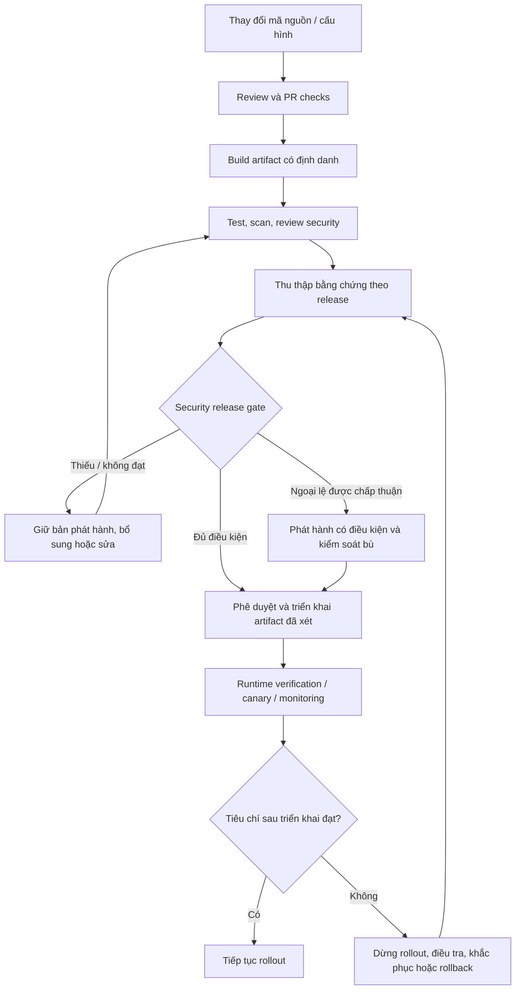
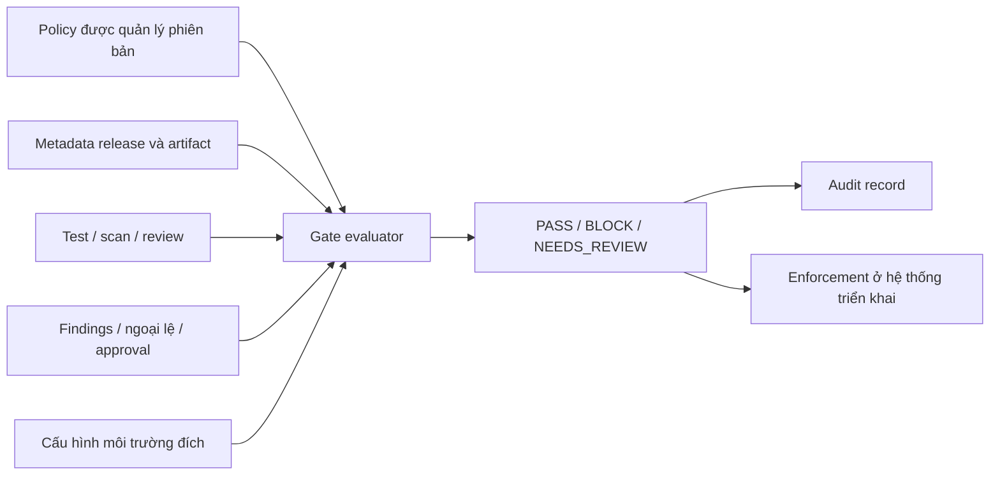

# Release gate

Một nhóm phát triển chuẩn bị đưa phiên bản mới của ứng dụng quản lý hồ sơ khách hàng lên production. Unit test và build đều thành công. Tuy nhiên, báo cáo kiểm thử phân quyền cho thấy tài khoản của tổ chức B có thể tải báo cáo chứa dữ liệu của tổ chức A; đồng thời công cụ quét dependency phát hiện một lỗ hổng có mức độ nghiêm trọng cao. Nếu chỉ dựa vào đèn xanh của pipeline build, nhóm có thể phát hành một phiên bản chưa đáp ứng mục tiêu bảo mật quan trọng.

**Release gate** là **điểm kiểm soát quyết định có cho phép một bản phát hành chuyển sang bước tiếp theo hay không**, dựa trên tiêu chí đã xác định và bằng chứng có thể kiểm tra. Trong Secure SDLC, security release gate kết hợp yêu cầu bảo mật, đánh giá rủi ro, kết quả kiểm chứng, trạng thái khắc phục và thẩm quyền phê duyệt để đưa ra quyết định có căn cứ.

Trong phạm vi module **SECURITY_SECURITY_ASSURANCE**, release gate là nơi kết nối hoạt động phát triển với *security assurance*: nhóm cần chỉ ra rằng phiên bản, artifact, cấu hình và môi trường dự kiến triển khai đã được đánh giá theo mục tiêu bảo mật. Release gate giúp ngăn phát hành khi chưa đủ căn cứ, đồng thời lưu được lý do, người chịu trách nhiệm và rủi ro còn lại khi có quyết định ngoại lệ.

## 1. Release gate là gì và khác một bài kiểm thử như thế nào?

**Bài kiểm thử** trả lời một câu hỏi cụ thể, chẳng hạn: “Tài khoản không có quyền có đọc được hồ sơ không?”. **Release gate** dùng một hoặc nhiều kết quả kiểm thử cùng chính sách và bối cảnh rủi ro để trả lời: “Bản phát hành này có đủ điều kiện tiếp tục không?”.

| Khái niệm | Vai trò | Ví dụ |
| --- | --- | --- |
| **Test / scan** | Tạo quan sát hoặc phát hiện có phạm vi | Integration test phát hiện API truy cập chéo tenant |
| **Security finding** | Ghi nhận vấn đề cần phân tích và xử lý | Lỗi BOLA có thể lộ dữ liệu khách hàng |
| **Risk assessment** | Đánh giá khả năng khai thác, tác động, mức phơi nhiễm và rủi ro còn lại | Đường API công khai xử lý dữ liệu nhạy cảm, rủi ro cao |
| **Release policy** | Định nghĩa điều kiện cho phép, chặn hoặc yêu cầu phê duyệt ngoại lệ | Không cho phát hành production khi có lỗi phân quyền trọng yếu chưa xử lý |
| **Release gate** | Đối chiếu chính sách với bằng chứng của bản phát hành và tạo quyết định | `BLOCK` cho bản phát hành có lỗi BOLA |
| **Release approval** | Xác nhận người có thẩm quyền chấp thuận các điều kiện áp dụng | Risk owner ký chấp nhận một ngoại lệ có thời hạn |
| **Deployment** | Đưa artifact đến môi trường đích | Triển khai cùng image digest đã được kiểm chứng |

Không phải tất cả gate đều là security gate. Pipeline có thể có gate chất lượng, khả năng tương thích, hiệu năng, ngân sách hoặc pháp lý. Security release gate tập trung vào bảo mật và có thể phối hợp với các gate khác để đưa ra quyết định phát hành tổng thể.

Một gate tốt cần có:

1. **Phạm vi chính xác:** dịch vụ nào, phiên bản nào, môi trường nào, nhóm người dùng và dữ liệu nào.
2. **Tiêu chí rõ ràng:** điều kiện chấp nhận, chặn, thiếu thông tin và ngoại lệ.
3. **Nguồn dữ liệu đáng tin:** test, review, artifact, cấu hình, finding và phê duyệt có khả năng truy vết.
4. **Người và hệ thống chịu trách nhiệm:** ai định nghĩa policy, ai có quyền sửa policy, ai được phê duyệt ngoại lệ.
5. **Cơ chế thực thi:** quyết định gate thực sự kiểm soát quyền chuyển artifact sang môi trường tiếp theo.
6. **Audit trail:** ghi policy version, evidence, kết quả, lý do và người phê duyệt.
7. **Cơ chế xem xét lại:** khi thay đổi phần mềm, cấu hình, mối đe dọa hoặc thông tin lỗ hổng.

**Gate xanh không có nghĩa là phần mềm an toàn tuyệt đối**. Nó chỉ có nghĩa rằng các điều kiện được đặt ra cho phạm vi và thời điểm đánh giá đã được đáp ứng hoặc đã có quyết định ngoại lệ hợp lệ.

## 2. Release gate nằm ở đâu trong Secure SDLC?

Release gate thường được đặt tại điểm chuyển trạng thái có tác động lớn: merge vào nhánh bảo vệ, tạo artifact phát hành, triển khai staging, phê duyệt production hoặc mở rộng tỷ lệ lưu lượng. Không nhất thiết chỉ có một gate cuối cùng.



### 2.1. Gate ở pull request

Mục tiêu là phát hiện sớm trước khi code vào nhánh phát hành. Có thể yêu cầu review, security test quan trọng, secret scanning, kiểm tra policy-as-code và threat-model review nếu thay đổi ranh giới tin cậy.

PR gate giúp giảm chi phí sửa lỗi nhưng **chưa chứng minh** artifact production đã đạt. Kết quả PR có thể khác khi build lại, cập nhật dependency, dùng cấu hình khác hoặc triển khai với quyền runtime rộng hơn.

### 2.2. Gate ở build và artifact

Gate này quan tâm đến nguồn gốc và tính toàn vẹn của phần mềm được đóng gói. Có thể kiểm tra:

- Source commit được phê duyệt, workflow và runner phù hợp.
- Dependency và base image nằm trong chính sách.
- Artifact có định danh, digest và thông tin nguồn gốc build.
- Kết quả kiểm thử và scan gắn với đúng commit hoặc artifact.
- Các secret, token và đặc quyền build được quản lý đúng.
- Có SBOM hoặc inventory thành phần nếu chính sách yêu cầu.

Mục tiêu là bảo đảm artifact được đưa đi triển khai chính là artifact đã được xét, hoặc có bằng chứng tương đương được phê duyệt khi bắt buộc phải tái build.

### 2.3. Gate trước production

Ngoài bằng chứng về source và artifact, cần xét cấu hình, quyền, kết nối, dữ liệu và khả năng bảo vệ của môi trường đích. Ví dụ: IAM role mới, chính sách mạng, secret injection, mã hóa, logging, backup và yêu cầu phân vùng tenant.

Bản build đạt mọi test ở staging vẫn có thể không an toàn nếu cấu hình production vô tình cho phép public bucket hoặc tắt audit log. Do đó, phải gắn quyết định với **deployment context**.

### 2.4. Gate trong quá trình rollout

Canary, blue-green hoặc phát hành theo nhóm người dùng có thể đặt thêm gate dựa trên tín hiệu vận hành: lỗi truy cập trái quyền, bất thường xác thực, số lần từ chối, tác động dữ liệu, sự kiện bảo mật, sức khỏe hệ thống và khả năng quay lại trạng thái ổn định.

Gate sau triển khai hỗ trợ phát hiện điều mà pre-release testing không nhìn thấy; nó **không thay thế** việc kiểm chứng các yêu cầu bảo mật bắt buộc trước production.

## 3. Dữ liệu đầu vào: gate phải biết chính xác mình đang đánh giá gì

Một gate chỉ đáng tin khi các đầu vào được chuẩn hóa và có thể kiểm tra nguồn gốc.

| Nhóm dữ liệu | Trường cần biết | Câu hỏi kiểm chứng |
| --- | --- | --- |
| **Định danh release** | Release ID, commit, artifact digest, môi trường và thời điểm | Gate có đang đánh giá đúng artifact và môi trường sẽ triển khai không? |
| **Mức quan trọng của hệ thống** | Phân loại dữ liệu, exposure, chủ sở hữu, tier | Chính sách phù hợp với rủi ro của dịch vụ không? |
| **Phạm vi thay đổi** | Endpoint, IAM, kiến trúc, dependency, cấu hình, migrations | Thay đổi có kích hoạt review hoặc phép kiểm thử bổ sung không? |
| **Yêu cầu và kiểm thử** | Requirement ID, test ID, kết quả, thời điểm, dữ liệu test | Các yêu cầu bắt buộc có bằng chứng đang hiệu lực không? |
| **Findings** | ID, mức ảnh hưởng, khả năng khai thác, trạng thái và owner | Có rủi ro vượt ngưỡng đang mở không? |
| **Secure supply chain** | SBOM, provenance, chữ ký/attestation nếu áp dụng | Artifact có nguồn và tính toàn vẹn phù hợp không? |
| **Runtime policy** | IAM, network, encryption, log, secret, backup | Cấu hình môi trường đích có đáp ứng control không? |
| **Ngoại lệ** | Phạm vi, lý do, control bù, approver, hạn hiệu lực | Quyết định ngoại lệ có hợp lệ và liên quan đúng rủi ro không? |

### 3.1. Kết quả vắng mặt khác kết quả đạt

Nếu integration test phân quyền không chạy vì runner lỗi, gate không thể suy ra phân quyền đã đạt. Nếu scanner không trả dữ liệu do thiếu quyền đọc repository, “0 findings” không có nghĩa là “không có lỗi”.

Nên phân biệt các trạng thái:

- `PASS`: phép kiểm tra áp dụng đã chạy thành công và đạt tiêu chí.
- `FAIL`: đã chạy và phát hiện điều kiện không đạt.
- `NOT_RUN`: chưa chạy hoặc bị bỏ qua.
- `ERROR`: quá trình kiểm tra gặp lỗi, đầu ra không đáng tin.
- `NOT_APPLICABLE`: không áp dụng, có căn cứ về phạm vi và người phê duyệt khi cần.
- `STALE`: bằng chứng không còn đúng commit, artifact, cấu hình hoặc thời hạn.
- `UNKNOWN`: thiếu dữ liệu để kết luận.

Với điều kiện bắt buộc, `NOT_RUN`, `ERROR`, `STALE` và `UNKNOWN` thường phải dẫn tới **giữ release để xử lý**, trừ khi chính sách có cơ chế quyết định riêng được phê duyệt. Không biến “không chạy” thành “đạt”.

### 3.2. Gắn bằng chứng với artifact bằng định danh bất biến

Một manifest phát hành có thể ghi:

```yaml
release:
  id: "<release-id>"
  service: "document-api"
  source_commit: "<commit-sha>"
  artifact_digest: "sha256:<digest>"
  target_environment: "production"
  deployment_config_ref: "<immutable-config-ref>"
policy:
  name: "security-release-policy"
  version: "<policy-version>"
evidence:
  authorization_test_run: "<test-run-id>"
  sca_report: "<sca-report-id>"
  config_check: "<config-check-id>"
  threat_review: "<review-id>"
assessments:
  finding_ids: ["<finding-id>"]
  exception_ids: ["<approved-exception-id-if-any>"]
decision:
  status: "<pending|pass|block|conditional>"
  evaluator: "<system-or-reviewer>"
  decided_at: "<timestamp>"
```

Đây là mẫu minh họa; các giá trị trong ngoặc nhọn cần được thay bằng dữ liệu thực. Đối chiếu `artifact_digest` của manifest với artifact thực tế sắp deploy. Nếu môi trường đích dùng cấu hình runtime khác, phải kiểm tra cả cấu hình đó. Không giả định việc giữ nguyên image đồng nghĩa giữ nguyên mức an toàn.

## 4. Xác định tiêu chí release gate theo rủi ro

Một chính sách tốt nên tách **điều kiện bắt buộc**, **điều kiện có thể xử lý theo rủi ro** và **tín hiệu để quan sát**.

### 4.1. Điều kiện bắt buộc (hard gate)

Hard gate là yêu cầu không được vượt qua trong quy trình thông thường. Ví dụ minh họa:

- Kiểm thử phân quyền theo tenant hoặc đối tượng có rủi ro cao phải đạt.
- Không có secret đang hiệu lực bị lộ trong artifact.
- Artifact production có nguồn gốc và tính toàn vẹn được xác minh theo chính sách.
- Không còn cấu hình làm dữ liệu nhạy cảm bị public ngoài ý định.
- Không có phát hiện được xác nhận có khả năng khai thác và rủi ro vượt ngưỡng không được phê duyệt.
- Control ghi log hoặc kiểm soát truy cập bắt buộc của môi trường đích phải được xác minh.
- Bằng chứng review thiết kế là bắt buộc nếu thay đổi trust boundary quan trọng.

Không nên sao chép nguyên các tiêu chí này cho mọi hệ thống. Một hard gate phải có **căn cứ**, **điều kiện áp dụng**, **phương pháp kiểm tra** và **chủ sở hữu chính sách**.

### 4.2. Điều kiện có thể đánh giá thêm (risk-based gate)

Không phải mọi finding có cùng mức ưu tiên. Ví dụ, một dependency có CVE mức cao nhưng không nằm trên đường thực thi, có control bù và đã xác minh phạm vi ảnh hưởng có thể cần xử lý khác với lỗi phân quyền trực tiếp để lộ dữ liệu production.

Các yếu tố đánh giá gồm:

1. Mức ảnh hưởng tới bí mật, toàn vẹn, sẵn sàng và riêng tư.
2. Mức phơi nhiễm: Internet-facing, nội bộ, chỉ quản trị hoặc môi trường cô lập.
3. Khả năng khai thác trong cấu hình thực tế và sự tồn tại của exploit được biết.
4. Tài sản, người dùng và dữ liệu bị ảnh hưởng.
5. Control giảm thiểu, khả năng phát hiện và ứng cứu.
6. Thời gian tồn tại của rủi ro và khả năng sửa trước hoặc sau phát hành.
7. Nghĩa vụ pháp lý, hợp đồng và chính sách không thể bỏ qua.

Một điểm số scanner tự nó chưa đủ cho quyết định. Gate có thể chuyển finding sang trạng thái cần người đánh giá có thẩm quyền xác minh và ký quyết định, thay vì tự cộng trừ điểm số rồi cho qua.

### 4.3. Tín hiệu quan sát (informational signal)

Một số chỉ số có thể dùng để theo dõi xu hướng mà chưa phải điều kiện chặn, chẳng hạn số cảnh báo ít nghiêm trọng đang mở, độ trễ scan, số dependency cần cập nhật hoặc thay đổi coverage.

Khi một chỉ số trở thành điều kiện gate, phải công khai ngưỡng, độ tin cậy dữ liệu và hậu quả khi vượt ngưỡng. Tránh để cùng một loại rủi ro bị xử lý tùy tiện giữa các nhóm.

### 4.4. Ma trận tiêu chí minh họa

| Nhóm tiêu chí | Chính sách ví dụ cho production có dữ liệu nhạy cảm | Bằng chứng điển hình | Khi chưa đạt |
| --- | --- | --- | --- |
| Phân quyền | Test chéo tenant và kiểm tra quyền theo đối tượng phải đạt | Integration test, review code | `BLOCK` |
| Secret | Không có secret đang hiệu lực bị lộ trong artifact hoặc log build | Secret scanning, xác minh thu hồi | `BLOCK` và thu hồi |
| Vulnerability | Finding vượt ngưỡng rủi ro phải được khắc phục hoặc xử lý bằng quyết định hợp lệ | SCA/SAST/DAST, risk assessment, retest | `BLOCK` hoặc xem xét ngoại lệ đúng chính sách |
| Threat modeling | Thay đổi trust boundary lớn cần được review | Threat model, quyết định kiến trúc | Giữ release để review |
| Supply chain | Nguồn, artifact digest và chính sách build phù hợp | Provenance, attestation, build log | `BLOCK` khi không chứng minh được nguồn gốc |
| Cấu hình production | Không mở dữ liệu nhạy cảm ra public; logging/control bắt buộc hoạt động | Policy-as-code, runtime config test | `BLOCK` |
| Incident readiness | Các kịch bản quan trọng có đường thu hồi/rollback, phát hiện và vận hành | Runbook, alert test, restore exercise | Xử lý theo mức rủi ro và yêu cầu bắt buộc |

Một tổ chức cần thiết lập tiêu chí của riêng mình qua risk assessment, policy và nghĩa vụ cụ thể. Bảng trên là ví dụ phục vụ học tập, không phải chuẩn bắt buộc cho mọi môi trường.

## 5. Trạng thái quyết định và ý nghĩa vận hành

Để tránh nhầm lẫn, nên tách **kết quả đánh giá kỹ thuật** khỏi **quyết định cho phép triển khai**.

| Kết quả | Ý nghĩa | Hành động |
| --- | --- | --- |
| **PASS** | Các điều kiện áp dụng có bằng chứng hợp lệ và được đáp ứng | Có thể đi tiếp theo quy trình phê duyệt |
| **BLOCK** | Một hoặc nhiều điều kiện bắt buộc không đạt hoặc bằng chứng không đủ | Giữ release, khắc phục hoặc bổ sung kiểm chứng |
| **NEEDS_REVIEW** | Có finding/ngoại lệ cần người có thẩm quyền đánh giá | Chưa tự động triển khai; chờ quyết định |
| **CONDITIONAL_APPROVAL** | Rủi ro được chấp nhận có điều kiện theo quy trình và phạm vi xác định | Chỉ phát hành khi đủ control bù, phạm vi, thời hạn và giám sát |
| **REVOKED / EXPIRED** | Quyết định hoặc ngoại lệ không còn hiệu lực | Phải đánh giá lại trước khi tiếp tục |

Một hệ thống có thể chọn tên trạng thái khác, nhưng cần ghi rõ semantics. Ví dụ, `CONDITIONAL_APPROVAL` không nên được báo thành “mọi control đều đạt”; báo cáo phải hiển thị các finding và rủi ro được chấp nhận.

### 5.1. Quy tắc khi thiếu bằng chứng: fail safely

Nếu một điều kiện gate bắt buộc thiếu kết quả do scanner offline, evidence repository lỗi hoặc pipeline bị hủy, không nên tự động đánh dấu `PASS`. Thực hành có thể là:

- Đánh dấu `BLOCK` hoặc `NEEDS_REVIEW` theo policy.
- Phân biệt sự cố công cụ với lỗ hổng trong sản phẩm.
- Yêu cầu chạy lại phép kiểm tra, dùng nguồn bằng chứng thay thế đã được chấp nhận hoặc tiến hành đánh giá có thẩm quyền.
- Lưu lý do, người phê duyệt, phạm vi thay thế và quyết định.

“Fail closed” của một gate có thể làm chậm release, vì vậy cần thiết kế tính sẵn sàng của hệ thống đánh giá, cache bằng chứng có thời hạn, kênh dự phòng và quy trình khẩn cấp. Nhưng khắc phục sự cố của gate không đồng nghĩa với tắt hoàn toàn kiểm soát bảo mật.

## 6. Thiết kế gate theo Claim – Argument – Evidence

Một release gate hỗ trợ security assurance khi quyết định có thể truy vết từ **khẳng định** đến **lập luận** và **bằng chứng**.

**Claim:** “Bản phát hành `release-42` của `document-api` đã thỏa các điều kiện bảo mật để triển khai production theo chính sách hiện hành, trong phạm vi và giả định được ghi nhận.”

**Argument:** “Các rủi ro quan trọng đã được ánh xạ thành yêu cầu và control; các phép xác minh bắt buộc đã chạy trên đúng artifact và cấu hình; những phát hiện còn lại được phân tích và có quyết định theo thẩm quyền.”

**Evidence:** Kết quả test, review, scan, cấu hình, artifact digest, risk assessment, exception/approval và runtime readiness.

### 6.1. Truy vết từ rủi ro đến quyết định

| Risk ID | Security requirement | Control | Bằng chứng | Gate decision |
| --- | --- | --- | --- | --- |
| `R-01` Truy cập chéo tenant | `SR-01` kiểm tra quyền theo đối tượng | Server-side authorization, tenant scoping | `T-AUTH-01..06`, code review | Bắt buộc pass |
| `R-02` Secret bị lộ | `SR-02` không xuất secret vào artifact và log | Secret manager, scan, log redaction | Build scan + secret inventory | Block nếu còn secret hiệu lực |
| `R-03` Dependency dễ bị khai thác | `SR-03` xử lý rủi ro dependency theo policy | Pin/update, kiểm soát provenance | SCA, SBOM, triage, retest | Theo ngưỡng rủi ro |
| `R-04` Cấu hình mở dữ liệu | `SR-04` storage và IAM theo phạm vi | Least privilege, storage policy | IaC scan + production policy check | Bắt buộc pass |
| `R-05` Mất khả năng phát hiện | `SR-05` sự kiện quan trọng được ghi và cảnh báo | Audit log, telemetry, alerting | Event-to-alert exercise | Bắt buộc nếu là control trọng yếu |

Khi release gate nhận một test pass, nó cần biết test nào xác minh yêu cầu nào. Một scanner báo 0 findings chưa thay thế được bằng chứng kiểm thử phân quyền nếu loại lỗi đó nằm ngoài khả năng scanner.

### 6.2. Chất lượng bằng chứng trước khi ra quyết định

Một kiểm tra chất lượng evidence có thể hỏi:

- **Liên quan:** Bằng chứng có trả lời claim và risk scenario hay không?
- **Độ bao phủ:** Các endpoint, vai trò, tenant và đường vận hành quan trọng có được xét không?
- **Có thể truy vết:** Có commit, artifact digest, policy version, môi trường và timestamp không?
- **Đáng tin cậy:** Kiểm thử chạy thật hay mock đã bỏ qua control? Công cụ có lỗi hoặc thiếu quyền không?
- **Còn hiệu lực:** Có thay đổi source, dependency hoặc runtime config sau khi kiểm thử không?
- **Độc lập phù hợp:** Rủi ro cao có review hoặc phương pháp xác minh bổ sung không?
- **Có giới hạn rõ:** Có finding chưa xử lý hoặc phần chưa kiểm tra nào bị giấu không?

Gate có thể thực hiện các kiểm tra metadata tự động, còn tính phù hợp và đầy đủ về chuyên môn thường vẫn cần review cho những rủi ro quan trọng.

## 7. Policy-as-code: biến tiêu chí thành quyết định có thể tái lập

**Policy-as-code** biểu diễn quy tắc dưới dạng dữ liệu hoặc mã, có version control, review và test. Nó giúp nhiều pipeline áp dụng tiêu chí nhất quán và lưu lại bản policy đã đưa ra quyết định.

Mô hình đơn giản:



### 7.1. Định nghĩa policy ở mức mô tả

Ví dụ dưới đây chỉ minh họa cách cấu trúc một policy cho dịch vụ có dữ liệu nhạy cảm; không phải schema tiêu chuẩn hay cấu hình chạy trực tiếp của bất kỳ CI nào:

```yaml
policy_id: SEC-PROD-RELEASE
version: "1.0"
scope:
  environments: [production]
  data_classifications: [sensitive, restricted]

required:
  - id: immutable-artifact
    condition: "tested_digest_equals_deploy_digest"
    on_missing: BLOCK

  - id: authorization
    condition: "critical_authorization_tests_passed"
    on_fail: BLOCK
    on_missing: BLOCK

  - id: secrets
    condition: "no_active_secret_exposed"
    on_fail: BLOCK
    on_missing: BLOCK

  - id: production-policy
    condition: "target_iam_network_storage_policy_verified"
    on_fail: BLOCK
    on_missing: BLOCK

risk_review:
  - id: exploitable-findings
    condition: "no_unaccepted_risk_above_threshold"
    on_fail: NEEDS_REVIEW

exceptions:
  require_approved_owner: true
  require_expiration: true
  require_compensating_controls: true
  require_release_and_finding_scope: true

decision_record:
  required_fields:
    - release_id
    - artifact_digest
    - policy_version
    - evidence_refs
    - findings
    - approver_if_exception
    - evaluated_at
```

Trong hệ thống thực, từng `condition` phải có định nghĩa rõ, nguồn dữ liệu và test tương ứng. Chuỗi văn bản trong ví dụ chỉ là tên quy tắc, không tự tạo ra khả năng chặn triển khai.

### 7.2. Minh họa quy tắc OPA/Rego

Giả sử một gate evaluator nhận JSON đã được xác minh về release. Ví dụ Rego tối giản sau cho thấy nguyên tắc **không cho qua khi thiếu bằng chứng bắt buộc**. Quy tắc chỉ xét đường phát hành thông thường vào production; quy trình ngoại lệ phải được triển khai riêng và không thể sửa input tùy ý để lách điều kiện.

```rego
package release_gate

import rego.v1

default allow := false

deny contains "artifact identity not verified" if {
    input.environment == "production"
    not input.artifact.digest_matches_tested
}

deny contains "authorization tests missing or failing" if {
    input.environment == "production"
    not input.evidence.authorization_tests_passed
}

deny contains "production controls not verified" if {
    input.environment == "production"
    not input.evidence.production_controls_verified
}

deny contains "unaccepted critical risk remains" if {
    input.environment == "production"
    input.risk.unaccepted_critical_count > 0
}

deny contains "critical risk count missing or invalid" if {
    input.environment == "production"
    not is_number(input.risk.unaccepted_critical_count)
}

deny contains "risk assessment missing" if {
    input.environment == "production"
    not input.risk.assessed
}

allow if {
    input.environment == "production"
    count(deny) == 0
}
```

Giả định evaluator nhận dữ liệu có cấu trúc:

```json
{
  "environment": "production",
  "artifact": {
    "digest_matches_tested": true
  },
  "evidence": {
    "authorization_tests_passed": true,
    "production_controls_verified": true
  },
  "risk": {
    "assessed": true,
    "unaccepted_critical_count": 0
  }
}
```

Kết quả `allow = true` trong ví dụ chỉ chứng minh **những điều kiện đã được mã hóa** đạt, với giả định các đầu vào đáng tin. Ứng dụng thực tế còn cần xác minh mã artifact, tính hiện hành của evidence, tính toàn vẹn của nguồn báo cáo, tính đúng đắn của bộ phân loại finding, quyền của caller, chính sách thay đổi và toàn bộ yêu cầu tổ chức. Đặc biệt, trường `unaccepted_critical_count` phải được tính từ nguồn findings đã được xác thực; không nhận nguyên số do developer tự khai.

### 7.3. Kiểm thử chính gate

Policy-as-code cũng là mã và có thể lỗi. Cần các bài kiểm thử cho gate, ví dụ:

| Tình huống | Quyết định mong đợi |
| --- | --- |
| Đủ evidence đúng digest, các điều kiện bắt buộc đạt | `PASS` |
| Không có kết quả test phân quyền do job bị skip | `BLOCK` |
| Evidence thuộc commit cũ | `BLOCK` hoặc đánh giá lại theo policy |
| Artifact digest sắp deploy khác digest đã kiểm chứng | `BLOCK` |
| Finding trọng yếu chưa có đánh giá rủi ro | `BLOCK / NEEDS_REVIEW` |
| Ngoại lệ hết hạn hoặc không đúng release | `BLOCK` |
| Một người tự sửa policy để tắt gate | Thay đổi bị chặn hoặc cần review/phê duyệt độc lập |
| Dịch vụ policy evaluator lỗi | Không cho phát hành qua đường thông thường; thực hiện quy trình sự cố được phê duyệt |

Không chỉ test kết quả logic. Cần test cả **enforcement**: người triển khai có thể gọi API deploy trực tiếp để bỏ qua gate không? Một check chỉ hiển thị màu đỏ trong giao diện nhưng không chặn quyền triển khai chưa phải security gate có hiệu lực.

## 8. Cách tích hợp gate an toàn với CI/CD

Một luồng triển khai thực tế có thể gồm các bước:

1. Lấy source từ nhánh bảo vệ sau review.
2. Build trong runner được quản lý với danh tính và quyền phù hợp.
3. Thu thập test, scan, review và artifact provenance.
4. Đóng gói metadata và evidence tham chiếu.
5. Đánh giá policy và findings theo risk register.
6. Ghi quyết định bất biến hoặc có audit trail tin cậy.
7. Cho phép deployment identity chỉ lấy artifact đã được phê duyệt.
8. Xác minh cấu hình, monitoring và tiêu chí sau triển khai.
9. Gắn kết quả thực tế vào hồ sơ release để đánh giá lại khi cần.

**Điểm quan trọng:** bước số 7 phải thực thi quyết định thật, thường thông qua quyền của môi trường triển khai, hệ thống admission/deployment controller hoặc cơ chế phê duyệt được bảo vệ. Nếu một người có quyền triển khai trực tiếp bất kỳ artifact nào, gate trong CI có thể chỉ là thủ tục.

### 8.1. Pseudo-pipeline minh họa

```yaml
# Mô hình logic, không phải cú pháp của một sản phẩm CI cụ thể.
pipeline:
  - name: build
    output: [artifact_digest, source_commit, build_id]

  - name: verify
    checks:
      - authorization_tests
      - unit_and_integration_tests
      - sast_and_sca
      - secret_scan
      - config_and_policy_checks
    output: [signed_or_trusted_test_results, findings]

  - name: prepare_release
    checks:
      - artifact_identity
      - threat_model_change_review
      - target_environment_config
    output: [release_manifest, evidence_refs]

  - name: evaluate_security_gate
    inputs:
      - release_manifest
      - evidence_refs
      - risk_assessment
      - approved_exceptions
      - release_policy_version
    output: [gate_decision]

  - name: deploy
    requires:
      - valid_gate_decision_for_same_artifact_and_environment
      - protected_environment_approval_if_required

  - name: verify_runtime
    checks:
      - audit_and_alert_health
      - security_control_health
      - rollout_security_signals
```

Ví dụ tập trung vào quan hệ phụ thuộc. Khi triển khai thật, cần cấu hình permission của runner, lưu trữ secret, môi trường, artifact registry và deploy controller theo công cụ được sử dụng.

### 8.2. Bảo vệ chính release gate

Gate có thể bị vô hiệu nếu kẻ tấn công hoặc một vai trò nội bộ sửa cấu hình, làm giả báo cáo hoặc cấp quyền triển khai trực tiếp. Những rủi ro cần kiểm soát:

- **Policy tampering:** ai được sửa policy, có review và lịch sử thay đổi không?
- **Workflow bypass:** có nhánh, tag, manual job hoặc API deploy đi vòng gate không?
- **Artifact substitution:** artifact được triển khai có khớp digest đã phê duyệt không?
- **Evidence tampering:** báo cáo có thể bị chỉnh sửa, ghi đè hoặc dùng lại cho release khác không?
- **Untrusted build:** code từ fork hoặc PR không tin cậy có đọc secret và token deploy không?
- **Privilege escalation:** CI identity có quyền thay IAM, tắt logging, cấp quyền production hay tự phê duyệt release không?
- **Stale approval:** approval cũ có thể áp dụng cho release mới hoặc môi trường khác không?
- **Policy drift:** quy tắc được kiểm tra trong CI có khớp enforcement ở deployment không?

Biện pháp tương ứng gồm branch protection, review độc lập cho workflow nhạy cảm, danh tính ngắn hạn, phân tách quyền build và deploy, ký/kiểm tra provenance khi phù hợp, artifact immutable, quản lý policy version, log quyết định và kiểm tra bypass định kỳ.

## 9. Ngoại lệ và chấp nhận rủi ro: kiểm soát, không xóa dấu vết

Không phải mọi phát hiện đều có thể sửa trước ngày phát hành. Ví dụ, một dependency có lỗi mức cao nhưng không nằm trên đường chạy đang sử dụng, hoặc môi trường cần triển khai gấp bản vá khác khi công cụ scan tạm thời gặp sự cố. Tổ chức có thể có quy trình ngoại lệ, nhưng phải phân biệt **chấp nhận rủi ro** với **xác nhận control đã đạt**.

### 9.1. Điều kiện tối thiểu của ngoại lệ

Một ngoại lệ hợp lệ nên có:

- **Phát hiện và phạm vi:** finding ID, service, release/artifact, môi trường, tài sản liên quan.
- **Phân tích tác động:** kịch bản khai thác, mức phơi nhiễm, hậu quả và độ tin cậy của nhận định.
- **Lý do không thể xử lý ngay:** phụ thuộc kỹ thuật, yêu cầu khẩn cấp hoặc kế hoạch sửa.
- **Biện pháp giảm thiểu:** giới hạn chức năng, rule mạng, bổ sung giám sát, vô hiệu hóa đường truy cập.
- **Chủ sở hữu và thẩm quyền phê duyệt:** không để người tạo phát hiện tự ký chấp thuận khi vượt quyền hạn.
- **Thời hạn:** ngày hết hiệu lực, sự kiện kích hoạt xem xét lại và mốc khắc phục.
- **Bằng chứng:** review, các phép kiểm tra thay thế hoặc kiểm chứng control bù.
- **Thông tin hiển thị trên release:** phát hành có điều kiện, còn finding nào, trạng thái xử lý ra sao.

Một ngoại lệ chỉ áp dụng cho phạm vi được ghi. Không nên tự mở rộng sang release, dịch vụ hoặc môi trường khác.

### 9.2. Ví dụ bản ghi ngoại lệ

```yaml
exception:
  id: "EXC-2026-001"
  finding_id: "FIND-217"
  service: "document-api"
  release_id: "<release-id>"
  target_environment: "production"
  risk_statement: "<mô tả tác động và khả năng khai thác>"
  mitigation: "<control bù đã được xác minh>"
  remediation_owner: "<team-or-person>"
  remediation_due: "<date>"
  approved_by: "<authorized-risk-owner>"
  approved_at: "<timestamp>"
  expires_at: "<timestamp>"
  review_triggers:
    - "new-exploit-evidence"
    - "change-in-exposure"
    - "mitigation-failure"
  supporting_evidence:
    - "<review-id>"
    - "<compensating-control-test-id>"
  status: "conditionally-approved"
```

Nếu hết hạn mà chưa khắc phục hoặc đánh giá lại, gate phải từ chối dựa vào ngoại lệ đó. Việc gia hạn cần quyết định mới, không tự động gia hạn vì release cũ đã chạy ổn.

### 9.3. Điều gì không nên làm?

Không sửa mức severity trong báo cáo gốc chỉ để được qua gate. Không xóa finding khỏi tập dữ liệu. Không biến scan timeout thành `PASS`. Không dùng tài khoản admin chung để ép pipeline deploy mà không có hồ sơ. Không coi một phê duyệt không có phạm vi và thời hạn là quyền bỏ qua gate vô điều kiện.

Có thể triage finding là false positive hoặc không áp dụng, nhưng cần lưu căn cứ và người xác nhận. Trạng thái finding phải giữ được khả năng audit.

## 10. Release khẩn cấp và hotfix

Đôi khi việc trì hoãn release cũng gây rủi ro: một lỗ hổng đang bị khai thác cần vá gấp hoặc sự cố production cần sửa ngay. Secure SDLC nên chuẩn bị **luồng phát hành khẩn cấp** trước khi khẩn cấp xảy ra.

Quy trình khẩn cấp có thể rút ngắn thời gian và ưu tiên các bước cốt lõi, nhưng vẫn phải:

1. Xác định lý do khẩn cấp và tác động nếu trì hoãn.
2. Giới hạn phạm vi thay đổi: sửa đúng lỗi, tránh gộp tính năng không liên quan.
3. Bảo vệ danh tính và quyền deploy; có ít nhất mức kiểm tra tối thiểu cần thiết.
4. Chạy kiểm thử rủi ro trọng yếu và xác minh artifact, nếu có thể.
5. Ghi ai phê duyệt, điều kiện và rủi ro còn lại.
6. Có cách giám sát sát sao, dừng rollout và phục hồi khi xảy ra vấn đề.
7. Hoàn thiện review, kiểm chứng bổ sung và post-release assessment trong thời hạn đã định.

Ví dụ, bản vá cho đường API bị khai thác cần ưu tiên test tái hiện lỗi và regression test quyền. Việc bỏ bớt các kiểm tra không liên quan đến lỗi có thể được xem xét theo policy khẩn cấp, nhưng một bản vá không vượt qua được test tái hiện lỗi thì không có bằng chứng đã khắc phục rủi ro chính.

### 10.1. Emergency path cũng cần gate riêng

Một nhánh `emergency=true` mà ai cũng tự bật sẽ trở thành bypass vĩnh viễn. Thay vào đó, luồng khẩn cấp cần identity và approver đã quy định, hạn hiệu lực ngắn, scope cụ thể, audit trail độc lập và review sau sự kiện.

Trong trường hợp dịch vụ gate gặp sự cố, tổ chức có thể có phương án đánh giá thủ công với bằng chứng thay thế và nhiều bên có thẩm quyền. Điều đó cần được định nghĩa trước, kiểm tra định kỳ và theo dõi như một ngoại lệ.

## 11. Ví dụ xuyên suốt: Release gate cho API đa tenant

Giả sử hệ thống `document-api` hỗ trợ hai loại yêu cầu: xem tài liệu và xuất dữ liệu theo lô. Bản phát hành `v2.7` có thay đổi authorization, cập nhật thư viện và bổ sung đường tải file.

### 11.1. Mục tiêu và phạm vi

**Security objectives:**

- Người dùng tenant B không đọc hoặc xuất dữ liệu tenant A.
- Không triển khai artifact không xác định được nguồn và phiên bản.
- Không để secret đang hiệu lực trong image hoặc log build.
- Các finding vượt ngưỡng rủi ro phải được xử lý trước production.
- Audit trail cho các thao tác đọc/xuất nhạy cảm phải hoạt động.

**Phạm vi:** `document-api v2.7`, API đọc/xuất, worker export, object storage, policy production và artifact container có digest xác định.

### 11.2. Điều kiện chấp nhận

| Gate ID | Tiêu chí | Bằng chứng mong đợi |
| --- | --- | --- |
| `G-01` | Negative test đọc chéo tenant đạt trên API và worker | Test run liên kết đúng commit |
| `G-02` | URL tải được giới hạn quyền/phạm vi/thời hạn theo thiết kế | API test và review config |
| `G-03` | Artifact đã kiểm thử khớp artifact deploy | Image digest và provenance |
| `G-04` | Scan secret chạy và mọi lộ lọt hiệu lực được xử lý | Scan result và ticket thu hồi |
| `G-05` | Finding vượt ngưỡng có trạng thái/ngoại lệ đúng policy | Finding register, risk decision |
| `G-06` | Production storage, IAM, logging được kiểm tra | Policy check và runtime config review |

### 11.3. Ba tình huống ra quyết định

**Tình huống A — chặn:**

- `G-01` thất bại: worker export lấy được tài liệu tenant khác.
- `G-03` và `G-04` đạt.

**Quyết định:** `BLOCK`. Lý do là yêu cầu bí mật dữ liệu trọng yếu không đạt; các scan khác đạt không làm giảm rủi ro trực tiếp này. Nhóm sửa phân quyền trong worker, kiểm tra các đường export tương tự và chạy lại test trên artifact mới.

**Tình huống B — chưa đủ thông tin:**

- Test phân quyền đạt.
- Job đánh giá IAM production gặp lỗi và không trả bằng chứng cho `G-06`.

**Quyết định:** `BLOCK` hoặc `NEEDS_REVIEW` theo policy, chưa tự động triển khai. Nhóm sửa lỗi kiểm chứng hoặc thu thập bằng chứng thay thế được chấp thuận, ghi phạm vi và quyết định.

**Tình huống C — chấp thuận có điều kiện:**

- Các điều kiện bắt buộc được xác minh.
- SCA phát hiện dependency có CVE đang được phân tích; nhóm chứng minh đường dễ bị khai thác không thể tiếp cận trong cấu hình hiện hành, có bằng chứng review, control bù và kế hoạch cập nhật.
- Risk owner có thẩm quyền chấp nhận rủi ro trong thời hạn cụ thể.

**Quyết định:** `CONDITIONAL_APPROVAL` nếu chính sách cho phép. Finding vẫn hiển thị; gate gắn ngoại lệ với đúng artifact, môi trường và thời hạn. Nếu thư viện xuất hiện đường khai thác mới hoặc cấu hình thay đổi, quyết định cần được xem xét lại.

### 11.4. Biên bản quyết định có thể kiểm tra

```yaml
decision_id: "GATE-<release-id>"
service: "document-api"
release_id: "<release-id>"
artifact_digest: "sha256:<digest>"
environment: "production"
policy_id: "SEC-PROD-RELEASE"
policy_version: "<version>"
checks:
  - id: G-01
    result: "<PASS-or-FAIL>"
    evidence_ref: "<test-run-id>"
  - id: G-02
    result: "<PASS-or-FAIL>"
    evidence_ref: "<review-id>"
  - id: G-03
    result: "<PASS-or-FAIL>"
    evidence_ref: "<artifact-verification-id>"
open_findings: ["<finding-id-if-any>"]
approved_exceptions: ["<exception-id-if-any>"]
scope_limitations: ["<excluded-or-unverified-path>"]
decision: "<PASS|BLOCK|NEEDS_REVIEW|CONDITIONAL_APPROVAL>"
reason: "<grounds-for-decision>"
decision_owner: "<authorized-owner-or-service>"
evaluated_at: "<timestamp>"
```

Ghi nhận cả kết quả bất lợi và phần chưa kiểm tra; nếu một endpoint export chưa nằm trong phạm vi, không được tuyên bố toàn bộ chức năng export đã được xác minh.

## 12. Phát hành thành công chưa đủ: gate sau triển khai

Một release đi qua pre-production gate có thể gặp rủi ro runtime: logging không chạy, sự kiện bất thường chỉ xuất hiện khi có người dùng thật, hoặc cấu hình của một vùng cloud khác staging. Vì thế cần bổ sung kiểm chứng sau deploy.

### 12.1. Tín hiệu sau triển khai

- Audit log và alert pipeline có đang hoạt động không?
- Có tăng đột biến các yêu cầu bị từ chối hoặc truy cập tài nguyên trái quyền không?
- Token, IAM, storage và network policy có đúng phạm vi đã phê duyệt không?
- Có hành vi xuất dữ liệu bất thường hoặc lượng tải vượt dự kiến không?
- Có thay đổi hệ thống ngoài manifest release không?
- Có thể giới hạn chức năng, dừng rollout, thu hồi quyền hoặc phục hồi khi cần không?

Một canary gate có thể tạm dừng tăng lưu lượng khi một tín hiệu vượt ngưỡng; nhưng các chỉ số cần được diễn giải trong ngữ cảnh và có người chịu trách nhiệm xử lý cảnh báo.

### 12.2. Rollback không phải lúc nào cũng an toàn

Nếu phiên bản trước chứa lỗ hổng đã bị khai thác, tự động rollback về bản đó có thể tái mở lỗ hổng. Quy trình ứng cứu cần cân nhắc phương án dừng chức năng, giới hạn lưu lượng, triển khai bản vá khác hoặc quay về bản ổn định đã được đánh giá. Migration dữ liệu không tương thích cũng có thể khiến rollback gây mất toàn vẹn.

Do đó, release gate và post-release gate cần kết nối với **runbook phục hồi và quản lý rủi ro**, không chỉ một nút “rollback”.

## 13. Đánh giá hiệu quả gate bằng chỉ số phù hợp

Mục tiêu của gate là giúp quyết định đúng và có thể kiểm chứng, không phải tối đa hóa số lần chặn release.

| Chỉ số | Câu hỏi hỗ trợ | Lưu ý khi diễn giải |
| --- | --- | --- |
| **Gate coverage** | Tỷ lệ đường phát hành production thực sự đi qua gate là bao nhiêu? | Phải tính cả manual deploy, hotfix và các hệ thống phụ |
| **Evidence freshness** | Bao nhiêu quyết định dùng evidence đúng commit, artifact và cấu hình? | Mẫu số là các quyết định cần bằng chứng |
| **Critical risk escape** | Có bao nhiêu lỗi trọng yếu lọt qua gate và bị phát hiện sau release? | Phân tích root cause; không chỉ tính số |
| **Time to triage** | Mất bao lâu để đánh giá finding ảnh hưởng release? | Phân biệt thời gian công cụ lỗi và thời gian review |
| **False positive / noise** | Gate chặn bao nhiêu lần do tín hiệu sai hoặc policy quá rộng? | Giảm nhiễu không được đánh đổi với việc bỏ qua rủi ro thật |
| **Exception debt** | Bao nhiêu ngoại lệ còn hiệu lực, sắp hết hạn hoặc quá hạn? | Theo dõi tác động, owner, rủi ro và kế hoạch sửa |
| **Unauthorized bypass** | Có đường triển khai không được kiểm soát hoặc việc sửa policy trái phép không? | Đây là dấu hiệu quan trọng về hiệu lực gate |
| **Post-release incidents** | Sự cố sau phát hành có liên quan đến control đã đánh giá không? | Kết hợp điều tra phạm vi và năng lực phát hiện |

Ví dụ, “95% release gate PASS” không thể hiện chương trình bảo mật tốt nếu 5% còn lại chứa toàn bộ hệ thống quan trọng, hoặc gate không kiểm tra các rủi ro chính. “Thời gian qua gate giảm” cũng có thể là do cải thiện tự động hóa hoặc do tắt bớt kiểm tra. Phải đọc chỉ số cùng độ bao phủ và chất lượng bằng chứng.

## 14. Các lỗi thiết kế gate thường gặp

| Sai lầm | Hệ quả | Cải thiện |
| --- | --- | --- |
| Chỉ dùng severity từ scanner để chặn | Bỏ qua ngữ cảnh khai thác, lỗ hổng logic và nghĩa vụ bắt buộc | Kết hợp risk assessment, test theo yêu cầu và tiêu chí policy |
| Bằng chứng không gắn artifact | Test pass của commit khác được dùng để phê duyệt | Bắt buộc commit/build/digest/config matching |
| Thiếu scan bị coi như 0 findings | Release không có kiểm chứng vẫn được qua | Phân biệt `NOT_RUN`, `ERROR`, `UNKNOWN` với `PASS` |
| Gate chỉ là nhãn CI, không kiểm soát quyền deploy | Có thể phát hành qua API hoặc tài khoản khác | Enforcement ở deployment boundary |
| Ai cũng sửa được policy hoặc workflow | Gate dễ bị bypass | Branch protection, review, separation of duties |
| Exception tồn tại vô hạn | Rủi ro không bao giờ được khắc phục | Hạn hiệu lực, owner, trigger review và theo dõi ngoại lệ |
| Chặn mọi finding bất kể tác động | Tăng false positive và khuyến khích né kiểm soát | Policy theo rủi ro, có quy trình triage minh bạch |
| Chỉ có gate trước phát hành | Bỏ sót drift và rủi ro sau deploy | Runtime verification, canary và phản hồi vào SDLC |
| Audit trail chỉ ghi “approved” | Không giải thích được vì sao quyết định hợp lý | Lưu policy version, evidence, findings và rationale |
| Bỏ qua CI/CD supply chain | Kẻ tấn công có thể thay artifact hoặc báo cáo | Bảo vệ runner, token, provenance và audit |
| Tự động rollback về bản cũ thiếu kiểm soát | Có thể tái triển khai lỗ hổng hoặc làm sai dữ liệu | Runbook theo rủi ro, kiểm tra compatibility và bản dự phòng an toàn |

## 15. Từng bước triển khai release gate trong tổ chức

### Bước 1: Chọn phạm vi thí điểm

Bắt đầu với một dịch vụ và luồng production rõ ràng, ưu tiên hệ thống có tài sản nhạy cảm và pipeline tương đối ổn định. Liệt kê mọi cách triển khai hiện có, kể cả manual deploy và hotfix.

### Bước 2: Xác định các yêu cầu không thể bỏ qua

Chọn một số tiêu chí phản ánh rủi ro chính, ví dụ authorization test, secret exposure, artifact identity và runtime config. Mỗi tiêu chí phải có owner và nguồn bằng chứng.

### Bước 3: Chuẩn hóa evidence manifest

Gắn kết quả test, finding và review vào commit/build/digest và môi trường. Đặt tên trạng thái `PASS`, `FAIL`, `UNKNOWN` thống nhất giữa các công cụ.

### Bước 4: Viết policy, phân quyền và thử trên dữ liệu lịch sử

Đánh giá policy trên các release trước để xem nó sẽ chặn hay cho qua những tình huống nào. Điều chỉnh false positive có căn cứ mà không bỏ yêu cầu rủi ro cao. Test cả các trường hợp thiếu evidence, report lỗi và policy bị sửa.

### Bước 5: Triển khai chế độ quan sát rồi chuyển sang enforcement

Có thể chạy gate ở chế độ **advisory** trong một khoảng được xác định để kiểm tra chất lượng dữ liệu và tác động quy trình. Khi policy đủ tin cậy, đặt enforcement tại ranh giới triển khai. Ghi rõ giai đoạn chuyển đổi và không gọi advisory mode là cơ chế chặn thực sự.

### Bước 6: Thiết lập luồng ngoại lệ và khẩn cấp

Quy định ai được phê duyệt, trong điều kiện nào, cần evidence và control bù gì, hạn hiệu lực bao lâu, người nào kiểm tra sau phát hành. Diễn tập để bảo đảm khi có sự cố mọi người không phải ứng biến bằng cách tắt gate.

### Bước 7: Đánh giá liên tục

Theo dõi incident, bypass, exception debt, evidence freshness và false positive; định kỳ cập nhật policy khi threat model, dependency, kiến trúc hoặc nghĩa vụ thay đổi.

## 16. Checklist thực hành

Trước khi cho phép một bản phát hành đi qua security release gate, người đánh giá có thể hỏi:

- [ ] Có xác định rõ release ID, commit, artifact digest và môi trường đích chưa?
- [ ] Chính sách được áp dụng có phiên bản và có phê duyệt thay đổi phù hợp chưa?
- [ ] Những thay đổi nhạy cảm có review kiến trúc/threat model cần thiết chưa?
- [ ] Các yêu cầu bảo mật trọng yếu có phép kiểm thử phù hợp, gồm negative test chưa?
- [ ] Có kiểm tra secret, dependency, cấu hình và supply chain ở mức yêu cầu chưa?
- [ ] Các bài kiểm tra bắt buộc thực sự chạy, không bị skip hoặc lỗi chưa xử lý chứ?
- [ ] Bằng chứng có đúng artifact, còn hiệu lực và truy vết được nguồn không?
- [ ] Mọi finding vượt ngưỡng đã được xử lý, giảm thiểu hoặc đánh giá theo policy chưa?
- [ ] Ngoại lệ có scope, thời hạn, control bù và người phê duyệt đúng thẩm quyền chưa?
- [ ] Có cơ chế ngăn triển khai khi gate không chấp thuận không?
- [ ] Có chứng cứ cấu hình production và khả năng logging/ứng cứu chưa?
- [ ] Có kế hoạch canary, theo dõi, dừng rollout và phục hồi phù hợp chưa?
- [ ] Quyết định và rủi ro còn lại đã được ghi vào audit trail chưa?
- [ ] Có trigger đánh giá lại khi code, dependency, policy hoặc môi trường thay đổi chưa?

## 17. Tự kiểm tra kiến thức qua tình huống

**Tình huống 1.** SAST và SCA đều đạt, nhưng kiểm thử truy cập chéo tenant không chạy vì job bị hủy. Release có được qua gate không?

**Phân tích:** Chưa đủ bằng chứng để xác nhận yêu cầu phân quyền. Nếu đây là điều kiện bắt buộc, gate cần `BLOCK` hoặc giữ để kiểm tra lại. Không được suy ra “đạt” từ kết quả của các công cụ không kiểm tra logic phân quyền tương ứng.

**Tình huống 2.** Build A đã được duyệt, nhưng deploy controller lấy image tag `latest` trỏ tới build B. Gate có còn hiệu lực không?

**Phân tích:** Quyết định gắn với artifact A không tự động áp dụng cho B. Cần đối chiếu digest bất biến và bảo đảm deployment chỉ dùng artifact được chấp thuận; nếu khác, phải đánh giá lại.

**Tình huống 3.** Một CVE được scanner đánh dấu Critical, nhưng security review có bằng chứng component không bị gọi đến trong cấu hình hiện tại. Có thể tự động xóa finding để cho qua không?

**Phân tích:** Không. Cần triage có căn cứ, ghi quyết định theo policy, người có thẩm quyền và điều kiện thay đổi. Nếu được chấp nhận, finding vẫn được lưu và gắn với ngoại lệ hoặc trạng thái đánh giá phù hợp.

**Tình huống 4.** Có sự cố nghiêm trọng cần hotfix ngay, trong khi hệ thống đánh giá security gate đang không hoạt động. Được dùng tài khoản admin để deploy trực tiếp mà không ghi nhận không?

**Phân tích:** Không nên. Cần sử dụng quy trình khẩn cấp đã quy định: thu thập bằng chứng tối thiểu, phê duyệt đúng thẩm quyền, giới hạn phạm vi và thời gian, giám sát sau deploy và kiểm chứng bổ sung khi hệ thống gate phục hồi.

**Tình huống 5.** Bản release được gate duyệt, nhưng sau deploy audit log production không được gửi tới hệ thống giám sát. Có thể coi assurance vẫn đầy đủ không?

**Phân tích:** Không. Bằng chứng về runtime control không còn đạt; cần kích hoạt phản ứng theo mức rủi ro, sửa cấu hình hoặc giới hạn rollout, lưu finding và cập nhật quyết định. Nếu log là yêu cầu bắt buộc, release cần được xem xét lại ngay.

## 18. Kết luận

Release gate là cơ chế chuyển những yêu cầu và bằng chứng bảo mật của Secure SDLC thành **quyết định phát hành có thể giải thích, kiểm tra và thực thi**. Gate cần biết đúng bản phát hành, artifact, môi trường và chính sách; đánh giá test, scan, review, finding, cấu hình và rủi ro còn lại; đồng thời có quy trình xử lý thiếu bằng chứng, ngoại lệ và tình huống khẩn cấp.

Đối với **security assurance**, ý nghĩa quan trọng nhất không nằm ở đèn xanh của pipeline. Giá trị nằm ở lập luận và chuỗi bằng chứng chứng minh rằng các điều kiện bảo mật đã được xác minh trong phạm vi định trước, cùng bản ghi trung thực về những vấn đề chưa xử lý và người chịu trách nhiệm quyết định.

**Release gate hiệu quả giúp tổ chức phát hành với mức tin cậy có căn cứ, ngăn những rủi ro không thể chấp nhận và duy trì khả năng đánh giá lại khi hệ thống hoặc bối cảnh đe dọa thay đổi.**
