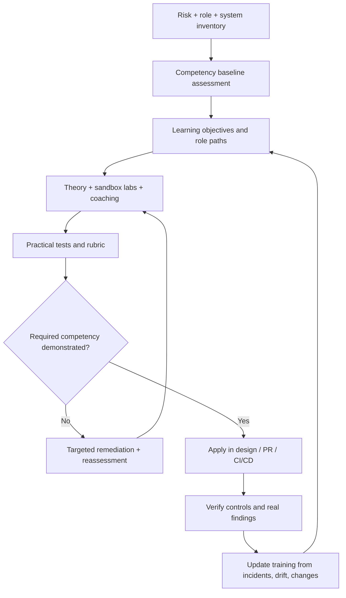
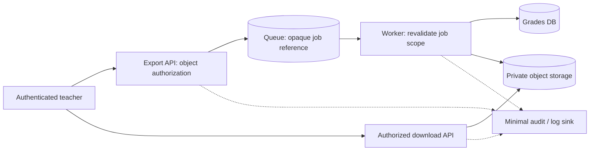

# Developer training

## Mục tiêu học tập

Sau bài học này, bạn có thể:

- Giải thích **developer security training** là gì, vì sao nó là một thành phần của **Secure Development** và **security assurance**, và tại sao hoàn thành khóa học không đồng nghĩa code được tạo ra đã an toàn.
- Xác định **năng lực cần đào tạo theo vai trò, công nghệ, hệ thống và rủi ro** thay vì chỉ đưa mọi developer vào cùng một khóa kiến thức chung.
- Thiết kế lộ trình từ onboarding, nguyên tắc nền tảng tới **secure coding, review thiết kế, threat modeling, kiểm thử bảo mật, cloud/IaC, supply chain, vận hành và ứng phó sự cố**.
- Xây dựng các **bài lab Java/Spring Boot** với lỗi có chủ đích, yêu cầu sửa, kiểm thử dương/âm và tiêu chí chứng minh bản sửa thực sự có hiệu lực.
- Đánh giá **kiến thức, kỹ năng thực hành, hành vi tại công việc và kết quả controls**; phân biệt các loại bằng chứng và giới hạn suy luận.
- Tổ chức chương trình đào tạo có owner, yêu cầu hoàn thành, coaching, tái đánh giá khi thay đổi công nghệ/đe dọa và xử lý khoảng trống năng lực.
- Sử dụng **Claim – Argument – Evidence** để chứng minh nhóm phát triển có năng lực phù hợp và các kỹ năng đó được áp dụng trong Secure SDLC ở phạm vi xác định.

## 1. Developer training là gì?

**Developer training** trong phát triển phần mềm an toàn là chương trình giúp developer hiểu **rủi ro bảo mật của công việc mình làm**, biết chọn thiết kế và thực hành lập trình phù hợp, phát hiện sai sót, tự kiểm chứng bản sửa và phối hợp hiệu quả với security, platform, operations, privacy và risk owners.

Khác với một buổi phổ biến chính sách, đào tạo có hiệu quả phải tạo thay đổi có thể quan sát: developer biết **khi nào cần hỏi về trust boundary, ai được truy cập đối tượng nào, dữ liệu nào không nên xuất hiện trong log, cách đánh giá dependency, và test âm nào chứng minh hệ thống từ chối hành động trái quyền**.

Ví dụ, nền tảng học tập có API Spring Boot cho phép giáo viên tải bảng điểm. Developer đã biết dùng `@PreAuthorize("hasRole('TEACHER')")` nhưng chưa biết cần kiểm tra **giáo viên đó có được phân công đúng lớp và tenant không**. Một khóa đào tạo thực hành cần cho họ tự tìm lỗi **Broken Object Level Authorization (BOLA/IDOR)**, sửa policy phía server, viết negative test và hiểu vì sao kiểm tra role hay ẩn nút trên giao diện chưa đủ.

Trong module **SECURITY_SECURITY_ASSURANCE**, mục tiêu không chỉ là “nhân viên đã học an toàn thông tin” mà là xây dựng **cách đánh giá có bằng chứng rằng kỹ năng bảo mật quan trọng được hiểu, thực hiện và kiểm tra trong thiết kế, code, pipeline và vận hành**. Một chứng nhận hoàn thành bài học là bằng chứng tham gia hoặc kiến thức tại thời điểm kiểm tra; **không tự chứng minh** sản phẩm đang đáp ứng security objectives.

### 1.1. Developer training giải quyết những vấn đề nào?

| Vấn đề | Biểu hiện trong dự án | Năng lực cần xây dựng |
| --- | --- | --- |
| Thiếu hiểu biết về ranh giới tin cậy | Tin rằng request đã đến từ mạng nội bộ nên được phép. | Nhận diện actors, assets, entry points, trust boundaries và authorization. |
| Biết framework nhưng áp dụng sai | Chỉ kiểm role, thiếu quyền theo tài nguyên. | Secure API design, Spring Security, object- và tenant-level checks. |
| Bỏ qua đường xử lý phụ | API an toàn nhưng worker, CSV, logs hoặc storage lộ dữ liệu. | End-to-end data flow, async security, minimization, data lifecycle. |
| Thiếu thói quen kiểm thử âm | Chỉ thử trường hợp user hợp lệ. | Negative testing, abuse cases, error-path testing, regression. |
| Phụ thuộc công cụ | Scan xanh được coi là code an toàn tuyệt đối. | Hiểu giới hạn SAST/SCA/DAST và xác minh thủ công. |
| Thực hành secret kém | Ghi token hoặc password vào config, log, ticket. | Secret lifecycle, workload identity, KMS và redaction. |
| Không phản ứng với thay đổi | Thêm API/region/vendor nhưng không review security impact. | Security review triggers, threat modeling, change assessment. |
| Không hiểu bằng chứng | Đánh dấu PASS khi chưa có test/runtime result. | Claim–Argument–Evidence, verification scope và findings. |

Đào tạo **không thay thế** thiết kế controls, code review, kiểm thử, IAM, network isolation hoặc security assurance. Nó giúp người làm việc **thiết kế và thực thi các controls đó đúng cách**, còn hiệu lực thực tế phải được kiểm tra riêng.

## 2. Phân biệt training, awareness, coaching và verification

| Hoạt động | Câu hỏi trả lời | Bằng chứng phù hợp | Không nên suy ra |
| --- | --- | --- | --- |
| **Security awareness** | Nhân viên nhận biết trách nhiệm và dấu hiệu rủi ro cơ bản? | Tham gia/quiz nhận thức, acknowledgement. | Có năng lực sửa BOLA hoặc thiết kế KMS. |
| **Developer training** | Developer hiểu và thực hiện kỹ thuật được dạy trong lab? | Bài thực hành, code, tests, rubric, review. | Tất cả code production được viết an toàn. |
| **Coaching/pair review** | Kỹ năng được áp dụng khi làm feature thật? | Pull request, phản hồi mentor, remediation. | Mọi thay đổi sau đó đều đạt. |
| **Security champion program** | Team có người giúp phổ biến patterns và nâng chất lượng review? | Hoạt động mentoring, review decisions, knowledge sharing. | Champion thay được security owner hoặc independent reviewer. |
| **Code/security review** | Một thay đổi cụ thể đã được xem xét đúng threat và requirements? | Review comments, test artifact, code/config revision. | Developer có kiến thức đầy đủ ở mọi lĩnh vực. |
| **Operating verification** | Control có hoạt động ở môi trường đang chạy? | Runtime settings, IAM, logs, egress, negative test. | Chỉ cần hoàn thành khóa học là đủ. |

**Training outcome** và **control outcome** liên quan nhưng khác nhau. Tổ chức nên đo cả hai và không dùng tỷ lệ xem video thay cho đánh giá security posture.

## 3. Phân tích nhu cầu đào tạo từ risk và công việc

Trước khi chọn khóa học, cần xác định **ai phát triển thành phần nào**, gặp **những loại dữ liệu/tài sản nào**, dùng công nghệ gì, chịu trách nhiệm controls nào và còn thiếu kỹ năng gì.

### 3.1. Nguồn đầu vào cho training needs analysis

1. **Service/technology inventory:** Java/Spring Boot, frontend, database, messaging, Kubernetes, cloud IAM, KMS, CI/CD.
2. **Architecture/DFD:** API công khai, worker, lưu trữ bảng điểm, dữ liệu cá nhân, admin control plane và external integrations.
3. **Threat model/risk register:** BOLA, SSRF, injection, token misuse, lateral movement, secret exposure, data exfiltration.
4. **Findings/incident history:** lỗi nào xuất hiện lặp lại, giai đoạn nào không phát hiện, developer có hiểu nguyên nhân gốc không.
5. **Security requirements và standards:** yêu cầu riêng theo hệ thống và nghĩa vụ áp dụng; có thể tham khảo OWASP ASVS, OWASP Top 10, OWASP SAMM, NIST SSDF **theo phiên bản phù hợp** để định hình năng lực, không coi danh mục là luật áp dụng tự động.
6. **Phỏng vấn và assessment:** developer tự đánh giá, bài code test, review PR, workshop threat modeling.
7. **Change roadmap:** chuyển từ monolith sang microservice, thêm vendor, đưa dữ liệu sang region khác, đổi token/key architecture.

Thông tin này phải được dùng có trách nhiệm. Dữ liệu đánh giá cá nhân không nên trở thành danh sách công khai để “xếp hạng developer yếu”; mục tiêu là **học tập và giảm rủi ro**, với quyền truy cập, retention và phương pháp đánh giá minh bạch.

### 3.2. Ma trận role–risk–competency

| Vai trò | Rủi ro/decision điển hình | Năng lực ưu tiên | Thực hành đánh giá |
| --- | --- | --- | --- |
| **Backend Java/Spring Boot** | API/BOLA, injection, session, queue, logs, data export. | Spring Security, object authz, validation, safe data access, tests. | Sửa API vượt quyền và viết integration tests. |
| **Frontend** | Token/session, DOM XSS, leaking data in client, browser trust. | Output encoding/context, safe storage, API boundary, CSP basics. | Phát hiện XSS hoặc dữ liệu thô bị trả về frontend. |
| **Mobile developer** | Local storage, credentials, deep links, transport, device assumptions. | Platform secure storage, TLS validation, session handling, logging. | Review app flow khi token hết hạn/bị mất. |
| **Platform/DevOps** | IAM/network, container, CI/CD secrets, IaC, backup. | Least privilege, policy-as-code, workload identity, runtime verification. | Review policy cloud/Kubernetes và negative access tests. |
| **Data engineer/analytics** | PII in pipelines, lineage, pseudonymization, retention. | Classification, minimization, data flow, privacy, transfer review. | Kiểm tra schema/log/exports và re-identification risks. |
| **Technical lead/architect** | Trust boundaries, ADR, vendor, crypto choices, abuse cases. | Threat modeling, design tradeoffs, security requirements, assurance. | Review thiết kế một tính năng rủi ro cao. |
| **Security champion** | Hỗ trợ team phát hiện lỗi và chuyển cấp đúng lúc. | Facilitation, review patterns, findings, mentoring. | Điều phối workshop và kiểm tra remediation evidence. |
| **QA/test engineer** | Missing negative cases, poor fixtures, false-positive PASS. | Abuse-driven tests, authz matrices, failure injection, evidence. | Xây test suite đối chứng positive/negative. |

Vai trò là **hướng ưu tiên**, không tạo quyền loại trừ. Một backend engineer làm CI/CD hoặc data pipeline vẫn cần kỹ năng tương ứng. Cần xác định **trách nhiệm thực tế** thay vì chỉ chức danh.

### 3.3. Chọn mức đào tạo dựa trên độ phơi bày

Ví dụ cùng là Spring Boot nhưng rủi ro khác nhau:

- Service nội bộ chỉ đọc cấu hình không nhạy cảm: cần baseline về input, auth, dependency, secrets và error handling.
- API public trả bảng điểm nhiều tenant: cần review sâu về BOLA, tenant isolation, rate limits, data minimization và negative tests.
- Worker ký chứng chỉ: cần kiến thức về key purpose, KMS, signing, revocation, provenance và audit.
- Pipeline xử lý identity proofing hoặc dữ liệu cá nhân đặc biệt: cần privacy/data handling và ràng buộc truy cập, lưu giữ, deletion.

**Không nên đào tạo “mọi thứ giống nhau cho mọi người”**, đồng thời cũng không bỏ qua kỹ năng nền tảng đối với người ít làm feature rủi ro cao.

## 4. Mô hình năng lực có thể kiểm chứng

### 4.1. Từ biết tới làm được

Nên phân biệt bốn mức năng lực:

| Mức | Biểu hiện cần thấy | Minh chứng |
| --- | --- | --- |
| **L1 – Nhận biết** | Giải thích được rủi ro, chỉ ra dấu hiệu bất thường và biết khi nào phải chuyển cấp. | Bài tình huống ngắn; giải thích một abuse case. |
| **L2 – Áp dụng có hướng dẫn** | Dùng pattern được phê duyệt để sửa một lỗi trong sandbox, đọc hiểu test. | Guided lab, code diff, test xanh với case âm. |
| **L3 – Thực hiện độc lập** | Tự threat-model, thiết kế fix và tạo tests cho feature thuộc phạm vi mình phụ trách. | Open-ended lab, PR thật được review, evidence. |
| **L4 – Dẫn dắt/đánh giá** | Challenge assumptions, review thiết kế, hướng dẫn người khác, phát hiện gap trong test/evidence. | Review rubric, mentorship, design decision và follow-up. |

Không đánh giá L3 chỉ bằng quiz trắc nghiệm, và không đánh giá L4 chỉ bằng số năm kinh nghiệm. Năng lực phải gắn với **task thực tế**, tiêu chí công khai và người đánh giá có chuyên môn.

### 4.2. Learning objectives theo hành vi

Thay vì mục tiêu mơ hồ “hiểu Spring Security”, viết:

> Developer backend có thể thiết kế và triển khai một endpoint đọc điểm theo **authenticated principal + quyền trên course/tenant**, viết test cho user đúng quyền và user cùng role nhưng sai tài nguyên, đồng thời chứng minh không có dữ liệu hoặc side effect ở ca bị từ chối.

Mục tiêu này có **đầu vào, hành động, hành vi kỳ vọng và bằng chứng**. Có thể chia thành kỹ năng nhỏ:

1. Chỉ ra trust boundary giữa caller và server.
2. Giải thích vì sao role check không đủ.
3. Xác định policy source tin cậy.
4. Triển khai object-level authorization trước khi trả dữ liệu.
5. Viết positive/negative tests.
6. Đọc kết quả test, tìm nguyên nhân nếu PASS/FAIL bất thường.
7. Nêu giới hạn của kết luận (ví dụ test MockMvc chưa chứng minh IAM/network).

### 4.3. Rubric thực hành minh họa

| Tiêu chí | Chưa đạt | Đạt cơ bản | Đạt tốt |
| --- | --- | --- | --- |
| **Threat identification** | Chỉ nêu “API chưa an toàn”. | Nhận ra cross-course data access. | Nêu cả tenant scope, queue, logs, download path. |
| **Authorization** | Chỉ thêm role check ở client/server. | Kiểm resource theo principal phía server. | Còn xét policy failure, ownership changes, worker bypass. |
| **Test** | Chỉ test happy path hoặc chỉ dựa mã 403. | Có positive/negative tests đúng fixture. | Kiểm side effects, cross-tenant, revoked permission và failure path. |
| **Data handling** | Ghi dữ liệu thô hoặc trả entity. | Chỉ trả trường cần thiết. | Bảo vệ logs/exports/cache và retention tương ứng. |
| **Evidence** | “Đã chạy thử thấy ổn”. | Có test artifact gắn với build. | Nêu scope, phương pháp, môi trường, giới hạn và finding. |

Rubric nên được hiệu chỉnh giữa các reviewer để giảm chênh lệch đánh giá; yêu cầu tối thiểu phải dựa trên **rủi ro nhiệm vụ**, không tùy ý theo cảm nhận.

## 5. Thiết kế chương trình đào tạo theo tầng

### 5.1. Lộ trình cho developer

| Giai đoạn | Trọng tâm | Phương pháp | Điều kiện chuyển tiếp |
| --- | --- | --- | --- |
| **Onboarding** | Chính sách, trách nhiệm, dữ liệu, báo cáo sự cố, secret hygiene. | Microlearning + bài tình huống. | Chứng minh biết nhận diện và chuyển cấp nguy cơ cơ bản. |
| **Foundation** | Trust boundaries, OWASP risks, secure API, authn/authz, logging, data handling. | Guided labs và code reading. | Bài tập sửa lỗi kèm negative tests. |
| **Role-specific** | Spring Boot, frontend, cloud/IaC, data pipeline, mobile theo trách nhiệm. | Stack-specific labs và code review. | Đạt competency rubric của vai trò. |
| **Advanced** | Threat modeling, multi-tenant design, async security, KMS, supply chain, incident. | Open-ended scenarios và tabletop. | Review thiết kế/PR có lập luận và evidence. |
| **Continuous practice** | New threats, lessons from findings, secure patterns, mentoring. | Security champions, short clinics, PR coaching. | Đánh giá lại khi trigger/risk đổi. |

Chương trình nên kết hợp **lý thuyết ngắn – thực hành – feedback – áp dụng vào công việc – kiểm chứng**. Chỉ tăng số giờ học không bảo đảm tăng năng lực.

### 5.2. Mẫu module 90 phút về BOLA

Đây là lịch minh họa, có thể điều chỉnh:

| Hoạt động | Thời lượng | Kết quả mong đợi |
| --- | ---: | --- |
| Khởi động bằng abuse case giáo viên lớp A đọc điểm lớp B | 10 phút | Xác định tài sản, actor và boundary. |
| Giải thích session, role, object-level và tenant authorization | 15 phút | Nắm nguyên tắc và sai lầm phổ biến. |
| Đọc service/controller Spring Boot có lỗi | 15 phút | Chỉ ra nơi thiếu enforcement. |
| Sửa policy và viết tests | 30 phút | Có code, positive và negative cases. |
| Review và phản biện lời giải | 10 phút | Giải thích tại sao fix có hiệu lực/giới hạn. |
| Mini-assessment và action áp dụng | 10 phút | Nêu ca test cần thêm cho service mình phụ trách. |

**Không đồng nhất hoàn thành lab với thành thạo tất cả dạng BOLA.** Người học có thể cần được đánh giá lại bằng tình huống mới không có hướng dẫn.

### 5.3. Lộ trình theo năng lực, không chỉ khóa học

Một developer giàu kinh nghiệm có thể bỏ qua phần nhập môn **nếu chứng minh được năng lực** bằng assessment có chất lượng. Một developer mới nhưng phụ trách signing service rủi ro cao phải có đào tạo chuyên sâu hoặc pair review phù hợp trước khi thực hiện quyết định quan trọng. Exemption/waiver cần tiêu chí, người duyệt và thời hạn review, không phải tự chọn “tôi biết rồi”.

## 6. Nội dung bắt buộc và chủ đề chuyên sâu

### 6.1. Secure design và threat modeling

Học viên cần biết:

- Nhận diện **assets, actors, entry points, data flows, trust boundaries**.
- Viết abuse case: “Nếu kẻ tấn công kiểm soát header/path/job payload thì sao?”.
- Chuyển threat thành **control statements và verification criteria**.
- Phân biệt risk acceptance, mitigation, design change và exception.
- Biết khi nào cần security design review hoặc chuyên gia Privacy/Cryptography.

Một bài lab hữu ích là thêm tính năng export: nhóm phải lập DFD tới queue, worker, storage, log, backup và đối tác; trình bày controls cho mỗi boundary.

### 6.2. Authentication, session và authorization

| Nội dung | Developer cần biết | Phép thực hành |
| --- | --- | --- |
| Authn/IdP | Phân biệt người gọi và quyền; validate issuer, audience, signature, expiry và token type. | Từ chối token sai audience hoặc expired. |
| Authorization | Role không thay được resource/tenant check. | Test hai giáo viên cùng role, khác lớp. |
| Session management | Token lifetime, revoke, refresh, cookie protection và CSRF theo architecture. | Thiết kế logout/revocation/threat response. |
| Workload identity | Dịch vụ nội bộ cũng cần identity và permission hẹp. | Review IAM của API/worker/KMS. |
| Privileged operations | MFA/JIT, step-up khi phù hợp, audit và separation of duties. | Thiết kế đường admin/break-glass. |

### 6.3. Input, output và API security

- Validation theo schema và ràng buộc nghiệp vụ; tránh **mass assignment**.
- Parameterized query an toàn; không ghép SQL từ dữ liệu không tin cậy.
- Output encoding **đúng ngữ cảnh** để giảm XSS; không áp một hàm escape cho mọi sink.
- SSRF controls: không gọi tùy ý URL client cung cấp, giới hạn outbound destination và redirect behavior.
- File upload: loại file, giới hạn kích thước, nơi lưu, quyền tải và đường xử lý lỗi.
- Pagination, rate limits, query complexity, resource quotas để giảm abuse/DoS.
- Error handling: không tiết lộ stack trace, connection string, token hoặc nội dung nhạy cảm.

### 6.4. Data protection và privacy

- Classification, purpose, minimization và retention.
- Encryption in transit/at rest và key responsibilities; không tự tạo thuật toán crypto.
- Data masking và redaction ở API/log/exports; không chỉ che trên giao diện.
- Pseudonymization không tự đồng nghĩa anonymization; hash email thông thường có thể bị đoán/ghép.
- Dữ liệu sao chép qua queue, cache, analytics, reports, backups và vendor cần handling rules.
- Cross-border data/remote support và điều kiện pháp lý áp dụng cần chuyển review đúng chuyên môn.

### 6.5. Cryptography, secrets và credentials

- Khác nhau giữa hash, password hashing, MAC, encryption, signing và tokenization.
- Sử dụng thư viện/SDK và KMS/HSM đã được đánh giá, quản lý key purpose và version.
- Nonce/IV, authenticated encryption, key rotation, JWT/JWKS và TLS theo thiết kế.
- Không hardcode API keys; không commit secret hoặc lưu secret trong logs/tickets.
- Phân biệt **rotate credential** với **re-encrypt dữ liệu**; hiểu tình huống compromise cần incident response.

### 6.6. Dependencies, CI/CD và cloud-native

- SCA/dependency scanning, lockfiles, provenance, pinning/version policy và update có kiểm thử.
- Container image, build isolation, CI secrets, artifact signing/provenance khi có yêu cầu.
- IaC review, least privilege IAM, Kubernetes RBAC/NetworkPolicy, secret injection và runtime drift.
- Phân biệt việc scanner phát hiện dấu hiệu với **chứng minh control** hoạt động.
- Review release gates, exceptions, rollout/rollback và post-deploy verification.

### 6.7. Logging, observability và incident readiness

Developer cần biết **nên log gì và không log gì**:

- Log actor/resource reference, action, decision, correlation ID và thời điểm theo policy.
- Không log password, bearer token, private key, raw proofing record hoặc bảng điểm chỉ vì cần debug.
- Review error path, proxy, access logs, tracing/APM, dead-letter queue và third-party sink.
- Biết cách tạo security event có thể điều tra và cách bảo vệ event.
- Nắm quy trình báo lộ secret, nghi ngờ truy cập trái quyền và lưu bằng chứng khi phát hiện sự cố.

## 7. Một chương trình huấn luyện gắn với Secure SDLC



**Lưu ý quan trọng:** vòng học tập và vòng kiểm chứng security controls không hoàn toàn trùng nhau. Có người làm lab tốt nhưng chưa có cơ hội áp dụng trong công việc; có feature chạy đúng nhưng reviewer chưa biết liệu kỹ năng đến từ đào tạo hay từ template có sẵn. Nên lưu **hai nhóm evidence khác nhau**, sau đó đối chiếu để đánh giá chương trình.

### 7.1. Tích hợp vào công việc hằng ngày

1. Khi tạo feature, developer dùng checklist bảo mật và ghi security impact.
2. Với thay đổi rủi ro cao, team thực hiện threat modeling hoặc review thiết kế.
3. Developer dùng **approved patterns** và thư viện đã được kiểm tra.
4. PR reviewer kiểm cả code, test âm, config và data flow liên quan.
5. CI kiểm SAST/SCA/secrets/IaC và integration tests phù hợp.
6. Release có runtime verification theo risk, không chỉ dựa vào CI.
7. Findings/incident đi ngược lại thành **training case** và cập nhật guideline.

Training hiệu quả nhất khi người học có **đường áp dụng ngắn**, feedback kịp thời và pattern/reusable tooling giúp biến kiến thức thành thói quen.

## 8. Lab 1 – Sửa BOLA trong Java/Spring Boot

### 8.1. Tình huống

API `GET /api/courses/{courseId}/grades` trả bảng điểm lớp học. Hai giáo viên có cùng role `TEACHER` nhưng chỉ giáo viên được phân công lớp và tenant tương ứng mới có quyền xem.

Ví dụ code **cố ý có lỗi**:

```java
@RestController
class GradeController {
    private final GradeService grades;

    GradeController(GradeService grades) {
        this.grades = grades;
    }

    @GetMapping("/api/courses/{courseId}/grades")
    @PreAuthorize("hasRole('TEACHER')")
    List<GradeView> list(@PathVariable long courseId) {
        return grades.listGrades(courseId);
    }
}
```

Lỗi không nằm ở annotation sai cú pháp, mà ở **security requirement thiếu**: mọi user có role TEACHER có thể thử `courseId` của lớp khác. Nếu service/repository không kiểm quyền theo object và tenant, dữ liệu có thể bị lộ.

### 8.2. Nhiệm vụ cho học viên

1. Viết **threat statement** và mô tả asset, actor, entry point, trust boundary.
2. Nêu vì sao frontend ẩn đường dẫn hoặc JWT có role TEACHER **không giải quyết** object-level authorization.
3. Thiết kế policy dùng identity tin cậy và mapping giáo viên–lớp–tenant phía server.
4. Chọn enforcement point và đảm bảo các đường đọc khác không bypass.
5. Viết positive/negative tests với fixtures rõ.
6. Kiểm tra denial không trả grade/PII và không tạo side effect.
7. Mô tả giới hạn: test ứng dụng không kiểm chứng IAM của database hoặc network segmentation.

### 8.3. Mẫu thiết kế đã cải thiện

```java
@Configuration
@EnableMethodSecurity
class MethodSecurityConfig {}

@Service
class GradeService {
    private final GradeRepository repository;

    GradeService(GradeRepository repository) {
        this.repository = repository;
    }

    @PreAuthorize(
        "@courseAccess.canViewGrades(authentication, #courseId)"
    )
    @Transactional(readOnly = true)
    public List<GradeView> listGrades(long courseId) {
        return repository.findGradeViewsByCourseId(courseId);
    }
}
```

Bean `courseAccess` là thành phần của ứng dụng **giả định**. Nó phải kiểm tra principal đáng tin, quan hệ phân công còn hiệu lực, tenant, action và những điều kiện nghiệp vụ khác; không chỉ `authentication.isAuthenticated()`. `GradeView` nên là projection/DTO chỉ chứa trường được phép, không serialize entity có dữ liệu thừa.

**Điểm phải dạy rõ:** `@EnableMethodSecurity` phải được cấu hình và lời gọi phải đi qua security proxy; self-invocation và code path khác có thể bỏ qua annotation. Phải kiểm tra nơi service được gọi thực tế, không dùng annotation như bằng chứng duy nhất.

### 8.4. Integration tests với đối chứng

Giả sử fixture có lớp 42 thuộc tenant A: `teacher-a` được phân công, `teacher-b` không được phân công; lớp 99 thuộc tenant B:

```java
@SpringBootTest
@AutoConfigureMockMvc
class GradeAuthorizationIT {
    @Autowired
    MockMvc mockMvc;

    @Test
    @WithMockUser(username = "teacher-a", roles = "TEACHER")
    void assignedTeacherCanReadOwnCourse() throws Exception {
        mockMvc.perform(get("/api/courses/42/grades"))
            .andExpect(status().isOk())
            .andExpect(jsonPath("$").isArray());
    }

    @Test
    @WithMockUser(username = "teacher-b", roles = "TEACHER")
    void otherTeacherCannotReadGrades() throws Exception {
        mockMvc.perform(get("/api/courses/42/grades"))
            .andExpect(status().isForbidden());
    }

    @Test
    @WithMockUser(username = "teacher-a", roles = "TEACHER")
    void otherTenantCannotBeRead() throws Exception {
        mockMvc.perform(get("/api/courses/99/grades"))
            .andExpect(status().isForbidden());
    }
}
```

Đây là mẫu test giảng dạy, **không phải mã chạy được độc lập**: cần controller mapping, fixtures, repository, Spring Security/Test dependencies và static imports thích hợp. Phải kiểm tra test đi qua filter/policy thật và xác minh fixture đúng; một mã 403 có thể đến từ security config sai, không chứng minh object policy đã hoạt động. Với endpoint trả 404 theo chính sách chống enumeration, expected status có thể khác, nhưng hành vi **không tiết lộ dữ liệu** phải được kiểm tra nhất quán.

### 8.5. Rubric chấm lab

| Tiêu chí | Điểm gợi ý | Điều reviewer cần thấy |
| --- | ---: | --- |
| Nhận diện BOLA và tenant boundary | 20 | Nêu rõ actor/resource/threat, không chỉ nói “thiếu role”. |
| Policy dùng nguồn tin cậy | 25 | Kiểm principal–course–tenant, không tin client-supplied tenant. |
| Positive và negative tests | 25 | Có fixtures đối chứng, cùng role/sai course, sai tenant. |
| Bảo vệ data/side effects | 15 | Denial không trả grade; DTO tối thiểu, logs phù hợp. |
| Lập luận/evidence và giới hạn | 15 | Trình bày enforcement, build/test scope và phần cần runtime test. |

Điểm là **minh họa**, phải hiệu chỉnh theo learning objectives và mức năng lực. Không cấp pass nếu học viên chỉ chỉnh test để bỏ qua case âm.

## 9. Lab 2 – Bảo vệ luồng export bất đồng bộ

### 9.1. Mô hình hệ thống

Một nền tảng học tập cho phép giáo viên export CSV bảng điểm. Lưu lượng đi qua API → queue → worker → object storage → download API.



**Bài toán học tập:** sau khi tạo job, giáo viên mất quyền với lớp; worker vẫn xử lý message cũ và file được tạo. Hoặc một user sửa `jobId` để tải file của user khác. Bản chất là **authorization ở nhiều trust boundaries**, không thể chỉ giải quyết bằng role check ở controller.

### 9.2. Security requirements cho lab

| ID | Requirement | Test/evidence |
| --- | --- | --- |
| `TRN-JOB-01` | Request tạo job phải xác minh user có quyền export đúng course/tenant tại thời điểm tạo. | Test positive/negative và verify no job on deny. |
| `TRN-JOB-02` | Job scope do server tạo, chứa metadata tin cậy và không mang dữ liệu nhạy cảm thô nếu không cần. | Review schema, queue payload/serialization test. |
| `TRN-JOB-03` | Worker kiểm điều kiện hợp lệ khi xử lý, gồm tình huống quyền bị thu hồi và message replay. | Revocation, replay, duplicate delivery tests. |
| `TRN-JOB-04` | Worker chỉ có quyền đọc dữ liệu/ghi object theo scope và không egress tùy ý. | IAM/network permission tests và runtime snapshot. |
| `TRN-JOB-05` | Download yêu cầu quyền với file/export, xử lý expiry và revocation. | Cross-user download, expired URL, direct storage denial. |
| `TRN-JOB-06` | Logs/traces/queue DLQ không chứa bảng điểm hay bearer token trái policy. | Error-path log-to-sink checks và data handling review. |
| `TRN-JOB-07` | Retry, timeout và partial failure không tạo duplicate/orphaned objects ngoài retention. | Idempotency/reconciliation/cleanup tests. |

### 9.3. Các nhiệm vụ tăng độ khó

**Mức 1:** chỉ ra trust boundaries và luồng có thể bị lạm dụng. **Mức 2:** thiết kế job model, expiry, identity binding và access checks. **Mức 3:** tạo tests cho revoked access, tampered job ID, retry, lỗi storage và cleanup. **Mức 4:** review phương án của nhóm khác, chỉ ra nơi còn thiếu runtime IAM, vendor/log hoặc assumptions chưa có bằng chứng.

Một lựa chọn có thể là lưu **immutable server-defined scope** trong job record, message chỉ chứa opaque reference, dùng optimistic concurrency/idempotency và kiểm quyền lại gần thời điểm xử lý/tải. Cách cụ thể tùy nghĩa vụ và threat model; không mặc định một giải pháp xử lý tất cả race conditions.

### 9.4. Điều học viên cần rút ra

- Queue không tự biến payload thành đáng tin; message có thể stale, replay hoặc do principal khác gây ra qua đường phụ.
- Backend/worker identity cần ít quyền hơn database administrator.
- Một bucket private vẫn có thể bị đọc qua đường download không kiểm scope.
- Presigned URL ngắn hạn là một control giới hạn phơi bày, không tự thay thế authorization tại thời điểm cần.
- Audit cần đủ để điều tra nhưng không được tự tạo rò dữ liệu học viên.
- Security control phải có **nơi thực thi, test, evidence và owner**.

## 10. Lab 3 – Secrets, logs và dependency risk

### 10.1. Tình huống

Trong một pull request, developer:

1. Đặt API key của dịch vụ email vào `application.yml` và commit.
2. Ghi nguyên request headers để điều tra lỗi xác thực, bao gồm bearer token.
3. Thêm dependency chưa được review và tắt cảnh báo CI vì kết quả scan “quá nhiều”.
4. Bật debug logs trên production để tái hiện lỗi nhưng không đặt thời hạn tắt.

### 10.2. Học viên phải làm gì?

- Nhận diện **secret exposure** và kích hoạt quy trình ứng phó/rotate phù hợp; xóa dòng khỏi Git không bảo đảm secret chưa bị lộ trong history/bản sao.
- Đề xuất **secret manager/workload identity** theo nền tảng và giảm quyền API key.
- Thiết kế structured logging/allowlist chỉ giữ trường cần điều tra, tránh raw headers và payload.
- Xác minh error paths, APM/tracing, log collectors và retention, không chỉ một unit test.
- Review dependency theo nguồn, version, provenance, mức độ sử dụng, lỗ hổng và biện pháp giảm thiểu; phân biệt finding thật với false positive có căn cứ.
- Không coi “đã tắt scanner” là remediation; ghi exception với owner, scope, due date và residual risk nếu được policy cho phép.

**Không sử dụng API key thật hoặc truy cập production trong lab.** Dùng token giả, tài khoản demo và repository sandbox có dữ liệu synthetic để luyện phát hiện và sửa.

## 11. Đào tạo qua secure code review và threat modeling

### 11.1. Peer review là môi trường học tập

Một pull request có thể được dùng để luyện kỹ năng phát hiện:

- Trust boundary mới, API response chứa trường không cần thiết.
- Sai object-level authorization và nhầm lẫn tenant/client-provided IDs.
- Input đi vào SQL, template, file path hoặc outbound URL.
- Logic kiểm quyền nằm quá xa side effect hoặc thiếu recheck ở worker.
- Logging, secrets, error paths và retries.
- Thiếu test âm, fixture không đại diện threat hoặc scan fail bị bỏ qua.

Reviewer nên giải thích **đường tấn công và tiêu chí đúng**, không chỉ viết “thiếu bảo mật”. Ví dụ: “Mọi giáo viên cùng role có thể thay `courseId`; cần kiểm assignment trong trusted store và thêm test denial cho cùng role, khác lớp.”

### 11.2. Workshop threat modeling nhỏ

Mỗi nhóm nhận một DFD và thực hiện:

1. Chọn assets (điểm, token, certificate key, user data).
2. Ghi actors và entry points.
3. Khoanh vùng trust boundaries.
4. Liệt kê abuse cases theo STRIDE hoặc câu hỏi attacker.
5. Phân loại theo risk; không cần chấm điểm giả chính xác.
6. Đề xuất controls, location, owner và tests.
7. Viết một ADR ngắn cho lựa chọn có trade-off.
8. Trình bày unresolved assumptions và residual risk.

Đánh giá **chất lượng lập luận**, không chỉ số threat được liệt kê. Mười threat trùng lặp nhưng không có mitigations không hữu ích bằng ba threat thực tế với control/test đúng.

## 12. Đánh giá học tập: từ tham gia đến năng lực thực tế

### 12.1. Bốn lớp kết quả cần phân biệt

| Lớp đánh giá | Câu hỏi | Bằng chứng | Giới hạn |
| --- | --- | --- | --- |
| **Participation/engagement** | Developer đã tham gia, hoàn tất phần học? | Attendance, LMS activity, completion record. | Không chứng minh đã hiểu hoặc áp dụng. |
| **Learning/competency** | Có thể giải thích, sửa và kiểm thử một lỗi? | Open-ended quiz, lab, rubric, code/test artifacts. | Khả năng trong sandbox chưa chắc chuyển sang công việc thật. |
| **Transfer to practice** | Có áp dụng trong design/PR/review thật? | PR review, tests, mentor observation, design decisions. | Hành vi có thể bị ảnh hưởng bởi templates/tooling và độ khó feature. |
| **Security outcome** | Những lỗi đã nhắm tới có được ngăn/ngày càng phát hiện sớm? | Findings by category, escape rates, incident root causes, verified controls. | Không thể quy mọi thay đổi chỉ cho training; nhiều yếu tố cùng tác động. |

Không có chỉ số riêng lẻ thay được cả bốn lớp. **Tỷ lệ hoàn thành 100% không có nghĩa security assurance PASS 100%.**

### 12.2. Kiểm tra hiểu thật, tránh “học đáp án”

Assessment tốt nên có:

- Một tình huống **mới**, không chỉ thay số ID của ví dụ đã học.
- Positive/negative cases có **fixtures kiểm soát**.
- Một lỗi giả (test trả 403 vì CSRF/missing route), yêu cầu học viên phân biệt với authorization thực.
- Một đường phụ chưa được mô tả trực tiếp (worker, logs, export, storage).
- Yêu cầu giải thích *tại sao* bản sửa an toàn trong scope và giới hạn kiểm chứng.
- Rubric và feedback giúp học viên hiểu thiếu kỹ năng nào.

Với kỹ năng rủi ro cao, nên có **reassessment sau một khoảng phù hợp hoặc sau thay đổi công nghệ/threat**. Không đánh đồng một chứng nhận năm trước với khả năng triển khai KMS mới hôm nay.

### 12.3. Khi học viên không đạt

Quy trình nên hướng tới năng lực:

1. Chỉ rõ tiêu chí chưa đạt và nguyên nhân (chưa hiểu trust boundary, test yếu, policy sai, v.v.).
2. Cấp lab bù trừ/coaching theo đúng gap.
3. Cho làm assessment tương đương nhưng không lặp nguyên đáp án.
4. Với nhiệm vụ rủi ro cao, áp dụng **peer pairing, reviewer bổ sung hoặc scope công việc được giám sát** cho tới khi đủ năng lực.
5. Lưu decision/record đúng chính sách và bảo vệ dữ liệu đánh giá cá nhân.

Không nên dùng thất bại trong lab làm cớ che giấu finding production; **security incident và skill gap cần xử lý theo các tuyến trách nhiệm riêng nhưng có thể liên kết để học hỏi**.

## 13. Thiết kế môi trường lab an toàn

Một lab không được tạo thêm rủi ro cho tổ chức hoặc dữ liệu người học.

### 13.1. Những nguyên tắc bắt buộc

- Dùng **synthetic datasets**, tài khoản giả, domain/endpoint test và secret giả.
- Cô lập sandbox khỏi production, hạn chế network egress và quyền cloud.
- Không cung cấp credentials production hoặc bản sao chứa dữ liệu cá nhân thật chỉ để luyện code review.
- Bài tập có lỗ hổng chủ ý phải đặt trong môi trường kiểm soát, không xuất hiện trong template production.
- Giới hạn tài nguyên, thời hạn môi trường, chi phí và cleanup.
- Review các log/record của lab vì chúng có thể chứa thông tin tài khoản người học.
- Có hướng dẫn báo cáo khi người học phát hiện secret thật, cấu hình mở hoặc dữ liệu nhạy cảm trong tài liệu đào tạo.

### 13.2. Hạ tầng tối thiểu

Một sandbox Spring Boot có thể gồm API, test database, một bộ dữ liệu giả với hai tenants/courses, MockMvc integration tests và checker để ghi nhận output. Với lab về worker, thêm queue giả hoặc container test có network isolation; với IAM/cloud, dùng **policy fixtures** thay vì mở account thực có quyền cao.

### 13.3. Không thưởng cho cách “lách bài”

Học viên có thể làm negative test xanh bằng cách **chặn mọi request**, đổi fixture để quyền luôn sai, xóa test hoặc mock security service trả sẵn expected result. Rubric phải có **positive control**, check side effects và review cách triển khai, không chỉ đếm dòng xanh trong test runner.

## 14. Tổ chức chương trình, vai trò và trách nhiệm

| Vai trò | Trách nhiệm với developer training | Bằng chứng |
| --- | --- | --- |
| **Engineering leadership** | Phân bổ thời gian, ưu tiên học, gắn competence với nhiệm vụ/risk. | Training policy, resource allocation, review cadence. |
| **Security enablement/AppSec** | Xây nội dung, labs, rubric, cập nhật threat patterns, coaching. | Curriculum revision, lab design, facilitator feedback. |
| **Service/technical lead** | Xác định kỹ năng cần cho công nghệ và feature; tạo cơ hội áp dụng. | Role mapping, design/PR review, action tracking. |
| **Security champion** | Hỗ trợ team, làm cầu nối về best practices và findings. | Mentorship, office hours, review contributions. |
| **Developer/QA/Platform learner** | Học, thực hành, nhận feedback, áp dụng và nêu vấn đề. | Assessment, code/test evidence, learning goals. |
| **Risk/Data/Privacy owners** | Xác định rủi ro/mục tiêu và kiểm tra tài liệu theo lĩnh vực. | Risk decisions, topic review, privacy conditions. |
| **Assurance reviewer** | Đánh giá phạm vi, dữ liệu đào tạo, độ tin cậy của competence evidence và liên hệ với controls. | Claim/argument/evidence, findings, review record. |

Security champions **không thay thế** trách nhiệm của engineering owner và security governance. Developer không cần là chuyên gia mọi mảng, nhưng phải biết **ranh giới năng lực và lúc nào cần chuyển cấp**.

### 14.1. Lập kế hoạch theo chu kỳ

1. Xác định skill gaps từ risk, findings, release roadmap và assessment.
2. Chọn mục tiêu cụ thể, đối tượng, mức độ, tài liệu và lab.
3. Chốt chủ sở hữu, nguồn lực, lịch và điều kiện hoàn thành.
4. Triển khai với mentor/reviewer và môi trường an toàn.
5. Đánh giá thực hành, phản hồi, coaching và reassessment.
6. Quan sát áp dụng trong PR, design reviews và controls.
7. Cập nhật nội dung dựa trên sự cố, lỗ hổng mới, công nghệ và feedback.

Đừng tạo chương trình chỉ tồn tại trong LMS rồi không có liên hệ với backlog, PR, release hoặc security standards.

## 15. Claim – Argument – Evidence cho năng lực developer

### 15.1. Claim có thể kiểm chứng

**Claim A – competence:** “Những developer backend được phân công phát triển API bảng điểm trong phạm vi service S tại thời điểm T đã được đánh giá đủ năng lực về object-level authorization, tenant isolation và negative testing theo rubric được phê duyệt, hoặc đang có biện pháp giám sát bù trừ được ghi nhận.”

**Argument A:**

1. Role/service inventory xác định **population** những developer thực sự làm việc trên API rủi ro này, bao gồm người mới và contractor trong phạm vi.
2. Training needs analysis chỉ rõ các kỹ năng liên quan từ threat model, design reviews và findings.
3. Curriculum và lab có mục tiêu/tiêu chí thực hành phù hợp.
4. Bài đánh giá kiểm khả năng nhận diện và sửa BOLA trên tình huống không chỉ ghi nhớ đáp án.
5. Reviewer/mentor áp dụng rubric, xác minh code/tests, ghi gaps và kế hoạch remediation.
6. Records được gắn với người/role/thời điểm/phiên bản, không suy luận từ attendance.

**Evidence A:** roster theo role, learning objectives, lab revision, grading rubric, completed test artifacts, reviewer feedback, remediation/reassessment decisions và thời điểm.

### 15.2. Claim về chuyển kỹ năng thành control

**Claim B – secure practice:** “Những thay đổi được chọn trong service S đã triển khai kiểm quyền theo course/tenant tại server và có negative tests kiểm tra truy cập sai tài nguyên; các findings liên quan đã được sửa và re-test trong build/runtime scope đã xác định.”

**Argument B:**

1. Security requirements và review thiết kế xác định đúng điểm thực thi authorization.
2. PR/code review chứng minh thay đổi triển khai theo yêu cầu.
3. Integration tests chạy qua Spring Security thật, có positive/negative fixtures và side-effect assertions.
4. Pipeline/release evidence gắn với build và environment.
5. Findings có remediation owner, re-test và reviewer closure.

**Evidence B:** design review/PR, CI results, build ID, test fixtures, deployed version, runtime config khi cần và finding closure records.

**Không suy Claim B trực tiếp từ Claim A.** Một developer làm lab giỏi chưa chứng minh feature production an toàn. Ngược lại, code production đạt nhờ security framework hoặc code review bổ sung cũng không có nghĩa mọi developer đều đã nắm kỹ năng.

### 15.3. Ma trận luận cứ – bằng chứng – giới hạn

| Nội dung cần chứng minh | Evidence | Giới hạn cần nêu |
| --- | --- | --- |
| Population của nhóm được đào tạo đầy đủ | Developer/service ownership, joiner/mover records, contractor roster. | Nhân sự tạm hoặc người code từ team khác có thể bị bỏ sót. |
| Mục tiêu gắn risk | Threat model, findings taxonomy, skill matrix, approved curriculum. | Mối đe dọa và stack có thể thay đổi. |
| Người học hiểu và làm được | Unseen lab, code/test artifacts, rubric và independent review. | Lab khác môi trường production, có thể còn pattern chưa kiểm. |
| Kỹ năng được áp dụng | PR comments, design decisions, test additions, mentoring observations. | Không thể quy hoàn toàn kết quả cho training. |
| Control hiệu quả | Negative/positive tests, runtime IAM/config, failure-path verification. | Chỉ bao phủ build, environment và sample được xét. |
| Gaps được xử lý | Action owner, coaching, re-test, exception/risk record. | Đã xếp lịch đào tạo lại không đồng nghĩa đã đạt năng lực. |

### 15.4. Mẫu hồ sơ training/assurance

```yaml
program_id: "SECDEV-TRAINING-EXAMPLE"
service: "SECURITY_SECURITY_ASSURANCE"
target_scope:
  system: "learning-platform"
  role: "backend-java-developer"
  responsibilities: ["grade-api", "grade-export-worker"]
  personnel_population_ref: "<verified-owner-roster>"
  assessment_window: "<approved-evaluation-window>"
risk_basis:
  threat_model_ref: "<applicable-threat-model>"
  findings_ref: "<verified-findings-taxonomy>"
competencies:
  - id: "AUTHZ-OBJECT-TENANT"
    target_level: "L3"
    learning_objective: "Enforce trusted course/tenant authorization"
    lab_ref: "<reviewed-lab-version>"
    rubric_ref: "<approved-rubric>"
  - id: "ASYNC-JOB-SECURITY"
    target_level: "L2"
    learning_objective: "Explain and test worker/job trust boundaries"
    lab_ref: "<reviewed-async-lab>"
    rubric_ref: "<approved-rubric>"
evidence:
  attendance_ref: "<LMS-artifact>"
  practical_assessment_ref: "<actual-code-test-artifact>"
  reviewer_feedback_ref: "<actual-feedback>"
  secure_pr_application_ref: "<actual-reviewed-PR>"
results:
  competence_status: "INSUFFICIENT_EVIDENCE"
  implementation_status: "NOT_ASSESSED"
  outstanding_gaps: ["<unverified-training-or-control-gap>"]
governance:
  program_owner_role: "appsec-enablement-owner"
  engineering_owner_role: "learning-backend-lead"
  assurance_reviewer_role: "independent-reviewer"
reassess_on:
  - "New framework or data classification"
  - "Repeated BOLA or export access findings"
  - "Role change, significant architecture change or incident"
```

Mẫu này **không phải chứng nhận năng lực hoặc bằng chứng controls đạt thực tế**. Không điền kết quả PASS khi chỉ có attendance hoặc chưa xem artifact; người học có quyền riêng tư đối với assessment records theo policy và nghĩa vụ áp dụng.

### 15.5. Trạng thái assurance

| Trạng thái | Khi dùng | Hành động |
| --- | --- | --- |
| **PASS trong phạm vi** | Bằng chứng phù hợp chứng minh competence/control đáp ứng tiêu chí trong scope. | Ghi version, thời điểm, reviewer và trigger tái đánh giá. |
| **FAIL** | Một bài thực hành không đạt rubric, hoặc test xác nhận control sai trong scope. | Coaching/remediation; nếu là control production thì theo finding/incident process. |
| **INSUFFICIENT_EVIDENCE** | Thiếu roster, assessment thực hành, test đúng phạm vi hoặc artifact không đáng tin. | Thu thập bổ sung, không tự PASS. |
| **EXCEPTION/RISK_ACCEPTED** | Sai khác trong thẩm quyền được duyệt có scope, hạn và biện pháp bù trừ. | Giám sát risk và expiry; không tuyên bố kỹ năng/control đã đạt. |

**Đừng trộn trạng thái năng lực cá nhân với trạng thái security control.** Hai phạm vi có thể khác nhau về owner, cách đánh giá và tác động.

## 16. Metrics và cải tiến liên tục

### 16.1. KPI/KRI không gây hiểu sai

| Chỉ số | Câu hỏi trả lời | Cảnh báo khi diễn giải |
| --- | --- | --- |
| Tỷ lệ nhân sự thuộc population rủi ro cao được đánh giá đúng kỹ năng | Coverage đào tạo thực tế thế nào? | Mẫu số không thể chỉ là người đã đăng ký LMS. |
| Tỷ lệ lab đạt theo competency (không chỉ quiz) | Developer làm được kỹ năng cụ thể không? | Lab lặp đáp án có thể làm tăng tỷ lệ giả. |
| Thời gian từ phát hiện skill gap tới reassessment đạt | Chương trình khắc phục khoảng trống nhanh không? | “Đã đăng ký học lại” chưa phải đạt. |
| Tỷ lệ PR rủi ro cao có negative tests liên quan | Học được áp dụng trong delivery không? | Có test không đồng nghĩa test có chất lượng. |
| Số BOLA/secret/logging findings lặp lại | Những pattern lỗi có đang giảm hoặc chuyển sang loại khác? | Findings ít có thể do test yếu. |
| Tỷ lệ findings được phát hiện ở design/code review thay vì production | Khả năng phát hiện sớm có cải thiện? | Cần tính coverage và số lượng thay đổi. |
| Tỷ lệ change trigger có training update hoặc clinic phù hợp | Nội dung có theo kịp risk/stack? | Update slide không có assessment chưa đủ. |
| Tỷ lệ developer rủi ro cao có coaching trong PR/design thật | Transfer to practice được hỗ trợ không? | Số buổi coaching không đo chất lượng. |
| Số exception/quá hạn do thiếu kỹ năng then chốt | Rủi ro tồn đọng ở đâu? | Skill gap không được dùng để miễn control bắt buộc. |

### 16.2. Những yếu tố gây nhiễu khi đánh giá hiệu quả

Nếu số findings giảm sau đào tạo, đó có thể là tín hiệu tốt nhưng cũng có thể do **ít tính năng mới, kiểm thử giảm, thay công cụ, team đổi người hoặc mẫu code được chuẩn hóa**. Cần phân tích theo loại lỗi, exposure, quy mô thay đổi, test coverage và severity; không gán toàn bộ thay đổi chỉ cho một khóa học.

Một cách đánh giá tốt là **theo cohort hoặc theo loại nhiệm vụ có đối chứng phù hợp**, tôn trọng quyền riêng tư người học và tránh biến metrics thành cơ chế thưởng phạt khiến developer giấu lỗi.

### 16.3. Trigger cập nhật nội dung đào tạo

- Có finding/incident mới về BOLA, token, KMS, worker, PII, supply chain hoặc cloud misconfiguration.
- Thay Spring Boot/Spring Security, build tooling, IdP, KMS, CNI hoặc chính sách CI/CD.
- Thêm dữ liệu nhạy cảm, yêu cầu mới về privacy/retention hoặc vendor.
- Kết quả assessment cho thấy nhiều người mắc cùng lỗi.
- Code review lặp lại cùng kiểu nhận xét hoặc exception quá hạn.
- Có kiến trúc mới: multi-tenancy, event-driven, AI feature, cross-border integration.

Nội dung cần có **owner, version, ngày review và trigger**, không phụ thuộc một bộ slide bất biến nhiều năm.

## 17. Những sai lầm thường gặp

| Sai lầm | Hệ quả | Cách cải thiện |
| --- | --- | --- |
| “Tất cả đã xem video nên đã biết secure coding.” | Không chứng minh được kỹ năng thực hành. | Lab và assessment có rubric. |
| “Một khóa chung đủ cho mọi developer.” | Backend, platform, mobile và data engineer thiếu kỹ năng theo nhiệm vụ. | Role-risk competency paths. |
| “Developer chỉ cần biết OWASP Top 10 thuộc lòng.” | Không tự biết kiểm authz, data flow hoặc race condition. | Abuse-case labs, design review, code/tests. |
| “Test xanh là học viên đã sửa lỗi.” | Có thể bị lách bằng mock, bỏ case âm hoặc deny all. | Positive control, fixture/side-effect checks và code review. |
| “Chỉ security team mới phải nghĩ về threats.” | Phát hiện muộn khi thiết kế/code đã cố định. | Train developer threat thinking và trigger review. |
| “API có role check là đủ.” | BOLA/cross-tenant exposure. | Server-side object/tenant authorization và negative tests. |
| “Queue nội bộ không cần kiểm policy.” | Worker xử lý job cũ, replay hoặc bị sửa scope. | Async security labs và worker-side validation. |
| “Secret lộ trong Git thì chỉ cần xóa commit.” | Bản sao và token còn giá trị. | Incident handling, revoke/rotate và kiểm tra phạm vi. |
| “Scan xanh nghĩa hệ thống không có lỗ hổng.” | Bỏ sót business logic, design flaw và misconfiguration. | Kết hợp design review, tests và runtime verification. |
| “Training phải dùng production data cho thật.” | Tạo thêm dữ liệu nhạy cảm ở sandbox. | Synthetic fixtures và isolation. |
| “Tỷ lệ hoàn thành 100% chứng minh controls đạt.” | Đánh đồng participation với operating effectiveness. | Phân biệt evidence về competence và control. |
| “Chỉ đào tạo một lần lúc onboarding.” | Kiến thức lỗi thời khi framework, risk và team thay đổi. | Continuous learning và reassessment trigger. |
| “Chỉ đếm finding là đủ đánh giá training.” | Team có thể che giấu lỗi hoặc thay đổi test coverage. | Đo chất lượng phát hiện, exposure và skill rubric. |
| “Người có certificate có thể tự approve mọi ngoại lệ.” | Xung đột quyền và sai thẩm quyền. | Phân tách reviewer/risk authority và audit. |
| “Bằng chứng lab áp dụng nguyên cho production.” | Runtime IAM, logging, API paths hoặc config khác. | Gắn claims với build/env, runtime evidence và giới hạn. |

## 18. Bài tập tình huống: xây chương trình đào tạo cho nhóm Spring Boot

**Bối cảnh:** đội phát triển nền tảng học tập gồm backend Java/Spring Boot, QA, frontend, DevOps và một security champion bán thời gian. Trong ba tháng gần đây:

1. Một API bảng điểm chỉ kiểm `hasRole('TEACHER')`, cho phép một giáo viên xem lớp khác.
2. Export worker dùng service account có quyền đọc toàn bộ database, message queue nhận payload chứa email và bảng điểm thô.
3. Logs của exception handler chứa bearer token và PII; log được gửi tới một nhà cung cấp observability.
4. Team dùng một dependency cũ trong module tạo PDF, nhưng không rõ ai chịu trách nhiệm xử lý finding từ scanner.
5. CI có SAST/SCA nhưng fail được bypass bằng một cờ cấu hình do developer tự sửa.
6. Không có negative tests cho cross-tenant access; các bài test hiện chỉ đo happy path.
7. 100% nhân viên đã xem một khóa awareness dài hai giờ; dashboard ghi `TRAINING_COMPLETE`.
8. Management muốn có **bằng chứng** rằng năng lực của team đủ để triển khai tính năng cấp chứng chỉ và mở API xác minh cho đối tác trong kỳ release tiếp theo.

### 18.1. Nhiệm vụ

1. Xác định **population cần đào tạo** theo role/service/feature, bao gồm contractor hoặc người có quyền sửa pipeline nếu có.
2. Lập **training needs analysis** từ findings, threat model, asset/data classification và roadmap.
3. Đề xuất competency targets cho backend, QA, platform, frontend, tech lead và security champion; giải thích ưu tiên.
4. Thiết kế lộ trình foundation → role-specific → advanced → on-the-job coaching; nêu **learning objectives có thể kiểm chứng**.
5. Xây một lab Spring Boot để người học tìm và sửa lỗi BOLA; yêu cầu positive/negative tests và mô tả cách ngăn việc lách bằng deny-all.
6. Thiết kế lab về queue/worker và storage: người dùng bị thu hồi quyền sau enqueue, job bị replay, file tải sai chủ thể, lỗi logging.
7. Đề xuất bài lab secret exposure và dependency review. Khi phát hiện token thực đã commit, phải xử lý qua tuyến nào?
8. Phân biệt **training assessment** với **CI security tests**, **security design review**, **runtime verification** và **incident findings**.
9. Viết **hai claims theo Claim – Argument – Evidence**: năng lực thực hành của developer và hiệu lực controls cho API/worker trong release.
10. Đề xuất các metrics để đo participation, skill, transfer-to-practice và security outcomes; chỉ ra các yếu tố gây nhiễu.
11. Thiết kế cơ chế coaching/reassessment khi một developer không đạt kỹ năng về object authorization nhưng đang tham gia feature rủi ro cao.
12. Đặt ra những trigger bắt buộc cập nhật chương trình khi chuyển cloud, thay token architecture, thêm đối tác xác minh hoặc xuất hiện incident mới.

### 18.2. Gợi ý tự đối chiếu

- `TRAINING_COMPLETE` chỉ chứng minh một hoạt động học tập đã được ghi nhận, không chứng minh developer biết sửa BOLA hoặc secure export.
- Bài BOLA phải kiểm **quyền trên course/tenant**, không chỉ role, và cần test cùng role/sai resource.
- Worker là trust boundary; việc API kiểm quyền lúc enqueue không bảo đảm job còn hợp lệ khi chạy.
- Secret/PII trong log phải được đánh giá như rủi ro/incident phù hợp; đào tạo không thay thế containment và remediation.
- Scanner có thể bỏ sót business logic; bypass CI cần controls/approval theo rủi ro, không để một developer tự mở.
- Claim năng lực cần **roster, lab, rubric, reviewer, code/test artifacts**; claim hiệu lực production cần **build, tests, runtime IAM/storage/log evidence**.
- Trạng thái `INSUFFICIENT_EVIDENCE` phù hợp nếu chưa có kiểm tra thực hành hoặc runtime, dù attendance bằng 100%.
- Kế hoạch cải thiện phải có owner, thời hạn, coaching, review trong PR thật và cơ chế đánh giá lại sau thay đổi.

## Tổng kết

**Developer training** là đầu tư có chủ đích vào năng lực **nhận diện threat, chọn thiết kế, lập trình, kiểm thử, phản biện và chứng minh security controls** của người xây dựng phần mềm. Chương trình tốt bắt đầu từ **role và risk**, triển khai qua **learning objectives đo được, lab an toàn, coaching, assessment thực hành và áp dụng vào Secure SDLC**; không dừng ở danh sách người hoàn thành khóa học.

Trong **security assurance**, cần nối được **rủi ro và trách nhiệm → kỹ năng cần có → training và competence evidence → design/code/test practices → runtime verification → findings và cải tiến liên tục**. Bằng chứng đào tạo giúp chứng minh con người có năng lực phù hợp trong phạm vi đã đánh giá, nhưng không thay thế bằng chứng rằng hệ thống đang vận hành đáp ứng mục tiêu bảo mật. Khi chưa đủ dữ kiện, phải nêu rõ giới hạn và hành động cần bổ sung thay vì tự đánh dấu đạt.
