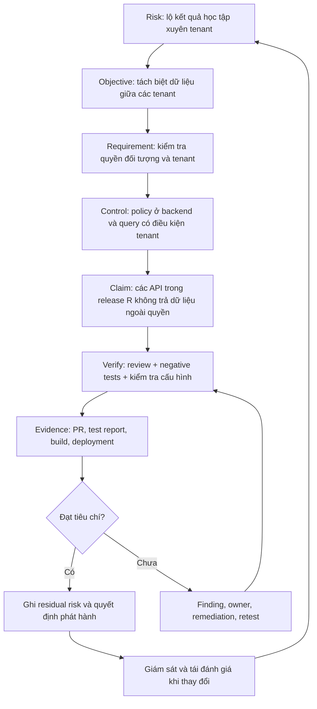
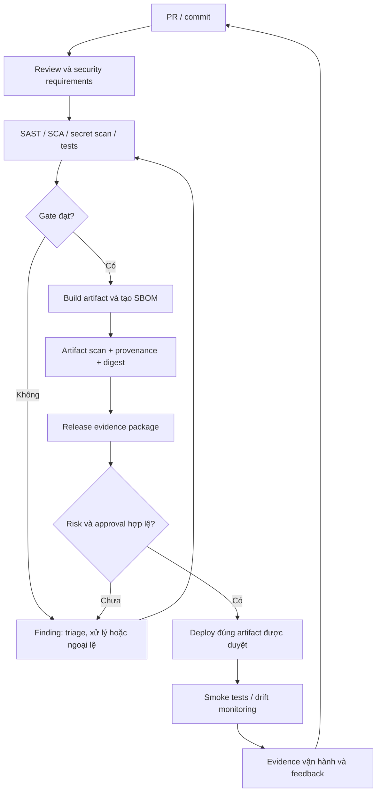

# Bằng chứng SDLC: chứng minh phần mềm được phát triển và phát hành an toàn

## 1. Tại sao quy trình SDLC cần bằng chứng?

Một nhóm phát triển tuyên bố: “Chúng tôi luôn code review, chạy security scan và kiểm thử trước khi release”. Khi người đánh giá hỏi bản phát hành đang chạy có được review hay không, họ chỉ tìm thấy ảnh chụp dashboard xanh của một nhánh phát triển từ tháng trước. Ảnh chụp không cho biết commit nào đã được kiểm tra, công cụ dùng cấu hình gì, có cảnh báo nào bị bỏ qua, và bản build được triển khai có đúng là bản đã qua kiểm thử hay không.

Tình huống này cho thấy sự khác biệt giữa **thực hiện hoạt động bảo mật** và **chứng minh hoạt động đó đã diễn ra, có hiệu quả đối với mục tiêu cần bảo vệ**.

**Bằng chứng SDLC (Software Development Life Cycle evidence)** là tập hợp các bản ghi, kết quả kiểm tra, quyết định, cấu hình và artifact có thể truy vết trong suốt vòng đời phát triển phần mềm. Chúng cho phép người có trách nhiệm trả lời những câu hỏi như:

- Hệ thống có yêu cầu bảo mật nào, và chúng đến từ rủi ro nào?
- Kiến trúc và các thay đổi quan trọng đã được đánh giá ra sao?
- Mã nguồn được review và kiểm thử trên đúng phiên bản nào?
- Dependency, secret, cấu hình và pipeline build đã được kiểm tra ở phạm vi nào?
- Những finding nào còn mở? Ai quyết định xử lý hoặc chấp nhận rủi ro?
- Artifact đang triển khai có thực sự được tạo từ mã, công cụ và quy trình đã được kiểm chứng?
- Khi hệ thống thay đổi hoặc xuất hiện lỗ hổng mới, kết luận bảo đảm còn giá trị không?

Trong chương **Secure development** thuộc module **SECURITY_SECURITY_ASSURANCE**, bằng chứng SDLC kết nối phát triển an toàn với **security assurance**: đánh giá có căn cứ rằng hệ thống đáp ứng mục tiêu bảo mật, từ phân tích rủi ro, yêu cầu và controls đến kiểm thử, audit, xử lý finding và giám sát liên tục trong phát triển cũng như vận hành.

### Mục tiêu học tập

Sau bài này, bạn có thể:

1. Phân biệt hoạt động SDLC, artifact, evidence, assurance claim và quyết định chấp nhận rủi ro.
2. Lập ma trận truy vết từ rủi ro, yêu cầu đến controls, kiểm thử và bằng chứng.
3. Chọn evidence thích hợp cho các giai đoạn yêu cầu, thiết kế, lập trình, CI/CD, phát hành và vận hành.
4. Đánh giá chất lượng evidence theo nguồn gốc, tính toàn vẹn, độ bao phủ, tính cập nhật và khả năng tái hiện.
5. Thiết kế một hồ sơ release evidence cho hệ thống Java/Spring Boot nhiều tenant.
6. Xử lý trường hợp evidence thiếu, sai phạm vi, lỗi thời hoặc mâu thuẫn với kết quả thực tế.

## 2. Các khái niệm nền tảng

| Khái niệm | Ý nghĩa | Ví dụ |
|---|---|---|
| **SDLC** | Vòng đời từ lập yêu cầu, thiết kế, phát triển, kiểm thử, phát hành đến vận hành và thay đổi | Quy trình phát hành một dịch vụ API |
| **Security objective** | Kết quả bảo mật cần đạt | Không cho phép người dùng tenant A xem dữ liệu tenant B |
| **Security requirement** | Điều kiện bảo mật cụ thể, kiểm chứng được | API phải kiểm tra cả quyền trên đối tượng và tenant |
| **Security control** | Biện pháp nhằm ngăn ngừa, phát hiện hoặc xử lý rủi ro | Authorization ở service layer, negative integration tests |
| **Assurance claim** | Luận điểm muốn chứng minh trong một phạm vi xác định | Mọi endpoint đọc kết quả trong release R đều thực thi kiểm tra tenant |
| **Evidence** | Thông tin có nguồn gốc và phạm vi rõ, hỗ trợ hoặc bác bỏ claim | Test report, code review, policy/config, audit log |
| **Finding** | Sai lệch hoặc điểm yếu được phát hiện trong quá trình kiểm chứng | API export không lọc tenant |
| **Residual risk** | Rủi ro còn lại sau khi xem xét hiệu lực của controls | Khả năng có endpoint mới chưa được bao phủ |
| **Release evidence package** | Tập hợp liên kết và metadata của bằng chứng liên quan đến một bản phát hành | Commit, build, SBOM, test, scan, approval, risk decision |
| **Provenance** | Thông tin về nguồn gốc và cách artifact được tạo | Repo, commit, workflow, builder, thời điểm, artifact digest |

**Evidence không nhất thiết phải là file đính kèm.** Một liên kết bất biến đến kết quả CI, bản ghi phê duyệt có audit trail hoặc tham chiếu đến artifact lưu trong kho kiểm soát truy cập đều có thể là evidence, miễn là người đánh giá có thể truy xuất và xác minh tính liên quan.

**Có evidence không đồng nghĩa hệ thống an toàn tuyệt đối.** Bằng chứng luôn có phạm vi, thời gian và độ tin cậy nhất định. Chẳng hạn, một bài test thành công chứng minh hành vi trong điều kiện đã thử; nó không tự bảo đảm mọi luồng nghiệp vụ chưa kiểm tra cũng đúng.

### Phân biệt activity, artifact và evidence

| Activity (hoạt động) | Artifact được tạo | Khi nào artifact trở thành evidence hữu ích? |
|---|---|---|
| Threat modeling | Sơ đồ luồng dữ liệu, danh sách threat | Có phạm vi/phiên bản, risk owner, quyết định và mapping đến yêu cầu |
| Code review | Pull request, bình luận, approval | Gắn đúng diff, reviewer, tiêu chí review, thời điểm và kết quả |
| Static analysis | Báo cáo SAST | Gắn commit, tool version, rule set, phát hiện, triage và giới hạn quét |
| Integration test | Test result, log | Có expected/actual, dữ liệu và cấu hình test, build được kiểm tra |
| Build release | Binary/container image | Có digest, nguồn code, toolchain và đường truy vết đến pipeline |
| Risk acceptance | Biên bản quyết định | Chỉ rõ phạm vi, finding, chủ rủi ro, quyền phê duyệt, điều kiện và thời hạn |

Một danh sách “đã làm” chỉ là phát biểu về quy trình. Evidence cần giúp xác minh **đã làm trên đối tượng nào, bằng cách nào, kết quả ra sao và kết luận hợp lệ trong phạm vi nào**.

## 3. Chuỗi truy vết làm nền tảng cho security assurance

Bằng chứng SDLC nên được tổ chức theo chuỗi:

**Risk scenario → Security objective → Requirement → Control → Claim → Verification activity → Evidence → Finding/decision → Monitoring.**



Mỗi mắt xích cần một định danh hoặc liên kết ổn định. Nếu chỉ có báo cáo SAST mà không biết requirement hay claim nào đang được kiểm chứng, rất khó kết luận hệ thống có đáp ứng mục tiêu bảo mật trọng yếu hay không.

### Ma trận truy vết ví dụ

| ID | Risk/requirement | Control và claim | Evidence dự kiến | Điều kiện đạt |
|---|---|---|---|---|
| R-01 / REQ-01 | Không lộ dữ liệu học tập xuyên tenant | Kiểm tra tenant tại service/query; CLM-01 | Access matrix, review PR, test âm tính, config production | Mọi đường đọc dữ liệu thuộc phạm vi đều từ chối truy cập sai tenant |
| R-02 / REQ-02 | Không để credential bị lộ trong repo/build | Secret management, secret scanning; CLM-02 | Rule/config scanner, PR scan, kiểm tra quyền CI | Không có secret có hiệu lực bị ghi ra artifact/log; finding được xử lý |
| R-03 / REQ-03 | Hạn chế rủi ro dependency có lỗ hổng | SCA/SBOM, triage, patch; CLM-03 | Dependency graph, SBOM, scan, risk decision | Finding vượt ngưỡng được xử lý hoặc có quyết định ngoại lệ hợp lệ |
| R-04 / REQ-04 | Artifact triển khai xuất phát từ build được phê duyệt | CI kiểm soát, provenance/digest; CLM-04 | Build record, source revision, artifact digest, deployment record | Digest triển khai trùng artifact đã kiểm tra và phê duyệt |
| R-05 / REQ-05 | Có thể khôi phục sau sự cố mất dữ liệu | Backup, restore test, recovery policy; CLM-05 | Backup log, kết quả diễn tập phục hồi, biên bản review | Diễn tập đáp ứng mục tiêu phục hồi đã duyệt |

Một control có thể đáp ứng nhiều yêu cầu; một yêu cầu thường cần nhiều control và phương pháp kiểm chứng. Không nên ép quan hệ một-một nếu làm mất các đường ảnh hưởng quan trọng.

## 4. Evidence ở từng giai đoạn SDLC

### 4.1. Khởi tạo và phân tích yêu cầu

Ở giai đoạn đầu, câu hỏi là **cần bảo vệ cái gì, khỏi kịch bản nào và theo tiêu chí gì**.

Evidence hữu ích:

- Danh mục tài sản, dữ liệu, người dùng và dịch vụ trọng yếu.
- Phân loại dữ liệu, luồng xử lý và ranh giới tin cậy.
- Risk register: kịch bản, likelihood/impact, chủ sở hữu, giả định và mức ưu tiên.
- Yêu cầu bảo mật có thể kiểm chứng và liên kết tới user story/epic.
- Yêu cầu pháp lý, hợp đồng hoặc chính sách nội bộ áp dụng cho phạm vi dự án.
- Security acceptance criteria, đặc biệt cho các luồng xác thực, phân quyền và xử lý dữ liệu.

Ví dụ requirement chưa đủ rõ: “API phải an toàn”.

Requirement có thể kiểm chứng:

> Với mọi API trả kết quả học tập, backend phải xác thực chủ thể, kiểm tra quyền đối với đối tượng dữ liệu và tenant; yêu cầu ngoài quyền phải bị từ chối mà không trả dữ liệu của tenant khác.

Evidence không chỉ là một trang mô tả. Cần biết yêu cầu được ai phê duyệt, thuộc phiên bản nào, và được kiểm chứng bởi test hoặc review nào.

### 4.2. Thiết kế và threat modeling

Các quyết định kiến trúc cần được chứng minh có xét đến rủi ro:

- Sơ đồ context/data flow, thành phần, trust boundaries và các luồng đặc quyền.
- Threat model có danh sách threat, giả định, biện pháp giảm thiểu và rủi ro chưa xử lý.
- Architecture Decision Record (ADR) ghi lựa chọn, lý do, trade-off và người phê duyệt.
- Security design review: phân quyền, xác thực, quản lý key/secret, mã hóa, logging, data retention.
- Mapping giữa các threat và requirements/controls tương ứng.
- Bằng chứng review khi thay đổi architecture, nhà cung cấp hoặc trust boundary.

Ví dụ: ứng dụng dùng API gateway để xác thực token, nhưng kiểm tra tenant được thực hiện trong từng service. Tài liệu thiết kế phải giải thích **vì sao gateway không đủ**, ở lớp nào kiểm tra quyền đối tượng và làm sao tránh việc background job đi vòng qua lớp đó.

Một sơ đồ đẹp không chứng minh kiến trúc đã được triển khai như thiết kế. Giai đoạn tiếp theo phải xác nhận bằng code, cấu hình và kiểm thử.

### 4.3. Phát triển và review mã nguồn

Evidence thường bao gồm:

- Thay đổi có PR/MR, liên kết issue/requirement, diff và lịch sử review.
- Branch protection, yêu cầu reviewer và trạng thái kiểm tra bắt buộc.
- Bản ghi review các luồng nhạy cảm: authorization, input validation, logging, cryptography, error handling.
- Kết quả SAST, secret scan và các finding được triage.
- Unit test, property-based test hoặc test negative path cho security requirement.
- Tài liệu cấu hình và thay đổi dependency/BOM/lockfile.

Một PR có dấu “Approved” chỉ chứng minh có phê duyệt trong phạm vi workflow đã cấu hình. Để dùng làm evidence cho security claim, cần xác định reviewer đã xem **đúng commit/diff**, thay đổi nhạy cảm có tiêu chí review phù hợp, và không có commit mới làm mất hiệu lực phê duyệt.

**Ví dụ review phân quyền trong Java:**

```java
@PreAuthorize("@accessPolicy.canReadResult(authentication, #tenantId, #resultId)")
public ResultDto getResult(String tenantId, UUID resultId) {
    return repository.findByTenantIdAndId(tenantId, resultId)
        .map(mapper::toDto)
        .orElseThrow(ResultNotFoundException::new);
}
```

Đoạn code chỉ minh họa một control. Reviewer vẫn phải xác minh `accessPolicy` dựa trên danh tính và quyền đáng tin cậy, method security đã bật, không có luồng truy cập bypass, truy vấn lọc tenant đúng và các API export/batch có cùng yêu cầu. Evidence mạnh hơn khi có **code review gắn commit** và **test âm tính** cho các điều kiện truy cập trái phép.

### 4.4. Kiểm thử bảo mật

Cần lưu kết quả theo loại phương pháp và mục tiêu kiểm tra:

| Phương pháp | Có thể cung cấp evidence về | Giới hạn cần ghi rõ |
|---|---|---|
| **Unit test** | Logic validation, authorization policy, hàm xử lý dữ liệu | Không chứng minh toàn bộ luồng tích hợp hoặc cấu hình production |
| **Integration/API test** | Quyền trên đối tượng, tenant boundary, authentication, lỗi nghiệp vụ | Phụ thuộc dữ liệu, cấu hình và phạm vi API được thử |
| **SAST** | Mẫu code nguy hiểm theo tập rule, data flow có thể phân tích | Có false positive/negative; khó thay thế business logic review |
| **SCA/dependency review** | Thành phần có lỗ hổng đã biết, tình trạng phiên bản, một phần nguồn gốc | Phụ thuộc chất lượng inventory, advisory và reachability |
| **Secret scan** | Dấu hiệu secret lộ trong mã, lịch sử hoặc artifact được quét | Không bao phủ mọi secret và mọi nơi đã bị phát tán |
| **DAST** | Hành vi ứng dụng đang chạy với các request/kịch bản đã thử | Chỉ bao phủ môi trường và đường đi được cấu hình |
| **Fuzzing** | Phản ứng trước input bất thường, crash hoặc lỗi parser | Cần corpus, thời lượng và coverage thích hợp |
| **Manual penetration test** | Kết hợp các đường tấn công, business logic và đánh giá theo ngữ cảnh | Phụ thuộc phạm vi, kỹ năng, thời gian; kết quả có tính thời điểm |
| **Configuration/IaC review** | Quy tắc mạng, IAM, secret, TLS, cấu hình deployment | Không tự khẳng định runtime không drift |
| **Resilience/restore test** | Khả năng khôi phục, xử lý sự cố, RTO/RPO trong điều kiện thử | Không bảo đảm mọi sự cố thực tế sẽ giống kịch bản |

Với mỗi test, cần ghi **test ID, requirement/claim, bản build, môi trường, dữ liệu hoặc điều kiện, expected result, actual result và evidence**. Nếu kết quả thất bại, chính kết quả thất bại cũng là evidence và phải được quản lý như một finding.

### 4.5. CI/CD, build và artifact

Các câu hỏi assurance quan trọng:

- Mã nguồn nào đã tạo ra artifact?
- Pipeline nào chạy, trên môi trường và toolchain nào?
- Người nào hoặc cơ chế nào có quyền thay đổi pipeline/build?
- Kết quả test/scan có thuộc đúng commit và đúng artifact không?
- Artifact có bị sửa hoặc thay thế giữa kiểm thử và triển khai?

Evidence có thể gồm commit SHA, workflow definition version, build/job ID, kết quả các gate, SBOM, provenance, artifact digest, chữ ký khi phù hợp, bản ghi approval và deployment manifest.

**Digest** là một cách định danh nội dung artifact. So sánh digest giúp xác minh artifact được triển khai có cùng nội dung với artifact đã được phê duyệt. Nhưng digest không tự chứng minh build đáng tin hoặc mã nguồn không độc hại; cần liên kết với nguồn code, builder và policy.

### 4.6. Phát hành và triển khai

Trước release, bằng chứng nên giúp trả lời:

- Những kiểm tra bắt buộc nào đã hoàn tất và trên bản build nào?
- Các finding trọng yếu đã được khắc phục và retest chưa?
- Những ngoại lệ còn hiệu lực có owner, điều kiện và thẩm quyền không?
- Hệ thống triển khai có dùng đúng artifact, cấu hình, secret reference và policy đã xét?
- Ai đã phê duyệt phát hành, theo tiêu chí nào?

Sau triển khai, có thể cần smoke test phân quyền, kiểm tra cấu hình quan trọng, thông tin digest đang chạy và kết quả health/security checks. Bằng chứng từ staging không tự động chứng minh production cấu hình giống hệt.

### 4.7. Vận hành và cải tiến

SDLC không kết thúc tại thời điểm deploy. Evidence trong vận hành có thể bao gồm:

- Audit log, alert và báo cáo giám sát theo risk.
- Rà soát quyền và thay đổi vai trò, tài khoản đặc quyền.
- Kết quả quét lại khi có advisory mới hoặc cấu hình thay đổi.
- Báo cáo vulnerability management, sự cố, điều tra nguyên nhân gốc.
- Diễn tập backup/restore, incident response và kiểm tra khả năng khôi phục.
- Trạng thái remediation, kết quả retest, ngày đóng finding và risk review.

Một lỗ hổng mới công bố có thể khiến evidence “SCA pass” từ lúc release không còn đủ để kết luận residual risk hiện tại thấp. Assurance cần được làm mới theo sự kiện và theo mức rủi ro.

## 5. Chất lượng bằng chứng: có file chưa chắc đã có assurance

Các tiêu chí đánh giá evidence:

| Tiêu chí | Câu hỏi cần hỏi | Ví dụ evidence yếu |
|---|---|---|
| **Relevance — liên quan** | Bằng chứng có trực tiếp hỗ trợ claim hay requirement? | Dùng scan dependency để chứng minh tenant authorization |
| **Coverage — bao phủ** | Có đủ API, vai trò, hành động, môi trường và thành phần? | Test một endpoint rồi kết luận toàn bộ API an toàn |
| **Correctness — đúng đắn** | Phương pháp, dữ liệu và expected/actual có phù hợp? | Test 403 nhưng không kiểm tra tác vụ nền vẫn ghi dữ liệu |
| **Freshness — cập nhật** | Có gắn với bản code, policy và cấu hình đang chạy? | Pen test của version cũ trước khi đổi identity provider |
| **Provenance — nguồn gốc** | Ai/công cụ nào tạo, khi nào, từ đầu vào và bản build nào? | Báo cáo thủ công thiếu commit, người tạo và môi trường |
| **Integrity — toàn vẹn** | Có cơ chế phát hiện thay đổi hoặc sửa sai trái phép? | File kết quả tùy ý ghi đè sau phê duyệt |
| **Repeatability — tái thực hiện** | Người khác có thể chạy lại hoặc đối chiếu kết quả? | Chỉ ghi “test OK” không có điều kiện và test case |
| **Independence — độc lập phù hợp** | Có mức review độc lập tương xứng rủi ro? | Control trọng yếu do một người tự triển khai, tự duyệt, tự chấp nhận |
| **Availability — truy xuất** | Evidence còn tồn tại và có thể xem khi audit/sự cố? | Link tới job/log đã bị xóa do retention ngắn |
| **Consistency — nhất quán** | Evidence và quyết định có mâu thuẫn hay thiếu liên kết? | Báo cáo SCA báo fail nhưng release note ghi “không có rủi ro” |

Không phải mọi loại evidence đều cần cùng mức độc lập, lưu trữ hoặc kiểm thử. Điều đó phụ thuộc mức độ nhạy cảm của tài sản, hậu quả khi control thất bại và độ bất định của kết luận.

### Evidence “pass” cần metadata gì?

Một record hữu ích nên có các trường sau (tên trường chỉ minh họa):

```yaml
evidence_id: "EV-AUTHZ-2026-011"
claim_id: "CLM-TENANT-01"
requirement_ids:
  - "REQ-AUTHZ-01"
service: "learning-result-service"
source:
  repository: "learning-platform"
  commit: "0123456789abcdef0123456789abcdef01234567"
build:
  id: "ci-4821"
  artifact_digest: "sha256:<digest-thuc-te>"
verification:
  method: "integration-test"
  test_suite: "TenantIsolationIT"
  environment: "staging-isolated"
  expected: "Cross-tenant read requests are denied"
  actual: "All defined negative test cases passed"
  status: "PASS"
  executed_at: "2026-11-28T09:00:00+07:00"
  tool_version: "<phien-ban-thuc-te>"
artifact:
  uri: "artifact-store://ci-4821/tenant-isolation-report"
review:
  reviewer: "security-reviewer"
  reviewed_at: "2026-11-28T09:15:00+07:00"
limitations:
  - "Chưa kiểm thử luồng export mới trên production"
```

Các giá trị commit, digest, URI, thời gian và service trong ví dụ là **giả định**, cần thay bằng giá trị thực của hệ thống. Bằng chứng vẫn có giới hạn: trạng thái PASS chỉ áp dụng cho bộ test và môi trường đã ghi nhận; nếu chưa kiểm thử export, không nên tuyên bố mọi đường đọc dữ liệu đều đã được chứng minh.

## 6. Mô hình assurance case: claim, argument và evidence

Một **assurance case** trình bày lập luận có cấu trúc về việc một mục tiêu được đáp ứng dựa trên bằng chứng. Cách diễn đạt nên tránh claim quá rộng.

**Claim quá rộng:** “Ứng dụng an toàn”.

**Claim có thể kiểm chứng:** “Trong release R, mọi API đọc kết quả học tập thuộc inventory đã phê duyệt đều từ chối yêu cầu truy cập xuyên tenant theo chính sách REQ-AUTHZ-01, tại cấu hình production đã xác minh”.

```text
GOAL / CLAIM:
  Release R kiểm soát truy cập kết quả học tập theo tenant
  |
  +-- ARGUMENT 1: Danh mục đường truy cập đã được xác định đủ phạm vi
  |     +-- EVIDENCE: API inventory, DFD, review export/batch jobs
  |
  +-- ARGUMENT 2: Thiết kế và code áp dụng kiểm soát quyền
  |     +-- EVIDENCE: ADR, policy mapping, PR review, source inspection
  |
  +-- ARGUMENT 3: Hành vi đã được kiểm chứng trên bản build R
  |     +-- EVIDENCE: Negative integration tests, test report, build ID
  |
  +-- ARGUMENT 4: Artifact và cấu hình production khớp bản đã duyệt
  |     +-- EVIDENCE: Image digest, deployment record, smoke test
  |
  +-- ASSUMPTIONS: Inventory đầy đủ, identity provider hoạt động đúng
  +-- LIMITATIONS: Chưa bao phủ một integration thử nghiệm chưa phát hành
```

Nếu giả định không được kiểm chứng, hoặc inventory thiếu đường truy cập mới, phải bổ sung evidence hoặc thu hẹp claim. Đánh giá assurance cần chỉ rõ **điều đã chứng minh, điều có cơ sở suy luận và điều vẫn chưa biết**.

### Một evidence có thể hỗ trợ nhiều claim

Báo cáo tích hợp xác thực có thể hỗ trợ claim về phiên đăng nhập và token validation; báo cáo kiểm tra phân quyền có thể hỗ trợ claim về quyền đối tượng. Tuy nhiên, dùng lại evidence phải phù hợp từng claim. Không thể dùng kết quả test đăng nhập để tự suy ra quy tắc tenant isolation đã đúng.

## 7. Evidence trong CI/CD: tự động hóa thu thập và liên kết

CI/CD là nơi thuận lợi để thu thập evidence có tính lặp lại. Một pipeline điển hình có thể:

1. Nhận commit/PR và ghi nhận nguồn thay đổi.
2. Resolve dependency graph; kiểm tra manifest, lockfile hoặc BOM.
3. Chạy code quality, SAST, secret scanning và policy checks theo phạm vi.
4. Chạy unit/integration/security regression tests.
5. Build artifact có định danh và digest.
6. Tạo SBOM và quét artifact hoặc container image cuối.
7. Đối chiếu findings và exception với release policy.
8. Lưu artifact/evidence có metadata và retention.
9. Chuyển sang bước phê duyệt, ký/attest khi phù hợp và triển khai artifact đã được xét.
10. Sau deploy, kiểm tra digest/cấu hình và các smoke tests quan trọng.



Pipeline phải lưu được **trạng thái test thất bại và quá trình xử lý**, không chỉ ảnh chụp trạng thái cuối cùng. Nếu cho phép rerun, cần phân biệt kết quả các lần chạy và giải thích vì sao một lần thất bại được xử lý.

### 7.1. Release gate cần điều kiện có thể xác minh

Ví dụ chính sách release:

```text
INPUT:
  release candidate R
  source commit C
  artifact digest D
  security requirements / risk register / exception register

REQUIRED:
  - Review bắt buộc áp dụng cho commit C
  - Security test suite quan trọng PASS trên artifact tương ứng
  - SAST/SCA/secret scan hoàn thành trong phạm vi release
  - Findings vượt ngưỡng được xử lý hoặc có exception hợp lệ
  - Artifact digest D được ghi trong release evidence package
  - Người có thẩm quyền phê duyệt theo chính sách

AFTER DEPLOYMENT:
  - Digest đang chạy khớp D
  - Security smoke tests đạt
  - Monitoring và owner đã sẵn sàng

IF EVIDENCE IS MISSING:
  - Đánh dấu trạng thái NOT_VERIFIED
  - Chặn hoặc escalation theo policy và mức rủi ro
```

Đây là logic chính sách minh họa, không phải công cụ có thể chạy trực tiếp. Ngưỡng kiểm tra, ngoại lệ và cấp phê duyệt phải được tổ chức thiết lập dựa trên risk appetite, tính trọng yếu của hệ thống và nghĩa vụ liên quan.

### 7.2. Không chấp nhận kết quả từ nhánh hoặc artifact khác

Một lỗi assurance phổ biến là “test pass ở commit A nhưng deploy commit B”. Nếu B chứa thay đổi chưa kiểm tra, kết quả ở A không chứng minh B đạt yêu cầu. Cần liên kết:

**Source revision → CI run → test/scan evidence → built artifact digest → approval → deployed digest.**

Đối với pipeline có nhiều bước và môi trường, nên xác định bước nào có thể tái sử dụng evidence và điều kiện nào bắt buộc chạy lại. Thay đổi source, dependency, build recipe, policy hoặc cấu hình liên quan có thể khiến evidence cũ mất hiệu lực.

## 8. Bằng chứng về nguồn gốc và tính toàn vẹn artifact

**Software supply chain provenance** mô tả artifact được xây dựng từ đâu và bằng quy trình nào. Nó hỗ trợ kiểm tra chuỗi từ mã nguồn đến bản phát hành.

Các thông tin có ích:

- Repository, commit/tag và hệ thống quản lý source.
- Build definition, workflow và revision của cấu hình pipeline.
- Builder/runner identity và toolchain khi có.
- Inputs như dependency và các artifact build quan trọng.
- Build invocation, kết quả, thời điểm và artifact digest.
- Chính sách xác minh chữ ký/attestation hoặc provenance nếu được áp dụng.

**SBOM** cho biết thành phần trong một phạm vi artifact; **provenance** cho biết nguồn gốc và cách artifact được tạo. Chúng bổ sung cho nhau: SBOM không tự chứng minh pipeline đáng tin, và provenance không tự chứng minh mọi dependency không có lỗ hổng.

Các mô hình như **SLSA** cung cấp khái niệm về mức độ kiểm soát và khả năng kiểm chứng chuỗi build. Khi tham chiếu một mức hay chứng nhận, phải xác định phạm vi và yêu cầu thực tế, không suy ra một mức bảo đảm tổng quát cho toàn hệ thống.

### Kiểm tra integrity trong triển khai

Ví dụ với container image, một release record có thể lưu:

```yaml
release_id: "result-service-2026.11-demo"
source_commit: "<commit-da-duyet>"
ci_run: "<build-id>"
image:
  reference: "registry.example/learning/result-service@sha256:<digest>"
evidence:
  - "ci://<build-id>/security-test-report"
  - "ci://<build-id>/sca-report"
  - "artifact://<build-id>/sbom"
  - "artifact://<build-id>/provenance"
approvals:
  - "change-owner-approval"
  - "risk-review-if-required"
deployment:
  environment: "production"
  observed_digest: "sha256:<same-digest>"
  security_smoke_test: "PASS"
```

Mẫu trên là dữ liệu minh họa. Khi triển khai thực tế, cần xác minh chuỗi artifact và quyền truy cập các nguồn evidence; trường `observed_digest` phải được lấy từ trạng thái triển khai thay vì gõ lại từ ý định release.

## 9. Ví dụ xuyên suốt: evidence cho phân quyền đa tenant trong Java/Spring Boot

Giả sử dịch vụ `result-service` của nền tảng học tập lưu kết quả bài kiểm tra cho nhiều trường hoặc doanh nghiệp. Các vai trò chính gồm người học, giảng viên và quản trị viên của từng tenant. Hệ thống dùng Spring Boot, cơ sở dữ liệu quan hệ và API xuất báo cáo.

### 9.1. Đặt rủi ro và mục tiêu

**Risk R-01:** người dùng tenant A sửa tham số `tenantId` hoặc `resultId` và truy cập kết quả thuộc tenant B do thiếu kiểm tra quyền ở một endpoint hoặc tác vụ export.

**Objective:** chỉ người có quyền hợp lệ được đọc/sửa kết quả của đúng tenant, lớp và đối tượng.

**Requirement REQ-AUTHZ-01:** mỗi đường truy cập dữ liệu phải xác minh danh tính, quyền hành động, phạm vi tenant và quan hệ với đối tượng trước khi trả hoặc thay đổi dữ liệu.

**Claim CLM-TENANT-01:** trong release R, các endpoint đọc/sửa/xuất kết quả thuộc inventory đã phê duyệt đều từ chối yêu cầu vượt phạm vi tenant.

### 9.2. Xác định evidence theo giai đoạn

| Giai đoạn | Evidence cụ thể | Nội dung chứng minh |
|---|---|---|
| Requirements | REQ-AUTHZ-01, access matrix theo vai trò/tenant | Quy tắc truy cập rõ và kiểm chứng được |
| Design | DFD, threat model, ADR về kiểm tra quyền tại service và query | Những đường truy cập và trust boundary đã được phân tích |
| Development | PR review của controller, service, repository và export job | Kiểm tra quyền được triển khai ở các đường quan trọng |
| Testing | Integration tests cho role, tenant, object ID, export và batch | Hành vi cho phép/từ chối đúng trên build mục tiêu |
| CI/CD | Commit, job, test report, image digest và scan report | Test và scan gắn với release artifact |
| Deployment | Image digest thực tế, policy/config kiểm tra sau deploy | Bản triển khai khớp bản đã xét |
| Operations | Audit log, phát hiện truy cập sai, access review và incident feedback | Control tiếp tục hoạt động và có giám sát |

### 9.3. Test âm tính là bằng chứng quan trọng

Ví dụ test integration cho API đọc kết quả:

```java
@Test
void learnerFromTenantACannotReadResultOfTenantB() throws Exception {
    String tokenOfLearnerA = tokenFactory.forLearner("tenant-A", "learner-A");
    UUID resultBelongingToTenantB = fixtures.resultOf("tenant-B");

    mockMvc.perform(get("/api/results/{resultId}", resultBelongingToTenantB)
            .header("Authorization", "Bearer " + tokenOfLearnerA))
        .andExpect(status().isForbidden());
}
```

Đây là đoạn minh họa, giả định policy trả HTTP 403 khi không đủ quyền. Một hệ thống có thể chọn 404 nhằm tránh tiết lộ sự tồn tại của tài nguyên. Trong cả hai trường hợp, test cần xác minh **không có dữ liệu trái phép trong response hoặc side effect**, và không tồn tại endpoint thay thế bỏ qua kiểm soát.

Test case cần bổ sung:

- Người học A đọc kết quả chính mình: allow.
- Người học A đọc kết quả của người học khác trong cùng tenant khi không có quyền: deny.
- Giảng viên A xem lớp được phân công: allow; lớp ngoài phân công: deny.
- Giảng viên A thay cả `tenantId` và `resultId` để truy cập tenant B: deny.
- Endpoint export/batch chỉ xuất dữ liệu trong phạm vi cho phép.
- Tài khoản bị thu hồi quyền giữa phiên: request tiếp theo tuân theo thời hạn thu hồi đã định.
- Các trường hợp null/missing ID, ID giả, resource không tồn tại và cache miss/hit không lộ dữ liệu.

### 9.4. Ví dụ defect và chuỗi xử lý

Một test cho export báo FAIL: giảng viên tenant A có thể xuất kết quả thuộc tenant B. Kết quả FAIL **là evidence có giá trị**, cho thấy claim hiện chưa đạt.

Quy trình:

1. Tạo finding `F-021` liên kết `R-01`, `REQ-AUTHZ-01` và `CLM-TENANT-01`.
2. Ghi bản build, API, request, kết quả thực tế, phạm vi ảnh hưởng và tác động.
3. Phân công chủ sửa lỗi; đánh giá mức nghiêm trọng và biện pháp giảm thiểu trước mắt.
4. Sửa lọc tenant và review mọi đường export tương tự, không chỉ endpoint phát hiện.
5. Thêm regression tests; chạy lại trên build mới.
6. Quét và kiểm tra artifact mới; đối chiếu digest sau triển khai.
7. Đánh giá residual risk, cập nhật evidence và chỉ đóng finding khi tiêu chí đóng đã được đáp ứng.

Nếu nhóm chỉ sửa mã nhưng chưa có retest, trạng thái phù hợp là **FIX_IMPLEMENTED / VERIFICATION_PENDING**, không phải VERIFIED. Nếu vẫn phải phát hành với rủi ro còn tồn tại, cần quyết định ngoại lệ đúng thẩm quyền với thời hạn, điều kiện giảm thiểu và lịch đánh giá lại.

## 10. Hồ sơ release evidence tối thiểu

Một release evidence package nên cho phép người đánh giá từ **release ID** đi ngược về source, yêu cầu và quyết định rủi ro.

| Nhóm thông tin | Nội dung tối thiểu | Mục đích |
|---|---|---|
| Release identity | Service, release ID, commit/tag, artifact digest, môi trường | Gắn evidence với đúng đối tượng |
| Requirements/risk | Requirement IDs, risk IDs, phiên bản security baseline | Cho biết tiêu chí cần chứng minh |
| Design/change | ADR, threat model delta, PRs, reviewer | Chứng minh thay đổi đã được xem xét |
| Build provenance | Pipeline/run ID, builder, workflow version, input và output | Truy xuất nguồn gốc artifact |
| Verification | Test suite, SAST/SCA/secret scan, manual review, scope, results | Đánh giá các claim |
| Findings | Open/closed, severity, owner, status và retest evidence | Thể hiện khoảng trống chưa xử lý |
| Exceptions | Quyết định risk acceptance, điều kiện, expiry, approver | Giải trình rủi ro còn lại |
| Release approval | Phê duyệt của người/cơ chế có thẩm quyền | Ghi quyết định cho phép phát hành |
| Deployment verification | Digest đã triển khai, config check, smoke tests | Đối chiếu giữa điều đã kiểm và điều đang chạy |
| Monitoring | Alert, owner, lịch review, trigger làm mới evidence | Duy trì assurance sau phát hành |

### Một manifest release evidence minh họa

```yaml
release:
  id: "result-service-R-demo"
  service: "result-service"
  commit: "<real-commit-sha>"
  artifact_digest: "sha256:<real-artifact-digest>"
  environment: "production"
claims:
  - id: "CLM-TENANT-01"
    requirement: "REQ-AUTHZ-01"
    evidence:
      - "artifact://ci-run-123/access-matrix"
      - "artifact://ci-run-123/authorization-tests"
      - "artifact://ci-run-123/code-review-record"
    status: "VERIFIED_WITH_SCOPE"
    limitations:
      - "Đối chiếu riêng cấu hình external export connector"
findings:
  open:
    - id: "F-022"
      risk_owner: "result-service-owner"
      decision: "RESTRICT_EXPORT_PENDING_RETEST"
  fixed_and_verified:
    - id: "F-021"
      evidence: "artifact://ci-run-123/retest-F-021"
release_gate:
  required_checks: "PASS"
  risk_decision: "APPROVED_WITH_CONDITIONS"
  approver: "<authorized-approver>"
  approval_record: "approval://change-R-demo"
deployment:
  deployed_digest: "sha256:<real-artifact-digest>"
  smoke_test: "PASS"
monitoring:
  owner: "service-operations"
  next_review: "<approved-review-date>"
```

Đây là một **mẫu dữ liệu giả định**, không phải evidence của hệ thống thực tế. Các URI và trạng thái phải dẫn đến hồ sơ tồn tại, có quyền truy cập phù hợp và có thể kiểm chứng. Trạng thái `APPROVED_WITH_CONDITIONS` chỉ hợp lệ nếu thẩm quyền, điều kiện phát hành, risk appetite và biện pháp giảm thiểu đã được xác nhận theo chính sách.

## 11. Ai tạo, ai đánh giá và ai sử dụng evidence?

| Vai trò | Trách nhiệm điển hình |
|---|---|
| **Product/service owner** | Xác định yêu cầu, phạm vi service và bảo đảm xử lý risk/finding của sản phẩm |
| **Developer/engineering lead** | Tạo code, test, PR review, sửa finding, giữ liên kết đến build |
| **Security/AppSec** | Hướng dẫn security requirements, phương pháp review, test và triage; đánh giá evidence |
| **Platform/DevOps** | Bảo vệ CI/CD, artifact registry, triển khai, provenance, log và retention |
| **QA/test engineer** | Thiết kế, thực hiện, duy trì và báo cáo test có thể tái hiện |
| **Risk owner** | Quyết định hoặc đề xuất xử lý residual risk trong thẩm quyền |
| **Release/change approver** | Xác nhận các gate và điều kiện phát hành theo chính sách |
| **Audit/assurance độc lập** | Lấy mẫu evidence, đánh giá chất lượng kiểm soát và báo cáo khoảng trống |

Có thể dùng RACI để phân định người thực hiện (R), người chịu trách nhiệm cuối cùng (A), người được tham vấn (C) và được thông báo (I). Với control trọng yếu, nên có mức đánh giá độc lập phù hợp để tránh một cá nhân tự tạo, tự xác nhận và tự phê duyệt mọi phần của kết luận.

**Một finding cần có owner; một exception cần có người có quyền chấp nhận rủi ro.** Việc security team ghi nhận “đã biết” không đồng nghĩa rủi ro đã được chấp nhận.

## 12. Khi bằng chứng bị thiếu, lỗi thời hoặc mâu thuẫn

| Tình huống | Rủi ro đối với kết luận | Hành động phù hợp |
|---|---|---|
| Không có test report cho commit đã phát hành | Không chứng minh code đang chạy được kiểm tra | Chạy kiểm chứng bổ sung hoặc chặn/escalation theo policy |
| Scan pass nhưng advisory mới xuất hiện sau đó | Evidence cũ không phản ánh threat hiện tại | Tái scan artifact/SBOM, đánh giá reachability và risk |
| Test pass ở staging, production dùng policy khác | Claim có thể không đúng ở môi trường đích | Kiểm tra config diff, smoke test và policy enforcement |
| Artifact triển khai có digest khác artifact được duyệt | Mất liên kết giữa review và production | Dừng/điều tra thay đổi, xác minh provenance trước khi kết luận |
| Finding đã đổi trạng thái “resolved” nhưng không có retest | Chưa chứng minh sửa lỗi có hiệu lực | Yêu cầu regression test và đối chiếu artifact |
| Dashboard xanh nhưng raw report có lỗi bị suppression | Kết luận thiếu trung thực hoặc thiếu ngữ cảnh | Audit cấu hình suppression, exception và kết quả gốc |
| Link evidence hết hạn, log đã bị xóa | Không thể kiểm toán hoặc điều tra | Cải thiện retention, kho lưu trữ và chính sách sao lưu |
| Không biết owner/approver | Không có trách nhiệm giải trình | Xác định quyền và chủ sở hữu, review lại quyết định |

Khi thiếu bằng chứng, nên ghi **NOT_VERIFIED** hoặc **INSUFFICIENT_EVIDENCE** đối với claim liên quan. “Không có evidence chứng minh lỗi” không phải bằng chứng “không có lỗi”.

### Tránh tạo evidence hình thức

- Chụp ảnh dashboard thay vì lưu result gắn commit/build.
- Tự điền “PASS” thủ công khi không có job và kết quả kiểm thử.
- Lưu nhiều bản báo cáo nhưng không xác định được bản nào áp dụng cho release.
- Chỉ giữ kết quả scan xanh, xóa lịch sử các lần thất bại.
- Cho phép suppression không có lý do, chủ sở hữu hoặc hạn.
- Ghi “đã pen test” nhưng không có scope, phiên bản, phương pháp hoặc finding.
- Dùng bảng checklist như bằng chứng hiệu lực mà không kiểm tra control thực tế.

Hệ thống evidence nên khiến hành vi đúng dễ thực hiện: tự động thu thập metadata, liên kết artifact, chuẩn hóa trạng thái, yêu cầu giải thích khi bỏ qua gate và có thể truy xuất khi audit.

## 13. Bảo vệ và quản lý vòng đời evidence

Evidence về bảo mật có thể chứa chi tiết kiến trúc, đường tấn công, thông tin người dùng hoặc log nhạy cảm. Vì vậy cần quản lý vừa để **truy vết**, vừa để **không tạo nguồn rò rỉ mới**.

### 13.1. Integrity và provenance

- Gắn evidence với commit, run ID, artifact digest và phiên bản policy.
- Hạn chế sửa/xóa hồ sơ đã phê duyệt; lưu audit trail khi cập nhật.
- Kiểm soát quyền ghi vào kho build/release evidence và quyền ký/attest.
- Nếu áp dụng chữ ký số hoặc attestation, xác minh danh tính người ký, phạm vi và cách bảo vệ khóa.
- Có cơ chế phát hiện thay đổi ngoài dự kiến và đối chiếu bản triển khai.

Không nên nói “báo cáo được ký nên ứng dụng an toàn”. Chữ ký có thể chứng minh tính toàn vẹn hoặc nguồn gốc theo cơ chế tin cậy, nhưng không bảo đảm nội dung kiểm tra đầy đủ hay kết luận chính xác.

### 13.2. Retention, access và privacy

- Xác định loại evidence bắt buộc lưu và thời hạn theo mức rủi ro, yêu cầu pháp lý/hợp đồng và khả năng audit.
- Phân quyền người tạo, người duyệt, người kiểm toán và người vận hành.
- Không lưu mật khẩu, khóa bí mật, token còn hiệu lực hoặc dữ liệu cá nhân không cần thiết trong report.
- Dùng dữ liệu test được làm giả hoặc giảm nhận diện khi phù hợp.
- Bảo đảm link đến CI job, artifact registry hoặc ticket không mất trước thời hạn cần đối chiếu.
- Có quy trình xử lý xóa/hết hạn khi yêu cầu retention và quyền riêng tư thay đổi.

### 13.3. Tính liên tục và versioning

Hồ sơ release nên có version hoặc snapshot để sau này xem lại **tại thời điểm phê duyệt đã biết điều gì**. Khi một advisory mới khiến risk thay đổi, không nên viết lại lịch sử rằng bản release ban đầu “đã fail”. Thay vào đó, tạo sự kiện/đánh giá mới liên kết đến bản release, ghi thời điểm phát hiện, bối cảnh mới và quyết định tiếp theo.

## 14. Chỉ số đánh giá chất lượng evidence và hiệu quả chương trình

| Chỉ số | Cách sử dụng | Cảnh báo diễn giải |
|---|---|---|
| **Requirement-to-test coverage** | Tỷ lệ requirement trọng yếu có test/review phù hợp | Có test ID không có nghĩa test đủ sâu |
| **Claim evidence coverage** | Tỷ lệ claim trọng yếu có evidence hợp lệ, còn mới | Cần đánh giá phạm vi và độ tin cậy |
| **Release traceability** | Tỷ lệ release liên kết được commit → CI → artifact → deploy | Chỉ số quy trình; chưa tự chứng minh security outcome |
| **Evidence freshness** | Tuổi evidence so với code/config hiện hành | Phải xét trigger thay đổi, không chỉ ngày tháng |
| **Critical finding verification** | Tỷ lệ finding nghiêm trọng được retest thành công | Tránh coi đóng ticket là verified |
| **Open exception age** | Tuổi và số exception hết hạn | Ngoại lệ quá hạn cần escalation |
| **Security gate bypass count** | Số lần bypass, lý do và thẩm quyền | Giảm số lần bằng cách ẩn bypass không cải thiện kiểm soát |
| **Failed/re-run tests** | Tỷ lệ test thất bại và chạy lại, lý do | Quan tâm flaky tests và dấu hiệu bỏ qua lỗi |
| **Artifact integrity mismatch** | Số lần digest triển khai khác bản được duyệt | Một lần mismatch nghiêm trọng có thể cần điều tra ngay |
| **Audit sample exception rate** | Tỷ lệ mẫu evidence thiếu metadata hoặc không truy xuất được | Phụ thuộc phương pháp lấy mẫu và chất lượng review |

**Đừng dùng số lượng báo cáo làm thước đo an toàn.** Chương trình tạo hàng nghìn artifact nhưng không truy vết được yêu cầu hoặc bản phát hành có thể cung cấp ít assurance hơn một chương trình có bộ evidence nhỏ, đầy đủ, cập nhật và kiểm chứng được.

## 15. Risk-based assurance: cần bằng chứng sâu đến đâu?

Không phải thay đổi nào cũng cần pen test độc lập hoặc kiểm tra thủ công quy mô lớn. Chiều sâu assurance nên tương xứng với tài sản, tác động, bề mặt tấn công, độ mới của thay đổi và độ bất định.

| Thay đổi | Evidence thường cần |
|---|---|
| Cập nhật văn bản giao diện không ảnh hưởng xử lý dữ liệu | PR review, build/test nền và mapping release |
| Thay đổi quyền người dùng hoặc policy tenant | Threat model delta, authorization review, negative tests, config verification |
| Thêm endpoint export dữ liệu nhạy cảm | Access matrix, data flow, test quyền và giới hạn dữ liệu, audit logging, risk assessment |
| Thay identity provider hoặc luồng token | Design review, token validation tests, MFA/session/revocation tests, deployment checks |
| Thay dependency parser nhận dữ liệu không tin cậy | SCA, provenance review, regression/fuzz test phù hợp, artifact verification |
| Thay CI/CD hoặc artifact registry | Review quyền build, provenance, credential scope, integrity checks và deployment traceability |

Với thay đổi nhỏ, vẫn cần bằng chứng nền tảng đủ để truy vết. Với thay đổi rủi ro cao, nên bổ sung reviewer độc lập, test chuyên sâu và kiểm tra production sau triển khai. Mọi kết luận cần ghi rõ còn những rủi ro và giả định nào chưa được chứng minh.

## 16. Checklist để thiết kế bộ evidence SDLC

### Phạm vi và yêu cầu

- [ ] Đã xác định service, dữ liệu, môi trường, release và risk owner?
- [ ] Có risk scenarios và security requirements cụ thể, kiểm chứng được?
- [ ] Có truy vết requirement → control → claim → test/review?
- [ ] Có ghi giả định, bề mặt tấn công và phạm vi chưa được kiểm tra?

### Thực hiện và thu thập

- [ ] PR/code review được gắn đúng commit và reviewer?
- [ ] Build, test, SAST/SCA/secret scan và config checks có version, phạm vi, thời điểm?
- [ ] Có test âm tính cho authorization, input và các luồng nghiệp vụ nhạy cảm?
- [ ] SBOM/provenance và artifact digest được ghi theo release nếu cần?
- [ ] Test fail, finding và exception được lưu, không bị ẩn bởi dashboard tổng hợp?

### Release và vận hành

- [ ] Findings vượt ngưỡng đã được xử lý hoặc chấp nhận đúng thẩm quyền?
- [ ] Remediation có retest trên build mới, không chỉ có commit sửa?
- [ ] Digest triển khai khớp artifact đã kiểm tra/phê duyệt?
- [ ] Các kiểm tra liên quan đến cấu hình production đã được thực hiện?
- [ ] Evidence có retention, quyền truy cập và khả năng truy xuất khi audit?
- [ ] Có owner và trigger làm mới evidence khi code, policy, dependency hoặc threat thay đổi?

Checklist là công cụ nhắc việc; assurance claim chỉ có giá trị khi bằng chứng **đủ liên quan, có chất lượng và đúng phạm vi**.

## 17. Bài tập tình huống

Một nhóm phát hành phiên bản R2 của nền tảng học tập. Trước khi phát hành, pipeline báo 120 unit tests pass, SAST không có finding cao và PR đã được phê duyệt. Tuy nhiên, R2 thêm endpoint export dữ liệu người học; ảnh chụp dashboard quét là của commit trước khi thêm endpoint, người phê duyệt không kiểm tra artifact digest, và không có test truy cập xuyên tenant cho API mới.

**Yêu cầu:**

1. Xác định ít nhất ba assurance claims có nguy cơ chưa được chứng minh.
2. Chỉ ra evidence nào đã có nhưng không đủ để kết luận cho R2.
3. Thiết kế test âm tính và review bổ sung cho endpoint export.
4. Mô tả cách liên kết commit R2, build, test, SBOM, artifact digest và deployment.
5. Đề xuất cách xử lý nếu release bắt buộc triển khai gấp nhưng chưa đủ evidence: chủ rủi ro, biện pháp giảm thiểu, quyền phê duyệt, thời hạn và điều kiện retest.

**Hướng đánh giá:** Kết quả unit test/SAST trên commit cũ không chứng minh endpoint mới an toàn. Cần đánh giá cả quyền tenant, đối tượng, vai trò, phạm vi export và tác động phụ; đối chiếu artifact được kiểm tra với bản triển khai. Nếu risk vượt ngưỡng hoặc không được chấp nhận, cần hạn chế tính năng hoặc dừng phát hành theo chính sách.

## 18. Câu hỏi tự ôn tập

1. Một hoạt động code review khác một bằng chứng code review có thể kiểm toán ở những điểm nào?
2. Vì sao “SAST PASS” không đủ để chứng minh phân quyền đa tenant là đúng?
3. Nếu test chạy trên commit A nhưng production triển khai commit B, cần bổ sung gì để tái lập chuỗi assurance?
4. Khi nào một finding được xem là “fixed and verified”, và khi nào nên ghi “verification pending”?
5. SBOM, provenance và artifact digest cung cấp các loại thông tin khác nhau ra sao?
6. Nếu CI lưu kết quả quét chỉ trong bảy ngày nhưng audit diễn ra sau ba tháng, rủi ro nằm ở đâu?
7. Hãy viết một claim có phạm vi rõ ràng và thiết kế ba evidence bổ trợ cho kiểm soát truy cập dữ liệu nhạy cảm.
8. Những thay đổi nào trong vận hành có thể khiến evidence của release trước mất hiệu lực?

## 19. Ghi nhớ

- **Bằng chứng SDLC** là thông tin có thể truy vết và kiểm chứng về việc yêu cầu, controls, kiểm thử và quyết định bảo mật đã được thực hiện trên đối tượng xác định.
- Evidence cần liên kết **risk → requirement → control → claim → verification → result → decision**, đồng thời gắn với commit, build, artifact và môi trường.
- **Hoạt động đã làm** không đồng nghĩa **đã chứng minh đạt mục tiêu**; một báo cáo PASS luôn có phạm vi và giới hạn.
- CI/CD hỗ trợ thu thập tự động, nhưng evidence cần provenance, integrity, coverage, freshness, retention và review phù hợp.
- SAST, SCA, test, code review, thiết kế, provenance, SBOM và monitoring là những bằng chứng **bổ sung**, không thay thế lẫn nhau.
- Finding cần owner, xử lý và retest; exception cần người chấp nhận rủi ro đúng thẩm quyền, điều kiện và hạn xem xét.
- Assurance là vòng lặp **liên tục**: thay đổi code, cấu hình, dependency, threat hoặc môi trường có thể đòi hỏi bằng chứng mới.

### Tài liệu tham khảo định hướng

- **NIST SP 800-218 — Secure Software Development Framework (SSDF):** khung thực hành phát triển phần mềm an toàn và quản lý bằng chứng liên quan.
- **NIST SP 800-53 — Security and Privacy Controls for Information Systems and Organizations:** tham khảo controls và hoạt động đánh giá phù hợp với rủi ro.
- **OWASP ASVS — Application Security Verification Standard:** gợi ý yêu cầu và tiêu chí kiểm chứng bảo mật ứng dụng.
- **OWASP SAMM — Software Assurance Maturity Model:** tham khảo xây dựng và cải tiến hoạt động assurance trong vòng đời phần mềm.
- **SLSA — Supply-chain Levels for Software Artifacts:** mô hình thực hành bảo vệ chuỗi build và provenance.
- **CycloneDX / SPDX:** các định dạng trao đổi SBOM, hỗ trợ inventory và theo dõi thành phần.

Các framework trên là nguồn định hướng. Khi sử dụng, cần kiểm tra phiên bản và phạm vi áp dụng, xác định yêu cầu của tổ chức và thu thập bằng chứng thật từ hệ thống đang phát triển, phát hành và vận hành.
