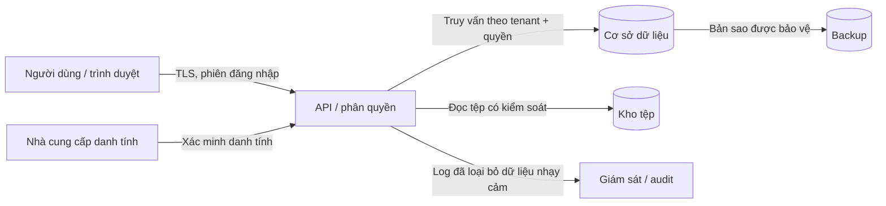

# Tính bí mật (Confidentiality) trong Security Assurance

## 1. Tính bí mật là mục tiêu gì?

**Tính bí mật (confidentiality)** là thuộc tính bảo đảm thông tin chỉ được tiết lộ cho những chủ thể có quyền biết, trong đúng phạm vi và ngữ cảnh được cho phép. Chủ thể có thể là người dùng, dịch vụ, tiến trình, thiết bị hoặc đối tác. “Đọc được dữ liệu” không đồng nghĩa với “được phép đọc dữ liệu”: một nhân viên đã đăng nhập vẫn không mặc nhiên được xem hồ sơ của mọi nhân viên khác.

Trong bộ ba mục tiêu bảo mật **CIA**:

| Mục tiêu | Câu hỏi trọng tâm | Ví dụ sự cố |
| --- | --- | --- |
| **Confidentiality – Bí mật** | Ai có thể biết nội dung hoặc suy ra thông tin nhạy cảm? | Nhân viên chi nhánh A xem được lương của chi nhánh B. |
| **Integrity – Toàn vẹn** | Dữ liệu có bị thay đổi sai phép hoặc sai lệch không? | Người không có quyền sửa số tài khoản nhận lương. |
| **Availability – Sẵn sàng** | Người được phép có thể sử dụng hệ thống khi cần không? | Hệ thống hồ sơ bị gián đoạn khiến bộ phận nhân sự không truy cập được. |

Ba mục tiêu bổ sung cho nhau. Mã hóa có thể giúp giữ bí mật nội dung nhưng không tự động bảo đảm tính toàn vẹn của quy trình phân quyền hay tính sẵn sàng của dịch vụ.

Đối với module **SECURITY_SECURITY_ASSURANCE**, việc học tính bí mật có một yêu cầu sâu hơn: **phải chứng minh được bằng bằng chứng kiểm tra rằng các biện pháp bảo vệ thực sự đáp ứng mục tiêu**, từ nhận diện rủi ro, đặc tả yêu cầu, lựa chọn kiểm soát, kiểm thử, đánh giá đến xử lý phát hiện. Câu khẳng định “hệ thống có mã hóa” chỉ mô tả một biện pháp; chưa đủ để kết luận dữ liệu được giữ bí mật.

Sau bài này, người học có thể:

1. Xác định thông tin, chủ thể, đường truyền và ranh giới tin cậy cần bảo vệ.
2. Chuyển rủi ro lộ lọt dữ liệu thành yêu cầu bảo mật có thể kiểm chứng.
3. Kết hợp kiểm soát truy cập, mã hóa, quản lý dữ liệu và vận hành thành cơ chế phòng vệ nhiều lớp.
4. Thiết kế ca kiểm thử tiêu cực và thu thập bằng chứng cho hoạt động security assurance liên tục.
5. Đánh giá phần rủi ro còn lại và ưu tiên khắc phục khi kiểm soát thất bại.

## 2. Hiểu đúng phạm vi của tính bí mật

### 2.1. Dữ liệu nào cần được giữ bí mật?

Không chỉ tên, mật khẩu hay số thẻ thanh toán mới nhạy cảm. Phạm vi cần xét gồm:

- **Dữ liệu nhận dạng và cá nhân:** số định danh, thông tin liên hệ, hồ sơ nhân sự, hồ sơ khách hàng.
- **Dữ liệu kinh doanh:** báo giá riêng, kế hoạch sản phẩm, hợp đồng chưa công bố, dữ liệu giao dịch.
- **Bí mật kỹ thuật:** khóa API, token, mật khẩu, khóa ký, khóa mã hóa, cấu hình hạ tầng nhạy cảm.
- **Thông tin suy diễn và siêu dữ liệu:** sự tồn tại của một hồ sơ, lịch sử truy cập, danh sách khách hàng, kích thước hay thời điểm phát sinh giao dịch. Dù nội dung chính được ẩn, siêu dữ liệu vẫn có thể làm lộ điều cần bảo vệ.

**Tính bí mật và quyền riêng tư (privacy) có liên quan nhưng không đồng nhất.** Tính bí mật đặt trọng tâm vào ngăn tiết lộ trái phép. Quyền riêng tư còn liên quan đến mục đích, tính hợp pháp, giới hạn thu thập và sử dụng dữ liệu cá nhân. Dữ liệu có thể được bảo vệ rất tốt khỏi người lạ nhưng vẫn bị sử dụng sai mục đích bởi một bộ phận có quyền truy cập.

### 2.2. Bảo vệ trong toàn bộ vòng đời dữ liệu

| Trạng thái hoặc điểm chạm | Rủi ro chính | Câu hỏi cần trả lời |
| --- | --- | --- |
| **Khi truyền (in transit)** | Nghe lén, chặn dữ liệu giữa các dịch vụ | Các kết nối, kể cả kết nối nội bộ, có xác thực và mã hóa phù hợp không? |
| **Khi lưu (at rest)** | Lộ ổ đĩa, bản sao lưu, tệp xuất hoặc đối tượng lưu trữ | Dữ liệu và bản sao có được mã hóa, giới hạn quyền và quản lý khóa không? |
| **Khi xử lý (in use)** | Người dùng/tiến trình có quyền quá rộng, lộ bộ nhớ hoặc dữ liệu tạm | Dịch vụ có chỉ đọc và trả về các trường cần thiết không? |
| **Khi quan sát và vận hành** | Log, trace, lỗi ứng dụng, bản dump hoặc công cụ hỗ trợ làm lộ dữ liệu | Đường giám sát và hỗ trợ có kiểm soát dữ liệu nhạy cảm không? |
| **Khi chia sẻ, lưu trữ lâu dài, hủy bỏ** | Liên kết chia sẻ tồn tại quá lâu; dữ liệu vẫn còn ở bản sao | Có giới hạn người nhận, thời hạn, lưu giữ và xóa theo chính sách không? |

Mọi đường dữ liệu di chuyển đều có thể tạo ra một đường rò rỉ mới: tài liệu tải lên kho đối tượng, dữ liệu chép sang môi trường thử nghiệm, tệp CSV xuất cho đối tác, bản backup hoặc thông điệp trong hàng đợi.

### 2.3. Phân loại dữ liệu để chọn mức bảo vệ

Một tổ chức có thể định nghĩa các lớp như **Công khai → Nội bộ → Mật → Hạn chế nghiêm ngặt**. Tên lớp có thể khác nhau; điều quan trọng là có **quy tắc và chủ sở hữu dữ liệu** rõ ràng. Ví dụ:

| Lớp minh họa | Ví dụ | Quy tắc bảo vệ tối thiểu |
| --- | --- | --- |
| Công khai | Tài liệu sản phẩm đã công bố | Bảo đảm không vô tình kèm dữ liệu chưa công khai. |
| Nội bộ | Hướng dẫn vận hành nội bộ | Chỉ thành viên tổ chức được xem; kiểm soát chia sẻ ra ngoài. |
| Mật | Hợp đồng khách hàng, bảng lương | Giới hạn theo vai trò và đối tượng dữ liệu; mã hóa, nhật ký truy cập. |
| Hạn chế nghiêm ngặt | Khóa ký sản xuất, dữ liệu định danh đặc biệt nhạy cảm | Quyền tối thiểu, cách ly, truy cập có phê duyệt khi cần, giám sát và kiểm soát vòng đời khóa. |

Phân loại phải gắn với **mục đích sử dụng** và **mức thiệt hại nếu lộ lọt**. Không nên chỉ gắn nhãn rồi coi đó là bằng chứng bảo vệ đã hiệu quả.

## 3. Từ rủi ro tiết lộ đến yêu cầu kiểm chứng được

Xét một **nền tảng SaaS quản lý hồ sơ nhân sự** phục vụ nhiều công ty thuê dịch vụ (tenant). Bộ phận nhân sự của công ty A được xem các hồ sơ thuộc A theo quyền được phân; công ty B không được thấy hồ sơ của A. Một số trường như tài khoản ngân hàng chỉ dành cho vai trò được ủy quyền.

### 3.1. Xác định tài sản, chủ thể và ranh giới tin cậy

- **Tài sản:** hồ sơ nhân viên, dữ liệu lương, tệp đính kèm, khóa mã hóa, bản sao lưu, lịch sử truy cập.
- **Chủ thể:** nhân viên, nhân sự, quản lý, quản trị viên, dịch vụ API, tác vụ nền, bên hỗ trợ.
- **Điểm vào:** API, giao diện web, endpoint tải tệp, truy vấn báo cáo, sự kiện, công cụ quản trị.
- **Ranh giới tin cậy:** trình duyệt ↔ API; API ↔ cơ sở dữ liệu; tenant A ↔ tenant B; hệ thống chính ↔ nhà cung cấp lưu trữ/giám sát.
- **Giả định cần kiểm tra:** danh tính lấy từ token đã xác minh; tenant gắn với danh tính; môi trường thử nghiệm không dùng dữ liệu sản xuất chưa được bảo vệ.



Sơ đồ là bản đồ các đường dữ liệu chính, chưa phải bằng chứng các đường đó an toàn. Mỗi mũi tên cần liên kết với yêu cầu, kiểm soát, phương pháp xác minh và người chịu trách nhiệm.

### 3.2. Nhận diện tình huống đe dọa

| Mã rủi ro | Kịch bản | Hậu quả có thể xảy ra |
| --- | --- | --- |
| R-01 | Người thuộc tenant A thay ID trên URL để lấy hồ sơ tenant B (*broken object-level authorization* – BOLA). | Lộ hồ sơ giữa các khách hàng. |
| R-02 | API trả cả trường tài khoản ngân hàng dù giao diện không hiển thị. | Dữ liệu nhạy cảm xuất hiện trong response và công cụ phát triển trình duyệt. |
| R-03 | Một bucket backup hoặc liên kết tải tệp mở rộng quyền chia sẻ. | Người ngoài truy cập được bản sao dữ liệu. |
| R-04 | Token, mật khẩu hoặc nội dung hồ sơ bị ghi thẳng vào log/traces. | Người có quyền đọc log nhưng không có quyền đọc hồ sơ vẫn thấy dữ liệu. |
| R-05 | Tài khoản dịch vụ có quyền đọc mọi tenant, bị xâm nhập hoặc sử dụng sai. | Lộ dữ liệu trên diện rộng, khó khoanh vùng. |
| R-06 | Mã hóa được bật nhưng khóa và dữ liệu nằm trong cùng phạm vi quyền truy cập quá rộng. | Kẻ tấn công lấy được cả dữ liệu lẫn khả năng giải mã. |

Khi ưu tiên, xem xét **khả năng xảy ra, tác động, số đối tượng bị ảnh hưởng, khả năng phát hiện và kiểm soát hiện có**. Ưu tiên có thể thay đổi khi kiến trúc hoặc lượng dữ liệu thay đổi.

### 3.3. Viết yêu cầu bảo mật dưới dạng có thể kiểm thử

Yêu cầu mơ hồ: “Thông tin nhân viên phải an toàn”.

Yêu cầu đo được: “API đọc hồ sơ phải xác thực người gọi, giới hạn truy vấn trong tenant lấy từ ngữ cảnh danh tính đã được xác minh và kiểm tra quyền trên từng hồ sơ. Khi không được phép, API không trả về nội dung hồ sơ, kể cả qua lỗi, log hoặc đường tải tệp”.

Một tập yêu cầu mẫu:

| ID | Yêu cầu tính bí mật | Cách xác minh tối thiểu |
| --- | --- | --- |
| C-01 | Mặc định từ chối truy cập; mọi endpoint đọc dữ liệu nhạy cảm phải xác thực và phân quyền trên đối tượng. | Kiểm thử truy cập không token, sai vai trò, khác tenant, thay ID. |
| C-02 | Mỗi trường dữ liệu được phát hành theo nguyên tắc **need-to-know**, không lấy dư trường rồi chỉ ẩn ở giao diện. | So sánh payload API, DTO, file xuất với ma trận quyền. |
| C-03 | Luồng truyền dữ liệu nhạy cảm sử dụng giao thức mã hóa và cấu hình được tổ chức phê duyệt. | Kiểm tra cấu hình đầu cuối và kết nối thực tế, kể cả hop nội bộ. |
| C-04 | Dữ liệu lưu và bản sao lưu được bảo vệ bằng mã hóa, quyền truy cập tối thiểu và quy trình quản lý khóa. | Bằng chứng cấu hình, chính sách khóa, thử truy cập từ danh tính không được cấp quyền. |
| C-05 | Log, lỗi, trace và số liệu giám sát không tiết lộ bí mật hoặc dữ liệu nhạy cảm không cần thiết. | Tạo giao dịch thử có dữ liệu dấu mốc rồi tìm trên các hệ thống quan sát. |
| C-06 | Tài khoản dịch vụ, người vận hành và bên thứ ba chỉ có quyền cần thiết, có thu hồi và rà soát định kỳ. | Rà soát quyền thực cấp, log dùng quyền, chứng cứ thu hồi. |
| C-07 | Tệp xuất, đường chia sẻ, dữ liệu môi trường thử nghiệm và backup tuân thủ giới hạn truy cập, thời gian lưu, quy trình hủy. | Thử truy cập trái phép, kiểm tra hết hạn và đối chiếu thực tế lưu trữ. |

Giá trị ngưỡng như thời hạn URL, chu kỳ rà soát hay thời gian lưu log phải được xác định từ rủi ro và chính sách của hệ thống cụ thể; không có một con số phù hợp cho mọi loại dữ liệu.

## 4. Các lớp kiểm soát để giữ bí mật

### 4.1. Xác thực không thay thế phân quyền

**Authentication** xác định chủ thể là ai. **Authorization** xác định chủ thể đó được làm gì với tài nguyên cụ thể. Một JWT hợp lệ chứng minh người gọi đã qua cơ chế xác thực phù hợp; nó không tự động cấp quyền xem mọi bản ghi mà API có thể truy vấn.

Kiểm soát phân quyền nên kết hợp:

1. **Deny by default:** chưa có quyền rõ ràng thì từ chối.
2. **Least privilege:** quyền vừa đủ, tách tài khoản đọc dữ liệu, quản trị hệ thống và quản lý khóa.
3. **Object- và tenant-level authorization:** kiểm tra trên từng đối tượng và tổ chức sở hữu, không chỉ trên tên endpoint.
4. **Field-level authorization:** giới hạn từng trường nhạy cảm; xuất báo cáo và truy vấn tìm kiếm cũng tuân thủ.
5. **Separation of duties:** cá nhân có quyền vận hành hạ tầng không mặc nhiên có quyền đọc nội dung hồ sơ.
6. **Lifecycle of access:** cấp, thay đổi, rà soát, thu hồi quyền khi đổi vai trò hoặc rời tổ chức.

RBAC (quyền theo vai trò) giúp mô hình dễ quản trị; ABAC (quyền theo thuộc tính) có thể bổ sung các điều kiện như tenant, đơn vị, quan hệ quản lý, mức nhạy cảm hoặc trạng thái hồ sơ. Không nên tin vào thuộc tính do người gọi tự điền như `tenantId` ở query string nếu chưa đối chiếu với danh tính đáng tin cậy.

**Ví dụ Java/Spring minh họa nguyên tắc** (các kiểu `Actor`, `AccessPolicy`, `ProfileMapper`, repository và ngoại lệ cần được triển khai theo ứng dụng):

```java
@Service
public class EmployeeProfileService {
    private final EmployeeProfileRepository repository;
    private final AccessPolicy accessPolicy;
    private final ProfileMapper mapper;

    public EmployeeProfileDto readProfile(UUID profileId, Actor actor) {
        // actor được tạo từ ngữ cảnh xác thực ĐÃ được máy chủ xác minh.
        EmployeeProfile profile = repository
                .findByIdAndTenantId(profileId, actor.tenantId())
                .orElseThrow(ProfileNotFoundException::new);

        // Đã giới hạn tenant vẫn cần kiểm tra quyền trên hồ sơ cụ thể.
        if (!accessPolicy.canRead(actor, profile)) {
            throw new AccessDeniedException("Access denied");
        }

        // Trả đúng các trường actor được phép thấy.
        return mapper.toAuthorizedView(profile, actor);
    }
}
```

Đối với ứng dụng thật, cần bảo đảm **mọi đường đọc** (chi tiết, tìm kiếm, xuất CSV, tải tệp, tác vụ nền) cùng sử dụng chính sách phân quyền; đồng thời xem xét kiểm soát bổ sung tại tầng cơ sở dữ liệu. Việc thay đổi hoặc che nút trong frontend không đủ vì client có thể gọi API trực tiếp.

**Lỗi thường gặp:**

```java
// Không an toàn: tìm bản ghi theo ID toàn cục trước khi quyết định trả dữ liệu.
return repository.findById(requestedId).map(mapper::toDto);
```

Nếu endpoint không kiểm tra tenant và quyền đối tượng, người dùng có thể thử ID của người khác. Ngay cả khi ID khó đoán, điều đó không thay thế phân quyền.

### 4.2. Mã hóa dữ liệu và quản lý khóa

Mã hóa là một thành phần thiết yếu nhưng chỉ bảo vệ trong **mô hình đe dọa** phù hợp:

- **Khi truyền:** sử dụng TLS phù hợp chính sách, kiểm tra chứng thư và cấu hình ở nơi kết nối thực sự được thiết lập. Sau khi TLS kết thúc ở gateway, các hop tiếp theo vẫn cần được đánh giá.
- **Khi lưu:** mã hóa ổ đĩa, cơ sở dữ liệu, đối tượng lưu trữ và backup tùy nhu cầu; giới hạn quyền đối với cả dữ liệu và khóa.
- **Ở cấp ứng dụng/trường dữ liệu:** cân nhắc khi cần thu hẹp những chủ thể có thể xem nội dung; làm rõ ai được quyền giải mã và tác động tới tìm kiếm, vận hành, phục hồi.
- **Đối với mật khẩu:** lưu bằng hàm băm mật khẩu có salt và chi phí thích hợp, thay vì mã hóa có thể đảo ngược để so sánh mật khẩu.

Vòng đời khóa cần xét nơi sinh, lưu giữ, phân quyền, sử dụng, luân chuyển, thu hồi, khôi phục và hủy khóa. Các hệ thống quản lý khóa chuyên dụng (KMS/HSM tùy rủi ro) có thể hỗ trợ nhưng không bù được cho chính sách truy cập cấu hình sai. Nếu dịch vụ ứng dụng có quyền giải mã mọi bản ghi, việc tài khoản dịch vụ bị chiếm quyền vẫn là một đường lộ dữ liệu.

**Mã hóa không chữa được phân quyền sai:** dữ liệu giải mã hợp lệ trong API rồi trả cho người gọi không được phép vẫn là vi phạm tính bí mật.

### 4.3. Giảm lượng thông tin có thể bị lộ

- **Thu thập tối thiểu:** không thu trường dữ liệu không cần cho mục đích nghiệp vụ.
- **Trả về tối thiểu:** dùng DTO/response schema chọn trường theo quyền; không gửi trường nhạy cảm rồi kỳ vọng frontend ẩn đi.
- **Masking và redaction:** ẩn dữ liệu trên UI, log, lỗi và công cụ hỗ trợ. Dùng dữ liệu thử có dấu mốc để xác minh đã che thật.
- **Pseudonymization / tokenization:** thay định danh bằng mã tham chiếu khi quy trình cho phép; bảng ánh xạ và khóa đảo ngược vẫn là tài sản nhạy cảm.
- **Anonymization:** chỉ coi là ẩn danh khi nguy cơ tái định danh đã được đánh giá thích hợp; xóa tên đơn thuần không bảo đảm ẩn danh.
- **Retention và deletion:** giới hạn thời gian lưu, kiểm soát bản sao, bản dump và dữ liệu trong môi trường phi sản xuất.

Không log token truy cập, mật khẩu, khóa, thông tin hồ sơ đầy đủ; khi cần audit, ưu tiên các trường đủ phục vụ truy vết như `actorId`, `resourceType`, `action`, `decision`, `timestamp`, `correlationId` và định danh tài nguyên đã được xử lý phù hợp mức nhạy cảm.

### 4.4. Kiểm soát đường chia sẻ và vận hành

Các tệp xuất, URL tải xuống có ký, snapshot, công cụ BI, hệ thống tìm kiếm và cache phải tuân thủ **cùng mục tiêu bảo mật với dữ liệu nguồn**. URL có chữ ký vẫn là một quyền truy cập nếu bị chuyển tiếp; cần giới hạn đối tượng, phạm vi, thời hạn và cân nhắc khả năng thu hồi. Cache dùng chung phải có khóa phân vùng tenant/user và chính sách tránh lưu dữ liệu nhạy cảm ngoài ý muốn.

Trong vận hành, cần quản lý danh tính quản trị, quyền khẩn cấp, hoạt động hỗ trợ khách hàng, công cụ truy xuất production và cấp quyền cho nhà cung cấp. Quyền được cấp rộng “để tiện xử lý sự cố” phải được coi là rủi ro có chủ sở hữu, giới hạn và chứng cứ rà soát.

## 5. Security assurance: chứng minh kiểm soát có hiệu lực

Security assurance không dừng ở thiết kế hoặc một lần kiểm tra. Với mục tiêu tính bí mật, chuỗi lập luận cần nối được:

**Tài sản và rủi ro → Yêu cầu → Security control → Bài kiểm tra → Bằng chứng → Kết quả đánh giá → Khắc phục và kiểm tra lại.**

Ví dụ ma trận truy vết:

| Rủi ro | Yêu cầu | Kiểm soát | Kiểm thử và bằng chứng kỳ vọng |
| --- | --- | --- | --- |
| R-01 lộ chéo tenant | C-01 | Kiểm tra tenant từ danh tính đã xác minh; chính sách quyền trên hồ sơ | Test gọi ID tenant B bằng token tenant A trả từ chối, response không chứa nội dung; log test và báo cáo CI. |
| R-02 trả thừa trường | C-02 | DTO theo quyền, allowlist các trường | So sánh JSON response theo vai trò với danh sách trường cho phép; kết quả test. |
| R-03 lộ backup | C-04, C-07 | Kho lưu riêng tư, mã hóa, IAM tối thiểu | Ảnh chụp cấu hình/cấu hình xuất tự động; thử truy cập với danh tính không có quyền. |
| R-04 lộ log | C-05 | Lọc dữ liệu nhạy cảm ở tầng ghi log và trace | Giao dịch có dữ liệu thử đánh dấu; kết quả tìm kiếm dấu mốc trong log, trace và thông báo lỗi. |
| R-05 quyền dịch vụ rộng | C-06 | Tài khoản dịch vụ tách vai trò, quyền theo chức năng | Danh sách quyền thực tế, kết quả thử thao tác vượt quyền, lịch sử rà soát. |
| R-06 lộ khóa | C-04 | Chính sách KMS, tách quyền dữ liệu và khóa | Policy versioned, nhật ký gọi giải mã và thử từ chối ở vai trò không được cấp. |

### 5.1. Những loại bằng chứng có giá trị

| Loại bằng chứng | Chứng minh điều gì? | Giới hạn cần nhận biết |
| --- | --- | --- |
| Thiết kế luồng dữ liệu, threat model, bảng phân loại | Phạm vi, giả định và rủi ro đã được nhận diện | Chưa chứng minh triển khai hoạt động đúng. |
| Cấu hình chính sách, IAM, KMS, TLS, IaC | Kiểm soát dự kiến đã được cấu hình tại môi trường xác định | Có thể khác thực tế chạy, có cấu hình ghi đè hoặc ngoại lệ. |
| Test tự động, test xuyên tenant, test phân quyền API | Hành vi quan sát được đối với các trường hợp đã kiểm tra | Chỉ bao phủ kịch bản, phiên bản, môi trường của test. |
| Kết quả thử nghiệm xâm nhập và rà soát thiết kế | Phát hiện lỗi không dễ thấy trong test chức năng | Chỉ phản ánh phạm vi và thời điểm đánh giá. |
| Log audit và lịch sử rà soát quyền | Ai truy cập, dùng quyền nào, phát hiện và xử lý ra sao | Log phải đủ toàn vẹn và không tự tạo kênh lộ dữ liệu. |
| Ticket khắc phục, commit và kết quả retest | Phát hiện đã được xử lý và hành vi mới được xác minh | Đóng ticket đơn thuần không chứng minh lỗi đã hết. |

Bằng chứng tốt phải **truy vết được** về yêu cầu/rủi ro, gắn với **phiên bản và môi trường**, có **thời điểm**, **người hoặc hệ thống thực hiện**, **kết quả**, và đủ dữ liệu để người đánh giá độc lập xác nhận. Báo cáo dùng minh họa cần ẩn các thông tin nhạy cảm thực.

### 5.2. Thiết kế kiểm thử theo hành vi trái phép

Các ca kiểm thử cần đi xa hơn “người đúng quyền xem được hồ sơ”. Nên có ít nhất:

| Ca kiểm thử | Kết quả bảo mật kỳ vọng |
| --- | --- |
| Không có token / token không hợp lệ / token hết hạn | Không trả dữ liệu nhạy cảm. |
| Người dùng tenant A yêu cầu ID hồ sơ tenant B | Bị từ chối; không lộ nội dung, trường hay tệp đính kèm. |
| Người cùng tenant nhưng không có quyền xem lương | Không thấy trường lương ở JSON, báo cáo, endpoint tải tệp. |
| Tài khoản dịch vụ chỉ được đọc dữ liệu nhóm A yêu cầu nhóm B | Quyền bị giới hạn thực tế, không chỉ dựa vào ý định cấu hình. |
| Một URL chia sẻ đã hết hạn hoặc đã thu hồi | Không còn lấy được tệp. |
| Hệ thống sinh lỗi với đầu vào chứa dữ liệu nhạy cảm thử nghiệm | Thông báo và log không lộ toàn bộ dữ liệu hoặc bí mật. |
| Tài khoản không có quyền truy cập backup hay giải mã | Truy cập và thao tác giải mã bị từ chối, có log kiểm toán phù hợp. |

**Ví dụ kiểm thử API dùng MockMvc (mã minh họa với fixture đã chuẩn bị):**

```java
@Test
void userFromAnotherTenantCannotReadProfile() throws Exception {
    // tokenTenantA: token hợp lệ của người dùng tenant A
    // profileIdTenantB: hồ sơ thuộc tenant B
    mockMvc.perform(get("/api/profiles/{id}", profileIdTenantB)
            .header("Authorization", "Bearer " + tokenTenantA))
        .andExpect(status().isNotFound())
        .andExpect(content().string(""));
}
```

Ví dụ chọn **404 và body rỗng** nhằm tránh xác nhận sự tồn tại của hồ sơ khác tenant; một hệ thống có thể chọn hợp đồng lỗi khác, nhưng phải nhất quán và không tiết lộ nội dung. Cần có test tương ứng cho **API danh sách, tìm kiếm, báo cáo, xuất dữ liệu, endpoint tệp và quyền theo trường**. Với chức năng phân trang, kiểm thử cả số lượng và metadata có thể suy ra dữ liệu ngoài quyền.

Trong kiểm thử, sử dụng dữ liệu giả định; tránh đưa dữ liệu khách hàng thật hoặc bí mật production vào báo cáo, log pipeline và công cụ bên thứ ba.

### 5.3. Chỉ số hỗ trợ đánh giá liên tục

Có thể theo dõi những chỉ số gắn trực tiếp với mục tiêu:

- **Tỷ lệ API nhạy cảm có kiểm thử truy cập trái phép** theo danh mục API được cập nhật.
- **Số phát hiện lộ dữ liệu còn mở**, phân theo mức độ nghiêm trọng, chủ sở hữu và tuổi phát hiện.
- **Tỷ lệ kho dữ liệu và backup nằm trong danh mục kiểm kê có bằng chứng cấu hình bảo vệ còn hiệu lực.**
- **Tỷ lệ tài khoản đặc quyền đã được rà soát** trong chu kỳ quy định; số quyền không còn cần thiết.
- **Thời gian từ phát hiện đến khắc phục và kiểm tra lại** đối với lỗi ảnh hưởng đến tính bí mật.
- **Số ngoại lệ được phê duyệt chưa hết hạn** và phần rủi ro còn lại của từng ngoại lệ.

Không lấy một chỉ số đơn lẻ làm kết luận “an toàn”. Ví dụ, tỷ lệ bao phủ test cao vẫn vô nghĩa nếu bỏ sót endpoint mới hoặc các trường hợp vượt tenant.

## 6. Vận hành assurance liên tục trong vòng đời phát triển

| Giai đoạn | Hoạt động bắt buộc nên cân nhắc | Đầu ra cần lưu |
| --- | --- | --- |
| **Thiết kế** | Phân loại dữ liệu, vẽ luồng dữ liệu, nhận diện threat, định nghĩa ma trận quyền | Data inventory, threat model, yêu cầu C-xx, quyết định thiết kế. |
| **Triển khai** | Kiểm soát quyền ở backend, DTO tối thiểu, quản lý bí mật, cấu hình kho và khóa | Code review, chính sách và cấu hình được quản lý phiên bản. |
| **CI và kiểm thử** | Test âm về quyền, quét bí mật, kiểm tra cấu hình, test các tình huống rò rỉ | Kết quả theo commit/build, báo cáo lỗi và bằng chứng tái hiện. |
| **Trước phát hành** | Đối chiếu kiểm soát thực tế với yêu cầu, phê duyệt ngoại lệ có thời hạn | Biên bản đánh giá, danh sách rủi ro còn lại, quyết định phát hành. |
| **Vận hành** | Theo dõi truy cập bất thường, kiểm kê tài sản, rà soát quyền, kiểm tra chia sẻ và backup | Audit log, báo cáo định kỳ, bằng chứng tái kiểm. |
| **Khi có phát hiện/sự cố** | Cô lập đường lộ lọt, thu hồi quyền hoặc khóa liên quan, đánh giá phạm vi ảnh hưởng, sửa nguyên nhân gốc | Ticket, kế hoạch xử lý, kết quả retest, bài học cải tiến. |

Khi kiến trúc thay đổi (thêm API, một đối tác mới, kho lưu trữ khác, thay cách xác thực), cập nhật threat model và ca kiểm thử trước khi coi bằng chứng cũ còn hiệu lực. Security assurance là **quá trình cập nhật liên tục**, không phải một dấu kiểm tồn tại vĩnh viễn.

### 6.1. Quy trình xử lý một phát hiện

Giả sử thử nghiệm phát hiện endpoint xuất CSV không giới hạn `tenantId`:

1. **Ghi nhận:** ticket chứa endpoint, điều kiện tái hiện an toàn, dữ liệu thử, ảnh hưởng, độ nghiêm trọng, môi trường và người phụ trách.
2. **Khoanh vùng:** tìm các đường xuất dữ liệu khác dùng chung query, xác định dữ liệu và tenant có khả năng chịu ảnh hưởng.
3. **Giảm rủi ro trước mắt:** hạn chế hoặc vô hiệu hóa tính năng nếu mức độ rủi ro yêu cầu; bảo đảm không gây lộ thêm khi điều tra.
4. **Sửa nguyên nhân gốc:** áp chính sách tenant và quyền đối tượng tại backend; thống nhất logic với các đường đọc khác.
5. **Kiểm tra lại:** test ca tái hiện, các vai trò hợp lệ, đường API tương tự và log; ghi kết quả theo bản build triển khai.
6. **Cập nhật assurance:** ma trận C-01/C-02, test regression, đánh giá rủi ro còn lại và bằng chứng đóng phát hiện.

Nếu đã có dấu hiệu truy cập dữ liệu trái phép, quy trình còn phải kích hoạt ứng phó sự cố và nghĩa vụ thông báo theo chính sách, hợp đồng và pháp luật áp dụng; việc sửa bug không tự giải quyết hậu quả tiết lộ đã xảy ra.

## 7. Sai lầm thường gặp và cách nhận biết

| Nhận định hoặc cách làm sai | Vấn đề | Cách kiểm chứng/cải thiện |
| --- | --- | --- |
| “Dùng HTTPS nên dữ liệu đã bí mật.” | HTTPS không kiểm soát ai được đọc dữ liệu sau khi đến server. | Kết hợp test phân quyền, kiểm tra các hop truyền và đầu ra API. |
| “Người dùng đăng nhập rồi thì API trả dữ liệu được.” | Xác thực không đồng nghĩa được quyền với mọi đối tượng. | Test sai vai trò, khác tenant, BOLA trên từng endpoint. |
| “Frontend ẩn trường lương là đủ.” | Người dùng vẫn có thể đọc payload mạng. | Kiểm tra payload backend theo quyền, DTO và file xuất. |
| “Database bật mã hóa nên không thể lộ.” | Dịch vụ có thể giải mã và trả dữ liệu cho người trái quyền; khóa có thể bị lạm dụng. | Rà soát chính sách quyền dữ liệu/khóa và test hành vi. |
| “Chỉ log để debug nên không đáng lo.” | Log được sao chép, tìm kiếm và có tập người xem khác với dữ liệu gốc. | Test dữ liệu dấu mốc trong log/trace, giới hạn quyền truy cập. |
| “Pentest năm ngoái đạt nên hiện tại vẫn đạt.” | API, quyền, hạ tầng và đối tác thay đổi theo thời gian. | Gắn bằng chứng với phiên bản và tái kiểm khi có thay đổi đáng kể. |
| “Đã đóng ticket nghĩa là rủi ro hết.” | Thay đổi có thể không xử lý đường đi khác hoặc chưa triển khai đúng môi trường. | Retest sau triển khai và đánh giá rủi ro còn lại. |

## 8. Bài tập áp dụng

Một công ty cho phép trưởng nhóm xem hồ sơ của thành viên trong nhóm, nhân sự xem hồ sơ theo trách nhiệm và nhân viên chỉ xem một phần hồ sơ của chính mình. Hệ thống có endpoint chi tiết, tìm kiếm, tải PDF và xuất báo cáo; log hiện ghi toàn bộ request body.

Hãy xây dựng một hồ sơ assurance nhỏ gồm:

1. Danh sách dữ liệu nhạy cảm, các chủ thể, ranh giới tin cậy và ít nhất ba kịch bản tiết lộ trái phép.
2. Ma trận quyền theo **vai trò × loại tài nguyên × trường dữ liệu × ngữ cảnh**, kèm nguyên tắc mặc định từ chối.
3. Ít nhất bốn yêu cầu C-xx có điều kiện chấp nhận cụ thể, trong đó có một yêu cầu cho xuất PDF và một yêu cầu cho log.
4. Một ca kiểm thử âm cho mỗi đường truy cập; nêu bằng chứng cần lưu và cách bảo đảm bằng chứng không chứa dữ liệu nhạy cảm thật.
5. Cách xử lý nếu bài kiểm thử phát hiện trưởng nhóm A tải được báo cáo của nhóm B, gồm khoanh vùng, sửa lỗi, retest và cập nhật rủi ro.

**Tiêu chí tự đánh giá:** người khác có thể đọc yêu cầu, chạy lại kiểm thử trên dữ liệu giả định, thấy rõ kết quả đạt/không đạt và truy ngược đến rủi ro ban đầu mà không cần dựa vào lời khẳng định “đã cấu hình an toàn”.

## 9. Ghi nhớ

Tính bí mật là mục tiêu **ngăn tiết lộ thông tin ngoài phạm vi được phép** trên toàn bộ đường đi và vòng đời dữ liệu. Phân quyền chi tiết, giới hạn dữ liệu, mã hóa, quản lý khóa và vận hành an toàn cần phối hợp, vì mỗi cơ chế chỉ giải quyết một phần rủi ro. Trong security assurance, mục tiêu này phải được diễn đạt thành yêu cầu đo được, liên kết với kiểm soát và **bằng chứng hành vi thực tế**, rồi kiểm tra lại khi hệ thống hoặc rủi ro thay đổi.
