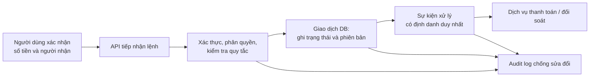
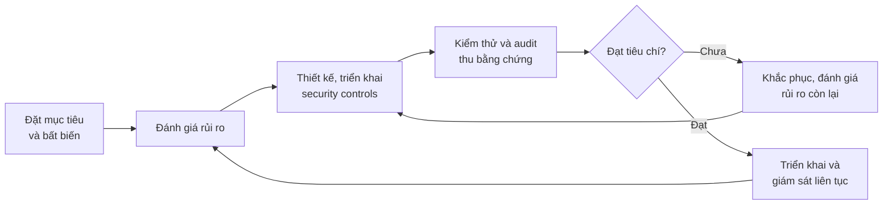

# Tính toàn vẹn (Integrity): từ mục tiêu bảo mật đến bằng chứng bảo đảm

## Mục tiêu học tập

Sau bài này, người học có thể:

1. Giải thích tính toàn vẹn trong bộ ba **Confidentiality – Integrity – Availability (CIA)** và phân biệt tính toàn vẹn với tính bí mật, tính sẵn sàng, tính xác thực.
2. Xác định những dữ liệu, quy trình, cấu hình và bằng chứng phải được bảo vệ khỏi thay đổi trái phép hoặc sai lệch ngoài ý muốn.
3. Chuyển một mục tiêu toàn vẹn thành **bất biến nghiệp vụ, yêu cầu có thể kiểm thử, biện pháp kiểm soát và bằng chứng**.
4. Chọn đúng cơ chế như phân quyền, giao dịch cơ sở dữ liệu, ràng buộc dữ liệu, hàm băm, HMAC, chữ ký số, nhật ký kiểm toán và giám sát.
5. Tổ chức kiểm thử, đánh giá, xử lý phát hiện và giám sát liên tục để chứng minh các kiểm soát thực sự hoạt động.

Trong module **SECURITY_SECURITY_ASSURANCE**, chủ đề này được tiếp cận dưới góc nhìn *security assurance*: không dừng ở tuyên bố “dữ liệu an toàn”, mà phải xác định **điều gì cần luôn đúng, rủi ro nào có thể phá vỡ điều đó, biện pháp nào giảm rủi ro, và bằng chứng nào cho thấy biện pháp có hiệu lực**.

## 1. Tính toàn vẹn là gì?

**Tính toàn vẹn (integrity)** là thuộc tính bảo mật bảo đảm thông tin và trạng thái hệ thống được tạo, thay đổi, xử lý và sử dụng **đúng theo quy tắc được cho phép**, đồng thời những thay đổi trái phép hoặc sai lệch ngoài ý muốn được ngăn chặn hay phát hiện phù hợp với mức rủi ro.

Ví dụ, một lệnh thanh toán được người dùng xác nhận với số tiền **750.000 VND** và người thụ hưởng **A** chỉ được thực thi theo nội dung đã xác nhận. Một thay đổi từ 750.000 thành 7.500.000, đổi người nhận thành B, thực hiện hai lần hoặc chuyển sang trạng thái “đã duyệt” khi chưa được phê duyệt đều là những tình huống có thể vi phạm tính toàn vẹn.

“Toàn vẹn” **không có nghĩa là dữ liệu không bao giờ được sửa**. Hệ thống vẫn cần chỉnh sửa đơn hàng, cập nhật tài khoản, hủy giao dịch. Điều quan trọng là mỗi thay đổi phải có chủ thể được phép, điều kiện hợp lệ, quy trình đúng, kết quả nhất quán và khả năng kiểm chứng.

### 1.1. Phân biệt với các thuộc tính liên quan

| Thuộc tính | Câu hỏi cốt lõi | Ví dụ đối với lệnh chuyển tiền |
|---|---|---|
| **Confidentiality – Bí mật** | Ai được xem thông tin? | Người không có quyền không đọc được số tài khoản. |
| **Integrity – Toàn vẹn** | Thông tin và trạng thái có được tạo, thay đổi, sử dụng đúng quy tắc? | Số tiền, người nhận và trạng thái phê duyệt không bị sửa sai. |
| **Availability – Sẵn sàng** | Dịch vụ có thể được sử dụng khi cần? | Dịch vụ thanh toán hoạt động trong thời gian cam kết. |
| **Authenticity – Xác thực nguồn gốc** | Dữ liệu/yêu cầu thực sự đến từ nguồn nào? | Yêu cầu được xác minh là do đúng tài khoản hay hệ thống gửi. |
| **Accountability – Trách nhiệm giải trình** | Có truy vết được ai đã thực hiện hành động nào? | Bản ghi kiểm toán thể hiện người duyệt, thời điểm, kết quả. |

Các thuộc tính hỗ trợ lẫn nhau nhưng không thay thế nhau. Kênh được mã hóa có thể bảo vệ dữ liệu trên đường truyền; nó không tự ngăn một tài khoản đã bị chiếm quyền sửa dữ liệu tại máy chủ. Một chữ ký số hợp lệ có thể chứng minh dữ liệu được ký bởi khóa tương ứng; nó **không chứng minh nội dung nghiệp vụ đúng** nếu người có quyền ký đã tạo dữ liệu sai.

### 1.2. Những lớp toàn vẹn cần bảo vệ

- **Toàn vẹn dữ liệu:** Giá trị, cấu trúc, quan hệ và lịch sử dữ liệu không bị thay đổi sai; ví dụ số dư, thông tin hóa đơn, quyền truy cập.
- **Toàn vẹn giao dịch và quy trình:** Các bước diễn ra đúng thứ tự, đúng thẩm quyền, không thiếu, lặp hoặc vượt qua bước phê duyệt.
- **Toàn vẹn phần mềm và cấu hình:** Mã triển khai, thư viện, container image, cấu hình bảo mật và hạ tầng khớp với bản đã được kiểm tra và phê duyệt.
- **Toàn vẹn log và bằng chứng:** Bản ghi kiểm toán, kết quả kiểm thử, bản ghi triển khai và bằng chứng sự cố không bị xóa hoặc sửa để che giấu hành vi.

Một hệ thống có dữ liệu “đúng định dạng” chưa chắc có tính toàn vẹn. Chẳng hạn, giá trị `amount=7500000` hoàn toàn hợp lệ về kiểu số nhưng vẫn sai nếu người dùng chỉ chấp thuận `750000`. Vì vậy, kiểm tra toàn vẹn phải bao gồm **quy tắc nghiệp vụ**, không chỉ checksum hay kiểu dữ liệu.

## 2. Xác định điều gì bắt buộc phải đúng

Để đánh giá được tính toàn vẹn, bắt đầu từ **tài sản cần bảo vệ**, **đường đi của dữ liệu**, **ranh giới tin cậy** và **bất biến (invariants)**.

Xét hệ thống thanh toán có ứng dụng người dùng, API, dịch vụ phê duyệt, cơ sở dữ liệu, message broker và hệ thống đối soát.



Các ranh giới quan trọng gồm: thiết bị người dùng → API; API → cơ sở dữ liệu; dịch vụ → hàng đợi sự kiện; môi trường phát triển → môi trường vận hành; hệ thống đang chạy → kho lưu chứng cứ. Dữ liệu đi qua ranh giới nào cũng cần xác định bên nào có quyền tạo, sửa, xác minh và tin tưởng dữ liệu.

### 2.1. Mô tả bằng bất biến nghiệp vụ

Một số bất biến có thể kiểm tra được:

- **I1 – Bảo toàn nội dung đã duyệt:** Khi lệnh đã được xác nhận, số tiền và người thụ hưởng không đổi; nếu cần sửa thì phải tạo phiên bản mới và phê duyệt lại.
- **I2 – Chuyển trạng thái hợp lệ:** Lệnh chỉ đi theo các trạng thái được phép, chẳng hạn `CREATED → APPROVED → EXECUTED`; không được tự ý đi thẳng từ `CREATED` sang `EXECUTED`.
- **I3 – Không xử lý trùng:** Cùng một mã yêu cầu nghiệp vụ không dẫn đến hai lần ghi nợ.
- **I4 – Nhất quán khi đồng thời:** Hai người duyệt hoặc hai tiến trình cập nhật cùng lệnh không được âm thầm ghi đè kết quả của nhau.
- **I5 – Có dấu vết kiểm toán:** Mỗi thao tác nhạy cảm được ghi nhận đủ ngữ cảnh để điều tra, và người thay đổi dữ liệu nghiệp vụ không thể tự xóa dấu vết tương ứng.
- **I6 – Đối soát được:** Tổng hợp giao dịch nội bộ và kết quả từ hệ thống đối tác phải khớp, hoặc sai lệch phải được phát hiện và xử lý.

**Bất biến** là phát biểu về điều luôn phải đúng. **Yêu cầu kiểm soát** mô tả hệ thống phải làm gì để duy trì điều đó. **Bằng chứng** cho thấy yêu cầu đã được kiểm tra hoặc đang được thực thi.

### 2.2. Phân tích rủi ro theo đường đi dữ liệu

| Rủi ro / tình huống | Bất biến bị đe dọa | Kiểm soát tiêu biểu | Cách xác minh |
|---|---|---|---|
| Client sửa `amount` hoặc `beneficiary` sau khi xác nhận | I1 | Ràng buộc bản phê duyệt với nội dung lệnh; kiểm tra tại server | Gửi yêu cầu đã sửa, kỳ vọng từ chối và không ghi nợ |
| Tài khoản hỗ trợ sửa lệnh ngoài thẩm quyền | I1, I2 | Phân quyền phía server theo vai trò, đối tượng và trạng thái; nguyên tắc ít quyền | Thử thao tác với từng vai trò/từng trạng thái |
| Hai cập nhật đồng thời làm mất thay đổi | I4 | Transaction, khóa hoặc optimistic locking | Kiểm thử concurrent update; chỉ một thay đổi hợp lệ thành công |
| Retry/replay sự kiện khiến chuyển tiền hai lần | I3 | Idempotency key, unique constraint, kiểm soát trạng thái và thời hạn | Gửi lại cùng yêu cầu nhiều lần; chỉ một hiệu ứng nghiệp vụ |
| Kẻ tấn công sửa message giữa các dịch vụ | I1, I2 | TLS/mTLS, cơ chế xác minh nguồn và toàn vẹn payload theo mô hình tin cậy | Thử payload giả mạo/sửa đổi; kỳ vọng bị phát hiện |
| Người có quyền DB sửa log để che giấu | I5 | Ghi log sang hệ thống độc lập, phân quyền tách biệt, lưu chống sửa đổi | Thử sửa/xóa log bằng tài khoản vận hành thông thường |
| Triển khai mã/cấu hình chưa phê duyệt | I1–I6 | Bảo vệ nhánh, review, kiểm tra artifact, kiểm soát triển khai | Đối chiếu commit, artifact, chữ ký và bản đang chạy |
| Dữ liệu nội bộ lệch với kết quả đối tác | I6 | Đối soát định kỳ, cảnh báo sai lệch, quy trình xử lý | Cấy sai lệch có kiểm soát và kiểm tra cảnh báo/ticket |

Việc đánh giá rủi ro cần xem xét **khả năng xảy ra, mức tác động, quyền của kẻ tấn công, đường khai thác và kiểm soát hiện có**. Một sai lệch vài giây trong bộ đếm hiển thị và một thay đổi sai người nhận tiền có thể có mức ưu tiên hoàn toàn khác nhau.

## 3. Thiết kế biện pháp bảo vệ toàn vẹn

Không có một kỹ thuật duy nhất bảo vệ mọi loại toàn vẹn. Thiết kế đáng tin cậy thường sử dụng nhiều lớp kiểm soát, từ đầu vào, quy tắc nghiệp vụ, lưu trữ đến giám sát và bằng chứng độc lập.

### 3.1. Kiểm soát quyền và luồng phê duyệt

- Xác thực chủ thể trước khi xử lý; phân quyền **trên server** đối với từng hành động, tài nguyên, thuộc tính và trạng thái.
- Áp dụng *least privilege* và tách nhiệm vụ khi có rủi ro cao: người lập lệnh và người duyệt là hai chủ thể khác nhau nếu nghiệp vụ yêu cầu.
- Kiểm tra các chuyển trạng thái bằng một state machine hoặc quy tắc tập trung; mặc định từ chối chuyển trạng thái không được định nghĩa.
- Ràng buộc việc phê duyệt vào **đúng nội dung** đã được xem xét; chỉnh sửa trường nhạy cảm làm mất hiệu lực phê duyệt trước đó.
- Không tin những trường như `approved=true`, `role=admin` hoặc `price` do client tự cung cấp nếu server phải là nơi quyết định giá trị đó.

Mã hóa và xác thực kênh truyền bảo vệ một phần đường đi dữ liệu, nhưng quyết định “ai được đổi giá trị nào và khi nào” vẫn phải được thực thi trong ứng dụng.

### 3.2. Kiểm soát toàn vẹn trong cơ sở dữ liệu

Cơ sở dữ liệu hỗ trợ tính toàn vẹn qua **PRIMARY KEY, FOREIGN KEY, UNIQUE, CHECK, transaction** và các cơ chế điều khiển đồng thời. Tuy nhiên, chúng phải được kết hợp với quy tắc nghiệp vụ.

Ví dụ bảng lệnh có trường phiên bản:

```sql
CREATE TABLE payment_instruction (
    id UUID PRIMARY KEY,
    amount_minor BIGINT NOT NULL CHECK (amount_minor > 0),
    beneficiary VARCHAR(120) NOT NULL,
    status VARCHAR(20) NOT NULL
        CHECK (status IN ('CREATED', 'APPROVED', 'EXECUTED', 'REJECTED')),
    version BIGINT NOT NULL DEFAULT 0
);

-- Chỉ cập nhật khi phiên bản và trạng thái vẫn đúng như lúc đọc.
UPDATE payment_instruction
SET status = 'APPROVED',
    version = version + 1
WHERE id = :id
  AND version = :expected_version
  AND status = 'CREATED';
```

Ứng dụng phải kiểm tra **số dòng được cập nhật**: nếu bằng 0, yêu cầu đã lỗi thời hoặc trạng thái không còn hợp lệ, và không được báo phê duyệt thành công. Thao tác cập nhật phải nằm trong transaction phù hợp, đồng thời phải được server kiểm tra người duyệt có thẩm quyền.

**Optimistic locking** ngăn việc ghi đè âm thầm theo phiên bản, nhưng riêng nó không ngăn sửa dữ liệu bởi người có quyền, không bảo đảm bất biến trên nhiều bảng, và không thay thế idempotency. Nếu một bất biến trải qua nhiều hàng/bảng hoặc nhiều dịch vụ, cần thiết kế ranh giới transaction, mức cô lập, khóa, cơ chế idempotency và đối soát thích hợp.

### 3.3. Hash, HMAC và chữ ký số: dùng đúng mục đích

| Cơ chế | Có thể chứng minh điều gì? | Giới hạn cần nhớ |
|---|---|---|
| **Hash mật mã** (ví dụ SHA-256) | Dữ liệu hiện tại khớp với một digest chuẩn đã biết/trusted hay không | Nếu kẻ tấn công sửa được **cả dữ liệu lẫn digest**, việc so khớp không tạo bảo đảm đáng tin |
| **HMAC** (ví dụ HMAC-SHA-256) | Payload không bị thay đổi và được tạo bởi bên giữ khóa bí mật chung, trong giới hạn mô hình tin cậy | Bất kỳ bên nào giữ cùng khóa đều có thể tạo MAC; cần bảo vệ và luân chuyển khóa |
| **Chữ ký số** (ví dụ Ed25519, ECDSA) | Payload gắn với khóa ký tương ứng; bên chỉ có khóa công khai có thể xác minh | Phải tin đúng khóa/certificate, kiểm soát khóa riêng và xác định chính sách thời gian, thu hồi |
| **TLS/mTLS** | Bảo vệ tính toàn vẹn dữ liệu **trên một kết nối** giữa các endpoint đã xác minh | Không tự bảo vệ dữ liệu sau khi kết nối kết thúc hoặc khi endpoint có quyền đã bị xâm nhập |
| **Checksum không mật mã** (ví dụ CRC) | Phát hiện nhiều lỗi truyền/lưu trữ ngẫu nhiên | Không chống được kẻ tấn công chủ động tính lại checksum |

Ba câu hỏi cần trả lời trước khi chọn giải pháp:

1. Ta cần phát hiện lỗi vô tình, hành vi sửa dữ liệu có chủ đích hay cần xác minh **nguồn phát hành**?
2. Ai nắm khóa hoặc digest chuẩn, và liệu kẻ tấn công có sửa được cả dữ liệu lẫn căn cứ kiểm tra?
3. Dữ liệu có cần ràng buộc với **phiên bản, giao dịch, người nhận, thời điểm, nonce và bối cảnh sử dụng** để ngăn sử dụng lại?

Ví dụ Java dưới đây tạo và xác minh HMAC cho một thông điệp chuyển tiền có cấu trúc. Thay vì nối chuỗi mơ hồ, ví dụ mã hóa có độ dài trường rõ ràng và thứ tự cố định:

```java
import java.io.ByteArrayOutputStream;
import java.io.DataOutputStream;
import java.io.IOException;
import java.nio.charset.StandardCharsets;
import java.security.GeneralSecurityException;
import java.security.MessageDigest;
import javax.crypto.Mac;
import javax.crypto.SecretKey;

public final class TransferIntegrity {
    public record Transfer(String requestId, long amountMinor,
                           String beneficiary) {}

    private static void writeText(DataOutputStream out, String value)
            throws IOException {
        byte[] utf8 = value.getBytes(StandardCharsets.UTF_8);
        out.writeInt(utf8.length);
        out.write(utf8);
    }

    // Định dạng ổn định do hai đầu thống nhất; 1 là phiên bản định dạng.
    public static byte[] encode(Transfer transfer) throws IOException {
        var buffer = new ByteArrayOutputStream();
        var out = new DataOutputStream(buffer);
        out.writeInt(1);
        writeText(out, transfer.requestId());
        out.writeLong(transfer.amountMinor());
        writeText(out, transfer.beneficiary());
        out.flush();
        return buffer.toByteArray();
    }

    public static byte[] calculateTag(Transfer transfer, SecretKey key)
            throws IOException, GeneralSecurityException {
        Mac mac = Mac.getInstance("HmacSHA256");
        mac.init(key);
        return mac.doFinal(encode(transfer));
    }

    public static boolean verify(Transfer transfer, byte[] receivedTag,
                                 SecretKey key)
            throws IOException, GeneralSecurityException {
        byte[] expectedTag = calculateTag(transfer, key);
        return receivedTag != null
                && MessageDigest.isEqual(expectedTag, receivedTag);
    }
}
```

**Điều mã này làm được:** Nếu hai bên giữ khóa bí mật an toàn và cùng sử dụng định dạng mã hóa, việc sửa `requestId`, `amountMinor` hoặc `beneficiary` mà không có khóa hợp lệ sẽ khiến xác minh thất bại.

**Điều mã này chưa giải quyết:** Giá trị âm/sai nghiệp vụ, người ký có thực sự được phép yêu cầu chuyển tiền, thông điệp có bị phát lại, khóa có bị lộ, hay yêu cầu đã hết hạn. Trong thiết kế vận hành, cần lấy khóa từ hệ thống quản lý bí mật/KMS, thêm thông tin phiên bản khóa, hạn sử dụng và nonce hoặc idempotency key; kiểm tra chúng trên server và lưu dấu đã xử lý một cách nguyên tử.

Khi ký JSON hoặc gửi dữ liệu giữa ngôn ngữ/hệ thống khác nhau, phải quy định **canonicalization** chính thức (kiểu số, Unicode, cách mã hóa, thứ tự trường, trường tùy chọn). Hai cách biểu diễn khác nhau của cùng một ý nghĩa có thể cho hai giá trị hash/HMAC khác nhau.

### 3.4. Log kiểm toán và chống sửa đổi bằng chứng

Để điều tra và chứng minh kiểm soát hoạt động, cần ghi lại ít nhất: **mã yêu cầu, chủ thể, hành động, đối tượng, quyết định phân quyền, thời điểm, trạng thái trước/sau, kết quả và mã liên kết truy vết**. Với trường nhạy cảm, có thể lưu hash hoặc thông tin thay đổi tối thiểu thay vì ghi toàn bộ dữ liệu cá nhân hay bí mật.

Một bản ghi kiểm toán hữu ích có dạng:

```json
{
  "eventId": "evt-000184",
  "requestId": "req-10021",
  "actorId": "approver-07",
  "action": "PAYMENT_APPROVE",
  "resourceId": "payment-102",
  "oldState": "CREATED",
  "newState": "APPROVED",
  "authorizationDecision": "ALLOW",
  "result": "SUCCESS",
  "occurredAt": "2026-11-20T08:30:00Z"
}
```

Hệ thống nên chuyển log đến nơi có quyền quản trị **tách biệt** với tài khoản quản trị ứng dụng, thiết lập thời hạn lưu giữ, kiểm soát sửa/xóa và giám sát việc mất log. Có thể bổ sung lưu trữ *append-only*, chế độ lưu không được ghi đè trong thời hạn quy định, hoặc chuỗi hash với giá trị neo ở nơi độc lập. **Chuỗi hash tự thân không đủ** nếu kẻ tấn công có thể viết lại toàn bộ chuỗi và điểm neo. Đồng hồ, danh tính và quyền truy cập nơi lưu chứng cứ cũng là các giả định tin cậy cần được đánh giá.

### 3.5. Toàn vẹn phần mềm, cấu hình và đường triển khai

Lệnh thanh toán có thể bị biến đổi dù cơ sở dữ liệu an toàn nếu chương trình đang chạy đã bị thay thế. Vì vậy, chương trình security assurance còn cần kiểm soát:

- Thay đổi mã qua pull request, review, bảo vệ nhánh và kiểm thử tự động.
- Xác minh dependency, artifact/build, container image và bản phát hành dự kiến.
- Quản lý cấu hình bằng quy trình có phê duyệt, phân quyền chỉnh sửa và theo dõi thay đổi.
- Đối chiếu **mã nguồn → bản build → artifact → bản triển khai** và phát hiện cấu hình bị trôi (*drift*).
- Giới hạn quyền sửa pipeline CI/CD, kho artifact và khóa ký; lưu kết quả kiểm thử và bản ghi triển khai làm bằng chứng.

Một chữ ký artifact hợp lệ chỉ cho biết artifact phù hợp với khóa ký được tin tưởng. Để tin vào **nội dung** artifact, phải đánh giá thêm quy trình build, nguồn phụ thuộc và quyền điều khiển pipeline.

## 4. Chứng minh tính toàn vẹn bằng security assurance

Một tuyên bố như “API đã triển khai kiểm tra toàn vẹn” chỉ là **mô tả biện pháp**. Chương trình assurance cần tập hợp bằng chứng ở cả cấp thiết kế, triển khai và vận hành.

### 4.1. Chuỗi truy vết từ rủi ro đến bằng chứng

| Thành phần | Ví dụ áp dụng cho giao dịch |
|---|---|
| **Mục tiêu** | Không lệnh nào được thực thi với số tiền/người nhận khác nội dung đã phê duyệt. |
| **Rủi ro** | Client sửa payload sau phê duyệt; tài khoản nội bộ lạm quyền; message bị phát lại. |
| **Yêu cầu** | Phiên bản nội dung đã duyệt được ràng buộc với lệnh; chỉ vai trò hợp lệ duyệt; một mã lệnh chỉ gây một lần ghi nợ. |
| **Security controls** | Kiểm tra trạng thái ở server, authorization, transaction, unique constraint, idempotency, đối soát. |
| **Hoạt động xác minh** | Code review, unit/integration test, thử vượt quyền, kiểm thử replay/concurrency, rà soát cấu hình DB. |
| **Bằng chứng** | ID yêu cầu, test case và kết quả chạy, commit/build được kiểm tra, log thực thi, báo cáo đối soát, ticket xử lý lỗi. |
| **Tiêu chí đạt** | Tất cả trường hợp thay đổi trái phép/trùng giao dịch đã định nghĩa đều bị chặn hoặc phát hiện trong ngưỡng được chấp thuận. |

Trong thực tế, cần gắn từng yêu cầu với người sở hữu, mức rủi ro, phiên bản hệ thống, thời điểm kiểm tra và bằng chứng có thể truy xuất. Có bằng chứng kiểm thử của bản build cũ **không tự chứng minh** rằng bản mới đang chạy có cùng thuộc tính.

### 4.2. Chiến lược kiểm thử nhiều lớp

**Kiểm thử chức năng và bất biến**

- Sửa số tiền hoặc người nhận sau khi đã phê duyệt: API phải từ chối và dữ liệu gốc không đổi.
- Chuyển trạng thái trái phép (ví dụ `CREATED → EXECUTED`): không có giao dịch thực thi.
- Cố gắng đặt số tiền âm, giá trị ngoài phạm vi hoặc tham chiếu sai: các ràng buộc thích hợp từ chối.
- Gửi cùng idempotency key nhiều lần, kể cả khi timeout/retry: chỉ có một hiệu ứng nghiệp vụ.
- Hai request cùng dùng phiên bản cũ: hệ thống xử lý xung đột và không mất cập nhật.

**Kiểm thử bảo mật**

- Gửi yêu cầu với vai trò không đủ quyền; đổi ID tài nguyên thành của người khác.
- Thay từng trường của payload được gắn HMAC/chữ ký; kiểm tra hệ thống phát hiện.
- Phát lại thông điệp hợp lệ ở phiên/đơn hàng/thời điểm khác; kiểm tra ràng buộc ngữ cảnh.
- Thử thao tác sửa/xóa log bằng quyền ứng dụng, tài khoản hỗ trợ và quyền quản trị giới hạn.
- Kiểm tra đường triển khai: artifact không được phê duyệt hoặc cấu hình sai không được phát hành.

**Kiểm thử vận hành và khôi phục**

- Chèn sai lệch mẫu vào luồng đối soát trong môi trường kiểm thử: cảnh báo và quy trình xử lý phải được kích hoạt.
- Mô phỏng mất kết nối broker, xử lý trùng và sự kiện đến sai thứ tự.
- Khôi phục dữ liệu từ backup rồi so sánh tính nhất quán, bản ghi giao dịch và kết quả đối soát; backup tồn tại không đồng nghĩa khôi phục chính xác.
- Kiểm tra định kỳ quyền quản trị, retention và khả năng truy xuất log/bằng chứng.

Với kiểm thử xâm nhập, cần xác định phạm vi và quyền được cấp rõ ràng. Các bài kiểm thử có thể phá hủy hoặc tạo giao dịch thật phải dùng môi trường kiểm thử, tài khoản và dữ liệu chuyên dụng.

### 4.3. Ma trận yêu cầu – kiểm thử – bằng chứng

| ID | Yêu cầu/điều kiện đạt | Loại kiểm thử | Bằng chứng lưu |
|---|---|---|---|
| INT-01 | Lệnh đã duyệt không bị sửa trường nhạy cảm mà không duyệt lại | API + tích hợp | Test ID, request/response, ảnh chụp trạng thái DB đã khử dữ liệu nhạy cảm |
| INT-02 | Chỉ vai trò được ủy quyền mới chuyển trạng thái | Authorization test | Ma trận quyền, kết quả thử được/không được phép |
| INT-03 | Retry không tạo thêm giao dịch thành công | Integration + fault injection | Mã lệnh, số lần xử lý, chứng cứ idempotency |
| INT-04 | Update đồng thời không làm mất trạng thái hợp lệ | Concurrency test | Kịch bản song song, số dòng cập nhật, kết quả cuối |
| INT-05 | Dữ liệu sai lệch có cảnh báo trong ngưỡng xác định | Monitoring/đối soát | Rule cảnh báo, lịch sử chạy, ticket mẫu |
| INT-06 | Không thể âm thầm xóa log từ quyền ứng dụng | Access/configuration test | Chính sách truy cập, log thử xóa, kết quả kiểm tra |
| INT-07 | Bản deploy truy vết được đến artifact đã phê duyệt | Pipeline/deployment review | Commit, bản build, artifact digest, deployment record |

**Bằng chứng tốt** cần có khả năng liên hệ đến đúng yêu cầu, đáng tin về nguồn, có thời điểm và phạm vi, đủ để người khác kiểm tra lại. Một ảnh chụp màn hình “test passed” thiếu mã phiên bản, kịch bản, môi trường và kết quả chi tiết thường chưa đủ.

## 5. Theo dõi liên tục và xử lý phát hiện

Tính toàn vẹn có thể suy giảm sau khi triển khai do thay đổi phần mềm, cấu hình, quyền truy cập, dữ liệu hoặc cách tích hợp. Chương trình assurance cần duy trì vòng lặp:



Có thể theo dõi các chỉ số như:

- Số lần thay đổi trường nhạy cảm bị từ chối; tần suất chuyển trạng thái bất hợp lệ.
- Số lần retry bị chặn bởi idempotency và số trường hợp nghi ngờ xử lý trùng.
- Số sai lệch đối soát, độ lớn sai lệch và thời gian từ phát hiện đến xử lý.
- Tỷ lệ luồng giao dịch quan trọng có kiểm thử bất biến và bằng chứng gắn với phiên bản triển khai.
- Tình trạng chạy của các kiểm soát: log đến kho độc lập, kiểm tra drift, đánh giá quyền, kiểm thử khôi phục.
- Số phát hiện audit chưa xử lý, mức độ nghiêm trọng, thời gian tồn đọng và kết quả tái kiểm chứng sau khắc phục.

**Ví dụ về mục tiêu đo lường do đội dự án tự đặt**, không phải ngưỡng áp dụng chung: “100% bài kiểm thử thay đổi số tiền sau phê duyệt phải bị từ chối”; “cảnh báo khi đối soát lệch xuất hiện trong vòng 5 phút”; “mọi phát hiện nghiêm trọng được gán người xử lý và ngày hoàn thành”. Ngưỡng thực tế phải dựa trên rủi ro, đặc tính hệ thống và cam kết nghiệp vụ.

Khi có phát hiện, quy trình xử lý cần nêu rõ: **độ nghiêm trọng → phạm vi dữ liệu bị ảnh hưởng → biện pháp ngăn chặn tạm thời → phân tích nguyên nhân gốc → sửa lỗi → kiểm thử hồi quy → xác nhận hiệu quả → cập nhật đánh giá rủi ro và bằng chứng**. Nếu chưa thể khắc phục, quyết định chấp nhận rủi ro phải có chủ thể có thẩm quyền, thời hạn xem xét và biện pháp giảm thiểu tạm thời; không được tự coi “đã đóng ticket” là chứng minh vấn đề đã hết.

## 6. Tình huống tổng hợp: hóa đơn đã phê duyệt bị thay đổi

Hệ thống doanh nghiệp cho phép kế toán tạo hóa đơn và quản lý duyệt trước khi chi tiền. Sau khi hóa đơn trị giá **12.000.000 VND** được duyệt, một nhân viên có quyền cập nhật hồ sơ thay người thụ hưởng mà trạng thái vẫn là `APPROVED`. Hệ thống dùng HTTPS và lưu hash của file PDF nhưng giao dịch thanh toán lấy người nhận từ bảng có thể sửa.

**Phân tích:**

1. **Tài sản:** Số tiền, người thụ hưởng, quyết định phê duyệt, trạng thái thanh toán và nhật ký thay đổi.
2. **Bất biến bị phá vỡ:** Nội dung dùng để chi tiền không còn khớp với nội dung đã được phê duyệt.
3. **Nguyên nhân thiết kế:** Phê duyệt không gắn với phiên bản bất biến của dữ liệu dùng để chi; dữ liệu sau phê duyệt vẫn sửa được mà không hủy phê duyệt.
4. **Vì sao kiểm soát hiện có chưa đủ:** HTTPS bảo vệ giao tiếp với server; hash PDF chỉ cho phép so sánh PDF với một digest được tin tưởng. Cả hai đều không đảm bảo bảng người thụ hưởng dùng để chuyển tiền khớp với bản đã duyệt.
5. **Khắc phục:** Lưu snapshot/phiên bản của nội dung cần duyệt; ràng buộc quyết định phê duyệt vào snapshot đó; sửa trường nhạy cảm phải quay về trạng thái chờ duyệt; kiểm tra lại tại thời điểm thực thi thanh toán; ghi audit vào kho được kiểm soát độc lập.
6. **Bằng chứng hoàn tất:** Kịch bản thử sửa người nhận sau khi duyệt bị từ chối hoặc bắt duyệt lại; kiểm thử chuyển tiền xác minh dùng đúng snapshot; bản ghi review, test và bản phát hành liên kết được với yêu cầu.

Tình huống này cho thấy một hệ thống vẫn có thể “dùng mã hóa” và “có checksum” nhưng không đạt mục tiêu toàn vẹn nghiệp vụ. Điều cần bảo đảm nằm ở **quan hệ giữa dữ liệu, quyết định phê duyệt và hành động cuối cùng**.

## 7. Bài tập thực hành

Một API nhận sự kiện cập nhật hạn mức với các trường `eventId`, `accountId`, `newLimit`, `approvedBy`. Message broker cho phép giao lại sự kiện nhiều lần, và các dịch vụ có thể nhận sự kiện khác thứ tự.

Hãy thiết kế ngắn gọn:

1. Ba bất biến liên quan đến thẩm quyền phê duyệt, thứ tự phiên bản và xử lý lặp.
2. Hai ranh giới tin cậy phải kiểm tra và phương án bảo vệ thông điệp.
3. Ít nhất bốn bài kiểm thử, gồm sửa payload, giả người duyệt, replay và nhận sự kiện sai thứ tự.
4. Các bằng chứng có thể dùng trong đợt audit tiếp theo.

**Gợi ý tự kiểm tra:** Một thiết kế tốt nên ràng buộc chữ ký/MAC hoặc xác minh nguồn với *nội dung lệnh và bối cảnh*, kiểm tra quyền phê duyệt tại nơi đáng tin, dùng `eventId` để chống xử lý trùng, dùng version/sequence để phát hiện sự kiện lỗi thời, và có log không dễ bị cùng chủ thể thao túng. Nếu chỉ dựa vào “message đi qua TLS” hoặc “có `approvedBy` trong payload”, thiết kế vẫn còn khoảng trống.

## 8. Ghi nhớ khi đánh giá mục tiêu toàn vẹn

- Bắt đầu từ **điều phải đúng về nghiệp vụ**, rồi mới chọn hash, HMAC, chữ ký, database constraint hoặc control tương ứng.
- Xác định ai có thể sửa **dữ liệu gốc và cả bằng chứng xác minh**; digest đặt chung nơi với dữ liệu có thể không cung cấp căn cứ tin cậy.
- Bảo vệ toàn bộ vòng đời: tạo, duyệt, truyền, xử lý, lưu trữ, triển khai, ghi log, đối soát và khôi phục.
- Kiểm tra cả thay đổi **trái phép**, lỗi **vô tình**, xử lý **đồng thời**, sự kiện **trùng/lỗi thời** và việc che giấu dấu vết.
- Liên kết từng yêu cầu với **kiểm soát, kiểm thử, tiêu chí đạt, bằng chứng và người chịu trách nhiệm**.
- Xem security assurance là quá trình liên tục: phát hiện sai lệch, khắc phục, tái kiểm chứng và cập nhật đánh giá rủi ro sau mỗi thay đổi quan trọng.
