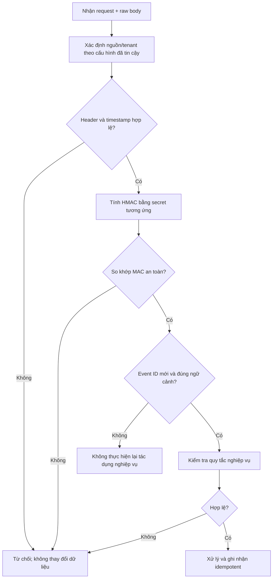
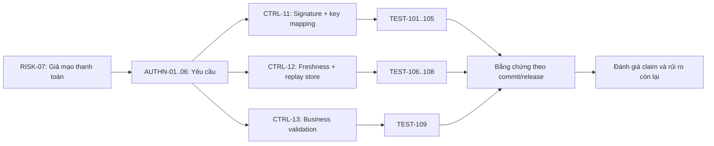

# Tính xác thực (Authenticity) trong security assurance

Một ứng dụng nhận được thông báo “thanh toán thành công” từ một endpoint webhook. Nội dung trông hợp lệ, có mã đơn hàng và số tiền chính xác. Nhưng **làm thế nào biết thông báo thực sự đến từ nhà cung cấp thanh toán được tin cậy**, chứ không phải do kẻ tấn công tự gửi? Và nếu đúng là nhà cung cấp gửi, làm sao biết thông báo chưa bị sửa hoặc phát lại?

Đó là vấn đề của **tính xác thực (authenticity)** — một mục tiêu bảo mật thiết yếu bên cạnh tính bí mật, tính toàn vẹn và tính sẵn sàng.

Trong module `SECURITY_SECURITY_ASSURANCE`, mục tiêu không chỉ là **có cơ chế xác thực**, mà còn phải **lập được luận cứ và bằng chứng** chứng minh cơ chế ấy đáp ứng yêu cầu trong phạm vi cụ thể. Bài này kết nối tính xác thực với phân tích rủi ro, yêu cầu bảo mật, security controls, kiểm thử, audit và xử lý phát hiện trong suốt vòng đời phát triển và vận hành.

## 1. Tính xác thực là gì?

**Tính xác thực** là thuộc tính cho phép một bên có cơ sở tin cậy rằng **một thực thể, thông điệp, dữ liệu hoặc hiện vật thực sự có danh tính hay nguồn gốc như được tuyên bố**, theo các giả định và quan hệ tin cậy đã xác định.

Tùy đối tượng cần bảo vệ, ta có thể nói đến:

| Đối tượng | Khẳng định về tính xác thực | Ví dụ |
|---|---|---|
| **Thực thể** (entity authenticity) | Chủ thể đang tương tác thực sự là bên đã tuyên bố | Dịch vụ A xác minh server B qua chứng chỉ TLS hợp lệ |
| **Thông điệp** (message authenticity) | Thông điệp đến từ bên nắm khóa/chứng thực hợp lệ của nguồn được khai báo | Webhook kiểm tra MAC hoặc chữ ký số |
| **Nguồn gốc dữ liệu** (data-origin authenticity) | Dữ liệu được tạo/gửi từ nguồn mà hệ thống tin tưởng | Một bản ghi được liên kết với nguồn đo hoặc dịch vụ phát sinh |
| **Hiện vật phần mềm** (artifact provenance/authenticity) | Gói phần mềm được tạo/phát hành bởi bên được tin cậy theo quy trình xác định | Xác minh chữ ký bản phát hành và danh tính người/kênh ký |

Ví dụ: xác minh chữ ký số của một bản cập nhật có thể chứng minh gói đó được ký bằng khóa tương ứng với danh tính đã tin cậy, nếu khóa và quá trình xác minh được quản lý đúng. Nó **không tự chứng minh mã nguồn không có lỗ hổng** hoặc người ký không bị chiếm quyền.

Vì vậy, một tuyên bố authenticity nên có đủ bốn thành phần:

1. **Ai/cái gì được xác thực?** Người dùng, dịch vụ, thông điệp, dữ liệu hay gói phần mềm.
2. **Danh tính hoặc nguồn gốc nào được khẳng định?** Ví dụ nhà cung cấp thanh toán X, tenant A hoặc dịch vụ `billing`.
3. **Dựa vào cơ chế và quan hệ tin cậy nào?** Khóa bí mật, khóa công khai, chứng chỉ, bên cấp danh tính, thiết bị, quy trình đăng ký khóa.
4. **Trong ngữ cảnh nào?** Giao dịch nào, endpoint nào, thời điểm nào, bản phát hành nào; điều kiện nào làm bằng chứng hết hiệu lực.

Không có cơ sở tin cậy ban đầu, một chữ ký hợp lệ chỉ nói rằng **người nắm một khóa nào đó** đã ký. Để gắn khóa ấy với “nhà cung cấp X”, hệ thống phải xác thực việc phân phối, đăng ký và quản trị khóa.

## 2. Phân biệt authenticity với các khái niệm liên quan

Tiếng Việt thường dùng “xác thực” cho cả **authenticity** (thuộc tính/mục tiêu) và **authentication** (hoạt động xác minh). Hai khái niệm gần nhau nhưng không đồng nhất.

| Khái niệm | Câu hỏi được giải quyết | Ví dụ và giới hạn |
|---|---|---|
| **Authenticity – tính xác thực** | Có căn cứ để tin danh tính/nguồn gốc được khai báo là đúng không? | Tin một webhook thực sự đến từ bên phát hành mong đợi |
| **Authentication – quá trình xác thực** | Bằng cách nào kiểm tra một chủ thể hoặc thông điệp? | Kiểm tra credential, xác minh chứng chỉ, MAC hoặc chữ ký |
| **Identification – định danh** | Chủ thể khai báo mình là ai? | Gửi username hoặc `client_id`; lời khai chưa được xác minh |
| **Authorization – phân quyền** | Chủ thể đã xác thực được phép làm gì? | Người dùng đăng nhập thành công chưa chắc có quyền hoàn tiền |
| **Integrity – tính toàn vẹn** | Nội dung có bị thay đổi trái phép hay không? | Hash kiểm tra thay đổi; một hash không được bảo vệ có thể bị thay cùng dữ liệu |
| **Confidentiality – tính bí mật** | Ai có thể đọc nội dung? | TLS mã hóa đường truyền; tính bí mật không tự bảo đảm nguồn gửi đáng tin |
| **Non-repudiation – chống chối bỏ** | Có bằng chứng đủ mạnh để một bên khó phủ nhận hành động đã thực hiện không? | Chữ ký số gắn với danh tính và quản trị khóa phù hợp có thể hỗ trợ; HMAC dùng khóa chung thường không chứng minh riêng bên nào đã tạo MAC |
| **Freshness – tính mới** | Thông điệp có thuộc phiên/khung thời gian hiện tại và chưa bị phát lại trái phép không? | Nonce, timestamp, số thứ tự và cơ chế chống replay |

Một trường hợp đặc biệt quan trọng: **thông điệp có chữ ký hoặc MAC hợp lệ vẫn có thể là thông điệp cũ bị phát lại**. Xác minh nguồn gốc và toàn vẹn là điều kiện cần, nhưng nhiều giao dịch cần thêm kiểm tra tính mới và tính duy nhất.

Tương tự, một người đã đăng nhập bằng phương thức mạnh vẫn có thể không được phép truy cập thông tin của người khác. Authentication **không thay thế** authorization.

## 3. Vì sao tính xác thực dễ bị phá vỡ?

Khi thiết kế assurance, cần xét không chỉ thuật toán mật mã mà cả hệ thống định danh, vận hành khóa và cách diễn giải thông điệp.

| Đe dọa | Tình huống | Rủi ro chính |
|---|---|---|
| **Giả mạo nguồn** (spoofing) | Kẻ tấn công gửi webhook giả với trường `provider` tự điền | Hệ thống thực hiện giao dịch dựa trên nguồn không tin cậy |
| **Đánh cắp credential/khóa** | API key, private key hoặc token bị lộ | Kẻ tấn công có thể tạo thông điệp trông hợp lệ |
| **Phishing và chiếm phiên** | Người dùng xác thực vào trang giả hoặc token phiên bị đánh cắp | Hành vi độc hại được gán cho danh tính thật |
| **Thay thế/nhầm khóa tin cậy** | Ứng dụng dùng sai khóa của tenant hoặc chấp nhận chứng chỉ không đáng tin | Xác minh thành công bằng sai quan hệ tin cậy |
| **Replay** | Gửi lại yêu cầu hoàn tiền đã ký hợp lệ | Hành động bị thực hiện lặp lại |
| **Thao túng diễn giải dữ liệu** | Bên ký và bên xác minh chuẩn hóa JSON khác nhau, hoặc ký khác phần mà ứng dụng xử lý | Một payload được xác minh nhưng ý nghĩa giao dịch không đúng như đã ký |
| **Bỏ qua kiểm tra ở một luồng xử lý** | Endpoint phụ hoặc consumer bất đồng bộ không xác minh chữ ký | Một đường đi phá hỏng khẳng định cho toàn dịch vụ |
| **Trust anchor lỗi thời** | Khóa bị thu hồi nhưng hệ thống tiếp tục chấp nhận | Nguồn không còn hợp lệ vẫn được công nhận |

Ví dụ rủi ro cho hệ thống quản lý đơn hàng:

- **Tài sản:** trạng thái thanh toán, số dư, lịch sử giao dịch.
- **Đối thủ:** người ngoài Internet có thể gửi request tới webhook.
- **Hành vi tấn công:** giả danh nhà cung cấp thanh toán để yêu cầu đánh dấu đơn hàng “đã thanh toán”.
- **Tác động:** giao hàng chưa thu tiền, sai lệch đối soát hoặc mất uy tín.
- **Mục tiêu:** chỉ thông điệp đến từ nguồn được cấp quyền, chưa bị sửa và chưa bị áp dụng lặp lại mới có thể thay đổi trạng thái đơn.

Đặt đúng mục tiêu trước khi chọn control: chặn theo IP có thể bổ sung lớp bảo vệ, nhưng IP có thể thay đổi hoặc thuộc hạ tầng dùng chung; một header `X-Provider: trusted` do client tự khai báo không chứng minh danh tính.

## 4. Từ mục tiêu đến yêu cầu có thể kiểm chứng

Câu “webhook phải có tính xác thực” quá rộng để đánh giá. Hãy tách thành các yêu cầu có mã, tiêu chí đạt và phương pháp kiểm chứng.

Giả sử endpoint `POST /webhooks/payment` tiếp nhận thông điệp từ nhà cung cấp đã đăng ký khóa.

| Mã | Yêu cầu bảo mật | Tiêu chí chấp nhận | Bằng chứng gợi ý |
|---|---|---|---|
| `AUTHN-01` | Chỉ chấp nhận nguồn đã đăng ký | Không có khóa/chứng thư hợp lệ thì request bị từ chối trước khi thay đổi trạng thái | Kiểm thử nguồn hợp lệ và nguồn giả; cấu hình trust store |
| `AUTHN-02` | Bảo vệ toàn vẹn phần dữ liệu được xử lý | Thay đổi bất kỳ byte thuộc thông điệp đã ký làm xác minh thất bại | Kiểm thử sửa body, mã đơn hàng, amount |
| `AUTHN-03` | Ràng buộc thông điệp với ngữ cảnh | Chữ ký/MAC bao phủ phiên bản giao thức, thời gian và ID sự kiện theo định dạng đã công bố | Review đặc tả ký và test vector |
| `AUTHN-04` | Chống phát lại | Sự kiện trùng không gây thực thi lại tác dụng nghiệp vụ; dữ liệu hết hạn bị từ chối | Kiểm thử gửi lặp, gửi trễ, sai đồng hồ |
| `AUTHN-05` | Quản trị khóa đúng | Khóa được lưu an toàn, cấp theo nguồn/tenant, xoay vòng và thu hồi theo quy trình | Cấu hình KMS/secret manager, hồ sơ rotation, rà soát quyền |
| `AUTHN-06` | Ghi nhận sai lệch | Thất bại xác minh được ghi nhận có kiểm soát, không để lộ secret | Log tổng hợp, cảnh báo, playbook xử lý |

Những yêu cầu này được phân tầng: `AUTHN-01`/ `02` xây sự tin cậy vào nguồn và nội dung; `03`/ `04` bảo vệ ngữ cảnh giao dịch; `05` giữ tính tin cậy của khóa; `06` hỗ trợ phát hiện khi hệ thống bị thử tấn công hoặc cấu hình sai.

**Điều kiện chấp nhận phải gắn với tác động thực tế.** Chẳng hạn, chỉ thấy response `401` chưa đủ nếu hệ thống đã ghi đơn hàng là “paid” trước khi trả lỗi. Bằng chứng phải kiểm tra cả trạng thái lưu trữ và tác dụng phụ.

## 5. Security controls bảo vệ tính xác thực

### 5.1. Xác thực thực thể: người dùng và dịch vụ

Đối với người dùng, control có thể bao gồm mật khẩu được quản lý an toàn, MFA, passkey/FIDO2/WebAuthn, bảo vệ phiên và cơ chế phát hiện đăng nhập bất thường. Với tài khoản có đặc quyền cao hoặc rủi ro phishing lớn, phương thức **chống phishing** như passkey/WebAuthn thường phù hợp hơn mã OTP nhập tay, vì xác thực được ràng buộc với tên miền của bên dựa vào danh tính.

Đối với service-to-service, có thể sử dụng **mutual TLS (mTLS)**, token truy cập có chữ ký hoặc danh tính workload ngắn hạn. Phải xác minh rằng chứng chỉ/token thực sự thuộc đúng **dịch vụ dự kiến**, không chỉ “được một CA nào đó ký”.

Với token JWT, việc xác minh cần phù hợp loại token và trust model: kiểm tra chữ ký bằng thuật toán đã cho phép, khóa thuộc issuer tin cậy, `iss`, `aud`, `exp`, `nbf` và các claim ngữ cảnh liên quan. Không chọn thuật toán chỉ theo header do người gửi tự khai báo; không mặc định token đăng nhập dùng được cho mọi API. Việc kiểm tra phân quyền theo tài nguyên vẫn phải diễn ra sau khi xác thực.

### 5.2. Xác thực nguồn thông điệp

Ba cơ chế thường gặp:

| Cơ chế | Hỗ trợ điều gì? | Điểm cần lưu ý |
|---|---|---|
| **HMAC/MAC với secret chia sẻ** | Xác minh thông điệp do bên nắm cùng secret tạo ra và nội dung đã MAC không bị thay | Bất kỳ bên nào nắm secret đều có thể tạo MAC; khó quy kết riêng bên gửi |
| **Chữ ký số** | Xác minh bằng public key rằng bên nắm private key tương ứng đã ký dữ liệu | Phải xác thực public key thuộc đúng chủ thể, quản lý khóa, thu hồi và thuật toán |
| **TLS/mTLS** | Bảo vệ kênh và xác thực danh tính endpoint theo cấu hình | Bảo vệ theo kết nối; dữ liệu sau khi qua proxy/queue hoặc được lưu chuyển tiếp có thể cần xác minh ở cấp thông điệp |

**Hash thông thường, mã hóa đơn thuần, địa chỉ IP, username hay custom header tự khai báo không thay thế một cơ chế xác thực nguồn hợp lệ.** Lựa chọn phụ thuộc ranh giới tin cậy: webhook qua mạng Internet thường cần MAC/chữ ký theo giao thức của nhà cung cấp; giao tiếp nội bộ nhạy cảm có thể cần mTLS và kiểm tra danh tính workload.

### 5.3. Bảo vệ tính mới, ngữ cảnh và khóa

Một thiết kế hợp lý thường bổ sung:

- **Timestamp và giới hạn tuổi thông điệp:** giới hạn khoảng thời gian chấp nhận, đồng thời xử lý lệch đồng hồ.
- **Nonce/event ID/số thứ tự:** phát hiện request đã dùng; thao tác ghi nhận phải nguyên tử và có thời hạn lưu đủ dài.
- **Ràng buộc ngữ cảnh:** đưa version, ID nguồn, tenant, hành động hoặc tài nguyên liên quan vào dữ liệu được ký để ngăn nhầm miền sử dụng.
- **Quy tắc canonicalization rõ ràng:** bên gửi và nhận phải ký/đọc cùng biểu diễn byte; ưu tiên ký raw body đúng đặc tả thay vì parse JSON rồi serialize tùy thư viện.
- **Vòng đời khóa:** tạo, phân phối, lưu trữ, phân quyền, xoay vòng, thu hồi và ứng phó khi lộ khóa.
- **Từ chối mặc định:** thiếu header, chữ ký sai, khóa không rõ nguồn hoặc claim không phù hợp đều không được thay đổi trạng thái nghiệp vụ.

Một signature/MAC hợp lệ chỉ là một bước trong quyết định xử lý. Hệ thống vẫn cần xác minh **quyền thực hiện hành động, trạng thái đơn hàng, số tiền, đơn vị tiền tệ, mối liên hệ giữa giao dịch và đơn hàng**, và quy tắc idempotency.

## 6. Ví dụ Java 17: xác minh webhook HMAC-SHA256

Đây là **giao thức minh họa do bài học định nghĩa**, không phải format mặc định của mọi nhà cung cấp. Giả sử đối tác gửi:

- Header `X-Event-Timestamp`: Unix epoch **giây**, dạng số thập phân.
- Header `X-Event-Id`: chuỗi gồm chữ ASCII, chữ số, dấu `_` hoặc `-`.
- Header `X-Event-Signature`: HMAC-SHA256 mã hóa hexadecimal, dài 64 ký tự.
- Dữ liệu được ký là: `timestamp + LF + eventId + LF + rawRequestBody` dưới dạng byte.
- Secret được cấp và quản lý riêng cho **nguồn/tenant** đã đăng ký.

Luồng xử lý:



Ví dụ hàm **xác minh HMAC và giới hạn tuổi thông điệp**, dùng API chuẩn của Java 17:

```java
import java.nio.charset.StandardCharsets;
import java.security.GeneralSecurityException;
import java.security.MessageDigest;
import java.time.Clock;
import java.util.HexFormat;
import javax.crypto.Mac;
import javax.crypto.SecretKey;

public final class WebhookSignatureVerifier {
    private static final long MAX_SKEW_SECONDS = 300;

    private WebhookSignatureVerifier() {}

    public static boolean verify(
            byte[] rawBody,
            String timestamp,
            String eventId,
            String signatureHex,
            SecretKey trustedKey,
            Clock clock) {

        if (rawBody == null || timestamp == null || eventId == null
                || signatureHex == null || trustedKey == null || clock == null) {
            return false;
        }

        // Cú pháp thống nhất: tránh diễn giải khác nhau giữa hai bên.
        if (!timestamp.matches("[0-9]{1,19}")
                || !eventId.matches("[A-Za-z0-9_-]{1,128}")
                || !signatureHex.matches("[0-9a-fA-F]{64}")) {
            return false;
        }

        final long sentAt;
        try {
            sentAt = Long.parseLong(timestamp);
        } catch (NumberFormatException ex) {
            return false;
        }

        long now = clock.instant().getEpochSecond();
        if (sentAt < now - MAX_SKEW_SECONDS
                || sentAt > now + MAX_SKEW_SECONDS) {
            return false;
        }

        byte[] supplied = HexFormat.of().parseHex(signatureHex);

        try {
            Mac mac = Mac.getInstance("HmacSHA256");
            mac.init(trustedKey);
            mac.update(timestamp.getBytes(StandardCharsets.US_ASCII));
            mac.update((byte) 0x0A); // LF
            mac.update(eventId.getBytes(StandardCharsets.US_ASCII));
            mac.update((byte) 0x0A); // LF
            byte[] expected = mac.doFinal(rawBody);
            return MessageDigest.isEqual(expected, supplied);
        } catch (GeneralSecurityException ex) {
            throw new IllegalStateException("Cannot verify webhook", ex);
        }
    }
}
```

**Điều kiện áp dụng:** `trustedKey` phải đến từ kho bí mật đáng tin, được chọn theo cấu hình đăng ký nguồn/tenant (không được tự tin `keyId` của bên gửi nếu chưa đối chiếu). Phía phát hành phải ký **cùng chuỗi byte theo đúng thứ tự**; HMAC secret cần đủ entropy và không được ghi vào log.

Hàm trên **chưa chống replay đầy đủ**: một request có chữ ký hợp lệ vẫn có thể bị gửi lại trong cửa sổ năm phút. Sau khi `verify(...)` thành công, luồng xử lý phải dùng kho lưu trạng thái phân tán (nếu có nhiều instance) để **kiểm tra và đánh dấu event ID bằng thao tác nguyên tử**. Khóa idempotency phải được ràng buộc với nguồn/tenant và lưu đủ lâu bao phủ thời gian chấp nhận replay. Nếu hệ thống có retry hợp lệ, có thể trả kết quả đã xử lý cho event trùng, nhưng không được thực hiện lại tác dụng nghiệp vụ. Phải thiết kế cả tình huống xử lý thành công nhưng response bị mất.

Hàm cũng **chưa xác minh nội dung nghiệp vụ, không thực hiện quản trị khóa hay bảo đảm TLS/authorization**. Đây là thành phần kiểm tra chữ ký trong kiến trúc nhiều lớp; không được diễn giải kết quả `true` là “giao dịch đã được chấp thuận”.

### Ma trận kiểm thử cho ví dụ

| Trường hợp | Kỳ vọng | Điều cần kiểm tra thêm |
|---|---|---|
| Payload gốc, secret/tenant đúng, timestamp còn hiệu lực | Chữ ký được chấp nhận | Dữ liệu chỉ thay đổi sau các kiểm tra nghiệp vụ |
| Sửa một byte trong body nhưng giữ chữ ký | Bị từ chối | Không có tác dụng phụ |
| Thay `timestamp` hoặc `eventId` nhưng giữ chữ ký | Bị từ chối | Log sai lệch không lộ secret |
| Chữ ký sai độ dài, sai ký tự hoặc thiếu header | Bị từ chối | Không có exception chưa xử lý hoặc bypass |
| Timestamp quá cũ hoặc quá xa trong tương lai | Bị từ chối | Kiểm thử ranh giới `±300s` với `Clock` cố định |
| Thông điệp hợp lệ được gửi lại với cùng event ID | Không xử lý tác dụng nghiệp vụ lần nữa | Thử đồng thời trên nhiều instance |
| Ký bằng khóa của tenant B, gửi với định danh tenant A | Bị từ chối | Kiểm tra ánh xạ key–tenant thực tế |
| Xoay vòng hoặc thu hồi khóa | Chấp nhận/từ chối đúng cửa sổ chính sách | Thử khóa cũ, khóa mới, khóa đã thu hồi |
| Kiểm tra chữ ký thành công nhưng số tiền sai | Giao dịch bị từ chối theo quy tắc nghiệp vụ | Xác minh số tiền, đơn vị tiền tệ, đơn hàng và trạng thái |

Với API khác, tiêu chí chấp nhận có thể khác. Chẳng hạn, nhà cung cấp dùng chữ ký bất đối xứng hoặc format timestamp khác thì phải theo đúng đặc tả của họ; không tự thay đổi giao thức khi tích hợp.

## 7. Xây dựng assurance case: Claim – Argument – Evidence

Một cơ chế tồn tại trong mã nguồn chưa đủ để kết luận mục tiêu authenticity đã đạt. Trong **security assurance**, ta cần một lập luận và bằng chứng có thể xem lại.

| Thành phần | Ví dụ cho webhook thanh toán |
|---|---|
| **Claim** | Chỉ sự kiện thanh toán được xác thực nguồn và đúng ngữ cảnh mới có thể cập nhật trạng thái đơn |
| **Argument** | Mọi đường nhận sự kiện đều xác minh MAC/chữ ký với khóa gắn nguồn tin cậy; kiểm tra freshness và idempotency; chỉ cập nhật sau khi thỏa quy tắc nghiệp vụ |
| **Control** | Xác minh HMAC; trust registry; secret manager; timestamp; kho event ID; nghiệp vụ kiểm tra số tiền/trạng thái |
| **Evidence** | Review kiến trúc và luồng xử lý; test vector; CI test; kiểm thử tích hợp triển khai; cấu hình key mapping; hồ sơ rotation; kết quả giám sát |
| **Giả định** | Secret và hệ thống lưu trạng thái không bị chiếm quyền; đồng hồ và trust registry hoạt động đúng |
| **Giới hạn** | Chưa thể kết luận về endpoint không nằm trong phạm vi hoặc sự kiện được xử lý ở môi trường khác |

Chuỗi truy vết có thể biểu diễn như sau:



**Chất lượng bằng chứng** cần được đánh giá theo:

- **Tính liên quan:** kiểm thử thực sự tác động đến khả năng giả mạo nguồn, thay đổi nội dung hoặc replay hay không?
- **Độ bao phủ:** mọi endpoint, consumer, queue và đường cập nhật trạng thái có đi qua xác minh không?
- **Khả năng truy xuất:** kết quả có gắn với phiên bản mã, cấu hình, thời điểm và môi trường được đánh giá không?
- **Độ mới:** bằng chứng có còn hiệu lực sau thay đổi SDK, reverse proxy, khóa hoặc trust registry không?
- **Độ độc lập và tin cậy:** có review phù hợp mức rủi ro, test âm tính và kiểm chứng ngoài unit test không?
- **Tính chính xác của kết luận:** `PASS` nghĩa là đã chạy trường hợp nào, còn giả định chưa kiểm chứng nào?

Một bản ghi minh họa (không phải bằng chứng thật):

```yaml
risk_id: RISK-07
claim_id: CLAIM-AUTH-01
requirement_ids: [AUTHN-01, AUTHN-02, AUTHN-04]
control_ids: [CTRL-11, CTRL-12]
scope: "POST /webhooks/payment"
artifact_version: "<commit-or-release-id>"
environment: "<staging-or-production>"
assessment_method: "<integration-test-and-config-review>"
result: "<PASS-FAIL-OR-INCONCLUSIVE>"
evidence_uri: "<immutable-ci-report-or-audit-reference>"
assessed_at: "<ISO-8601-time>"
assessor: "<team-or-reviewer>"
limitations:
  - "Chưa bao phủ mọi luồng nhập sự kiện bất đồng bộ"
  - "Chưa kiểm chứng quy trình thu hồi khóa trong sự cố thực tế"
reassessment_trigger: "Thay đổi khóa, giao thức ký, luồng nhận sự kiện"
```

Không lưu secret, private key hoặc token nguyên bản vào hồ sơ kiểm thử hay ticket. Có thể ghi phiên bản khóa, ID đã kiểm soát và bằng chứng cấu hình không tiết lộ bí mật.

## 8. Khi đánh giá thất bại: phát hiện, khắc phục và chấp nhận rủi ro

Giả sử pentest chỉ ra consumer của một queue nội bộ cập nhật trạng thái thanh toán mà **không kiểm tra dấu xác thực nguồn**. Dù endpoint webhook chính đã kiểm tra HMAC, claim “mọi sự kiện thanh toán đều được xác thực trước khi cập nhật đơn” vẫn **chưa được hỗ trợ**.

Quy trình xử lý nên gồm:

1. **Ghi nhận finding:** đường đi bị ảnh hưởng, bước tái hiện, tác động, rủi ro, điều kiện khai thác và bằng chứng.
2. **Xác định phạm vi:** consumer nào, topic nào, môi trường nào; có thể tạo sự kiện giả hoặc phát lại qua đường nào.
3. **Ưu tiên xử lý theo rủi ro:** đánh giá độ dễ khai thác, ảnh hưởng tới tài chính/dữ liệu và biện pháp giảm thiểu đang có.
4. **Khắc phục nguyên nhân:** đặt xác minh tại ranh giới tin cậy thích hợp, bảo vệ độ tin cậy của message broker, ràng buộc danh tính producer, hạn chế quyền publish, thực hiện idempotency.
5. **Kiểm chứng lại:** chạy test giả mạo/phát lại theo cả đường HTTP và queue; xác minh tác dụng phụ thực tế không xảy ra.
6. **Cập nhật assurance case:** gắn bằng chứng sau sửa với claim và phiên bản triển khai; chỉ kết luận đạt khi tiêu chí đã được kiểm chứng.

Nếu chưa xử lý được ngay, phải ghi rõ **rủi ro còn lại**, biện pháp tạm thời, chủ sở hữu, người có quyền chấp nhận, thời hạn và điều kiện đánh giá lại. Không đổi finding thành `PASS` chỉ vì ticket đã đóng hoặc ai đó đã phê duyệt ngoại lệ.

Đối với khóa đã bị lộ, chỉ sửa code chưa giải quyết nguyên nhân: cần xem xét **thu hồi/xoay vòng khóa, rà soát phạm vi ảnh hưởng, điều tra log, đánh giá sự kiện đáng ngờ và cập nhật bằng chứng**.

## 9. Duy trì tính xác thực trong phát triển và vận hành

Authenticity là thuộc tính cần được kiểm chứng lại khi **nguồn tin cậy, khóa, giao thức, code hoặc môi trường** thay đổi.

| Thời điểm | Hoạt động assurance liên quan |
|---|---|
| **Thiết kế** | Threat model spoofing, key theft, replay, nhầm nguồn/tenant; đặt claim và tiêu chí có thể kiểm tra |
| **Coding/CI** | Test signature hợp lệ và sai, tampering, expired, replay, key mismatch; review việc lấy raw body và trust lookup |
| **Trước phát hành** | Kiểm tra cấu hình production, secret manager, đường vào thực tế, rollout/rollback và trường hợp xoay khóa |
| **Vận hành** | Theo dõi tỷ lệ chữ ký không hợp lệ, sự kiện trùng, source bất thường, lỗi đồng bộ thời gian, khóa sắp hết hạn |
| **Sau sự cố/thay đổi** | Thu hồi khóa, cập nhật threat model, chạy hồi quy và làm mới assurance conclusion |

Một số **tín hiệu vận hành** hữu ích: số lần xác minh thất bại theo nguồn, tỷ lệ replay, số sự kiện bị từ chối do sai tenant, thời gian thu hồi khóa khi phát hiện lộ, tỷ lệ endpoint có kiểm thử nguồn giả. Các chỉ số này giúp phát hiện vấn đề và mức độ bao phủ; chúng **không tự đo được “mức an toàn tuyệt đối”**. Tỷ lệ request sai chữ ký tăng có thể do tấn công, tích hợp lỗi hoặc cấu hình rotation sai; cần phân tích nguyên nhân trước khi kết luận.

Trong audit, người đánh giá không nên chỉ hỏi “có dùng HMAC/TLS không?”, mà nên kiểm tra: **khóa nào được tin, vì sao được tin, dữ liệu nào được ký, luồng nào xác minh, có thể replay không, kết quả kiểm chứng thuộc bản phát hành nào, và khi sai lệch thì ai chịu trách nhiệm**.

## 10. Những nhầm lẫn thường gặp

| Nhầm lẫn | Nhận định đúng |
|---|---|
| “Có TLS là tất cả dữ liệu đều được xác thực đầu-cuối.” | TLS bảo vệ và có thể xác thực endpoint của kênh; dữ liệu đi qua proxy, broker hay lưu trữ có thể cần thêm bảo vệ nguồn ở cấp thông điệp |
| “JWT giải mã được là hợp lệ.” | Base64 decode không phải xác minh chữ ký, issuer, audience, thời hạn và mục đích sử dụng |
| “Hash trùng là biết người gửi.” | Hash thường không ràng buộc dữ liệu với danh tính được tin cậy |
| “Signature hợp lệ nghĩa là người gửi có quyền làm mọi thao tác.” | Authenticity và authorization là hai yêu cầu riêng |
| “HMAC tương đương chữ ký số chống chối bỏ.” | HMAC dùng secret chung; nhiều bên cùng nắm secret có thể tạo MAC |
| “Timestamp hợp lệ là đủ để chống replay.” | Request có thể bị phát lại trong cửa sổ chấp nhận; cần event ID/nonce và idempotency phù hợp |
| “Có test pass là nguồn dữ liệu chắc chắn đáng tin.” | Cần kiểm tra trust anchor, cấu hình triển khai, đường xử lý khác và trạng thái khóa theo thời gian |
| “Chữ ký đúng thì nội dung chắc chắn đúng sự thật.” | Chữ ký chứng minh nguồn/byte được ký theo giả định về khóa; nội dung vẫn có thể sai hoặc độc hại |

## 11. Checklist áp dụng cho một hệ thống thực tế

Khi bắt đầu một vòng security assurance cho tính xác thực, hãy tự rà soát:

1. **Xác định danh tính/nguồn cần tin:** người dùng, dịch vụ, tenant, nguồn dữ liệu hoặc nhà phát hành artefact nào?
2. **Khoanh phạm vi và ranh giới tin cậy:** có những endpoint, queue, proxy và trạng thái nghiệp vụ nào chịu ảnh hưởng?
3. **Viết claim kiểm chứng được:** yêu cầu một nguồn hợp lệ, byte không bị sửa, đúng ngữ cảnh và chống replay khi cần.
4. **Chọn và cấu hình control:** authentication, HMAC/chữ ký/mTLS, trust registry, quản lý khóa, freshness, idempotency và kiểm tra authorization.
5. **Thu bằng chứng cả trường hợp thành công và thất bại:** bao gồm bypass, replay, nhầm tenant, thay khóa và đường xử lý phụ.
6. **Đánh giá chất lượng bằng chứng:** xét phạm vi, môi trường, version, thời gian, giới hạn và khả năng truy xuất.
7. **Xử lý phát hiện và theo dõi liên tục:** tạo finding, kiểm chứng sửa lỗi, đánh giá rủi ro còn lại và tái đánh giá sau thay đổi.

**Ghi nhớ:** Tính xác thực trả lời câu hỏi **“Có bằng chứng đáng tin rằng nguồn/danh tính được tuyên bố là đúng hay không?”**. Trong security assurance, mục tiêu đó chỉ được coi là có cơ sở khi tổ chức **liên kết rủi ro → yêu cầu → control → kiểm thử/audit → bằng chứng → khắc phục và đánh giá lại**, cùng với các giả định và giới hạn được trình bày rõ ràng.
