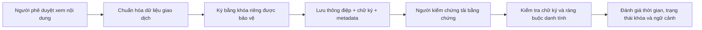
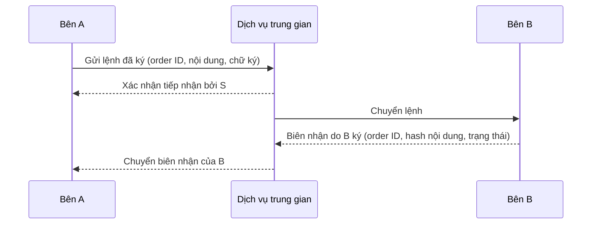

# Tính chống chối bỏ (Non-repudiation)

## Mục tiêu học tập

Sau bài học, bạn có thể:

- Giải thích **tính chống chối bỏ** và phân biệt với xác thực, toàn vẹn, tính bí mật, truy vết trách nhiệm và khả năng audit.
- Xác định ai có thể phủ nhận điều gì trong một giao dịch: tạo yêu cầu, phê duyệt, gửi, nhận hoặc thực thi.
- Thiết kế cơ chế tạo và bảo quản bằng chứng dựa trên chữ ký số, danh tính, thời gian, nội dung giao dịch và nhật ký có khả năng kiểm tra.
- Nhận diện giới hạn của chữ ký số, MAC, TLS, log, timestamp và chứng thư số; tránh kết luận vượt quá phạm vi bằng chứng.
- Chuyển mục tiêu chống chối bỏ thành yêu cầu đo được, security controls, ca kiểm thử, hồ sơ đánh giá và quy trình khắc phục liên tục.

## 1. Tính chống chối bỏ là gì?

**Tính chống chối bỏ** (*non-repudiation*) là mục tiêu bảo mật nhằm cung cấp **bằng chứng có thể kiểm tra** về một hành động hoặc sự kiện, để một bên khó có thể phủ nhận hành động đó một cách có căn cứ khi xảy ra tranh chấp. Hai trường hợp thường gặp là:

- **Chống chối bỏ nguồn gốc** (*non-repudiation of origin*): cung cấp bằng chứng cho thấy một thực thể xác định đã phát sinh hoặc phê duyệt thông điệp/giao dịch.
- **Chống chối bỏ việc nhận** (*non-repudiation of receipt*): cung cấp bằng chứng cho thấy bên nhận đã nhận nội dung hoặc xác nhận tiếp nhận một thông điệp/giao dịch xác định.

Trong thực tế, cần diễn đạt chính xác **sự kiện nào** đang được chứng minh. “Hệ thống đã gửi yêu cầu” khác với “phía nhận đã tiếp nhận”; “người dùng đã đăng nhập” khác với “người dùng đã chấp thuận chuyển khoản 100 triệu đồng”. Không thể suy ra việc đã đọc, hiểu hoặc đồng ý chỉ từ thông báo “đã giao thành công” của một hệ thống trung gian.

> Chống chối bỏ không có nghĩa là một người **không còn khả năng phát biểu lời phủ nhận**, cũng không bảo đảm một kết luận pháp lý tuyệt đối. Nó làm tăng khả năng kiểm chứng và quy trách nhiệm bằng bằng chứng phù hợp, trong một mô hình tin cậy và một phạm vi xác định.

Trong module **SECURITY_SECURITY_ASSURANCE**, chống chối bỏ là một **mục tiêu bảo mật cần được đánh giá bằng bằng chứng**. Muốn kết luận mục tiêu đạt, nhóm phát triển và vận hành phải liên kết rủi ro, yêu cầu, biện pháp kiểm soát, kết quả kiểm thử, audit và khắc phục phát hiện — thay vì chỉ xác nhận hệ thống có chức năng ký số.

### Ví dụ thực tế

Một doanh nghiệp có hệ thống phê duyệt thay đổi hạn mức thanh toán. Khi xảy ra tranh chấp, bên liên quan có thể hỏi:

1. **Ai** đã khởi tạo và phê duyệt thay đổi?
2. **Hạn mức, tài khoản đích và điều kiện** cụ thể trong yêu cầu là gì?
3. **Khi nào** sự kiện xảy ra, và yêu cầu được phê duyệt theo chính sách nào?
4. Có thể chứng minh nội dung đã phê duyệt **không bị thay đổi** sau đó không?
5. Bằng chứng có thể được **đối chiếu độc lập** sau một khoảng thời gian hay không?

Một log “User alice clicked Approve” không trả lời trọn vẹn các câu hỏi này: cần kiểm tra danh tính, nội dung thực sự được duyệt, chuỗi sự kiện, độ tin cậy của log và khả năng người khác đã dùng phiên đăng nhập hoặc khóa của Alice.

## 2. Phân biệt với các thuộc tính bảo mật liên quan

| Thuộc tính | Câu hỏi trọng tâm | Ví dụ kiểm chứng | Vì sao chưa đủ để chống chối bỏ? |
| --- | --- | --- | --- |
| **Bí mật (Confidentiality)** | Ai được đọc thông tin? | Dữ liệu được mã hóa, quyền truy cập giới hạn | Không cho biết ai đã phê duyệt một giao dịch. |
| **Toàn vẹn (Integrity)** | Nội dung có bị sửa đổi không? | So sánh hash hoặc xác minh chữ ký | Hash đơn lẻ không ràng buộc nội dung với một người. |
| **Xác thực (Authentication)** | Thực thể nào đang tham gia phiên? | Đăng nhập nhiều yếu tố | Đã đăng nhập không chứng minh đã duyệt **nội dung cụ thể**. |
| **Xác thực nguồn gốc (Authenticity)** | Thông điệp có đến từ nguồn được khai báo không? | Xác minh chữ ký hoặc cơ chế xác thực thông điệp | Cần thêm căn cứ quản lý khóa, danh tính, thời điểm, ngữ cảnh và khả năng tranh chấp. |
| **Trách nhiệm giải trình (Accountability)** | Ai chịu trách nhiệm cho hoạt động nào? | Audit trail, chủ sở hữu và phân quyền | Ghi nhận tác nhân không tự chứng minh log không thể bị sửa hoặc giả mạo. |
| **Chống chối bỏ (Non-repudiation)** | Có bằng chứng đủ mạnh để xác minh hành động hoặc việc nhận? | Chữ ký trên nội dung, bằng chứng danh tính, dấu thời gian, chuỗi bảo quản | Đây là **mục tiêu tổng hợp**; mức thuyết phục phụ thuộc toàn bộ hệ thống chứng cứ. |

**Ví dụ phân biệt cơ chế mật mã:** một mã xác thực thông điệp (*Message Authentication Code*, MAC) dựa trên khóa bí mật dùng chung có thể phát hiện sửa đổi và chứng thực nguồn trong phạm vi những bên cùng giữ khóa. Tuy nhiên, vì **cả hai bên có thể tạo MAC**, một bên thường không thể dùng riêng MAC để chứng minh với bên thứ ba rằng chỉ bên kia đã tạo thông điệp. Chữ ký số bất đối xứng hỗ trợ khả năng xác minh bởi bên thứ ba tốt hơn, nhưng vẫn phụ thuộc việc xác định chủ thể nắm khóa riêng.

## 3. Các thành phần tạo nên bằng chứng chống chối bỏ

Một cơ chế có giá trị cần kết hợp nhiều lớp, không dựa vào một tệp chữ ký duy nhất.

| Thành phần | Vai trò | Câu hỏi đánh giá |
| --- | --- | --- |
| **Định danh chủ thể** | Liên kết tài khoản, tổ chức hoặc cá nhân với hành động | Danh tính đã được xác minh thế nào? Có tài khoản dùng chung, ủy quyền hay danh tính máy không? |
| **Ràng buộc nội dung** | Gắn bằng chứng với chính xác đối tượng, giá trị và điều kiện được duyệt | Chữ ký bao gồm cả số tiền, người nhận, đơn vị tiền tệ, action, phiên bản và mã giao dịch không? |
| **Bằng chứng mật mã** | Phát hiện thay đổi và xác minh khóa tương ứng đã tạo chữ ký | Dùng thuật toán phù hợp? Khóa có được bảo vệ? Có thể kiểm tra độc lập? |
| **Thời gian có thể tin cậy** | Hỗ trợ xác định thứ tự, hiệu lực và trạng thái chứng thư tại thời điểm xảy ra | Thời gian do client tự báo, server ghi hay được chứng thực bởi dịch vụ tin cậy? |
| **Ngữ cảnh nghiệp vụ** | Chứng minh thao tác ký gắn với một quyết định có ý nghĩa | Người phê duyệt có thấy đúng nội dung và xác nhận rõ hành động không? |
| **Vòng đời khóa/chứng thư** | Hỗ trợ liên kết public key với chủ thể và kiểm soát việc ký | Ai cấp và quản lý khóa? Có thu hồi, hết hạn hoặc nghi ngờ lộ khóa? |
| **Lưu giữ và truy xuất** | Giữ bằng chứng kiểm tra được trong thời hạn cần thiết | Ai được ghi/sửa/xóa, có tính toàn vẹn, lịch sử truy cập và chính sách lưu giữ không? |
| **Kiểm chứng độc lập** | Cho phép assessor hoặc hệ thống khác xác minh | Có đủ dữ liệu đầu vào, thuật toán, public key/chứng thư, kết quả và điều kiện kiểm chứng không? |

Ví dụ một **biên nhận nhận hàng** chỉ có ý nghĩa nếu bản ghi thể hiện **bên nào nhận, nhận đối tượng gì, tại thời điểm nào và bằng cơ chế xác nhận nào**. API trả về HTTP 200 chỉ cho thấy ứng dụng đã xử lý request ở một điểm trong luồng; không tự chứng minh người nhận đã xác nhận tiếp nhận đúng nội dung.

## 4. Chữ ký số hỗ trợ chống chối bỏ như thế nào?

Trong chữ ký số bất đối xứng, chủ thể dùng **khóa riêng** để ký các byte đại diện cho nội dung; bên xác minh dùng **khóa công khai** tương ứng để kiểm tra chữ ký. Nếu nội dung thay đổi, việc xác minh phải thất bại với cùng chữ ký và khóa. Hệ thống thực tế còn cần xác minh khóa công khai được gắn với **đúng chủ thể** theo chính sách tin cậy.



### Điều kiện để chữ ký có ý nghĩa

1. **Đúng bytes được phê duyệt:** định nghĩa thông điệp cần ký rõ ràng và ổn định. Với JSON, nhiều cách biểu diễn tương đương về mặt dữ liệu có byte khác nhau; phải quy định cách chuẩn hóa (*canonicalization*) hoặc dùng định dạng serialization xác định.
2. **Không nhập nhằng nghiệp vụ:** bao gồm loại hành động (ví dụ “APPROVE_LIMIT_CHANGE”), ID giao dịch duy nhất, phiên bản biểu mẫu, số tiền, đơn vị tiền, đối tượng nhận, điều kiện và phạm vi hệ thống để chống tái sử dụng ở ngữ cảnh khác.
3. **Khóa riêng được quản trị:** giới hạn quyền sử dụng, ghi nhận thao tác ký, có cơ chế luân chuyển/thu hồi và, với giao dịch rủi ro cao, cân nhắc thiết bị ký/hệ thống quản lý khóa chuyên dụng như HSM hoặc khóa ràng buộc phần cứng.
4. **Ràng buộc danh tính:** khóa công khai/chứng thư được xác minh theo chuỗi tin cậy, danh tính, mục đích sử dụng, thời hạn và trạng thái theo chính sách tại thời điểm liên quan. Chứng thư không tự chứng minh người chủ tự tay ký nếu khóa bị đánh cắp hoặc người khác được phép sử dụng.
5. **Xác nhận ý chí trong quy trình:** người dùng được hiển thị rõ nội dung và thực hiện hành động phê duyệt có chủ đích; lưu bằng chứng của bước xác nhận. Đây là vấn đề quy trình, không được bảo đảm chỉ bởi thuật toán ký.
6. **Có khả năng kiểm tra về sau:** lưu thông điệp gốc/bytes đã ký, chữ ký, thuật toán, chứng thư hoặc định danh khóa, trạng thái kiểm tra và bằng chứng thời gian cần thiết.

### Ví dụ Java: ký và xác minh nội dung bằng RSA-PSS

Ví dụ sử dụng Java Security API với RSA-PSS và SHA-256. Khóa được tạo ngay trong chương trình **chỉ để minh họa cơ chế mật mã**; ví dụ này chưa xác minh danh tính thật, chưa quản lý khóa production và chưa tự tạo giá trị chống chối bỏ đầy đủ.

```java
import java.nio.charset.StandardCharsets;
import java.security.KeyPair;
import java.security.KeyPairGenerator;
import java.security.PrivateKey;
import java.security.PublicKey;
import java.security.Signature;
import java.security.spec.MGF1ParameterSpec;
import java.security.spec.PSSParameterSpec;
import java.util.Base64;

public class SignatureEvidenceExample {
    private static final PSSParameterSpec PSS = new PSSParameterSpec(
            "SHA-256", "MGF1", MGF1ParameterSpec.SHA256, 32, 1);

    static byte[] sign(byte[] content, PrivateKey privateKey) throws Exception {
        Signature signer = Signature.getInstance("RSASSA-PSS");
        signer.setParameter(PSS);
        signer.initSign(privateKey);
        signer.update(content);
        return signer.sign();
    }

    static boolean verify(byte[] content, byte[] signature, PublicKey publicKey)
            throws Exception {
        Signature verifier = Signature.getInstance("RSASSA-PSS");
        verifier.setParameter(PSS);
        verifier.initVerify(publicKey);
        verifier.update(content);
        return verifier.verify(signature);
    }

    public static void main(String[] args) throws Exception {
        KeyPairGenerator generator = KeyPairGenerator.getInstance("RSA");
        generator.initialize(3072);
        KeyPair keys = generator.generateKeyPair();

        // Định dạng cố định chỉ phục vụ ví dụ; hệ thống thật cần chuẩn hóa rõ ràng.
        String approval = "approval-v1|event=EVT-901|action=APPROVE_LIMIT_CHANGE"
                + "|actor=alice|account=ACC-007|amount=50000000|currency=VND";
        byte[] original = approval.getBytes(StandardCharsets.UTF_8);
        byte[] signature = sign(original, keys.getPrivate());

        System.out.println("Signature: " + Base64.getEncoder().encodeToString(signature));
        System.out.println("Original valid: " + verify(original, signature, keys.getPublic()));

        byte[] tampered = approval.replace("50000000", "90000000")
                .getBytes(StandardCharsets.UTF_8);
        System.out.println("Changed valid: " + verify(tampered, signature, keys.getPublic()));
    }
}
```

Kết quả về mặt logic là thông điệp gốc xác minh thành công, còn thông điệp đã sửa số tiền thì xác minh thất bại. **Kết luận hợp lệ:** chữ ký nhất quán với các byte gốc và public key được cung cấp. **Chưa thể kết luận:** Alice ngoài đời đã trực tiếp đọc và chủ ý phê duyệt giao dịch. Muốn kết luận rộng hơn cần quản lý khóa, liên kết danh tính, bước xác nhận và chuỗi bằng chứng bổ sung.

Trong hệ thống thực tế, **không lưu private key dạng plaintext trong source code, biến log hoặc database thông thường**; không tự nghĩ ra định dạng chuẩn hóa mơ hồ như ví dụ. Cần chọn giao thức/định dạng chữ ký đã được chuẩn hóa phù hợp với trường hợp sử dụng và thiết kế kiểm tra chữ ký ở bên xác minh.

## 5. Chống chối bỏ việc gửi và việc nhận: hai yêu cầu khác nhau

Giả sử bên A gửi một lệnh mua hàng cho bên B. Các sự kiện có thể xuất hiện theo thứ tự:



- **Chứng cứ nguồn gốc:** chữ ký của A và bằng chứng liên kết khóa ký với A hỗ trợ xác minh A đã tạo/phê duyệt chính lệnh đó.
- **Chứng cứ trung gian:** biên nhận của S chứng minh S đã tiếp nhận theo phạm vi xác nhận của S, không tự chứng minh B đã nhận.
- **Chứng cứ nhận:** biên nhận được xác minh là do B ký hỗ trợ kết luận B đã tiếp nhận lệnh theo nội dung và trạng thái ghi trong biên nhận.
- **Chứng cứ đồng ý:** nếu yêu cầu chứng minh B **chấp thuận** đơn hàng, biên nhận phải diễn đạt rõ hành động chấp thuận; chỉ có trạng thái “received” chưa đủ.

Biên nhận nên ràng buộc **ID sự kiện, hash hoặc nội dung cần xác nhận, kết quả nghiệp vụ, danh tính bên nhận và thời điểm**. Cần quy định cách xử lý lệnh gửi lại, biên nhận trùng, trả lời muộn hoặc bất đồng về phiên bản nội dung; nếu không, bằng chứng có thể đúng về mật mã nhưng sai về ý nghĩa nghiệp vụ.

## 6. Dấu thời gian và độ tin cậy lâu dài

Một bản ghi “createdAt” do ứng dụng tự đặt có ích cho truy vết vận hành nhưng không tự là bằng chứng thời gian độc lập. Đồng hồ máy khách có thể sai hoặc bị chỉnh; đồng hồ server có thể được đồng bộ nhưng vẫn phụ thuộc vào hạ tầng và quyền quản trị.

Đối với giao dịch cần bảo đảm cao, có thể sử dụng **dịch vụ dấu thời gian tin cậy** (*trusted timestamping*, ví dụ mô hình RFC 3161) để chứng minh dữ liệu hoặc giá trị hash tương ứng đã tồn tại không muộn hơn thời điểm được dịch vụ xác nhận, theo các giả định tin cậy của dịch vụ đó. Dấu thời gian không chứng minh người ký là ai hay đã chấp thuận nội dung.

Việc xác minh sau nhiều năm còn phụ thuộc vòng đời thuật toán, chứng thư, thông tin thu hồi và dữ liệu xác thực lưu kèm. Một chứng thư hết hạn ở hiện tại không tự cho phép kết luận chữ ký đã tạo trong quá khứ là giả, cũng không có nghĩa mọi chữ ký cũ đều hợp lệ; phải áp dụng chính sách xác minh theo thời điểm và bằng chứng tin cậy liên quan. Nếu thuật toán trở nên yếu, tổ chức có thể cần cơ chế bảo toàn hoặc gia hạn giá trị kiểm chứng bằng chứng theo chuẩn áp dụng.

## 7. Thiết kế yêu cầu chống chối bỏ có thể kiểm thử

Chỉ yêu cầu “Hệ thống phải hỗ trợ non-repudiation” là chưa đủ. Hãy diễn đạt theo chủ thể, sự kiện, nội dung, mức tin cậy, thời hạn và cách kiểm chứng.

Ví dụ cho dịch vụ phê duyệt hạn mức thanh toán:

| ID | Yêu cầu đánh giá được | Security control minh họa | Bằng chứng/tiêu chí đánh giá |
| --- | --- | --- | --- |
| NR-01 | Mọi phê duyệt hạn mức phải gắn với danh tính đã xác thực và một lần xác nhận có chủ đích cho **nội dung hiển thị**. | Xác thực mạnh cho thao tác nhạy cảm, màn hình xác nhận số tiền/người nhận, kiểm soát session. | Luồng UX, cấu hình xác thực, test actor giả mạo và xác nhận thiếu bước. |
| NR-02 | Mỗi phê duyệt phải tạo bản ghi có thể kiểm tra toàn vẹn, bao gồm actor, action, giao dịch, giá trị, policy version và ID duy nhất. | Chữ ký số trên payload chuẩn hóa, ID chống phát lại. | Nội dung đã ký, kết quả verify hợp lệ và thất bại khi sửa từng trường quan trọng. |
| NR-03 | Bên xác minh phải xác thực khóa ký gắn với chủ thể tại thời điểm và phạm vi ký theo chính sách. | PKI/định danh khóa tin cậy, quản lý vòng đời khóa và chứng thư. | Test chứng thư sai, khóa lạ, hết hiệu lực, bị thu hồi; biên bản quản trị khóa. |
| NR-04 | Hệ thống phải lưu chứng cứ với lịch sử truy cập, bảo vệ khỏi sửa/xóa trái phép trong thời hạn theo chính sách. | Lưu trữ hạn chế quyền, bất biến có kiểm soát, audit trail, backup. | Test sửa/xóa trái phép, cấu hình quyền, kiểm tra khôi phục và đối chiếu integrity. |
| NR-05 | Người đánh giá được ủy quyền phải tái xác minh bằng chứng theo ID giao dịch, độc lập với trạng thái UI ban đầu. | Verification API/quy trình export gói bằng chứng. | Test đọc gói chứng cứ, đối chiếu khóa, kết quả chữ ký và thời điểm. |
| NR-06 | Khi thay đổi khóa, luồng duyệt hoặc schema giao dịch, hệ thống phải xác định bằng chứng bị ảnh hưởng và đánh giá lại. | Quản lý thay đổi, versioning, CI test và review rủi ro. | Liên kết change request, build, kiểm thử hồi quy, finding và retest. |

Mức yêu cầu cụ thể phụ thuộc giá trị tài sản, mô hình đe dọa, rủi ro chấp nhận được và quy định áp dụng. Không phải mọi thao tác như lưu nháp hoặc xem trang đều cần chữ ký số của từng người dùng.

### Đường đi từ rủi ro đến assurance case

| Thành phần | Ví dụ |
| --- | --- |
| **Rủi ro RISK-APPROVAL-01** | Kẻ tấn công sửa số tiền hoặc một bên phủ nhận nội dung đã phê duyệt. |
| **Mục tiêu OBJ-NR-01** | Có thể xác minh ai đã phê duyệt giá trị giao dịch nào và vào thời điểm nào. |
| **Claim CL-NR-01** | Đối với build X trên môi trường Y, phê duyệt giao dịch được ràng buộc với nội dung chính xác, chủ thể và bản ghi có thể truy vết. |
| **Argument** | Payload chứa đầy đủ trường quan trọng, chữ ký hợp lệ, khóa được quản lý, luồng duyệt yêu cầu xác nhận và bằng chứng lưu giữ được. |
| **Evidence** | Test sửa payload, kết quả xác minh chữ ký, cấu hình key management, quy trình cấp/thu hồi khóa, audit event, kiểm tra quyền lưu trữ và review. |
| **Residual risk** | Nếu tài khoản hoặc khóa bị chiếm quyền, chữ ký hợp lệ vẫn có thể được tạo trái ý chí chủ thể; phải có kiểm soát bổ trợ. |

## 8. Bằng chứng và hoạt động kiểm thử cho security assurance

Tổ chức cần kiểm tra cả **khả năng tạo bằng chứng** lẫn **khả năng bằng chứng còn đáng tin khi xảy ra tranh chấp**.

### Bộ tình huống kiểm thử tối thiểu

| Tình huống | Kết quả mong đợi |
| --- | --- |
| Xác minh đúng payload, đúng khóa công khai | Chữ ký hợp lệ; trường nghiệp vụ đối chiếu đúng. |
| Thay số tiền, người nhận, loại hành động hoặc ID giao dịch sau khi ký | Xác minh thất bại hoặc giao dịch bị từ chối do không khớp nội dung. |
| Dùng chữ ký thuộc giao dịch khác để phê duyệt giao dịch mới | Bị từ chối nhờ ràng buộc định danh giao dịch, mục đích và cơ chế chống phát lại. |
| Xác minh bằng khóa không đáng tin, hoặc chứng thư không hợp lệ theo chính sách | Bị từ chối; ghi rõ lý do đánh giá. |
| Thu hồi quyền người dùng trước thời điểm phê duyệt mới | Không thể tạo phê duyệt hợp lệ theo chính sách; có dấu vết về thay đổi quyền. |
| Người không có quyền sửa hoặc xóa evidence record | Thao tác bị chặn/ghi nhận, hoặc sai lệch có thể bị phát hiện bằng cách đối chiếu nguồn tin cậy. |
| Thay đổi nội dung hiển thị khác nội dung được ký | Phát hiện bất nhất; không hoàn tất phê duyệt. |
| Tra cứu lại giao dịch sau một lần thay đổi schema hoặc triển khai | Hệ thống hiểu đúng phiên bản cũ và vẫn kiểm tra được bằng chứng. |
| Khóa ký nghi bị lộ hoặc hệ thống clock lệch | Kích hoạt kiểm soát sự cố; kết luận đánh giá không bỏ qua nghi vấn về nguồn gốc/thời gian. |
| Gửi yêu cầu nhưng không có biên nhận của bên đích | Chỉ kết luận được các sự kiện đã quan sát/chứng minh, không khẳng định bên đích đã nhận. |

**Phương pháp đánh giá:** kết hợp kiểm thử tự động, review thiết kế, kiểm tra chính sách khóa, xem xét hệ thống log, thử khôi phục evidence và đánh giá vận hành. Một unit test xác minh “Signature.verify == true” chỉ kiểm tra thuật toán và dữ liệu đầu vào ở phạm vi test; chưa chứng minh bản phát hành production, danh tính người ký hoặc tính toàn vẹn của kho lưu giữ.

### Ví dụ cấu trúc hồ sơ bằng chứng

Cấu trúc dưới đây là **mẫu**, các giá trị “<...>” cần được thay bằng thông tin thực tế khi đánh giá:

```yaml
evidence_id: EV-NR-2026-001
claim_id: CL-NR-01
requirement_ids: [NR-01, NR-02, NR-03, NR-04]
transaction_id: "<TRANSACTION_ID>"
event_type: APPROVE_LIMIT_CHANGE
actor_id: "<VERIFIED_ACTOR_ID>"
payload_schema: approval-v1
payload_digest_sha256: "<DIGEST_OF_EXACT_SIGNED_BYTES>"
signature_format: "<ALGORITHM_AND_ENCODING>"
signature_artifact: "<PROTECTED_ARTIFACT_URI>"
public_key_or_certificate_id: "<TRUSTED_KEY_REFERENCE>"
timestamp_evidence: "<TRUSTED_TIME_REFERENCE_IF_APPLICABLE>"
source_commit: "<SOURCE_COMMIT_SHA>"
deployment_id: "<DEPLOYMENT_ID>"
environment: "<ENVIRONMENT>"
observed_at: "<UTC_ISO_8601>"
verification_result: "<PASS_FAIL_INCONCLUSIVE>"
reviewer: "<REVIEWER_ID>"
limitations: "<UNTESTED_SCOPE_AND_RESIDUAL_RISKS>"
```

Tệp YAML này **không tự trở thành bằng chứng mạnh** chỉ vì có đủ trường; giá trị thực còn nằm ở các artifact gốc, chữ ký có thể kiểm tra, kiểm soát quyền truy cập, nguồn gốc dữ liệu và log đánh giá liên quan. Việc thu thập nên gắn mã commit, build và deployment để bảo đảm test được đối chiếu với đúng phiên bản đã chạy.

## 9. Log, chuỗi bảo quản và kiểm toán

**Audit log** là nguồn chứng cứ quan trọng nhưng cần xem xét đối tượng nào có thể tạo, sửa hoặc xóa log. Log thuần văn bản do cùng ứng dụng có quyền cao nhất ghi và sửa không cung cấp cơ chế độc lập để chống giả mạo. Các biện pháp tăng độ tin cậy gồm:

- Gửi log đến hệ thống thu thập độc lập với ứng dụng, phân quyền đọc/ghi và giám sát việc xóa hoặc sửa.
- Gắn ID sự kiện, ID correlation, actor, action, trạng thái, thời điểm, nguồn, phiên bản ứng dụng và tham chiếu payload đã ký; nhất quán schema giữa các dịch vụ.
- Sử dụng chính sách lưu giữ, backup và vùng lưu trữ có bảo vệ sửa/xóa phù hợp mức rủi ro; ghi nhận truy cập vào kho bằng chứng.
- Khi cần, dùng chuỗi hash có neo tới một nguồn tin cậy hoặc chữ ký cho từng lô log để hỗ trợ phát hiện chỉnh sửa. **Chuỗi hash đơn thuần không chống được người có quyền viết lại toàn bộ chuỗi và giá trị gốc**, nếu không có điểm neo hoặc biện pháp kiểm soát độc lập.
- Theo dõi độ trễ, khoảng trống log, sai lệch clock và sự cố pipeline để không suy diễn rằng thiếu sự kiện nghĩa là không xảy ra sự kiện.

**Chuỗi bảo quản bằng chứng** (*chain of custody*) trả lời: ai thu thập, thu khi nào, từ đâu, chuyển cho ai, qua thao tác gì và cách nào xác nhận hiện vật không bị thay đổi. Cần đặc biệt giữ thông tin này khi thu thập cho điều tra, audit hoặc tranh chấp. Hash hiện vật giúp phát hiện thay đổi nhưng **không tự xác lập nguồn gốc hoặc thời gian** nếu hồ sơ lấy mẫu không đáng tin.

Chứng cứ có thể chứa dữ liệu cá nhân, thông tin giao dịch, token hoặc định danh thiết bị. Thiết kế quyền truy cập, che dữ liệu nhạy cảm và thời hạn lưu giữ phải cân bằng khả năng đối soát với yêu cầu bảo mật và nghĩa vụ pháp lý; không đưa private key, access token hay payload nhạy cảm nguyên bản vào hệ thống log công khai.

## 10. Những giới hạn và rủi ro thường bị bỏ qua

| Ngộ nhận hoặc tình huống | Vì sao nguy hiểm? | Cách giảm rủi ro |
| --- | --- | --- |
| “Chữ ký hợp lệ chứng minh Alice tự nguyện ký.” | Khóa riêng có thể bị lộ, bị dùng qua ủy quyền hoặc phần mềm ký không hiển thị đúng nội dung. | Bảo vệ khóa, xác thực lại thao tác nhạy cảm, phê duyệt rõ ràng, giám sát bất thường, thu thập ngữ cảnh. |
| “Đã xác thực TLS nên không ai phủ nhận đã gửi.” | TLS bảo vệ phiên truyền nhưng không mặc nhiên tạo bằng chứng ký từng giao dịch cho bên thứ ba. | Ký payload nghiệp vụ hoặc sử dụng cơ chế biên nhận được xác thực riêng nếu cần. |
| “Server trả HTTP 200 nghĩa là người nhận đã đồng ý.” | 200 chỉ phản ánh trạng thái xử lý ở endpoint tương ứng. | Xác định rõ sự kiện nhận/chấp thuận và biên nhận ký xác nhận nội dung. |
| “Hash của log là bằng chứng chống sửa.” | Người có quyền sửa file có thể tạo lại hash nếu không có nguồn neo. | Lưu hash ở nơi độc lập, ký/đóng dấu thời gian và hạn chế quyền. |
| “Ký JSON là đủ, bất kể serialization.” | Một payload logic có thể có nhiều biểu diễn byte, hoặc parser hiểu khác nhau. | Dùng chuẩn hóa xác định, version schema và bảo đảm ký đúng bytes được kiểm tra. |
| “Có chứng thư số là mọi tranh chấp được giải quyết.” | Tranh chấp còn phụ thuộc nhận dạng, cách dùng khóa, ý chí, thời điểm, thẩm quyền và quy định áp dụng. | Ghi nhận assurance case, điều kiện tin cậy, giới hạn và bằng chứng quy trình. |
| “Chỉ cần đánh giá một lần.” | Khóa, chứng thư, thuật toán, chính sách, cách triển khai và rủi ro thay đổi. | Đánh giá định kỳ và theo sự kiện; theo dõi khóa, test và finding liên tục. |

Chứng cứ có giá trị trước cơ quan pháp lý hay không còn phụ thuộc quy định theo **quốc gia/vùng lãnh thổ, loại giao dịch, điều kiện sử dụng chữ ký điện tử và quy trình chứng thực**. Không đồng nhất một chữ ký số hợp lệ về mặt mật mã với việc được công nhận pháp lý trong mọi trường hợp.

## 11. Đánh giá liên tục và xử lý phát hiện

Một chương trình security assurance liên tục có thể vận hành theo vòng lặp:

```text
Xác định rủi ro tranh chấp / giả mạo / thay đổi giao dịch
    -> Định nghĩa claim và yêu cầu chống chối bỏ cụ thể
    -> Thiết kế control (ký, danh tính, xác nhận, timestamp, lưu giữ)
    -> Kiểm thử, review và thu thập bằng chứng theo build/môi trường
    -> Đánh giá độ tin cậy, phạm vi và giới hạn
    -> Ghi nhận finding, khắc phục và retest
    -> Giám sát khóa, thay đổi hệ thống, sự cố, đánh giá lại
```

Ví dụ, một audit phát hiện rằng chữ ký chỉ bao gồm “transactionId” mà **không bao gồm số tiền hoặc người nhận**. Đây là lỗ hổng ràng buộc ngữ cảnh: ứng dụng có thể truy xuất cùng ID nhưng hiển thị nội dung đã bị sửa. Cách xử lý:

1. Ghi finding với tình huống tái hiện, phạm vi giao dịch và mức tác động; đánh giá có cần tạm dừng chức năng hay bổ sung kiểm soát ngắn hạn không.
2. Sửa schema bản tin ký để bao gồm toàn bộ trường quan trọng; có version rõ ràng và migration phù hợp đối với bằng chứng cũ.
3. Bổ sung negative test: đổi từng trường quan trọng phải bị từ chối; test gửi lại ở giao dịch khác và test xác nhận nội dung hiển thị.
4. Review quản trị khóa, kiểm soát quyền truy cập và log; kiểm tra bản sửa đến đúng môi trường triển khai.
5. Lưu kết quả retest và quyết định của người đánh giá. Không đóng finding chỉ vì pull request đã được merge.

Cần phân biệt ba trạng thái khi báo cáo: **đã kiểm chứng đạt**, **chưa đủ bằng chứng để kết luận**, và **không đạt**. Nếu tổ chức chấp nhận rủi ro tồn dư thì ghi rõ chủ sở hữu, cơ sở chấp nhận, điều kiện, thời hạn và người phê duyệt; việc chấp nhận không biến một control thất bại thành đạt.

## 12. Bài tập áp dụng

**Tình huống:** nền tảng thanh toán phát hành hóa đơn điện tử. Hệ thống ghi log “merchant=ShopA, status=SENT, timestamp=12:00”. Nhân viên cho rằng log đủ chứng minh khách hàng đã nhận và đồng ý với hóa đơn. Khách hàng phủ nhận từng xem hóa đơn.

Hãy trả lời:

1. Log hiện tại thực sự có thể hỗ trợ khẳng định nào?
2. Cần thu thập thêm bằng chứng gì để phân biệt việc **phát hành**, **chuyển**, **nhận**, **mở xem** và **chấp thuận**?
3. Những phép thử nào chứng minh nội dung hóa đơn đã phát hành không bị sửa và biên nhận không bị gán nhầm hóa đơn?
4. Những rủi ro nào vẫn tồn tại ngay cả khi chữ ký số của bên phát hành hợp lệ?

**Định hướng trả lời:**

| Câu hỏi | Hướng phân tích |
| --- | --- |
| 1 | Log do hệ thống phát hành ghi hỗ trợ việc ứng dụng **ghi nhận trạng thái SENT** tại một thời điểm theo clock của nó; chưa tự chứng minh bên nhận đã nhận hoặc đồng ý. |
| 2 | Sử dụng chữ ký và nội dung hóa đơn của bên phát hành; receipt hoặc acknowledgement ràng buộc ID/hash và chủ thể nhận; sự kiện mở xem chỉ hỗ trợ kết luận theo năng lực quan sát của hệ thống. Nếu cần chứng minh đồng ý, phải có hành động chấp thuận rõ ràng. |
| 3 | Thử sửa số tiền, đối tượng mua, số hóa đơn và thông tin ngân hàng; xác minh chữ ký thất bại. Thử tráo biên nhận giữa hai hóa đơn, gửi lại, thay phiên bản và xác minh với khóa sai. |
| 4 | Có thể xảy ra lộ khóa, chiếm tài khoản, sai liên kết chứng thư–chủ thể, lỗi canonicalization, thiếu thời gian tin cậy và mất/tẩy xóa bằng chứng sau giao dịch. |

## Ghi nhớ

- **Chống chối bỏ là mục tiêu về khả năng chứng minh một sự kiện**, với chủ thể, nội dung, ngữ cảnh và thời điểm cụ thể; không phải cam kết không bao giờ có tranh chấp.
- **Chữ ký số là một thành phần quan trọng**, nhưng mức thuyết phục còn phụ thuộc danh tính, bảo vệ khóa, quy trình xác nhận, dấu thời gian và bảo quản bằng chứng.
- **Đã gửi, đã nhận, đã đọc và đã đồng ý** là những khẳng định khác nhau, cần cơ chế và chứng cứ riêng.
- Security assurance yêu cầu **claim, control, phương pháp kiểm thử và evidence** có thể truy vết qua từng phiên bản và môi trường.
- Đánh giá chống chối bỏ phải được **duy trì liên tục** khi khóa, chứng thư, hệ thống, chính sách hoặc rủi ro thay đổi; finding chỉ được đóng khi có kết quả kiểm chứng lại.
