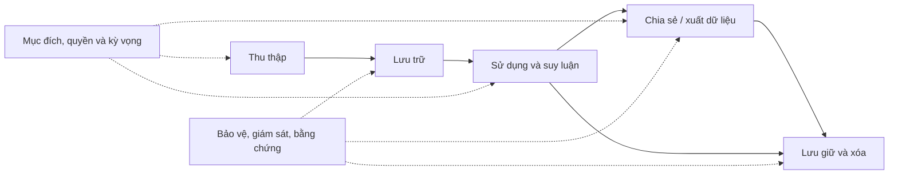
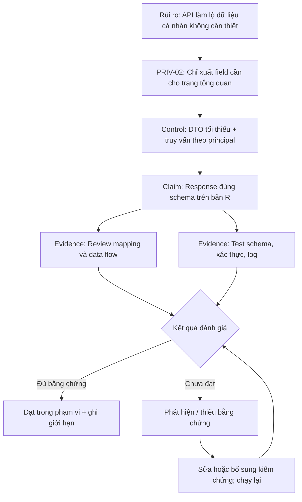

# Tính riêng tư

## Mục tiêu học tập

Sau khi học bài này, bạn có thể:

- Giải thích **tính riêng tư (privacy)** như một mục tiêu cần đánh giá trong chương trình **security assurance**, đồng thời phân biệt nó với tính bí mật (confidentiality).
- Nhận diện dữ liệu cá nhân, dữ liệu có thể liên kết và các rủi ro riêng tư xuyên suốt vòng đời xử lý dữ liệu.
- Chuyển nguyên tắc riêng tư thành **yêu cầu có thể kiểm chứng**, security/privacy controls và tiêu chí chấp nhận.
- Xây dựng lập luận **claim – argument – evidence** để chứng minh một yêu cầu riêng tư trong phạm vi đã xác định.
- Lập kế hoạch kiểm thử, audit, xử lý phát hiện và tái đánh giá khi dữ liệu hoặc hệ thống thay đổi.

## 1. Tính riêng tư là gì?

**Tính riêng tư** là việc tôn trọng và bảo vệ lợi ích, quyền và kỳ vọng chính đáng của cá nhân liên quan đến **việc thu thập, sử dụng, chia sẻ, lưu giữ và suy luận từ thông tin về họ**. Trong hệ thống phần mềm, mục tiêu này đòi hỏi nhóm phát triển phải trả lời: dữ liệu nào được xử lý, cho mục đích gì, ai có thể sử dụng, trong bao lâu, với mức minh bạch và khả năng kiểm soát nào.

Tính riêng tư không đồng nghĩa với việc **giữ kín mọi thông tin**. Một người học có thể đồng ý cho giáo viên được phân công xem tiến độ để hỗ trợ học tập nhưng không muốn dữ liệu đó được sử dụng để quảng cáo ngoài mục đích đã công bố. Quyền truy cập được cấp về mặt kỹ thuật vẫn có thể dẫn tới hoạt động xử lý không phù hợp với mục đích ban đầu.

### 1.1. Phân biệt privacy và confidentiality

| Khía cạnh | Tính bí mật (confidentiality) | Tính riêng tư (privacy) |
| --- | --- | --- |
| Vấn đề trọng tâm | Ngăn chủ thể không được phép đọc dữ liệu. | Đảm bảo hoạt động xử lý dữ liệu về cá nhân phù hợp mục đích, giới hạn và nghĩa vụ áp dụng. |
| Loại tài sản | Bí mật kinh doanh, khóa truy cập, thông tin cá nhân, mã nguồn… | Dữ liệu về cá nhân và thông tin có thể dẫn đến nhận biết, theo dõi, suy luận về cá nhân. |
| Tình huống vi phạm | Học viên A đọc trộm bảng điểm của B. | Một bộ phận được cấp quyền hợp lệ dùng bảng điểm để lập hồ sơ quảng cáo ngoài mục đích đã công bố. |
| Control điển hình | Xác thực, phân quyền, mã hóa, quản lý khóa. | Giảm thiểu dữ liệu, giới hạn mục đích, thời hạn lưu, minh bạch, quy trình xử lý yêu cầu của chủ thể dữ liệu. |
| Bằng chứng | Kiểm thử phân quyền, review cấu hình, kết quả kiểm tra rò rỉ. | Data inventory, hồ sơ mục đích, kiểm thử giới hạn sử dụng/lưu giữ, audit luồng chia sẻ, kết quả xử lý yêu cầu của người dùng. |

**Confidentiality là một phần quan trọng của privacy, nhưng chưa đủ.** Mã hóa dữ liệu trong cơ sở dữ liệu có thể ngăn một số hình thức đọc trái phép; nó không chứng minh hệ thống chỉ thu thập dữ liệu cần thiết, đã xóa dữ liệu đúng hạn hoặc không chuyển dữ liệu cho bên thứ ba ngoài phạm vi cho phép.

Các khái niệm cũng không nên đánh đồng:

- **Privacy** là mục tiêu bảo vệ quyền, lợi ích và kỳ vọng hợp lý của cá nhân đối với việc xử lý dữ liệu.
- **Data protection** là tập hợp nguyên tắc, quy định và biện pháp nhằm bảo vệ dữ liệu cá nhân trong quá trình xử lý; phạm vi nghĩa vụ phụ thuộc pháp luật và bối cảnh áp dụng.
- **Security** cung cấp nhiều cơ chế kỹ thuật và tổ chức để bảo vệ dữ liệu, đồng thời còn bảo vệ những tài sản không phải dữ liệu cá nhân.
- **Security assurance** thu thập và đánh giá bằng chứng rằng các mục tiêu bảo vệ, trong đó có mục tiêu riêng tư, đang được đáp ứng.

## 2. Dữ liệu nào tạo ra rủi ro riêng tư?

Không chỉ họ tên, số điện thoại hoặc địa chỉ email mới liên quan đến riêng tư. Thông tin **nhận dạng trực tiếp** và thông tin **nhận dạng gián tiếp** khi kết hợp với nguồn khác đều có thể gắn với một cá nhân.

Ví dụ trong nền tảng học tập:

| Loại thông tin | Ví dụ | Rủi ro có thể phát sinh |
| --- | --- | --- |
| Định danh trực tiếp | Họ tên, email, mã tài khoản liên kết với danh tính. | Lộ danh tính, liên hệ không mong muốn, giả mạo. |
| Dữ liệu học tập | Điểm kiểm tra, lịch sử truy cập bài giảng, nhận xét giáo viên. | Suy luận năng lực, thói quen và tình trạng học tập. |
| Dữ liệu hành vi | Thời điểm đăng nhập, thời lượng học, lượt xem tài liệu. | Theo dõi sinh hoạt, lập hồ sơ hành vi. |
| Dữ liệu thiết bị và mạng | IP, cookie ID, device identifier, vị trí suy ra từ IP. | Liên kết nhiều phiên truy cập, truy vết cá nhân. |
| Dữ liệu hỗ trợ | Nội dung yêu cầu trợ giúp, tệp đính kèm, hội thoại với trợ lý học tập. | Rò rỉ thông tin nhạy cảm người học chủ động cung cấp. |
| Dữ liệu đã biến đổi | Mã người dùng thay tên, điểm tổng hợp của nhóm rất nhỏ. | Tái nhận dạng bằng cách đối chiếu hoặc suy luận từ dữ liệu khác. |

**Dữ liệu định danh giả (pseudonymized)** vẫn có thể liên kết lại với cá nhân nếu tồn tại khóa ánh xạ hoặc các thuộc tính hỗ trợ nhận dạng. **Dữ liệu ẩn danh (anonymized)** đòi hỏi xem xét thực tế khả năng nhận dạng lại trong bối cảnh sử dụng; chỉ xóa tên hoặc băm mã tài khoản không tự động khiến dữ liệu trở thành ẩn danh.

Ví dụ: một thống kê không chứa tên nhưng công bố rằng “người duy nhất học lúc 02:00 tại lớp X đã trượt bài kiểm tra Y” vẫn có thể làm lộ thông tin nếu cộng đồng biết người đó là ai. Ngay cả báo cáo tổng hợp cũng cần đánh giá kích thước nhóm, khả năng kết hợp tập dữ liệu và các phép truy vấn lặp.

## 3. Privacy là mục tiêu xuyên suốt vòng đời dữ liệu

Một hệ thống phải bảo vệ tính riêng tư ở **mọi điểm dữ liệu đi qua**, kể cả những nơi thường bị bỏ quên như log, backup, hệ thống phân tích, công cụ hỗ trợ khách hàng hoặc nhà cung cấp bên ngoài.



Ở từng giai đoạn, nhóm thiết kế cần xác định:

1. **Thu thập:** Dữ liệu có thật sự cần cho mục đích đã xác định không? Có trường bắt buộc không hợp lý không?
2. **Lưu trữ:** Dữ liệu nằm ở hệ thống nào, theo khu vực lưu trữ và phân quyền nào? Có xuất hiện trong log hoặc bản sao kiểm thử không?
3. **Sử dụng:** Vai trò và tác vụ nào có quyền truy cập? Có giới hạn sử dụng cho mục đích đã được chấp thuận không?
4. **Chia sẻ:** Dữ liệu được chuyển tới đội nội bộ hoặc nhà cung cấp nào? Các giới hạn xử lý có theo dữ liệu tới nơi nhận không?
5. **Lưu giữ và xóa:** Thời hạn nào áp dụng cho từng loại dữ liệu? Chính sách có bao gồm dữ liệu dẫn xuất, cache, bản sao lưu và hệ thống bên nhận không?
6. **Phản hồi yêu cầu:** Cá nhân có thể xem, sửa, yêu cầu xóa hay thực hiện quyền khác theo chính sách và pháp luật áp dụng bằng cách nào?

Một sơ đồ luồng dữ liệu chỉ mô tả ứng dụng chính mà bỏ qua dịch vụ analytics hoặc hệ thống gửi email sẽ tạo **lỗ hổng trong phạm vi assurance**: kiểm thử API đạt cũng chưa cho thấy bên nhận dữ liệu đang sử dụng chúng đúng mục đích.

## 4. Nguyên tắc thiết kế hướng tới tính riêng tư

Các nguyên tắc dưới đây cần được chuyển thành cơ chế và hồ sơ kiểm chứng cụ thể. Phạm vi nghĩa vụ pháp lý có thể khác nhau giữa quốc gia, loại dữ liệu, đối tượng và mục đích xử lý; nhóm sản phẩm cần xác nhận yêu cầu áp dụng trong bối cảnh của mình.

| Nguyên tắc | Ý nghĩa triển khai | Câu hỏi assurance |
| --- | --- | --- |
| **Mục đích xác định và giới hạn sử dụng** | Xác định mục đích trước khi thu thập; xem xét và cho phép riêng khi dùng cho mục đích khác. | Dữ liệu thu thập có gắn mục đích? Luồng sử dụng phụ có được kiểm soát? |
| **Giảm thiểu dữ liệu** | Chỉ xử lý trường và mức chi tiết cần thiết. | Có trường/telemetry nào không phục vụ mục đích không? |
| **Minh bạch** | Giải thích cho cá nhân về dữ liệu, mục đích, người nhận và thời hạn theo yêu cầu áp dụng. | Thông báo có phù hợp với data flow thực tế không? |
| **Cơ sở xử lý phù hợp** | Xác định cơ sở hợp lệ cho từng hoạt động; dùng cơ chế xin và quản lý sự đồng ý ở những trường hợp cần thiết. | Có hồ sơ cơ sở xử lý và tình trạng đồng ý khi áp dụng không? |
| **Quyền và lựa chọn của cá nhân** | Có khả năng tiếp nhận, xác minh, thực hiện và theo dõi các yêu cầu hợp lệ. | Có kiểm chứng quy trình xem/sửa/xóa hoặc phản đối khi thích hợp không? |
| **Độ chính xác** | Có cách sửa và cập nhật dữ liệu sai, tránh quyết định dựa trên dữ liệu đã lỗi thời. | Sửa dữ liệu tại nguồn có được phản ánh tới bản sao liên quan không? |
| **Giới hạn lưu giữ** | Đặt lịch lưu giữ theo từng loại dữ liệu và xóa/ẩn danh khi hết lý do lưu, trừ ngoại lệ được phép. | Có bằng chứng job xóa chạy đúng, kể cả xử lý thất bại không? |
| **Bảo vệ và trách nhiệm giải trình** | Áp dụng control kỹ thuật và tổ chức; phân công người chịu trách nhiệm và lưu bằng chứng. | Có thể truy vết quyết định, ngoại lệ, audit và khắc phục không? |

**Privacy by design** nghĩa là suy xét rủi ro riêng tư từ giai đoạn thiết kế, dữ liệu, API, quan hệ với bên xử lý cho đến vận hành. **Privacy by default** nghĩa là mặc định tính năng không thu thập, hiển thị hoặc chia sẻ dữ liệu vượt quá mức cần thiết cho mục đích đã xác định. Ví dụ, trang hồ sơ mặc định không công khai điểm của học viên cho cả lớp.

Sự đồng ý không phải giải pháp cho mọi trường hợp. Hệ thống có thể có những cơ sở xử lý khác tùy pháp luật áp dụng, và một nút “Tôi đồng ý” không thay thế được nguyên tắc giới hạn mục đích, bảo mật, trách nhiệm giải trình hoặc quyền của cá nhân.

## 5. Chuyển rủi ro riêng tư thành yêu cầu có thể kiểm chứng

Trong security assurance, câu “bảo vệ quyền riêng tư của học viên” quá rộng để kết luận đã đạt hay chưa. Trước hết cần mô tả **tài sản, chủ thể, luồng dữ liệu, mối đe dọa và tác động** rồi mới xác định mục tiêu có tiêu chí đo.

### 5.1. Các kịch bản rủi ro điển hình

| Kịch bản | Nguyên nhân hoặc đường tấn công | Tác động có thể có | Control gợi ý |
| --- | --- | --- | --- |
| Học viên A xem dữ liệu của B | BOLA/IDOR do chỉ kiểm tra đăng nhập, không kiểm tra quyền theo bản ghi. | Lộ điểm số, tiến độ học tập. | Phân quyền phía server theo tài nguyên và quan hệ chủ sở hữu. |
| Dữ liệu học tập bị tái sử dụng ngoài mục đích | Dữ liệu chia sẻ với một hệ thống analytics mà không giới hạn mục đích. | Lập hồ sơ người học, sử dụng ngoài kỳ vọng và nghĩa vụ áp dụng. | Data mapping, mục đích được phê duyệt, kiểm soát luồng chia sẻ và bên nhận. |
| Nhật ký chứa email và token | Log toàn bộ request body/header để debug. | Rò rỉ định danh hoặc thông tin xác thực qua công cụ giám sát. | Log allowlist, che thông tin nhạy cảm, giới hạn quyền và thời hạn log. |
| Tiến độ học tập bị giữ vô hạn | Không có thời hạn lưu hoặc job xóa chỉ chạy trên cơ sở dữ liệu chính. | Tích lũy dữ liệu không còn cần thiết; tăng tác động khi lộ. | Lịch lưu giữ theo loại dữ liệu, kiểm tra xóa và vòng đời bản sao. |
| Báo cáo nhóm nhỏ bị tái nhận dạng | Công bố dữ liệu tổng hợp quá chi tiết hoặc cho phép nhiều phép lọc chồng chéo. | Suy luận điểm hoặc hành vi của một cá nhân. | Giới hạn chi tiết, kiểm tra nguy cơ tái nhận dạng và quản lý truy vấn. |
| Yêu cầu xóa bị xử lý thiếu | Dữ liệu đã xóa ở ứng dụng chính nhưng còn trong hệ thống gửi email hoặc nhà cung cấp. | Yêu cầu của người dùng không được thực thi đầy đủ trong phạm vi áp dụng. | Danh mục hệ thống nhận dữ liệu, quy trình phối hợp và evidence cho từng bước. |

Có thể dùng phương pháp threat modeling dành cho privacy, chẳng hạn các nhóm nguy cơ liên quan đến **liên kết danh tính, nhận dạng, quan sát, tiết lộ, thiếu minh bạch hoặc thiếu khả năng can thiệp**. Điều quan trọng không phải tên phương pháp mà là việc nhóm bao phủ được những cách dữ liệu ảnh hưởng tới cá nhân, kể cả trường hợp không có hacker và người xử lý vẫn đăng nhập hợp lệ.

### 5.2. Ví dụ bộ yêu cầu và tiêu chí kiểm chứng

Giả sử một nền tảng học tập lưu điểm, tiến độ, sự kiện sử dụng và dữ liệu hỗ trợ. Bảng dưới đây là **chính sách ví dụ cho sản phẩm giả định**, không phải thời hạn hay quy tắc pháp luật áp dụng chung.

| Mã yêu cầu | Yêu cầu kiểm chứng được | Tiêu chí chấp nhận minh họa |
| --- | --- | --- |
| `PRIV-01` | Tiến độ học viên chỉ xuất hiện trong tài khoản của người đó và tài khoản giáo viên được phân công theo quy tắc nghiệp vụ. | Test chủ sở hữu/giáo viên hợp lệ thành công; tài khoản khác và phiên chưa đăng nhập bị từ chối. |
| `PRIV-02` | API tóm tắt tiến độ chỉ trả dữ liệu cần cho giao diện. | Schema response không chứa email, ngày sinh, số điện thoại, nội dung phản hồi nhạy cảm. |
| `PRIV-03` | Sự kiện analytics chỉ gồm các trường đã được xét duyệt cho mục đích phân tích học tập. | So sánh payload thực tế với danh mục field cho phép; phát hiện thêm field ngoài danh mục làm fail kiểm tra. |
| `PRIV-04` | Event log kỹ thuật hết hạn sau **90 ngày** theo chính sách giả định, trừ trường hợp có căn cứ giữ lại hợp lệ. | Kiểm tra dữ liệu quá hạn và log thực thi job; trường hợp ngoại lệ có lý do, người duyệt và thời hạn xem lại. |
| `PRIV-05` | Yêu cầu hợp lệ về dữ liệu cá nhân được ghi nhận, xác minh và xử lý theo quy trình áp dụng. | Test quy trình từ tiếp nhận → xác minh → thực thi ở các hệ thống liên quan → thông báo kết quả, có hồ sơ ngoại lệ. |
| `PRIV-06` | Dữ liệu gửi cho bên xử lý ngoài hệ thống phải đúng phạm vi và mục đích được phép. | Đối soát danh mục người nhận, payload thực tế, cấu hình quyền và hồ sơ ràng buộc xử lý. |

Một yêu cầu tốt nên xác định **ai**, **dữ liệu nào**, **hành động nào**, **điều kiện cho phép/từ chối**, **ngoại lệ**, **tiêu chí chấp nhận** và **chủ trách nhiệm**. Mã yêu cầu giúp nối kết với control, test, audit và phát hiện mà không phải suy đoán.

## 6. Ví dụ Java/Spring Boot: privacy trong API và dữ liệu

Giả sử người học chỉ cần thấy số bài đã hoàn thành và số bài đang học. Việc trả toàn bộ đối tượng `LearnerEntity` có thể vô tình đưa email, ngày sinh, ghi chú nội bộ hoặc cờ hỗ trợ vào response.

Một thiết kế tốt hơn là **chỉ xuất những trường cần dùng** và lấy danh tính từ ngữ cảnh xác thực phía server:

```java
// Chỉ chứa hai số liệu thực sự cần cho trang tổng quan.
public record LearningSummaryView(
        long completedLessons,
        long inProgressLessons
) {}

@RestController
@RequestMapping("/api/me")
class LearningSummaryController {
    private final LearningSummaryService summaryService;

    LearningSummaryController(LearningSummaryService summaryService) {
        this.summaryService = summaryService;
    }

    @GetMapping("/learning-summary")
    LearningSummaryView getMySummary(
            @AuthenticationPrincipal PortalPrincipal principal) {
        return summaryService.forAccount(principal.accountId());
    }
}
```

`PortalPrincipal` là kiểu principal của ứng dụng giả định, trả về ID tài khoản đã được xác thực; `LearningSummaryService` phải truy vấn theo tài khoản đó và chỉ trả dữ liệu được phép. Mọi endpoint phụ trợ, API export và tác vụ chạy nền cũng cần được kiểm tra theo đúng chính sách. Cấu hình Spring Security phải yêu cầu xác thực ở endpoint này và xử lý từ chối truy cập đúng cách.

**Vì sao đây chỉ là một phần của privacy control?**

- Response DTO hạn chế dữ liệu trả ra nhưng không bảo đảm dữ liệu chưa bị sao chép sang log, event bus hoặc hệ thống analytics.
- Lấy ID từ principal giúp giảm nguy cơ client tự chỉ định tài khoản khác, nhưng phần lấy dữ liệu phía server vẫn phải ràng buộc đúng tài khoản.
- Quy tắc phân quyền không giải quyết việc dữ liệu được giữ bao lâu, mục đích phân tích ra sao, hoặc quyền của người dùng được xử lý thế nào.

Trong luồng telemetry, có thể dùng nguyên tắc **allowlist** thay vì tự động serialize toàn bộ request:

```json
{
  "eventType": "lesson_completed",
  "lessonId": "lesson-42",
  "eventTime": "2026-11-28T02:00:00Z"
}
```

Payload trên là ví dụ tối giản; ngay cả `lessonId` và `eventTime` vẫn có thể thành dữ liệu liên quan đến cá nhân khi được liên kết với session, IP hoặc tài khoản ở tầng vận chuyển. Do đó cần review **toàn bộ đường truyền và nơi lưu**, không chỉ các field nhìn thấy trong JSON. Nếu cần đo lường theo cá nhân, nhóm phải xác định mục đích, phạm vi liên kết, quyền truy cập và thời hạn thích hợp.

### 6.1. Kiểm thử privacy không chỉ là kiểm thử truy cập

| Kiểm thử | Tình huống | Bằng chứng mong đợi |
| --- | --- | --- |
| Phân quyền | A gọi API xem tiến độ B thông qua ID hoặc đường export. | Từ chối theo chính sách; không trả nội dung nhạy cảm. |
| Giảm thiểu response | Truy xuất summary bằng tài khoản hợp lệ. | Chỉ các field trong schema cho phép xuất hiện; snapshot/schema test có phạm vi rõ. |
| Giảm thiểu telemetry | Hoàn thành bài học, phát sinh sự kiện và log. | Payload/trace không có trường ngoài allowlist; kiểm tra cả hệ thống nhận. |
| Thời hạn lưu | Tạo dữ liệu đã quá hạn theo chính sách thử nghiệm, chạy job. | Dữ liệu thuộc diện phải xóa không còn trong phạm vi xử lý; có hồ sơ thực thi. |
| Xử lý yêu cầu cá nhân | Gửi yêu cầu từ đúng người, người giả mạo, yêu cầu có ngoại lệ lưu giữ. | Có bước xác minh, phân quyền thực thi, dấu vết quyết định và phản hồi phù hợp. |
| Thay đổi cấu hình | Bật tính năng analytics mới hoặc thêm bên thứ ba. | Chính sách và các phép kiểm liên quan được review lại trước phát hành. |

Với kiểm thử riêng tư, **dữ liệu kiểm thử cũng là tài sản cần bảo vệ**. Ưu tiên dữ liệu tổng hợp hoặc giả lập không thể gắn với cá nhân; khi bắt buộc dùng dữ liệu thật, cần quyền, biện pháp bảo vệ và quy trình sử dụng phù hợp.

## 7. Chứng minh mục tiêu riêng tư bằng Claim – Argument – Evidence

Security assurance cần trả lời **“Vì sao tin rằng hệ thống đạt mục tiêu riêng tư?”**, chứ không chỉ **“Đã bật những control nào?”**. Chuỗi lập luận nên gắn trực tiếp với yêu cầu, phạm vi và phiên bản hệ thống.

Ví dụ cho yêu cầu `PRIV-02`:

**Claim:** “Trên phiên bản phát hành R, endpoint `GET /api/me/learning-summary` chỉ cung cấp hai trường tổng hợp cần thiết cho người học đã xác thực.”

**Argument:**

1. Server xác định chủ thể qua ngữ cảnh xác thực, không lấy account ID tùy ý từ client.
2. Service chỉ truy vấn phần dữ liệu cần tính hai trường; controller sử dụng DTO giới hạn output.
3. Tất cả đường xử lý của endpoint và cấu hình serialization được kiểm tra bằng test, review và kết quả chạy trên build phát hành.

**Evidence:** Review mapping API và data flow; test response schema; test trường hợp chưa xác thực; kết quả kiểm tra các trace/log liên quan; mã commit, bản build, môi trường và người duyệt.

**Giới hạn:** Claim chỉ áp dụng cho endpoint và phiên bản R. Nó **không** tự chứng minh rằng tất cả dữ liệu học viên trong hệ thống được xử lý đúng mục đích hoặc những endpoint khác đều có schema an toàn.



Một bản ghi bằng chứng có thể dùng cấu trúc như sau (các ID chỉ là ví dụ):

```yaml
requirement_id: PRIV-02
claim: "API learning-summary chỉ trả hai trường tổng hợp được duyệt"
scope:
  endpoint: "GET /api/me/learning-summary"
  release: "release-example"
  environment: "staging với security config tương ứng"
controls:
  - "Xác thực bằng principal phía server"
  - "Chỉ xuất DTO LearningSummaryView"
evidence:
  - type: api_schema_test
    result: PASS
    artifact: "ci/example-run/schema"
  - type: authorization_test
    result: PASS
    artifact: "ci/example-run/auth"
  - type: data_flow_review
    result: REVIEWED
    artifact: "reviews/example"
open_findings: []
assumptions:
  - "Endpoint không có đường trả dữ liệu phụ ngoài response đã kiểm"
reassess_when:
  - "Đổi DTO, serializer, authentication hoặc telemetry"
```

Trong triển khai thực tế, artifact phải tồn tại, kết quả phải là kết quả chạy thật và cần có thời điểm, người chịu trách nhiệm, build/commit, cấu hình, phạm vi kiểm thử cùng liên kết tới phát hiện. Không được điền `PASS` vì “đã viết test” mà không có kết quả thực thi.

## 8. Các phương pháp đánh giá và giới hạn bằng chứng

Đánh giá privacy thường cần kết hợp **kiểm tra kỹ thuật** với **xem xét quy trình và nghiệp vụ**:

| Phương pháp | Kiểm chứng tốt điều gì? | Không thể tự chứng minh điều gì? |
| --- | --- | --- |
| Data inventory và data-flow review | Dữ liệu được xử lý tại đâu, đi qua hệ thống và người nhận nào, phục vụ mục đích gì. | Cấu hình và hành vi thực tế không sai lệch với sơ đồ nếu chưa kiểm tra. |
| Privacy threat modeling / privacy impact assessment | Những tác động lên cá nhân, nguy cơ nhận dạng, liên kết, theo dõi, không minh bạch, thiếu quyền kiểm soát. | Tất cả nguy cơ đã được triệt tiêu. |
| Kiểm thử API/integration/E2E | Các luồng cho phép/từ chối, schema, quyền và hành vi đã có test. | Mọi đường truy cập và mọi trường hợp chưa được đưa vào test. |
| Quan sát payload, log, trace và cấu hình | Dữ liệu thực sự được truyền, lưu hoặc chia sẻ trong môi trường quan sát. | Hành vi ở mọi môi trường, tại mọi thời điểm khác. |
| Audit quy trình và nhà cung cấp | Mục đích, chủ trách nhiệm, quyền xử lý, hồ sơ yêu cầu người dùng và ngoại lệ được quản trị. | Không có sai sót kỹ thuật nếu không đánh giá triển khai. |
| Kiểm tra xóa và lưu giữ | Job xóa, dữ liệu quá hạn và hồ sơ ngoại lệ trong những hệ thống đã kiểm tra. | Mọi bản sao ở bên nhận, backup hay dữ liệu dẫn xuất đã được xử lý nếu chưa nằm trong phạm vi. |

Ba trạng thái kết quả cần được ghi rõ:

- **Đáp ứng trong phạm vi đã đánh giá:** Bằng chứng đủ và còn hiệu lực đối với claim, phiên bản, môi trường và tiêu chí được nêu.
- **Chưa đủ bằng chứng:** Thiếu quan sát một luồng dữ liệu, kết quả test hoặc hồ sơ bên xử lý; chưa thể kết luận claim đã đạt.
- **Phát hiện sai lệch:** Một hành vi hoặc tài liệu không đáp ứng tiêu chí; cần ghi nhận, phân loại mức độ ảnh hưởng, giao chủ xử lý và xác minh sau khi sửa.

**Bằng chứng có ngày hết hiệu lực theo ngữ cảnh:** thêm SDK analytics, đổi nhà cung cấp lưu trữ, mở API mới, chuyển dữ liệu sang kho phân tích khác hoặc thay cách tổng hợp thống kê đều có thể làm kết luận cũ không còn đúng. Assurance không phải chứng nhận vĩnh viễn.

## 9. Duy trì privacy assurance liên tục

Một chương trình thực hành có thể tổ chức theo vòng lặp:

1. **Kiểm kê dữ liệu và xác định trách nhiệm:** Duy trì danh mục loại dữ liệu, mục đích, nguồn, người nhận, thời hạn, hệ thống lưu trữ và đầu mối phụ trách.
2. **Đánh giá rủi ro:** Xem xét tác động tới cá nhân, khả năng xảy ra và điều kiện khiến dữ liệu bị sử dụng sai hoặc tái nhận dạng; ưu tiên rủi ro theo bối cảnh.
3. **Chuyển thành yêu cầu có test:** Liên kết privacy objective với requirement, control, tiêu chí nghiệm thu và hồ sơ đánh giá.
4. **Kiểm tra khi phát triển:** Review thay đổi schema, data flow, thư viện bên thứ ba, tracking/analytics; tự động hóa schema tests, kiểm thử phân quyền và cấu hình khi phù hợp.
5. **Kiểm soát phát hành:** Yêu cầu bằng chứng còn hiệu lực cho luồng dữ liệu quan trọng; ghi lại ngoại lệ, người phê duyệt và thời hạn khắc phục.
6. **Giám sát vận hành và audit:** Theo dõi truy cập bất thường, quyền của bên xử lý, việc thực thi retention job, yêu cầu người dùng và phát hiện từ kiểm tra định kỳ.
7. **Khắc phục và tái đánh giá:** Xác minh phạm vi ảnh hưởng, ngăn tiếp diễn, xử lý dữ liệu đã bị tác động khi cần, kiểm tra lại và cập nhật kết luận assurance.

Các thước đo hữu ích có thể gồm **tỷ lệ luồng dữ liệu quan trọng có data owner và mục đích được phê duyệt**, **tỷ lệ yêu cầu privacy có bằng chứng còn hiệu lực**, **số hệ thống nhận dữ liệu chưa được đối soát**, **số dữ liệu quá hạn chưa xử lý có lý do**, **thời gian khắc phục phát hiện nghiêm trọng** và **tỷ lệ yêu cầu hợp lệ của người dùng được xử lý theo thời hạn áp dụng**.

Không dùng riêng chỉ số “0 sự cố riêng tư được báo cáo” để khẳng định an toàn: điều đó có thể do giám sát thiếu, thiếu kênh phản ánh hoặc chưa phát hiện vi phạm. Cũng không dùng số lượng test pass để thay thế đánh giá mục đích xử lý và luồng dữ liệu thực tế.

### Những ngộ nhận thường gặp

| Ngộ nhận | Cách hiểu đúng |
| --- | --- |
| “Dữ liệu đã mã hóa nên không còn rủi ro privacy.” | Mã hóa giảm một số nguy cơ truy cập trái phép; sử dụng sai mục đích, giữ quá lâu hoặc suy luận dữ liệu vẫn là rủi ro. |
| “Chỉ cần bỏ tên là dữ liệu đã ẩn danh.” | Có thể còn khóa ánh xạ hoặc tổ hợp thuộc tính giúp nhận dạng lại. |
| “Người dùng bấm đồng ý thì hệ thống có thể xử lý mọi thứ.” | Phạm vi và tính hợp lệ của sự đồng ý phải được xem xét, đồng thời vẫn có các yêu cầu khác về mục đích, bảo vệ và quyền của cá nhân. |
| “API đã phân quyền đúng nên privacy hoàn tất.” | Privacy còn bao gồm thu thập, mục đích, chia sẻ, lưu giữ, quyền và khả năng kiểm soát. |
| “Đã xóa trong database chính là đã xóa hết.” | Cần kiểm tra cả các bản sao, log, cache, backup và bên nhận tùy chính sách, khả năng kỹ thuật và ngoại lệ áp dụng. |
| “Audit năm trước đã đạt nên năm nay không cần kiểm tra.” | Mọi thay đổi về data flow, công nghệ hoặc mục đích có thể làm bằng chứng cũ không còn hiệu lực. |

## 10. Tình huống tự luyện

Nền tảng học tập dự định tích hợp một dịch vụ phân tích bên ngoài để đo tỷ lệ hoàn thành bài học. SDK mặc định gửi email, ID thiết bị, IP, tên bài học và thời điểm học. Tài liệu sản phẩm nói chỉ cần đo **tỷ lệ hoàn thành theo khóa học**; nhóm phát triển đã bật HTTPS và đăng nhập thành công cho người dùng.

Hãy thực hiện các yêu cầu:

1. Xác định tối thiểu **ba nguy cơ riêng tư** của thiết kế, kể cả nguy cơ phát sinh khi nhà cung cấp hoạt động đúng đặc tả kỹ thuật.
2. Đề xuất các trường dữ liệu tối thiểu có thể đáp ứng mục đích phân tích và chỉ ra những trường/liên kết vẫn cần đánh giá nguy cơ nhận dạng lại.
3. Viết một requirement có tiêu chí kiểm chứng về giới hạn payload được gửi ra ngoài và một requirement về retention/chia sẻ.
4. Phác thảo chuỗi **claim → argument → evidence** cho việc giới hạn dữ liệu gửi đi, trong đó có test payload và review cấu hình SDK.
5. Nếu bản phát hành sau bật thêm tính năng thống kê theo lớp, nêu những bằng chứng phải được xem xét lại.

**Gợi ý tự đối chiếu:** HTTPS chỉ bảo vệ một số tính chất của đường truyền, không quyết định nên gửi dữ liệu gì. Email và device ID có thể không cần thiết cho mục đích tỷ lệ hoàn thành; IP, mốc thời gian và nhóm quá nhỏ vẫn tạo khả năng liên kết cá nhân. Nhóm cần xét duyệt schema, mục đích, cơ sở xử lý, phạm vi bên nhận, thời hạn và trường hợp người dùng thực hiện quyền của mình. Bằng chứng nên gồm data-flow map, cấu hình SDK, payload quan sát thực tế, kiểm thử tự động, hồ sơ review nhà cung cấp và kết quả đánh giá sau thay đổi.

## Tổng kết

**Tính riêng tư** là một mục tiêu bảo mật liên quan đến cách dữ liệu về cá nhân được thu thập, sử dụng, chia sẻ và lưu giữ, kể cả khi không xảy ra truy cập trái phép. Để có **security assurance** cho mục tiêu này, cần liên kết **rủi ro → yêu cầu riêng tư có thể kiểm chứng → controls → claim/argument → bằng chứng → xử lý phát hiện → tái đánh giá**. Kết luận chỉ đáng tin khi bằng chứng đúng phạm vi, có thể truy vết, còn hiệu lực và phản ánh cả hành vi kỹ thuật lẫn quy trình vận hành.
