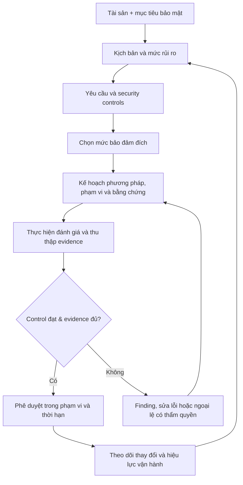

# Mức bảo đảm cần đạt trong Security Assurance

## 1. Mức bảo đảm cần đạt là gì và vì sao phải xác định?

Trong chương **Mục tiêu bảo mật**, câu hỏi “**Mức bảo đảm cần đạt**” (target assurance level/required assurance) có nghĩa là: **Cần bằng chứng đáng tin đến mức nào để chấp nhận tuyên bố rằng một mục tiêu bảo mật đang được đáp ứng, trong phạm vi và khoảng thời gian xác định?**

Đây là một quyết định **dựa trên rủi ro và mục đích sử dụng**, không chỉ là yêu cầu “kiểm thử nhiều hơn”. Nó định hướng:

- **Mục tiêu cần chứng minh:** bảo vệ tài sản và thuộc tính nào (bí mật, toàn vẹn, sẵn sàng, xác thực, khả năng truy trách nhiệm...).
- **Độ sâu và độ rộng đánh giá:** cần xem thiết kế, code, cấu hình, các đường nghiệp vụ, tình huống tấn công, vận hành thực tế đến đâu.
- **Chất lượng và tính độc lập của bằng chứng:** chứng cứ lấy từ đâu, ai thực hiện, có tái lập được không, cần người đánh giá độc lập hay không.
- **Điều kiện chấp nhận:** tiêu chí nào phải đạt để cho phép phát hành, tiếp tục vận hành hoặc kết luận control có hiệu lực.
- **Chu kỳ duy trì:** bao lâu đánh giá lại và những thay đổi nào bắt buộc làm mới bằng chứng.

Trong phạm vi module **SECURITY_SECURITY_ASSURANCE**, mục tiêu là hình thành cách đánh giá **có bằng chứng** rằng hệ thống đáp ứng mục tiêu bảo mật: bắt đầu từ rủi ro và yêu cầu, chọn security controls, tổ chức kiểm thử và audit, xử lý phát hiện, rồi duy trì assurance trong phát triển và vận hành. Xác định mức bảo đảm cần đạt là bước nối **mức rủi ro mà tổ chức chịu được** với **mức chứng minh mà đội phát triển và đánh giá phải cung cấp**.

Ví dụ: cùng một lỗi kiểm tra quyền, một trang tin công khai và một API thay đổi điểm thi có hậu quả khác nhau. API điểm thi có thể đòi hỏi kiểm tra quyền theo từng tài nguyên, rà soát logic nghiệp vụ, kiểm thử âm tính, kiểm thử hồi quy, dấu vết thay đổi, xem xét độc lập và theo dõi production. Chỉ chạy một bộ unit test rồi báo “PASS” không đủ cho mục tiêu có rủi ro cao như vậy.

> **Phát biểu chính xác:** “Với phiên bản X, môi trường Y và phạm vi Z, các bằng chứng A, B, C cho thấy yêu cầu R đạt tiêu chí T với mức tin cậy đã chấp nhận; các giới hạn và rủi ro tồn đọng được ghi nhận.” Không kết luận “hệ thống hoàn toàn an toàn”.

### Phân biệt các đại lượng thường bị trộn lẫn

| Khái niệm | Trả lời câu hỏi | Lưu ý |
| --- | --- | --- |
| **Security objective – mục tiêu bảo mật** | Cần bảo vệ điều gì? | Ví dụ: điểm thi không bị sửa trái quyền. |
| **Risk level – mức rủi ro** | Nếu mục tiêu thất bại, khả năng và tác động lớn đến đâu? | Phụ thuộc tài sản, mối đe dọa, mức phơi lộ, control, bối cảnh. |
| **Required/target assurance – mức bảo đảm cần đạt** | Muốn tin control đáp ứng mục tiêu, phải kiểm tra và có bằng chứng sâu, rộng, độc lập đến mức nào? | Là mức **đích** được quyết định trước hoặc khi rà soát thay đổi. |
| **Achieved assurance – mức bảo đảm đã đạt** | Bằng chứng hiện có thực sự hỗ trợ kết luận đến đâu? | Có thể thấp hơn mục tiêu dù chức năng vẫn hoạt động. |
| **Security strength/level – mức sức mạnh hoặc cấp bảo vệ** | Control thiết kế để chống lại dạng đe dọa đến mức nào? | Không đồng nghĩa chất lượng bằng chứng về control. |
| **Residual risk – rủi ro còn lại** | Sau khi áp dụng control và xử lý, vẫn có thể mất mát gì? | Có thể tồn tại dù assurance đạt mục tiêu. |
| **Compliance – tuân thủ** | Có đáp ứng tiêu chí của tiêu chuẩn/quy định cụ thể không? | Một chứng nhận có phạm vi không bao trùm mọi rủi ro. |

**Bảo vệ mạnh** và **bằng chứng mạnh** có liên hệ nhưng không thay thế nhau. Một cơ chế phân quyền đúng thiết kế nhưng chưa được kiểm thử có thể bảo vệ tốt trên thực tế, song **assurance đạt được còn thấp**. Ngược lại, nhiều báo cáo kiểm thử chất lượng cao xác nhận control có lỗi nghiêm trọng không biến nó thành hệ thống an toàn; chúng chỉ giúp kết luận **đáng tin rằng mục tiêu chưa được đáp ứng**.

## 2. Chọn mức bảo đảm từ mục tiêu, rủi ro và hậu quả thất bại

Không có một mức assurance cố định phù hợp cho mọi thành phần. Để quyết định mục tiêu, hãy đánh giá ít nhất các yếu tố sau:

| Yếu tố | Câu hỏi ra quyết định | Ảnh hưởng tới mức bảo đảm |
| --- | --- | --- |
| **Giá trị và độ nhạy của tài sản** | Tài sản gồm dữ liệu cá nhân, điểm thi, khóa ký số hay dữ liệu công khai? | Tài sản nhạy cảm/quan trọng thường cần bằng chứng sâu hơn. |
| **Mức tác động** | Nếu bị lộ, sai lệch hoặc gián đoạn, hậu quả cho ai, trong bao lâu? | Tác động cao làm tăng mức cần chứng minh. |
| **Khả năng và bề mặt tấn công** | Endpoint có mở Internet? Có nhiều người dùng? Có đường gọi không cần xác thực? | Phơi lộ lớn đòi hỏi đánh giá nhiều tình huống lạm dụng. |
| **Ranh giới tin cậy** | Hệ thống xử lý dữ liệu từ bên ngoài, đi qua dịch vụ thứ ba hoặc vai trò đặc quyền? | Thường cần kiểm thử ranh giới và quyền liên hệ giữa các hệ thống. |
| **Độ phức tạp/thay đổi** | Luồng nghiệp vụ nhiều nhánh, phụ thuộc dịch vụ, phát hành thường xuyên? | Tăng yêu cầu truy vết, kiểm thử hồi quy và cập nhật bằng chứng. |
| **Nghĩa vụ pháp lý/hợp đồng** | Có yêu cầu đánh giá, giám sát, lưu hồ sơ, kiểm toán độc lập? | Một số tiêu chí kiểm chứng là bắt buộc dù điểm rủi ro nội bộ thấp. |
| **Khả năng phát hiện và phục hồi** | Có theo dõi bất thường, rollback, backup đã kiểm tra, ứng cứu kịp thời? | Có thể ảnh hưởng rủi ro còn lại và cách chứng minh hiệu lực vận hành. |
| **Khẩu vị/ngưỡng chịu đựng rủi ro** | Tổ chức cho phép bao nhiêu gián đoạn, gian lận, truy cập trái phép? | Quy định ngưỡng chấp nhận và cấp phê duyệt. |

Một kịch bản rủi ro tốt cần mô tả mối liên hệ **tác nhân/tình huống → lỗ hổng hoặc điểm yếu → tài sản → hậu quả → control hiện có**. Sau khi xác định mục tiêu bảo vệ và kịch bản, đội dự án mới chọn **mức assurance cần thiết** để kiểm tra việc giảm rủi ro.

### Ví dụ trong nền tảng học tập

| Chức năng | Mục tiêu bảo mật nổi bật | Rủi ro nếu mục tiêu thất bại | Hướng chọn độ nghiêm ngặt đánh giá |
| --- | --- | --- | --- |
| Trang thông tin khóa học công khai | Toàn vẹn nội dung, sẵn sàng hợp lý. | Nội dung bị sửa sai hoặc trang tạm không truy cập được. | Xác minh phát hành, quyền sửa nội dung, kiểm tra cấu hình và thay đổi. |
| Xem hồ sơ học viên | Bí mật và phân quyền theo đối tượng. | Lộ dữ liệu cá nhân của người khác. | Kiểm thử ma trận quyền, luồng truy cập, nhật ký và cấu hình thực tế. |
| Nộp bài thi trực tuyến | Toàn vẹn bản nộp, xác thực, sẵn sàng theo thời hạn. | Mất bài, sửa bài, gián đoạn trong kỳ thi. | Kiểm thử điều kiện cạnh, tính nhất quán, chịu tải/phục hồi và vận hành. |
| Sửa điểm thi | Toàn vẹn, kiểm soát đặc quyền, truy trách nhiệm. | Gian lận điểm, thiệt hại uy tín và quyền lợi học viên. | Đánh giá quyền ở mọi đường ghi, rà soát độc lập, kiểm thử lạm dụng và log/audit. |
| Quản lý khóa ký token | Bí mật khóa, quản lý vòng đời và phát hành đáng tin. | Mạo danh nhiều tài khoản, truy cập lan rộng. | Kiểm chứng quản lý bí mật, phân quyền, quy trình xoay vòng, giám sát và phương án khắc phục. |

Các mức đánh giá trong bảng là **hướng suy luận**, không phải một tiêu chuẩn tự gán cấp độ. Quyết định chính thức cần dựa trên ma trận rủi ro và tiêu chí được tổ chức phê duyệt.

## 3. Các chiều cấu thành mức bảo đảm

Mức assurance không đơn thuần bằng “số lượng test case”. Có thể mô tả nó bằng một **hồ sơ các chiều chứng minh**.

| Chiều đánh giá | Mức cơ bản có thể làm gì? | Khi đòi hỏi assurance cao hơn cần gì? |
| --- | --- | --- |
| **Rigor – độ nghiêm ngặt** | Đối chiếu yêu cầu và chạy các kiểm thử tích cực thông thường. | Xem mô hình đe dọa, abuse case, ca âm tính, ranh giới, kiểm tra logic và tái thực hiện có kiểm soát. |
| **Coverage – độ bao phủ** | Một số thành phần hoặc luồng chính. | Toàn bộ control/đường truy cập có rủi ro đáng kể, vai trò, API và ngoại lệ nghiệp vụ trong phạm vi. |
| **Independence – mức độc lập** | Người triển khai tự kiểm tra và peer review. | Người/nhóm không trực tiếp phát triển thực hiện đánh giá, kiểm toán độc lập khi cần. |
| **Evidence quality – chất lượng chứng cứ** | Biên bản kiểm tra, kết quả thủ công hoặc một log test. | Artifact có tiêu chí, phiên bản, người/công cụ, thời điểm, kết quả, hash/tham chiếu, có thể kiểm tra lại. |
| **Repeatability – khả năng tái lập** | Kiểm tra theo thao tác thủ công được mô tả. | Kịch bản kiểm thử và môi trường chuẩn hóa; CI/CD chạy lại và giữ lịch sử có thể so sánh. |
| **Freshness – độ mới** | Bằng chứng tại một lần kiểm tra. | Bằng chứng tương thích bản release và cấu hình đang chạy; tái kiểm tra sau thay đổi quan trọng. |
| **Operating effectiveness – hiệu lực vận hành** | Chứng minh control có trong thiết kế và triển khai. | Quan sát control hoạt động theo thời gian: audit log, cảnh báo, mẫu vận hành, cấu hình production. |
| **Limitations – giới hạn minh bạch** | Ghi phạm vi kiểm thử cơ bản. | Ghi rõ giả định, phần loại trừ, rủi ro còn lại, bằng chứng yếu và điều kiện hết hiệu lực. |

Ví dụ: tăng số lượng bài kiểm thử tự động nhưng không bao phủ luồng “giáo viên thay điểm của lớp khác” **không giúp chứng minh** chính sách phân quyền của chức năng sửa điểm. Tương tự, báo cáo penetration test có chất lượng cao nhưng thực hiện cho phiên bản cũ không xác nhận được một thay đổi phân quyền vừa đưa lên production.

Các chiều này **không nên cộng điểm một cách máy móc**. Một lỗ hổng chưa xử lý tại control tối quan trọng không thể được “bù” bằng rất nhiều bài kiểm thử ở tính năng khác. Hồ sơ assurance phải gắn với **tuyên bố cụ thể** và yêu cầu bắt buộc của mức mục tiêu.

## 4. Khung mức bảo đảm minh họa A1–A4

Để thực hành nhất quán, nhóm có thể thiết lập thang nội bộ. Bảng dưới đây là **khung minh họa do bài học xây dựng**, không phải cấp độ được quy định sẵn bởi NIST, ISO, OWASP hay Common Criteria. Tên “A1–A4” chỉ có ý nghĩa khi tổ chức định nghĩa rõ tiêu chí và công bố phạm vi sử dụng.

| Mức nội bộ | Mức tin cậy cần hình thành | Hoạt động tối thiểu minh họa | Bằng chứng chấp nhận minh họa |
| --- | --- | --- | --- |
| **A1 – cơ bản** | Có cơ sở kiểm tra tính hiện diện và hoạt động cơ bản của control. | Xác định yêu cầu, review triển khai, chạy kiểm thử chức năng và một số tình huống lỗi có liên quan. | Requirement/acceptance criteria, kết quả test gắn build, người phụ trách. |
| **A2 – có hệ thống** | Có thể truy vết và tái lập kiểm chứng các rủi ro thường gặp. | A1 + kiểm thử âm tính, review code/cấu hình, SAST/SCA phù hợp, ma trận yêu cầu–control–test, CI regression. | Báo cáo CI, review, phạm vi test và danh sách finding đã triage. |
| **A3 – tăng cường** | Có bằng chứng sâu cho các rủi ro cao, từ nhiều phương pháp và người kiểm tra khác nhau. | A2 + threat modeling, abuse case, kiểm thử ranh giới tin cậy, đánh giá độc lập tương đối, kiểm chứng môi trường triển khai. | Threat model, kết quả đánh giá độc lập, retest finding, bản chụp cấu hình và quyết định rủi ro. |
| **A4 – nghiêm ngặt, duy trì** | Có mức tin cậy cao cho control trọng yếu, kể cả hiệu lực vận hành và khả năng duy trì. | A3 + đánh giá độc lập chuyên sâu theo phạm vi, bằng chứng vận hành theo thời gian, kiểm chứng khôi phục/ứng cứu và tái đánh giá theo thay đổi trọng yếu. | Gói assurance case có lý lẽ, chứng cứ kỹ thuật và vận hành, audit độc lập phù hợp, dấu vết quyết định và giám sát liên tục. |

**Nguyên tắc dùng thang:**

1. Gắn mức đích với **claim/control hoặc nhóm yêu cầu** có cùng đặc trưng rủi ro; không mặc nhiên toàn bộ dịch vụ có một mức giống nhau.
2. Mức cao hơn kế thừa mục tiêu kiểm chứng thích hợp của mức thấp hơn, nhưng phương pháp cần **điều chỉnh theo rủi ro**. Chẳng hạn SAST có thể ít giá trị cho một cấu hình network thuần túy, khi đó dùng cấu hình/bằng chứng vận hành tương đương theo mục tiêu.
3. Chỉ ghi **A3 đạt** nếu tất cả điều kiện bắt buộc của A3 liên quan đến phạm vi đều có bằng chứng thỏa đáng. Không lấy trung bình A1 ở control quan trọng và A4 ở control ít liên quan để tuyên bố A3 toàn hệ thống.
4. Các kết luận phải có **phạm vi, phiên bản, thời điểm và hạn hiệu lực/trigger đánh giá lại**. Cùng một control có thể đạt A3 trên staging nhưng chưa đủ bằng chứng vận hành để kết luận A3 cho production.
5. Mức **đích** được chủ thể có thẩm quyền phê duyệt. Người thực hiện test báo cáo **mức thực đạt** cùng khoảng trống và giới hạn, không tự giảm mục tiêu để vừa với bằng chứng.

### Không nhầm thang nội bộ với tiêu chuẩn bên ngoài

| Khung/khái niệm | Quan hệ với assurance | Điều cần tránh |
| --- | --- | --- |
| **Common Criteria – Evaluation Assurance Level (EAL)** | Có khung thành phần assurance và các gói EAL dành cho đánh giá sản phẩm trong phạm vi TOE (Target of Evaluation). | Không gọi một mức A3 nội bộ là “EAL3”; không suy diễn một EAL sang mức an toàn vận hành toàn tổ chức. |
| **OWASP ASVS** | Đưa ra các yêu cầu xác minh bảo mật ứng dụng cùng các mức verification do ASVS định nghĩa. | Không quy đổi trực tiếp verification level sang thang A1–A4 mà không xây dựng và phê duyệt phép ánh xạ. |
| **NIST SP 800-53A** | Đưa ra quy trình và phương pháp đánh giá security/privacy controls, với các khái niệm mục tiêu, đối tượng, mức độ sâu/độ bao phủ đánh giá. | Không hiểu tài liệu này là một thang điểm assurance duy nhất cho mọi ứng dụng. |
| **ISO/IEC 27001** | Yêu cầu hệ thống quản lý an toàn thông tin, đánh giá rủi ro, xử lý và cải tiến liên tục. | Chứng nhận hệ thống quản lý có phạm vi; không khẳng định từng endpoint đã được penetration test. |
| **IEC 62443 – Security Level** | Trong hệ thống điều khiển công nghiệp, security level mô tả mức năng lực/đích bảo vệ trước các loại đối thủ/đe dọa theo phạm vi. | Không xem “Security Level” là từ đồng nghĩa tự động với độ tin cậy của bằng chứng assurance. |

Khi dự án áp dụng một chuẩn bắt buộc, phải dùng **định nghĩa, phiên bản và cấp độ của chính chuẩn đó**. Khung A1–A4 có thể hỗ trợ quản lý nội bộ, nhưng không được thay thế tiêu chí kiểm toán hoặc chứng nhận chuyên biệt.

## 5. Quy trình xác định mức bảo đảm cần đạt

Có thể thực hiện theo bảy bước. Đầu ra là một **quyết định assurance có thể kiểm tra lại**, chứ không phải một con số đứng riêng lẻ.

### Bước 1 – Xác định tài sản, mục tiêu và phạm vi

Mô tả hệ thống, chức năng, phiên bản, môi trường, actor và luồng dữ liệu. Viết mục tiêu theo kết quả cần bảo vệ:

> **OBJ-GRADE-01:** Chỉ giáo viên được phân công và các vai trò được ủy quyền theo chính sách mới được thay đổi điểm thi; mọi thay đổi phải truy vết được người thực hiện và lý do.

Một mục tiêu như “phân quyền an toàn” quá rộng để quyết định phải thu thập bằng chứng nào. Mục tiêu trên chỉ rõ **tài sản (điểm), hành vi (sửa), điều kiện (quyền), tính toàn vẹn và accountability**.

### Bước 2 – Mô tả kịch bản đe dọa và đánh giá rủi ro

Ví dụ: tài khoản giáo viên A gọi API thay điểm của lớp B do backend chỉ kiểm tra role `TEACHER` mà không kiểm tra phạm vi lớp; hậu quả là điểm bị sửa trái phép. Đánh giá likelihood/impact theo phương pháp của tổ chức, xét cả khả năng phát hiện và phục hồi. Không lấy điểm severity công cụ quét thay cho đánh giá rủi ro nghiệp vụ.

### Bước 3 – Xác định yêu cầu và control có thể kiểm chứng

| ID | Yêu cầu/tiêu chí | Control dự kiến |
| --- | --- | --- |
| `REQ-GRADE-01` | Giáo viên ngoài lớp được phân công không được sửa điểm của học viên trong lớp. | Kiểm tra quyền theo quan hệ phân công giáo viên–lớp ở backend cho mọi đường ghi. |
| `REQ-GRADE-02` | Người chưa xác thực không được sửa điểm. | Authentication server-side; từ chối request không có principal hợp lệ. |
| `REQ-GRADE-03` | Mỗi cập nhật hợp lệ có dấu vết actor, đối tượng, thời điểm, giá trị trước/sau theo chính sách xử lý dữ liệu. | Audit trail được bảo vệ khỏi sửa trái phép; correlation ID. |
| `REQ-GRADE-04` | Thay đổi quyền phân công phải được áp dụng đúng thời điểm và không tạo đường truy cập cũ. | Quy trình đồng bộ quyền, xử lý cache, test thu hồi và kiểm chứng lại. |

Yêu cầu phải gắn với **chỉ tiêu thành công có thể kiểm tra**, chẳng hạn tình huống trái quyền phải bị từ chối và **không làm thay đổi dữ liệu**, không chỉ kiểm tra mã HTTP.

### Bước 4 – Chọn mức đích và lý do

Giả sử tổ chức đánh giá việc sửa điểm trái phép là rủi ro cao và đặt mức **A3** cho `OBJ-GRADE-01` theo thang minh họa. Lý do có thể gồm tính toàn vẹn điểm thi là trọng yếu, nhiều vai trò và quan hệ lớp, API nội bộ lẫn bên ngoài, khả năng gian lận. Mức A3 sẽ yêu cầu cả kiểm thử theo kịch bản đe dọa và đánh giá từ người không trực tiếp viết control.

**Ai quyết định?** Security architect hoặc nhóm GRC đề xuất phương pháp và mức mục tiêu; product/system owner cùng risk owner xem xét theo quyền hạn; đơn vị độc lập có thể yêu cầu ngưỡng cao hơn khi cần. Trách nhiệm cụ thể phải được ghi trong quy trình tổ chức. Nhóm code không nên tự hạ mức chỉ vì hạn phát hành.

### Bước 5 – Xây kế hoạch đánh giá và bằng chứng

Kế hoạch chỉ rõ **phương pháp, mẫu, dữ liệu, môi trường, người thực hiện, tiêu chí, ngưỡng pass/fail, artifact và thời điểm**.

| Claim cần chứng minh | Phương pháp | Tiêu chí đạt | Bằng chứng lưu |
| --- | --- | --- | --- |
| Người không được phân công không sửa được điểm | Integration/API test với principal ngoài lớp; kiểm tra DB sau gọi | Bị từ chối; điểm và version bản ghi không đổi | Test report, assertion, build ID |
| Mọi đường cập nhật đều kiểm tra quyền theo đối tượng | Rà soát route/service, test các API cập nhật/import/batch | Không tồn tại đường ghi bỏ qua điều kiện quyền | Route inventory, review record, test matrix |
| Phân công thay đổi có hiệu lực | Test thu hồi quyền, cache expiry và thời điểm giao dịch | Sau thu hồi, yêu cầu mới theo chính sách bị chặn | Scenario report, cấu hình cache/policy |
| Có thể truy trách nhiệm | Kiểm tra sự kiện audit của thay đổi hợp lệ và bị từ chối | Log đầy đủ trường bắt buộc và hạn chế lộ dữ liệu nhạy cảm | Audit samples, schema/log config |
| Control phù hợp thiết kế và môi trường triển khai | Threat model + review độc lập + config check | Không có finding chặn release; khác biệt cấu hình được giải trình | Biên bản review, finding tracker, configuration snapshot |

### Bước 6 – Đánh giá mức thực đạt và quyết định

Sau khi thực hiện, mỗi claim được đối chiếu với yêu cầu. Ba kết quả cần tách:

- **Control effectiveness:** bằng chứng cho thấy control có đáp ứng mục tiêu không?
- **Assurance achieved:** độ sâu, bao phủ, tính độc lập và độ mới của bằng chứng có **đạt mức A3 đã chọn** không?
- **Residual risk:** còn kịch bản nào cần khắc phục, theo dõi hoặc được chấp nhận có thẩm quyền?

Ví dụ, API vượt qua mọi integration test nhưng review độc lập A3 chưa thực hiện: **chưa đạt mức assurance A3**, dù các test đã chạy đều PASS. Ngược lại, assessment A3 phát hiện lỗi phân quyền thực sự: **đã đánh giá sâu nhưng control không đạt**. Không thể dùng mức độ hoạt động đánh giá làm bằng chứng rằng mục tiêu bảo mật đã đạt.

### Bước 7 – Phê duyệt, theo dõi và đánh giá lại

Release gate cần xác định ai phê duyệt, điều kiện để phát hành, finding nào chặn phát hành, ngoại lệ nào được chấp nhận và ngày hết hạn. Sau phát hành, khi thay mã phân quyền, mô hình role, IAM, đường import, chính sách tổ chức hoặc môi trường, cần đánh giá ảnh hưởng lên claim và bằng chứng cũ.



## 6. Ví dụ Java/Spring Boot: bảo đảm quyền sửa điểm ở mức A3

Giả sử API:

```http
PATCH /api/submissions/{submissionId}/grade
Authorization: Bearer <access-token>
Content-Type: application/json

{"score": 8.5}
```

Yêu cầu nghiệp vụ: chỉ giáo viên được phân công mới được sửa điểm; quản trị viên có quyền đặc biệt phải theo chính sách riêng. **Chỉ dùng** annotation kiểm tra `ROLE_TEACHER` là chưa đủ, vì giáo viên của lớp này có thể đổi điểm lớp khác.

Một logic service đơn giản hóa minh họa điều kiện ủy quyền theo đối tượng:

```java
@Transactional
public void updateGrade(
        UUID submissionId,
        BigDecimal score,
        UUID authenticatedTeacherId) {
    Submission submission = submissionRepository.findById(submissionId)
        .orElseThrow(() -> new NotFoundException("Submission not found"));

    boolean assigned = assignmentRepository.isTeacherAssignedToClass(
        authenticatedTeacherId, submission.getClassId());

    if (!assigned) {
        throw new AccessDeniedException("Not assigned to this class");
    }

    gradePolicy.validateScore(submission, score);

    BigDecimal before = submission.getScore();
    submission.setScore(score);
    submissionRepository.save(submission);
    gradeAudit.recordChange(
        authenticatedTeacherId, submissionId, before, score);
}
```

**Giả định của ví dụ:** `authenticatedTeacherId` phải được lấy từ danh tính đã xác thực tại backend (không tin ID do client tự gửi); `gradeAudit.recordChange` phải được thiết kế để không mất dấu vết khi giao dịch thành công và để chống sửa trái phép; việc chuyển phân công lớp, concurrency, quyền quản trị, xử lý lỗi và event bất đồng bộ cần đánh giá theo kiến trúc thực. Đoạn mã chỉ mô tả một control, không tự chứng minh mức A3.

### Mẫu ca thử thể hiện yêu cầu assurance

| Tình huống | Kết quả cần quan sát | Vì sao có giá trị |
| --- | --- | --- |
| Giáo viên A sửa điểm lớp A | Được phép trong chính sách, dữ liệu cập nhật hợp lệ, audit có liên kết | Chứng minh luồng đúng hoạt động. |
| Giáo viên A sửa điểm lớp B | Từ chối, dữ liệu lớp B không đổi | Chứng minh kiểm tra quyền theo đối tượng. |
| Học viên gọi endpoint sửa điểm | Từ chối và không sửa dữ liệu | Chứng minh kiểm soát role lẫn tài nguyên. |
| Giáo viên A bị thu hồi phân công rồi gọi lại | Bị từ chối theo hiệu lực chính sách; cache không giữ quyền quá hạn | Chứng minh thu hồi quyền. |
| Dùng API batch/import thay vì API thông thường | Không vượt qua kiểm tra quyền; tài nguyên không hợp lệ không bị cập nhật | Chứng minh bao phủ các đường ghi. |
| Gửi giá trị điểm không hợp lệ hoặc trạng thái đã chốt điểm | Bị từ chối theo quy tắc nghiệp vụ, không tạo cập nhật một phần | Chứng minh tính toàn vẹn nghiệp vụ. |
| Kiểm tra deployment/config trên production hoặc môi trường tương đương có cơ sở | Đường API, IAM, feature flag, audit và kết nối liên quan tuân theo thiết kế | Giảm khoảng trống giữa kết quả staging với hệ thống đang chạy. |

Với A3 minh họa, những ca này cần được **liên kết với requirement và threat scenario**, chạy trên build xác định, có bằng chứng về dữ liệu **không đổi** đối với truy cập trái quyền, và được một bên đủ độc lập rà soát. Kiểm thử xâm nhập có thể hữu ích nếu phạm vi, tính chất rủi ro và yêu cầu cụ thể cần nó; không phải mọi control đều buộc phải dùng cùng một công cụ.

### Mẫu hồ sơ quyết định target assurance

```yaml
objectiveId: OBJ-GRADE-01
claimId: CLAIM-GRADE-AUTHZ
claim: >-
  Mọi đường cập nhật điểm từ teacher portal chỉ cho phép giáo viên
  được phân công; mọi thay đổi hợp lệ có dấu vết truy vết được.
asset: grade-records
environment: production
scope:
  service: assessment-service
  interfaces:
    - "PATCH /api/submissions/{id}/grade"
    - "POST /api/grades/batch"
  roles:
    - teacher
    - student
riskScenario: RISK-GRADE-EDIT-07
requiredAssurance:
  scheme: INTERNAL_EXAMPLE_A1_A4
  level: A3
  rationale: "Toàn vẹn điểm thi là mục tiêu trọng yếu; nhiều đường ghi và ranh giới quyền."
  decidedByRole: risk-owner
  approvalRef: "<decision-record-id>"
criteria:
  - "Truy cập trái quyền không làm thay đổi dữ liệu."
  - "Tất cả đường ghi trong scope có kiểm tra quyền và test."
  - "Review độc lập hoàn tất và finding chặn phát hành đã xử lý."
  - "Cấu hình triển khai liên quan được kiểm chứng."
evidenceRequired:
  - "integration-test-report@build-id"
  - "authorization-route-matrix"
  - "threat-model-review"
  - "independent-review-record"
  - "deployment-configuration-assessment"
reassessmentTriggers:
  - "Thay đổi policy, role, mapping giáo viên-lớp."
  - "Thêm endpoint cập nhật hoặc thay đổi cơ chế import."
  - "Thay đổi IAM, API gateway hoặc cấu hình production."
```

Đây là **mẫu dữ liệu minh họa**, không phải định dạng bắt buộc. Để kiểm chứng, có thể lưu thêm `actualAssurance`, `assessmentResult`, `residualRisks`, `findings`, `approvedAt`, `validUntil` và đường dẫn bằng chứng dưới dạng metadata riêng hoặc record liên kết. Tuyệt đối không ghi các token thực hoặc dữ liệu cá nhân nhạy cảm vào bộ bằng chứng dùng chung.

## 7. Đánh giá khi nào mức bảo đảm đã đạt?

Không nên kết luận bằng một số phần trăm duy nhất. Dùng một **assurance case**: lập luận rõ ràng nối **claim → lý do → bằng chứng → giới hạn**.

Ví dụ claim: “Giáo viên không được phân công không thay đổi được điểm”. Lập luận: quyền được kiểm tra ở backend theo quan hệ phân công, mọi đường ghi đều dùng chính sách này, test âm tính xác minh dữ liệu không đổi, review độc lập không tìm thấy đường bypass trong phạm vi, và cấu hình đang triển khai phù hợp bản đã đánh giá.

| Thành phần assurance case | Cần có gì? |
| --- | --- |
| **Claim** | Tuyên bố hẹp, cụ thể, có thể kiểm tra. |
| **Context/assumptions** | Hệ thống, threat model, principal, role, môi trường, phiên bản, các phụ thuộc. |
| **Argument** | Vì sao tổ hợp control và bằng chứng hỗ trợ claim; các đường tấn công quan trọng được xử lý thế nào. |
| **Evidence** | Test report, code/config review, scan đã triage, audit sample, event log, retest, decision record. |
| **Defeaters/limitations** | Điều kiện có thể phủ định kết luận: đường API ngoài scope, build không trùng, quyền cache lỗi, evidence quá cũ. |
| **Decision** | Ai kết luận, ngày nào, mức assurance thực đạt, finding/rủi ro còn lại, điều kiện đánh giá lại. |

### Phân loại kết quả minh họa

| Trạng thái | Ý nghĩa | Hành động |
| --- | --- | --- |
| **Đạt yêu cầu control và assurance** | Control đáp ứng tiêu chí; hồ sơ bằng chứng đáp ứng đầy đủ mức đích. | Phê duyệt theo phạm vi, lưu hồ sơ và theo dõi trigger. |
| **Control có vẻ đạt nhưng assurance chưa đủ** | Test hiện có pass, nhưng thiếu độc lập, coverage, bản production hoặc evidence thời gian vận hành. | Bổ sung đánh giá/bằng chứng; chưa tuyên bố đạt mức đích. |
| **Control không đạt** | Có bằng chứng xác nhận vi phạm yêu cầu bảo mật. | Mở finding, đánh giá mức tác động, sửa và retest; xử lý release gate. |
| **Không thể kết luận** | Bằng chứng sai phạm vi, không đáng tin hoặc thiếu điều kiện nền. | Làm rõ scope, phương pháp và thu thập lại bằng chứng. |
| **Ngoại lệ/rủi ro được chấp nhận** | Một điều kiện chưa đạt được phê duyệt có thẩm quyền theo thời hạn. | Ghi rõ phần chưa đạt, lý do, bù trừ, chủ sở hữu, hạn và giám sát. |

**Đạt mức assurance** không đồng nghĩa **rủi ro bằng 0**. Đạt nghĩa là đã chứng minh một tập tuyên bố theo độ tin cậy/độ sâu và phạm vi được phê duyệt. Rủi ro chưa được triệt tiêu vẫn có thể tồn tại. Một ngoại lệ được phê duyệt cũng **không biến điều kiện chưa đạt thành đã đạt**.

## 8. Bằng chứng cho độ nghiêm ngặt, phạm vi và hiệu lực vận hành

### 8.1. Ma trận truy vết và kiểm soát độ bao phủ

Nếu mức A3 yêu cầu mọi đường cập nhật điểm được kiểm chứng, phải có **danh mục đường ghi** trước khi tính phần trăm:

| ID yêu cầu | Đường gọi | Control | Test/đánh giá | Evidence | Trạng thái |
| --- | --- | --- | --- | --- | --- |
| `REQ-GRADE-01` | `PATCH /grade` | `CTRL-AUTHZ-01` | `TC-01..TC-08` | `EVD-API-015` | Đã đánh giá |
| `REQ-GRADE-01` | `POST /grades/batch` | `CTRL-AUTHZ-01` | `TC-09..TC-14` | `EVD-BATCH-002` | Đã đánh giá |
| `REQ-GRADE-04` | Đổi phân công giáo viên | `CTRL-REVOKE-02` | `TC-15..TC-18` | `EVD-REV-003` | Đã đánh giá |
| `REQ-GRADE-03` | Audit lưu thay đổi | `CTRL-AUDIT-03` | Review + kiểm tra log | `EVD-LOG-010` | Cần rà soát độc lập |

Ma trận cho thấy yêu cầu nào còn thiếu kiểm chứng. **Coverage** chỉ có nghĩa khi nói rõ mẫu số: số endpoint, yêu cầu, kịch bản rủi ro hay control. “100% test xanh” vẫn có thể bỏ trống một endpoint không được đưa vào danh mục.

### 8.2. Độ mới và tính tương đương của môi trường

Một kết quả test hợp lệ có thể mất giá trị khi:

- Code trong nhánh phát hành khác mã đã test; thư viện phụ thuộc có thay đổi ảnh hưởng kiểm soát.
- Môi trường đánh giá và production khác cấu hình auth, feature flag, network policy, key store hoặc quyền service account.
- Có đường API mới hoặc cơ chế batch/import mới không nằm trong scope ban đầu.
- Dữ liệu/role trong production đa dạng hơn đáng kể so với tập thử nghiệm.
- Phát hiện lỗ hổng mới hoặc threat model thay đổi làm giả định cũ không còn đúng.

Do đó, lưu **commit/build, version dependency, environment, configuration reference, timestamp, người hoặc công cụ đánh giá và trạng thái finding**. Không yêu cầu phát lại toàn bộ mọi test sau mỗi thay đổi nhỏ, nhưng cần cơ chế **đánh giá tác động thay đổi** để quyết định những control và bằng chứng phải xác minh lại.

### 8.3. Tính độc lập và xung đột lợi ích

Peer review của người cùng nhóm thường có giá trị, nhưng mức độc lập khác với assessment bởi người không trực tiếp thiết kế hoặc vận hành control. Khi mức đích quy định độc lập, hồ sơ cần nói rõ vai trò, phạm vi, năng lực và sự tách biệt tương ứng. Độc lập không đồng nghĩa tự động đúng; chất lượng phương pháp và bằng chứng vẫn phải được thẩm tra.

### 8.4. Assurance ở runtime

Control có thể đúng lúc phát hành rồi mất hiệu lực sau cấu hình hoặc quyền thay đổi. Để có assurance liên tục, theo dõi:

- **Configuration drift:** thay đổi trái baseline về IAM, service account, API gateway, TLS, audit logging.
- **Authorization failures & anomalies:** bất thường truy cập trái quyền, nỗ lực vượt phạm vi lớp, số lượng thay đổi điểm khó giải thích.
- **Audit coverage:** tỷ lệ thao tác nhạy cảm sinh sự kiện đầy đủ và có thể tra cứu an toàn.
- **Vulnerability & dependency updates:** thay đổi rủi ro khi phụ thuộc có lỗ hổng mới.
- **Recovery effectiveness:** kiểm chứng định kỳ rằng khôi phục, backup và ứng cứu vẫn hoạt động đúng yêu cầu.

Các log hoặc alert chỉ là **tín hiệu**; phải đánh giá chính xác, bảo vệ dữ liệu cá nhân, đặt ngưỡng phù hợp và có quy trình phản ứng. Một dashboard xanh không tự chứng minh mọi control vận hành hiệu quả.

## 9. Release gate, phát hiện và ngoại lệ

Mức assurance có giá trị khi được gắn với **quyết định triển khai và trách nhiệm khắc phục**.

Giả sử chức năng sửa điểm đặt mục tiêu A3. Chính sách release minh họa:

1. Có requirement/claim, risk owner và thang assurance được duyệt.
2. Mọi test bắt buộc về phân quyền theo đối tượng đều đạt, không có trường hợp sửa điểm trái quyền.
3. Danh mục đường ghi trong scope đầy đủ; review độc lập và cấu hình liên quan hoàn tất.
4. Finding chặn phát hành phải được sửa, retest và xác minh; finding còn lại được xử lý theo tiêu chí rủi ro.
5. Bằng chứng gắn đúng build và môi trường triển khai, có người phê duyệt.

Nếu thiếu review độc lập, trạng thái phù hợp là **“A3 chưa được chứng minh”**. Nếu có lỗi sửa điểm trái quyền, trạng thái là **“control không đạt”**, ngay cả khi đầy đủ hồ sơ review. Hai trường hợp có bản chất khác nhau và dẫn đến hành động khắc phục khác nhau.

### Quyết định ngoại lệ tối thiểu phải ghi

| Trường | Nội dung cần có |
| --- | --- |
| Đối tượng và giới hạn | Claim/control, môi trường, phiên bản, tài sản, loại dữ liệu bị ảnh hưởng. |
| Điều kiện chưa đạt | Test, control hoặc yêu cầu assurance thiếu/vi phạm; bằng chứng hiện có. |
| Rủi ro còn lại | Kịch bản, likelihood/impact theo phương pháp nội bộ, hậu quả có thể xảy ra. |
| Giảm thiểu/bù trừ | Kiểm soát tạm và cách giám sát hiệu quả, nếu có. |
| Người có thẩm quyền | Risk owner/chức danh phê duyệt và ngày quyết định. |
| Thời hạn và trigger | Ngày hết hạn, điều kiện thu hồi ngoại lệ, sự kiện buộc đánh giá lại. |
| Kế hoạch khắc phục | Người chịu trách nhiệm, mốc, bằng chứng cần cho retest và closure. |

Ngoại lệ không nên mặc nhiên vượt qua nghĩa vụ bắt buộc của pháp luật hoặc hợp đồng. Nếu mục tiêu bảo mật trọng yếu không thể đáp ứng và rủi ro vượt ngưỡng được phép, phương án hợp lý có thể là **dừng phát hành, tắt chức năng, hạn chế phạm vi hoặc đổi thiết kế** cho đến khi đánh giá lại.

## 10. Duy trì mức assurance trong chương trình liên tục

Mức đích không phải nhãn dán một lần. Để tổ chức **security assurance liên tục trong phát triển và vận hành**, có thể gắn các điểm đánh giá với SDLC:

| Thời điểm | Cần quyết định gì? | Bằng chứng được tạo/cập nhật |
| --- | --- | --- |
| **Discovery/thiết kế** | Những mục tiêu nào có tác động lớn, ai là risk owner, mức đích và scope? | Risk scenario, mục tiêu, threat model, bản ghi quyết định assurance. |
| **Thiết kế control** | Control nào đạt mục tiêu, có điểm phụ thuộc hoặc giới hạn nào? | Review kiến trúc, requirement–control mapping. |
| **Pull request/CI** | Thay đổi có tác động đến control nào? Test cần chạy lại? | Unit/integration test, SAST/SCA phù hợp, review, build metadata. |
| **Trước release** | Mức thực đạt có đáp ứng mức đích? Finding có chặn release? | Assessment report, retest, độc lập nếu yêu cầu, quyết định release. |
| **Vận hành** | Cấu hình/điều kiện hoạt động có lệch so với khi đánh giá? | Configuration monitoring, audit samples, incident review, vulnerability status. |
| **Thay đổi lớn/sự cố** | Claim và bằng chứng nào mất hiệu lực? Có phải nâng mức đích? | Reassessment record, risk treatment, test/report mới. |
| **Đánh giá định kỳ** | Mức đích còn phù hợp với tài sản, công nghệ, rủi ro và nghĩa vụ mới? | Biên bản review, cập nhật risk register và assurance plan. |

**Chỉ số có thể theo dõi** (đều cần định nghĩa mẫu số, phạm vi và cách thu thập):

- Tỷ lệ claim trọng yếu có **mức assurance đích được phê duyệt** và owner rõ ràng.
- Tỷ lệ claim A3/A4 có **đủ bằng chứng hợp lệ, đúng phiên bản và trong hạn**.
- Tỷ lệ route/control trọng yếu được đánh giá đối chiếu với danh mục thực tế.
- Số finding chặn release chưa đóng, số ngoại lệ hết hạn và thời gian xác minh sửa lỗi.
- Số thay đổi liên quan control nhưng **chưa được đánh giá tác động** lên bằng chứng assurance.
- Mức bao phủ hoạt động giám sát và thời gian phát hiện những sai lệch quan trọng.

Các con số này là chỉ báo vận hành, không nên biến thành một phép cộng điểm “an toàn 97%”. Khi thấy chỉ số tăng, cần xem liệu tổ chức thực sự **giảm khoảng trống chứng minh của các rủi ro ưu tiên** hay chỉ tạo thêm báo cáo.

## 11. Những sai lầm thường gặp

| Sai lầm | Hậu quả | Cách sửa |
| --- | --- | --- |
| “Mọi dịch vụ đều cần cùng mức A3.” | Lãng phí ở chỗ ít rủi ro, có thể vẫn bỏ qua rủi ro rất cao. | Gắn mức đích với tài sản, claim và kịch bản rủi ro. |
| “SAST không báo lỗi nên assurance cao.” | Không thấy lỗ hổng logic nghiệp vụ hoặc quyền theo đối tượng. | Phối hợp phương pháp theo threat model, test âm tính và code review. |
| “Đã test staging, production chắc chắn đạt.” | Bỏ qua khác biệt cấu hình/phiên bản. | Kiểm tra độ tương đương và bằng chứng triển khai. |
| “Có nhiều test nghĩa là đủ coverage.” | Bỏ sót route hoặc hành vi chưa có test. | Có danh mục yêu cầu/route/đối tượng và traceability matrix. |
| “Được chuyên gia audit nghĩa là an toàn tuyệt đối.” | Vượt quá phạm vi, mẫu và thời điểm đánh giá. | Ghi rõ claim, giả định, giới hạn và rủi ro còn lại. |
| “Lỗi đã sửa thì đóng finding ngay.” | Không chứng minh cách sửa có hiệu lực hoặc không gây hồi quy. | Retest theo tiêu chí, lưu artifact và phê duyệt closure. |
| “Risk owner chấp nhận là control đạt.” | Lẫn quyết định quản trị rủi ro với bằng chứng hiệu lực. | Ghi ngoại lệ/risk acceptance riêng, giữ trạng thái assurance trung thực. |
| “Đã đạt assurance một lần nên không cần đánh giá lại.” | Không phát hiện drift, tấn công mới, thay đổi quyền. | Thiết lập trigger và lịch tái đánh giá. |

## 12. Bài tập tự kiểm tra

**Tình huống 1:** Nhóm phát hành API ghi điểm với 120 test đạt, nhưng chưa có ca kiểm thử giáo viên A sửa điểm lớp B. Có thể khẳng định đã đạt A3 theo khung minh họa không?

**Gợi ý:** Không. Đường tấn công chính liên quan quyền theo đối tượng chưa được kiểm chứng; số lượng test không thay thế độ bao phủ mục tiêu. Cần thêm abuse case, test dữ liệu không đổi, rà soát mọi đường ghi và bằng chứng theo tiêu chí A3.

**Tình huống 2:** Một control đạt A3 ở bản build X sau review độc lập, nhưng production đang chạy bản Y đã thay authorization filter. Kết luận nào hợp lý?

**Gợi ý:** Evidence X không tự bao trùm thay đổi Y. Phải đánh giá tác động, kiểm tra filter và chạy lại những test liên quan trước khi tuyên bố mức assurance cho Y.

**Tình huống 3:** Một control được kiểm tra rất kỹ và phát hiện lỗ hổng có thể sửa điểm trái quyền. Câu nào đúng?

- (A) “Mức assurance cao nên mục tiêu bảo mật đã được đáp ứng.”
- (B) “Bằng chứng đáng tin chỉ ra control chưa đáp ứng mục tiêu; cần xử lý finding và đánh giá lại.”

**Đáp án:** **B**. Chất lượng đánh giá và hiệu quả bảo vệ là hai chiều khác nhau.

**Tình huống 4:** Risk owner chấp nhận tạm thời việc thiếu một đánh giá độc lập bắt buộc cho A3. Mức assurance thực đạt nên ghi thế nào?

**Gợi ý:** Ghi **chưa chứng minh đạt A3**, nêu phần thiếu, quyết định ngoại lệ có thẩm quyền, thời hạn, điều kiện, kế hoạch bổ sung bằng chứng. Không âm thầm hạ target hoặc gắn nhãn “đã đạt”.

**Tình huống 5:** Trang landing page công khai được đặt A1 còn hệ thống quản lý khóa ký token đặt A4. Có mâu thuẫn không?

**Gợi ý:** Không nhất thiết; hai thành phần có tài sản, mối đe dọa và tác động khác nhau. Tuy nhiên phải kiểm tra phụ thuộc: landing page cũng có thể ảnh hưởng bảo mật nếu là cửa ngõ đăng nhập, nơi tải script nhạy cảm, hoặc có khả năng dẫn người dùng sang trang giả mạo.

## 13. Checklist ra quyết định và ghi nhớ

Trước khi kết luận một mục tiêu đã đạt mức bảo đảm cần thiết, cần trả lời được:

1. **Mục tiêu:** tài sản và kết quả bảo mật cần bảo vệ là gì? Claim đã đủ cụ thể chưa?
2. **Rủi ro:** kịch bản đe dọa và hậu quả nào biện minh cho mức đích?
3. **Phạm vi:** thành phần, role, đường API, môi trường, version và khoảng thời gian nào?
4. **Tiêu chí:** yêu cầu nào bắt buộc, như thế nào là pass/fail? Mức đích do ai duyệt?
5. **Control:** control được thiết kế, triển khai, vận hành ra sao? Có đường bypass hay phụ thuộc nào?
6. **Phương pháp:** độ sâu, bao phủ, độc lập, tái lập và độ mới của việc đánh giá có đủ không?
7. **Bằng chứng:** artifact có thể thẩm tra, gắn đúng control/requirement, build và thời gian không?
8. **Kết quả:** control có đạt không, assurance đã đạt tới đâu, còn lỗ hổng/bằng chứng thiếu nào?
9. **Quyết định:** ai được phép phát hành, chấp nhận ngoại lệ hoặc yêu cầu khắc phục?
10. **Duy trì:** sự kiện nào buộc đánh giá lại và ai theo dõi hiệu lực vận hành?

**Điểm cần nhớ:** “Mức bảo đảm cần đạt” là **chuẩn chứng minh có căn cứ cho một mục tiêu bảo mật trong bối cảnh rủi ro cụ thể**. Nó chỉ có ý nghĩa khi nối được mục tiêu → rủi ro → yêu cầu → control → phương pháp đánh giá → bằng chứng → kết luận và kế hoạch duy trì. Mức đã đạt phải phản ánh đúng chất lượng bằng chứng và kết quả kiểm soát, kể cả khi kết luận chưa thuận lợi cho việc phát hành.

### Tài liệu tham khảo để tìm hiểu sâu

- **NIST SP 800-30:** hướng dẫn đánh giá rủi ro, phù hợp để giải thích cơ sở lựa chọn mức bảo đảm.
- **NIST SP 800-37:** quản lý rủi ro và giám sát trong vòng đời hệ thống.
- **NIST SP 800-53 và SP 800-53A:** security/privacy controls và phương pháp đánh giá những control đó.
- **ISO/IEC 27001 và ISO/IEC 27002:** quản lý rủi ro an toàn thông tin và cách tổ chức biện pháp kiểm soát.
- **OWASP Application Security Verification Standard (ASVS):** yêu cầu xác minh phù hợp cho ứng dụng và API.
- **Common Criteria (ISO/IEC 15408):** framework đánh giá an ninh sản phẩm, có các khái niệm assurance và EAL theo phạm vi đánh giá.

Khi viện dẫn các khung này trong hồ sơ chính thức, phải ghi **phiên bản tài liệu, phạm vi áp dụng, điều khoản/tiêu chí cụ thể**, tránh suy diễn khung minh họa của bài học thành một chứng nhận.
