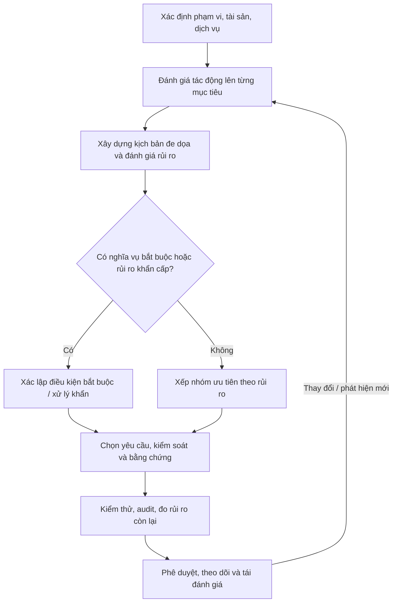

# Ưu tiên mục tiêu bảo mật trong Security Assurance

## 1. Vì sao phải ưu tiên các mục tiêu bảo mật?

Một hệ thống có nhiều mục tiêu bảo mật: **tính bí mật (confidentiality)**, **tính toàn vẹn (integrity)**, **tính sẵn sàng (availability)**, khả năng xác thực và phân quyền, khả năng truy vết, trách nhiệm giải trình và những mục tiêu đặc thù khác. Tất cả đều quan trọng, nhưng mức thiệt hại khi một thuộc tính bị xâm phạm không giống nhau ở mọi hệ thống, dữ liệu và thời điểm.

Ví dụ:

- Với kho hồ sơ nhân sự, **tiết lộ dữ liệu cá nhân** có thể là rủi ro nổi bật.
- Với dịch vụ chuyển tiền, **sai lệch người nhận hoặc số tiền** có thể dẫn đến tổn thất tức thời.
- Với hệ thống điều phối cấp cứu, **gián đoạn dịch vụ** có thể ảnh hưởng trực tiếp đến an toàn con người.
- Với hệ thống lưu giữ chứng từ, **thiếu nhật ký chứng minh ai thực hiện thao tác** có thể làm tổ chức không đáp ứng yêu cầu kiểm toán.

**Ưu tiên mục tiêu bảo mật** là quá trình xác định mục tiêu nào cần mức bảo vệ, sự chú ý, thời hạn xử lý và bằng chứng xác minh cao hơn **trong một ngữ cảnh cụ thể**. Đây không phải là tuyên bố rằng các mục tiêu xếp sau được phép bỏ qua. Mọi yêu cầu bắt buộc vẫn phải được đáp ứng, kể cả khi điểm rủi ro ước lượng thấp.

Trong module **SECURITY_SECURITY_ASSURANCE**, trọng tâm không chỉ là chọn điều gì quan trọng. Tổ chức cần **chứng minh được vì sao chọn**, liên kết quyết định đó với phân tích rủi ro, yêu cầu bảo mật, security controls, kiểm thử, audit và cách khắc phục phát hiện. Ưu tiên phải được cập nhật liên tục trong phát triển và vận hành khi dữ liệu, mối đe dọa hoặc điều kiện kinh doanh thay đổi.

### Kết quả học tập

Sau bài này, người học có thể:

1. Phân biệt ưu tiên mục tiêu, ưu tiên rủi ro và ưu tiên triển khai kiểm soát.
2. Xác định tài sản, tác động kinh doanh, nghĩa vụ bắt buộc và các kịch bản đe dọa để quyết định thứ tự ưu tiên.
3. Sử dụng mô hình đánh giá rủi ro định tính/bán định lượng một cách minh bạch, tránh độ chính xác giả tạo.
4. Chuyển quyết định ưu tiên thành yêu cầu đo được, kế hoạch kiểm soát và kế hoạch bằng chứng security assurance.
5. Rà soát, điều chỉnh và giải trình quyết định ưu tiên khi hệ thống hoặc bối cảnh thay đổi.

## 2. Hiểu đúng đối tượng đang được ưu tiên

Ba loại quyết định có liên quan nhưng khác nhau:

| Loại quyết định | Câu hỏi cần trả lời | Ví dụ |
| --- | --- | --- |
| **Ưu tiên mục tiêu** | Thuộc tính bảo mật nào cần được bảo vệ mạnh nhất đối với tài sản và dịch vụ này? | Toàn vẹn dữ liệu thanh toán là mục tiêu có tác động cao. |
| **Ưu tiên rủi ro** | Kịch bản gây hại nào cần được giảm trước? | Kẻ tấn công thay tài khoản nhận tiền trước khi duyệt lệnh. |
| **Ưu tiên biện pháp/đầu việc** | Làm kiểm soát hoặc sửa lỗi nào trước, với phụ thuộc và nguồn lực hiện tại? | Sửa lỗi phân quyền API trước khi thêm báo cáo kiểm toán mới. |

Không nên suy trực tiếp rằng mục tiêu xếp thứ nhất luôn có mọi công việc được triển khai trước. Một biện pháp nền tảng (như quản lý danh tính) có thể giảm đồng thời rủi ro bí mật và toàn vẹn. Một lỗi dễ bị khai thác ngay có thể cần sửa trước kế hoạch dài hạn cho mục tiêu có tác động cao hơn.

### 2.1. Những mục tiêu thường gặp

| Mục tiêu | Nội dung cần bảo đảm | Ví dụ tiêu chí có thể đo |
| --- | --- | --- |
| **Bí mật** | Chỉ chủ thể được phép mới có thể biết dữ liệu. | Không truy cập chéo tenant, không lộ trường nhạy cảm qua API/log. |
| **Toàn vẹn** | Dữ liệu và quyết định xử lý không bị sửa trái phép hoặc sai lệch. | Mọi thay đổi tài khoản nhận lương phải được phân quyền và ghi nhận; dữ liệu đối soát khớp. |
| **Sẵn sàng** | Dịch vụ thiết yếu có thể sử dụng đúng lúc và trong phạm vi cam kết. | Mục tiêu thời gian khôi phục và mất dữ liệu tối đa được phê duyệt dựa trên phân tích tác động kinh doanh. |
| **Xác thực/phân quyền** | Danh tính và quyền được xác minh đúng ngữ cảnh. | Người không đủ quyền bị từ chối tại backend; quyền đặc biệt được rà soát. |
| **Truy vết/trách nhiệm giải trình** | Có khả năng tái dựng các hành động quan trọng và quy trách nhiệm phù hợp. | Thay đổi dữ liệu nhạy cảm có bản ghi audit đủ trường và được bảo vệ khỏi sửa/xóa trái phép. |
| **Quyền riêng tư/tuân thủ** | Dữ liệu được thu thập, sử dụng, chia sẻ và lưu giữ theo mục đích và nghĩa vụ áp dụng. | Bằng chứng về quyền truy cập, hạn lưu dữ liệu và xử lý yêu cầu của chủ thể dữ liệu. |

Các mục tiêu có thể chồng lấn: phân quyền hỗ trợ bí mật và toàn vẹn; log phục vụ điều tra nhưng nếu ghi dữ liệu nhạy cảm không kiểm soát thì làm tăng rủi ro lộ lọt.

### 2.2. Ưu tiên khác nhau theo tài sản, vai trò và thời điểm

Không nên áp một thứ tự cố định như “C > I > A” cho toàn bộ tổ chức:

- **Cùng hệ thống, khác dữ liệu:** với bảng lương, cả bí mật số lương và tính chính xác của tài khoản nhận tiền đều có thể rất quan trọng; với trang thông báo công khai, bí mật nội dung thấp hơn toàn vẹn nội dung.
- **Cùng dữ liệu, khác khâu xử lý:** khi nhập thông tin chi trả, toàn vẹn dữ liệu nổi bật; khi tạo bản sao xuất cho kiểm toán, quyền truy cập và bảo mật tệp xuất trở nên quan trọng.
- **Cùng dịch vụ, khác thời gian:** trước thời hạn chuyển lương, gián đoạn hệ thống có hậu quả lớn hơn ngày vận hành thông thường.
- **Cùng mục tiêu, khác phạm vi:** việc lộ một hồ sơ khác với việc một tài khoản dịch vụ bị chiếm quyền và đọc được hàng triệu hồ sơ.

Vì vậy một kết quả ưu tiên hữu ích phải luôn gắn với **tài sản/dịch vụ, ranh giới, bối cảnh, giả định và kỳ đánh giá**.

## 3. Đầu vào cho quyết định ưu tiên

### 3.1. Giá trị tài sản và tác động kinh doanh

Trước khi chấm rủi ro, xác định:

1. **Dịch vụ quan trọng nào phụ thuộc tài sản?** Ví dụ, hồ sơ tài khoản nhận lương, tiến trình đối soát, dữ liệu đồng bộ sang ngân hàng.
2. **Ai bị tác động?** Người dùng, doanh nghiệp thuê dịch vụ, đối tác, cơ quan quản lý hoặc người chịu ảnh hưởng gián tiếp.
3. **Hậu quả là gì?** Tổn thất tài chính, vi phạm nghĩa vụ hợp đồng/pháp lý, tổn hại con người, gián đoạn vận hành, mất niềm tin, khó điều tra.
4. **Mức độ và thời gian chịu đựng?** Số lượng hồ sơ, số giao dịch, thời điểm xảy ra, khả năng phục hồi, hậu quả không thể đảo ngược.
5. **Bằng chứng nào hỗ trợ giả định?** Dữ liệu gián đoạn đã xảy ra, bản đồ quy trình, kết quả đánh giá tác động (BIA), hợp đồng/SLA, sự cố trước đây.

**Business Impact Analysis (BIA)** đặc biệt hữu ích cho tính sẵn sàng: xác định dịch vụ thiết yếu, hậu quả tăng theo thời gian gián đoạn và mức mất dữ liệu có thể chấp nhận. Các giá trị **RTO (Recovery Time Objective)** và **RPO (Recovery Point Objective)** phải được thống nhất từ nhu cầu nghiệp vụ và khả năng kỹ thuật; không nên chọn tùy tiện rồi dùng chúng làm bằng chứng nhu cầu đã được đáp ứng.

### 3.2. Mối đe dọa, điểm yếu và mức phơi nhiễm

Không chỉ hỏi “dữ liệu có nhạy cảm không?” mà phải đặt tình huống cụ thể:

> “Ai hoặc điều gì có thể gây ra hành động gì, thông qua đường nào, trên tài sản nào, dẫn đến hậu quả gì?”

Ví dụ các đường gây hại:

- API cho phép người thuộc tenant A xem hồ sơ tenant B do thiếu kiểm tra quyền trên từng đối tượng.
- Quyền dịch vụ quá rộng làm kẻ tấn công lấy được khóa giải mã và dữ liệu.
- Nhân viên có quyền truy cập bất hợp lý thay đổi thông tin nhận lương.
- Sự cố nhà cung cấp hoặc cuộc tấn công từ chối dịch vụ khiến tác vụ chuyển lương dừng trong giờ cao điểm.
- Nhật ký audit bị ghi thiếu hoặc bị sửa, khiến không thể chứng minh ai duyệt thay đổi.

Đánh giá khả năng xảy ra dựa trên bề mặt tấn công, khả năng bị khai thác, quyền cần có, lịch sử phát hiện, kiểm soát hiện tại và thông tin đe dọa phù hợp. Tránh coi mọi kịch bản đều có xác suất như nhau chỉ vì chưa có sự cố được ghi nhận.

### 3.3. Nghĩa vụ bắt buộc và giới hạn không thể đánh đổi

Các điều kiện pháp lý, hợp đồng, chính sách nội bộ và cam kết về an toàn có thể đặt ra **ngưỡng bảo vệ bắt buộc**, độc lập với thứ tự ưu tiên rủi ro. Ví dụ, không thể viện lý do “rủi ro chấm thấp” để bỏ một cơ chế kiểm soát truy cập được yêu cầu theo hợp đồng.

Phân biệt ba khái niệm:

- **Must-have:** yêu cầu bắt buộc hoặc điều kiện tối thiểu trước khi sử dụng/phát hành.
- **Priority:** thứ tự xử lý các rủi ro và khoảng cách kiểm soát khi nguồn lực hữu hạn.
- **Risk acceptance:** quyết định có thẩm quyền chấp nhận rủi ro còn lại trong giới hạn được phép, có lý do, thời hạn và theo dõi; không biến một vi phạm nghĩa vụ bắt buộc thành hợp lệ.

Đồng thời xem xét ràng buộc về nguồn lực, độ phức tạp kỹ thuật và phụ thuộc triển khai. Đây là đầu vào **lập kế hoạch thực hiện**, không phải lý do để tự giảm tác động kinh doanh hoặc xóa một rủi ro khỏi danh mục.

### 3.4. Độ tin cậy của thông tin

Một điểm rủi ro “12/25” chỉ có ý nghĩa khi biết vì sao chọn mức tác động 4 và khả năng xảy ra 3. Ghi rõ nguồn bằng chứng, ngày đánh giá, người đánh giá và độ tin cậy. Ví dụ:

| Giả định | Bằng chứng hiện có | Mức tin cậy | Hành động tiếp theo |
| --- | --- | --- | --- |
| API đã kiểm tra tenant trên mọi endpoint | Có test cho endpoint chi tiết, chưa có test export | Trung bình/thấp | Kiểm kê mọi endpoint và kiểm thử export. |
| Backup có cơ chế khôi phục phù hợp | Có lịch chạy backup, chưa có kết quả restore gần đây | Thấp | Diễn tập phục hồi và đo RTO/RPO thực tế. |
| Việc sửa dữ liệu lương luôn có audit | Có thiết kế event audit, chưa đối chiếu log môi trường chạy | Trung bình/thấp | Test thay đổi dữ liệu và xác minh log không thể sửa trái phép. |

Khi thiếu thông tin quan trọng, đánh dấu **chưa được xác minh** và lên kế hoạch thu thập chứng cứ. Không tự hạ mức ưu tiên vì “chưa thấy bằng chứng có lỗi”.

## 4. Quy trình ưu tiên mục tiêu theo rủi ro

Một quy trình thực hành gồm sáu bước, lặp lại khi điều kiện thay đổi:



### Bước 1: Đặt ranh giới và đơn vị đánh giá

Ghi tên hệ thống, các dịch vụ, các loại dữ liệu, môi trường (dev/test/prod), chủ sở hữu và đối tượng sử dụng. Chia những phần có đặc tính khác nhau thành **nhóm tài sản/dịch vụ đủ nhỏ** để thứ tự ưu tiên còn ý nghĩa; không đánh giá toàn bộ doanh nghiệp chỉ bằng một hàng “bí mật cao”.

### Bước 2: Gán mức tác động cho việc mất từng thuộc tính

Chọn thang đo chung, ví dụ từ 1 đến 5; tổ chức phải định nghĩa các mức bằng tiêu chí kinh doanh phù hợp:

| Điểm tác động | Ví dụ định nghĩa minh họa |
| --- | --- |
| **1 – Không đáng kể** | Ảnh hưởng hạn chế, xử lý trong quy trình thông thường. |
| **2 – Nhỏ** | Gián đoạn hoặc tổn thất nhỏ, phục hồi dễ, phạm vi hẹp. |
| **3 – Trung bình** | Ảnh hưởng đáng kể tới một nhóm khách hàng hoặc một quy trình quan trọng. |
| **4 – Lớn** | Thiệt hại lớn về hoạt động, tài chính, pháp lý hoặc uy tín. |
| **5 – Rất nghiêm trọng** | Hậu quả có thể vượt ngưỡng chịu đựng; phạm vi lớn hoặc khó đảo ngược. |

Đây chỉ là thang minh họa, không phải chuẩn chung. Có thể lập **ma trận tác động CIA trên từng tài sản**:

| Tài sản/dịch vụ | Mất bí mật | Mất toàn vẹn | Mất sẵn sàng | Diễn giải |
| --- | ---: | ---: | ---: | --- |
| Hồ sơ lương nhiều tenant | 5 | 5 | 3 | Lộ bảng lương hoặc sửa tài khoản nhận tiền gây hậu quả nặng. |
| API chuyển lương gần hạn thanh toán | 3 | 5 | 5 | Quyết định thanh toán sai hoặc dịch vụ dừng đúng hạn đều rất nghiêm trọng. |
| Trang giới thiệu sản phẩm công khai | 1 | 3 | 2 | Bí mật nội dung thấp; nội dung bị sửa có thể gây thông tin sai. |
| Nhật ký phê duyệt thanh toán | 4 | 5 | 3 | Log cần giữ bí mật phù hợp và phải bảo toàn bằng chứng thao tác. |

Không dùng duy nhất bảng này để xếp thứ tự công việc: **tác động** khác với **khả năng một tình huống xảy ra** và khác với **mức kiểm soát hiện có**.

### Bước 3: Đánh giá kịch bản rủi ro cụ thể

Với mô hình bán định lượng đơn giản:

```text
Điểm rủi ro tham khảo = Điểm tác động × Điểm khả năng xảy ra
```

Trong đó hai thành phần đều nhận điểm từ 1 đến 5. Việc nhân chỉ là **công cụ sắp xếp thứ tự tương đối**, không phải phép tính thiệt hại tiền tệ hay xác suất thống kê chính xác. Đặc biệt, các điểm thứ bậc (ordinal) không tự có ý nghĩa toán học như những giá trị đo thật; trường hợp cần quyết định lớn phải bổ sung phân tích định lượng hoặc đánh giá chuyên gia.

Mỗi kịch bản cần có ID, tài sản, thuộc tính chịu ảnh hưởng, sự kiện, hậu quả, kiểm soát hiện tại, điểm tác động, điểm khả năng, chủ sở hữu và mức tin cậy. Chấm rủi ro **trước và sau các kiểm soát đã xác minh** nếu cần so sánh mức rủi ro tiềm tàng và còn lại; không tự trừ điểm bằng các kiểm soát chỉ mới được đề xuất.

### Bước 4: Áp ngưỡng bắt buộc và xếp nhóm ưu tiên

Ví dụ quy tắc minh họa cho thang 1–25:

| Nhóm | Điều kiện ví dụ | Quyết định điều phối |
| --- | --- | --- |
| **P0 – Bắt buộc/khẩn cấp** | Vi phạm điều kiện không thể chấp nhận, có dấu hiệu đang lộ dữ liệu hoặc mối đe dọa cần xử lý khẩn. | Chuyển quy trình xử lý/phê duyệt khẩn và giới hạn phơi nhiễm. |
| **P1 – Cao** | Điểm tham khảo **15–25** và không thuộc P0. | Lập kế hoạch xử lý ưu tiên, có người chịu trách nhiệm và mốc kiểm tra. |
| **P2 – Trung bình** | Điểm tham khảo **8–14**. | Xử lý có thời hạn, xác minh kiểm soát đang giảm rủi ro. |
| **P3 – Thấp** | Điểm tham khảo **1–7**. | Theo dõi và xử lý theo chính sách chấp nhận rủi ro. |

Các ranh giới điểm và thời hạn trong ví dụ là **giả định để học**, không phải thang bắt buộc của tiêu chuẩn hay quy định. Tổ chức cần phê duyệt thang, tiêu chí nâng cấp, các ngoại lệ và quyền quyết định.

### Bước 5: Chuyển thứ tự ưu tiên thành yêu cầu, kiểm soát và phép thử

Một mục tiêu “ưu tiên cao” chưa đủ để thiết kế. Chuyển thành phát biểu đo được, ví dụ:

- **Mục tiêu bí mật:** “Không chủ thể của tenant A được truy xuất dữ liệu hồ sơ thuộc tenant B thông qua bất kỳ đường đọc nào.”
- **Mục tiêu toàn vẹn:** “Chỉ người có quyền và luồng phê duyệt hợp lệ mới được thay đổi tài khoản nhận lương; mọi thay đổi quan trọng có thể truy vết.”
- **Mục tiêu sẵn sàng:** “Dịch vụ xử lý bảng lương có mục tiêu khôi phục và mức mất dữ liệu tối đa đã được BIA xác lập, phê duyệt và được chứng minh qua diễn tập.”

Mỗi yêu cầu được nối với kiểm soát (authorization, kiểm soát phê duyệt, backup, khôi phục…), test âm/dương, quan sát vận hành và kết quả đánh giá.

### Bước 6: Quyết định, theo dõi và tái đánh giá

Đầu ra không chỉ là thứ tự điểm, mà là một **hồ sơ quyết định có thể kiểm toán**: ai phê duyệt, vì sao, bằng chứng nào, tác động tới backlog, rủi ro nào còn tồn tại, khi nào kiểm tra lại. Đừng coi một lần chấm điểm là kết quả có hiệu lực mãi mãi.

## 5. Ví dụ xuyên suốt: nền tảng quản lý và chi trả lương SaaS

Giả sử nền tảng phục vụ nhiều doanh nghiệp, lưu bảng lương và thông tin ngân hàng, gửi lệnh thanh toán vào ngày chốt lương. Các vai trò gồm nhân viên, nhân sự của tenant, kế toán, người duyệt, quản trị vận hành và dịch vụ tích hợp.

Đội ngũ nhận diện bốn kịch bản:

| ID | Kịch bản và mục tiêu bị ảnh hưởng | Tác động | Khả năng | Điểm | Ưu tiên ban đầu |
| --- | --- | ---: | ---: | ---: | --- |
| **R-C1** | Nhân viên tenant A sửa ID để đọc bảng lương tenant B (**bí mật**). | 5 | 4 | **20** | P1 |
| **R-I1** | Người thiếu quyền sửa tài khoản nhận lương trước khi duyệt (**toàn vẹn**). | 5 | 4 | **20** | P1 |
| **R-A1** | Dịch vụ xử lý lương ngừng ở ngày thông thường (**sẵn sàng**). | 4 | 3 | **12** | P2 |
| **R-T1** | Sửa dữ liệu nhạy cảm không có bản ghi đầy đủ (**truy vết**). | 4 | 3 | **12** | P2 |

Các con số do nhóm đánh giá giả định nhằm minh họa phương pháp, **không mô tả một hệ thống thực tế**. Kết quả cho thấy bí mật và toàn vẹn cần ưu tiên bảo vệ cao trong bối cảnh đang xét; điều đó không đồng nghĩa được phép bỏ qua yêu cầu sẵn sàng và audit.

### 5.1. Ưu tiên thay đổi khi bối cảnh thay đổi

Ngay trước giờ chốt chuyển lương, hậu quả và khả năng gián đoạn có thể tăng: giả sử **R-A1** được đánh giá lại thành tác động **5**, khả năng **5**, điểm **25**, từ P2 lên **P1 cao nhất trong bảng**. Nếu gián đoạn thực sự đang xảy ra và đạt tiêu chí khẩn cấp đã phê duyệt, công việc xử lý sự cố có thể được nâng lên **P0** theo quy trình riêng.

Sự thay đổi là có căn cứ nếu ghi rõ:

- Thời điểm chốt lương và số giao dịch phụ thuộc.
- Mức gián đoạn tối đa chấp nhận được từ BIA.
- Năng lực khôi phục đã được thử nghiệm và độ tin cậy của kết quả.
- Phạm vi kiểm soát còn thiếu hoặc đang thất bại.

Ví dụ này minh họa **không có thứ tự CIA cố định**. Một sự kiện hoặc cửa sổ nghiệp vụ có thể thay đổi mức ưu tiên mà không cần thay đổi ý nghĩa của các mục tiêu bảo mật.

### 5.2. Bản đồ từ rủi ro sang yêu cầu và bằng chứng

| Rủi ro | Yêu cầu bảo mật kiểm chứng được | Security controls | Bằng chứng assurance |
| --- | --- | --- | --- |
| R-C1 | Mọi endpoint đọc hồ sơ giới hạn tenant từ danh tính đã xác minh, phân quyền trên đối tượng và trường. | Kiểm soát tại API, DTO được phép, chính sách database phù hợp. | Test gọi chéo tenant trên detail/list/export/file; response không lộ nội dung; kết quả CI gắn commit. |
| R-I1 | Sửa tài khoản nhận lương phải qua quyền và luồng phê duyệt; không cho sử dụng dữ liệu chưa duyệt để thanh toán. | Authorization, phân tách nhiệm vụ, kiểm tra trạng thái, đối soát. | Test vai trò trái phép, test phê duyệt và thay đổi trái thứ tự; audit log, kết quả đối soát. |
| R-A1 | Đạt các mục tiêu khôi phục do chủ sở hữu nghiệp vụ phê duyệt. | Dự phòng, giám sát, sao lưu, diễn tập khôi phục, kịch bản ứng phó. | Log diễn tập, thời gian khôi phục quan sát, đo mất dữ liệu, báo cáo điều kiện kiểm thử. |
| R-T1 | Mọi hành động cập nhật/phê duyệt nhạy cảm có log gắn chủ thể, tài nguyên, hành động, kết quả, thời gian. | Audit tại server, giới hạn quyền đọc/sửa/xóa, cơ chế lưu log phù hợp. | Test tạo hành động và kiểm tra sự kiện audit; thử quyền sửa/xóa trái phép; kiểm tra log không chứa bí mật. |

Với R-A1, không chọn tùy tiện “RTO = 5 phút” hay “RPO = 0” chỉ vì muốn chứng tỏ sẵn sàng quan trọng. Mục tiêu càng khắt khe thì chi phí và kiến trúc càng khác; việc chọn và phê duyệt cần dữ liệu BIA cùng đánh giá khả thi.

### 5.3. Ưu tiên kiểm soát triển khai có thể khác thứ tự rủi ro

Giả sử R-C1 và R-I1 cùng P1, còn R-T1 là P2. Nhóm dự kiến:

1. **Ngăn đường lộ đang có bằng thay đổi phân quyền API** và viết test regression.
2. **Khóa việc sửa tài khoản người nhận trái quyền**, bổ sung kiểm tra phê duyệt trên backend.
3. **Bảo đảm audit cho chính thao tác thay đổi tài khoản** trước khi mở lại luồng thanh toán, dù kịch bản mất truy vết được chấm P2.
4. Thực hiện khắc phục sẵn sàng theo BIA, đồng thời chuẩn bị phương án khôi phục cho kỳ trả lương.

Lý do: các công việc có **phụ thuộc logic**. Audit là thành phần cần thiết để chấp nhận luồng thanh toán an toàn và điều tra thay đổi sai. Thứ tự thực hiện còn cân nhắc khả năng khai thác ngay, tác động lan truyền, thời gian giảm rủi ro và kiểm tra sau triển khai.

Không dùng “làm được nhanh” để thay thế hoàn toàn rủi ro cao. Nếu một lỗi nghiêm trọng cần thời gian sửa dài, phải có biện pháp giảm phơi nhiễm tạm thời và người chịu trách nhiệm.

## 6. Những yếu tố khiến điểm xếp hạng đánh lừa người đánh giá

### 6.1. Chấm số đẹp nhưng không có dữ liệu

Một bảng có nhiều chữ số thập phân dễ tạo cảm giác chính xác. Với thang 1–5, nên giữ định nghĩa từng mức, ghi bất đồng của người đánh giá và kiểm tra độ nhạy: nếu khả năng của R-I1 giảm từ 4 xuống 3, điểm từ 20 xuống 15, nhóm P1 có đổi không? Nếu một giả định làm thay đổi quyết định phát hành, cần bổ sung bằng chứng trước khi kết luận.

### 6.2. Đếm số lượng sự cố thay vì mức hậu quả

Một lỗi hiếm nhưng có thể gây thiệt hại rất nghiêm trọng hoặc nguy hiểm cho con người không nên bị loại chỉ vì tần suất quan sát thấp. Tổ chức có thể đặt ngưỡng tác động “không chấp nhận” khiến kịch bản được đưa vào quy trình ưu tiên đặc biệt bất kể điểm nhân.

### 6.3. Gộp mục tiêu quá rộng

Xếp “toàn vẹn P1” cho toàn bộ hệ thống che mất sự khác nhau giữa thay đổi mô tả giao diện và thay đổi số tiền giao dịch. Phải chỉ rõ **toàn vẹn của dữ liệu/quyết định nào, ở giai đoạn nào và với bên sử dụng nào**.

### 6.4. Nhầm “đã triển khai” với “đã chứng minh”

Dashboard báo “mã hóa bật” không chứng minh người dùng khác tenant không thể xem dữ liệu; “có backup” không chứng minh khả năng khôi phục. Đánh giá rủi ro còn lại phải dựa vào **hiệu lực kiểm soát đã được kiểm chứng**, trong đúng môi trường và phiên bản.

### 6.5. Bỏ qua mối phụ thuộc và tác động ngược

Một control nhằm tăng bí mật có thể làm giảm khả năng khôi phục nếu quản lý khóa kém. Thêm log để tăng truy vết có thể gây lộ dữ liệu nếu log ghi nguyên payload. Tăng kiểm tra xác thực có thể làm người dùng hợp lệ không vào được dịch vụ trong sự cố định danh. Khi chọn biện pháp, cần đánh giá **tác động lên các mục tiêu còn lại** và phương án cân bằng, thay vì tối ưu một mục tiêu biệt lập.

## 7. Liên kết ưu tiên với chương trình Security Assurance

Quyết định ưu tiên có giá trị vận hành khi mỗi mục tiêu được gắn với chủ sở hữu, yêu cầu chấp nhận, chu kỳ kiểm tra và bằng chứng có thể truy xuất.

### 7.1. Mẫu sổ đăng ký quyết định ưu tiên

| Trường | Nội dung cần ghi |
| --- | --- |
| Mã quyết định, phạm vi, ngày | Ví dụ DEC-SEC-014; dịch vụ xử lý bảng lương production; ngày đánh giá. |
| Tài sản và mục tiêu | Dữ liệu nhận lương – toàn vẹn; API hồ sơ – bí mật; dịch vụ xử lý lương – sẵn sàng. |
| Kịch bản rủi ro và tác động | Liên kết R-I1, R-C1, R-A1; mô tả thiệt hại có căn cứ. |
| Căn cứ bắt buộc | Chính sách, hợp đồng, nghĩa vụ pháp lý được xác nhận áp dụng. |
| Điểm và mức tin cậy | Điểm tác động/khả năng, phạm vi dữ liệu, bằng chứng và giả định. |
| Quyết định | P0/P1/P2/P3, thứ tự xử lý, lý do xử lý các trường hợp bằng điểm. |
| Yêu cầu và kiểm soát | Yêu cầu C/I/A/T cụ thể, nơi kiểm soát được thực thi. |
| Bằng chứng và trạng thái | Test theo build, chính sách cấu hình, báo cáo restore, audit; đạt/chưa đạt. |
| Chủ sở hữu và người phê duyệt | Đầu mối nghiệp vụ, kỹ thuật, security/risk; thời hạn, quyền quyết định. |
| Rủi ro còn lại và ngày rà soát | Rủi ro sau kiểm soát, ngoại lệ, điều kiện kích hoạt đánh giá lại. |

Mã quyết định, tiêu chí xếp hạng và phiên bản tiêu chuẩn nội bộ phải được quản lý để lần đánh giá sau có thể giải thích vì sao thứ tự thay đổi.

### 7.2. Chuyển ưu tiên thành độ sâu kiểm chứng

Ưu tiên cao thường kéo theo **mức độ assurance sâu hơn**, chẳng hạn:

- Threat modeling chi tiết hơn đối với đường dữ liệu và hành động nguy hiểm.
- Bao phủ nhiều kịch bản kiểm thử âm, phân quyền khác tenant, vai trò, phân vùng dữ liệu, tương tác bất thường.
- Kiểm tra độc lập hoặc review chuyên sâu cho các điểm thiết kế nhạy cảm.
- Diễn tập sự cố/khôi phục trong điều kiện mô phỏng gần thực tế.
- Theo dõi rủi ro, quyền đặc biệt, drift cấu hình và các phát hiện có tần suất phù hợp.

Tuy nhiên, **mức assurance thấp hơn không đồng nghĩa bỏ kiểm soát bắt buộc**. Cả mục tiêu xếp sau vẫn cần mức chứng cứ tối thiểu theo yêu cầu hệ thống và quy định áp dụng.

Một cách đơn giản để định nghĩa nghĩa vụ kiểm chứng:

| Mức ưu tiên | Ví dụ chiều sâu đánh giá | Điều kiện hoàn tất |
| --- | --- | --- |
| P0 | Điều tra/xử lý khẩn, xác nhận giảm phơi nhiễm, kiểm tra lại trước khi khôi phục hoạt động liên quan. | Người có thẩm quyền xác nhận việc xử lý và rủi ro còn lại. |
| P1 | Kiểm thử xuyên chức năng/âm, kiểm tra cấu hình thực tế, review độc lập khi phù hợp, theo dõi sát phát hiện. | Test đạt, evidence gắn phiên bản; ngoại lệ được phê duyệt đúng thẩm quyền. |
| P2 | Kiểm thử yêu cầu, rà soát quyền/cấu hình theo chu kỳ, theo dõi phát hiện đến khi xử lý. | Có bằng chứng đáp ứng tiêu chí và kế hoạch xử lý khoảng trống. |
| P3 | Kiểm tra tối thiểu theo chính sách và đánh giá lại khi có thay đổi. | Không bỏ yêu cầu bắt buộc; chấp nhận rủi ro trong giới hạn cho phép. |

Đây là **ví dụ về cách vận hành**, không phải lịch audit bắt buộc cho mọi doanh nghiệp. Phạm vi và tần suất kiểm chứng phải được cơ quan quản trị rủi ro phù hợp xác lập.

### 7.3. Cổng đánh giá phát hành và khắc phục

Khi kiểm tra phát hành, thay câu hỏi “Có làm xong việc P1 chưa?” bằng:

1. Các rủi ro P0/P1 và điều kiện bắt buộc đã được giải quyết, giảm thiểu hoặc xử lý theo đúng cơ chế phê duyệt chưa?
2. Yêu cầu nào có bằng chứng đạt trong đúng **phiên bản, môi trường và dữ liệu thử**?
3. Phát hiện còn mở có ảnh hưởng tới mục tiêu đã xếp cao không? Ai chấp nhận rủi ro còn lại, đến khi nào?
4. Có biện pháp tạm thời để giảm phơi nhiễm và phát hiện kịp thời khi kiểm soát chưa hoàn chỉnh không?
5. Điều kiện nào sẽ kích hoạt rà soát lại trước hoặc sau phát hành?

Việc đóng ticket không chứng minh kiểm soát đã hiệu quả. Cần **retest trên đường lỗi gốc** và các đường tương tự; đối với rủi ro vận hành, cần xác nhận ở môi trường triển khai và theo dõi tác dụng thực tế.

### 7.4. Các mốc kích hoạt thay đổi ưu tiên

Lịch rà soát định kỳ nên bổ sung những sự kiện thay đổi rủi ro:

- Xuất hiện nhóm dữ liệu mới, mở rộng số tenant hoặc tích hợp đối tác mới.
- Thay đổi luồng nghiệp vụ quan trọng, giờ cao điểm, cam kết SLA hoặc nhu cầu khôi phục.
- Thêm API, luồng export, quyền mới hoặc chuyển hệ thống lưu trữ.
- Phát hiện lỗ hổng, thay đổi thông tin đe dọa, sự cố hoặc near-miss.
- Kết quả kiểm thử/pentest, restore drill hoặc audit cho thấy giả định kiểm soát không đúng.
- Thay đổi quy định, hợp đồng, chính sách hoặc mức chấp nhận rủi ro của tổ chức.

Đầu ra của mỗi lần đánh giá lại phải lưu được **phiên bản trước/sau và lý do thay đổi**, thay vì ghi đè làm mất lịch sử quyết định.

## 8. Bài tập thực hành

Một công ty cung cấp cổng đăng ký khám bệnh, lưu dữ liệu bệnh nhân, lịch hẹn và thông tin thanh toán. Trong một ngày bình thường, hệ thống được dùng để tra cứu và đăng ký lịch. Khi bệnh viện chuyển sang chế độ tiếp nhận khẩn cấp, lượng yêu cầu tăng mạnh.

**Yêu cầu:**

1. Lập danh sách tài sản và bảng tác động riêng cho tính bí mật, toàn vẹn, sẵn sàng và truy vết. Đưa ra căn cứ nghiệp vụ cho từng mức.
2. Viết ít nhất năm kịch bản đe dọa cụ thể, có chủ thể/nguồn đe dọa, đường tấn công hoặc lỗi, tài sản bị ảnh hưởng và hậu quả.
3. Tạo thang khả năng 1–5 và chấm rủi ro có ghi giả định, mức tin cậy và các kiểm soát hiện có; phân biệt rủi ro trước và sau kiểm soát.
4. Chọn quy tắc P0–P3 cho ví dụ; nêu yêu cầu bắt buộc nào không phụ thuộc vào điểm rủi ro.
5. Xếp ưu tiên và giải thích vì sao thứ tự có thể thay đổi khi bệnh viện chuyển sang chế độ khẩn cấp.
6. Với hai kịch bản cao nhất, viết yêu cầu kiểm chứng được, control, ít nhất hai ca kiểm thử âm và các bằng chứng cần lưu.
7. Đưa ra quyết định phát hành khi một test P1 thất bại: cần khắc phục, giảm phơi nhiễm, phê duyệt hoặc dừng tính năng nào và ai có thẩm quyền?

**Tiêu chí đánh giá:** người ngoài có thể tái dựng quyết định ưu tiên từ tài sản, mức tác động, kịch bản, thông tin xác minh và nghĩa vụ bắt buộc; có thể kiểm tra bằng chứng của những quyết định đó trong môi trường cụ thể. Không cần có một thứ tự mục tiêu duy nhất đúng cho mọi phương án; điều quan trọng là **lập luận có căn cứ, nhất quán và kiểm chứng được**.

## 9. Câu hỏi tự kiểm tra

**1. Tại sao không thể tuyên bố toàn bộ tổ chức luôn phải ưu tiên bí mật hơn toàn vẹn và sẵn sàng?**  
Vì mức hậu quả và khả năng xảy ra phụ thuộc vào tài sản, quy trình, đối tượng chịu ảnh hưởng và thời điểm. Cần xác định phạm vi và kịch bản cụ thể.

**2. Hai rủi ro cùng điểm 20 có nhất thiết cùng thứ tự xử lý không?**  
Không. Có thể cần xét nghĩa vụ bắt buộc, tình trạng khai thác, ảnh hưởng lan truyền, phụ thuộc giữa kiểm soát, mức tin cậy của điểm và thời gian giảm rủi ro.

**3. Điều gì xảy ra nếu một yêu cầu bắt buộc chỉ có điểm rủi ro thấp?**  
Vẫn phải đáp ứng yêu cầu hoặc xử lý theo cơ chế có thẩm quyền và khuôn khổ áp dụng; điểm số không hợp thức hóa việc không tuân thủ.

**4. Có thể coi một control đã có trong tài liệu thiết kế là bằng chứng đủ để giảm điểm rủi ro còn lại không?**  
Không. Cần xác nhận cơ chế đã triển khai đúng và có hiệu lực, bằng test, quan sát cấu hình, audit hay diễn tập phù hợp.

**5. Mục tiêu đã ưu tiên cao sẽ có trạng thái đó mãi mãi?**  
Không. Thay đổi kiến trúc, dữ liệu, mối đe dọa, quy trình và kết quả assurance có thể làm thay đổi mức ưu tiên. Quyết định cần được rà soát và lưu lịch sử.

## 10. Tổng kết

Ưu tiên mục tiêu bảo mật là **quyết định quản trị rủi ro có căn cứ**, bắt đầu từ tài sản và tác động kinh doanh, đi qua các kịch bản đe dọa, nghĩa vụ bắt buộc và hiệu lực kiểm soát. Điểm số chỉ hỗ trợ thảo luận; thứ tự ưu tiên phải được giải thích trong ngữ cảnh cụ thể, đặc biệt khi nhiều mục tiêu cùng quan trọng hoặc xung đột.

Đối với **Security Assurance**, một quyết định ưu tiên chỉ hữu ích khi có thể truy vết từ **mục tiêu → rủi ro → yêu cầu → kiểm soát → phép thử → bằng chứng → quyết định và khắc phục**. Chính khả năng giải trình, kiểm chứng và điều chỉnh liên tục này giúp tổ chức sử dụng nguồn lực đúng chỗ mà vẫn duy trì các nghĩa vụ bảo mật tối thiểu trên toàn bộ hệ thống.
