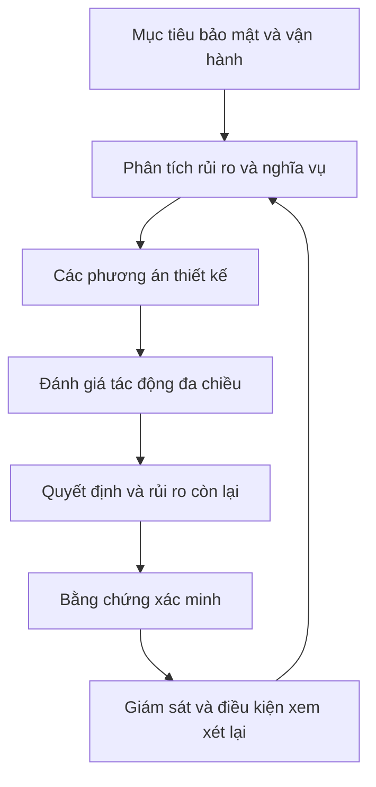
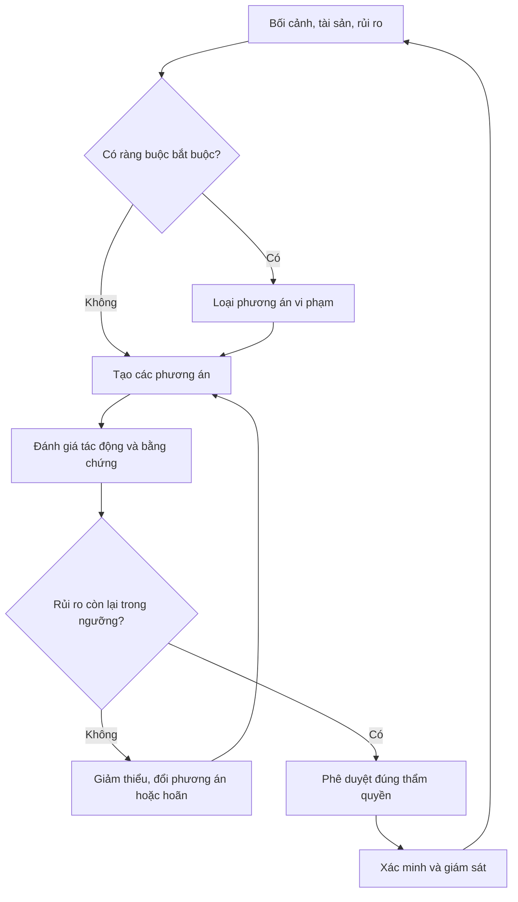

# Đánh đổi mục tiêu

Một hệ thống có thể yêu cầu xác thực thật chặt, mã hóa mọi dữ liệu, ghi lại đầy đủ hoạt động và luôn sẵn sàng phục vụ. Nhưng khi đưa các yêu cầu đó vào thực tế, nhóm phát triển sẽ gặp những lựa chọn khó: xác thực nhiều bước làm tăng độ an toàn nhưng cũng tăng ma sát cho người dùng; lưu log chi tiết giúp điều tra sự cố nhưng có thể thu thập quá nhiều dữ liệu cá nhân; mã hóa và kiểm tra toàn vẹn làm tăng chi phí xử lý; bảo trì để vá lỗ hổng có thể đòi hỏi tạm ngừng dịch vụ.

Đó là **đánh đổi mục tiêu bảo mật** (*security objectives trade-offs*): tình huống trong đó việc tối ưu hoặc bảo vệ một mục tiêu làm thay đổi khả năng đạt được mục tiêu khác, hoặc làm phát sinh chi phí, rủi ro và tác động mới. Đánh đổi không có nghĩa là tùy tiện hy sinh an ninh. Nó là quá trình nhận diện xung đột, so sánh phương án trong bối cảnh cụ thể, chọn mức bảo vệ phù hợp với rủi ro và chứng minh rằng quyết định vẫn đáp ứng các yêu cầu bắt buộc.

Trong security assurance, một quyết định chỉ đáng tin khi ta có thể giải thích **mục tiêu nào được ưu tiên, rủi ro nào được giảm, tác động nào được chấp nhận, ai có thẩm quyền chấp nhận và bằng chứng nào xác nhận phương án hoạt động như dự kiến**.

## 1. Vì sao các mục tiêu bảo mật có thể xung đột?

Mục tiêu bảo mật mô tả kết quả hệ thống cần đạt, chẳng hạn:

- **Tính bí mật (confidentiality):** thông tin chỉ được xem hoặc sử dụng bởi chủ thể được phép.
- **Tính toàn vẹn (integrity):** dữ liệu và hành vi hệ thống không bị sửa đổi trái phép hoặc sai lệch ngoài quy tắc.
- **Tính sẵn sàng (availability):** người dùng và hệ thống được phép có thể truy cập dịch vụ khi cần.
- **Tính xác thực (authenticity):** danh tính, nguồn gốc hoặc tính hợp lệ của thông điệp được xác minh.
- **Khả năng truy vết và quy trách nhiệm (accountability):** hoạt động quan trọng có thể được ghi nhận và gắn với chủ thể phù hợp.
- **Quyền riêng tư (privacy):** dữ liệu cá nhân được thu thập, sử dụng, chia sẻ và lưu giữ đúng mục đích, giới hạn và quyền của cá nhân.

Trong một hệ thống thực tế, những mục tiêu này cùng tồn tại với mục tiêu vận hành như khả năng sử dụng, độ trễ, khả năng mở rộng, khả năng phục hồi, chi phí và yêu cầu kinh doanh. Một control có thể cải thiện một kết quả nhưng làm giảm kết quả khác. Ví dụ, xác thực bổ sung giảm nguy cơ chiếm tài khoản, nhưng nếu mọi lần truy cập đều phải phụ thuộc vào một dịch vụ xác thực từ xa thì sự cố của dịch vụ đó có thể khiến người dùng hợp lệ không làm việc được.

Không có thứ tự ưu tiên cố định áp dụng cho mọi hệ thống. Một dịch vụ cấp cứu có yêu cầu sẵn sàng và quy trình truy cập khẩn cấp khác với kho lưu trữ hồ sơ mật. Hệ thống thanh toán có thể cần kiểm soát toàn vẹn giao dịch rất nghiêm ngặt; một ứng dụng đọc tin công khai có mô hình rủi ro khác. Quyết định phải xuất phát từ tài sản, mối đe dọa, nghĩa vụ và tác động cụ thể.

### 1.1. Phân biệt mục tiêu, yêu cầu và biện pháp

Ba lớp này liên quan nhưng không đồng nhất:

| Lớp | Câu hỏi | Ví dụ |
| --- | --- | --- |
| **Mục tiêu** | Kết quả nào cần được bảo vệ? | Chỉ nhân viên được phân quyền mới xem được hồ sơ khách hàng. |
| **Yêu cầu bảo mật** | Điều kiện nào phải đúng để đạt mục tiêu? | Mỗi lần đọc hồ sơ phải kiểm tra quyền theo người dùng, tổ chức và hồ sơ cụ thể. |
| **Security control** | Hệ thống thực hiện điều kiện đó bằng cách nào? | Kiểm tra quyền tại API và tầng nghiệp vụ; truy vấn giới hạn theo tổ chức; kiểm thử truy cập trái phép. |

Đánh đổi thường xuất hiện khi chọn yêu cầu chi tiết hoặc control. Ví dụ, mục tiêu bí mật dữ liệu vẫn được giữ nguyên, nhưng nhóm có thể chọn xác thực theo rủi ro, phân quyền theo vai trò kết hợp thuộc tính, hoặc quy trình truy cập khẩn cấp có kiểm soát. Mỗi phương án có tác động khác nhau đến trải nghiệm, độ phức tạp, khả năng vận hành và rủi ro.

### 1.2. Đánh đổi không phải lúc nào cũng là lựa chọn tổng bằng không

Một quyết định có vẻ phải hy sinh một mục tiêu đôi khi có thể được cải thiện bằng kiến trúc tốt hơn. Chẳng hạn, thay vì chọn giữa bảo mật cao và trải nghiệm tốt, hệ thống có thể dùng *step-up authentication*: chỉ yêu cầu xác thực mạnh hơn khi hành động có rủi ro cao. Thay vì giữ log chi tiết vô thời hạn để hỗ trợ điều tra, hệ thống có thể ghi sự kiện tối thiểu cần thiết, giới hạn người truy cập và đặt thời hạn lưu giữ theo mục đích.

Vì vậy, trước khi chấp nhận đánh đổi, cần tìm xem có phương án giảm xung đột, phân tách luồng hoặc áp dụng kiểm soát theo ngữ cảnh hay không.

## 2. Những nhóm đánh đổi thường gặp

### 2.1. Bí mật và sẵn sàng

Mã hóa dữ liệu, xác thực mạnh và kiểm tra quyền làm giảm khả năng truy cập trái phép. Nhưng dữ liệu được mã hóa chỉ sử dụng được khi khóa và dịch vụ cần thiết vẫn khả dụng. Nếu khóa mã hóa nằm trong một dịch vụ quản lý khóa duy nhất mà không có phương án phục hồi, sự cố dịch vụ hoặc mất quyền truy cập khóa có thể khiến dữ liệu hợp lệ không thể đọc.

Một ví dụ khác là yêu cầu xác thực trực tuyến mỗi lần truy cập. Khi hệ thống định danh ngừng hoạt động, người dùng hợp lệ cũng có thể bị khóa khỏi dịch vụ. Việc cho phép truy cập ngoại tuyến lại tạo rủi ro dùng thông tin xác thực cũ hoặc quyền đã bị thu hồi.

**Cách xử lý:** xác định mức sẵn sàng cần thiết; thiết kế dự phòng và phục hồi cho hệ thống định danh, kho khóa và các phụ thuộc; giới hạn thời gian tồn tại của thông tin xác thực ngoại tuyến; cân nhắc chế độ truy cập suy giảm có phạm vi hẹp; kiểm thử cả tình huống mất dịch vụ và thu hồi quyền.

Không nên mặc định *fail open* (cho qua khi kiểm soát lỗi) hoặc *fail closed* (từ chối khi kiểm soát lỗi) cho toàn hệ thống. Chọn hành vi theo tài sản và thao tác: xem thông tin công khai có thể tiếp tục khi một dịch vụ phụ trợ lỗi; chuyển tiền hoặc thay đổi quyền quản trị thường cần dừng nếu không xác minh được điều kiện an toàn. Với quy trình khẩn cấp, phải thiết kế cơ chế ngoại lệ có xác thực, giới hạn, ghi nhận và rà soát sau sử dụng.

### 2.2. Toàn vẹn và sẵn sàng

Một giao dịch tài chính cần tránh ghi nhận một phần hoặc ghi trùng. Kiểm tra nhất quán, khóa, giao dịch nguyên tử và cơ chế chống xử lý lặp giúp bảo vệ toàn vẹn nhưng có thể làm tăng độ trễ hoặc giảm thông lượng. Trong hệ thống phân tán, lựa chọn giữa đọc dữ liệu mới nhất và tiếp tục phục vụ khi mạng bị phân vùng có thể làm thay đổi cách hệ thống xử lý yêu cầu.

**Cách xử lý:** phân loại thao tác nào cần tính nhất quán mạnh, thao tác nào chấp nhận dữ liệu trễ; dùng idempotency key cho yêu cầu có thể gửi lại; thiết kế hàng đợi và cơ chế thử lại có giới hạn; đặt tiêu chí đối soát và phục hồi. Không áp dụng cùng một mức nhất quán cho mọi dữ liệu nếu rủi ro và nhu cầu khác nhau.

Ví dụ, số dư tài khoản và trạng thái quyết toán cần quy tắc cập nhật chặt chẽ. Số lượt xem tổng hợp hoặc dữ liệu phân tích có thể chấp nhận trễ vài phút nếu điều đó không làm sai quyết định nghiệp vụ.

### 2.3. Truy vết và quyền riêng tư

Log chi tiết giúp phát hiện hành vi bất thường, tái dựng chuỗi sự kiện và xác định trách nhiệm. Tuy nhiên, ghi toàn bộ request body, địa chỉ, mã định danh hoặc dữ liệu nhạy cảm có thể tạo thêm kho dữ liệu có nguy cơ bị lộ. Lưu log quá lâu cũng làm tăng tác động nếu tài khoản log bị xâm phạm.

**Cách xử lý:** xác định sự kiện nào thực sự cần cho phát hiện và điều tra; ghi danh tính, hành động, đối tượng, thời gian và kết quả ở mức cần thiết; loại bỏ hoặc che dữ liệu nhạy cảm; kiểm soát quyền đọc log; bảo vệ tính toàn vẹn; đặt thời hạn lưu giữ và quy trình xóa; kiểm thử để bảo đảm bí mật không vô tình xuất hiện trong log.

Ví dụ, thay vì ghi toàn bộ nội dung hồ sơ khách hàng khi có thao tác xem, hệ thống có thể ghi `actor_id`, `record_id`, hành động, thời điểm, kết quả và mã tương quan. Người điều tra có thể dùng mã hồ sơ để truy xuất dữ liệu theo quy trình được cấp quyền khi thật sự cần.

### 2.4. Bảo mật và khả năng sử dụng

Mật khẩu phức tạp, xác thực nhiều yếu tố, thời gian phiên ngắn và quy trình cấp quyền nghiêm ngặt có thể giảm một số nguy cơ. Nhưng nếu thiết kế gây khó khăn, người dùng có thể ghi mật khẩu ra giấy, chia sẻ tài khoản, tìm cách né kiểm soát hoặc liên tục yêu cầu hỗ trợ. Khi đó, control trên lý thuyết mạnh nhưng hiệu quả thực tế giảm.

**Cách xử lý:** đánh giá hành vi người dùng và mức rủi ro của từng thao tác; dùng xác thực mạnh cho hành động nhạy cảm; hỗ trợ phương thức xác thực dễ tiếp cận; cung cấp quy trình khôi phục an toàn; tránh buộc người dùng lặp lại bước không làm giảm rủi ro đáng kể; đo cả tỷ lệ hoàn thành hợp lệ và dấu hiệu né tránh kiểm soát.

Mục tiêu là đạt mức bảo vệ thực tế trong điều kiện con người sử dụng hệ thống, chứ không chỉ tối đa hóa độ nghiêm ngặt của chính sách.

### 2.5. Bảo mật và hiệu năng

Mã hóa, kiểm tra chữ ký, quét tệp, phân tích hành vi, kiểm tra quyền và ghi log đều tiêu tốn tài nguyên. Nếu thực hiện đồng bộ trên mọi request mà không thiết kế phù hợp, độ trễ và chi phí có thể tăng; nếu bỏ qua kiểm tra để giảm độ trễ, rủi ro có thể tăng.

**Cách xử lý:** đo chi phí trên luồng thực tế; tối ưu thuật toán và cấu hình; dùng cache cho kết quả có thể cache an toàn với cơ chế hết hạn và thu hồi rõ ràng; xử lý tác vụ nặng bất đồng bộ khi phù hợp; chỉ giảm tần suất kiểm tra khi phân tích rủi ro chứng minh điều đó chấp nhận được. Cache quyền hoặc dữ liệu nhạy cảm cần đặc biệt chú ý đến thay đổi quyền, cô lập tenant và thời gian hiệu lực.

### 2.6. Phòng thủ sâu và độ phức tạp vận hành

Phân đoạn mạng, nhiều lớp xác thực, nhiều hệ thống giám sát và nhiều cơ chế phê duyệt có thể giảm khả năng một lỗi đơn lẻ dẫn đến sự cố lớn. Nhưng chúng cũng tạo thêm cấu hình, tài khoản dịch vụ, khóa, luồng xử lý và điểm cần giám sát. Một kiến trúc phức tạp mà không có chủ sở hữu và quy trình vận hành rõ ràng có thể tạo lỗi cấu hình hoặc làm chậm phản ứng sự cố.

**Cách xử lý:** ưu tiên lớp bảo vệ có tác dụng rõ ràng đối với rủi ro; chuẩn hóa cấu hình; tự động hóa kiểm tra; xác định chủ sở hữu; loại bỏ control trùng lặp không tạo thêm giá trị; diễn tập quy trình vận hành. Đánh giá tổng thể cả rủi ro do thiếu control lẫn rủi ro do control khó vận hành.

### 2.7. Bảo mật, khả năng phục hồi và chi phí

Sao lưu nhiều bản, dự phòng nhiều vùng, hệ thống phục hồi thảm họa và kiểm thử xâm nhập độc lập đều cần nguồn lực. Cắt giảm chi phí có thể làm giảm khả năng phục hồi; đầu tư mọi nơi ở mức cao nhất có thể không tương xứng với giá trị tài sản và tác động sự cố.

**Cách xử lý:** xác định RTO (thời gian phục hồi mục tiêu) và RPO (mức mất dữ liệu tối đa chấp nhận được) theo tác động kinh doanh; kiểm tra khả năng khôi phục thực tế; ưu tiên tài sản quan trọng; xem xét chi phí vòng đời, bao gồm chi phí sự cố và vận hành. Bản sao lưu chưa được thử khôi phục không phải bằng chứng đầy đủ về khả năng phục hồi.

## 3. Một ví dụ tổng hợp: xác thực cho nền tảng quản lý hồ sơ

Giả sử một nền tảng SaaS cho phép nhân viên nhiều tổ chức quản lý hồ sơ khách hàng. Các mục tiêu được đặt ra gồm:

- Người không có quyền không thể đọc hoặc sửa hồ sơ.
- Nhân viên hợp lệ có thể làm việc trong giờ cao điểm và khi một dịch vụ phụ trợ gặp sự cố.
- Hoạt động xem, sửa và xuất hồ sơ có thể được điều tra khi có sự cố.
- Hệ thống không thu thập và lưu dữ liệu cá nhân vượt quá mục đích cần thiết.
- Thao tác thông thường có độ trễ phù hợp với nhu cầu sử dụng.

Nhóm đề xuất một phương án: MFA bắt buộc ở mọi lần đăng nhập, phiên rất ngắn, kiểm tra định danh từ xa trên mỗi request, ghi toàn bộ request/response để điều tra và giữ log không thời hạn. Phương án này có vẻ tối đa hóa một số kiểm soát, nhưng làm nảy sinh các vấn đề:

1. Dịch vụ định danh lỗi có thể làm ngừng toàn bộ hoạt động.
2. Phiên quá ngắn làm tăng gián đoạn và có thể khuyến khích hành vi né tránh.
3. Ghi toàn bộ request/response có nguy cơ lưu nội dung hồ sơ và thông tin xác thực.
4. Log không thời hạn làm tăng chi phí và phạm vi dữ liệu cần bảo vệ.
5. Kiểm tra từ xa trên mọi request có thể làm tăng độ trễ và phụ thuộc mạng.

Nhóm cần xem xét các phương án theo rủi ro:

| Vấn đề | Phương án có thể cân nhắc | Đánh đổi và điều kiện cần xác minh |
| --- | --- | --- |
| Xác thực | MFA khi đăng nhập và xác thực tăng cường cho xuất dữ liệu, đổi quyền, thay đổi thông tin nhạy cảm | Giảm ma sát ở thao tác thường ngày; phải xác định ngưỡng kích hoạt và kiểm thử việc bỏ qua hoặc giả mạo ngữ cảnh rủi ro |
| Phiên truy cập | Thời hạn phiên theo mức nhạy cảm, thu hồi khi đổi quyền hoặc có tín hiệu xâm phạm | Tăng khả năng sử dụng; phải đo thời gian thu hồi thực tế và giới hạn phiên bị đánh cắp |
| Dịch vụ định danh | Dự phòng, giám sát và quy trình khẩn cấp có giới hạn | Tăng sẵn sàng nhưng tăng độ phức tạp; phải kiểm tra không biến chế độ khẩn cấp thành đường vòng phân quyền |
| Audit log | Ghi metadata sự kiện, che dữ liệu nhạy cảm, kiểm soát truy cập và lưu theo thời hạn | Hỗ trợ điều tra và giảm dữ liệu dư thừa; phải chứng minh các sự kiện quan trọng vẫn đủ để tái dựng |
| Kiểm tra quyền | Kiểm tra phía máy chủ, cache có thời hạn ngắn và cơ chế vô hiệu hóa khi quyền đổi | Giảm độ trễ; cần test tình huống thu hồi quyền, truy cập chéo tổ chức và cache lỗi thời |

Phương án được chọn có thể là xác thực tăng cường theo hành động, dự phòng dịch vụ định danh, log theo sự kiện với dữ liệu tối thiểu và kiểm tra quyền phía máy chủ. Quyết định này không tự động đúng cho mọi tổ chức. Nó chỉ hợp lý nếu các kiểm tra chứng minh rằng mức bảo vệ còn đáp ứng yêu cầu, các luồng khẩn cấp được kiểm soát và những rủi ro còn lại được người có thẩm quyền chấp nhận.

### 3.1. Vẽ quan hệ giữa mục tiêu và phương án



Quyết định không kết thúc khi kiến trúc được phê duyệt. Nếu đo được tỷ lệ lỗi xác thực tăng cao, xuất hiện lỗ hổng trong thư viện MFA hoặc có sự cố lộ log, giả định ban đầu cần được xem xét lại.

## 4. Quy trình ra quyết định khi mục tiêu xung đột

Một quy trình có thể áp dụng cho thay đổi kiến trúc, tính năng mới hoặc quyết định vận hành gồm tám bước.

### Bước 1: Xác định bối cảnh và tài sản

Làm rõ hệ thống phục vụ ai, dữ liệu nào quan trọng, ai là chủ thể hợp lệ, luồng dữ liệu đi đâu, thành phần nào nằm ngoài quyền kiểm soát của nhóm và hậu quả nếu mục tiêu không đạt. Phân biệt môi trường thử nghiệm, staging và production nếu rủi ro khác nhau.

Không nên bắt đầu bằng câu hỏi “dùng control nào?”. Hãy bắt đầu bằng “điều gì cần được bảo vệ và tác động nào không thể chấp nhận?”.

### Bước 2: Mô tả các rủi ro và kịch bản thất bại

Mỗi xung đột cần gắn với một kịch bản cụ thể. Ví dụ:

- Nếu dịch vụ xác thực ngừng hoạt động, nhân viên không thể truy cập hồ sơ để xử lý sự cố khẩn cấp.
- Nếu cho phép token cũ tiếp tục hoạt động khi dịch vụ xác thực lỗi, người đã bị thu hồi quyền vẫn có thể truy cập.
- Nếu log ghi nội dung hồ sơ, người có quyền đọc log có thể xem dữ liệu vượt quá nhiệm vụ.

Mô tả chủ thể, hành động, điều kiện kích hoạt, tài sản bị ảnh hưởng, khả năng xảy ra và mức độ tác động. Một mục tiêu có thể có nhiều kịch bản thất bại khác nhau.

### Bước 3: Xác định giới hạn bắt buộc

Trước khi so sánh phương án, ghi rõ các ràng buộc không thể đánh đổi, chẳng hạn nghĩa vụ pháp lý, hợp đồng, chính sách tổ chức, yêu cầu an toàn, giới hạn phân quyền hoặc quy tắc xử lý dữ liệu. Không được dùng điểm số lợi ích để hợp thức hóa việc vi phạm một nghĩa vụ bắt buộc.

Phân biệt:

- **Ràng buộc cứng:** phải đáp ứng; phương án không đạt bị loại hoặc phải thay đổi.
- **Mục tiêu có mức chấp nhận:** có thể cân bằng theo bối cảnh, nhưng cần tiêu chí và người có thẩm quyền phê duyệt.
- **Ưu tiên tối ưu:** nên cải thiện nếu chi phí và rủi ro hợp lý.

### Bước 4: Chuyển mục tiêu thành tiêu chí đo được

Tránh tiêu chí như “bảo mật cao” hoặc “hiệu năng tốt”. Hãy xác định cách quan sát và ngưỡng chấp nhận. Ví dụ:

| Khía cạnh | Tiêu chí minh họa |
| --- | --- |
| Bí mật | Không có trường hợp truy cập chéo tenant trong tập kiểm thử và các đường truy cập thuộc phạm vi |
| Sẵn sàng | Đạt mục tiêu availability đã thống nhất; có RTO/RPO và kiểm thử phục hồi |
| Thu hồi quyền | Quyền bị thu hồi có hiệu lực trong thời gian tối đa được quy định |
| Quyền riêng tư | Log không chứa trường dữ liệu bị cấm; có thời hạn lưu giữ và kiểm soát truy cập |
| Hiệu năng | Độ trễ p95/p99 của thao tác quan trọng không vượt ngưỡng khi bật control |
| Truy vết | Có thể liên kết actor, hành động, đối tượng và thời điểm cho sự kiện quan trọng |

Các con số cụ thể phải xuất phát từ nhu cầu và phân tích rủi ro của hệ thống. Không sao chép một ngưỡng mẫu rồi xem đó là chuẩn chung.

### Bước 5: Tạo và phân tích nhiều phương án

Ít nhất nên xem xét phương án hiện tại, phương án tăng kiểm soát và phương án giảm xung đột bằng thiết kế. Với mỗi phương án, phân tích:

- Rủi ro nào được giảm và rủi ro mới nào phát sinh?
- Mục tiêu nào được cải thiện, mục tiêu nào chịu ảnh hưởng?
- Tác động đến người dùng, vận hành, hiệu năng, chi phí và khả năng phục hồi là gì?
- Có phụ thuộc mới, điểm lỗi tập trung hoặc đường vòng kiểm soát nào không?
- Có thể triển khai theo giai đoạn, bật theo nhóm người dùng hoặc hoàn tác an toàn không?

Không chỉ đánh giá lợi ích trực tiếp. Một control mới có thể làm tăng số tài khoản dịch vụ, tạo thêm khóa cần quản lý hoặc khiến quy trình khẩn cấp phức tạp hơn.

### Bước 6: So sánh theo rủi ro và mức độ ưu tiên

Có thể dùng ma trận định tính hoặc mô hình chấm điểm để hỗ trợ thảo luận. Nhưng không nên cộng điểm rồi coi phương án điểm cao nhất đương nhiên là an toàn nhất. Một thiếu sót nghiêm trọng về bí mật không thể được bù bằng điểm tốt về hiệu năng; ràng buộc bắt buộc phải được kiểm tra trước khi tính các ưu tiên khác.

Ví dụ bảng so sánh định tính:

| Tiêu chí | Phương án A: xác thực từ xa mỗi request | Phương án B: phiên ngắn có kiểm soát và step-up |
| --- | --- | --- |
| Khả năng thu hồi quyền | Có thể kiểm tra thường xuyên; phụ thuộc dịch vụ xác thực | Phụ thuộc thời gian phiên và cơ chế thu hồi; cần chứng minh độ trễ thu hồi |
| Sẵn sàng | Dễ bị ảnh hưởng khi dịch vụ xác thực lỗi | Có thể giảm phụ thuộc trên luồng thường; cần kiểm soát phiên và tình huống khẩn cấp |
| Độ trễ | Thêm một lần gọi phụ thuộc | Có thể thấp hơn; cần đo cache, refresh và step-up |
| Độ phức tạp | Tập trung ở dịch vụ xác thực và mạng | Tăng logic quản lý phiên, refresh và thu hồi |
| Bằng chứng cần có | Kiểm thử lỗi phụ thuộc, thu hồi, tải và bypass | Kiểm thử vòng đời phiên, thu hồi, step-up, token bị đánh cắp |

Chỉ sau khi loại các phương án vi phạm ràng buộc cứng, nhóm mới cân bằng chi phí và ưu tiên còn lại theo mức rủi ro chấp nhận.

### Bước 7: Ghi quyết định và rủi ro còn lại

Quyết định cần nêu phương án được chọn, lý do, phương án bị loại, giả định, control bù, chủ sở hữu, người phê duyệt và thời điểm xem xét lại. Ghi cả rủi ro còn lại thay vì chỉ ghi “đã xử lý”.

Nếu rủi ro vượt ngưỡng chấp nhận, phải giảm thiểu thêm, giới hạn phạm vi, hoãn phát hành hoặc chuyển quyết định lên đúng cấp có thẩm quyền. Nhóm kỹ thuật không tự chấp nhận thay tổ chức một rủi ro có ảnh hưởng vượt quyền hạn của mình.

### Bước 8: Xác minh, giám sát và xem xét lại

Thiết kế kiểm thử để chứng minh phương án đạt tiêu chí và không làm suy giảm mục tiêu khác ngoài mức đã chấp nhận. Theo dõi các chỉ số sau triển khai; đặt điều kiện đánh giá lại như thay đổi threat model, phát hiện lỗ hổng, sự cố, thay đổi pháp lý, tăng quy mô hoặc thay đổi hành vi người dùng.



## 5. Dùng ma trận đánh đổi một cách có trách nhiệm

Ma trận giúp các bên nhìn cùng một bức tranh. Nó không thay thế phân tích định tính, threat modeling hoặc phán đoán chuyên môn.

Một mẫu đơn giản:

| Phương án | Bí mật | Toàn vẹn | Sẵn sàng | Riêng tư | Trải nghiệm | Chi phí / vận hành |
| --- | --- | --- | --- | --- | --- | --- |
| A | Tốt | Tốt | Trung bình | Trung bình | Thấp | Cao |
| B | Tốt | Tốt | Tốt | Tốt | Tốt | Trung bình |
| C | Trung bình | Tốt | Tốt | Tốt | Tốt | Thấp |

Các mức trong bảng chỉ là ví dụ. Khi sử dụng thật, cần ghi căn cứ cho từng đánh giá, tiêu chí đo và mức độ tin cậy của thông tin. Nếu thiếu dữ liệu, đánh dấu “chưa biết” thay vì tự gán “trung bình”.

Nếu dùng trọng số, hãy công khai ai đặt trọng số và vì sao. Phân tích độ nhạy để biết thay đổi giả định có làm thay đổi lựa chọn hay không. Ví dụ, nếu phương án B chỉ thắng khi coi hiệu năng quan trọng hơn tính bí mật, nhóm cần xem lại liệu trọng số đó có phù hợp với hậu quả của việc lộ dữ liệu hay không.

**Một số nguyên tắc tránh lạm dụng ma trận:**

- Kiểm tra ràng buộc pháp lý, hợp đồng và chính sách trước khi chấm điểm.
- Không dùng điểm trung bình để che lấp một rủi ro nghiêm trọng.
- Tách dữ kiện đã đo khỏi nhận định chuyên gia và giả định.
- Nêu mức bất định, phạm vi chưa kiểm thử và các phụ thuộc.
- Cho phép người đánh giá chất vấn tiêu chí, trọng số và nguồn dữ liệu.

## 6. Chứng minh quyết định bằng security assurance

Một quyết định đánh đổi không hoàn tất khi biên bản được ký. Cần chứng minh rằng phương án đã chọn thực sự đạt mục tiêu trong phạm vi đã định, đồng thời các tác động phụ nằm trong giới hạn chấp nhận.

### 6.1. Liên kết mục tiêu, rủi ro, control và bằng chứng

Ví dụ với quyết định chỉ yêu cầu MFA tăng cường khi xuất dữ liệu:

| Thành phần | Nội dung cần có |
| --- | --- |
| Mục tiêu | Ngăn người chiếm được phiên thông thường xuất lượng lớn dữ liệu nhạy cảm |
| Rủi ro | Kẻ tấn công dùng phiên bị đánh cắp để xuất dữ liệu hàng loạt |
| Yêu cầu | Xuất dữ liệu vượt ngưỡng hoặc thuộc nhóm nhạy cảm phải xác thực tăng cường và được cấp quyền |
| Control | Step-up authentication, kiểm tra quyền, giới hạn tốc độ và cảnh báo hành vi bất thường |
| Tác động cần cân bằng | Tăng ma sát cho người dùng hợp lệ; có thể ảnh hưởng luồng xuất dữ liệu khẩn cấp |
| Bằng chứng | Test bỏ qua step-up, test quyền, test ngưỡng, kiểm tra log/cảnh báo, kiểm thử luồng hỗ trợ khẩn cấp |
| Rủi ro còn lại | Phiên bị đánh cắp vẫn có thể thực hiện một số thao tác thông thường trước khi chạm ngưỡng |

Nhóm cần kiểm tra cả nhánh từ chối và nhánh cho phép. Nếu chỉ kiểm tra rằng người dùng bị từ chối khi không có MFA, ta chưa biết người dùng có MFA nhưng không có quyền xuất dữ liệu có bị chặn hay không.

### 6.2. Bằng chứng phải phản ánh cả mục tiêu được ưu tiên và mục tiêu chịu tác động

Nếu chọn kiểm tra quyền mỗi request để tăng khả năng thu hồi, cần kiểm tra độ trễ và hành vi khi dịch vụ quyền lỗi. Nếu rút gọn log để bảo vệ riêng tư, cần chứng minh tập sự kiện còn lại vẫn hỗ trợ điều tra những tình huống quan trọng. Nếu cho phép chế độ suy giảm để tăng sẵn sàng, cần thử rằng chế độ đó không mở rộng quyền ngoài dự kiến.

Một bộ bằng chứng tốt có thể gồm:

- Kết quả threat modeling và lý do chọn phương án.
- Review thiết kế, mã nguồn và cấu hình liên quan.
- Kiểm thử chức năng, kiểm thử bảo mật, kiểm thử hiệu năng và kiểm thử lỗi phụ thuộc.
- Kết quả diễn tập phục hồi hoặc quy trình truy cập khẩn cấp.
- Kiểm tra dữ liệu log, quyền truy cập log và thời hạn lưu giữ.
- Phát hiện chưa khắc phục, quyết định chấp nhận rủi ro và lịch xem xét lại.

### 6.3. Ví dụ kiểm tra một control có đánh đổi

Giả sử hệ thống cache kết quả phân quyền trong 30 giây để giảm độ trễ. Mục tiêu là tăng hiệu năng trong khi giữ rủi ro thu hồi quyền ở mức chấp nhận. Nhóm không thể chỉ đo request nhanh hơn. Cần xác minh:

1. Người dùng vừa bị thu hồi quyền có thể tiếp tục truy cập tối đa bao lâu?
2. Cache có được phân vùng theo người dùng, tổ chức và tài nguyên không?
3. Cache có thể trả dữ liệu của tenant khác do khóa cache thiếu tenant ID không?
4. Khi hệ thống đồng bộ quyền lỗi, cache hết hạn sẽ xử lý thế nào?
5. Các thao tác nhạy cảm có bỏ qua cache hoặc dùng kiểm tra trực tiếp không?
6. Thời gian hiệu lực thực tế có đúng giới hạn đã cam kết không?

Đo độ trễ p95/p99 trước và sau thay đổi, đồng thời chạy kiểm thử thu hồi quyền, truy cập chéo tenant, tải cao và lỗi cache. Nếu giới hạn thu hồi 30 giây là không phù hợp với một nhóm thao tác nhạy cảm, nhóm cần dùng chính sách riêng cho nhóm thao tác đó thay vì áp dụng một thời hạn chung.

## 7. Ghi lại quyết định đánh đổi

Một bản ghi quyết định giúp người khác hiểu vì sao phương án được chọn và khi nào phải xem xét lại. Có thể dùng mẫu sau:

```yaml
decision_id: SEC-TRADEOFF-<id>
title: "<mô tả ngắn quyết định>"
scope:
  system: "<dịch vụ hoặc thành phần>"
  release: "<phiên bản hoặc mốc áp dụng>"
objectives:
  primary: ["<mục tiêu được ưu tiên>"]
  affected: ["<mục tiêu chịu tác động>"]
constraints:
  mandatory: ["<nghĩa vụ hoặc điều kiện bắt buộc>"]
risks:
  addressed: ["<risk-id>"]
  introduced_or_increased: ["<risk-id>"]
options_considered:
  - option: "<phương án>"
    benefits: ["<lợi ích>"]
    costs_and_risks: ["<chi phí và rủi ro>"]
selected_option: "<phương án được chọn>"
rationale: "<lập luận và căn cứ>"
controls_and_compensations: ["<control hoặc biện pháp bù>"]
acceptance_criteria: ["<tiêu chí đo được>"]
evidence: ["<liên kết hoặc mã hiện vật> "]
residual_risks: ["<rủi ro còn lại>"]
owner: "<người chịu trách nhiệm>"
approver: "<người có thẩm quyền>"
review_triggers: ["<sự kiện kích hoạt đánh giá lại>"]
review_date: "<ngày xem xét lại>"
```

Đây là cấu trúc minh họa, không phải một bản ghi đã được phê duyệt. Giá trị thực cần có liên kết tới risk register, yêu cầu, kiểm thử và bằng chứng của phiên bản liên quan. Tránh đưa bí mật, token, dữ liệu cá nhân hoặc nội dung khai thác nhạy cảm vào bản ghi nếu không cần thiết.

## 8. Những sai lầm thường gặp khi xử lý đánh đổi

| Sai lầm | Vì sao nguy hiểm | Cách cải thiện |
| --- | --- | --- |
| Coi một mục tiêu luôn quan trọng nhất | Bỏ qua bối cảnh và tác động của hệ thống | Xác định thứ tự ưu tiên theo tài sản, kịch bản và nghĩa vụ |
| Dùng “bảo mật” như lý do chung để từ chối mọi thay đổi | Không chỉ ra rủi ro cụ thể và có thể tạo kiểm soát quá mức | Nêu claim, threat scenario, tác động và phương án thay thế |
| Tối ưu hiệu năng bằng cách bỏ kiểm tra mà không đo rủi ro | Có thể tạo đường truy cập trái phép hoặc sai lệch dữ liệu | Đo chi phí control và tìm tối ưu an toàn trước khi giảm phạm vi kiểm tra |
| Chọn phương án có tổng điểm cao nhất | Điểm tổng có thể che rủi ro nghiêm trọng hoặc nghĩa vụ bắt buộc | Dùng ràng buộc cứng, phân tích độ nhạy và đánh giá chuyên môn |
| Chỉ ghi lợi ích, không ghi rủi ro mới | Người phê duyệt không hiểu đầy đủ hệ quả | Ghi cả rủi ro tăng lên, giả định và biện pháp bù |
| Chấp nhận rủi ro mà không có thẩm quyền | Người thực hiện có thể vượt quá trách nhiệm được giao | Chuyển đúng cấp phê duyệt, ghi phạm vi và thời hạn |
| Không đánh giá lại sau triển khai | Điều kiện thực tế có thể khác giả định thiết kế | Theo dõi chỉ số và đặt sự kiện kích hoạt review |
| Xem việc có control là bằng chứng control hiệu quả | Control có thể bị cấu hình sai, bỏ qua hoặc không vận hành | Kiểm tra thiết kế, triển khai, hành vi và vận hành bằng bằng chứng |

## 9. Đánh đổi thay đổi theo vòng đời hệ thống

Một quyết định hợp lý ở giai đoạn đầu có thể không còn phù hợp khi số lượng người dùng, giá trị dữ liệu hoặc bối cảnh tấn công thay đổi. Vì vậy, quyết định cần được xem xét ở các thời điểm:

| Thời điểm | Câu hỏi cần xem xét |
| --- | --- |
| Thiết kế kiến trúc | Các mục tiêu có xung đột không? Ranh giới tin cậy và phụ thuộc đã rõ chưa? |
| Trước khi phát hành | Control đã được kiểm thử trong cấu hình thực tế chưa? Có phát hiện nào làm thay đổi đánh giá rủi ro? |
| Sau triển khai | Độ trễ, lỗi, cảnh báo và hành vi người dùng có đúng giả định không? |
| Khi có sự cố | Đánh đổi hiện tại có góp phần gây sự cố hoặc cản trở phát hiện, ứng cứu không? |
| Khi thay đổi hệ thống | Thành phần, dữ liệu, quy mô hoặc threat model mới có làm mất hiệu lực quyết định cũ không? |
| Khi thay đổi nghĩa vụ | Chính sách, hợp đồng hoặc yêu cầu pháp lý mới có tạo ràng buộc mới không? |

Các tín hiệu cần xem xét lại có thể là: thời gian thu hồi quyền vượt ngưỡng, log thiếu dữ liệu cho điều tra, tỷ lệ người dùng tìm cách né MFA tăng, lỗi phụ thuộc làm gián đoạn dịch vụ, chi phí lưu trữ log tăng bất thường hoặc phát hiện lỗ hổng mới trong cơ chế được tin cậy.

Khi đánh đổi không còn phù hợp, nhóm có thể điều chỉnh ngưỡng, thay control, thu hẹp ngoại lệ hoặc thiết kế lại. Mọi thay đổi quan trọng cần tạo bằng chứng mới và cập nhật quyết định cũ để tránh dựa vào giả định đã lỗi thời.

## 10. Checklist thực hành

Trước khi phê duyệt một đánh đổi, hãy kiểm tra:

- [ ] Mục tiêu và tài sản cần bảo vệ đã được mô tả cụ thể.
- [ ] Các kịch bản đe dọa và hậu quả của từng lựa chọn đã được phân tích.
- [ ] Nghĩa vụ bắt buộc và giới hạn không thể đánh đổi đã được xác định.
- [ ] Tiêu chí chấp nhận có thể đo hoặc kiểm chứng được.
- [ ] Đã xem xét nhiều phương án, gồm phương án giảm xung đột bằng thiết kế.
- [ ] Tác động đến người dùng, vận hành, riêng tư, hiệu năng và chi phí đã được đánh giá.
- [ ] Control bù, giả định và phụ thuộc đã được ghi lại.
- [ ] Có bằng chứng kiểm tra cả mục tiêu được ưu tiên lẫn mục tiêu chịu tác động.
- [ ] Rủi ro còn lại có chủ sở hữu và được người đúng thẩm quyền chấp nhận.
- [ ] Có chỉ số theo dõi, điều kiện kích hoạt đánh giá lại và ngày xem xét.

Nếu một mục chưa hoàn thành, quyết định có thể vẫn đang ở trạng thái đề xuất hoặc cần giới hạn phạm vi áp dụng. Không nên diễn giải một quyết định chưa được kiểm chứng thành kết luận rằng mục tiêu bảo mật đã được đáp ứng.

## 11. Kết luận

Đánh đổi mục tiêu là một phần bình thường của thiết kế và vận hành hệ thống. Bí mật, toàn vẹn, sẵn sàng, riêng tư, truy vết, khả năng sử dụng và hiệu năng cần được xem xét cùng nhau theo bối cảnh rủi ro. Một control mạnh hơn ở một khía cạnh có thể làm tăng phụ thuộc, chi phí hoặc rủi ro ở khía cạnh khác.

Quyết định tốt bắt đầu từ mục tiêu và kịch bản rủi ro, xác định ràng buộc bắt buộc, so sánh các phương án, ghi rõ rủi ro còn lại và giao trách nhiệm phê duyệt đúng thẩm quyền. Sau đó, security assurance dùng kiểm thử, review, audit và dữ liệu vận hành để xác minh rằng phương án đạt tiêu chí đã đặt ra. Khi giả định hoặc môi trường thay đổi, quyết định phải được xem xét lại.

**Mục tiêu không phải là tối đa hóa một chỉ số bảo mật riêng lẻ. Mục tiêu là đạt mức bảo vệ phù hợp, có thể giải thích và có bằng chứng trong toàn bộ bối cảnh hệ thống.**
