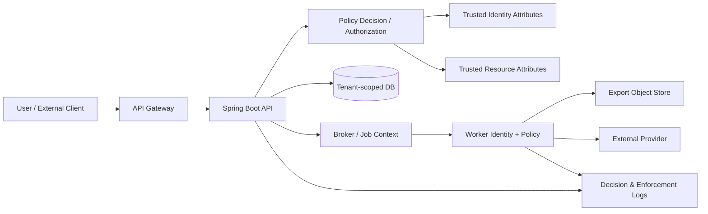
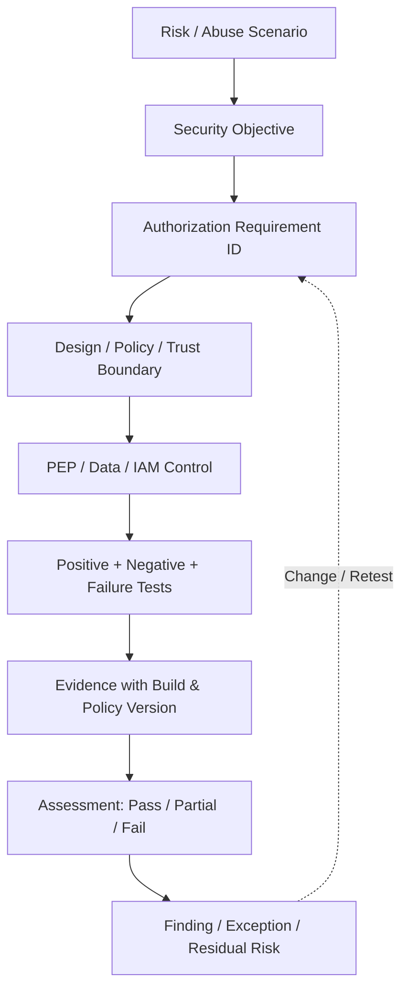

# Requirement về phân quyền: Đặc tả và kiểm chứng yêu cầu authorization

## 1. Mục tiêu học tập

Sau bài học, người học có thể:

1. Giải thích **requirement về phân quyền** (authorization requirement) và vị trí của nó trong **security requirements**, phân biệt với authentication, quản lý danh tính và quyết định triển khai kỹ thuật.
2. Viết yêu cầu xác định rõ **ai (subject), được làm gì (action), đối với tài nguyên nào (resource), trong điều kiện nào (context)** và trạng thái hệ thống phải bảo đảm.
3. Rút yêu cầu từ business process, data classification, threat model, risk assessment, security policy, quyền của các bên và trust boundaries.
4. Đặc tả **deny by default, least privilege, complete mediation, separation of duties, tenant isolation, resource ownership, delegation, privileged access và revocation** bằng câu có thể kiểm thử.
5. So sánh và chọn cách biểu diễn yêu cầu với **RBAC, ABAC, ReBAC và policy-based authorization** mà không đồng nhất mô hình quyền với một thư viện/framework cụ thể.
6. Viết **acceptance criteria** bao gồm cả positive, negative, abuse, failure và concurrency cases; biết vì sao chỉ kiểm tra HTTP 403 chưa đủ.
7. Thiết kế requirement cho API, data layer, background jobs, machine identity, exports, integrations và admin plane.
8. Thiết lập traceability **risk → objective → requirement → control → test → evidence → finding → remediation → residual risk**.
9. Áp dụng vào ứng dụng Java/Spring Boot đa tenant xử lý báo cáo, chuyển tiền và phê duyệt, gồm policy YAML, ma trận quyền và các test cases minh họa.
10. Đánh giá chất lượng yêu cầu và phân biệt yêu cầu **đã viết**, **đã triển khai**, **đã kiểm thử** và **đã được assurance với bằng chứng**.

Bài thuộc chương **Security requirements** của module **SECURITY_SECURITY_ASSURANCE**. Mục tiêu của module là xây dựng cách đánh giá **có bằng chứng** rằng hệ thống đáp ứng mục tiêu bảo mật, từ phân tích rủi ro và yêu cầu tới security controls, kiểm thử, audit, xử lý phát hiện và assurance liên tục trong phát triển/vận hành. Vì vậy, bài tập trung vào **đặc tả các điều kiện truy cập có thể kiểm chứng**, không chỉ vào cách gán role hay viết annotation trong code.

## 2. Requirement về phân quyền là gì?

**Requirement về phân quyền** là một phát biểu có thể kiểm chứng quy định **chủ thể nào được phép hoặc không được phép thực hiện hành động nào trên tài nguyên nào**, dựa trên các điều kiện được xác định, đồng thời nêu hành vi bắt buộc khi quyền không hợp lệ hoặc không thể xác minh.

Ví dụ sơ sài:

> Chỉ quản trị viên được quản lý người dùng.

Câu này để lại các câu hỏi:

- “Quản trị viên” thuộc tổ chức hoặc tenant nào?
- “Quản lý” gồm xem, mời, khóa, xóa, cấp đặc quyền hay xuất dữ liệu?
- Quản trị viên có được tự cấp quyền cao hơn hay không?
- Có được thay đổi tài khoản của tenant khác không?
- Đối tượng đang ở trạng thái nào?
- Ai phê duyệt thay đổi nhạy cảm?
- Việc từ chối có làm phát sinh side effects hay tiết lộ thông tin không?

Phiên bản kiểm thử được:

> **AUTHZ-USER-004:** Đối với API quản lý người dùng trong production, hệ thống **phải** chỉ cho phép chủ thể có quyền `USER_MANAGE` đang hiệu lực trong tenant T thực hiện thao tác khóa tài khoản thuộc tenant T; không chấp nhận tenant do client tự khai làm căn cứ cấp quyền. Nếu tài khoản đích thuộc tenant khác hoặc quyền đã bị thu hồi, yêu cầu phải bị từ chối **trước mọi thay đổi trạng thái**, không tạo job/notification quản lý nào và tạo audit event đã giảm thiểu dữ liệu nhạy cảm.

Câu trên nêu scope, actor, action, resource, condition, failure behavior và phần có thể xác minh. Cách thức triển khai cụ thể — Spring Security, API gateway, policy engine hay database row-level security — có thể được quyết định ở giai đoạn thiết kế.

### 2.1. Authentication không đồng nghĩa authorization

- **Authentication:** xác minh chủ thể đang trình bày credential là ai.
- **Authorization:** quyết định chủ thể được làm gì đối với tài nguyên cụ thể.
- **Entitlement administration:** tạo, cấp, sửa, thu hồi quyền và trách nhiệm sở hữu quyền.
- **Enforcement:** ngăn hành động vượt quyền xảy ra.
- **Assurance:** thu thập bằng chứng rằng yêu cầu và cơ chế thực thi hoạt động trong phạm vi xác định.

Một JWT hợp lệ, MFA thành công hoặc kết nối nội bộ không đủ để suy ra chủ thể có quyền xem hồ sơ của tenant khác.

### 2.2. Authorization requirements và security controls

Yêu cầu nói **điều gì phải đúng**, controls là các cơ chế nhằm làm cho điều đó đúng.

| Lớp | Ví dụ |
| --- | --- |
| **Risk** | Nhân viên tenant A có thể tải báo cáo của tenant B |
| **Security objective** | Không tiết lộ dữ liệu qua biên tenant |
| **Requirement** | Chỉ chủ thể được ủy quyền trong tenant sở hữu báo cáo mới được export |
| **Control** | Policy check tại service + tenant-scoped query + object storage policy |
| **Verification** | Positive/negative integration tests; direct URL and async job tests |
| **Evidence** | Test report đúng build, code/config, decision logs và access trace |
| **Conclusion** | Verified in stated scope; ghi các đường chưa kiểm tra |

Không viết requirement là “phải có `@PreAuthorize`” nếu business goal thực chất là **chặn hành động trái quyền trên mọi đường truy cập**.

## 3. Vì sao phân quyền thường thất bại dù hệ thống có login?

Một số failure modes:

- **BOLA/IDOR:** request dùng ID của tài nguyên không thuộc quyền truy cập.
- **BFLA (broken function-level authorization):** endpoint hành động nhạy cảm thiếu permission, dù UI đã ẩn nút.
- **Vertical privilege escalation:** user thường thao tác như admin.
- **Horizontal privilege escalation:** user có cùng role truy cập hồ sơ của người khác.
- **Cross-tenant access:** một tenant truy cập dữ liệu/tác vụ tenant khác.
- **Missing ownership check:** chỉ xét role mà bỏ qua owner hoặc relationship.
- **Confused deputy:** worker/service có quyền rộng bị caller ít quyền lợi dụng.
- **Stale permissions:** role bị thu hồi nhưng session/job/cache tiếp tục cho phép.
- **Insecure default:** người dùng mới có quyền rộng hoặc route mới permit by default.
- **Side-effect before check:** export, payment, publish message xảy ra trước quyết định deny.
- **Object-level bypass:** đường tải file/broker/database không áp dụng policy tương đương API.
- **Separation-of-duties breach:** người tạo giao dịch tự approve hoặc thay đổi chứng từ đã approved.

Một yêu cầu chỉ viết “must be authenticated” không giải quyết các tình huống này. Cần mô tả quyền theo **actor, action, resource, state và context**.

## 4. Nguồn đầu vào để xác định yêu cầu phân quyền

Không nên suy ra requirements từ các role hiện có trong code. Cần thu thập từ nhiều nguồn:

| Nguồn | Nội dung cần trích xuất | Bằng chứng đầu vào |
| --- | --- | --- |
| Business process | Ai thao tác ở bước nào, ai phê duyệt, hành động cấm | Process map, approval workflow |
| Data classification | Dữ liệu nào nhạy cảm, ai có need-to-know | Data inventory, classification policy |
| Risk assessment | Scenario lạm dụng, tác động, likelihood | Risk register, risk owners |
| Threat modeling | Actors, trust boundaries, attack paths | DFD, abuse cases, STRIDE/other method |
| Security policy | Least privilege, separation of duties, exception rules | Current approved policies |
| Legal/contractual duties | Ràng buộc truy cập/phạm vi dữ liệu nếu áp dụng | Legal/privacy requirements đã xác minh |
| Architecture | API, tenant boundaries, workers, providers, stores | Service/data-flow diagram |
| Current IAM model | Identities, roles, groups và entitlement lifecycle | IAM inventory, access review |
| Incident/finding history | Những kiểu bypass đã xảy ra | Incident RCA, audit findings |
| Operations | Break-glass, support access, outages | Runbooks, SLO, incident policy |
| Product UX | Cách thể hiện quyền và lỗi truy cập | Use cases, screens, API contracts |

### 4.1. Đặt câu hỏi elicitation đúng

- Chỉ có những nhóm chủ thể nào? User, bot, service, admin, vendor?
- Chủ thể thuộc phạm vi tổ chức, tenant, project, team nào?
- Tài nguyên nào tồn tại và ai sở hữu?
- Hành động nào có thể **đọc**, **tiết lộ**, **sửa**, **duyệt**, **xóa**, **ủy quyền** hoặc **quản trị**?
- Khi nào quyền bắt đầu/hết hiệu lực, được thu hồi thế nào?
- Có dữ liệu nhạy cảm theo field/record hoặc theo mục đích?
- Trạng thái nghiệp vụ nào giới hạn hành động?
- Ai không được kết hợp hai vai trò hoặc hai bước?
- Hệ thống có đường xử lý async, tải file trực tiếp, API legacy hoặc hỗ trợ vận hành không?
- Khi policy/identity provider lỗi thì hệ thống xử lý ra sao?

### 4.2. Khóa phạm vi và giả định

Ví dụ requirement dành cho “nhân viên ngân hàng trong tenant A” không thể mặc nhiên áp dụng cho “kỹ thuật viên support của platform”. Quyền support cần policy và threat treatment riêng, tránh lấy một ngoại lệ làm đường bypass chung.

## 5. Thuộc tính của một yêu cầu phân quyền tốt

Một requirement nên:

1. **Necessary:** gắn mục tiêu nghiệp vụ/bảo mật cụ thể.
2. **Unambiguous:** actor, action, resource và conditions rõ.
3. **Atomic khi hợp lý:** có thể định danh và kiểm tra từng obligation.
4. **Consistent:** không xung đột với requirements/policies khác hoặc có rule precedence.
5. **Complete within scope:** nêu cả trường hợp cho phép, cấm và tình huống thiếu thông tin.
6. **Feasible:** có thể triển khai và đo hành vi.
7. **Testable:** có precondition, action, expected decision và state effects.
8. **Traceable:** nối tới risk, design, code, tests và evidence.
9. **Owned:** có chủ yêu cầu và người quyết định ngoại lệ.
10. **Versioned:** khi thay đổi quyền có thể biết phiên bản nào áp dụng.

Một câu gồm nhiều nghĩa như “hệ thống phải phân quyền chặt chẽ, an toàn và dễ dùng” là **security aspiration**, chưa phải acceptance-ready requirement.

### 5.1. Viết theo ngôn ngữ bắt buộc

Các cụm nên được phân biệt:

- **PHẢI / MUST:** ràng buộc bắt buộc có thể đánh giá pass/fail.
- **KHÔNG ĐƯỢC / MUST NOT:** hành vi cấm.
- **NÊN / SHOULD:** gợi ý hoặc expectation có điều kiện; nếu quan trọng phải định nghĩa waiver.
- **CÓ THỂ / MAY:** lựa chọn được phép, không bắt buộc.

Tránh trộn nhiều nghĩa trong cùng một ID. Nếu một requirement có cả quyết định cho phép, audit, revocation và latency, có thể tách thành requirements con liên kết.

### 5.2. Mẫu requirement tối thiểu

```text
ID: AUTHZ-<domain>-<number>
Scope: application / environment / data class / entry points
Subject: trusted identity, role, relation, tenant
Action: read / export / approve / update / delete ...
Resource: type, owner, tenant, classification, state
Conditions: policy, purpose, session, time, risk, approvals
Rule: MUST permit only when ...; MUST deny when ...
Failure behavior: deny / safe restricted mode / no side effects
Freshness: when to reevaluate, revocation bound
Evidence: test IDs, required logs/config/provenance
Owner and review trigger: <team / policy revision / change>
```

## 6. Subject–Action–Resource–Context: lõi của mô hình

Công thức khái niệm:

```text
authorization_decision =
    evaluate(
        trusted_subject_attributes,
        requested_action,
        trusted_resource_attributes,
        verified_context,
        current_policy
    )
```

| Phần | Ví dụ | Câu hỏi kiểm tra |
| --- | --- | --- |
| **Subject** | user ID, workload ID, tenant membership, role | Identity đến từ đâu, có xác minh? |
| **Action** | view, export, approve, delete, assign-role | Quyền có đúng hành động? |
| **Resource** | report R, transfer X, key K, tenant T | Resource có owner/tenant/classification nào? |
| **Context** | approval state, session assurance, device posture, risk | Điều kiện có đáng tin và còn hiệu lực? |
| **Policy** | rule ID/version, deny overrides, exceptions | Rule nào thực sự áp dụng? |
| **Decision** | permit, deny, challenge/step-up, indeterminate | PEP phải làm gì trước side effects? |

### 6.1. Không tin các thuộc tính do client tự khai

Một client có thể gửi `tenantId=A`, `isAdmin=true` hoặc `resourceOwnerId=me`. Đây là **request parameters**, chưa phải dữ liệu ủy quyền đáng tin.

Requirement cần nêu nguồn:

> Hệ thống **phải** lấy tenant membership và permission của caller từ identity/policy source đáng tin; resource tenant/owner lấy từ dữ liệu được kiểm soát phía server; không được cấp quyền chỉ dựa trên thông tin owner/role/tenant do client gửi.

### 6.2. Khi attribute bị thiếu hoặc cũ

Nếu resource classification không có hoặc device posture quá hạn, kết quả có thể là `indeterminate`. Requirement phải quy định: với thao tác nhạy cảm, không thể xác minh điều kiện bắt buộc thì **không được tạo permit mặc định**; xử lý challenge, restricted mode hoặc deny theo policy được phê duyệt.

## 7. Deny by default và complete mediation

### 7.1. Deny by default

Requirement minh họa:

> **AUTHZ-BASE-001:** Mọi entry point cho hành động trên tài nguyên được bảo vệ **phải** từ chối truy cập khi không có policy cho phép rõ ràng; không có policy match, subject hợp lệ nhưng thiếu permission, hoặc context bắt buộc không thể xác minh **không được** dẫn tới permit mặc định.

Điều này bao gồm API mới, method nội bộ, message consumer, download ticket, admin tools và scheduled jobs trong phạm vi.

**Không phải mọi HTTP endpoint phải yêu cầu login.** Public endpoint có thể được cho phép rõ ràng trong policy; điểm quan trọng là access type có chủ đích, không bị mở do thiếu rule.

### 7.2. Complete mediation

Yêu cầu:

> **AUTHZ-BASE-002:** Mỗi attempt thực hiện hành động được bảo vệ phải đi qua authorization enforcement tương ứng; không có đường truy cập khác cho phép bỏ qua policy.

Có thể dùng cached decision nếu thiết kế có TTL, context binding và invalidation phù hợp; **complete mediation không nhất thiết đồng nghĩa gọi PDP qua mạng cho từng byte dữ liệu**.

### 7.3. Test cho default deny

- Gọi API mới không có policy mapping.
- Gọi action hợp lệ với role không được khai báo.
- Đi qua direct storage/worker path thay vì gateway.
- Gửi missing/unknown subject attribute.
- Policy service timeout hoặc stale config.
- Dùng public route chứa data access phụ thuộc authorization.

Kết quả mong đợi là deny hoặc restricted behavior đúng policy, không gây side effects trái quyền.

## 8. Least privilege, need-to-know và scope of authority

**Least privilege** yêu cầu chỉ cấp quyền cần thiết, cho resource cần thiết, trong thời gian cần thiết.

Đặc tả có thể có nhiều chiều:

- **Hành động:** view khác export, approve, revoke, delete.
- **Phạm vi:** chỉ tenant/project/case/bản ghi thuộc trách nhiệm.
- **Dữ liệu:** chỉ field cần cho nhiệm vụ; masked vs full.
- **Thời gian:** quyền có expiry hoặc JIT.
- **Ngữ cảnh:** chỉ cho phép với session/device/risk phù hợp.
- **Delegation:** quyền thực hiện thay mặt người khác không vượt phạm vi được ủy quyền.
- **Môi trường:** dev/staging/prod khác nhau; không tự đem role từ test sang prod.
- **Đối tượng:** quyền dùng key hoặc service identity khác quyền đọc dữ liệu nghiệp vụ.

### 8.1. Ví dụ từ hệ thống chuyển tiền

| Role/Subject | View transfer | Create transfer | Approve transfer | Export PII | Change policy |
| --- | --- | --- | --- | --- | --- |
| Customer user | Chỉ trong phạm vi được cấp | Theo quyền tài khoản | Không phải approver nội bộ | Không | Không |
| Maker | Chỉ tenant và case được giao | Trong giới hạn được duyệt | Không approve chính giao dịch của mình | Theo permission riêng | Không |
| Approver | Chỉ transfer được giao | Không cần mặc nhiên | Có điều kiện, dual control | Không mặc nhiên | Không |
| Reconciliation | Chỉ dữ liệu đối soát | Không | Không | Chỉ với permission/purpose riêng | Không |
| Platform support | Metadata tối thiểu khi cần | Không | Không | Không theo mặc định | Không |
| Security policy admin | Metadata policy cần thiết | Không | Không | Không mặc nhiên | Theo approval, JIT |

Đây là **ma trận minh họa**; quyền thực tế phải được business/data owners xác nhận. Mỗi ô “có thể” còn phụ thuộc tenant, resource state, purpose và policy, không phải chỉ tên role.

### 8.2. Cấm dùng quyền rộng như shortcut

Requirement ví dụ:

> **AUTHZ-LP-001:** Workload gửi thông báo trạng thái giao dịch chỉ được đọc fields cần để tạo thông báo và không được có quyền truy cập private signing keys, full customer ledger hoặc API quản trị.

Giải pháp có thể dùng service identity, scoped database view, field projections và IAM, nhưng requirement phải kiểm chứng **quyền thực**, không chỉ số lượng permission strings.

## 9. Resource ownership và tenant isolation

**Tenant isolation** là một nhóm requirements trọng yếu khi nhiều tổ chức hoặc khách hàng dùng chung nền tảng.

Một tập requirement điển hình:

- **AUTHZ-TEN-001:** Caller chỉ được truy cập resource thuộc tenant mà danh tính hiện tại có entitlement tương ứng, trừ một cross-tenant use case được phê duyệt và kiểm soát riêng.
- **AUTHZ-TEN-002:** Search, list, pagination, export và bulk operations phải lọc đúng tenant trong toàn bộ result set, không chỉ kiểm tra bản ghi đầu tiên.
- **AUTHZ-TEN-003:** Không cho phép caller thay `tenantId`, `ownerId` hoặc path ID để vượt scope; mọi giá trị client gửi chỉ là điều kiện truy vấn, không phải căn cứ cấp quyền.
- **AUTHZ-TEN-004:** Direct download, cache, object storage, webhook, callback, background job và legacy API phải có enforcement tương đương.
- **AUTHZ-TEN-005:** Hệ thống không được tiết lộ dữ liệu hoặc metadata của tenant khác qua response body, error detail, count, log hoặc timing ngoài phạm vi được duyệt.
- **AUTHZ-TEN-006:** Quyền truy cập delegated cross-tenant của support phải có purpose, scope, approval, expiry, audit và review riêng.

### 9.1. Object-level authorization khác function-level authorization

- **Function-level:** subject có permission gọi `GET /reports/{id}` hay `POST /reports/{id}/export` không?
- **Object-level:** subject có quyền đối với report cụ thể không?
- **Field-level:** subject có quyền nhận các cột chứa PII không?
- **Tenant-level:** report có nằm trong đúng organizational boundary không?
- **State-level:** report có ở trạng thái được xuất không?

Một endpoint đã được bảo vệ bằng role check vẫn có thể thất bại ở object/tenant/field.

### 9.2. Các đường dễ bỏ qua

- `findById` thay vì query ràng buộc tenant.
- Query list có filter tenant nhưng aggregation/count không có.
- Cache key chỉ dùng resource ID mà không xét authorization context.
- File export ghi vào bucket có ACL public hoặc URL dài hạn.
- Background job nhận tenant từ payload mà không kiểm tra producer.
- Batch endpoint chỉ kiểm tra quyền với item đầu.
- WebSocket/subscription nhận event của tenant khác.
- Reindex/search index lộ dữ liệu chưa được lọc theo policy.

Requirement phải nêu **độ phủ các access paths**, không chỉ route giao diện chính.

## 10. RBAC, ABAC, ReBAC và policy-based authorization

Các mô hình quyền giúp biểu diễn requirements; chúng không tự là security objective.

| Mô hình | Cơ sở quyết định | Điểm mạnh | Rủi ro cần quản lý |
| --- | --- | --- | --- |
| **RBAC** | Role → permissions | Dễ quản trị chức năng ổn định | Role explosion, role quá rộng |
| **ABAC** | Attributes subject/resource/action/environment | Thể hiện tenant, classification, context | Source integrity, stale/unknown attributes |
| **ReBAC** | Quan hệ subject ↔ resource | Phù hợp ownership, team/case membership | Relationship graph và consistency |
| **Policy-based** | Rule/decision theo policy version | Giám sát, kiểm thử và thay đổi tập trung | Policy drift, bypass PEP, failure behavior |

### 10.1. Viết requirement độc lập implementation

Requirement:

> Chỉ nhân viên được giao xử lý case C trong tenant T được xem tài liệu thuộc case C khi quyền còn hiệu lực.

Implementation có thể kết hợp role `CASE_AGENT` (RBAC), `tenantId` và classification (ABAC), quan hệ `assignedTo(case, user)` (ReBAC). Không cần cố viết một requirement chỉ bằng cụm “dùng RBAC”.

### 10.2. Policy precedence và conflict

Khi có allow chung nhưng deny do conflict of interest, requirement cần nêu thứ tự:

> **AUTHZ-POL-001:** Rule deny thuộc SoD hoặc tenant isolation phải có ưu tiên hơn permit chung của role, trừ ngoại lệ có điều kiện được phê duyệt theo cơ chế được định nghĩa.

Không nên để xung đột rule do thứ tự load hoặc tình cờ trong code quyết định.

### 10.3. Versioning và policy lifecycle

Yêu cầu cần định nghĩa chủ sở hữu policy, quy trình approve, rollout, rollback, kiểm tra runtime version, sự kiện thay đổi và khả năng truy vết. **Một policy file trong Git không chứng minh bản được enforce tại production**.

## 11. Separation of duties và các ràng buộc nghiệp vụ

**Separation of duties (SoD)** yêu cầu phân tách những thao tác có thể gây xung đột lợi ích hoặc làm mất kiểm soát. Có hai dạng:

- **Static SoD:** cùng một chủ thể không được giữ một số nhóm quyền xung đột.
- **Dynamic SoD:** có thể giữ các quyền nhưng không được thực hiện hai vai trò trái nhau **trên cùng giao dịch hoặc context**.

### 11.1. Maker–Checker

Các requirements ví dụ:

> **AUTHZ-SOD-001:** Người tạo transfer không được phê duyệt chính transfer đó, kể cả khi có role approver.

> **AUTHZ-SOD-002:** Thay đổi `amount`, `beneficiary` hoặc `fundingAccount` sau phê duyệt phải làm vô hiệu quyết định phê duyệt cũ và yêu cầu xác minh lại theo policy trước khi execute.

> **AUTHZ-SOD-003:** Thao tác approve chỉ được thực hiện khi transfer ở trạng thái `PENDING_APPROVAL`; mọi transition bất hợp lệ phải bị từ chối mà không gọi payment provider.

### 11.2. Vì sao role không đủ?

Một caller có cả `MAKER` và `APPROVER` có thể hợp lệ trong hệ thống nhỏ, nhưng **không được approve giao dịch do họ tạo**. Requirement phải kiểm tra relationship và transaction state, không chỉ danh sách role.

### 11.3. Admin và key management

Tương tự, quyền sửa KMS policy khác quyền decrypt dữ liệu; người approve risk exception không nên tự cấp quyền cho chính mình khi cần independent approval. Yêu cầu SoD nên chỉ rõ **cặp quyền xung đột**, phạm vi và cách kiểm thử.

## 12. Entitlement lifecycle: cấp, thay đổi và thu hồi quyền

Authorization không chỉ là kiểm tra runtime; quyền cũng cần vòng đời được quản trị.

Các giai đoạn:

1. Request quyền, nêu business justification.
2. Xác định owner dữ liệu/tài nguyên và role.
3. Phê duyệt theo mức risk/SoD.
4. Provision quyền với scope và expiry rõ.
5. Log change event và policy/role version.
6. Review quyền định kỳ và khi chức năng thay đổi.
7. Revoke khi offboarding, role change, incident hoặc hết hạn.
8. Xác minh cache/session/job không tiếp tục dùng quyền ngoài giới hạn.
9. Lưu evidence truy cập, approval và revocation.
10. Retire quyền không còn dùng và kiểm tra privilege creep.

### 12.1. Các requirement mẫu

- **AUTHZ-LIFE-001:** Quyền admin production phải có business owner, justification, expiry và review phù hợp risk.
- **AUTHZ-LIFE-002:** Thay đổi tenant membership hoặc role phải kích hoạt reevaluation/revocation theo latency mục tiêu được tổ chức phê duyệt.
- **AUTHZ-LIFE-003:** Disabled subject hoặc compromised credential không được tiếp tục thực hiện action nhạy cảm sau thời điểm và trong giới hạn hệ thống đã quy định, có bằng chứng đo thời gian propagate.
- **AUTHZ-LIFE-004:** Entitlements tồn tại không có owner hoặc quá hạn review phải được xử lý theo risk policy; không tự coi luôn hợp lệ.

### 12.2. Không đặt “ngay lập tức” nếu không định nghĩa được

Một yêu cầu “thu hồi quyền ngay lập tức” khó đánh giá với token offline, cache, multi-region và async jobs. Nên quy định **độ trễ tối đa chấp nhận được cho loại tài nguyên/action**, đánh giá provider limitations và đo bằng tests.

Nếu high-risk access bắt buộc chặn ngay, kiến trúc phải có session invalidation/introspection hoặc cơ chế phù hợp và chứng minh ở runtime.

## 13. Session, token và step-up authorization

### 13.1. Token validation vẫn là tiền đề, không là quyền cuối

Yêu cầu cần phân biệt:

- Token có đúng issuer, audience, algorithm, signature, validity không?
- Subject còn active và được phép dùng hệ thống không?
- Token scopes có phù hợp target API/action không?
- Resource owner/tenant/relationship có phù hợp không?
- Session assurance có đáp ứng độ nhạy cảm của action không?
- Quyền đã bị thu hồi hoặc context thay đổi chưa?

### 13.2. Step-up và context-sensitive requirements

Ví dụ:

> **AUTHZ-STEP-001:** Khi user yêu cầu export dữ liệu thuộc classification cao, hệ thống phải kiểm tra permission `REPORT_EXPORT_SENSITIVE`, purpose được duyệt và session authentication assurance/freshness theo baseline áp dụng; nếu chưa đạt, phải yêu cầu step-up hoặc từ chối trước khi xuất file.

> **AUTHZ-STEP-002:** Chỉ phát hành download ticket sau khi kiểm tra quyền; ticket phải ràng buộc resource, subject hoặc delegated scope, expiry và audience theo threat model. Hành vi sau revocation phải được định nghĩa và kiểm thử.

**Không cần MFA cho mọi lần đọc dữ liệu.** Yêu cầu là sử dụng assurance level tương xứng risk và kiểm soát session reuse.

### 13.3. Token replay, confused scope và cached decisions

- Token bearer có thể được replay nếu lộ; policy phải xét protection phù hợp.
- Caching decision phải ràng buộc subject, action, resource, context, policy version; tránh reuse quyết định của tenant A cho B.
- Chỉ dựa trên role claim trong token dài hạn có thể duy trì quyền sau offboarding.
- Dùng access token không đúng audience là lỗi trust boundary.
- Khi policy/risk đổi, cần invalidation hoặc re-evaluation theo SLO.

## 14. Machine/workload authorization và delegation

Một worker hoặc service account là **subject**, không phải kênh tin cậy mặc định.

### 14.1. Requirements cho service-to-service

> **AUTHZ-WL-001:** Chỉ workload identity đã được cấp permission phù hợp mới được gọi protected service action; network location hoặc việc có mTLS certificate hợp lệ không tự cấp mọi action.

> **AUTHZ-WL-002:** Workload chỉ được dùng tài nguyên, secrets, database schema, KMS operation trong scope purpose của service và environment.

> **AUTHZ-WL-003:** Credential của workload phải có lifecycle, rotation/revocation và behavior khi hết hạn theo policy; không dùng shared identity quá rộng giữa unrelated services.

### 14.2. Delegation: worker thay mặt user làm gì?

Khi API tạo job export, worker phải biết:

- Subject ban đầu và quyền đã được kiểm tra.
- Action và resource được ủy quyền.
- Tenant và allowed data fields.
- Thời điểm/job expiry.
- Thời điểm cần reauthorize nếu permissions đổi.
- Integrity/provenance của job envelope.
- Cách chặn replay, duplicate jobs và altered payload.

Requirement minh họa:

> **AUTHZ-ASYNC-001:** Report worker chỉ được xuất dữ liệu theo một authorization context đã được phát hành bởi trusted producer, ràng buộc tenant/report/allowed fields và có thời hạn; job không hợp lệ, replay trái policy hoặc vượt scope phải bị từ chối, không tạo file.

### 14.3. Không chuyển toàn bộ quyền user qua service account

Nếu worker có quyền database toàn cục để “đơn giản hóa”, một queue message giả có thể lợi dụng worker truy cập data tenant khác. Cần least privilege, payload integrity, resource-scoped access và auditing. Không dùng “broker nằm trong private network” làm yêu cầu bảo mật đủ.

## 15. Privileged access, JIT và emergency exceptions

Admin authorization thường có blast radius lớn. Cần quy định:

- Privileged identities riêng, purpose và owner.
- Quyền admin tách khỏi data read/decrypt khi có thể.
- Just-in-time access và expiry.
- Approval/dual control cho hành động rủi ro cao.
- Session assurance, device/context và command-level audit.
- Thu hồi sau nhiệm vụ và access review định kỳ.
- Break-glass với trigger, scope, alert và post-event review.
- Tài khoản service/admin không mặc nhiên bypass tenant constraints.

### 15.1. Requirement mẫu

> **AUTHZ-ADM-001:** Chỉ privileged principal có permission `MANAGE_PROD_POLICY` còn hiệu lực, session assurance đạt baseline và change approval phù hợp mới được thay policy production; mọi thay đổi phải lưu actor, policy version, reason/change ID và before/after metadata không chứa secret.

> **AUTHZ-ADM-002:** Emergency access phải có incident reference, scope, expiry, monitoring và independent post-review; không được dùng như đường cấp quyền mặc định.

### 15.2. Ngoại lệ không phải thiết kế chính

Một requirement dùng cụm “trừ khi là admin” mà không giới hạn loại admin/tenant/action có thể phá toàn bộ boundary. Mỗi ngoại lệ cần:

- Business justification và risk owner.
- Chủ thể, scope tài nguyên/hành động.
- Điều kiện áp dụng và thời hạn.
- Compensating controls, monitoring.
- Test và evidence.
- Cơ chế thu hồi và review lại.

## 16. Field-level, row-level và purpose-based authorization

Một record chứa nhiều mức nhạy cảm:

| Field/nhóm dữ liệu | Ví dụ | Requirement gợi ý |
| --- | --- | --- |
| Public metadata | Tên sản phẩm công khai | Có thể đọc theo policy public rõ |
| Tenant business metadata | Trạng thái transfer, mã đối soát | Chỉ tenant/relationship phù hợp |
| Personal data | Customer contact, email | Chỉ purpose và role có need-to-know |
| Financial sensitive | Account identifiers, beneficiary | Masking/field selection theo action |
| Credentials/secrets | API key, signing key | Không trả qua application DTO thông thường |
| Audit evidence | Actor, risk decision, policy result | Chỉ assessor/authorized operator, retention và tamper protection |

### 16.1. Requirement cho API response

> **AUTHZ-DATA-001:** API phải trả về **chỉ những fields được policy cho phép** cho subject/resource/action hiện tại, kể cả các đường list, export, aggregation, search và download; không serialize nguyên database entity nếu chứa dữ liệu không được phép.

### 16.2. Purpose limitation

Một employee được quyền nhìn số liệu để đối soát không mặc nhiên có quyền export PII cho marketing. Mục đích là một chiều policy, cần xác minh có nguồn và approval, không chỉ text parameter “purpose=approved” do client gửi.

### 16.3. Bulk operations

Với bulk export/delete/update, requirement cần nêu:

- Xét quyền trên từng item hoặc tập hợp theo policy; một item được phép không kéo theo toàn bộ.
- Không tạo partial unauthorized effects.
- Khi có mixed-authorization batch, hành vi all-or-nothing hay partial-with-report phải được quy định.
- Logging và response không tiết lộ items không được phép.
- Retry/continuation token không mở rộng scope.

## 17. Yêu cầu phân quyền theo điểm thực thi

Yêu cầu là kết quả bảo vệ tài nguyên, nên có thể cần nhiều enforcement points.



### 17.1. Chọn nơi enforce

| Boundary | Control có thể chọn | Requirement cần kiểm chứng |
| --- | --- | --- |
| Gateway | Authentication, coarse action scope | Client không vào route ngoài quyền |
| Application service | Business authorization, SoD/state | Quyết định dựa đúng resource, action, context |
| Data layer | Tenant/owner predicates, RLS nếu dùng | Không đọc/ghi rows ngoài scope |
| Worker/job | Trusted producer, job scope, reauthorization | Không tạo side effects ngoài delegated scope |
| Object storage | Scoped ticket/ACL, expiry | Không tải file bằng URL/identity sai |
| Cloud admin | IAM, JIT, approval | Không sửa policy/key ngoài authorized role |
| External provider | Service identity, signed callbacks | Không giả mạo webhook/response để vượt state/policy |

**Không đồng nghĩa phải xây cùng một authorization service cho mọi lớp**. Requirement được phân bổ cho controls khác nhau, nhưng cần kiểm tra tổng thể không có bypass.

### 17.2. Tránh TOCTOU

Nếu service kiểm tra quyền trước khi enqueue job nhưng job chạy sau nhiều giờ, context có thể đổi. Requirement cần nêu **khi nào phải re-check, job được giữ quyền tới đâu và điều kiện thu hồi**. Với transaction state, check và commit nên dùng cơ chế concurrency phù hợp.

## 18. Hành vi khi từ chối: deny trước side effects

Một yêu cầu phân quyền không hoàn chỉnh nếu chỉ nói “trả 403”.

### 18.1. Negative outcome cần quan sát

Khi deny:

- Không thay đổi record/balance/permission.
- Không tạo job, task, event hoặc export object trái quyền.
- Không gọi external provider nếu hành động đó yêu cầu authorization.
- Không cấp download ticket, signed URL, session hoặc token.
- Không trả dữ liệu/resource metadata vượt scope.
- Không ghi raw PII/secret vào log do exception.
- Có audit decision phù hợp nếu policy yêu cầu, với actor, action, resource reference và reason code tối thiểu.
- Response code/body không giúp suy đoán resource existence nếu threat model yêu cầu che giấu.

### 18.2. 401, 403 và 404

Trong HTTP API, `401` thường dùng khi request thiếu/không đáp ứng authentication; `403` cho quyền bị từ chối. Có thể dùng `404` để tránh tiết lộ resource tồn tại trong các trường hợp phù hợp. **Không hard-code quy tắc “luôn dùng 404”** mà cần xác định API contract, privacy requirements và logging.

### 18.3. Hành vi challenge và step-up

Nếu requirement cho phép step-up, client cần biết cách hoàn thành mà không làm lộ chính sách nội bộ quá mức. Step-up không được xảy ra **sau khi** tạo transfer hoặc export đã yêu cầu quyền.

## 19. Failure behavior, revocation latency và consistency

Requirements phải bao phủ trạng thái bất thường:

| Tình huống | Rủi ro | Requirement dạng outcome |
| --- | --- | --- |
| Policy engine timeout | Fallback permit | Không cho action nhạy cảm khi thiếu quyết định đáng tin |
| Identity provider unavailable | Không cập nhật danh tính | Phân loại hành động có thể restricted/deny |
| Resource attributes missing | Resource scope không rõ | Không coi thiếu tenant/owner là public |
| Cache giữ permission cũ | Revoked user còn quyền | Độ trễ được quy định và kiểm thử |
| Policy version drift | Cluster decisions không nhất quán | Version trace, alert và controlled rollout |
| Client claims bị sửa | Nâng quyền | Không tin nguồn client cho authoritative attributes |
| Concurrent state changes | Approve/cancel trái điều kiện | Atomic state/authorization check theo thiết kế |
| Job chạy sau revocation | Side effect trái quyền | Re-check hoặc delegated authorization semantics rõ |
| Audit pipeline outage | Mất evidence | Xác định buffering/alert/gap và release treatment |
| Backup/restore quyền cũ | Privilege resurrection | Reconcile IAM/policy state và test restore |

### 19.1. Không biến availability thành quyền truy cập

Ví dụ nếu permission service hỏng, hệ thống có thể phục vụ public help page hoặc trả status không nhạy cảm, nhưng không được mặc nhiên cho phép chuyển tiền, export PII hoặc thay KMS key policy.

### 19.2. Quyền còn hiệu lực bao lâu?

Một requirement nên nêu **max tolerated stale authorization window** theo mức độ rủi ro; có thể khác giữa đọc dashboard và phê duyệt payout. Không bịa một SLO “5 giây” dùng chung; owner cần xác định theo threat model, token architecture và khả năng triển khai.

### 19.3. Ghi rõ exceptions

Nếu cần offline authorization cache hoặc degraded mode, phải có allowlist action/resource, TTL, audit, owner, monitoring và recovery behavior. “Trong trường hợp lỗi thì bỏ qua xác minh” không phải đặc tả chấp nhận được cho dữ liệu nhạy cảm.

## 20. Đặc tả Policy Decision và Policy Enforcement

Requirements nên nói rõ **quyết định phân quyền được tính ở đâu, thực thi ở đâu và phụ thuộc nguồn thông tin nào**. Mô hình logic:

- **PDP/Policy Engine:** quyết định dựa trên attributes và policy.
- **PIP:** nguồn attributes về user/workload/resource/context.
- **PEP:** enforcement tại API, service, data layer, worker, gateway hoặc một access boundary khác.
- **Policy administration:** cấp, thay, phê duyệt và triển khai policy.

Các vai trò logic có thể được triển khai tập trung hoặc phân tán. Requirement không cần bắt buộc từng service gọi network PDP nếu một thư viện và local policy cache đáp ứng các thuộc tính bảo mật cần thiết.

### 20.1. Các yêu cầu quan trọng

> **AUTHZ-PDP-001:** Mọi quyết định authorization cho protected action phải dựa trên policy version đã được phê duyệt, các thuộc tính có nguồn tin cậy và resource state có liên quan; quyết định phải được enforce trước side effects.

> **AUTHZ-PEP-001:** Tất cả paths đã được nhận diện dẫn tới protected resource phải có enforcement tương ứng; direct database/object access, legacy API và worker entry points không được mặc nhiên kế thừa sự bảo vệ của public gateway.

> **AUTHZ-PEP-002:** Nếu decision là `deny` hoặc `indeterminate` và không có degraded mode được phê duyệt, hệ thống không được thực hiện protected action.

> **AUTHZ-POL-002:** Policy deployment phải có version/owner/approval và khả năng đối chiếu bản active trên từng PEP với bản đã kiểm thử.

### 20.2. Obligations và context của quyết định

Một quyết định không chỉ là boolean. Có thể kèm điều kiện:

- Chỉ trả selected fields.
- Yêu cầu xác minh mạnh hơn.
- Chỉ cho đọc, không export.
- Yêu cầu approval thứ hai.
- Giới hạn quota/rate hoặc thời gian.
- Mask một số trường.
- Ghi audit event hoặc yêu cầu justification.

Reviewer phải kiểm tra **PEP thực thi nghĩa vụ** chứ không chỉ nhận `PERMIT`. Nếu PDP trả “chỉ cho xem 3 cột” nhưng service trả nguyên object, requirement field-level vẫn thất bại.

## 21. Requirement catalog: ID, ownership và phân cấp

Một nhóm security requirements được quản trị bằng danh mục có ID ổn định.

Ví dụ phân cấp:

- **AUTHZ-BASE:** chính sách nền tảng, deny by default, complete mediation.
- **AUTHZ-TEN:** tenant/owner/resource isolation.
- **AUTHZ-FUNC:** hành động/quyền chức năng.
- **AUTHZ-SOD:** separation of duties và workflow state.
- **AUTHZ-DATA:** field-level, purpose, export và masking.
- **AUTHZ-LIFE:** entitlement lifecycle và revocation.
- **AUTHZ-WL:** workload/service/delegation.
- **AUTHZ-ADM:** admin/JIT/emergency.
- **AUTHZ-FAIL:** outages, stale signals và consistency.
- **AUTHZ-AUD:** decision/enforcement evidence.
- **AUTHZ-OPS:** review, monitoring và runtime effectiveness.

### 21.1. Mẫu metadata

| Thuộc tính | Ý nghĩa | Ví dụ |
| --- | --- | --- |
| Requirement ID | Định danh không đổi khi chỉnh câu chữ | `AUTHZ-TEN-004` |
| Statement | Một hoặc nhiều nghĩa vụ có thể kiểm tra | “MUST deny cross-tenant report access” |
| Rationale | Risk/business objective | `RISK-CROSS-TENANT-01` |
| Data/asset | Loại tài nguyên, classification | `financial-report / confidential` |
| Scope | Services, paths, clients, environments | `report-api, worker, object store` |
| Sources | Policy, threat model, data owner | `SEC-POL-ACCESS-v3` |
| Priority | Theo risk và impact | High |
| Owner/approver | Ai quyết định yêu cầu và chấp nhận risk | Data owner + security owner |
| Verification method | Test/review/inspection/monitoring | `AUTHZ-NEG-07` |
| Evidence | Report/log/approval và provenance | CI run ID, build digest |
| State | Draft/approved/implemented/verified | `approved` |
| Version/change reason | Kiểm soát lịch sử requirement | `v2 — export path added` |
| Exceptions | Scope, expiry, risk decision | Exception reference |

### 21.2. Không biến yêu cầu thành danh sách role thiếu ngữ cảnh

Catalog gồm 200 quyền `CAN_READ_X` chưa chắc đủ. Cần liên kết mỗi role/permission với resource types, owner boundaries, actions, conditions, state và test oracles.

## 22. Traceability: nối risk với evidence

Security assurance cần trả lời hai câu hỏi:

1. **Coverage:** những rủi ro trọng yếu nào có yêu cầu và controls tương ứng?
2. **Effectiveness:** controls có hoạt động và bằng chứng có đủ để hỗ trợ claim không?



### 22.1. Ma trận risk–requirement–control–test–evidence

| Risk scenario | Requirement | Control implementation | Verification | Evidence |
| --- | --- | --- | --- | --- |
| Authenticated user đọc tenant khác | `AUTHZ-TEN-001` | Service policy + tenant query predicate | Cross-tenant negative test | Repository review, integration report |
| User xem field PII không có need-to-know | `AUTHZ-DATA-001` | Field projection/serialization policy | Role/field matrix test | API response snapshot đã redact |
| Maker tự approve | `AUTHZ-SOD-001` | Creator/approver relation check | Maker-checker negative test | Workflow integration run |
| Privileged permission không hết hạn | `AUTHZ-LIFE-001` | JIT entitlement + expiry scheduler | Expiration/revocation test | IAM change log, test |
| Worker export quá scope | `AUTHZ-ASYNC-001` | Signed/verified job context và worker policy | Forged/replayed job test | Queue/worker audit trace |
| Policy outage cho phép bừa | `AUTHZ-BASE-001` | Safe failure behavior | Fault injection | Failure test result |
| Direct object URL bypass | `AUTHZ-TEN-004` | Scoped ticket/object ACL | Unauthorized download test | Storage policy test |
| Role change chưa revoke | `AUTHZ-LIFE-002` | Token/session invalidation | Revocation propagation test | Runtime timestamps |
| Admin tự cấp quyền | `AUTHZ-ADM-001` | SoD/approval workflow | Self-grant negative test | Policy change audit |

### 22.2. Truy vết nhiều–nhiều

Một requirement có thể được hiện thực bằng nhiều controls. Một test có thể hỗ trợ nhiều claims nhưng không nên suy luận vượt phạm vi. Ví dụ test REST endpoint chưa chứng minh đường Kafka consumer, gRPC admin API hoặc object store không bị bypass.

### 22.3. Khoảng trống coverage

Các tình trạng cần báo rõ:

- **Unmapped risk:** risk chưa có requirement.
- **Unimplemented requirement:** đã approve nhưng chưa có control.
- **Untested control:** có code/config nhưng không có verification.
- **Stale evidence:** test áp dụng build/policy cũ.
- **Unverified access path:** một consumer hoặc legacy route ngoài test scope.
- **Open/accepted exception:** risk còn tồn tại, cần owner và expiry.

## 23. Acceptance criteria phải bao gồm hành vi “không được phép”

Một requirement không đầy đủ nếu chỉ có trường hợp hợp lệ.

### 23.1. Mẫu Given–When–Then

```text
Given: subject, credential/session, tenant/role/relationships,
       resource owner/state/classification, policy version, context
When:  subject requests action A on resource R
Then:
  - permit/deny/challenge outcome exactly matches requirement
  - response fields are correctly scoped
  - no unauthorized database/queue/object/provider side effects
  - audit event records decision metadata without secrets/PII
  - behavior remains correct under specified failure or retry
```

### 23.2. Quy tắc định nghĩa oracle

**Test oracle** là tiêu chí để quyết định test pass hay fail. Với authorization phải kiểm tra:

- **Preconditions thật:** token còn hiệu lực, resource tồn tại, trạng thái đúng, role đúng.
- **Đúng boundary:** test đi qua path đang đánh giá, không bị authn chặn trước làm sai kết luận.
- **Đúng decision:** permit/deny hoặc challenge.
- **Không side effects:** DB, broker, cache, external provider, object storage.
- **Không leakage:** body, headers, metadata, logs và timing khi relevant.
- **Correct scope:** field/resource/tenant chính xác.
- **Correct provenance:** build/policy/environment đang đánh giá.

### 23.3. Negative test có giá trị

BOLA test phải dùng **token hợp lệ tenant A** yêu cầu **resource đang tồn tại của tenant B**. Nếu token không hợp lệ, test chỉ chứng minh authentication. Nếu resource B không tồn tại, response `404` không chứng minh tenant authorization.

### 23.4. Acceptance criteria cho policy exception

Nếu requirement có exception, test phải chứng minh:

- Ngoại lệ chỉ có hiệu lực đúng subject/resource/action/period.
- Không mở rộng sang tenant hoặc resource khác.
- Hết hạn tự thu hồi.
- Có alert và audit/approval cần thiết.
- Người không đủ thẩm quyền không thể tự tạo ngoại lệ.

## 24. Ví dụ BDD: báo cáo giao dịch theo tenant

```gherkin
Feature: Tenant-scoped report authorization

  Scenario: Authorized user reads an assigned report
    Given Alice is authenticated in tenant A
    And Alice has REPORT_VIEW permission for tenant A
    And report R1 exists in tenant A and is visible
    When Alice requests R1
    Then access is permitted
    And the response contains only allowed fields

  Scenario: Valid user cannot read a different tenant's report
    Given Bob is authenticated in tenant B with REPORT_VIEW
    And report R1 exists in tenant A
    When Bob requests R1
    Then access is denied according to the API contract
    And no report data or sensitive metadata is disclosed
    And no export job or download ticket is created

  Scenario: Viewer cannot export even if they can read
    Given Alice is authenticated and has REPORT_VIEW only
    And report R1 belongs to Alice's tenant
    When Alice requests export of R1
    Then export is denied
    And no output object or export job is created

  Scenario: Stale permission cannot exceed the allowed revocation window
    Given Alice has a still-valid session
    And Alice's REPORT_EXPORT entitlement is revoked
    When Alice requests an export after the defined revocation bound
    Then the request is denied
    And the policy version and decision are auditable

  Scenario: Authorization dependency fails
    Given a request requires an unavailable policy decision service
    When the user requests an export
    Then the system follows the approved safe-failure behavior
    And does not issue an export file or ticket
```

Kịch bản trên là **minh họa**, phải điều chỉnh policy hiện hành, environment và các action cụ thể trước khi dùng làm acceptance suite chính thức.

## 25. Java/Spring Boot: từ requirement tới code dễ sai

Giả định ứng dụng nhiều tenant, mỗi report có `tenantId` và `ownerId`. Gateway đã xác thực JWT và route có role `REPORT_VIEW`.

### 25.1. Ví dụ không an toàn

```java
// Ví dụ không an toàn để phân tích: không dùng ở production.
@GetMapping("/api/reports/{id}")
@PreAuthorize("hasAuthority('REPORT_VIEW')")
public ReportDto getReport(@PathVariable UUID id) {
    Report report = reportRepository.findById(id)
        .orElseThrow(NotFoundException::new);
    return ReportDto.from(report);
}
```

Tại sao chưa đủ:

1. `@PreAuthorize` chỉ xác minh function-level authority.
2. `findById(id)` không ràng buộc resource owner/tenant.
3. User ở tenant B có `REPORT_VIEW` có thể suy đoán ID report A.
4. `ReportDto.from` có thể trả field nhạy cảm không tương ứng quyền.
5. Không nêu policy cho report state, purpose và field access.
6. Không bảo vệ download/export/worker alternative paths.

Đó là ví dụ điển hình **authentication hợp lệ, quyền chức năng có nhưng object authorization thiếu**.

### 25.2. Điều quan trọng trong yêu cầu

Nên viết: “Chủ thể chỉ được nhận report thuộc tenant và permission scope được cấp” thay vì “endpoint phải có annotation `@PreAuthorize`”. Annotation có thể là một phần implementation, nhưng không là tiêu chí đủ để nghiệm thu business objective.

## 26. Java/Spring Boot: mẫu enforcement đa lớp

Ví dụ pseudocode có thể diễn đạt mapping requirement. Các interface/record dưới đây là abstraction minh họa, không phải API mặc định của Spring Security.

```java
public record VerifiedSubject(
    String subjectId,
    String tenantId,
    Set<String> permissions,
    String sessionReference
) {}

public record ResourceContext(
    UUID resourceId,
    String tenantId,
    String ownerId,
    String classification,
    String state
) {}

public enum DecisionType {
    PERMIT, DENY, CHALLENGE, INDETERMINATE
}

public record AuthorizationResult(
    DecisionType decision,
    String policyId,
    String policyVersion,
    String reasonCode,
    Set<String> allowedFields
) {
    public boolean permitted() {
        return decision == DecisionType.PERMIT;
    }
}
```

### 26.1. Service implementation minh họa

```java
@Service
public final class ReportAccessService {
    private final ReportRepository reports;
    private final AuthorizationService authorization;
    private final AuditSink audit;

    public ReportAccessService(
            ReportRepository reports,
            AuthorizationService authorization,
            AuditSink audit) {
        this.reports = reports;
        this.authorization = authorization;
        this.audit = audit;
    }

    public ReportView viewReport(
            VerifiedSubject caller,
            UUID reportId) {

        // Lấy metadata từ server-side trusted store.
        ResourceContext resource = reports.loadMetadata(reportId)
            .orElseThrow(NotFoundException::new);

        // Chủ thể không được tự chọn tenant từ request.
        if (!caller.tenantId().equals(resource.tenantId())) {
            audit.recordDenied(caller.subjectId(),
                reportId, "TENANT_MISMATCH");
            throw new AccessDeniedException("Access denied");
        }

        AuthorizationResult result = authorization.evaluate(
            caller, "REPORT_VIEW", resource);

        if (!result.permitted()) {
            audit.recordDenied(caller.subjectId(),
                reportId, result.reasonCode());
            throw new AccessDeniedException("Access denied");
        }

        // Không chỉ dựa vào policy ở gateway; ràng buộc tenant
        // tại data query và giới hạn projection theo quyết định.
        return reports.loadAuthorizedView(
                reportId,
                caller.tenantId(),
                result.allowedFields())
            .orElseThrow(NotFoundException::new);
    }
}
```

**Quan trọng:** Ví dụ chỉ để giảng giải. Code production còn cần xử lý null/invalid claims, authoritative resource owner, authorization cache/version, TOCTOU, timeout, privacy-safe error/logging, query projections, race và test trên schema thực. Giữa `loadMetadata` và `loadAuthorizedView`, resource có thể đổi tenant/state; cần ràng buộc/kiểm tra lại bằng transaction, version hoặc atomic predicate thích hợp. Không đưa `allowedFields` vào dynamic SQL identifier bằng string concatenation; phải dùng allowlisted projection.

### 26.2. Từ code quay lại nghiệm thu

Test phải xác minh:

- Caller thuộc tenant A đọc report A khi đủ role/policy.
- Caller thuộc tenant B nhưng có cùng role không đọc được A.
- Resource state bị khóa thì action liên quan bị từ chối.
- User chỉ có `REPORT_VIEW` không được export.
- Field nhạy cảm không có trong response nếu policy không cho.
- Khi thiếu policy decision hoặc sai version, hành vi an toàn.
- Metadata, cache và async paths không tạo bypass.
- Audit ghi reason code/correlation ID, không chứa raw token hoặc dữ liệu report.

## 27. Mẫu YAML requirement catalog

Mẫu dưới đây là cấu trúc **minh họa học thuật**, không phải YAML trạng thái bài học và cũng không khẳng định đã triển khai các controls.

```yaml
security_requirements:
  service: "transfer-platform"
  module: "SECURITY_SECURITY_ASSURANCE"
  domain: "authorization"
  version: "draft-v1"
  owner: "<security-and-business-owner>"
  baseline: "<approved-policy-reference>"

  requirements:
    - id: "AUTHZ-TEN-001"
      title: "Tenant-scoped report access"
      priority: "high"
      risk_refs:
        - "RISK-CROSS-TENANT-01"
      statement: >
        A verified subject MUST access report data only when
        the trusted resource tenant and the subject's authorized
        tenant scope match and the requested action is allowed.
      scope:
        environments: ["<target-environment>"]
        entry_points:
          - "report-api"
          - "report-worker"
          - "object-download"
      input_attributes:
        subject:
          - "verified_subject_id"
          - "authorized_tenant_scope"
          - "entitlements"
        resource:
          - "resource_id"
          - "trusted_resource_tenant"
          - "classification"
          - "state"
        action: ["view", "export"]
      requirements:
        default_decision: "deny"
        source_of_tenant: "trusted-server-side"
        denied_side_effects: "none"
        audit_record: "required-with-minimal-metadata"
      acceptance_tests:
        - "AUTHZ-T01-valid-own-tenant"
        - "AUTHZ-T02-valid-other-tenant"
        - "AUTHZ-T03-wrong-action"
        - "AUTHZ-T04-direct-download-bypass"
        - "AUTHZ-T05-policy-unavailable"
      evidence:
        code_revision: "<reviewed-commit>"
        build_digest: "<tested-artifact>"
        policy_version: "<active-policy-version>"
        test_report: "<protected-evidence-link>"
        deployed_environment: "<environment>"
        collected_at: "<UTC-time>"
      evaluation:
        status: "not_assessed"
        limitations:
          - "<unverified-legacy-path>"
        residual_risk_owner: "<risk-owner>"

    - id: "AUTHZ-SOD-001"
      title: "Maker-checker separation"
      statement: >
        The transfer creator MUST NOT approve the same transfer,
        even when the creator also has the APPROVER role.
      acceptance_tests:
        - "AUTHZ-S01-maker-self-approve-denied"
        - "AUTHZ-S02-assigned-approver-allowed"
        - "AUTHZ-S03-amount-change-requires-new-approval"
      evaluation:
        status: "not_assessed"

  review_triggers:
    - "New resource, action or tenant boundary"
    - "Role, relationship or policy change"
    - "Security incident or access-control finding"
    - "New service, export or third-party integration"
```

Khi thiết kế hệ thống thực, nên tách requirement catalog và runtime policy artifacts, cùng traceability IDs; không coi YAML mô tả requirement là policy đã được enforcement.

## 28. Ma trận kiểm thử authorization cho assurance

| Test ID | Preconditions | Hành động | Expected authorization | Additional assertion |
| --- | --- | --- | --- | --- |
| AUTHZ-T01 | Alice thuộc tenant A, có `REPORT_VIEW`, R1 thuộc A | GET R1 | Permit | Chỉ allowed fields |
| AUTHZ-T02 | Bob thuộc tenant B, có `REPORT_VIEW`, R1 thuộc A | GET R1 | Deny | Không leak metadata |
| AUTHZ-T03 | Alice có `REPORT_VIEW` nhưng không có `REPORT_EXPORT` | POST export R1 | Deny | Không job/object |
| AUTHZ-T04 | User không authentication | GET protected R1 | Reject | Không data |
| AUTHZ-T05 | Resource không tồn tại | GET unknown ID | Theo API contract | Không suy luận resource khác |
| AUTHZ-T06 | Alice còn token nhưng permission đã revoke | Export sau revocation bound | Deny | Có evidence propagation |
| AUTHZ-T07 | Token hợp lệ nhưng sai audience | GET R1 | Reject | Không execute handler |
| AUTHZ-T08 | Batch gồm R1 của A và R2 của B | Bulk export | Theo bulk policy | Không xuất R2 |
| AUTHZ-T09 | Worker nhận payload từ producer không được phép | Process export job | Deny | Không tạo file |
| AUTHZ-T10 | Download ticket bị copy sang identity khác | Download object | Deny theo binding | Không có data |
| AUTHZ-T11 | User tạo transfer đồng thời tự approve | Approve | Deny | State unchanged |
| AUTHZ-T12 | Approved transfer bị đổi amount | Execute | Deny/reapprove | Không gọi provider |
| AUTHZ-T13 | Policy engine timeout | Export PII | Safe failure | Không side effect |
| AUTHZ-T14 | Resource tenant thay đổi giữa read và write | Update/report | Theo atomic policy | Không vượt tenant |
| AUTHZ-T15 | Privileged role hết hạn | Change IAM policy | Deny | Audit expiration |
| AUTHZ-T16 | Admin dùng emergency permission đúng hạn/scope | Authorized emergency action | Permit có điều kiện | Alert, reason/expiry |
| AUTHZ-T17 | Emergency permission quá hạn | Same action | Deny | Không bypass |
| AUTHZ-T18 | Policy version drift giữa 2 instances | Same protected action | Không có unsafe permit | Alert + version trace |
| AUTHZ-T19 | Claim `isAdmin=true` do client tự thêm | Assign role | Deny | Source validation |
| AUTHZ-T20 | API response có field PII không được cấp | View record | Permit only fields | DTO projection |
| AUTHZ-T21 | Queue retry/duplicate same job | Export/execute once | Theo idempotency policy | Không duplicate effect |
| AUTHZ-T22 | Storage URL gọi trực tiếp bỏ qua API | Download object | Enforce scoped access | No direct bypass |

### 28.1. Coverage không chỉ đo số test pass

Một suite 100% pass nhưng chỉ có positive cases không chứng minh robust authorization. Cần đo:

- Coverage theo resource types/actions/roles/tenant boundaries.
- Coverage theo API/data/worker/admin/third-party paths.
- Negative cases cho tài nguyên **có thật** ngoài quyền.
- Role/state/relationship combinations có rủi ro cao.
- Failure/revocation/cache/concurrency behavior.
- Policy versions và build mapping.
- Những đường chưa kiểm tra và chủ residual risk.

### 28.2. Không thử trên dữ liệu thật không cần thiết

Dùng test fixtures tách biệt, actor và tenant minh họa, sandbox provider và audit logs được redact. Không thực hiện payment/role changes trên production chỉ để tạo evidence nếu có phương pháp an toàn hơn.

## 29. Case study: yêu cầu phân quyền cho nền tảng chuyển tiền đa tenant

### 29.1. Hệ thống giả định

- Customer portal và employee portal gọi API Gateway.
- Transfer API bằng Java/Spring Boot.
- PostgreSQL lưu accounts, transfers, approvals và report metadata.
- Broker lưu jobs; payment worker gọi external payment provider.
- Object store lưu reports/export files.
- IdP/IAM quản lý user/workload identity.
- Policy service đánh giá resource/action/context.
- Admin plane quản lý entitlements, security controls, emergency.
- SIEM nhận audit/authorization events.

### 29.2. Assets và risks

| Asset/business flow | Risk | Requirement ưu tiên |
| --- | --- | --- |
| Transfer details | Cross-tenant read | Tenant- and resource-scoped authorization |
| Create/approve transfer | Self-approval hoặc vượt amount threshold | SoD, transaction state, dual control |
| Execute payment | Retry/worker chạy trái quyền | Delegation, idempotency, state authorization |
| Customer contact | Export quá mục đích | Field/purpose-based permission |
| Object export | URL bypass/copy | Scoped ticket, short expiry, revoke semantics |
| IAM roles | Privilege escalation/self-grant | JIT, approval, SoD và audit |
| Admin policy changes | Unauthorized policy modification | Elevated authentication và change governance |
| Background broker | Fake/replayed job | Trusted producer, job scope, integrity, replay policy |

### 29.3. Requirement set theo flow

**Scenario A — Customer xem transfer**

- Subject authenticated, tenant/account relationship được xác minh.
- Action read chỉ vào transfer thuộc account scope.
- Resource metadata từ database đáng tin, không tin URL ID.
- Response chỉ fields phù hợp cho customer.
- Không leak sự tồn tại của transfer tenant khác theo API privacy contract.

**Scenario B — Nhân viên đối soát export**

- Role `RECONCILIATION` không tự bao gồm `EXPORT_SENSITIVE`.
- Report thuộc tenant được giao, purpose và classification phù hợp.
- Step-up nếu action/sensitivity cần.
- Worker nhận authorized job, không tin tenant từ payload không xác minh.
- Download ticket có resource/action/subject hoặc delegated scope, expiry và audit.
- Revocation giữa enqueue và download được xử lý theo policy.

**Scenario C — Maker/Approver**

- Maker tạo yêu cầu nhưng không thể tự approve.
- Approver có permission đúng tenant, amount threshold và transaction state.
- Thay đổi amount/beneficiary sau approve làm approval invalid theo rules.
- Execute chỉ khi authorization và business state đều hợp lệ.
- Concurrent approve/cancel/execute phải có state transition atomic phù hợp.

**Scenario D — Platform admin**

- Quyền support, policy admin, IAM admin và decrypt data là các permission khác nhau.
- Thay permission nhạy cảm cần approval, expiry và event logging.
- Break-glass có incident purpose và post-event review.
- Không để một cloud role quá rộng mặc nhiên đọc tất cả dữ liệu mọi tenant.

### 29.4. Failure và recovery cases

- Policy/IdP unavailable: protected payment/export phải theo safe-failure policy.
- Worker chạy chậm: phải kiểm tra ủy quyền còn phù hợp vào thời điểm thực thi nếu yêu cầu.
- Provider timeout: không retry mù để tạo duplicate transfer; reconcile trạng thái.
- IAM role revoke: test propagation lên gateway, service, worker và caches.
- Restore từ backup: không resurrect role/permission đã thu hồi.
- Feature flag chuyển chế độ: không mở quyền ngoài approved policy.

### 29.5. Ví dụ finding và remediation

**Finding:** API `GET /transfers/{id}` kiểm tra token và role `TRANSFER_VIEW` nhưng repository dùng `findById(id)`. Người thuộc tenant A có thể đọc transfer tenant B khi biết ID.

**Risk:** cross-tenant disclosure/confidentiality violation; scope cần đánh giá thêm qua list, export, worker và logs.

**Requirement bị vi phạm:** `AUTHZ-TEN-001` và `AUTHZ-TEN-004`.

**Remediation:** server-side trusted tenant/resource mapping, resource authorization, tenant-scoped query, kiểm tra analogous paths, bổ sung regression tests và quyết định cache behavior.

**Verification:** token A hợp lệ, transfer B tồn tại, request vào chính endpoint sau fix, kết quả deny; không có dữ liệu/side effects; build/config và deployed version được xác định.

**Conclusion:** khi retest pass có thể ghi “đã xác minh cho các paths và build nêu trong report”; không suy ra mọi subsystem đa tenant đã an toàn nếu chưa kiểm tra.

## 30. Evidence của phân quyền: quyết định chưa đủ, phải chứng minh enforcement

Một evidence package nên gồm:

1. **Scope:** system, environment, versions, entry points, resource types, tenants và time window.
2. **Requirements:** approved IDs, owners, risk references và policy baseline.
3. **Design:** trust boundaries, access matrix, policy data model, PEP coverage.
4. **Implementation:** repository queries, service checks, IAM/policy deployment và review.
5. **Test results:** positive/negative/failure/concurrency cases và test oracle.
6. **Runtime config:** active policy version, workload identity, token validations, resource ACL.
7. **Decision telemetry:** request/subject/resource/action, decision/reason/version.
8. **Enforcement telemetry:** actual HTTP, DB, storage, worker hoặc provider outcome.
9. **Revocation and lifecycle:** access reviews, JIT expiry, stale-cache tests.
10. **Findings/limitations:** open gaps, exceptions, remediation, residual risk owner.

### 30.1. Event metadata mẫu

```json
{
  "eventType": "authorization_decision",
  "requestId": "req-example-19",
  "subjectRef": "subject-opaque-01",
  "resourceRef": "report-opaque-07",
  "action": "REPORT_EXPORT",
  "policyId": "AUTHZ-TEN-001",
  "policyVersion": "v3",
  "decision": "DENY",
  "reasonCode": "TENANT_SCOPE_MISMATCH",
  "enforcementResult": "NO_EXPORT_CREATED",
  "environment": "test",
  "buildRef": "sha-or-artifact-reference",
  "timestamp": "2026-01-01T00:00:00Z"
}
```

Đây là **bản ghi giả lập**, không phải kết quả thực. Log không được chứa raw access token, session cookie, private key, full transaction payload hoặc PII không cần thiết. `subjectRef` và `resourceRef` cần được bảo vệ để tránh tái định danh trái phép.

### 30.2. Decision vs enforcement evidence

Một PDP có thể trả `DENY`, nhưng nếu worker đã tạo file trước khi nhận decision thì requirement vẫn thất bại. Cần đối chiếu decision logs với resource state, queue events, object creation và external calls trong negative tests.

### 30.3. Quality dimensions

- **Provenance:** ai thu thập, từ nguồn/tool nào.
- **Integrity:** artifact có thể kiểm chứng chưa bị sửa trái phép?
- **Freshness:** đúng policy/build/config đang đánh giá?
- **Coverage:** bao phủ paths/actions/subjects/resources nào?
- **Completeness:** thiếu negative/failure routes nào?
- **Reproducibility:** có testcase/preconditions để làm lại?
- **Confidentiality:** evidence có tự làm lộ dữ liệu nhạy cảm?
- **Independence:** nguồn khác nhau có kiểm tra các giả định khác nhau?

Không được dùng một screenshot role mapping thay cho bằng chứng authorization runtime trên mọi paths.

## 31. Requirement phi chức năng liên quan phân quyền

Bên cạnh quyết định permit/deny, cần ràng buộc chất lượng vận hành.

### 31.1. Latency và availability

- Thời gian đánh giá policy trên request quan trọng.
- Hành vi timeout, retry, circuit breaker.
- Safe failure/restricted mode.
- Giới hạn độ trễ cập nhật entitlement/revocation.
- Khả năng phục hồi khi PDP/IdP không khả dụng.
- Monitoring của authorization failures và error budgets.

Không tự đặt những con số không có nguồn. Owner phải chọn **SLO theo rủi ro, tải và kiến trúc**, rồi lưu benchmark/evidence.

### 31.2. Consistency

- Cùng policy version trên các regions/instances.
- Attribute TTL và invalidation.
- Decision cache key phải ràng buộc đủ context.
- SoD/state checks atomic theo business requirement.
- Đường read, write, export và async phải thống nhất policy semantics.
- Rollback policy không được vô tình mở lại quyền quá rộng.

### 31.3. Observability và audit

- Có structured decision/enforcement events.
- Có source/policy version và reason code.
- Alert với deny anomalies, privilege changes, break-glass.
- Audit logs được bảo vệ, retained theo policy và truy cập tối thiểu.
- Không cần log raw credentials/PII để đánh giá hiệu quả.

### 31.4. Usability và quyền truy cập hợp pháp

Policy quá chặt có thể chặn user hợp lệ, gây workaround hoặc tài khoản dùng chung. Requirements nên mô tả:

- Lý do deny/challenge đủ để hướng dẫn người dùng mà không leak thông tin.
- Quá trình request/access approval rõ owner, SLA, expiry.
- Support/break-glass hợp pháp, không thành đường bypass tùy ý.
- Tác động accessibility và service availability khi step-up thất bại.
- Cơ chế kháng nghị/điều chỉnh quyền đúng quy trình.

## 32. Cloud/SaaS và third-party authorization requirements

Một ứng dụng thường dùng resources nằm ngoài phạm vi code của mình:

- IAM roles dùng KMS, DB, queue, object storage.
- SaaS admin consoles và service integrations.
- API token cấp cho payment provider.
- Webhook credentials và callback signatures.
- Cross-account/cross-project access.
- Data processors, support agents và delegated access.

### 32.1. Shared responsibility

| Boundary | Provider có thể hỗ trợ | Tổ chức phải đặc tả/kiểm chứng |
| --- | --- | --- |
| Cloud IAM | Policy engine, roles, audit events | Ai được cấp role/action/resource, review và revoke |
| Object storage | ACL, bucket policy, signed URL | Tenant scope, token expiry, download authorization |
| KMS | Key permissions, audit | Key usage purpose, principals, separation of duties |
| SaaS | SSO/SCIM, access logs | Mapping roles, offboarding, delegated admin |
| Message broker | Producer/consumer ACL | Job integrity, tenant scope và worker authorization |
| Vendor API | Client credentials và request identity | Least privilege, rate/limit và provider impact |
| Managed DB | Database privileges, optional RLS | App object-level authorization và trustworthy tenant |
| CI/CD | Branch/environment protection | Ai được đổi policy, IAM, secrets và deployments |

Một provider compliance report không chứng minh custom IAM policies trong account của khách hàng đã cấu hình đúng. Requirement cần nêu provider/customer responsibilities và evidence tương ứng.

### 32.2. Cross-organization access

Các use cases cross-tenant như support, delegated partner hoặc regulator access cần requirement riêng về purpose, authorization chain, data minimization, audit, expiry và revocation. Không đặt một super-admin bypass chung chỉ vì tích hợp dễ hơn.

## 33. Quản trị thay đổi authorization requirements

Mỗi thay đổi về role, policy, resource ownership, API action, tenant model hoặc dữ liệu cần trigger review requirements.

Quy trình minh họa:

1. **Change proposal:** điều gì thay đổi và vì sao.
2. **Impact analysis:** roles, resource types, trust boundaries, data flows, current sessions, async jobs.
3. **Risk reassessment:** misuse/abuse cases mới.
4. **Requirement update:** ID, wording, priority, owner và backward compatibility.
5. **Control allocation:** gateway, service, data, worker, cloud/third party.
6. **Test update:** positive/negative/failure/concurrency và regression.
7. **Approval:** business/data/security/risk owners theo policy.
8. **Deployment and migration:** policy version rollout, role/entitlement migration, old tokens.
9. **Verification:** runtime enforcement, drift, monitoring, revocation.
10. **Evidence refresh:** update traceability, findings và next review date.

### 33.1. Policy exceptions và risk acceptance

Nếu legacy API chưa hỗ trợ tenant-scoped policy, cần record:

- Requirement ID và gap cụ thể.
- Affected resource/data class và exposure.
- Risk owner có thẩm quyền.
- Compensating controls có evidence.
- Scope và expiry date.
- Remediation plan và review trigger.
- Release decision theo risk appetite.

**Accepted exception không phải requirement đã được đáp ứng.** Báo cáo assurance phải nêu rõ failure/partial và lý do risk acceptance.

### 33.2. Đánh giá khi incident xảy ra

Một incident BOLA hay privilege escalation là đầu vào quan trọng cho requirements. Tổ chức cần xem yêu cầu có bị thiếu không, implementation sai không, test oracle yếu hay evidence drift; sau đó cập nhật mapping và kiểm tra những hệ thống có cùng pattern.

## 34. Metrics và kiểm soát độ phủ yêu cầu phân quyền

| Metric | Ý nghĩa | Giới hạn |
| --- | --- | --- |
| Tỷ lệ protected resource/action có requirement ID | Requirement coverage | Inventory có thể thiếu paths |
| Tỷ lệ high-risk requirement có acceptance tests | Testability | Test tên đúng chưa chắc assertion đúng |
| Tỷ lệ negative tests qua đúng authorization boundary | Chất lượng verification | Cần kiểm tra preconditions và side effects |
| Tỷ lệ policy changes có owner/approval/version | Governance | Approval không tự chứng minh runtime |
| Tỷ lệ production PEP áp dụng đúng policy version | Runtime coverage | PEP tồn tại chưa chắc kiểm soát object-level |
| Thời gian permission revocation tới denial thực | Lifecycle effectiveness | Phải đo theo region/subject/action |
| Số cross-tenant/privilege findings | Risk visibility | Số thấp có thể do phát hiện yếu |
| Tỷ lệ critical access paths chưa được test | Residual gap | Phải có population đầy đủ |
| Số privileged accounts thiếu expiry/review | Privilege creep | Cần phân loại account/service exceptions |
| Tỷ lệ open exceptions quá hạn | Rủi ro tồn đọng | Accepted risk không phải pass |
| Tỷ lệ evidence đúng build/config/policy | Evidence freshness/provenance | Mới không đồng nghĩa đủ |
| Số incident lặp lại do cùng authorization gap | Feedback SDLC | Không dùng “zero incidents reported” làm thước đo duy nhất |

### 34.1. Định nghĩa denominator

```text
Authorization Requirement Coverage =
  Protected resource-action pairs with approved,
  testable authorization requirements
  ---------------------------------------------------
  All inventoried protected resource-action pairs
```

Nếu thiếu worker paths hoặc admin API trong inventory, tỷ lệ coverage sẽ bị thổi phồng. Các report nên công bố population, exclusions, ngày cập nhật, phương pháp kiểm thử và missing evidence.

### 34.2. Đừng tối ưu số policy rules

Nhiều role/rules không có nghĩa bảo mật tốt. Một policy đơn giản nhưng bao phủ toàn bộ resource/action/context có thể hiệu quả hơn hàng trăm rules không có owner.

## 35. Vai trò trong đặc tả và bảo đảm phân quyền

| Vai trò | Quyết định/trách nhiệm chính |
| --- | --- |
| **Product/Business Owner** | Quyền phục vụ business process và invariants |
| **Data/Resource Owner** | Classification, ownership, permitted purpose, access approval |
| **Security Architect** | Trust boundaries, policy model, requirement coverage |
| **IAM/Identity Team** | Identity source, entitlements, provisioning, revocation |
| **Application Engineering** | API/service/DB/worker enforcement và tests |
| **Platform/Cloud Team** | KMS/IAM/storage/network controls và runtime configuration |
| **QA/AppSec** | Acceptance criteria, abuse cases, negative/failure tests |
| **SecOps** | Runtime anomalies, revocation monitoring, investigations |
| **Risk Owner** | Residual risk decision và exceptions |
| **Internal Audit/Assessor** | Independent review of control evidence and coverage |
| **Vendor/Contract Owner** | Third-party access obligations, service scopes và assurance |

Không có một nhóm tự mình hoàn thành toàn bộ. Requirement owner và control owner có thể khác nhau; nếu chưa xác định ai phê duyệt quyền, runtime framework không thể tự giải quyết vấn đề governance.

## 36. Các sai lầm thường gặp khi viết requirement phân quyền

| Sai lầm | Vì sao nguy hiểm | Cách cải thiện |
| --- | --- | --- |
| “User phải đăng nhập” thay cho phân quyền | Không chặn BOLA/BFLA | Nêu subject, action, resource, context |
| Chỉ liệt kê roles | Không có owner/tenant/field/state | Permission matrix và resource rules |
| Nêu phải dùng một annotation cụ thể | Ràng buộc implementation nhưng bỏ mục tiêu | Viết expected outcome + verification |
| Coi mạng nội bộ là trusted | Lateral movement, compromised service | Machine identity và explicit resource policy |
| Trust `tenantId` từ client | Cross-tenant disclosure | Trusted subject/resource attributes |
| Chỉ test user đúng quyền | Bypass không được phát hiện | Negative/abuse/failure tests |
| Test khác tenant với resource không tồn tại | False pass | Test với real fixture/resource tồn tại |
| HTTP 403 là đủ | Side effects có thể xảy ra trước | Assert DB/queue/object/provider state |
| Policy chỉ ở gateway | Direct worker/storage/DB bypass | Map tất cả access paths |
| Không định nghĩa role lifecycle | Privilege creep, stale sessions | Provision/review/revoke requirements |
| “Revoke immediately” không đo được | Không thể nghiệm thu | Risk-based latency bound |
| MFA đồng nghĩa có quyền | Nhầm authn và authz | Kiểm tra resource/action sau MFA |
| Cho admin bypass tất cả | Blast radius không kiểm soát | JIT, SoD, approval và scoped exceptions |
| Không xét async và retry | Confused deputy, replay | Delegation, reauthorization và idempotency |
| Thiếu state/SoD | Maker self-approve hoặc thay nội dung approved | State machine và relational checks |
| Không xét field-level | DTO/export lộ PII | Explicit projections và purpose |
| Bỏ qua failure của PDP | Fail open | Safe-failure requirements |
| Không quản lý policy version | Drift giữa environments | Versioned policy + runtime evidence |
| Dùng screenshot thay verification | Không có provenance/coverage | Code/config/test/runtime evidence |
| Chỉ đánh giá design | Không biết controls chạy đúng chưa | Design + operating effectiveness |
| Accepted exception được coi là pass | Che residual risk | Report exception/expiry riêng |

## 37. Checklist nghiệm thu “Requirement về phân quyền”

### 37.1. Nội dung yêu cầu

- [ ] Mỗi requirement có ID, owner, scope, version và risk reference?
- [ ] Nêu subject identities và nguồn attributes đáng tin?
- [ ] Nêu resource types, tenant/owner/classification và trạng thái?
- [ ] Nêu actions cụ thể, khác nhau giữa read/view/export/approve/delete/admin?
- [ ] Nêu context, purpose, step-up, device hoặc approval khi liên quan?
- [ ] Phân biệt authentication và authorization?
- [ ] Nêu chính xác điều kiện permit/deny/indeterminate và rule precedence?
- [ ] Có default deny, complete mediation và least privilege?
- [ ] Có SoD, state transitions và ownership relationships khi cần?
- [ ] Bao phủ quyền field-level/row-level và data minimization?
- [ ] Có entitlement lifecycle, offboarding và revocation bounds?
- [ ] Có scope/expiry cho privileged/JIT/break-glass permissions?

### 37.2. Độ phủ kiến trúc

- [ ] Đã inventory các API, data, worker, storage, admin, integration access paths?
- [ ] Có yêu cầu tương đương cho alternate/bypass paths?
- [ ] Trusted resource metadata được lấy từ server-side authority?
- [ ] Service-to-service authorization không phụ thuộc mạng nội bộ đơn thuần?
- [ ] Async jobs mang delegated scope và xử lý permission change?
- [ ] Cache decision/permission có TTL/invalidation/context binding?
- [ ] Bulk/list/export/cached URLs tuân theo tenant và field rules?
- [ ] Khi policy/identity source lỗi, không có unsafe permit mặc định?
- [ ] Có review cloud/SaaS/vendor responsibilities và IAM policy?

### 37.3. Verification và evidence

- [ ] Mỗi requirement có acceptance criteria quan sát được?
- [ ] Có positive và negative test với preconditions đúng?
- [ ] Tests phân biệt authn failures với authz failures?
- [ ] Có kiểm tra no unauthorized side effects khi deny?
- [ ] Có failure, stale policy, revocation và concurrency tests?
- [ ] Có evidence về runtime policy version và enforcement points?
- [ ] Test reports gắn với correct build/environment/region?
- [ ] Evidence bảo vệ PII/secrets và có provenance/integrity?
- [ ] Findings/coverage gaps có severity, owner, remediation và retest?
- [ ] Exceptions có scope/expiry/risk owner, không ghi thành pass?
- [ ] Có review trigger khi role/tenant/data flow/service thay đổi?
- [ ] Kết luận phân biệt designed/implemented/verified/partial/failed?

Checklist giúp phát hiện điểm thiếu, nhưng **không thay thế risk assessment, threat model, đánh giá nghiệp vụ và kiểm thử kỹ thuật**.

## 38. Bài tập vận dụng

**Bài 1 — Từ aspiration tới requirement.** Chuyển câu “Hệ thống phải quản lý phân quyền chặt chẽ” thành ít nhất 5 requirement IDs có subject/resource/action/context, expected denial và test oracle.

**Bài 2 — Authentication vs authorization.** API `GET /customers/{id}` yêu cầu JWT hợp lệ, nhưng trả mọi record theo ID. Viết requirement còn thiếu và negative test có customer thật của tenant khác.

**Bài 3 — Role matrix.** Thiết kế quyền cho Maker, Approver, Auditor, Reconciliation và Platform Support; phân biệt read, create, approve, export, delete và admin.

**Bài 4 — Field-level.** Một record chứa status, phone, account number và fraud reason. Đặc tả những fields mà từng role được nhận, và trường hợp không được export.

**Bài 5 — Maker–Checker.** Người tạo transfer đồng thời có role approver. Viết dynamic SoD requirement, state preconditions và tests cho self-approve, changed amount, concurrent approve/cancel.

**Bài 6 — Token stale.** Một nhân viên chuyển team nhưng token có claim role cũ còn hiệu lực. Đặc tả revocation window, session invalidation strategy và evidence đo thực tế.

**Bài 7 — Multi-tenant export.** Worker nhận tenant ID trong message từ API. Viết requirement cho trusted producer, tenant scope, allowed fields, expiry, integrity, retry và direct object access.

**Bài 8 — Policy outage.** PDP không phản hồi. Phân loại read-only dashboard, export PII, payment approval và password reset theo safe-failure behavior có thể kiểm chứng.

**Bài 9 — Policy as Code.** Requirement catalog có `AUTHZ-TEN-001`, nhưng runtime dùng version cũ. Đặc tả policy deployment proof, drift monitoring và integration tests.

**Bài 10 — Admin exception.** Support engineer cần khẩn cấp xem metadata một tenant để điều tra sự cố. Viết requirement về purpose, owner, approval, JIT, masking, expiry, audit và hậu kiểm.

**Bài 11 — BOLA test quality.** Test dùng token sai audience và resource không tồn tại nhưng vẫn kỳ vọng 403. Chỉnh lại preconditions để chứng minh đúng authorization boundary.

**Bài 12 — Bulk endpoint.** Một lệnh export 100 reports chứa 99 reports tenant A và 1 report tenant B. Định nghĩa all-or-nothing hoặc partial policy, results và no-leak conditions.

**Bài 13 — Cache isolation.** Cache key chỉ có report ID, không phân biệt tenant/permission. Viết requirement về cache authorization, revocation, TTL và test với hai users khác quyền.

**Bài 14 — Third-party API.** Payment connector dùng service account có quyền đổi mọi tài khoản. Đặc tả workload identity, least privilege, permitted actions và provider reconciliation.

**Bài 15 — Evidence.** Viết hồ sơ claim “mọi download ticket được ràng buộc subject/tenant/expiry”, kèm tests, policy version, deployed build, logs và limitations.

**Bài 16 — Risk mapping.** Lập ma trận risk → objective → requirement → control → test → evidence cho cross-tenant read, self-approval, admin self-grant và replay job.

**Bài 17 — Review một ngoại lệ.** Legacy API chưa hỗ trợ authz theo resource nhưng được tiếp tục chạy 3 tháng. Viết exception scope, compensating controls, expiry, risk owner và retest.

**Bài 18 — Metrics.** Dashboard báo 100% protected endpoints có authn. Giải thích vì sao chưa thể suy ra authorization coverage và thiết kế denominator theo resource/action/access path.

**Bài 19 — Privacy.** Data analyst có quyền đọc báo cáo tổng hợp nhưng không có quyền xem PII. Đặc tả purpose and field-level rules, tests và audit.

**Bài 20 — Assurance conclusion.** Một requirement có policy YAML và test pass ở staging, nhưng chưa có production runtime evidence cho worker. Viết kết luận “verified in scope / partial / insufficient evidence” chính xác.

## 39. Kết luận

**Requirement về phân quyền** không phải chỉ là danh sách roles hay một lời hứa “chỉ người có quyền mới truy cập”. Đó là tập hợp các phát biểu **cụ thể, có chủ sở hữu và có thể kiểm chứng** về **subject, action, resource, context, conditions, lifecycle và hành vi từ chối**. Yêu cầu tốt phải xử lý cả tenant isolation, ownership, least privilege, SoD, privileged access, machine identities, background jobs, revocation, failure và data minimization. Nó phân biệt **điều phải được bảo đảm** với **cơ chế được chọn để triển khai**.

Trong **SECURITY_SECURITY_ASSURANCE**, phân quyền được bảo đảm bằng chuỗi có thể truy vết **risk/abuse scenario → objective → requirement → policy/control/PEP → positive, negative, concurrency và failure verification → evidence đúng build/policy/environment → finding, remediation, exception và residual risk**. Một token hợp lệ, một role trong code, một dấu check trong IAM hay test HTTP 403 đơn lẻ đều không đủ để tuyên bố authorization hoạt động trên mọi đường truy cập. Kết luận có giá trị phải cho biết **chính xác phạm vi đã chứng minh, điều chưa kiểm tra và khi nào cần đánh giá lại**, nhằm duy trì security assurance liên tục trong phát triển và vận hành.
