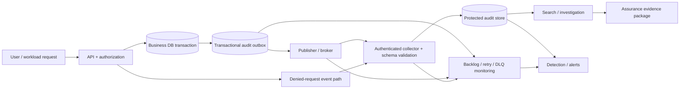
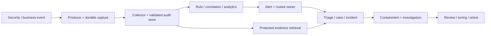

# Requirement về audit: đặc tả, kiểm chứng và duy trì dấu vết bảo mật có bằng chứng

## 1. Vì sao audit phải trở thành security requirement?

Giả sử một doanh nghiệp dùng hệ thống nhân sự đa tenant. Một nhân viên báo rằng tài khoản nhận lương đã bị đổi; đội bảo mật cần biết **ai hoặc workload nào thực hiện thay đổi, trên hồ sơ nào, lúc nào, bằng quyền nào, kết quả ra sao và có liên quan đến phiên đăng nhập hoặc phê duyệt nào**. Nếu hệ thống chỉ có dòng log `request completed in 43 ms`, nhóm điều tra không thể xác định một thay đổi nhạy cảm đã xảy ra hợp lệ hay chưa.

Ở chiều ngược lại, nếu ứng dụng ghi toàn bộ request/response, bearer token và bảng lương vào log để “đảm bảo audit đầy đủ”, bản thân kho audit có thể trở thành nguồn rò rỉ nghiêm trọng. Nếu quản trị viên có thể sửa hoặc xóa các event ghi nhận hành vi của chính mình, dấu vết còn lại không đáng tin cậy. Nếu log chỉ nằm trên máy chủ bị xâm nhập, việc có log cũng chưa đảm bảo điều tra được sau sự cố.

**Requirement về audit** là yêu cầu bảo mật mô tả **những sự kiện nào hệ thống bắt buộc phải ghi nhận, thuộc tính nào phải có, cách bảo đảm tính chính xác, toàn vẹn, bảo mật, khả dụng, thời hạn và khả năng tra cứu, cùng tiêu chí kiểm chứng**. Nó biến câu “cần có audit log” thành một tập điều kiện **có thể thử nghiệm và kết luận bằng bằng chứng**.

Trong chương **Security requirements** của module **SECURITY_SECURITY_ASSURANCE**, mục tiêu không chỉ là có log mà là **xây dựng cách đánh giá có bằng chứng rằng hệ thống đáp ứng các mục tiêu bảo mật**, từ xác định rủi ro và control objectives đến thiết kế yêu cầu, thực thi, kiểm thử, audit, xử lý findings và duy trì security assurance liên tục trong phát triển và vận hành.

### Mục tiêu học tập

Sau bài này, bạn có thể:

1. Phân biệt audit trail, security event log, application log, telemetry và báo cáo kiểm toán.
2. Xây **event catalog** theo tài sản, rủi ro, hành động và mức nhạy cảm, tránh ghi thiếu hoặc ghi quá mức.
3. Viết requirement có ID, scope, điều kiện kích hoạt, dữ liệu tối thiểu, tiêu chí pass/fail, owner và evidence.
4. Thiết kế dấu vết có actor/resource/tenant/action/outcome/context đáng tin, đồng bộ thời gian và correlation.
5. Xác minh collection, integrity, access control, retention, search, monitoring và resilience của hệ thống audit.
6. Phân biệt việc “event đã được phát” với “event được lưu bền, tìm lại được và sử dụng được trong điều tra”.
7. Đánh giá findings, remediation, retest và residual risk bằng bằng chứng gắn phiên bản/môi trường.

> **Phạm vi nghĩa vụ:** yêu cầu lưu trữ bao lâu, loại sự kiện nào bắt buộc, quyền xem và cung cấp hồ sơ, mức độ bảo toàn bằng chứng có thể khác nhau theo luật, hợp đồng, chính sách và lĩnh vực. Các con số/định mức trong bài là **ví dụ để luyện cách viết yêu cầu**, không phải thời hạn hoặc chuẩn bắt buộc cho mọi tổ chức. Khi áp dụng thực tế, phải ghi căn cứ và người có thẩm quyền xác nhận.

## 2. Phân biệt audit, logging, observability và monitoring

| Thành phần | Mục đích chính | Ví dụ | Vì sao không thay thế các thành phần khác? |
| --- | --- | --- | --- |
| **Audit trail** | Truy vết hoạt động quan trọng và trách nhiệm giải trình trên tài nguyên. | Ai sửa quyền truy cập bảng lương; giá trị trạng thái trước/sau ở mức an toàn. | Chưa tự phát hiện và phản ứng bất thường. |
| **Security event log** | Ghi sự kiện có ý nghĩa an ninh. | Đăng nhập thất bại, nâng đặc quyền, token bị từ chối, key policy change. | Không đủ để chứng minh mọi biến động nghiệp vụ nếu thiếu event catalog. |
| **Application/diagnostic log** | Giải thích hành vi chương trình và lỗi. | Exception type, request ID, retry count. | Dòng debug thường thiếu actor, resource, outcome đáng tin. |
| **Metrics/traces** | Đo hiệu năng và tìm nguyên nhân vận hành. | Latency API, trace giữa service, error rate. | Telemetry kỹ thuật có thể bị lấy mẫu và không giữ mọi hành động audit trọng yếu. |
| **Monitoring/detection** | Phân tích tín hiệu để phát hiện và cảnh báo. | Nhiều export nhạy cảm bất thường trong thời gian ngắn. | Cần nguồn log đủ tin cậy; alert không tự là bằng chứng mọi event được lưu. |
| **Audit/assessment report** | Kết luận hiệu lực control dựa trên bằng chứng. | Kiểm thử truy cập sai tenant có event deny và có thể tra cứu. | Tài liệu báo cáo không tự chứng minh trạng thái runtime dài hạn. |

**Audit trail là dữ liệu bằng chứng về sự kiện; security assurance là hoạt động đánh giá xem control audit có hoạt động đúng hay không.** Một event có thể phục vụ nhiều mục đích: điều tra sự cố, phân tích gian lận, chứng minh phê duyệt, phát hiện truy cập trái phép hoặc kiểm tra quyền. Nhưng không nên trộn **log phát triển** với **dữ liệu audit được bảo vệ** mà không có chính sách.

### 2.1. Audit không đồng nghĩa giám sát nhân sự vô hạn

Chỉ ghi các trường và sự kiện cần cho mục tiêu/rủi ro hoặc nghĩa vụ đã xác định; tuân thủ quy tắc tiếp cận, thông báo, phân loại và lưu giữ áp dụng. “Thu thập mọi hành vi của mọi người mãi mãi” không phải nguyên tắc audit tốt: nó tăng rủi ro riêng tư, chi phí và mức độ phơi nhiễm khi kho log bị lộ.

### 2.2. Audit yêu cầu cả thành công và thất bại

Một sự kiện truy cập nhạy cảm bị **từ chối** có thể quan trọng để phát hiện dò quét, BOLA/IDOR hoặc misuse, nhưng một thao tác **thành công** làm đổi trạng thái cũng cần audit để truy vết. Nếu chỉ ghi lỗi, không thể giải thích ai đã đổi người nhận lương. Nếu chỉ ghi thành công, không thể thấy các nỗ lực vượt quyền lặp lại.

## 3. Bắt đầu từ threat model và tài sản cần giải trình

Trước khi liệt kê hàng trăm event, hãy trả lời:

- **Tài sản/dữ liệu nào** phải bảo vệ: bảng lương, hồ sơ nhân viên, bản xuất, key, cấu hình IAM, audit store?
- **Hành vi nào** có thể gây hậu quả: đọc nhạy cảm, export hàng loạt, sửa đích nhận tiền, cấp đặc quyền, xóa bản ghi, thay chính sách?
- **Ai hoặc cái gì** có thể thực hiện: người dùng, admin, vendor, application, service account, job/automation?
- **Ranh giới tin cậy** nào cần quan sát: API gateway, backend, queue, database, cloud IAM, storage, third-party?
- **Câu hỏi điều tra** cần trả lời sau sự cố: ai yêu cầu, ai phê duyệt, kết quả được commit chưa, resource có thay đổi không, dữ liệu đã được gửi tới đâu?
- **Thời hạn truy vết** và mức độ bảo vệ bằng chứng có yêu cầu gì, từ nguồn căn cứ nào?
- **Failure mode** nào có thể che dấu vết: tắt agent, hỏng queue, clock lệch, overflow, lỗi parser, mất mạng, actor giả, xóa log?

### 3.1. Threat-to-audit mapping

| Risk ID | Tình huống | Câu hỏi cần audit trả lời | Event/control ứng viên |
| --- | --- | --- | --- |
| **R-AUD-01** | User tenant A cố tải hồ sơ tenant B. | Ai gọi, resource/tenant nào, quyết định quyền ra sao? | `data.access.denied`, kiểm tra authoritative tenant. |
| **R-AUD-02** | Người có quyền xuất bảng lương số lượng lớn. | Ai khởi tạo, tập dữ liệu/khối lượng nào, có được phê duyệt không? | `data.export.requested/completed/failed`. |
| **R-AUD-03** | Tài khoản chi trả bị thay trái phép. | Ai sửa, khi nào, kết quả commit, có approval và giá trị cũ/mới ở mức an toàn? | `payroll.destination.changed`. |
| **R-AUD-04** | Admin cấp quyền đọc nhạy cảm cho bản thân. | Ai cấp, cho ai, role/scope gì, tại sao, hiệu lực khi nào? | `privilege.grant.changed` và approval ref. |
| **R-AUD-05** | Credential dịch vụ/KMS key bị sử dụng lạ. | Identity nào dùng key, thao tác nào, outcome và nguồn? | `credential.used`, `key.policy.changed` theo tích hợp. |
| **R-AUD-06** | Đối tượng dữ liệu bị xóa hoặc restore sai. | Ai yêu cầu, job nào thực thi, đối tượng nào bị ảnh hưởng và trạng thái cuối? | `data.delete.requested/completed`, `backup.restore.executed`. |
| **R-AUD-07** | Kẻ tấn công xóa hoặc làm gián đoạn audit. | Có sự kiện tắt collector, thay policy, giảm retention, xuất dữ liệu audit không? | `audit.config.changed`, collector health, access audit. |
| **R-AUD-08** | Job nền gửi dữ liệu đến recipient mới. | Job/workload nào, destination được duyệt không, kết quả và bản phát hành? | `integration.transfer.completed/denied`. |

### 3.2. Không tạo sự kiện chỉ vì tên nghe có vẻ bảo mật

Ghi “`user_clicked_button`” chưa chắc hỗ trợ điều tra: click có thể xảy ra trước khi request tới backend, không có resource authoritative hoặc action được commit. Với thay đổi nghiệp vụ nhạy cảm, cần event ở **ranh giới tin cậy quan sát được kết quả thực**, không chỉ ở UI.

Đồng thời, **không cần audit từng lần đọc một tệp static công khai** nếu nó không phục vụ mục tiêu/điều kiện nào đã xác định. Mức chi tiết phải xuất phát từ classification và rủi ro.

## 4. Xây event catalog với ngữ nghĩa ổn định

**Event catalog** là danh mục các loại event phải phát, định nghĩa hành vi, source-of-truth, dữ liệu tối thiểu và tiêu chí kiểm chứng. Mỗi event cần tên/version và người quản lý schema để các nhóm không tùy ý thay nghĩa.

### 4.1. Nhóm sự kiện thường gặp

| Nhóm | Ví dụ event | Điều cần phân biệt |
| --- | --- | --- |
| **Identity/authentication** | Login success/failure, MFA challenge, recovery, credential revoke. | Authentication thành công chưa phải authorization thành công. |
| **Authorization/access** | Sensitive read/export allow/deny, object-level policy denial. | Đúng principal, tenant và resource; không ghi toàn bộ dữ liệu. |
| **Privilege/lifecycle** | Add/remove role, admin elevation, service permission change, leaver disable. | Actor thay quyền và principal được thay quyền là hai thực thể khác. |
| **Data change** | Update payment destination, change classification, delete/restore. | Requested vs committed vs failed/reverted. |
| **Export/sharing** | Report generated, file downloaded, partner transfer completed/failed. | Tạo export khác tải export; tạo link khác đã download. |
| **Configuration/control plane** | Policy changed, logging disabled, retention changed, KMS key grant changed. | Ai thực sự thay quyền/cấu hình hiệu lực, có approval không. |
| **Security operations** | Detection alert, containment, quarantine, incident action. | Alert không tự xác nhận incident hay thao tác đã hoàn tất. |
| **Reliability/audit service** | Collector down, ingest lag, event rejected, retention job failed. | Dùng để xác minh hệ thống audit còn quan sát được. |

### 4.2. Đặc tả một event: `payroll.destination.changed`

| Thuộc tính | Đặc tả minh họa |
| --- | --- |
| Trigger | Giao dịch thay tài khoản nhận lương **đã commit**. |
| Source of truth | Backend transaction/service nghiệp vụ; không phải client tự khai thành công. |
| Actor | Principal đã xác thực; nếu service thực hiện thay, ghi workload và nguồn yêu cầu. |
| Target | Employee/account reference đã chuẩn hóa; tenant lấy từ dữ liệu authoritative. |
| Action/outcome | `payroll.destination.change` / `success`; event lỗi/từ chối là loại khác. |
| Context | Thời điểm commit, request/correlation ID, approval/change ID khi cần. |
| Data minimization | Không ghi nguyên số tài khoản; có thể dùng mã tham chiếu/tokens và chỉ báo thay đổi. |
| Delivery | Có chiến lược bền vững qua crash/retry và phát hiện sự kiện bị mất. |
| Consumer | Kho audit có phân quyền; rule giám sát gian lận nếu có. |
| Retention | Theo bảng retention/basis đã phê duyệt cho dữ liệu audit này. |
| Acceptance | Thử success/rollback/concurrent update và truy xuất event theo transaction ref. |

### 4.3. Thiết kế event name và schema version

Nên chọn tên theo nghiệp vụ rõ ràng, ví dụ `access.denied`, `payroll.destination.changed`, `privileged.session.activated`. Không dùng tên mơ hồ như `event42`, `task_done` hoặc `audit_success`.

Version schema để consumer nhận biết thay đổi trường bắt buộc, enum và ý nghĩa. Phân biệt **thay định dạng** với **thay ngữ nghĩa**; không tái sử dụng tên cũ cho hành động khác rồi làm sai các truy vấn audit nhiều năm.

## 5. Trường dữ liệu bắt buộc của một audit event

Một event có giá trị điều tra phải trả lời được **ai, làm gì, lên cái gì, ở đâu, lúc nào, với kết quả nào và vì sao hệ thống tin thông tin đó**.

| Trường minh họa | Nguồn tin cậy và vai trò | Ghi chú bảo mật |
| --- | --- | --- |
| `event_id` | ID duy nhất từ event producer hoặc outbox. | Hữu ích cho idempotency/dedup khi retry. |
| `event_type`, `schema_version` | Event catalog và release. | Không thay ngữ nghĩa không version. |
| `occurred_at` | Mốc hành vi nghiệp vụ tại nguồn, chuẩn hóa múi giờ. | Có thể khác thời gian ingest. |
| `observed_at` / `ingested_at` | Mốc collector nhận/lưu event. | Dùng đo delay và phát hiện late events. |
| `actor_id`, `actor_type` | Identity đã xác thực hoặc workload identity. | Không tin claim do caller chưa xác minh tự gửi. |
| `initiator_id` / `on_behalf_of` | Người/hệ thống khởi tạo chuỗi job/ủy quyền. | Phân biệt người yêu cầu và service thực hiện. |
| `tenant_id` | Membership/resource context authoritative. | Không dùng tenant header của client làm nguồn duy nhất. |
| `resource_type`, `resource_id` | Đối tượng cụ thể bị tác động. | Tránh chứa toàn bộ dữ liệu nhạy cảm trong ID. |
| `action` | Operation như read/export/approve/update/delete. | Phải phản ánh hành vi được đánh giá. |
| `outcome` | `allowed`, `denied`, `committed`, `failed`, `rolled_back` theo ngữ nghĩa. | Không ghi “success” nếu transaction chưa commit. |
| `reason_code` / `policy_ref` | Quyết định của backend/policy engine. | Lý do đủ điều tra nhưng không lộ bí mật. |
| `request_id`, `correlation_id` | Context gắn các bước từ API tới job và storage. | Phục vụ điều tra xuyên service; không nhầm với danh tính. |
| `session_ref` / `device_ref` | Tham chiếu có kiểm soát khi có nhu cầu. | Tránh lưu nguyên token/session cookie. |
| `approval_ref` / `change_ref` | Chứng cứ cho hành động yêu cầu phê duyệt. | Không mặc định ticket tồn tại nghĩa là approval hợp lệ. |
| `source_service`, `source_version` | Producer và build/phiên bản. | Hỗ trợ xác minh nguồn event và drift. |
| `integrity_ref` / `delivery_status` | Metadata lưu trữ, ký/digest hoặc trạng thái pipeline khi phù hợp. | Digest không tự chứng minh event ban đầu đúng. |

### 5.1. Không phải mọi trường đều bắt buộc cho mọi event

Ví dụ, `device_ref` có thể không tồn tại cho tác vụ batch; `approval_ref` không bắt buộc với mỗi lần đọc bình thường. **Event catalog** phải nêu **required/optional/forbidden fields theo event type**. Trường không áp dụng nên có lý do; không bắt các producer điền giá trị giả để “đạt schema”.

### 5.2. Dữ liệu nên tránh đưa vào audit

Không ghi password, bearer/access/refresh token, private key, plaintext DEK/KEK, mã OTP, cookie phiên, số thẻ đầy đủ, hồ sơ lương/khám bệnh nguyên bản hoặc toàn bộ request body nếu không có căn cứ và kiểm soát rất cụ thể. Một event chỉ cần ghi `employee_id` đã bảo vệ và `field_changed=payment_destination` thay vì số tài khoản trước/sau.

Nếu dữ liệu cá nhân phải có để điều tra, áp dụng **minimization, phân quyền, bảo vệ khi truyền/lưu, retention và review**; sử dụng định danh giả hoặc hash có kiểm soát nếu đáp ứng mục tiêu, đồng thời cân nhắc khả năng tái liên kết.

### 5.3. Actor và resource cần nguồn authoritative

Đừng ghi `actor=admin` từ header `X-User` do client gửi. Actor phải lấy từ security context đã xác thực; resource tenant lấy từ bản ghi/nguồn tin cậy, không chỉ từ path parameter. Đối với một job chạy thay người dùng, ghi rõ cả **service thực thi** và **người hoặc workflow yêu cầu**, nếu có bằng chứng.

## 6. Ngữ nghĩa event: chính xác, thời gian, thứ tự và correlation

### 6.1. Requested, authorized, committed và delivered là bốn trạng thái khác nhau

Một yêu cầu “đổi tài khoản nhận lương” có thể:

1. Được client **yêu cầu**.
2. Được backend **xác minh danh tính/quyền** hoặc từ chối.
3. Được xử lý, **commit** hoặc rollback bởi cơ sở dữ liệu.
4. Phát sinh event, **được collector nhận**, lưu và đánh chỉ mục.

Không được gọi bước 1 là “thành công” khi bước 3 chưa xảy ra. Tương tự, HTTP 200 không luôn chứng minh batch job đã hoàn tất hoặc đối tác thực sự đã nhận file. Event catalog nên có từ vựng rõ ràng như `operation.requested`, `operation.denied`, `operation.committed`, `operation.failed`, `transfer.delivered`, với nguồn xác minh tương ứng.

**Ví dụ:** controller trả 202 Accepted vì đã xếp job export vào queue. Event `data.export.requested` là đúng; `data.export.completed` chỉ có giá trị sau khi worker tạo file thành công. Event `data.export.downloaded` chỉ phù hợp khi có bằng chứng giao dịch tải file theo ngữ nghĩa do hệ thống định nghĩa, không phải chỉ vì link được phát hành.

### 6.2. Thời gian cần có nghĩa

Các mốc thời gian thường gồm:

- `occurred_at`: hành vi diễn ra ở producer hoặc thời điểm transaction commit.
- `recorded_at`: event được ghi bền tại producer/outbox nếu có.
- `ingested_at`: collector nhận và xử lý.
- `indexed_at`: có thể tra cứu ở hệ thống truy vấn.

Nên dùng timestamp có timezone rõ ràng, thường chuẩn hóa UTC, có độ chính xác phù hợp và cơ chế đồng bộ clock được giám sát. Đặt ví dụ cụ thể về độ trễ/độ lệch **theo SLO được duyệt**. Không coi event có timestamp là đáng tin nếu host clock sai, nguồn user có thể chỉnh hoặc hai hệ thống không có quy tắc time correlation.

### 6.3. Trật tự không nhất thiết tuyệt đối

Trong microservices, không đảm bảo mọi event giữa mọi producer đến đúng thứ tự thời gian. Queue retry, mạng chậm, clock skew và ingestion delay có thể làm event đến lệch thứ tự. Thiết kế nên sử dụng **transaction ID, aggregate version/sequence, correlation ID và event ID** khi cần xác minh trình tự một đối tượng.

Không dựa vào “dòng thứ hai trong dashboard xảy ra sau dòng thứ nhất” nếu không biết semantics của timestamp và ordering. Khi điều tra chuỗi thay quyền → export → revoke, reviewer phải xem **source events, version và độ trễ truyền**.

### 6.4. Correlation không đồng nghĩa quan hệ nhân quả

Một `correlation_id` liên kết các bước của một request hoặc job; nhưng việc hai event có cùng ID không tự chứng minh hành động B được phép bởi A. Có thể cần **approval reference, policy decision, actor delegation và transaction relationship**. Correlation ID không nên chứa PII hoặc secret.

### 6.5. Mã hóa lỗi một cách ổn định

Kết quả `denied` nên có lý do chuẩn hóa (ví dụ `TENANT_MISMATCH`, `ROLE_MISSING` hoặc `DEVICE_UNTRUSTED`) nhưng không tiết lộ logic chi tiết tới client nếu gây rủi ro. Event nội bộ có thể lưu reason code theo quyền phù hợp; thông báo API ra ngoài có thể dùng mã lỗi chung. Không đưa stack trace có password/token vào event.

## 7. Cách viết một audit requirement có thể kiểm chứng

Một yêu cầu tốt không chỉ bắt đầu bằng “The system shall log all security events”. Cần phân rã:

> **[Trong scope nào] [thành phần nào] phải ghi sự kiện nào khi điều kiện nào xảy ra, với trường nào, gắn nguồn tin cậy nào, trong khoảng thời gian nào, bảo vệ/tra cứu ra sao, và phép thử nào xác nhận được.**

### 7.1. Mẫu requirement chuẩn hóa

| Trường | Ý nghĩa |
| --- | --- |
| **Requirement ID/version** | Mã ổn định, tránh đổi nghĩa âm thầm. |
| **Risk/control objective refs** | Rủi ro và mục tiêu bảo mật mà yêu cầu xử lý. |
| **Scope/assets/flows** | API, job, tenant, production, cloud control plane, dữ liệu cụ thể. |
| **Event triggers** | Success, deny, failure, role change, export, configuration change… |
| **Required/forbidden fields** | Actor/resource/action/outcome/correlation; không ghi secrets. |
| **Trust source** | Dữ liệu lấy từ auth context, DB, IdP, control plane hay nguồn nào. |
| **Quality & delivery** | Thời gian tối đa, độ đầy đủ, duplicate/order semantics, failure behavior. |
| **Protection & retention** | IAM, encryption, anti-tamper, nơi lưu, lifecycle, review, các ngoại lệ. |
| **Verification** | Test IDs, expected/actual và evidence đủ để kết luận. |
| **Owner & change triggers** | Chịu trách nhiệm và điều kiện đánh giá lại. |

### 7.2. Từ yêu cầu mơ hồ tới yêu cầu kiểm thử được

**Mơ hồ:** “Ứng dụng phải lưu toàn bộ hành vi quan trọng.”

**Cụ thể hơn:** “Đối với mọi yêu cầu thay đổi đích nhận lương qua các API trong release X, backend phải phát event `payroll.destination.changed` khi transaction commit; event chứa event ID, timestamp từ server, actor đã xác minh, tenant/resource reference từ DB, request/transaction reference, action, outcome, source version và approval reference khi cần. Không được chứa số tài khoản đầy đủ hoặc token. Event phải được giao/lưu theo cơ chế bền vững đã phê duyệt và có thể tìm lại theo ID trong thời hạn theo policy.”

**Acceptance:** tạo dữ liệu giả, chạy cả thành công, bị từ chối và rollback; xác minh nội dung, độ bền, khả năng tìm lại, quyền xem log và không chứa dữ liệu cấm. Xác nhận trên build/môi trường thuộc scope, không chỉ unit test một hàm tạo event.

### 7.3. SLO và ngưỡng cần được phê duyệt

Một số chỉ tiêu có thể đo: độ trễ từ commit đến lúc truy vấn được event, độ lệch clock, tỷ lệ phát/nhận thành công, thời gian phát hiện lỗi collector, thời hạn tra cứu hoặc thời gian hoàn thành yêu cầu điều tra. Không áp đặt một ngưỡng cố định cho mọi dữ liệu/nhóm sự kiện: thiết lập theo **rủi ro, năng lực hệ thống, nghĩa vụ và mức độ khẩn cấp**. Sau khi duyệt mới đưa số cụ thể vào acceptance tests.

### 7.4. Nên tách requirement theo tính chất

- **Functional audit requirements:** event nào phải được ghi và schema nào.
- **Security requirements for audit:** ai đọc/sửa/xóa được; integrity, confidentiality, source authenticity.
- **Reliability/non-functional requirements:** delivery, latency, availability, dedup, backup và search.
- **Operational requirements:** monitoring pipeline, alert, review, investigation, retention và xử lý sự cố.
- **Governance requirements:** owner, data classification, policy review, audit access approval và ngoại lệ.

Tách nhóm giúp tránh kết luận một yêu cầu “đạt” trong khi một thuộc tính thiết yếu vẫn fail.

## 8. Bộ requirement mẫu cho một ứng dụng có dữ liệu nhạy cảm

Các requirement dưới đây là **bản mẫu để điều chỉnh và phê duyệt**, không phải bộ bắt buộc áp dụng nguyên xi. Tham chiếu mức độ như “trong ngưỡng đã duyệt” phải được cụ thể hóa trong requirement baseline và test plan của tổ chức.

| Requirement ID | Yêu cầu và phạm vi | Bằng chứng/tiêu chí nghiệm thu |
| --- | --- | --- |
| **AUD-REQ-01 Event coverage** | Mỗi hành động trong event catalog được phê duyệt phải phát event khi trigger xảy ra. | Đối chiếu catalog ↔ entry points; positive/negative/batch tests có event tương ứng. |
| **AUD-REQ-02 Trusted actor** | Actor, tenant và resource reference phải lấy từ nguồn đã xác minh. | Thử header/tenant/actor giả; event vẫn ghi nguồn authoritative. |
| **AUD-REQ-03 Event semantics** | Event phân biệt requested, denied, committed, failed và rollback. | Test transaction success/rollback và async job completion; không có false success. |
| **AUD-REQ-04 Minimal schema** | Event bắt buộc chứa ID, type/version, time, actor, action, resource, outcome và correlation khi áp dụng. | Schema contract tests và kiểm tra field required theo từng event. |
| **AUD-REQ-05 No secrets** | Log không chứa thông tin bí mật hoặc dữ liệu vượt mục đích. | Sinh marker/test token giả, quét structured fields, exception paths, traces. |
| **AUD-REQ-06 Durable capture** | Event mức quan trọng phải được lưu/giao theo thiết kế không mất âm thầm khi crash/retry. | Outbox/queue tests, failure injection, reconciliation nguồn-sink. |
| **AUD-REQ-07 Ingestion latency** | Event phải tra cứu được trong ngưỡng trễ đã duyệt theo loại. | Đo occurred/recorded/ingested/indexed, thống kê phân vị và exceptions. |
| **AUD-REQ-08 Time reliability** | Clock/timestamp source và thứ tự sự kiện phải có quy tắc được xác minh. | Clock sync monitoring, test skew/out-of-order và ordering refs. |
| **AUD-REQ-09 Access control** | Chỉ role/nhân sự đúng quyền được truy vấn/export audit; tách admin control khỏi audit access. | Effective grants, negative access tests, privileged review. |
| **AUD-REQ-10 Tamper resistance** | Thay/xóa event không được phép phải bị ngăn hoặc có thể phát hiện theo mức assurance yêu cầu. | IAM/retention policy, integrity checks, unauthorized modify/delete tests. |
| **AUD-REQ-11 Source authenticity** | Audit event phải xác định được hệ thống phát, và nguồn giả không được nhập thành event đáng tin. | Producer auth, credential rotation, spoof/replay tests. |
| **AUD-REQ-12 Resilience** | Collector/downstream lỗi không được làm mất âm thầm event quan trọng. | Queue/buffer limits, failure mode, retry/DLQ, alert và recovery tests. |
| **AUD-REQ-13 Retention** | Lưu, hạn chế truy cập, xóa/giữ theo bảng retention và nghĩa vụ áp dụng. | Rule config, oldest/newest sample, expiry/hold/delete verification. |
| **AUD-REQ-14 Search & retrieval** | Người được quyền có thể tìm và kết xuất đúng dữ liệu phục vụ điều tra theo scope. | Search theo actor/resource/time/correlation, kết quả đầy đủ, export audit. |
| **AUD-REQ-15 Audit the auditors** | Truy cập, xuất và thay cấu hình kho audit phải được ghi lại theo policy. | Admin/read/export/change event-to-store tests và alert rules. |
| **AUD-REQ-16 Health monitoring** | Mất log, lag, drop, parse error, storage saturation phải được phát hiện/chuyển cấp. | Synthetic canary, alert-to-triage-to-response và failure injection. |
| **AUD-REQ-17 Cross-service trace** | Event quan trọng có thể nối request, job, storage và policy decision. | Correlation tests xuyên API/queue/worker, kiểm tra actor delegation. |
| **AUD-REQ-18 Tenant isolation** | Tenant không thể đọc log của tenant khác; admin scope được giới hạn. | API/dashboard/export negative tests và per-tenant queries. |
| **AUD-REQ-19 Release change** | Schema/event catalog thay đổi phải version, review và regression test. | Schema diff, compatible consumer tests, deployment/runtime verification. |
| **AUD-REQ-20 Evidence lifecycle** | Audit artifacts dùng cho assessment có nguồn, thời điểm, scope, tính toàn vẹn và reviewer. | Evidence manifest, protected storage, retest và retention refs. |

### 8.1. Đặt mức ưu tiên theo hậu quả

Không phải tất cả event đều cần cùng mức độ bền vững. Một sự kiện **đổi tài khoản chi trả** hoặc **cấp quyền quản trị** có thể cần xử lý transaction/delivery nghiêm ngặt hơn log debug. Một sự kiện telemetry hiệu năng có thể chấp nhận sampling; nhưng nếu event catalog quy định mọi lần export dữ liệu nhạy cảm phải có dấu vết, việc sampling có thể vi phạm yêu cầu đó.

### 8.2. Acceptance criteria cần hai chiều

Ngoài test event đúng được phát, cần test **event không được phát sai**. Ví dụ transaction rollback không tạo `change.committed`; tải file không thành công không được ghi `download.completed`; user A không được tạo event actor B bằng cách sửa header. False positives làm dữ liệu audit kém tin cậy không kém event bị thiếu.

## 9. Kiến trúc audit: từ sự kiện nghiệp vụ đến bằng chứng có thể tra cứu

Một kiến trúc audit có thể gồm **source service → local durable record/outbox → event broker/collector → validation/normalization → protected audit store/index → monitoring/search/evidence**. Tùy rủi ro và hạ tầng, không phải hệ thống nào cũng dùng đủ thành phần; điều quan trọng là làm rõ điểm commit, retry, giới hạn mất dữ liệu và integrity.



Sơ đồ mô tả một **kiến trúc minh họa**: event của giao dịch commit có thể dùng outbox cùng transaction để tránh “thay dữ liệu thành công nhưng chưa kịp ghi audit”. Đối với request bị từ chối **không có transaction nghiệp vụ**, cần đường phát sự kiện khác có thiết kế bền vững tương xứng. Hai đường phải có event semantics và failure handling rõ.

### 9.1. Tại sao không chỉ gọi logger ở controller?

Controller có thể gọi `logger.info("updated")` rồi database commit thất bại, tạo false success. Hoặc database commit thành công nhưng ứng dụng crash trước khi log được gửi, khiến mất event. Gọi logger sau khi commit có thể chính xác về kết quả hơn nhưng vẫn còn cửa sổ crash. **Transactional outbox** có thể giảm bất nhất bằng cách ghi dữ liệu nghiệp vụ và bản ghi event trong cùng transaction.

Outbox không miễn phí: cần publisher, retry, trạng thái delivery, dedup, backlog monitoring, retention và tránh phát tán event thừa. Với hệ thống dùng event streaming/CDC, cũng phải kiểm tra **source of truth, filtering, authorization và schema semantics**.

### 9.2. Tách vận hành audit khỏi quyền ứng dụng khi phù hợp

Nếu kẻ xâm nhập app host có thể xóa toàn bộ log local, chuỗi bằng chứng yếu. Chuyển event đến kho tách quyền, có access policy và anti-tamper theo rủi ro giúp tăng khả năng điều tra. Nhưng kho trung tâm vẫn phải có **quyền chặt, quản lý khóa, kiểm tra nguồn, audit truy cập và backup/availability**.

### 9.3. Không dùng sampled tracing làm nguồn audit bắt buộc

Distributed tracing thường có sampling để giảm chi phí; nó tốt cho correlation, không tự bảo đảm 100% events quan trọng. Nếu yêu cầu `AUD-REQ-01` bắt buộc ghi tất cả lần thay quyền, nguồn audit phải có cơ chế đáp ứng yêu cầu đó **độc lập với quyết định sampling** của tracing.

## 10. Tính đầy đủ: loss, duplicate, retry và reconciliation

### 10.1. “Không mất log” phải được đặc tả trong failure model

Trong hệ thống phân tán, lời hứa “exactly once end-to-end” có thể che nhiều điều kiện và giả định khó bảo đảm. Một kiến trúc thường chọn **at-least-once delivery** cho event quan trọng, sau đó dùng `event_id` để phát hiện/deduplicate ở nơi nhận. Kết quả cần được kiểm chứng khi producer crash, queue retry, network partition, collector restart và consumer lag.

Một event được gửi hai lần không nhất thiết là hai lần sửa dữ liệu. Nếu không có event ID và correlation với transaction, reviewer có thể đếm sai số thay đổi. Ngược lại, dedup quá mạnh dựa trên cùng actor/resource trong một phút có thể xóa nhầm **hai thao tác thật**.

### 10.2. Các trạng thái delivery cần theo dõi

| Điểm | Có thể thất bại thế nào? | Bằng chứng |
| --- | --- | --- |
| Business commit | Giao dịch rollback nhưng event vẫn báo committed. | Atomicity/transaction tests. |
| Outbox write | Bản ghi business tồn tại nhưng event record không có. | Database transaction consistency test. |
| Publisher | Crash sau gửi trước ack, phát duplicate. | Retry/idempotency test, producer state. |
| Broker | Message hết retention, backlog hoặc permission lỗi. | Metrics, DLQ, broker policy và fault test. |
| Collector/parser | Schema unknown, event bị loại hoặc field mất. | Reject counter, quarantine/DLQ và alert. |
| Storage/index | Ghi bền nhưng chưa index, không tìm thấy. | Stored-vs-indexed reconciliation và latency. |
| Query/export | Tìm kiếm sai range/timezone/tenant, bản xuất thiếu event. | Query completeness tests với tập event đã biết. |

### 10.3. Reconciliation theo nguồn và sink

Một phép kiểm chứng tốt tạo tập **N hành vi có ID/transaction refs biết trước**, xác nhận **N sự kiện logic mong đợi** được ghi bền và tìm lại được; duplicate vật lý được nhận diện đúng, không làm mất event thật. Với tải lớn, dùng reconciliation theo partition, event sequence, source counts hoặc watermark thích hợp; phải công bố giới hạn và thời gian quan sát.

Không kết luận “tỷ lệ ghi log 100%” từ số sự kiện collector tự đếm, bởi hệ thống không thể đếm các event chưa từng tới collector. Cần **đối soát nguồn phát với nơi nhận**, synthetic canary và health metrics.

### 10.4. Khi collector không khả dụng

Tùy loại event và hậu quả, hệ thống có thể **giữ giao dịch**, **ghi vào outbox bền**, **chặn hành động nhạy cảm** hoặc dùng cơ chế buffer giới hạn. Phải định nghĩa trước hành vi theo rủi ro/availability, đo dung lượng/delay, cảnh báo khi gần vượt ngưỡng và kiểm thử recovery. Không tự mặc định fail-open hoặc cho phép ghi log vào memory vô hạn rồi im lặng mất khi process restart.

## 11. Tính toàn vẹn, chống sửa/xóa và nguồn gốc audit event

Audit store chỉ hữu ích khi người điều tra có căn cứ tin rằng event không bị sửa, xóa hoặc giả mạo ngoài quy trình được cho phép. Không có một tùy chọn “immutable” nào tự bảo đảm toàn vẹn của **toàn bộ chuỗi** từ hành vi nghiệp vụ tới bằng chứng.

### 11.1. Các tầng integrity khác nhau

| Tầng | Mối đe dọa | Control và phép kiểm chứng |
| --- | --- | --- |
| **Nguồn event** | Caller tự khai actor, sửa outcome hoặc gửi event giả. | Producer authentication, trusted metadata, schema/allowlist, spoof test. |
| **Đường vận chuyển** | Event bị sửa, thay, phát lại hoặc chuyển sai đích. | Authenticated transport, producer identity, replay/dedup policy. |
| **Broker/collector** | Quyền rộng cho phép drop, rewrite hoặc bỏ qua event. | Least privilege, monitoring, rejected-event queue, config change audit. |
| **Storage** | Admin/app có thể sửa/xóa log để che dấu. | Tách quyền, append-oriented/WORM/object lock khi phù hợp, integrity verification. |
| **Search/index** | Index sai, bộ lọc bỏ mất event hoặc trả dữ liệu đã bị thay. | So sánh nguồn bền vững với index, test truy vấn, giới hạn dữ liệu trả. |
| **Export/evidence** | Bản trích dẫn bị chỉnh sau khi xuất. | Provenance, timestamps, digest/chữ ký nếu phù hợp, chain of custody. |

### 11.2. Append-only, immutable và WORM có phạm vi

Các cơ chế append-only hoặc write-once-read-many (WORM) có thể làm khó việc sửa/xóa bản ghi sau khi lưu, đặc biệt khi retention/lock được quản lý bởi một miền quyền độc lập. Nhưng phải trả lời:

- Event **đã được tạo đúng** trước khi ghi bất biến chưa?
- Ai có quyền đổi cấu hình storage, thời hạn, key, clock và policy?
- Có thể bỏ qua collector hoặc gửi event giả tới store không?
- Quyền privileged có thể tắt logging trước sự kiện quan trọng không?
- Bản sao trong index hoặc export có cùng bảo đảm không?
- Thời hạn lock có phù hợp nghĩa vụ xóa/retention không?

**“Immutable storage” không có nghĩa “sự thật không thể sai”.** Một event chứa actor sai vẫn được lưu sai một cách bất biến. Do đó cần cả **source authenticity, completeness, integrity, reconciliation và governance**.

### 11.3. Hash, chữ ký và chain of custody

Digest, signature hoặc hash chain có thể hỗ trợ phát hiện nội dung/tập bản ghi bị sửa sau mốc tạo bằng chứng đáng tin. Chúng không chứng minh event có được phát đầy đủ hoặc nguồn phát ban đầu đúng nếu nguồn đó đã bị compromise. Muốn điều tra đáng tin, cần ghi:

1. Nguồn, collector, chính sách và thời gian thu thập.
2. Tập event, filter/query, khoảng thời gian và version.
3. Người thực hiện, người nhận chuyển giao, thời điểm và mục đích xử lý.
4. Cơ chế bảo vệ bản gốc, bản sao phục vụ phân tích và lịch sử truy cập.
5. Dấu kiểm tra toàn vẹn phù hợp và cách kiểm tra lại.

Nếu sự kiện được lưu ở nhiều kho, phải biết **bản nào là nguồn bền vững có thẩm quyền**. Không cho người sửa dữ liệu audit cũng có quyền tự xác nhận bản export “chưa bị thay đổi” mà không có cơ chế kiểm soát độc lập khi rủi ro yêu cầu.

### 11.4. Audit việc thao tác trên chính audit

Các hành động đọc/export số lượng lớn, thay retention, tắt agent, sửa parser, thêm grant, xóa index hoặc thay policy nên có audit trail và alert theo mức rủi ro. Nếu cùng một admin có thể sửa log và xóa dấu vết sửa log trong cùng miền quyền, cần **tách trách nhiệm/đường ghi sang miền bảo vệ khác** hoặc áp dụng biện pháp giám sát độc lập.

## 12. Bảo vệ tính bí mật và quyền riêng tư của audit data

Audit thường chứa **dữ liệu rất nhạy cảm**: lịch sử thao tác, danh tính, tài nguyên đang tồn tại, địa chỉ mạng, kết quả truy cập thất bại, thông tin về người liên quan hoặc dấu hiệu sự cố. Khả năng truy vấn tổng hợp các event có thể cho biết quy trình và hành vi của nhiều người, dù mỗi event đơn lẻ chứa ít trường.

### 12.1. Nguyên tắc minimization và redaction

- Chỉ ghi dữ liệu cần để tái dựng hành động và kết luận rủi ro.
- Dùng mã tham chiếu thay vì raw payload; phân quyền riêng kho ánh xạ khi phải tái liên kết.
- Không ghi password, token, session cookie, mã OTP, khóa, dữ liệu tài chính/sức khỏe nguyên bản.
- Review exception stack, headers, query parameters, request-body logging và crash dump.
- Tránh đưa PII vào labels/metrics có retention khác audit.
- Nếu cần IP/device reference, xác định mục đích, nguồn, quyền truy cập và retention cụ thể.

**Đừng đánh đổi an toàn của dữ liệu cá nhân để đạt “độ chi tiết” của audit.** Một event về thay tài khoản nhận tiền có thể ghi loại trường thay đổi, transaction và resource ref; khi điều tra cần so sánh giá trị, có thể dùng quy trình truy xuất bản ghi nghiệp vụ có quyền riêng.

### 12.2. Quyền đọc và xuất audit

| Vai trò minh họa | Quyền cần thiết | Quyền cần tránh hoặc hạn chế |
| --- | --- | --- |
| Security analyst | Tìm sự kiện thuộc scope sự cố, xem trường cần thiết, mở case. | Export tất cả tenants hoặc đọc dữ liệu ngoài nhiệm vụ. |
| Application owner | Xem event liên quan service và vận hành mình quản lý. | Xem lịch sử nhạy cảm của mọi người dùng hoặc sửa bản gốc. |
| Auditor được ủy quyền | Truy vấn/extract theo audit scope đã phê duyệt. | Quyền thay event hoặc thay retention. |
| Platform operator | Vận hành pipeline, xem health/status và cấu hình phù hợp. | Đọc plaintext audit ngoài nhu cầu hoặc tự xóa dấu vết. |
| Incident responder | Truy cập khẩn trong phạm vi vụ việc, có ticket/expiry. | Quyền truy cập dài hạn không review sau sự cố. |
| Data/privacy steward | Xem retention, mục đích, quyền và việc xử lý dữ liệu audit. | Không tự mặc định được đọc mọi chi tiết sự cố. |

Áp dụng **least privilege, tenant isolation, JIT/approval khi cần, access review và audit-the-auditor**. Một query dashboard có thể trả ít trường nhưng API export vẫn trả toàn bộ bản ghi; phải test cả hai.

### 12.3. Encryption và key management

Audit data thuộc phạm vi bảo vệ cần mã hóa khi truyền và khi lưu theo baseline được duyệt. KMS/key permission, rotation, backup/restore và quyền decrypt phải được kiểm tra như các tài sản nhạy cảm khác. Mã hóa **không thay** quyền truy vấn hoặc phát hiện hành vi truy cập audit bất thường.

### 12.4. Đáp ứng các quyền và nghĩa vụ liên quan dữ liệu cá nhân

Retention, quyền truy cập/chỉnh sửa/xóa hoặc hạn chế xử lý audit data có thể phải cân bằng **nghĩa vụ pháp lý, điều tra, bảo toàn bằng chứng, bảo mật và quyền riêng tư** theo phạm vi áp dụng. Không tự khẳng định audit log luôn phải xóa ngay khi có yêu cầu hoặc luôn được lưu vô thời hạn. Cần quyết định có căn cứ, được review và minh bạch về giới hạn xử lý.

## 13. Resilience: khi audit pipeline lỗi phải làm gì?

Một yêu cầu audit thực tế phải xem **điều gì xảy ra khi log service không sẵn sàng**, không chỉ trường hợp hoạt động bình thường.

### 13.1. Failure modes

| Sự cố | Hậu quả | Tiêu chí kiểm chứng |
| --- | --- | --- |
| Mất kết nối collector/broker | Event không tới sink, tích tụ backlog. | Buffer/outbox bền, retry, cảnh báo độ trễ/dung lượng. |
| Collector restart liên tục | Mất thứ tự hoặc tạo duplicate. | Reconciliation theo event ID, không mất event logic. |
| Parse/schema fail | Event bị bỏ mà không ai biết. | Quarantine/DLQ, reject counter, owner xử lý. |
| Audit storage hết dung lượng | Không lưu/không index được event. | Capacity alert, retention/quota plan, failure behavior. |
| Clock skew/time source fail | Sai timeline và điều tra. | Clock-health alert, event-time semantics, correlation. |
| KMS/key access lỗi | Không ghi/đọc hoặc restore audit được. | Recovery tests, key dependency inventory, fallback hợp lệ. |
| Privileged actor tắt logging | Mất độ bao phủ sau thay cấu hình. | Configuration monitoring, independent alert/audit control plane. |
| SIEM mất kết nối | Có event ở store nhưng không detect. | Store-vs-SIEM lag monitoring, detection recovery drill. |
| Event flood/DoS | Drop, nghẽn producer hoặc chi phí tăng. | Rate/priority, capacity, backpressure, threat-mode test. |

### 13.2. Failure behavior phải định nghĩa theo loại giao dịch

Với hành động có hậu quả lớn như **cấp quyền quản trị, đổi đích nhận tiền hoặc xóa dữ liệu nhạy cảm**, tổ chức có thể yêu cầu **không commit nếu không thể ghi dấu vết bền vững**. Điều này có thể được thực hiện thông qua outbox cùng transaction. Với sự kiện ít nghiêm trọng hơn, hệ thống có thể chấp nhận đệm bền và gửi sau, với giới hạn lag/dung lượng.

Mỗi cách đều có trade-off về **tính sẵn sàng và tính đầy đủ**. Một API phụ thuộc trực tiếp vào dịch vụ audit từ xa có thể bị ngừng khi collector outage; thiết kế cần xác định điều kiện, ngưỡng, retries, degraded mode và trách nhiệm. Không dùng nguyên tắc “always fail closed” máy móc cho mọi thao tác mà không xem an toàn nghiệp vụ, nhưng cũng không cho qua hành động nhạy cảm rồi mất audit âm thầm.

### 13.3. Tránh vòng lặp khi audit pipeline lỗi

Nếu mỗi lỗi gửi audit lại tạo một event audit mới và lặp vô hạn, hệ thống có thể bị quá tải. Nên dùng health metrics/counters, log vận hành được hạn chế và cơ chế alert riêng cho collector. Phân biệt **sự kiện nghiệp vụ phải lưu bền** với **thông báo sức khỏe hệ thống audit**, có đường dự phòng phù hợp.

## 14. Retention, legal hold và khả năng tìm lại bằng chứng

### 14.1. Retention phải có nguồn căn cứ

Một requirement cần xác định:

- **Event category** và mục đích lưu.
- **Data classification** của event/metadata.
- **Căn cứ**: chính sách, nghĩa vụ hoặc cam kết đã được phê duyệt.
- **Thời hạn** hoặc điều kiện hết hạn, mốc bắt đầu tính.
- **Hot/warm/cold access** và thời gian phục hồi truy vấn khi cần.
- **Encryption/key dependencies**, backup/replication và quyền.
- **Deletion/expiry** cho bản chính, bản sao, index và export.
- **Legal/investigation hold** nếu áp dụng, owner, approval và release conditions.

Không có một thời hạn “30 ngày”, “90 ngày” hay “7 năm” đúng cho mọi audit event và tổ chức. Nếu trong bài tập cần định lượng, hãy ghi rõ **ví dụ nội bộ giả định**, thay bằng quyết định được duyệt trước khi production.

### 14.2. Retention không chỉ là một rule ở storage chính

Event có thể nằm trong collector buffer, broker, hot index, cold archive, SIEM, file export, backup và incident case. Mỗi bản sao có chức năng, quyền và thời hạn khác nhau. Data flow/inventory phải chỉ ra **những bản sao nào còn sau khi kho chính xóa dữ liệu**, vì sao được phép và cách xử lý kết thúc.

### 14.3. Legal hold và tính bất biến

Khi có yêu cầu bảo toàn theo quy trình hợp lệ, một số log có thể phải được giữ vượt retention thông thường. Cần:

1. Xác định scope theo event/time/tenant/case với người có thẩm quyền.
2. Bảo vệ bản gốc, ghi provenance và chain of custody.
3. Ngăn xóa ngoài quyền, kể cả job lifecycle tự động.
4. Giới hạn truy cập và theo dõi mọi export/truy vấn.
5. Đánh giá thời điểm kết thúc hold và trở lại retention rule.

Không bật khóa bất biến vô thời hạn cho mọi dữ liệu audit nếu điều đó trái chính sách/khả năng đáp ứng nghĩa vụ; các quyết định phải có căn cứ và khả năng kiểm chứng.

### 14.4. Searchability là một thuộc tính của requirement

Nhà điều tra cần tra cứu event theo:

- Khoảng thời gian và time basis (`occurred_at` hay `ingested_at`).
- Actor/subject hoặc workload identity.
- Tenant, resource, action, outcome, event type.
- Request/transaction/correlation/approval ID.
- Source service, build/policy version.
- Finding, incident hoặc case reference khi có.

Một hệ thống lưu log nhưng không thể tìm đúng tập event trong ngưỡng nghiệp vụ **chưa đáp ứng đầy đủ mục tiêu audit**. Test query nên dùng tập event giả có **kết quả mong đợi trước**, đo cả missing, unexpected và cross-tenant leakage.

### 14.5. Export phục vụ kiểm toán cũng cần audit

Audit report/export có thể chứa dữ liệu nhạy cảm. Phải có authorization, masking, integrity/provenance, lifecycle và log sự kiện export. Không đưa toàn bộ audit records vào file không mã hóa gửi email chỉ để chứng minh hệ thống đã ghi log.

## 15. Từ ghi log đến phát hiện và ứng phó

Audit log là nguồn thông tin để phát hiện bất thường, nhưng **được lưu không có nghĩa được quan sát và phản ứng**.

### 15.1. Chuỗi detection cần kiểm chứng



### 15.2. Tình huống detection tiêu biểu

| Tình huống | Dấu hiệu kết hợp | Hành động kỳ vọng |
| --- | --- | --- |
| Dò ID tài nguyên chéo tenant | Nhiều `access.denied` khác tenant, cùng actor/session. | Alert theo risk, điều tra object authorization và source. |
| Bulk export bất thường | Export lớn bất thường so baseline/mức quyền. | Triage owner, step-up/block/review theo policy. |
| Privilege escalation | Grant role nhạy cảm không có approval hợp lệ. | Phát hiện, kiểm tra change record và revoke khi có căn cứ. |
| Audit tampering | Logging disable, retention giảm, delete attempt ở store. | Alert độc lập và bảo toàn evidence. |
| Credential compromise | Login abnormal + token use/key grant bất thường. | Correlate identity/resource events và incident response. |
| Deletion hoặc restore bất thường | Bulk delete/restore ngoài lịch hoặc actor bất thường. | Triage với nghiệp vụ, cô lập theo playbook khi cần. |

Một rule không nên dựa độc quyền vào tên event nếu producer có thể đổi ngữ nghĩa mà không review. Event catalog version, nguồn và điều kiện phát cần được quản lý cùng detection content.

### 15.3. End-to-end test

Tạo **event thử có kiểm soát**, xác minh nó được ghi bền, rule kích hoạt đúng, alert tới đúng nhóm, người nhận có khả năng triage và có response record. Đo **event → indexed → alert → triage → action**, với mốc thời gian đáng tin.

Đồng thời test negative: activity không vượt ngưỡng không tạo báo động không cần thiết; các trường sensitive bị redacted; sự cố nguồn không khiến hệ thống “xanh” giả. Một alert test thành công **không chứng minh mọi loại tấn công đều sẽ được phát hiện**, mà chỉ chứng minh chain tương ứng trong phạm vi đã thử.

### 15.4. Hành vi đáng nghi có thể là incident

Nếu audit cho thấy có dấu hiệu **truy cập trái phép, exfiltration hoặc lạm dụng quyền đang diễn ra**, đội có trách nhiệm cần đánh giá kích hoạt **incident response** và nghĩa vụ liên quan theo quy trình đã duyệt. Không đợi hết chu kỳ audit định kỳ mới xử lý.

## 16. Audit cho cloud, identity, key và thay đổi cấu hình

Nhiều thao tác có rủi ro không diễn ra trong application code: thay IAM, public bucket policy, KMS grants, IdP settings hoặc CI/CD pipeline. Requirement chỉ yêu cầu “mọi API phải ghi audit” không bao phủ **control plane**.

### 16.1. Cross-plane coverage

| Miền | Các event quan trọng | Đường lấy evidence |
| --- | --- | --- |
| **Identity/IdP** | Account provision/disable, role/group change, MFA reset, privileged auth. | IdP/admin audit API, event export và identity inventory. |
| **Cloud IAM** | Role grant/revoke, trust policy change, service principal creation. | Cloud audit events, effective IAM policy, change records. |
| **KMS/HSM** | Key policy/grant changed, key disabled, use anomalies khi có hỗ trợ. | KMS event feed và quyền sử dụng key đã đối chiếu. |
| **Storage** | Bucket public-policy change, object access/export/deletion thuộc scope. | Storage access audit/resource policy/events, đánh giá giới hạn provider. |
| **Database** | Privileged access/grants, schema/security config và truy cập nhạy cảm khi yêu cầu. | Database audit/config và application resource events. |
| **CI/CD** | Pipeline definition change, approval, production deployment, signing key use. | Version control/change record, artifact provenance và runner logs. |
| **Audit platform** | Logging config changed, retention changed, user exported log, storage access policy changed. | Audit-the-auditor, external protected events, review. |
| **Backup/DR** | Backup policy changed, restore initiated/completed, vault permission changed. | Backup service events, approval và drill reports. |

### 16.2. Shared responsibility

Một nhà cung cấp cloud có thể phát control-plane audit nhưng **không biết nghiệp vụ “tenant A được đọc payroll record B hay không”**. Ngược lại, ứng dụng có thể biết object-level authorization nhưng không biết admin vừa cấp public access trên bucket. Security assurance phải đối chiếu **trách nhiệm provider và tổ chức**, nguồn log, khả năng bật/tắt, vùng/phạm vi, retention và bằng chứng thực tế.

Nếu báo cáo của vendor nói “logging supported”, chưa đủ kết luận logging đã bật đúng tenant/account, mọi region, mọi resource type và mọi hành động thuộc yêu cầu.

### 16.3. Phê duyệt và thay đổi đặc quyền

Khi event chứa `approval_ref`, cần kiểm tra **approval thật, đúng scope, người duyệt, thời điểm và trạng thái hiệu lực**. Một ticket có thể tồn tại nhưng chưa được chấp thuận, đã hết hạn hoặc dành cho resource khác. Các bước emergency/break-glass phải có event kích hoạt, giới hạn, hậu kiểm và evidence.

## 17. Mẫu audit requirement và event contract dưới dạng YAML

Các YAML dưới đây là **cấu trúc minh họa để học cách quản lý requirements/evidence**, không phải cấu hình được một framework hoặc tiêu chuẩn nào chấp nhận trực tiếp. Các ID, tên dịch vụ, mốc thời gian, mục tiêu định lượng và đường dẫn bằng chứng đều giả định.

### 17.1. Requirement record có khả năng kiểm thử

```yaml
requirement_id: "AUD-REQ-CHANGE-01"
version: "1.2"
title: "Audit thay đổi tài khoản nhận lương đã commit"
service: "SECURITY_SECURITY_ASSURANCE / HR SaaS example"
chapter: "Security requirements"
topic: "Requirement về audit"
risk_refs: ["R-AUD-03", "R-AUD-07"]
control_refs: ["CTRL-AUD-EVENT-01", "CTRL-AUD-DURABLE-01"]
scope:
  environments: ["production", "staging-verification"]
  tenants: "All enabled tenants"
  entry_points: ["payroll-api", "payroll-admin-workflow"]
  data_classification: "restricted"
trigger:
  business_action: "change_payment_destination"
  event_when: "database_transaction_committed"
  event_type: "payroll.destination.changed"
  denied_event_type: "payroll.destination.change.denied"
  schema_version: "1"
fields:
  required:
    - "event_id"
    - "event_type"
    - "schema_version"
    - "occurred_at"
    - "actor_ref"
    - "actor_type"
    - "tenant_ref"
    - "resource_ref"
    - "action"
    - "outcome"
    - "transaction_ref"
    - "source_service"
    - "source_version"
  optional_when_applicable:
    - "approval_ref"
    - "correlation_ref"
    - "on_behalf_of_ref"
  forbidden:
    - "raw_bank_account"
    - "password"
    - "access_token"
    - "session_cookie"
trust_sources:
  actor: "server_verified_security_context"
  tenant: "authoritative_business_record"
  outcome: "transaction_commit_result"
delivery:
  method: "transactional_outbox_to_protected_store"
  at_least_once: true
  deduplication_key: "event_id"
  searchable_latency_slo_ref: "SLO-AUD-INGEST-HIGH"
security:
  access_policy_ref: "POL-AUD-ACCESS-01"
  retention_policy_ref: "RET-AUD-PAYROLL-01"
  tamper_control_ref: "CTRL-AUD-INTEGRITY-01"
acceptance:
  positive_tests: ["AUD-T01", "AUD-T04", "AUD-T06"]
  negative_tests: ["AUD-T02", "AUD-T03", "AUD-T08"]
  resilience_tests: ["AUD-T09", "AUD-T10"]
  expected: "Giao dịch commit có đúng một logical event; rollback không có false commit; không mất âm thầm khi retry"
governance:
  business_owner_role: "Payroll product owner"
  control_owner_role: "Application security owner"
  verifier_role: "Security QA / independent reviewer"
  approval_ref: "DEC-AUD-REQ-01"
  review_triggers:
    - "New payroll entry point"
    - "Authorization or schema change"
    - "Audit pipeline outage or security incident"
```

**Ghi chú:** `at_least_once: true` thể hiện mục tiêu delivery, không tự chứng minh nó đạt. Trường `expected` chỉ mô tả tiêu chí; kiểm thử phải xác minh cả hành vi thực tế và khả năng tìm lại. `SLO-AUD-INGEST-HIGH` là tham chiếu chưa có con số; khi đưa vào production phải trỏ tới mức SLO đã được duyệt.

### 17.2. Event mẫu không chứa dữ liệu lương thực

```json
{
  "event_id": "evt-test-000421",
  "event_type": "payroll.destination.changed",
  "schema_version": "1",
  "occurred_at": "2026-11-28T03:30:12Z",
  "actor_ref": "test-user-payroll-01",
  "actor_type": "human",
  "tenant_ref": "tenant-test-A",
  "resource_ref": "employee-test-034",
  "action": "payroll.destination.change",
  "outcome": "committed",
  "transaction_ref": "txn-test-00982",
  "correlation_ref": "req-test-00421",
  "approval_ref": "approval-test-022",
  "field_changed": "payment_destination",
  "source_service": "payroll-service",
  "source_version": "build-test-124"
}
```

Trong hệ thống thật, event có thể cần nguồn xác thực mạnh hơn mã chuỗi. Những ID giả chỉ dùng để minh họa. Không dùng thời điểm trong ví dụ để suy rằng một sự kiện thật đã xảy ra.

### 17.3. Schema evolution

Khi thay tên `actor_ref` thành `principal_id`, thêm `on_behalf_of_ref` hoặc tách `outcome` thành trạng thái chi tiết, cần version và quy trình tương thích với collector, rule detection, index, query và hồ sơ audit cũ. Test consumer chưa nâng cấp để phát hiện parsing errors và event bị drop.

## 18. Ví dụ Java: ghi audit bằng transactional outbox

Ví dụ sau diễn giải một **mẫu Java/Spring ở mức kiến trúc**, không phải module hoàn chỉnh có thể biên dịch độc lập: repository/entity, authenticated principal, data layer, serializer và publisher là các thành phần do hệ thống cung cấp. Trọng tâm là ghi record nghiệp vụ và **event outbox trong cùng một transaction**, không tự gửi event qua mạng trong transaction rồi coi việc gửi đó là commit bền.

```java
@Service
public class PayrollChangeService {
    private final EmployeeRepository employees;
    private final AuditOutboxRepository auditOutbox;
    private final AuthorizationService authorization;

    @Transactional
    public void changePaymentDestination(
            VerifiedPrincipal actor,
            UUID employeeId,
            VerifiedPaymentDestination newDestination,
            UUID approvedChangeId) {

        Employee employee = employees.findByIdForUpdate(employeeId)
                .orElseThrow(() -> new NotFoundException("Not found"));

        // Authoritative tenant/resource and verified actor are server-side.
        authorization.requirePermission(
                actor,
                employee.tenantId(),
                employee.id(),
                "payroll.destination.change");

        employee.setPaymentDestination(newDestination);
        employees.save(employee);

        // Same database transaction as employee update.
        // Never store the raw account number or credentials in audit.
        auditOutbox.save(AuditOutboxEvent.create(
                UUID.randomUUID(),
                "payroll.destination.changed",
                1,
                Instant.now(),
                actor.subjectRef(),
                employee.tenantId(),
                employee.id(),
                "payroll.destination.change",
                "committed",
                approvedChangeId));
    }
}
```

**Ngữ nghĩa:** khi transaction commit, cả dữ liệu nghiệp vụ và outbox record tồn tại; khi rollback, cả hai rollback. Publisher riêng đọc outbox và gửi vào pipeline audit có **retry, deduplication, delivery status và monitoring**. Label `committed` trong record là trạng thái mong đợi khi transaction commit; record chưa được xem là event đã đến store cho tới khi có evidence delivery. Tránh dùng callback ngoài transaction mà có thể fail sau commit rồi bỏ mất event.

### 18.1. Đường deny khác đường commit

Nếu authorization từ chối trước khi transaction ghi dữ liệu, event `payroll.destination.change.denied` không thể dựa vào cùng outbox business transaction đã rollback. Cần một đường audit cho quyết định từ chối, có reliability và bảo vệ tương xứng, đồng thời tránh đưa request payload nhạy cảm vào log. Test cả khi attacker gửi hàng loạt request bị từ chối để xem flood/backpressure và khả năng ghi nhận đúng.

### 18.2. Không đưa transaction dữ liệu thật vào ví dụ test

Test fixture dùng tài khoản/ID giả và user giả với quyền được kiểm soát. Bằng chứng có thể là transaction ref, event ID, kết quả query và trace đã che; **không cần sao chép số tài khoản ngân hàng thật vào output test** để chứng minh audit đầy đủ.

### 18.3. Ngoài tính nguyên tử còn phải có kiểm tra runtime

Đọc được record trong outbox sau commit là một tầng evidence; chưa chứng minh publisher hoạt động, event không bị sửa, index còn đủ hoặc người điều tra có thể truy vấn theo quyền. Để kết luận end-to-end cần đi tới **protected audit store và retrieval** trong phạm vi định nghĩa.

## 19. Test plan: kiểm chứng audit bằng điều kiện pass/fail

Mỗi test cần ghi **test ID, preconditions, identity và tài sản giả, môi trường, build/config, input, expected/actual, timestamps, evidence refs và reviewer**. Các test trong bảng là gợi ý; phải điều chỉnh theo control objectives, schema và SLO đã duyệt.

| Test ID | Tình huống | Expected | Evidence |
| --- | --- | --- | --- |
| **AUD-T01** | User có quyền sửa payment destination, transaction commit. | Có event `changed` đúng actor/tenant/resource/transaction, không có số tài khoản thô. | Business state, outbox event, audit-store query và event ID. |
| **AUD-T02** | User sai tenant gửi thay đổi trực tiếp qua API. | Backend deny, có deny event theo catalog, không tạo committed event. | Authorization response, security event, data unchanged. |
| **AUD-T03** | Gửi actor/tenant giả trong header/payload. | Event ghi actor/tenant từ nguồn đã xác minh; không tin dữ liệu giả. | Synthetic request và kết quả event fields. |
| **AUD-T04** | Transaction thất bại hoặc rollback. | Không có false `changed`; event failure theo catalog nếu yêu cầu. | Transaction result, outbox/query, event semantics. |
| **AUD-T05** | API trả 202 và job export chạy async. | `requested` riêng, `completed/failed` đúng trạng thái worker. | Queue job ID, business result và event correlation. |
| **AUD-T06** | Nhiều thao tác cùng tài nguyên liên tiếp. | Event IDs/versions/order refs phân biệt từng hành động. | Known transaction set và query results. |
| **AUD-T07** | Producer và collector có clock skew thử nghiệm. | Timestamps/clock-health được xử lý và timeline không suy luận sai. | Occurred vs ingested, health metrics, policy. |
| **AUD-T08** | Payload chứa chuỗi test tương tự token/PII. | Các trường cấm không xuất hiện ở audit store, trace, error logs. | Marker scan với dữ liệu giả và schema report. |
| **AUD-T09** | Crash sau business commit trước khi publisher ack. | Event không mất; duplicate được nhận diện đúng logical event. | Fault injection, retry history, source-sink reconciliation. |
| **AUD-T10** | Collector/storage/index tạm không sẵn sàng. | Retry/buffer/failure behavior đúng thiết kế, alert và khôi phục. | Outbox backlog, alert, recovery, completeness. |
| **AUD-T11** | Consumer nhận event schema không tương thích. | Không drop âm thầm; reject/DLQ và owner được cảnh báo. | Parser reject metrics, DLQ và incident/action. |
| **AUD-T12** | User không có quyền truy vấn/export audit. | Deny trên dashboard/API/export và audit access event thích hợp. | Effective IAM và negative tests. |
| **AUD-T13** | User tenant A truy vấn log tenant B. | Deny hoặc trả đúng scope tenant A, không lộ metadata B. | Query/API test và protected log evidence. |
| **AUD-T14** | Actor không được phép sửa/xóa event hay đổi retention. | Deny và/hoặc tamper alert; không làm biến mất record. | IAM/resource policy, modify/delete test. |
| **AUD-T15** | Admin thay audit policy theo workflow được duyệt. | Change được version, audit, approval và quyền hiệu lực đúng. | Before/after policy, approval, event query. |
| **AUD-T16** | Người được quyền export audit theo incident case. | Export đúng filter, có provenance, protection và chính nó được audit. | Query definition, count/digest khi áp dụng, export event. |
| **AUD-T17** | Dữ liệu hết retention/đang legal hold thử nghiệm. | Expiry và hold theo policy; không xóa dữ liệu đang hold hợp lệ. | Retention configuration, lifecycle job, verify. |
| **AUD-T18** | Sự kiện bulk export bất thường giả. | Detection → alert → triage → action theo ngưỡng được duyệt. | Event ID, rule version, alert/case response. |
| **AUD-T19** | Một source mới trong cloud/job không có event mapping. | Coverage reconciliation tìm ra gap và tạo finding. | Runtime inventory, catalog diff, finding. |
| **AUD-T20** | Đo N giao dịch đã biết từ business source. | N logical audit events được tìm lại; duplicate/missing được phân loại. | Source counts, event IDs, store counts, sampling details. |
| **AUD-T21** | Audit store restore sau sự cố. | Bản ghi trong scope phục hồi, integrity/search/rights đạt mục tiêu. | DR drill, timestamps, measured RTO/RPO và exceptions. |
| **AUD-T22** | Thay schema và deploy producer mới. | Collector/detection/search không sai ngữ nghĩa, event cũ còn truy vấn được. | Contract/regression tests, version rollout. |

### 19.1. Tiêu chí đánh giá kết quả

Phân biệt:

- **Pass in scope:** expected/actual đạt và evidence phù hợp cho tài sản, môi trường, phiên bản đã kiểm.
- **Failed:** có chứng cứ outcome khác tiêu chí, ví dụ missing event hoặc actor sai.
- **Partial:** một số đường đạt, còn đường quan trọng chưa đạt hoặc không có coverage.
- **Implemented but unverified:** có policy/code nhưng chưa có runtime test/retrieval.
- **Unknown:** không có quyền xem nguồn, thiếu record hoặc không xác định được phạm vi.
- **Not applicable:** có căn cứ rõ ràng vì control không áp dụng, không phải vì chưa kiểm tra.

Đừng đổi Failed thành Pass chỉ vì “đã merge code”; cần **retest đúng artifact/môi trường** và xác minh tình trạng hệ thống sau triển khai.

### 19.2. Phép thử trong môi trường được phép

Không xóa log production, disable collector thật, gửi payload dữ liệu cá nhân hoặc truy cập sai quyền trên hệ thống không có ủy quyền để chứng minh control. Dùng staging/test tenants, data giả, fault injection được phê duyệt, canary có kiểm soát và kế hoạch rollback. Với production có thể dùng kiểm tra runtime config, query mẫu hoặc canary hạn chế theo chính sách.

## 20. Case study: yêu cầu audit cho HR SaaS nhiều tenant

### 20.1. Bối cảnh

Một sản phẩm HR SaaS có tenant A/B, API xem hồ sơ, payroll workflow, job export CSV, object storage, dịch vụ quản lý quyền, hệ thống xác thực, KMS và backend xử lý xóa dữ liệu. Người dùng gồm HR operator, payroll operator, support, admin và workload identity.

Risk owners yêu cầu có thể trả lời:

1. Ai thay đổi đích nhận lương hoặc role truy cập hồ sơ?
2. Ai yêu cầu và thực sự tải CSV của tenant nào?
3. Nỗ lực truy cập sai tenant có được phát hiện không?
4. Khi admin thay storage/KMS policy, có thể điều tra không?
5. Nếu ứng dụng/collector lỗi lúc một giao dịch nhạy cảm đã commit, dấu vết có tồn tại không?
6. Ai được xem audit records, và hệ thống có bảo vệ bản xuất điều tra không?

### 20.2. Bảng mapping risk → requirement → evidence

| Risk | Requirement trọng yếu | Tình trạng kiểm tra giả định | Kết luận |
| --- | --- | --- | --- |
| **R-AUD-01** Sai tenant truy cập API | AUD-REQ-01/02/18 | Negative test sai tenant có deny event; nguồn tenant đúng. | Pass cho API đã thử. |
| **R-AUD-02** Export CSV không có dấu vết hoàn thành | AUD-REQ-03/17 | Controller ghi requested; worker success không ghi completed. | **Failed** về lifecycle export. |
| **R-AUD-03** Đổi tài khoản lương không thể điều tra | AUD-REQ-03/06 | Backend commit xong mới gửi log async trực tiếp, không có outbox. | **Failed/Unverified** về bảo đảm không mất khi crash. |
| **R-AUD-04** Admin cấp quyền rồi xóa log | AUD-REQ-09/10/15 | Audit store private nhưng admin IAM có quyền delete và đổi retention. | **Failed** ở separation/tamper resistance. |
| **R-AUD-05** SIEM mất một phần sự kiện | AUD-REQ-12/16 | Có log ở store nhưng rule không báo khi SIEM ingestion dừng. | **Failed** ở health monitoring/detection. |
| **R-AUD-06** Xóa dữ liệu nhưng hồ sơ audit không rõ giữ bao lâu | AUD-REQ-13 | Đã có retention policy; backup audit chưa có lifecycle mapping. | **Partial/Unverified**. |
| **R-AUD-07** Truy vấn log chéo tenant | AUD-REQ-09/18 | Dashboard lọc tenant; API export audit chưa test. | **Implemented, unverified** cho API export. |

**Không kết luận audit “đạt 5/7”** khi những lỗi ở dòng export, data change và quyền admin có thể làm mất hoặc làm sai bằng chứng trọng yếu.

### 20.3. Phân tích lỗi “đã xuất CSV”

Một user hợp lệ yêu cầu xuất bảng lương. Gateway trả 202; worker tạo file, object storage cấp link và file được tải. Nếu hệ thống chỉ ghi `export.requested`, điều tra không xác định được:

- Job có hoàn tất hay timeout?
- CSV nào được tạo, tenant và owner nào?
- Link nào được phát hành và ai thực sự tải?
- Có recipient hoặc download ngoài scope không?
- Có cache/retry sinh thêm bản sao không?

**Yêu cầu bổ sung:** phân biệt `export.requested`, `export.completed/failed`, `download.authorized/denied` và `download.completed` khi platform có bằng chứng giao nhận phù hợp. Gắn job ID, resource/export ID, actor/on-behalf-of, tenant, correlation và source version, nhưng không lưu CSV hoặc thông tin lương trong audit.

### 20.4. Remediation theo chuỗi evidence

1. **Owner sản phẩm** xác định những câu hỏi điều tra bắt buộc và hậu quả rủi ro.
2. **Engineering** cập nhật event catalog, transaction/outbox cho thay đổi nhạy cảm và worker event cho export.
3. **Platform** tách quyền audit storage khỏi quyền ứng dụng và quyền admin không cần thiết; thiết lập health monitoring.
4. **QA** tạo test theo hành vi commit, rollback, collector crash, replay, tenant và event retrieval.
5. **Security assessor** kiểm tra effective IAM, store integrity, missing/duplicate reconciliation và alert-to-response.
6. **Risk owner** đánh giá kết quả, những đường còn thiếu và residual risk trước khi đóng finding.
7. **Operations** định kỳ kiểm tra event coverage, schema changes, lag, retention và quyền truy vấn.

### 20.5. Kết luận assurance minh họa

> Đợt kiểm chứng xác nhận một số API truy cập sai tenant có deny event đầy đủ trong build đã thử. Tuy nhiên, worker xuất CSV chưa ghi trạng thái hoàn tất; luồng đổi tài khoản nhận lương có nguy cơ mất event khi ứng dụng crash; quyền quản trị audit quá rộng và SIEM ingestion outage chưa có cảnh báo. Chưa đủ căn cứ kết luận hệ thống đáp ứng requirement về audit toàn bộ. Cần containment, sửa root cause và retest, sau đó đánh giá lại rủi ro còn lại.

Đây là kết luận **có giới hạn, dựa trên evidence**; khác với câu chung “hệ thống đã bật audit logging”.

## 21. Evidence package và khả năng truy vết requirement-to-test

### 21.1. Chuỗi chứng minh

Một yêu cầu audit phải kết nối được:

**Asset/flow → threat/risk → audit objective → requirement → event catalog/schema → implementation/control → test → evidence → finding/remediation → residual risk → authorized decision.**

Với hành vi thay tài khoản nhận lương:

| Bước | Tham chiếu giả định | Chức năng |
| --- | --- | --- |
| Asset | `DA-HR-PAYMENT-01` | Hồ sơ thông tin chi trả của nhân viên. |
| Risk | `R-AUD-03` | Không chứng minh được thay đổi hợp lệ/không hợp lệ. |
| Requirement | `AUD-REQ-CHANGE-01` | Event commit đáng tin, trường tối thiểu và durability. |
| Control | `CTRL-AUD-DURABLE-01` | Transactional outbox + protected collector. |
| Test | `AUD-T01`, `AUD-T04`, `AUD-T09` | Commit/rollback/crash/retry. |
| Evidence | `EV-AUD-01`, `EV-AUD-02` | Event source, store query, delivery reconciliation. |
| Finding | `FIND-AUD-02` | Event có thể mất trong cửa sổ crash. |
| Remediation | `ACT-AUD-02` | Thêm outbox, monitoring và retest. |
| Decision | `DEC-AUD-02` | Risk owner xem evidence và residual risk. |

### 21.2. Evidence manifest mẫu

```yaml
assessment_id: "ASSURE-AUD-HR-2026-Q4"
service: "HR SaaS multi-tenant"
chapter: "Security requirements"
topic: "Requirement về audit"
scope:
  environments: ["staging-test", "production-runtime-review"]
  tenants: ["tenant-test-A", "tenant-test-B"]
  services: ["payroll-api", "export-worker", "audit-collector"]
  data_classification: "restricted"
  assessed_period: "2026-Q4"
  exclusions:
    - "Legacy partner export audit chưa có quyền xem source log"
traceability:
  risk_ref: "R-AUD-03"
  requirement_ref: "AUD-REQ-CHANGE-01"
  control_ref: "CTRL-AUD-DURABLE-01"
  test_refs: ["AUD-T01", "AUD-T04", "AUD-T09"]
evidence:
  - id: "EV-AUD-01"
    type: "transaction_outbox_and_store_reconciliation"
    source: "Test runner + application DB + protected audit store"
    environment: "staging"
    build_ref: "HR-BUILD-124"
    policy_schema_versions: ["AUD-SCHEMA-v1"]
    executed_at: "2026-11-28T10:00:00+07:00"
    expected: "All committed events retrievable; no rollback false success"
    actual: "Committed paths pass; crash-before-publish path missing"
    result: "failed"
    storage_ref: "protected-evidence-store:EV-AUD-01"
    finding_ref: "FIND-AUD-02"
  - id: "EV-AUD-02"
    type: "effective_audit_store_access_review"
    source: "Runtime IAM/resource policy"
    environment: "production"
    collected_at: "2026-11-28T10:45:00+07:00"
    result: "partial"
    limitation: "Một privileged role còn quyền delete"
    storage_ref: "protected-evidence-store:EV-AUD-02"
  - id: "EV-AUD-03"
    type: "event_to_alert_response_drill"
    source: "Synthetic event + detection + incident workflow"
    environment: "staging"
    executed_at: "2026-11-28T11:30:00+07:00"
    result: "unverified"
    limitation: "Chưa kiểm thử collector outage và alert routing"
actions:
  - id: "ACT-AUD-02"
    finding_ref: "FIND-AUD-02"
    owner_role: "Payroll engineering lead"
    verifier_role: "Security QA"
    status: "open"
governance:
  assessment_owner_role: "Security assurance team"
  data_owner_role: "HR product/data owner"
  risk_decision_authority: "Authorized product risk owner"
  decision_ref: "DEC-AUD-02"
  next_review_trigger: "Release, policy, pipeline or incident change"
protection:
  evidence_access: "Need-to-know only"
  retention: "As approved by applicable policy and obligations"
```

Đây chỉ là mẫu học tập; tên kho `protected-evidence-store` là **reference**, không phải URL thật. Bản thân manifest **không thay thế artifact gốc** và không chứng minh kết quả “failed” đúng hay sai nếu assessor không thể xem bằng chứng nguồn theo thẩm quyền.

### 21.3. Sáu tiêu chí đánh giá evidence

1. **Completeness:** event catalog và inventory đã bao phủ mọi entry point/tenant/service quan trọng chưa? Có đối soát source-to-store không?
2. **Accuracy:** event ghi actor, resource, outcome và thời gian từ nguồn đáng tin? Có false success/false denial không?
3. **Freshness:** evidence còn đại diện sau thay release, schema, storage, IAM, retention hoặc collector không?
4. **Provenance:** event/test được lấy bằng phương pháp nào, từ nguồn nào, do ai, lúc nào và filter nào?
5. **Integrity:** artifact/kho được bảo vệ chống sửa/xóa và có cách kiểm tra lại không?
6. **Independence & protection:** reviewer phù hợp, không chứa key/token/dữ liệu cá nhân không cần thiết và có lịch sử truy cập không?

### 21.4. Không lấy log làm bằng chứng duy nhất cho chính tính đầy đủ của log

Nếu một event không được phát, bản audit store không tự cho biết nó thiếu. Cần đối soát **business transaction nguồn, job state, control plane events, test fixtures và audit sink**. Một dashboard toàn “success” có thể đơn giản là những event bị lỗi không bao giờ tới dashboard.

## 22. Finding, remediation, retest và residual risk

### 22.1. Finding audit nên gồm gì?

| Trường | Nội dung |
| --- | --- |
| **Finding ID/date/owner** | Mã, thời điểm, người chịu trách nhiệm khắc phục. |
| **Requirement/control refs** | Điều kiện nào bị vi phạm, control nào thất bại. |
| **Asset/tenant/event scope** | Nguồn dữ liệu, service, phiên bản, môi trường, khoảng thời gian. |
| **Observed vs expected** | Có event thiếu/sai/không tìm được/sửa được không? |
| **Impact** | Câu hỏi điều tra nào không thể trả lời, blast radius và hậu quả. |
| **Evidence refs/confidence** | Source, runtime state, query, test và giới hạn. |
| **Immediate mitigation** | Giới hạn quyền, bật giám sát thay thế, dừng luồng nhạy cảm khi cần. |
| **Action/owner/due** | Kế hoạch sửa root cause, hạn và người chịu trách nhiệm. |
| **Retest criteria** | End-to-end source → store → query/alert đúng artifact. |
| **Risk decision** | Current/target residual risk, authority, review trigger và ngoại lệ hợp lệ. |

### 22.2. Ví dụ: người có quyền xóa audit log

**Observed:** một cloud role dùng vận hành có `delete` trên audit bucket và có thể sửa retention. **Impact:** actor sở hữu role này có thể làm mất dấu vết việc mình thay policy. **Containment:** thu hẹp quyền hoặc tách policy theo change control; kiểm tra các role tương tự. **Remediation:** phân tách admin audit store, application operators và audit reviewers; bật tamper detection/protected event feed phù hợp. **Retest:** negative IAM test cho role vận hành; verify cấu hình/runtime state và event change audit. **Decision:** không đóng finding khi mới tạo policy PR.

### 22.3. Current residual risk khác target residual risk

- **Inherent risk:** rủi ro trước khi tính các controls theo giả định được công bố.
- **Current residual risk:** rủi ro còn lại với **controls đang vận hành và có evidence phù hợp**.
- **Target residual risk:** mức mong đợi sau các hành động bổ sung **nếu** được triển khai và kiểm chứng.

| Tình trạng | Current residual | Target |
| --- | --- | --- |
| Event thiếu trong job export. | Vẫn có khoảng trống audit, có thể thiếu bằng chứng exfiltration. | Giảm sau khi job emit đúng và retrieval tests đạt. |
| Đã merge code event mới, chưa deploy. | **Không tự giảm.** | Mục tiêu dự kiến sau deploy/retest. |
| Đã deploy nhưng parser loại event schema mới. | Có evidence failed, rủi ro có thể còn cao. | Cần sửa pipeline và kiểm chứng end-to-end. |
| Test đúng phạm vi, IAM/store/alert đã được kiểm chứng. | Có thể đánh giá lại trong scope và thời điểm đã thử. | Còn các phần ngoài phạm vi cần kế hoạch. |

Không được tính nhiều lớp “đã logging” là các controls độc lập nếu tất cả đều gửi về **cùng một collector có quyền xóa không kiểm soát**. Đánh giá điểm lỗi chung và tính phụ thuộc.

### 22.4. Ngoại lệ có giới hạn

Một hệ thống legacy chưa có event catalog hoặc đối tác không cung cấp audit API có thể cần ngoại lệ trong thời gian chuyển đổi. Ngoại lệ phải có scope, rủi ro, biện pháp bù đắp có evidence, người phê duyệt, thời hạn, trigger review và kế hoạch thay thế. Không dùng ngoại lệ nội bộ để bỏ qua nghĩa vụ pháp luật/hợp đồng bắt buộc.

## 23. RACI: ai quyết định và ai chứng minh audit đạt?

**R** = người thực hiện; **A** = người giải trình cuối cùng; **C** = tham vấn; **I** = được thông báo. Mỗi hàng có một A để tránh mọi người đều “có trách nhiệm” mà không ai quyết định. Ma trận dưới đây là ví dụ cần điều chỉnh theo tổ chức:

| Hoạt động | Lãnh đạo (LD) | Product/Data owner (PO) | Security/GRC (SEC) | Engineering (ENG) | Platform/SIEM (OPS) | QA/Assessor (QA) | Privacy/Legal (PRIV) |
| --- | :---: | :---: | :---: | :---: | :---: | :---: | :---: |
| Xác định câu hỏi điều tra, business risks | I | **A/R** | R | C | C | C | C |
| Xác định nghĩa vụ, retention và mục đích audit | I | C | R | C | C | C | **A/R** |
| Định nghĩa event catalog/schema và coverage | I | **A** | R | **R** | C | C | C |
| Thiết kế durable event capture trong ứng dụng | I | C | C | **A/R** | R | C | I |
| Vận hành collector, storage, quyền, backup | I | C | C | R | **A/R** | C | C |
| Định nghĩa detection và response playbook | I | C | **A** | C | **R** | C | C |
| Xây test plan và xác minh hiệu lực | I | C | C | R | R | **A/R** | C |
| Đối soát inventory/coverage và gaps | I | C | **A** | R | R | **R** | C |
| Sửa lỗi application event generation | I | C | C | **A/R** | R | R | I |
| Sửa lỗi collector/retention/access | I | C | C | C | **A/R** | R | C |
| Tổng hợp kết luận assurance | I | C | **A** | R | R | **R** | C |
| Chấp nhận residual risk trong thẩm quyền | I | **A** | **R** | C | C | C | C |
| Quyết định rủi ro vượt thẩm quyền sản phẩm | **A** | R | **R** | C | C | C | C |
| Rà soát chương trình audit định kỳ | **A** | R | **R** | C | R | C | R |

### 23.1. Tách quyền khi rủi ro cao

Người có thể thay cấu hình audit, thay quyền lưu trữ hoặc vận hành collector không nên tự xác nhận toàn bộ bằng chứng về hành vi của chính mình nếu policy yêu cầu độc lập. Quyền đọc dữ liệu audit có thể nhạy cảm, và quyền xuất/destroy cần approval. Với tổ chức nhỏ không tách được nhân sự, sử dụng reviewer chéo, quản lý thay đổi, monitor độc lập và biện pháp bù đắp có kiểm chứng.

### 23.2. Trách nhiệm của nhà cung cấp

Nếu dùng SIEM/cloud logging bên ngoài, tổ chức vẫn phải xác định **phần nào vendor ghi, phần nào ứng dụng phải phát, ai chịu trách nhiệm bật nguồn, kiểm tra coverage, bảo vệ quyền và retention**. Không dùng chứng chỉ/hợp đồng vendor để thay event tests và policy review phía mình.

## 24. Metrics và KRI: đo chất lượng audit thay vì số dòng log

| Chỉ số | Cách đo cần có mẫu số | Diễn giải đúng |
| --- | --- | --- |
| **Event catalog coverage** | Actions/entry points thuộc risk scope có event design + runtime verification / tổng actions/entry points phát hiện. | Inventory đầy đủ là điều kiện của mẫu số. |
| **Critical event delivery completeness** | Logical events tìm lại được / committed actions hoặc known events từ nguồn độc lập trong kỳ. | Collector tự đếm không chứng minh event chưa tới. |
| **Ingestion/index latency** | Phân vị thời gian source → store → searchable theo event class. | Đo cả độ trễ cực đoan, late events và sự cố. |
| **Actor/resource attribution accuracy** | Events có actor/tenant/resource authoritative được kiểm tra / mẫu events kiểm chứng. | Field có giá trị không có nghĩa giá trị đúng. |
| **Schema rejection rate** | Events parser reject/DLQ / tổng received events, theo version/source. | Tăng có thể do producer mới hoặc lỗi schema. |
| **Drop/duplicate reconciliation** | Missing/duplicate logical events so với source IDs. | Duplicate vật lý không luôn là mất integrity. |
| **Time synchronization health** | Producers/collectors đạt clock policy / tổng components thuộc scope. | Có NTP client không chứng minh clock đang đúng. |
| **Audit access verification coverage** | Stores/queries có negative IAM/tenant isolation tests / tổng trong scope. | Cần xét cả dashboard và export API. |
| **Tamper resistance verification** | High-risk stores đã kiểm tra policy/negative modify-delete / tổng stores nhạy cảm. | Bật WORM không chứng minh event source chính xác. |
| **Retention/hold conformance** | Stores/copies đã kiểm tra expiry/hold/backup theo policy / tổng stores/copies đến hạn. | Không dùng successful lifecycle job thay verification. |
| **Detection-to-response** | Time event → alert → triage → action theo scenario. | Không phản ánh cảnh báo không bao giờ được kích hoạt. |
| **Audit pipeline health coverage** | Sources/brokers/collectors/stores có canary/alert được test / tổng components trọng yếu. | Health xanh không bảo đảm completeness. |
| **Stale/unverified evidence** | Requirements chưa có runtime evidence hiện hành, theo rủi ro và tuổi. | Unknown không phải Pass. |
| **Finding aging** | Findings mức cao chưa retest/đóng đúng thẩm quyền, theo ngày và hậu quả. | Ticket status không thay actual behavior. |

### 24.1. Tại sao “10 triệu dòng log/ngày” không nói lên assurance?

Một hệ thống ghi nhiều dòng debug có thể vẫn không lưu một event `privilege.grant.changed`; trong khi một hệ thống ghi ít hơn nhưng đủ event đúng ngữ nghĩa, bảo vệ và truy xuất được có thể phù hợp mục tiêu điều tra hơn. **Số dòng log là khối lượng vận hành, không phải bằng chứng về completeness hay accountability**.

Ví dụ dashboard cho thấy “99% event sources active” nhưng nguồn 1% còn lại là **service quản lý khóa của toàn bộ tenant**. Báo cáo phải hiển thị resource criticality, nguồn thiếu, rủi ro, owner và biện pháp giảm phơi nhiễm; không che finding quan trọng bằng tỷ lệ cao.

### 24.2. Review triggers

Đánh giá lại requirement/evidence khi có: API/job mới, thay schema, thêm tenant/region/recipient, thay IdP/IAM/KMS policy, đổi event broker/storage, thay retention/legal obligations, thay threat model, incident, mất log, drift, hoặc nguồn event không còn owner.

## 25. Anti-pattern: những cách audit tưởng tốt nhưng thiếu bằng chứng

| Sai lầm | Vì sao sai? | Cách cải thiện |
| --- | --- | --- |
| “Log mọi thứ” không có event catalog. | Dữ liệu nhiều nhưng khó điều tra, dễ lộ bí mật. | Chọn theo risk, actor/action/resource/outcome và data minimization. |
| Chỉ ghi `request received`. | Không biết authorization và business commit. | Phân biệt requested/denied/committed/failed. |
| Chỉ ghi thao tác thành công. | Bỏ dấu hiệu dò quyền và truy cập bị từ chối. | Audit deny theo risk và chống flood. |
| Chỉ ghi thao tác thất bại. | Không truy vết ai đã thay quyền hoặc export thành công. | Có event thành công cho hành động quan trọng. |
| Actor lấy từ header client. | Có thể bị giả mạo. | Lấy identity từ verified security context. |
| Tenant lấy từ query parameter. | Có thể giả scope trong audit. | Ràng buộc authoritative resource tenant. |
| Ghi raw payload và token. | Kho audit trở thành kho bí mật nguy hiểm. | Redaction, event schema tối thiểu, synthetic tests. |
| Chỉ ghi sau business commit bằng lời gọi async dễ mất. | Crash có thể làm mất dấu vết. | Durable outbox/approved delivery design và fault test. |
| Coi duplicate event là duplicate transaction. | Retry có thể phát lại cùng event. | Event ID và dedup/reconciliation. |
| Coi dòng đầu tiên trong SIEM là event xảy ra trước. | Clock skew, queue delay hoặc index khác thứ tự. | Source time, ingest time, transaction sequence và correlation. |
| Chỉ có log local trên host bị xâm nhập. | Attacker có thể xóa/sửa. | Protected store, tách quyền, integrity monitoring. |
| Coi encryption là chống xóa log. | Người có quyền storage vẫn có thể delete. | Access control, append-only/tamper detection. |
| Coi hash là chứng minh dữ liệu audit đúng sự thật. | Hash không chứng minh source/completeness. | Provenance, authenticated producer, source-sink reconciliation. |
| Dùng sampled traces để chứng minh mọi event. | Sampling có thể bỏ các hành động bắt buộc. | Dedicated auditable capture path cho critical events. |
| Bật SIEM mà không test alert. | Log có thể không được phân tích hoặc triage. | End-to-end event-to-response drill. |
| Quy định một thời hạn retention chung không có căn cứ. | Có thể sai nghĩa vụ hoặc gây phơi nhiễm. | Retention schedule theo category/nguồn căn cứ/owner. |
| Đóng finding sau khi merge PR. | Chưa xác minh runtime pipeline và query. | Retest đúng environment/build, evidence và risk decision. |
| Dùng N/A khi chưa xem được legacy source. | Che gap khỏi scope. | Unknown/unverified, owner, deadline, containment. |

## 26. Bài tập thực hành: đặc tả audit cho nền tảng thanh toán đa tenant

**Bối cảnh:** một nền tảng xử lý giao dịch và thanh toán cho nhiều doanh nghiệp. Dữ liệu đi qua web/mobile API, auth service, payment service, queue, worker, database, payment-provider integration, object storage, KMS, audit store và SIEM. Một số thao tác có phê duyệt kép; admin có thể quản lý quyền và hệ thống có job khôi phục dữ liệu.

Kết quả kiểm tra ban đầu:

- Login có log nhưng MFA reset chỉ lưu email thông báo, không có audit event có nguồn tin cậy.
- Chuyển khoản được ghi `submitted`; khi worker thất bại sau retry, không có `failed`.
- Nhân viên hỗ trợ có quyền xem lịch sử giao dịch của nhiều tenant dù giao diện chỉ lọc một tenant.
- Một service role có thể sửa audit retention và xóa object trong kho audit.
- Payment service commit xong mới gửi audit async; khi service crash ngay sau commit, event có thể mất.
- SIEM không phát hiện collector ngừng nhận event trong khoảng thời gian thử nghiệm.
- Audit export có số tài khoản đầy đủ; file được chia sẻ tới nhóm email rộng.
- Một event type đổi tên nhưng không cập nhật parser cũ, khiến một số nguồn bị drop.
- Backup audit tạo thành công nhưng chưa có restore drill và chưa rà retention bản sao.

### Yêu cầu bài tập

1. **Lập asset và trust-boundary map:** bao gồm business DB, queue, export, audit store, SIEM, cloud control plane, KMS và provider.
2. **Threat model:** tối thiểu tám rủi ro về gian lận, quyền chéo tenant, thiếu event, tamper, logging secrets, parser lỗi, độ trễ và mất khả năng phục hồi.
3. **Viết event catalog:** tối thiểu 12 event types với trigger, nguồn, actor/resource/outcome, forbidden fields và expected semantics.
4. **Đặc tả requirements:** ít nhất 10 requirement IDs theo mẫu ở mục 7–8, có tiêu chí kiểm chứng/owner.
5. **Thiết kế capture:** chọn durable outbox, event broker, store và protected access cho từng loại event; giải thích trade-off nếu collector outage.
6. **Định nghĩa schema:** event ID, version, trusted actor, resource/tenant, transaction/correlation, event/ingest time, outcome và fields cần che.
7. **Test plan:** chọn tối thiểu 15 ca trong AUD-T01 đến AUD-T22, có commit/rollback, crash/retry, forged actor, tenant, tamper, retention, collector failure, alert và restore.
8. **Đối soát:** thiết kế thử N giao dịch giả từ nguồn business và xác minh N logical events tại audit store, xử lý duplicate/late event.
9. **Viết evidence manifest:** scope, environment, build, source method, timestamp, expected/actual, limitation, owner và protected storage ref.
10. **Xử lý findings:** containment, root cause, remediation, retest và risk decision cho sự kiện chuyển khoản bị thiếu, quyền delete audit và raw tài khoản trong audit export.
11. **Quản lý retention:** nêu category, owner, căn cứ, legal hold nếu áp dụng, cold archive, backup và deletion verification.
12. **Báo cáo cho risk owner:** tách Pass, Failed, Partial, Unverified, current vs target residual risk và những đường chưa kiểm tra.

**Tiêu chí đạt:** người đánh giá độc lập có thể đi từ **transaction/asset → risk → requirement → event/control → runtime test → protected audit evidence → finding → retest → residual risk → authorized decision**. Không dùng dữ liệu khách hàng thật, token, khóa hoặc thao tác phá hủy production trong bài tập.

## 27. Câu hỏi tự kiểm tra

**1. Audit log và application debug log khác nhau thế nào?**  
Audit cần sự kiện và thuộc tính phục vụ truy vết trách nhiệm, outcome và tài nguyên theo nguồn đáng tin; debug log chủ yếu giúp chẩn đoán phần mềm và có thể không bảo đảm phạm vi hoặc retention của audit.

**2. Chỉ ghi HTTP 200 sau khi nhận yêu cầu có chứng minh transaction thành công không?**  
Không. Cần hiểu 200/202, async job và transaction commit; phát event tương ứng với hành vi thực, không dựa vào giả định.

**3. Vì sao actor/tenant không nên lấy thẳng từ header do client gửi?**  
Vì client có thể giả mạo. Actor lấy từ verified security context; tenant/resource từ nguồn nghiệp vụ authoritative.

**4. Event ID và correlation ID khác nhau ra sao?**  
Event ID nhận diện một logical event phục vụ dedup; correlation ID liên kết nhiều bước của request/job, không tự chứng minh quan hệ phê duyệt hoặc nhân quả.

**5. Transactional outbox giải quyết vấn đề gì?**  
Giúp ghi business state và audit record trong cùng transaction, giảm nguy cơ commit dữ liệu nhưng mất record audit khi process crash; vẫn cần publisher, retry, dedup và store verification.

**6. Outbox có bảo vệ audit event bị admin sửa sau khi đến storage không?**  
Không. Cần IAM, tách quyền, integrity/tamper controls và audit-the-auditor ở downstream.

**7. Vì sao cần cả `occurred_at` và `ingested_at`?**  
Để phân biệt thời điểm hành vi tại nguồn với lúc collector nhận, đo độ trễ, late events và điều tra timeline có clock skew.

**8. Hash một file log có chứng minh mọi hành vi đều được ghi đúng không?**  
Không. Hash có thể hỗ trợ phát hiện file bị sửa sau mốc tham chiếu, không chứng minh sự kiện bị thiếu hoặc producer khai sai.

**9. Có thể dùng sampled distributed trace làm audit chính cho mọi sự kiện nhạy cảm không?**  
Không mặc định. Nếu yêu cầu cần lưu mọi action trọng yếu, sampling có thể làm thiếu event; cần dedicated capture/coverage phù hợp.

**10. “Backup audit success” có chứng minh có thể điều tra sau sự cố không?**  
Không. Cần restore drill, kiểm tra quyền, key, integrity, schema/search và RTO/RPO theo mục tiêu.

**11. Log chứa bearer token có được coi là audit chi tiết tốt không?**  
Không. Nó tạo nguy cơ chiếm quyền. Cần forbidden fields, redaction và negative tests ở mọi đường log/trace/export.

**12. Có thời hạn lưu log cố định áp dụng cho mọi tổ chức không?**  
Không. Retention phụ thuộc mục đích, loại event, luật/hợp đồng, chính sách được duyệt và nhu cầu điều tra.

**13. Làm sao biết collector không bỏ mất event?**  
Đối soát nguồn với sink qua event/transaction IDs, synthetic canary, metrics về lag, drop, DLQ, parser errors và failure tests.

**14. Vì sao phải audit truy cập audit store?**  
Vì người đọc/export hoặc sửa cấu hình kho audit có thể gây rò rỉ hoặc che dấu vết; các hành động này cũng cần accountability.

**15. Khi nào được đóng finding “event bị mất khi crash”?**  
Sau khi triển khai sửa lỗi đúng môi trường, fault/retry tests và source-to-store retrieval đạt, evidence được review, và risk owner xem phần rủi ro còn lại.

**16. Một SIEM rule báo “healthy” có chứng minh mọi control audit đạt?**  
Không. Cần phân biệt log đã phát, đã ingest, lưu bền, tìm lại được, integrity, privacy, detection và response.

## 28. Tổng kết

**Requirement về audit không phải yêu cầu chung chung “hệ thống phải ghi log”.** Nó phải xác định chính xác **những hành động nào, ở nguồn nào, khi nào, actor/resource/tenant/action/outcome nào, theo ngữ nghĩa commit/deny/failed nào, với độ bền, thời gian, tính toàn vẹn, bảo mật, retention, quyền truy vấn và response được bảo đảm đến đâu**. Audit chất lượng cao có khả năng trả lời câu hỏi điều tra và chứng minh kiểm soát; audit kém chất lượng có thể vừa bỏ sót hành vi nhạy cảm vừa tạo kho rò rỉ dữ liệu.

Trong **SECURITY_SECURITY_ASSURANCE**, lộ trình kiểm chứng là **data/resource inventory → threat/risk → audit requirement → event contract → secure capture/transport/storage → positive, negative và failure tests → protected evidence → finding/remediation/retest → residual risk → decision → continuous assurance**. Chỉ khi nguồn sự kiện, đường delivery, quyền truy cập, khả năng tìm lại và giới hạn bằng chứng đều được làm rõ, tổ chức mới có cơ sở đánh giá trung thực rằng mục tiêu audit đã được đáp ứng trong phát triển và vận hành.
