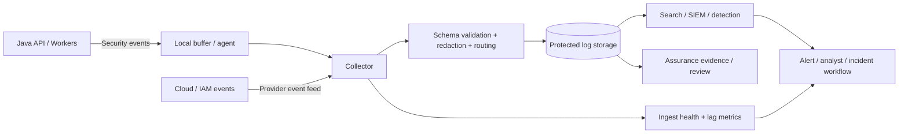

# Requirement về logging

**Requirement về logging** là tập yêu cầu có thể kiểm chứng quy định hệ thống **phải ghi nhận sự kiện gì, vào lúc nào, với những trường dữ liệu nào, bảo vệ và chuyển log ra sao, ai được truy cập, giữ trong bao lâu, phát hiện sự cố thế nào, và phải có bằng chứng gì để kết luận control đang hoạt động**. Đối với security assurance, logging không chỉ là gọi `logger.info(...)` ở một vài đoạn mã. Nó là chuỗi liên kết từ mục tiêu bảo mật đến khả năng **phát hiện, điều tra, truy vết hành động, kiểm tra sự tuân thủ kiểm soát và chứng minh việc vận hành**.

Ví dụ, nền tảng học trực tuyến cho giảng viên xuất bảng điểm. Một log `Export completed` không đủ trả lời *ai yêu cầu, xuất bảng điểm lớp nào, thuộc tenant nào, người đó có quyền không, job nào thực hiện, kết quả được lưu ở đâu, việc xuất có bị replay không và ai tải file*. Nhưng ghi **toàn bộ nội dung bảng điểm, access token hay private key** vào log lại gây rò rỉ dữ liệu. Vì vậy logging requirements cần cân bằng **khả năng điều tra, tính toàn vẹn, độ sẵn sàng, tính hữu ích và data minimization**.

Bài thuộc chương **Security requirements**, module **SECURITY_SECURITY_ASSURANCE** với mục tiêu: *Xây dựng cách đánh giá có bằng chứng rằng hệ thống đáp ứng các mục tiêu bảo mật, từ phân tích rủi ro, yêu cầu và security controls đến kiểm thử, audit và khắc phục phát hiện. Học tổ chức chương trình security assurance liên tục trong phát triển và vận hành.* Theo đó, bài tập trung xây dựng yêu cầu theo cấu trúc **risk → requirement → control → test/evidence → assessment → finding/remediation → reassessment**.

**Thông điệp chính:** log chỉ hỗ trợ quyết định bảo mật khi **đúng sự kiện, đúng ngữ nghĩa, đúng nguồn, đủ ngữ cảnh, đúng thời điểm, không bị sửa/xóa trái phép, có thể truy vấn kịp, và không tạo ra lỗ hổng bảo mật/quyền riêng tư mới**.

## 1. Kết quả học tập

Sau bài học, bạn có thể:

1. Phân biệt application log, security event, audit trail, access log, infrastructure log, trace, metric và alert.
2. Xác định logging requirements từ risk scenarios và security objectives, thay vì log mọi thứ rồi hy vọng phát hiện sự cố.
3. Phân loại sự kiện security trọng yếu: xác thực, phân quyền, thay đổi đặc quyền, truy cập dữ liệu nhạy cảm, thay đổi cấu hình, key/secret lifecycle, lỗi control và hành vi bất thường.
4. Thiết kế **event schema** với actor, action, resource, tenant, outcome, event time, source, correlation và version.
5. Viết requirement có phạm vi, điều kiện kích hoạt, expected behavior, acceptance criteria, owner, retention, failure behavior và phép thử rõ.
6. Thiết kế pipeline thu thập, chuẩn hóa, truyền, lưu, tìm kiếm và giám sát log, bao gồm độ tin cậy và dữ liệu mất/đến trễ/trùng.
7. Bảo vệ confidentiality, integrity, availability của logs; hạn chế log forging/injection, quyền truy cập quá rộng và xóa dấu vết.
8. Cân bằng observability với privacy, data minimization, pseudonymization, retention và legal hold theo chính sách/luật áp dụng.
9. Áp dụng logging an toàn trong Java/Spring và các luồng API, queue, worker, database, cloud, CI/CD và vendor.
10. Xây ma trận positive/negative/failure-mode tests, kể cả test khi collector mất kết nối.
11. Soạn Claim–Argument–Evidence và phân biệt design, implementation và operating effectiveness.
12. Quản lý findings, evidence gaps, exceptions, remediation/retest và chương trình continuous logging assurance.

## 2. Logging requirement khác câu lệnh ghi log như thế nào?

### 2.1. Logger statement, event và security requirement

Ba ví dụ sau không tương đương:

| Mức | Ví dụ | Giới hạn |
|---|---|---|
| **Dòng code** | `logger.info("Login failed")` | Chưa rõ actor, reason, source, thời gian, collector, retention |
| **Event contract** | `auth.login.failed` với `actor_id`, `client_context`, `reason_code`, `outcome` | Chưa quy định coverage, khi nào bắt buộc, loss handling, người nhận |
| **Security requirement** | “Mọi lần đăng nhập bị từ chối trên các API thuộc scope phải sinh một audit event có schema X, xuất tới nền tảng tập trung trong điều kiện Y; khi pipeline lỗi, hệ thống cảnh báo theo policy Z” | Có thể đặt test/evidence để đánh giá |

Một requirement tốt mô tả **điều kiện và kết quả quan sát được**, không chỉ công nghệ. “Phải dùng ELK/SIEM” là lựa chọn kỹ thuật; nó chưa xác định cần phát hiện/điều tra gì.

### 2.2. Logging không phải security control độc lập tuyệt đối

Logging có thể:

- Cung cấp bằng chứng cho **detection** và incident response.
- Hỗ trợ **accountability** và review hành động có đặc quyền.
- Xác nhận sự kiện của security controls như deny/allow, key rotation, policy change.
- Cho biết trạng thái, lỗi và drift của hệ thống.

Nhưng logging **không tự ngăn truy cập trái quyền**; cần authentication, authorization, isolation và các preventive controls riêng. Có log truy cập không chứng minh truy cập đó được phép.

### 2.3. “Log đầy đủ” luôn là khái niệm có phạm vi

Không thể ghi và giữ mọi request payload, every row read hoặc mọi memory event vô hạn. Cần xác định:

- **Đối tượng được bảo vệ:** tài khoản, dữ liệu điểm, secrets, privileged controls.
- **Sự kiện có ý nghĩa:** grant/revoke, login failure, unauthorized export, policy change.
- **Độ chi tiết cần thiết:** metadata, identifier, result và reason code.
- **Độ nhạy:** thông tin cá nhân và dữ liệu bí mật.
- **Khối lượng, thời gian và retention:** phù hợp risk và năng lực vận hành.
- **Coverage:** endpoints, environments, data flows, third parties.
- **Exceptions:** đường nào không log do data minimization, và phải có lý do.

## 3. Phân loại telemetry

| Loại | Mục tiêu | Ví dụ | Không tự chứng minh |
|---|---|---|---|
| **Application log** | Chẩn đoán hoạt động | Request timeout, cache miss, business exception | Có security event đầy đủ |
| **Security event** | Nhận diện security-relevant action/condition | `authz.denied`, `secret.accessed` | Sự kiện đã được alert/triage |
| **Audit log/trail** | Truy vết “ai làm gì, với cái gì, khi nào, kết quả” | Role changed, grade edited | Không thể bị giả, nếu thiếu bảo vệ |
| **Access log** | Quan sát truy cập mạng/API | Source, method, status, route | Quyền trên object được xác minh |
| **Infrastructure/cloud log** | Hoạt động hạ tầng và control plane | IAM change, object store access | Đã bao phủ application business logic |
| **Distributed trace** | Theo dõi request qua nhiều service | Trace/span, service calls | Có thể dùng thay audit trail |
| **Metric** | Định lượng theo thời gian | auth failures/sec, queue lag | Có chi tiết để điều tra từng action |
| **Alert/detection** | Báo điều kiện cần phản ứng | Nhiều 403 từ một identity | Sự cố đã được xử lý |
| **Evidence record** | Gắn kiểm tra/control với chứng minh | Run ID, test result, config hash | Log thô tự đủ cho assurance |

Một event có thể phục vụ nhiều mục đích, nhưng phải được **định nghĩa theo nhu cầu**. Không coi distributed trace (có thể sampling và chứa payload) là audit trail đáng tin cho tất cả privileged actions.

### 3.1. Audit event và diagnostic message

Một audit event nên **có cấu trúc, schema ổn định và đủ attribution**, còn diagnostic log có thể thay đổi theo version để giúp debug. Khi nâng version, có thể đổi log text nhưng không được làm vỡ event contract mà detection và audit workflow đang sử dụng.

### 3.2. Event khác alert

Một lần `login.failed` là **event**. Quy tắc “cùng một principal bị từ chối nhiều lần trong cửa sổ đánh giá” có thể tạo **alert**. Alert còn cần owner, severity, runbook, deduplication, escalation và feedback; không nên ghi một event rồi khẳng định phát hiện tấn công đã hoạt động.

## 4. Bắt đầu từ risk và mục tiêu bảo mật

### 4.1. Kịch bản xuyên suốt: xuất bảng điểm

Giả sử giảng viên chỉ được xuất điểm lớp thuộc quyền. Threat scenarios:

1. Giảng viên hợp lệ thay `classId` để truy cập lớp khác (BOLA).
2. API deny đúng nhưng không có audit event; đội điều tra không biết có hành vi dò ID.
3. Worker lấy `tenantId` từ message giả mạo và xuất dữ liệu sai tenant.
4. Người có quyền vận hành thay policy để tắt audit hoặc cho phép direct-path bypass.
5. Log tự ghi token hoặc nội dung bảng điểm, khiến log viewer trở thành đường rò dữ liệu.
6. Collector ngừng nhận sự kiện nhưng dashboard báo “0 violations”.
7. Timestamp bị lệch giữa API, queue và worker, khiến timeline điều tra sai.
8. Actor có quyền đọc log xóa những event do chính họ tạo.

Mỗi threat dẫn tới **requirements khác nhau**, không phải tất cả đều giải bằng `logger.info()`.

### 4.2. Nối threat, requirement và evidence

| Risk | Logging/security requirement | Control | Verification |
|---|---|---|---|
| BOLA bị bỏ qua | Mọi deny tại endpoint export sinh event có actor, class, tenant, outcome | Server-side authorization + audit | Cross-tenant negative test và audit assertions |
| Job giả/replay | Worker ghi event job accepted/rejected/completed gắn job ID/producer | Queue identity, schema, idempotency | Forged/duplicate/stale message tests |
| Thay quyền âm thầm | Role/permission change ghi actor, subject, old/new role, approval reference | Privileged audit event | Authorized/unauthorized role-change tests |
| Log chứa secrets | Trường nhạy cảm bị loại/redact theo event contract | Allowlist DTO, safe logging | Synthetic secret canary tests |
| Xóa/sửa log | Audit stream có access control, retention/integrity controls | Restricted append/log service, tamper checks | IAM negative tests, integrity/reconciliation |
| Collector hỏng | Pipeline health được theo dõi và alert khi trễ/mất nguồn | Heartbeats, backlog/lag metrics | Simulated collector outage |
| Timeline sai | Event time và clock synchronization được xác minh | Time sync + timestamp schema | Clock skew and ordering tests |
| Truy cập log trái quyền | Chỉ vai trò phê duyệt được xem/export logs | RBAC/ABAC và audited access | Unauthorized analyst/read/export tests |
| Tenant A xem log B | Log query/export giới hạn tenant khi cần | Tenant isolation và index policy | Cross-tenant log access tests |

### 4.3. Logging mục đích bảo mật khác log cho sản phẩm

Việc có thể truy vết một hành động nhạy cảm không mặc nhiên cho phép dùng cùng log để xây hồ sơ hành vi học viên hoặc quảng cáo. **Purpose, access, retention và recipient** phải được xác định riêng. Privacy review có thể cần thiết nếu log chứa thông tin cá nhân, kể cả IP, user ID hoặc device identifiers.

## 5. Các nhóm sự kiện nên đánh giá

Danh sách sau là gợi ý **theo risk**; không phải hệ thống nào cũng cần log tất cả từng sự kiện với cùng độ chi tiết.

### 5.1. Authentication và session lifecycle

- Đăng nhập thành công/thất bại khi có giá trị bảo mật.
- MFA challenge, success/failure, enrollment, reset, disable.
- Password reset/recovery, credential change.
- Account lock/unlock, disable/enable.
- Session creation, renewal, revocation, suspicious refresh.
- Token validation errors có ý nghĩa: invalid issuer/audience/signature, expired, revoked.
- Service account/key authentication failures.
- Risk signals: login từ context bất thường, brute-force pattern khi phát hiện.

**Không ghi password, OTP, raw access/refresh token, full Authorization header hay recovery code.** Thường chỉ cần token ID đã bảo vệ/scope metadata theo policy, không phải raw credential.

### 5.2. Authorization và truy cập dữ liệu

- Denied operations trên tài sản nhạy cảm.
- Granted access khi hành động có impact cao: export, bulk download, thay điểm, cấp role.
- Data sharing, external download/signed URL issuance khi phù hợp.
- Điều chỉnh quyền user/service/tenant/object.
- Break-glass/impersonation/support access.
- Sử dụng API privileged, truy cập secret, thay dữ liệu có kiểm soát.
- Unauthorized direct-path hoặc cross-tenant attempts.

**Không mặc định log mọi lần đọc từng row** nếu điều đó vừa gây khối lượng lớn vừa tạo rủi ro privacy; xác định sự kiện có ý nghĩa theo tài sản và khả năng điều tra.

### 5.3. Administrative/security configuration changes

- Thay đổi IAM roles, policy, groups, service identities.
- Thay config authentication, authorization, network, TLS/trust anchors.
- Tạo/rotate/revoke key, certificate hoặc secret; không log secret value.
- Bật/tắt audit settings, collectors, alerts và retention rules.
- Thay critical feature flags hoặc security exceptions.
- Tạo/xóa privileged API keys và credentials.
- CI/CD release approval, artifact signing, deployment, rollback.
- Thay cấu hình backup, retention hoặc data sharing.

Với thay đổi quan trọng, cần biết **ai, cái gì, phạm vi, trước/sau có kiểm soát, approval/change reference, time, outcome và affected services**.

### 5.4. Dữ liệu và quy trình nghiệp vụ nhạy cảm

Đối với learning platform:

| Hoạt động | Điều cần truy vết | Không nên đưa vào log |
|---|---|---|
| Teacher sửa điểm | Actor, submission/grade ID, class/tenant, action, result, reason/change reference | Nguyên nội dung bài nộp hoặc dữ liệu không liên quan |
| Export bảng điểm | Requester, class/tenant, job ID, approval/authz outcome, file reference | Raw score list, full file content |
| Tải báo cáo | Actor/service, object reference, authorization outcome | Signed URL có bearer secret hoặc file bytes |
| Đổi phân công giáo viên | Grant/revoke, actor, subject, resource, old/new scope | Credentials và payload nhạy cảm không cần |
| Xem support case nhạy cảm | Actor, case reference, access purpose, result | Nội dung tâm lý/hỗ trợ riêng tư |
| Thay consent/data sharing | Actor, purpose/category, before/after, request reference | Dữ liệu theo dõi chi tiết vượt mục đích |
| Deletion/retention job | Scope, job ID, outcome, exceptions, downstream state | Dump toàn bộ dữ liệu bị xóa |
| Report worker fail | Job/tenant scope, error category, retry state | File, token, PII trong exception |

### 5.5. System, security-control và operational failures

- Rate limit/quota triggered, WAF rule hits theo scope.
- Policy decision point unavailable, fail-closed/degraded transitions.
- TLS/mTLS certificate validation failure khi có ý nghĩa.
- Container/security policy violation, unexpected admin port access.
- Database privilege failure, storage access denied.
- Log collector/agent disconnected, queue backlog, ingest errors.
- Integrity verification failure, unauthorized deletion attempt.
- Significant configuration drift và monitoring blind spots.

**Failure event cũng cần schema và owner**; “monitoring không có error” không đủ nếu collector mất kết nối.

## 6. Event schema: thiết kế thông tin đủ dùng

### 6.1. Các trường thường cần

| Field | Ý nghĩa | Câu hỏi kiểm chứng |
|---|---|---|
| `event_id` | Định danh event duy nhất trong phạm vi | Deduplicate/replay và truy vết được không? |
| `event_type` | Tên sự kiện có taxonomy ổn định | Alert/parser có hiểu đúng không? |
| `schema_version` | Phiên bản contract | Consumer có xử lý version khác không? |
| `event_time` | Thời gian sự kiện xảy ra | UTC/offset rõ và nguồn clock đáng tin? |
| `observed_at` / `ingested_at` | Collector nhận được lúc nào | Có phát hiện đến trễ/lag không? |
| `service`, `env`, `instance` | Nguồn và runtime | Gắn được build/version? |
| `actor_id`, `actor_type` | Chủ thể thực hiện (user/service/unknown) | Có lấy từ context đã xác minh? |
| `actor_tenant_id` | Phạm vi của actor nếu áp dụng | Không tin raw header do client gửi? |
| `action` | Hành động | Có khớp với business policy? |
| `resource_type`, `resource_id` | Tài sản/đối tượng | Có thể tra cứu mà không lộ data? |
| `resource_tenant_id` | Tenant sở hữu tài sản | Có giúp phát hiện cross-tenant? |
| `outcome` | Success, denied, error, pending | Có phân biệt deny với lỗi hệ thống? |
| `reason_code` | Mã lý do phi nhạy cảm | Không expose policy/secret bất hợp lý? |
| `request_id`, `trace_id`, `job_id` | Correlation qua các bước | Có chống spoof/tin nhầm dữ liệu client? |
| `authn_method`, `policy_id` | Cách xác thực, policy đã áp dụng | Dùng version/ID phù hợp thay secret? |
| `source_context` | IP/device/network khi cần điều tra | Privacy/classification và độ tin cậy rõ? |
| `change_reference` | Ticket, approval, incident khi áp dụng | Có liên kết đúng thay đổi? |
| `data_classification` | Mức bảo vệ log | RBAC/retention phù hợp không? |

Không phải mọi event đều cần tất cả trường; xác định **required/optional theo event type**. Ví dụ login failure chưa có verified actor có thể ghi `actor_type=unknown` và safe external identifier khi policy cho phép, không tự khẳng định `actor_id` đã được xác thực.

### 6.2. Phân biệt actor, subject và executor

Một luồng hỗ trợ có thể gồm:

- **Actor:** quản trị viên thực hiện yêu cầu.
- **Subject:** tài khoản của người học được thay quyền.
- **Executor:** backend service hoặc batch worker thực thi hành động.
- **Delegation:** “service X làm theo yêu cầu của user Y” với scope/thời hạn.

Nếu chỉ log `actor=report-worker`, cuộc điều tra sẽ thiếu người đã yêu cầu export. Nhưng cũng không nên tin `requestedBy` từ raw queue message khi nó chưa được xác minh với job record/token.

### 6.3. Outcome phải thống nhất ngữ nghĩa

Các trạng thái gợi ý:

- `SUCCEEDED`: thao tác hoàn tất theo tiêu chí nghiệp vụ.
- `DENIED`: policy từ chối.
- `FAILED`: được phép thử nhưng lỗi khi xử lý.
- `PENDING`: được nhận nhưng chưa xử lý xong.
- `CANCELLED`: được hủy.
- `UNKNOWN`: không đủ cơ sở xác định outcome.

Một API trả 202 Accepted **không phải** export đã hoàn tất; phải có event khi worker hoàn thành/thất bại và mapping qua job ID.

## 7. Event taxonomy và quy tắc đặt tên

### 7.1. Tên ổn định, không phụ thuộc message string

Nên dùng event type machine-readable, chẳng hạn:

```text
auth.login.succeeded
auth.login.failed
auth.mfa.challenge.failed
auth.session.revoked
authz.resource_access.denied
data.grade.updated
data.report_export.requested
data.report_export.completed
data.report_export.failed
data.report_download.denied
identity.role.granted
identity.role.revoked
security.policy.changed
security.secret.rotated
security.audit_pipeline.unhealthy
deployment.production.approved
```

Các tên là **quy ước minh họa của tổ chức**. Có thể dùng chuẩn taxonomy hiện hành nếu hệ thống đã chọn; quan trọng là thống nhất, versioned, có owner và tài liệu schema.

### 7.2. Event schema versioning

Khi đổi tên field, kiểu, outcome hoặc taxonomy:

1. Xác định producer/consumer phụ thuộc.
2. Có version hoặc chiến lược backward compatibility.
3. Test parser, SIEM rules, alerts, reports và retention/search.
4. Rollout có kiểm tra lag, drop hoặc parse error.
5. Ghi thời điểm cutover và version mapping.
6. Không loại field bảo mật quan trọng chỉ vì giảm logging cost mà chưa risk review.

### 7.3. Severity là metadata, không thay event type

`ERROR` không mặc nhiên là security incident. Một `DENIED` có thể là policy vận hành bình thường, nhưng nhiều denies có mẫu bất thường có thể thành alert. Event type và severity/alert classification cần được dùng đúng mục đích; đừng báo mọi 403 là “critical breach”.

## 8. Tính chính xác về thời gian và trình tự

### 8.1. Event time khác ingest time

Trong hệ thống phân tán:

- API phát sự kiện lúc `T1`.
- Message vào queue và worker xử lý ở `T2`.
- Collector tiếp nhận log lúc `T3`.
- SIEM index sẵn sàng truy vấn ở `T4`.

Các mốc khác nhau. Phải xác định requirement về **timestamp, lag và query availability**. Không được suy từ thứ tự ingestion rằng event nào chắc chắn xảy ra trước.

### 8.2. Quy tắc timestamp

- Dùng định dạng dễ parse có timezone/offset rõ, thường biểu diễn theo UTC.
- Xác định độ chính xác cần thiết: milliseconds/microseconds nếu phục vụ correlation, không giả định chính xác tuyệt đối.
- Đồng bộ hệ thống clock theo baseline.
- Theo dõi clock drift/skew giữa nodes, containers, managed services và vendors khi cần.
- Ghi `event_time`, `ingested_at` tách biệt.
- Dùng monotonic clock cho **đo duration** trong một process khi thích hợp; wall clock cho event timestamp.
- Khi clock có vấn đề, đánh dấu time quality/uncertainty thay vì sắp timeline như chắc chắn.

### 8.3. Event ordering và idempotency

Một distributed system có thể gửi event trễ, lặp hoặc đảo thứ tự. Requirement nên xác định:

- `event_id` để deduplicate trong phạm vi phù hợp.
- `request_id`/`job_id` để nhóm chuỗi hoạt động.
- `sequence` hoặc version nếu nghiệp vụ cần tổng thứ tự cho một resource.
- Logic detect gaps/out-of-order khi dùng stream.
- Không dựa chỉ vào timestamp để xác định thứ tự tuyệt đối giữa systems không cùng clock.
- Bảo vệ against client-supplied correlation IDs gây trùng/lẫn tenant hoặc log forging.

## 9. Privacy và data minimization của logs

### 9.1. “Log mọi thứ” có thể là rủi ro

Log có thể chứa thông tin định danh, hoạt động học tập, IP, device identifiers, lịch sử truy cập, request params, bài nộp và suy luận về hành vi. Một audit stream kéo dài nhiều năm có thể tạo tập dữ liệu nhạy cảm hơn dữ liệu nguồn khi cho phép liên kết theo thời gian.

Requirement cần phân biệt **nhu cầu an ninh, vận hành, audit, pháp lý/hợp đồng** và việc sử dụng thứ cấp. Được phép tạo security log **không đồng nghĩa** được dùng nó để profiling, quảng cáo hoặc giám sát nhân viên không giới hạn.

### 9.2. Trường không nên ghi nguyên văn

| Loại | Không ghi nguyên dạng khi không có cơ sở đặc biệt | Thay bằng |
|---|---|---|
| Authentication secrets | Password, OTP, recovery codes, raw tokens, session cookies | Token ID/credential reference đã bảo vệ nếu cần |
| Cryptographic material | Private keys, seed, key-encryption-key, signing secret | Key reference/version/action/outcome |
| Financial/health/education detail | Full card data, hồ sơ sức khỏe, nội dung bài, điểm hàng loạt | Resource ID, event type, redacted/summarized metadata |
| Request/response bodies | JSON chứa PII hoặc secrets | Structured allowlisted audit fields |
| Sensitive URLs | Signed URL, query API token, pre-signed download link | Endpoint template, object reference, no bearer part |
| Identity documents | Raw passport/ID scans | Case/record reference và action |
| Headers | Authorization, Cookie, Set-Cookie | Header class hoặc validated principal ID khi cần |
| Stack traces | Exception message có SQL/credentials/raw data | Safe error code, bounded internal trace đã redact |

Khi một nhóm security có nhu cầu thu thập bằng chứng sâu trong incident, phải có **quy trình, thẩm quyền, giới hạn thời gian, access controls và retention** riêng. Không bật full payload logging liên tục cho toàn production chỉ vì “có thể cần điều tra”.

### 9.3. Masking, redaction và pseudonymization

- **Masking:** che một phần giá trị khi không cần toàn bộ.
- **Redaction:** loại giá trị nhạy cảm khỏi output.
- **Pseudonymization:** thay định danh bằng mã giả theo mục đích và quản trị mapping riêng.
- **Aggregation:** tổng hợp event metrics khi không cần từng record.
- **Hashing:** có thể giúp đối chiếu trong một số thiết kế nhưng không tự tạo anonymity; giá trị nhỏ/dễ đoán có thể bị đảo bằng thử nghiệm hoặc liên kết.

Redaction nên ưu tiên **allowlist ở thời điểm tạo event**, thay vì hy vọng bộ lọc regex tại collector bắt được mọi secret trong raw payload. Một lớp phòng vệ downstream vẫn hữu ích nhưng không nên là lớp duy nhất.

### 9.4. Data subject/privacy obligations

Retention/deletion, truy cập, minh bạch và hạn chế mục đích phụ thuộc pháp luật, hợp đồng, ngữ cảnh xử lý. Những yêu cầu có thể va chạm với immutable audit logs hoặc legal hold. Khi đó, **Privacy/Legal/Data Owner** cần xác định policy cụ thể, ngoại lệ hợp lệ, người được phép truy cập và quy trình xử lý. Không tự khẳng định mọi log “phải giữ mãi” hoặc “phải xóa tức thì” trong mọi trường hợp.

## 10. Log injection và event authenticity

### 10.1. Log forging/injection

Input từ user có thể chứa newline, control characters hoặc chuỗi giống format của logger. Nếu code nối trực tiếp:

```java
// Anti-pattern: raw user input có thể tạo line break/event giả.
logger.info("Login rejected for username=" + request.username());
```

Một chuỗi có ký tự điều khiển có thể phá format text log hoặc làm downstream parser nhầm thành nhiều events. Nhưng chỉ xóa newline vẫn không xử lý mọi trường hợp Unicode/structured parser/field injection.

### 10.2. Structured logging và typed event contract

Ưu tiên:

- Event object có `event_type`, `schema_version`, typed fields.
- Field allowlist và giới hạn kích thước/length.
- Encode/escape theo format xuất (JSON/log sink), không tự nối text thủ công.
- Không cho client trực tiếp đặt `actor_id`, `tenant_id`, `outcome` authoritative.
- `event_id` từ server; correlation ID từ client phải được kiểm soát/sanitized nếu nhận.
- Bảo vệ nguồn/transport và producer identity.
- Có parser/schema validation ở collector.
- Không cấp cho event producer quyền sửa/xóa dữ liệu lịch sử.

Structured JSON làm giảm một số lỗi phân tách, **không tự chứng minh event là thật**. Nếu một workload bị xâm nhập có quyền phát audit events, nó vẫn có thể gửi event giả hoặc không gửi event; cần xác định trust model và dùng nguồn độc lập khi có giá trị.

### 10.3. Event source trust

Một event cần biết **ai phát và hệ thống nào chịu trách nhiệm xác thực**. Ví dụ actor identity có thể đến từ IdP/JWT đã validate; source IP đến từ gateway đã xác minh proxy chain; timestamp đến từ server clock. Không gán `actor_id` theo `X-User-Id` do client gửi mà không có validation.

### 10.4. Khả năng phủ nhận và giới hạn bằng chứng

Audit trails có thể hỗ trợ accountability, nhưng **log có chữ ký không tự tạo non-repudiation tuyệt đối**. Kết luận về tác giả hành động phụ thuộc credential custody, identity proofing, log generation, tamper resistance, clock, shared accounts và điều tra. Nếu nhiều người dùng chung một admin account, log chỉ có account ID không thể chứng minh người cụ thể.

## 11. Kiến trúc log pipeline và trust boundaries

### 11.1. Dòng dữ liệu tiêu biểu



Trong thực tế, collector/agent có thể được thay bằng managed logging service, message broker, event bus hoặc sidecar. Điều quan trọng là xác định **trách nhiệm, quyền, failure modes, timestamps, data classification và khả năng đối chiếu**.

### 11.2. Các trust boundaries

| Boundary | Rủi ro | Controls và phép kiểm tra |
|---|---|---|
| App → local agent | App bị chiếm, payload giả, stdout mất | Typed events, process identity, buffering/permissions |
| Agent → collector | MITM, dropped events, unauthorized producer | Authenticated transport, receiver auth, retries và health |
| Collector → parser | Schema drift, log injection, parse failure | Validation, quarantine, parse-error metrics |
| Parser → storage | Unauthorized write/delete, PII exposure | Restricted ingest role, encryption, ACL, retention |
| Storage → SIEM | Query thiếu logs, dữ liệu đến trễ | Completeness/lag checks, index version |
| SIEM → alert | Rule sai hoặc bị tắt | Synthetic detections, rule approval, change logs |
| Analyst → log query/export | Insider access/tenant leakage | RBAC, JIT/approval, audit of log access |
| Log storage → evidence | Bản sao bị sửa, thiếu source/scope | Provenance, integrity verification, controlled export |

### 11.3. Một pipeline “đang chạy” chưa chắc có coverage

Có thể SIEM xanh nhưng:

- Một pod không gắn agent.
- Một route bypass gateway nên không có access/security events.
- Worker dùng logger khác hoặc schema cũ.
- Queue full làm mất events ở vùng tải cao.
- Index rule bỏ sót một event type sau migration.
- Vendor đổi API field hoặc ngừng gửi audit records.
- Trong incident, attacker tắt audit flag mà không có cảnh báo.

Vì vậy coverage cần dựa trên **inventory, synthetic events, reconciliation và pipeline health**, không chỉ biểu tượng Green của SIEM.

## 12. Reliability: log được tạo khác log được nhận

### 12.1. Các điểm có thể mất sự kiện

Một API có thể gọi audit logger thành công về mặt code nhưng event vẫn không tới nơi lưu cuối:

1. Process crash trước khi flush buffer.
2. Agent/sidecar không chạy hoặc không đọc được file/stdout.
3. Network outage gây retry và queue overflow.
4. Broker đầy, bị cấu hình TTL quá ngắn hoặc consumer lag.
5. Schema parser từ chối field mới và không có dead-letter/quarantine.
6. Storage ingestion bị throttling/quota/permission error.
7. Log rotation hoặc container restart xóa dữ liệu chưa chuyển.
8. Sampling/filter áp vào security event không được phép mất.
9. Collector nhận event nhưng index/query chưa sẵn sàng.
10. Analyst chỉ có quyền xem một phần indices và không nhận ra scope thiếu.

Requirement nên phân biệt **event emission**, **delivery/acknowledgment**, **durable storage**, **query availability** và **alert processing**; chúng là những giai đoạn khác nhau.

### 12.2. Mức bảo đảm và semantics

| Mô hình | Mô tả | Vấn đề cần xử lý |
|---|---|---|
| **Best effort** | Gửi event không bảo đảm nhận được | Phù hợp một số debug logs; yếu đối với privileged audit nếu cần accountability |
| **At-most-once** | Không phát lại; có thể mất khi lỗi | Phải đánh giá rủi ro mất chứng cứ |
| **At-least-once** | Retry cho tới khi có dấu hiệu nhận; có thể trùng event | Cần event ID/deduplication và chống side effects |
| **Effectively-once trong phạm vi thiết kế** | Consumer/storage quản lý dedup/idempotency | Không được suy ra exactly-once tuyệt đối qua mọi hệ thống |
| **Transactional audit/outbox** | Business write và audit/outbox record nằm trong một transaction khi phù hợp | Còn cần publisher, consumer, retention và monitoring |
| **Synchronous durable audit** | Hành động phụ thuộc kết quả ghi audit | Có thể tăng latency/availability impact, cần failure policy |

Không có một delivery semantic bắt buộc cho tất cả logs. Với **high-impact audit event**, yêu cầu thường cần độ tin cậy cao hơn diagnostic INFO message. Định nghĩa phải nói rõ **điểm xác nhận và giới hạn bảo đảm**.

### 12.3. Correlation/reconciliation

Một cách kiểm tra completeness là đối chiếu:
- Số privileged operations ở authoritative business records.
- Số audit events tương ứng theo cùng kỳ, scope và event type.
- Duplicate IDs, missing IDs, parse failures, ingestion gaps và delayed events.
- Các thay đổi role/IAM từ source of truth với audit feed.
- Các deployment/permission changes có ticket và audit events.

Số lượng bằng nhau **chưa chứng minh mọi event đúng** nếu có missing events bù bằng duplicate hoặc spoofed events; nên reconcile bằng **stable IDs và resource/action mapping** khi có thể.

### 12.4. Thử failure mode bằng sự kiện tổng hợp

Trong môi trường kiểm thử có quyền:
- Ngắt collector để xác minh queue buffer/retry và alert.
- Làm broker đầy hoặc pipeline trả lỗi có kiểm soát.
- Đổi schema không tương thích, xem parser error/quarantine.
- Restart app sau khi phát event chưa flush.
- Thử duplicate delivery và kiểm tra deduplication.
- Xác minh log vẫn tìm được theo event ID sau recovery.
- Kiểm tra telemetry về lag, drop, backlog và số nguồn hoạt động.

Một test làm hệ thống chậm hoặc mất log không nên chạy trên production không có phương án an toàn/được phép.

## 13. Failure behavior và security-sensitive operations

### 13.1. “Audit unavailable” phải được thiết kế

Khi audit channel không sẵn sàng, hệ thống có những lựa chọn:
- **Fail closed:** từ chối hành động nhạy cảm vì không thể ghi bằng chứng theo chính sách.
- **Durable local/outbox:** tiếp tục nếu event được ghi bền vững tại nguồn và có kế hoạch chuyển khi hồi phục.
- **Degraded mode:** chỉ cho phép một tập hành động với giới hạn và cảnh báo.
- **Best-effort continuation:** chấp nhận một khoảng mất log theo risk appetite cho những sự kiện ít quan trọng.

Không áp một lựa chọn cho tất cả services. Yêu cầu cần xác định **event criticality, business impact, tolerance, fail mode, recovery và approver**.

### 13.2. Ví dụ bảo vệ thao tác thay quyền quản trị

Nếu hành động `grant_admin` rất nhạy cảm, yêu cầu có thể nói: *Không hoàn tất cấp quyền nếu không tạo được một audit record bền vững với actor, subject, action, scope và change reference*.

Điều này **không đồng nghĩa** business DB và log storage ngoài hệ thống có thể commit nguyên tử mà không thiết kế transaction phân tán. Có thể dùng transaction/outbox trong cùng DB để ghi privileged action và audit intent, sau đó chuyển tới audit store có giám sát. Cần phân biệt **bằng chứng đã durable ở nguồn** và **đã index trung tâm**.

### 13.3. Thao tác fail-open nguy hiểm

Một anti-pattern:

~~~java
try {
    auditService.recordGrant(...);
} catch (Exception e) {
    // swallow everything: still grants privilege without audit
}
roleService.grantAdmin(...);
~~~

Nếu policy yêu cầu audit bảo đảm trước khi hoàn tất grant, việc im lặng bỏ exception vi phạm control. Nhưng đơn giản chuyển thành “throw trước grant” cũng chưa giải quyết crash windows/concurrency. Cần thiết kế transaction/outbox/ack và recovery phù hợp.

### 13.4. Không để audit thành DoS amplifier

Một attacker có thể spam event như invalid login để làm đầy storage hoặc làm nghẽn API. Requirements nên bao gồm:
- Rate limiting/throttling theo risk mà không bỏ mất high-impact events trái policy.
- Backpressure/quotas/partitioning.
- Capacity planning và log amplification controls.
- Detection cho volume spike và ingestion health.
- Event payload size limits và schema validation.
- Resilience của ứng dụng khi logging subsystem hỏng.

**Sampling và aggregation** có thể phù hợp cho high-volume diagnostics, nhưng phải công khai rule và đảm bảo **critical audit classes** theo requirement không bị mất ngoài dự kiến.

## 14. Confidentiality của logs

### 14.1. Logs là một data store riêng

Log repository thường tập hợp dữ liệu từ nhiều services và tenants; quyền truy cập logs có thể cho phép suy ra hoạt động user, network topology, thời điểm giao dịch và trạng thái bảo mật. Cần bảo vệ chúng như **tài sản có phân loại**, không như file text vô hại.

### 14.2. Logging access control requirements

- Chỉ identities/roles được phê duyệt mới đọc/query/export logs.
- Quyền **ingest**, **read**, **search**, **delete**, **change retention**, **manage alerts** và **admin** phải được phân tách khi phù hợp.
- User/tenant isolation ở query/export, nếu có multi-tenant logging.
- Privileged access, break-glass và support access có approval/audit theo risk.
- Service producer không có quyền xóa/sửa lịch sử log.
- SIEM rule administrators và storage administrators có phân quyền, review và change history.
- Secrets/key references cho encryption có owner và lifecycle.
- Bulk log export cần scope, purpose, thời gian và recipient controls.
- Không mở public dashboard hoặc công khai log index do cấu hình sai.
- Log access được logging mà không gây recursion vô hạn.

### 14.3. Bảo vệ truyền và lưu

Tùy threat model:
- Encryption in transit cho app/agent/collector/storage communications.
- Authenticated producer/receiver, mTLS hoặc credentials phù hợp.
- Encryption at rest và key management theo data classification.
- Storage access policy, backup, replication và disaster recovery.
- Network segmentation và hạn chế egress/exports.
- Kiểm tra logs được xử lý bởi vendor theo hợp đồng, trách nhiệm và location khi áp dụng.

**Encryption không thay authorization**. Một log store được mã hóa nhưng mọi developer có quyền đọc vẫn có thể vi phạm yêu cầu bảo mật/quyền riêng tư.

### 14.4. Privacy control với thông tin dễ liên kết

Ngay cả pseudonymous user ID, IP hoặc session reference cũng có thể liên kết với người thật qua nguồn phụ trợ. Khi cấp quyền cho security analysts, nên xét:
- Có cần dữ liệu định danh ở mọi trường hợp không?
- Có thể tách summary events và raw restricted events không?
- Có thể dùng scoped/timed access hoặc masking ở query layer không?
- Ai được de-pseudonymize trong điều kiện nào?
- Có audit việc export/mass query dữ liệu log không?

## 15. Integrity, tamper resistance và chain of custody

### 15.1. Các threat đối với tính toàn vẹn

- Attacker xóa những event ghi lại hành vi.
- Insider sửa timestamp, actor hoặc outcome.
- Workload bị chiếm phát log giả hoặc tắt logging.
- Collector/parser thay đổi field ngoài chủ ý.
- Storage admin sửa retention trước điều tra.
- Evidence export được chỉnh sửa sau khi thu thập.
- Log ingestion lỗi dẫn đến record không nhất quán với source.
- Clock skew làm timeline bị hiểu sai.

### 15.2. Các lớp bảo vệ

| Lớp | Ví dụ | Điều cần chứng minh |
|---|---|---|
| **Source control** | Restricted audit logger/config, privileged change audit | Ai có thể tắt/thay logging? |
| **Identity and transport** | Authenticated producer, protected channel | Event đến từ nguồn theo policy? |
| **Storage permissions** | Append-only design, restricted delete, separate admin | Producer không thể sửa lịch sử trái quyền? |
| **Retention/immutability** | WORM/immutable retention hoặc equivalent controls khi phù hợp | Deletion/overwrite có bị chặn trong thời hạn yêu cầu? |
| **Integrity verification** | Digest/signature/hash chain, periodic verification | Phát hiện được modification theo phạm vi nào? |
| **Offsite/independent copy** | Replication tới domain quản trị khác | Attacker chiếm một domain có xóa tất cả bản sao? |
| **Audit of log administration** | Truy vết retention/delete/export/change | Ai quản trị log và khi nào? |
| **Evidence custody** | Export metadata, original source, hash, reviewer | Dùng được trong đánh giá/điều tra? |

### 15.3. Hash chain có giới hạn

Hash chain có thể liên kết các record để hỗ trợ phát hiện chỉnh sửa sau đó **nếu** keys/checkpoints/source roots được bảo vệ và validator kiểm tra định kỳ. Tuy nhiên:
- Hash của record không chứng minh nội dung record lúc đầu đúng.
- Attacker điều khiển producer có thể tạo sự kiện giả hoặc bỏ sự kiện.
- Reordering/partition/rotation có thể làm verification phức tạp.
- Nếu attacker kiểm soát cả chain và anchors, có thể tái tạo chain.
- Không phải mọi hệ thống cần chain; chọn theo impact, chi phí và khả năng duy trì.

### 15.4. Evidence export và chain of custody

Khi thu log làm bằng chứng:
1. Ghi source, query, filter, period, tenant/service và người thu.
2. Ghi timestamp/clock basis, timezone và log schema/version.
3. Lưu bản gốc và metadata trong kho có kiểm soát.
4. Tính digest để kiểm tra thay đổi của **artifact export** khi phù hợp.
5. Ghi việc chuyển giao, quyền truy cập, bản sao, transformations.
6. Tách bản gốc với bản đã redact để chia sẻ.
7. Ghi missing/late logs và uncertainty.
8. Dùng chính sách retention/legal hold đúng thẩm quyền.

Không chỉ dựa vào một screenshot không rõ query hoặc một file CSV không có provenance để khẳng định ai đã thực hiện một privileged action.

## 16. Availability, throughput và capacity requirements

### 16.1. Logging có resource budget

Log pipeline cạnh tranh network, CPU, memory, disk và storage với workload khác. Một thiết kế nên ước tính:

- Events per second bình thường/đỉnh.
- Trung bình/max event size theo schema.
- Ingest/parse/index throughput.
- Buffer/queue capacity và thời gian chịu outage.
- Query/search latency với security investigation.
- Storage/retention/replication cost.
- High-cardinality fields và indexing choices.
- Disaster recovery/replay và failover.
- Vendor/platform quotas.
- Growth theo số tenants/services.

Không chọn retention và “real-time” bằng cảm tính mà không nhìn data volume và khả năng vận hành.

### 16.2. SLI/SLO có thể đo

Một số requirement minh họa nên có ngưỡng thực do tổ chức chọn:

| Signal | Ý nghĩa | Cần phân biệt |
|---|---|---|
| **Event emission coverage** | % critical actions sinh event tại nguồn | Không bằng delivery thành công |
| **Delivery success/lag** | % events đến collector trong khoảng dự kiến | Có thể chưa index/searchable |
| **Query availability lag** | Từ event time tới search sẵn sàng | Khác alert latency |
| **Alert detection latency** | Từ điều kiện tới alert được tạo | Không bằng triage/containment time |
| **Dropped events** | Số lượng events rơi khỏi pipeline có thể đo | 0 nếu không có instrumentation đáng tin là mơ hồ |
| **Parser/schema errors** | Event không thể chuẩn hóa | Cần quarantine/repair |
| **Source heartbeat coverage** | Nguồn critical có báo health | Heartbeat không chứng minh đầy đủ events |
| **Storage integrity verification** | Tỷ lệ bản ghi/partition được kiểm tra | Không chứng minh producer không bỏ events |
| **Retention policy compliance** | Records được giữ/xóa theo policy | Phải xét legal hold/exceptions |
| **Access review coverage** | Privileged readers/exporters được review | Reviewer cần xem effective grants |

### 16.3. Ví dụ ngưỡng, không phải chuẩn bắt buộc

Một tổ chức có thể đặt yêu cầu minh họa: *với high-impact admin events, mục tiêu 99,9% được search trong vòng 5 phút và không có mất mát không được xử lý theo policy; hệ thống alert khi lag vượt ngưỡng*. Các giá trị này **không phải tiêu chuẩn phổ quát**; yêu cầu thực phải dựa risk, capacity, pháp luật/hợp đồng và quyết định của control owner.

Nếu chọn mục tiêu “không mất event”, thiết kế phải nói **đảm bảo ở đâu** (durable source record, collector ack, protected storage) và cách test failure modes; không khẳng định tuyệt đối chỉ bằng một dashboard.

## 17. Retention, deletion, backup và legal hold

### 17.1. Retention phải gắn loại log và mục đích

Không có số ngày chung đúng cho mọi ứng dụng và lãnh thổ. Có thể xây **retention matrix** theo:
- Security audit logs và privileged activities.
- Access logs high volume.
- Debug/diagnostic logs.
- Authentication events.
- Incident evidence/forensic exports.
- CI/CD/build/deployment audit.
- Data access/privacy request records.
- Vendor/cloud provider logs.

Mỗi nhóm có owner, mục đích, classification, access, primary/archive storage, period và policy deletion, exceptions/legal hold.

### 17.2. Retention matrix minh họa

| Log class | Purpose | Retention decision | Evidence |
|---|---|---|---|
| Privileged IAM changes | Investigate/admin accountability | Theo risk và yêu cầu nội bộ/luật áp dụng | Config, immutability, search/retrieval tests |
| API access metadata | Availability/abuse investigations | Phù hợp volume và purpose | Retention rules, sampling disclosure |
| Debug log | Short-term troubleshooting | Tối thiểu theo nhu cầu, giới hạn PII | TTL validation và access review |
| Export audit | Grade confidentiality/accountability | Gắn business/audit obligations | Job/event reconciliation |
| Security incident evidence | Investigation/legal requirements | Theo case, legal hold nếu có | Case reference, custody and hold record |
| Build/deploy audit | Supply-chain and change tracking | Theo release/operating obligations | Provenance, deploy event retention |
| Vendor audit feed | Third-party security assurance | Phụ thuộc hợp đồng/source availability | Provider settings, extraction tests |

### 17.3. Delete/hold conflict không giải bằng mặc định

Immutable storage có thể cần giữ log trong một thời hạn; quyền dữ liệu và yêu cầu xóa có thể cũng tồn tại tùy hoàn cảnh. Khi xung đột, **Privacy/Legal và Data Owner** phải xác định thẩm quyền, cơ sở lưu giữ, policy truy cập, xử lý bản sao và hết kỳ giữ. Không tự xóa bằng chứng trong legal hold hoặc tự giữ dữ liệu cá nhân vô hạn.

### 17.4. Backup và archive cũng thuộc scope

Retention xóa trong hot index chưa có nghĩa archived logs, snapshots, cold storage, vendor copies và exported evidence đều được xử lý theo policy. Cần data lineage và testing:
- Archive/restore có hoạt động không?
- Khi sự cố xảy ra, có truy xuất đúng kỳ trong thời gian cần điều tra không?
- Data after retention có còn trong backups theo ngoại lệ hợp lệ?
- Ai có quyền restore và đọc?
- Integrity/metadata có tồn tại sau chuyển tier?

## 18. Detection rules và alert response

### 18.1. Từ event tới detection

Một security logging requirement có thể yêu cầu event được ghi; một **detection requirement** thêm logic phát hiện tình huống có ý nghĩa. Ví dụ:

| Detection scenario | Events/sources | Câu hỏi |
|---|---|---|
| Brute-force/credential stuffing | Failed login + user/network context | Threshold, window và false positives? |
| Account takeover suspicion | New device/session, MFA changes, sensitive action | Nguồn context có đáng tin? |
| Privilege escalation | Role/permission changes, approval feed | Có grant ngoài quy trình? |
| Mass data export | Export requested/completed, volume metadata | Có bất thường với actor/tenant? |
| Cross-tenant enumeration | Denied object access patterns | Có nhiều denies theo ID/resource? |
| Logging tampering | Audit disable, policy change, missing heartbeats | Có phân biệt planned maintenance? |
| Secret misuse | Secret read + role/identity changes | Truy cập có hợp lệ theo lịch/bối cảnh? |
| Supply-chain change | Build signer/deploy events | Artifact có đúng approval/provenance? |

Không dùng một mẫu “5 login failures = attacker” cho mọi hệ thống; threshold phải được hiệu chỉnh bằng baseline, attack model và khả năng phản ứng.

### 18.2. Alert quality

Alert cần:
- Rule ID/version, event IDs và source coverage.
- Severity/prioritization theo impact.
- Actor/resource/tenant context đã được phép hiển thị.
- Link tới search/case/runbook.
- Deduplication, suppression đúng scope/thời gian.
- Owner/on-call/escalation.
- Tracking: created, acknowledged, triaged, resolved và feedback.
- Cơ chế ngăn security alerts làm lộ PII/secret qua email/chat.

### 18.3. False positives và false negatives

Detection rules có thể báo sai và bỏ sót. Assurance cần:
- Synthetic attack-like events trong môi trường được phép.
- Rule test datasets có cả legitimate patterns.
- Triage feedback loop.
- Coverage map: event source nào, attack scenario nào chưa có.
- Alert noise/capacity.
- Monitoring khi rule bị sửa/tắt hoặc data source biến mất.

Không kết luận “không có tấn công” chỉ vì SIEM không tạo alert.

## 19. Access review, segregation of duties và log administration

### 19.1. Reader, producer và administrator không cùng quyền

- **Producer:** chỉ phát event theo schema; không sửa record lịch sử.
- **Collector:** ingest/route, quản lý retry/quarantine trong phạm vi.
- **Log platform admin:** quản trị storage/index/rules theo kiểm soát.
- **Security analyst:** đọc/tìm kiếm theo nhiệm vụ và data classification.
- **Auditor/assessor:** truy cập evidence theo scope, có thể yêu cầu độc lập.
- **Privacy/Legal:** review purpose/retention/access theo thẩm quyền.
- **Incident responder:** mở rộng quyền tạm khi có case được duyệt.

Với hệ thống nhỏ, một người có thể kiêm vai trò nhưng **xung đột quyền** cần được xem: người bị điều tra có thể xóa log của chính mình không? Admin log platform có thể sửa rules để che việc xóa không?

### 19.2. Break-glass và privileged access

Khi cần truy cập logs nhạy cảm ngoài quy trình, có thể áp:
- Approval/incident reference.
- Time-limited/JIT access.
- MFA/step-up khi cần.
- Query/export scope giới hạn.
- Ghi audit người cấp quyền và người dùng.
- Periodic review/recertification.
- Revocation khi hết nhiệm vụ.

### 19.3. Đánh giá effective access

Không chỉ xem policy trong tài liệu. Test thực tế:
- User không có role audit không đọc được event.
- Một tenant analyst không xem event tenant khác.
- Producer account không xóa/sửa logs.
- Export quyền cao được audit.
- Disabled employee hoặc revoked credential không còn truy cập.
- Vendor/support access được giới hạn scope/time.

## 20. Nguồn logs đa hệ thống và shared responsibility

### 20.1. Java application logs

Ứng dụng có thể phát structured audit events qua logger, domain event publisher hoặc audit service. Cần xác định:
- Event được tạo ở **đúng điểm quyết định** (allow/deny/after commit).
- Actor/resource/action lấy từ context được xác minh.
- `response.status` không bị dùng sai thay business outcome.
- Exception path, filters, async worker và scheduled jobs được bao phủ.
- Không log raw request body hoặc bearer token.
- Event schema/version có contract tests.

### 20.2. Database logs

Database audit, query logs và access logs có thể ghi những hoạt động mà application events bỏ sót, đặc biệt DBA/admin paths. Nhưng:
- Query logs có thể chứa PII/secret/SQL params.
- Database user thường là shared application role, không tự chứng minh end-user.
- Với connection pool, correlation và application context phải được thiết kế.
- Audit log của DB không tự chứng minh app-level business authorization.
- Quyền xem/xóa DB audit records cần tách biệt phù hợp.

### 20.3. Cloud/control plane logs

IAM, network policy, object storage, secret access và managed service changes có thể có logging riêng do cloud provider quản lý. Cần:
- Enable/collect đúng loại events và scope account/project/region.
- Xác nhận cấu hình trên **all relevant accounts/regions**.
- Bảo vệ log delivery/storage và quyền chỉnh logging settings.
- Gắn service owner với resource IDs.
- Xem retention và phí/volume theo policy.
- Test unauthorized change và actual event visibility.

Một managed cloud service có audit feature không có nghĩa tenant đã bật đúng hoặc data events đã được collect.

### 20.4. Kubernetes/containers

Container stdout/stderr có thể được ship bằng node agents/sidecars. Cần xem:
- Pod/node restarts và mất buffer.
- Multi-line stack traces, JSON parse và namespace labels.
- Service account identity và pod/build version.
- Scheduler/control plane audit riêng.
- Log rotation và retention.
- Secret leakage qua env dumps.
- Dynamic pods không nằm trong static source list.

### 20.5. CI/CD và supply chain

Security-relevant events:
- Source/branch permission change, protected branch bypass.
- CI runner identity, build/dependency changes.
- Secret access/certificate/signing-key use.
- Artifact digest/signature and registry permission.
- Deployment approval, rejected deploy và rollback.
- Emergency exception/break-glass.

Một pipeline “green” chưa chứng minh source/build/artifact/runtime provenance. Logs phải có link sang revision, artifact và deployment IDs.

### 20.6. Vendors, SaaS và managed logging

Khi bên thứ ba cung cấp audit feed:
- Những event types và metadata nào được hỗ trợ?
- Có API/export/historical availability và rate limits gì?
- Đồng hồ, time zones, schema version và event loss behavior?
- Audit permissions của vendor và phía khách hàng?
- Retention/access/incident notification theo hợp đồng và yêu cầu áp dụng?
- Provider report có bao phủ đúng dịch vụ/kỳ/function?
- Có test extraction, ingestion và triage của buyer không?

Báo cáo compliance của vendor **không tự chứng minh** tổ chức mình đã cấu hình đúng integration và kiểm soát truy cập log.

## 21. Cách viết requirement về logging có thể kiểm thử

### 21.1. Template cho một requirement

Thay vì “hệ thống phải có audit log”, hãy dùng mẫu:

> **Khi** [điều kiện/sự kiện] xảy ra trong [hệ thống/môi trường/phạm vi], **thành phần** [owner/producer] phải sinh [event type/schema] gồm [fields bắt buộc] bằng [nguồn identity/time đáng tin] và ghi/chuyển tới [điểm durable/collector] trong [mục tiêu vận hành hoặc policy]; không ghi [các dữ liệu cấm]. Khi [failure mode], hệ thống phải [từ chối/ghi bền vững/cảnh báo/giới hạn] theo [risk decision]. **Bằng chứng:** [positive/negative/failure-mode tests, config và operating records].

Yêu cầu cần nêu **WHY** (risk/control objective), **WHAT** (event), **WHEN** (trigger và trạng thái), **WHERE** (source/destination), **WHO** (actor/owner), **HOW VERIFIED** (tests), và **LIMITS** (data minimization, retention, failure mode).

### 21.2. Chất lượng requirement

Một yêu cầu đạt chất lượng nên có:

- **Atomic:** không gom hàng chục nội dung độc lập thành một requirement khó đánh giá.
- **Unambiguous:** event class, required fields, scope và outcome được định nghĩa rõ.
- **Necessary:** liên kết risk, threat, security objective hoặc nghĩa vụ.
- **Feasible:** có khả năng triển khai/kiểm thử với hạ tầng và chi phí hợp lý.
- **Verifiable:** có test oracle và acceptance criteria.
- **Traceable:** nối risk/control/code owner/test/evidence.
- **Consistent:** không mâu thuẫn privacy, retention, access hoặc fail mode.
- **Versioned:** khi yêu cầu thay đổi có change rationale, impact và approval.
- **Owned:** có người accountable và chu kỳ review.

### 21.3. Anti-pattern

- “Log tất cả user actions” nhưng không có định nghĩa *action* và data minimization.
- “Không mất log” mà không xác định source/destination/ack, recovery và tradeoff.
- “Log chi tiết để debug” nhưng đưa credentials vào payload.
- “Đưa log vào SIEM” mà không có parser, coverage, alert hoặc test.
- “Ghi timestamp” nhưng không có timezone và clock synchronization.
- “Log phải immutable” mà producer cũng có quyền sửa/xóa storage.
- “Giữ log lâu dài” không có mục đích, policy, retention owner hoặc đánh giá privacy.
- “Critical alerts phải được xử lý nhanh” nhưng không có thang đo, người nhận và failure reporting.

## 22. Catalog yêu cầu logging tham khảo

Các mã **LOG-REQ-001…LOG-REQ-030** chỉ là ví dụ nội bộ cho bài học. Chúng không phải mã control của một chuẩn bên ngoài. Các thông số SLO, thời hạn và phạm vi phải do risk/control owner lựa chọn; không được dùng các mục này như xác nhận hệ thống đang đạt.

| ID | Security requirement có thể kiểm chứng | Acceptance criteria cốt lõi |
|---|---|---|
| **LOG-REQ-001** | Mọi login được từ chối trong scope tạo event xác thực có cấu trúc | Có type/outcome/time/source/reason; không log password/token |
| **LOG-REQ-002** | MFA enrollment/reset/disable và thao tác recovery nhạy cảm được audit | Actor, subject, method, event outcome, approval khi áp dụng |
| **LOG-REQ-003** | Thay đổi role/permission/tenant membership có audit record | Old/new scope, initiator, subject, resource, outcome, reference |
| **LOG-REQ-004** | Denied access trên object/data nhạy cảm tạo event | Principal, resource reference, tenant/action, policy decision |
| **LOG-REQ-005** | Data export/bulk download có audit lifecycle | Requested, authorized/denied, completed/failed, download events phù hợp |
| **LOG-REQ-006** | Thay đổi grade/assessment quan trọng được audit | Actor, resource, authorized action, outcome; không log raw sensitive payload |
| **LOG-REQ-007** | Privileged/admin/config changes có dấu vết | Old/new approved metadata, ticket/ref, service, actor, outcome |
| **LOG-REQ-008** | Key/secret/certificate lifecycle được ghi nhận an toàn | Key reference/version/action/outcome; không chứa secret material |
| **LOG-REQ-009** | Log records có schema/version ổn định | Parser/consumer contract tests pass; drift có alert |
| **LOG-REQ-010** | Sự kiện có ID/time/correlation theo thiết kế | Event/source timestamps, event ID, service, request/job IDs |
| **LOG-REQ-011** | Actor identity lấy từ nguồn đã xác minh | Synthetic forged header không tạo actor giả có quyền |
| **LOG-REQ-012** | Không ghi credentials và dữ liệu không cần thiết | Synthetic secret tests: không xuất hiện trong sinks thuộc scope |
| **LOG-REQ-013** | Log inputs không được phá format hay giả event | CRLF/control characters bị encode/validate, schema parse đúng |
| **LOG-REQ-014** | Audit event quan trọng có delivery semantics đã định | Outage/retry/duplicate tests phù hợp policy và event IDs |
| **LOG-REQ-015** | Ingest pipeline có health/lag/drop monitoring | Collector down, parser error và missing source tạo signal |
| **LOG-REQ-016** | High-impact audit có failure behavior được quyết định trước | Thao tác nhạy cảm không hoàn tất trái policy khi audit unavailable |
| **LOG-REQ-017** | Log producer không sửa/xóa lịch sử đã bảo vệ | Negative IAM/delete/overwrite tests deny |
| **LOG-REQ-018** | Log storage/access được bảo vệ theo classification | Read/export/admin rights; unauthorized actor bị deny |
| **LOG-REQ-019** | Security log admin actions cũng có audit | Access, retention/rule change, export/delete attempts có record |
| **LOG-REQ-020** | Log retention/deletion/hold theo policy version | TTL/archival/backup/hold tests, owner & exception |
| **LOG-REQ-021** | Time quality đáp ứng khả năng điều tra | Event/ingest time, timezone và clock skew monitoring |
| **LOG-REQ-022** | Alert rules cho high-risk scenarios có kiểm thử | Synthetic detection triggers, routing/runbook/escalation |
| **LOG-REQ-023** | Sự kiện thất bại của security controls được quan sát | Policy engine, TLS/identity/authorization failures theo scope |
| **LOG-REQ-024** | Cloud/control plane audit feeds được bật đúng scope | Accounts/regions/event types inventory reconciliation |
| **LOG-REQ-025** | Queue/worker jobs có event correlation với requester | Request→job→worker→file/download trace gắn IDs đáng tin |
| **LOG-REQ-026** | Không có cross-tenant log query/export | Negative tenant-scoped read/export tests |
| **LOG-REQ-027** | Incident evidence có provenance và custody | Source/filter/period/digest/transfer records và access controls |
| **LOG-REQ-028** | Changes của logger/schema/rules được review | Config changes, PR/approval, post-deploy checks |
| **LOG-REQ-029** | Monitor/collector failure không báo false-green | Tool/source unavailable là Gap/Unhealthy, không là Zero Findings |
| **LOG-REQ-030** | Scope và hiệu quả log được review định kỳ/theo trigger | Coverage, findings, retest và residual risk report |

### 22.1. Không dùng một bộ requirements cho mọi mức nhạy cảm

Ví dụ:
- Login denial events có thể quan trọng cho brute-force detection.
- Grade export logs cần mạnh về actor–tenant–resource–job traceability.
- Debug cache misses thường chỉ cần vận hành, có thể sampling.
- CA signing operations có thể yêu cầu custody/integrity controls cao hơn ứng dụng thường.
- Vendor telemetry cần hợp đồng, data transfer/privacy và reader access khác.

Chương trình nên phân loại event/control theo **risk tier**, không buộc log mọi thông tin với cùng retention và latency.

### 22.2. Phân tách functional và nonfunctional requirements

**Functional requirements**: các event nào được sinh và gồm các field nào khi business/security action xảy ra.

**Nonfunctional requirements**: consistency, reliability, latency, capacity, confidentiality, integrity, retention, availability và operational support.

Ví dụ một requirement `grade.export.completed` (functional) và yêu cầu event được search trong cửa sổ thời gian đã duyệt (nonfunctional) là hai điều có thể test riêng. Không nên chấm Pass cả hai từ một screenshot sự kiện tại app console.

## 23. Ví dụ requirement chi tiết với acceptance criteria

### 23.1. LOG-REQ-005 — Audit export bảng điểm

**Risk:** export trái quyền hoặc khó điều tra việc tiết lộ điểm học viên.

**Scope:** public/private API export, queue, report worker và download endpoint của các phiên bản/tenants được inventoried.

**Statement:** Mỗi yêu cầu export phải tạo security/audit event `data.report_export.requested` hoặc `data.report_export.denied` với actor ID đã xác thực (hoặc `unknown` nếu chưa xác thực), tenant/resource reference, request ID, authorization decision, policy ID/version và event time. Một job được chấp nhận cần các events `completed`/`failed` hoặc `cancelled` theo job state, gắn cùng job ID. Việc cấp/tải báo cáo cần event theo data-access policy. Không ghi nội dung bảng điểm, raw bearer token hoặc signed URL secret.

**Acceptance tests:**
1. Teacher được phân công tạo job; event requested có actor, tenant, class, outcome, job ID.
2. Teacher ngoài scope bị deny; có event denied, không có job/file unauthorized.
3. Worker xử lý thành công/thất bại tạo event với cùng job ID.
4. Queue duplicate/replay không làm audit lặp vô hạn hoặc tạo side effects ngoài policy; event IDs giúp truy vết.
5. Token/header giả không biến thành actor được xác minh.
6. Log pipeline bị lỗi: operation và audit delivery xử lý theo yêu cầu reliability/failure behavior.
7. Truy vấn event đầu-cuối từ log store bởi reviewer đúng quyền; reader ngoài scope bị deny.

**Evidence:** API/worker integration test, request/job/object records, event payload (synthetic data), collector ingest, query, IAM policy, build/deployment mapping, error logs, reviewer sign-off.

### 23.2. LOG-REQ-012 — Không ghi credentials

**Risk:** log repository trở thành nơi rò token, password hoặc keys.

**Statement:** Các logger/audit events thuộc scope chỉ xuất field được phê duyệt. User input, raw headers, secrets và exception details không được tự động ghi. Các giá trị nhạy cảm được loại bỏ/redact trước khi rời trust boundary nguồn. Nếu một diagnostic capture đặc biệt được duyệt, phải có scope/time/access/retention riêng.

**Acceptance tests:**
1. Dùng synthetic canary tokens/password/keys có dấu hiệu nhận biết.
2. Gây lỗi login, API, file upload, vendor request và exception.
3. Truy vấn log ở app, agent, collector, SIEM, error tracker, tracing platform.
4. Không xuất hiện secret canaries ở bất cứ sink trong scope.
5. Structured fields còn đủ điều tra action/outcome mà không có secret.
6. Logs/traces từ dependencies và HTTP clients cũng được review; không chỉ audit logger riêng.
7. Nêu rõ sources chưa kiểm tra, không đánh dấu đạt toàn cục khi có gap.

### 23.3. LOG-REQ-015 — Detect mất nguồn

**Risk:** nguồn audit hỏng làm giảm khả năng phát hiện và điều tra, dashboard vẫn xanh.

**Statement:** Đối với mọi source được đánh dấu critical, hệ thống phải có freshness/heartbeat, lag và error visibility. Khi source mất hoặc không đủ coverage vượt ngưỡng được phê duyệt, health status chuyển Unhealthy/Unknown, alert được route đến owner và được ghi nhận.

**Acceptance tests:**
1. Tắt agent/collector thử nghiệm theo kế hoạch, xác minh alert và route.
2. Cho parser từ chối một event schema giả định và xác minh quarantine/error metric.
3. Làm backlog tăng có kiểm soát, đo lag/drop.
4. Khôi phục source, xác nhận catch-up/dedup theo policy.
5. Dashboard không hiển thị “0 security incidents” như một kết luận tin cậy khi source mất.

### 23.4. LOG-REQ-017 — Không sửa/xóa audit history

**Risk:** attacker hoặc privileged user xóa dấu vết.

**Statement:** Producer identity chỉ được gửi event; không được quyền sửa/xóa event đã được ghi bền vững vào protected audit store. Quyền quản trị retention/deletion cần phê duyệt và được audit/giám sát theo policy.

**Acceptance tests:**
- Producer account cố delete/overwrite record và bị deny.
- Reader không có quyền admin không sửa retention policy.
- Approved admin change có audit record đủ actor/time/scope.
- Integrity/immutability verification theo storage design.
- Recovery từ bản sao/backup theo requirement nếu nguồn primary mất.
- Phân biệt bản ghi đã durable với record đang nằm buffer chưa được bảo vệ.

## 24. Lập logging responsibility matrix

### 24.1. Vì sao phải rõ owner?

Nếu event chưa đến SIEM, có thể do API không emit, agent lỗi, parser lỗi, storage quota, detection rule sai hoặc analyst không có quyền. Mỗi bước do một nhóm quản lý; không có owner thì việc khắc phục bị đẩy vòng.

| Thành phần / quyết định | Accountable role minh họa | Responsible roles |
|---|---|---|
| Risk và critical event scope | Security/Data Risk Owner | Product, AppSec, SOC |
| Event semantics/schema | Application/Domain Owner | Backend, Security Engineering |
| Source instrumentation | Engineering Tech Lead | Developers |
| Audit delivery/reliability | Platform/Observability Owner | SRE, Messaging Team |
| Collector/storage protection | Log Platform Owner | Cloud/Platform/SecOps |
| Detection content/rules | SOC/Detection Lead | Security Analysts/Detection Engineers |
| Reader/access governance | Security Data Owner | IAM/Platform |
| Data minimization/retention | Data Owner + Privacy/Legal theo thẩm quyền | Security, Engineering |
| Evidence collection/assessment | Security Assurance Lead | Control owners, independent reviewer |
| Incident triage/response | Incident Commander/IR Lead | SOC, Service Owner, Legal/Privacy khi cần |
| Residual risk acceptance | Risk owner được ủy quyền | Consult Security, Legal, Product |

Tổ chức cụ thể có thể giao vai trò khác. Quan trọng là xác định **người chịu trách nhiệm cuối và người thực thi**, không chỉ danh sách các teams được nhận thông báo.

### 24.2. Separation of duties

Với logs quan trọng, nên xem:
- Developers không tự xóa evidence chứng minh hành vi của service mình khi không có review.
- Log admins không tự phê duyệt mọi thay đổi retention/rule của mình.
- Analyst xem logs theo least privilege.
- Risk owner quyết định exception chứ không chỉnh sửa kết quả test.
- Người được audit không phải người duy nhất có thể sửa/xóa audit trail.

Mức phân tách thực tế phụ thuộc quy mô tổ chức, tác động và khả năng vận hành; với nhóm nhỏ có thể bù bằng approval/audit/periodic independent review.

## 25. Java/Spring: thiết kế security audit event có cấu trúc

### 25.1. Tách audit event khỏi diagnostic logger

**Anti-pattern:**

~~~java
log.info("User " + request.userId()
        + " exported grades: " + report.toString());
~~~

Dòng trên có thể tin user ID do client khai báo và ghi raw report chứa dữ liệu học viên. Thêm `info` ở mọi nơi còn làm event semantics khó nhất quán.

**Thiết kế gợi ý:** đưa sự kiện có typed fields vào một interface audit chuyên biệt, chỉ cho phép những field được phê duyệt.

~~~java
public enum AuditOutcome {
    SUCCEEDED,
    DENIED,
    FAILED,
    PENDING,
    CANCELLED
}

public record SecurityAuditEvent(
        String eventId,
        String eventType,
        int schemaVersion,
        java.time.Instant eventTime,
        String service,
        String environment,
        String actorId,
        String actorType,
        String action,
        String resourceType,
        String resourceId,
        String tenantId,
        AuditOutcome outcome,
        String reasonCode,
        String requestId,
        String jobId
) {}

public interface SecurityAuditSink {
    void record(SecurityAuditEvent event);
}
~~~

Đây là **contract minh họa**; trong dự án thật còn cần field validation, truncation/bounds, authenticated source, delivery semantics, secret redaction, versioning và policy cho null/optional. `record` là từ Java, không tự ghi bền vững hay kiểm soát integrity.

### 25.2. Không tin principal do request body khai báo

Ví dụ conceptual service method:

~~~java
public ExportReceipt requestExport(
        AuthenticatedPrincipal actor,
        long classId) {

    ClassEntity courseClass = classRepository.findById(classId)
            .orElseThrow(NotFoundException::new);

    boolean permitted = classPolicy.canExport(actor, courseClass);

    if (!permitted) {
        audit.record(auditFactory.exportDenied(
                actor, courseClass, "CLASS_SCOPE_DENIED"));
        throw new AccessDeniedException("Export not permitted");
    }

    // Bản production cần transaction/outbox phù hợp để
    // thống nhất giữa job record và audit event.
    ExportJob job = exportJobService.create(
            actor.subjectId(), courseClass.tenantId(),
            courseClass.id());

    audit.record(auditFactory.exportRequested(
            actor, courseClass, job.id()));

    return new ExportReceipt(job.id());
}
~~~

**Cảnh báo về atomicity:** Code đặt `audit.record` sau `create` vẫn có crash window: job có thể được tạo nhưng event không được lưu. Nếu requirement cần durable audit gắn với business write, cần **transactional outbox, persisted audit intent hoặc cơ chế tương đương**; không sao chép mẫu này trực tiếp vào production như giải pháp reliability đầy đủ.

### 25.3. Event audit khác log thông báo lỗi

Một diagnostic log khi truy vấn database timeout có thể ghi stack trace đã xử lý an toàn và request ID. Một `data.report_export.failed` audit event nên ghi **job ID, actor/resource scope, failure category, outcome và thời điểm**. Hai loại có thể liên kết qua correlation nhưng không nên copy toàn bộ exception/request body vào audit event.

### 25.4. Structured logging với SLF4J/Logback

Nếu dùng logger thông thường cho diagnostic/security-supporting logs:

~~~java
// Structured key/value fields (API cụ thể tùy phiên bản logging stack).
log.atInfo()
   .addKeyValue("event_type", "authz.resource_access.denied")
   .addKeyValue("request_id", safeRequestId)
   .addKeyValue("resource_type", "grade_report")
   .addKeyValue("reason_code", "CLASS_SCOPE_DENIED")
   .log("Access denied");
~~~

Điều này cần phiên bản logging API/backend phù hợp và JSON appender/encoder được cấu hình đúng. **Việc log key/value chưa chứng minh producer identity đáng tin, field redaction, event durability hoặc schema ở collector**.

### 25.5. Tránh free-form exception text chứa sensitive data

~~~java
try {
    reportService.createReport(job);
} catch (KnownReportException ex) {
    audit.record(auditFactory.reportFailed(
            job, mapToSafeReasonCode(ex)));
    // Diagnostic log giữ request ID và loại exception đã kiểm soát.
    log.warn("Report generation failed for jobId={}",
             job.id());
    throw ex;
}
~~~

Cần thiết kế rõ phân loại exception, không vội xem `ex.getMessage()` là an toàn vì nhiều thư viện đưa raw SQL, headers, token hoặc PII vào message.

## 26. Transactional outbox và audit consistency

### 26.1. Vấn đề dual write

Một hành động thay role:
1. Commit role change vào business DB.
2. Gửi audit event qua network tới collector.

Nếu process crash giữa hai bước, role đã thay nhưng audit event có thể thiếu. Đảo thứ tự lại tạo event “role granted” dù DB rollback. Không có transaction chung, **hai thao tác tách biệt không bảo đảm nhất quán tuyệt đối**.

### 26.2. Outbox pattern

Một thiết kế:

~~~mermaid
flowchart LR
    U["Approved role change"] --> T["DB transaction"]
    T --> B[("Role state update")]
    T --> O[("Audit outbox record")]
    O --> P["Publisher retry + event ID"]
    P --> C["Collector / broker"]
    C --> S[("Protected audit storage")]
    P --> H["Lag/error monitoring"]
    C --> H
~~~

Trong transaction của business DB, ghi **business change và audit intent/outbox row** cùng commit. Publisher ngoài transaction gửi record với retries. Consumer dùng event ID/dedup khi cần. Điều này tăng khả năng nhất quán tại nguồn nhưng vẫn cần:
- Giới hạn quyền DB/outbox.
- Theo dõi chưa publish/lag/retry và recovery.
- Xử lý duplicate delivery.
- Quy tắc khi outbox full/DB unavailable.
- Mapping event time, effective actor và business outcome.
- Retention và privacy tại outbox.
- Đối chiếu source events với downstream store.

### 26.3. Pseudocode minh họa

~~~java
@Transactional
public void grantCourseAdmin(
        AuthenticatedPrincipal actor,
        long targetUserId,
        long tenantId) {

    permissionPolicy.requireCanGrantAdmin(
            actor, targetUserId, tenantId);

    roleRepository.grantAdmin(targetUserId, tenantId);

    // Ghi trong cùng transaction với role change.
    // Implementation production cần unique event ID,
    // schema validation, actor context và outbox processing.
    auditOutboxRepository.save(
            auditFactory.roleGranted(
                    actor, targetUserId, tenantId));
}
~~~

Một `@Transactional` chỉ có ý nghĩa nếu business write và outbox cùng tham gia transaction manager/database theo cấu hình. Nếu role service thực hiện remote API call, annotation này **không tự tạo distributed transaction**; phải thiết kế orchestration, idempotency và compensation/confirmation tương ứng.

### 26.4. Retest khi outbox hoạt động sai

- Business write + outbox write cùng commit hoặc cùng rollback trong phạm vi thiết kế.
- Publisher crash/restart không làm mất outbox records đã commit.
- Retry có thể tạo duplicate network sends nhưng không làm hỏng audit semantics.
- Worker xử lý record malformed bằng quarantine, không drop im lặng.
- Lag/backlog metrics và alert hoạt động.
- Event IDs từ source có thể đối chiếu với protected audit storage.
- Privileged user không có quyền sửa/xóa outbox mà không bị kiểm soát.
- Khi outbox đầy, high-impact action xử lý theo fail mode được phê duyệt.

## 27. Security event cho HTTP request và authorization

### 27.1. Không log mọi request body trong filter

Một HTTP logging filter có thể rất tiện để debug nhưng nếu ghi `Authorization`, cookie, request body hoặc uploaded file thì tăng rủi ro leak. Thiết kế nên:

- Log route template như `/classes/{id}/grades` khi phù hợp, không raw URL có query token.
- Ghi authenticated actor từ server security context, không raw header.
- Chỉ ghi resource ID khi cần và theo data classification.
- Ghi outcome theo security decision; phân biệt HTTP result và business state.
- Không đọc/copy body chỉ để log nếu body lớn hoặc chứa secrets.
- Giới hạn logger của third-party HTTP clients và proxies.
- Dùng audit event tại policy/business control point cho hành động có security impact.

### 27.2. 401 khác 403 và business deny

- **401** thường liên quan unauthenticated/invalid credential path; có thể không có verified actor.
- **403** thường liên quan authenticated (hoặc policy) denial; nên gắn principal nếu được xác minh.
- **404** có thể được dùng để không tiết lộ sự tồn tại object, nhưng vẫn có thể cần internal audit event với safe resource reference.
- **5xx** là error/availability signal; không phải lúc nào cũng là authorization failure.
- **202** là accepted async work, không đồng nghĩa job completed.
- Một HTTP status không bao quát mọi side effects; audit phải bám logic outcome.

### 27.3. Không biến log thành kênh lộ sự tồn tại tài sản

Một user không được phép có thể đoán object ID. Application có thể dùng response 404 nhất quán nhằm không tiết lộ sự tồn tại, nhưng internal audit event phải bảo vệ để reviewer có quyền điều tra. Không được để log search/export cho tenant A làm lộ resource ID tenant B theo cách trái policy.

## 28. Async jobs và end-to-end correlation

### 28.1. Request → queue → worker → storage → download

Một flow export bảng điểm có thể gồm:

| Bước | Event | Correlation |
|---|---|---|
| Request received | `data.report_export.requested` | request ID, actor, class/tenant |
| Authorization denied | `data.report_export.denied` | request ID, reason code |
| Job accepted | `data.report_export.queued` | job ID, request ID, principal ref |
| Worker starts | `data.report_export.processing` | job ID, worker identity |
| Job finished | `data.report_export.completed` | job ID, output object ref, result metadata |
| Job failed | `data.report_export.failed` | job ID, safe error reason |
| Download authorized | `data.report_download.allowed` | actor, object ref, decision |
| Download denied | `data.report_download.denied` | actor, object ref, reason |
| File retired | `data.report_export.retired` | object ref, retention/job ID |

Không bắt buộc mỗi hệ thống có mọi event tên như trên. Điều quan trọng là có **audit trail đủ để kết luận business/security outcome** mà không ghi raw report.

### 28.2. Phân biệt trace context và authority

Trace ID/request ID giúp correlate; chúng **không phải proof of authorization**. Một HTTP header chứa trace ID do client gửi không được tin như actor ID hoặc scope. Khi propagate qua queue cần sanitize và bound length, và bảo đảm event metadata về actor/action lấy từ nguồn kiểm soát.

### 28.3. Retention và cardinality

Một job ID duy nhất là tốt cho truy vết, nhưng đưa mọi user ID/object ID vào high-cardinality metrics labels có thể gây chi phí/DoS và rò dữ liệu qua metric dashboards. Dùng IDs trong restricted logs theo policy; metrics aggregate theo những dimension được duyệt.

## 29. Detection coverage với login, export và IAM

### 29.1. Không chỉ test rule logic

Để chứng minh detection “nhiều auth failures”:
1. IdP/API thực phát đúng events.
2. Collector nhận và chuẩn hóa đầy đủ.
3. SIEM index và rule truy vấn đúng event type.
4. Rule window/threshold tính theo time semantics được duyệt.
5. Alert được gửi tới owner và có incident workflow.
6. Analyst có đủ context không lộ secret.
7. Feedback/false positive handling có người chịu trách nhiệm.
8. Monitoring báo nếu bất kỳ bước nào bị tắt/lỗi.

Một unit test gọi trực tiếp rule với dữ liệu mock chỉ chứng minh **rule logic**, chưa chứng minh end-to-end detection.

### 29.2. Đường kiểm tra tối thiểu

| Threat scenario | Synthetic test | Evidence |
|---|---|---|
| Credential stuffing | Chuỗi login failures có kiểm soát | Event ingestion, rule, alert, routing |
| Privilege grant trái quy trình | Role grant không có approval reference | IAM/change event và detection |
| Bulk export bất thường | Nhiều export requests theo tenant/actor | Job audit + threshold/alert |
| Audit disabled | Thử thay setting audit trong test | Change event + missing source signal |
| Secret access ngoài vai trò | Test unprivileged access | Deny event, IAM/secret store logs |
| Cross-tenant enumeration | Actor gọi IDs ngoài quyền | Denied authz event aggregation |
| Pipeline schema drift | Producer thay schema test event | Parser errors, quarantine, owner alert |

### 29.3. Detection tuning theo context

Threshold cần xét:
- Số users/tenants/clients và workload patterns.
- NAT/shared IP/mobile networks.
- Automated tests, retries và expected admin jobs.
- Clock skew và event arrival lag.
- Peak hours và seasonality.
- Privacy/access constraints.
- Analyst triage capacity.

Không tự động khóa hàng nghìn học viên chỉ vì nhiều logins fail từ shared IP; detection cần risk-based response và kiểm tra false positives.

## 30. Ma trận kiểm thử logging requirements

Các phép thử sau là **test catalog để lựa chọn theo risk**, không phải checklist phải chạy y hệt trên mọi hệ thống. Test cần được ràng buộc với release/config/source identity, expected event schema, đường ingest và query.

| Test ID | Requirement/risk | Scenario | Expected result |
|---|---|---|---|
| **LOG-T01** | LOGIN / auth failures | Đăng nhập bằng credential không hợp lệ | Có event failed với reason safe, không có password/token |
| **LOG-T02** | Session/auth lifecycle | Revoke session/token đúng policy | Event có subject, action, outcome, time |
| **LOG-T03** | MFA | Tạo/xóa hoặc reset MFA với role hợp lệ | Event có actor/subject và policy/change reference |
| **LOG-T04** | Access control | User A đọc object tenant B | Deny và event, không rò body/cache/file |
| **LOG-T05** | Privileged changes | Admin cấp/revoke role | Event old/new scope, actor, target, outcome |
| **LOG-T06** | Admin no privilege | User thường cố đổi role | Deny, audit và không có role mutation |
| **LOG-T07** | Export lifecycle | Request→queue→worker→download | Các events correlate bằng IDs đáng tin |
| **LOG-T08** | Worker failure | Job fail/retry | Event outcome chính xác, safe reason, không double-count sai |
| **LOG-T09** | Duplicate/replay | Queue gửi lặp job event | Có event ID/dedup và side-effect policy |
| **LOG-T10** | Sensitive data | Synthetic token trong Authorization/header | Không xuất hiện trong app/agent/SIEM/trace thuộc scope |
| **LOG-T11** | Log injection | Username chứa newline/control chars | Không tạo event giả hoặc phá JSON parser |
| **LOG-T12** | Actor authenticity | Client giả X-User-Id/X-Role | Event không khẳng định identity giả được xác thực |
| **LOG-T13** | Timestamp | Clock skew và event đến trễ | Event/ingest time phân biệt, drift được quan sát |
| **LOG-T14** | Schema evolution | Producer gửi field mới/thiếu required field | Parser xử lý version hoặc quarantine/alert |
| **LOG-T15** | Collector outage | Ngắt collector trong test | Retry/buffer hoặc fail mode, alert health hoạt động |
| **LOG-T16** | Storage outage | Collector lưu thất bại | Error/backlog/drop signal, không false-green |
| **LOG-T17** | High-impact audit | Audit sink không sẵn sàng khi grant role | Operation xử lý theo fail-closed/outbox policy |
| **LOG-T18** | Outbox atomicity | DB transaction rollback | Không có business change không có audit intent trái semantics |
| **LOG-T19** | Outbox recovery | Crash sau commit trước publish | Durable record được retry, traceable, không mất im lặng |
| **LOG-T20** | Retention | Time-bound logs đến hạn | Archive/delete/hold đúng policy và event class |
| **LOG-T21** | Log access | User không có vai trò đọc log | Read/query/export bị deny |
| **LOG-T22** | Tenant isolation | Analyst tenant A truy vấn log tenant B | Không trả event ngoài quyền |
| **LOG-T23** | Producer permissions | App identity cố sửa/xóa audit history | Deny và có evidence |
| **LOG-T24** | Log admin governance | Thay alert/retention policy | Có approval/audit và effective config diff |
| **LOG-T25** | Integrity | Sửa một bản test audit artifact | Verification phát hiện thay đổi theo thiết kế |
| **LOG-T26** | Detection | Synthetic brute-force/privilege anomaly | Rule tạo alert đúng và route tới owner |
| **LOG-T27** | Detection gap | Tắt rule hoặc mất source thử nghiệm | Health/change alert, không đánh dấu Pass |
| **LOG-T28** | Cloud coverage | IAM action ở account/region trong scope | Provider log được ingest/query |
| **LOG-T29** | Kubernetes coverage | Restart pod hoặc đổi replica | Event/agent coverage và gaps rõ |
| **LOG-T30** | Vendor events | Mất feed hoặc đổi schema | Health/parser errors, escalation |
| **LOG-T31** | Log access audit | Analyst export tập log lớn | Có actor, scope, purpose/change reference theo policy |
| **LOG-T32** | Privacy minimization | Query/body có PII canary | Raw PII không bị ghi vào sinks thuộc scope |
| **LOG-T33** | Audit after remediation | Fix logging regression deployed | Event runtime đúng build/config; finding có retest |
| **LOG-T34** | Evidence chain | Export forensic logs | Provenance, filters, time, custody, digest theo policy |
| **LOG-T35** | False-green monitor | Audit pipeline ngắt nhưng dashboard 0 incident | Dashboard biểu thị unavailable/incomplete |
| **LOG-T36** | Performance/abuse | Tải cao sinh nhiều event | Bounded resources, preservation theo risk tier, drop metrics |
| **LOG-T37** | Async authorization | User bị revoke trước worker export | Audit phản ánh decision và job outcome đúng policy |
| **LOG-T38** | Sensitive admin operation | Break-glass access | Event actor, reason, scope, time và review reference |
| **LOG-T39** | Client context | Forged request ID/extremely long header | Correlation không phá schema hoặc thay actor |
| **LOG-T40** | Decommission | Service nghỉ chạy và audit source bị remove | Inventory/collector/rule updated, không báo missing source sai |

### 30.1. Test event generation và delivery độc lập

Ví dụ `LOG-T04` có thể tách thành:
1. API deny đúng với actor sai scope.
2. Audit event được tạo tại đúng điểm.
3. Event có schema đúng và không rò dữ liệu.
4. Event đi qua pipeline và được lưu bền vững theo requirement.
5. Reviewer có thể truy vấn theo ID/time trong retention period.
6. Detector phản ứng nếu pattern đủ điều kiện.
7. Source health/reconciliation xác minh không thiếu event.

Không suy ra các bước 3–7 tự đạt vì bước 1 trả HTTP 403.

### 30.2. Expected/actual, evidence và reviewer

Mỗi test nên ghi:
- **Trigger:** actor, action, resource, test fixture và precondition.
- **Expected security decision:** allow/deny/failed theo control.
- **Expected event:** event type, fields, time semantics, sensitive-field exclusions.
- **Expected delivery:** source durable point, collector/storage, lag/SLO khi áp dụng.
- **Expected negative behavior:** không thêm event giả hoặc rò secrets.
- **Actual:** event payload đã xử lý an toàn, search result, side effects, health signals.
- **Build/config/time:** commit/digest, environment, policy/schema versions.
- **Owner/reviewer/status:** pass/fail/evidence gap và liên kết finding.

## 31. Evidence catalog YAML minh họa

Mẫu dưới là **hồ sơ học tập với placeholders**, không phải bằng chứng hệ thống production đã đạt.

~~~yaml
evidence_id: EVD-LOG-LEARNING-EXPORT-001
claim_id: CLAIM-LOG-EXPORT-ASSURANCE
control_ids:
  - LOG-REQ-004
  - LOG-REQ-005
  - LOG-REQ-010
  - LOG-REQ-014
  - LOG-REQ-015
scope:
  service: "learning-api"
  environment: "production-equivalent-test"
  routes:
    - "/api/v1/classes/{classId}/export"
  components:
    - "learning-api"
    - "export-queue"
    - "report-worker"
    - "security-audit-collector"
  tenants:
    - "synthetic-tenant-a"
    - "synthetic-tenant-b"
  exclusions:
    - "Legacy batch export awaiting separate review"
event_contract:
  schema_version: 1
  event_types:
    - "data.report_export.requested"
    - "data.report_export.denied"
    - "data.report_export.completed"
    - "data.report_export.failed"
  required_fields:
    - "event_id"
    - "event_time"
    - "service"
    - "actor_id"
    - "action"
    - "resource_id"
    - "tenant_id"
    - "outcome"
    - "request_id"
  forbidden_fields:
    - "password"
    - "raw_access_token"
    - "grade_report_content"
    - "signed_url_secret"
source:
  commit: "Populate actual source revision"
  build_digest: "Populate actual artifact digest"
  logging_schema: "Populate actual schema version"
  collector_config: "Populate version and approved destination"
tests:
  - id: "LOG-T07"
    expected: "Export lifecycle events correlate by request/job ID"
    actual: "Pending actual test"
  - id: "LOG-T10"
    expected: "Synthetic token is absent from app and centralized sinks"
    actual: "Pending actual test"
  - id: "LOG-T15"
    expected: "Collector outage detected with approved failure behavior"
    actual: "Pending actual test"
assurance:
  status: "INSUFFICIENT_EVIDENCE"
  reviewer: "Assigned assessor"
  period: "Populate actual assessment period"
  limitations:
    - "No assertion about legacy batch worker until tested"
review_triggers:
  - "New event schema or collector"
  - "Change in authorization/export workflow"
  - "IAM, retention or log routing change"
  - "Security incident or missing source event"
~~~

Không đưa raw logs chứa thông tin nhạy cảm vào evidence file nếu không có phạm vi bảo vệ. Liên kết tới vị trí lưu bằng chứng có phân quyền và dùng synthetic identifiers trong ví dụ.

## 32. Case study: audit trail cho export dữ liệu học viên

### 32.1. Hệ thống và mục tiêu

Nền tảng học có:
- Browser/mobiles của học viên và giảng viên.
- Java Learning API.
- Gateway kiểm tra authentication và một số request properties.
- PostgreSQL quản lý assignments và grades.
- Queue và report worker.
- Private object storage cho file report.
- Email notification/analytics vendor.
- Cloud IAM, centralized log platform và security detection.

Business requirement: giảng viên chỉ xuất điểm lớp thuộc quyền. Logging security objectives:
- Có thể trả lời **ai yêu cầu, ai được phép, ai bị từ chối**.
- Theo dõi **job được tạo, worker thực hiện và file được tải**.
- Phát hiện **cross-tenant enumeration, export bất thường, privileged policy changes**.
- Chứng minh collector hoạt động, events có integrity và quyền truy cập log được kiểm soát.
- Không làm lộ raw grades, credentials hay signed URL trong log.

### 32.2. DFD và log boundaries

~~~mermaid
flowchart LR
    U["Teacher Browser"] -->|"Request + token"| G["Gateway"]
    G --> A["Java API"]
    A --> D[("Grades DB")]
    A --> Q[["Export Queue"]]
    Q --> W["Report Worker"]
    W --> S[("Private Object Storage")]
    A -->|"Approved metadata"| V["Vendor Notification"]
    A -->|"Audit events"| C["Collector"]
    W -->|"Audit events"| C
    G -->|"Access/security events"| C
    I["Cloud IAM / Policy Changes"] --> C
    C --> P[("Protected Log Store")]
    P --> R["SIEM / Detection"]
    R --> O["SOC + IR"]
    P --> E["Assurance Reviewer"]
~~~

Một logging architecture diagram không chứng minh rằng mọi app/worker instance đã gửi event; cần runtime inventory và delivery tests.

### 32.3. Các risk scenarios

| Risk | Logging requirement cần | Controls liên quan |
|---|---|---|
| Giảng viên truy vấn lớp khác | Denied event có verified actor, class/tenant, outcome | Object-level authorization |
| Worker replay job | Job accepted/rejected/completed và idempotency reference | Queue producer validation |
| Worker dùng stale authority | Job decision và policy version, time | Recheck/delegated authorization |
| File tải trái phép | Download allow/deny event với object reference | Storage authorization và signed URL scope |
| Admin đổi role để che sự kiện | Privileged role/policy changes audit | IAM, separation of duties |
| Logs chứa grades/token | Event allowlist, secret canary tests | Safe logging, privacy protection |
| Collector mất sự kiện | Heartbeats, lag, reconciliation | Buffer/outbox, monitoring |
| Tenant log read bị lộ | Reader ACL, tenant-scope query testing | Log platform isolation |

### 32.4. Audit flow mong muốn

1. API xác minh principal, tenant và quan hệ giảng viên–lớp.
2. Nếu bị từ chối, tạo audit `data.report_export.denied` với safe reason code, không tạo job/file.
3. Nếu được phép, tạo job record và durable audit intent theo consistency model.
4. Queue nhận scoped job reference từ producer identity được cấp quyền.
5. Worker kiểm tra schema, identity/scope, authorization state theo policy và ghi outcome.
6. Worker tạo file với private storage key; audit ghi file reference, không ghi nội dung.
7. Khi user tải, endpoint/storage kiểm tra quyền/signed URL policy và audit allow/deny theo phạm vi đã duyệt.
8. Collector nhận, validate schema, bảo vệ lưu trữ và tạo monitoring signal.
9. SIEM phát hiện pattern suspicious theo rule.
10. Reviewer đối chiếu source/job/file/privileged changes với events ở log store, ghi exceptions/gaps.

### 32.5. Bảng evidence thu thập

| Bước | Evidence | What it proves / limits |
|---|---|---|
| Authentication | Token validation/config, synthetic requests | Actor được xác minh trong test scope |
| Authorization | Teacher/class relation, allow/deny tests | Policy quyết định đúng |
| Audit emission | Structured event schema/output | Event được tạo tại source |
| Durable intent | DB+outbox transaction test | Business change và audit intent consistency trong phạm vi |
| Queue/worker | Job ID and outcome event correlation | Async lifecycle traceability |
| Log ingest | Collector query with event IDs | Events tới protected store trong test |
| Privacy | Synthetic PII/secret canary tests | Trường bị cấm không xuất trong sinks đã kiểm tra |
| Access control | Unauthorized log reader tests | Effective log store permission |
| Availability | Collector outage/drift alert tests | Phát hiện khi audit pipeline lỗi |
| Detection | Synthetic cross-tenant denial bursts | Detection rule và alert workflow được test |
| Operating | Several periods/releases event reconciliation | Control hoạt động qua thời gian được đánh giá |

### 32.6. Trường hợp xảy ra lỗi

Giả sử một API đã từ chối truy cập chéo tenant đúng nhưng collector không nhận `authz.resource_access.denied` trong vài giờ. Kết luận:
- **Authorization prevention:** có thể đạt trong những request được test.
- **Logging coverage/delivery:** không được xác nhận, có thể là control failure hoặc evidence gap tùy dữ liệu.
- **Detection:** không được nói đạt chỉ vì SIEM không có alert.
- **Incident response:** phải xác minh source emission, buffer, parser, storage và triage missing events.
- **Risk:** mất khả năng quan sát attempts có thể làm giảm độ tin cậy điều tra/assurance.

Phân biệt **preventive control** với **detective/audit control** tránh đánh đồng hệ thống không rò dữ liệu với hệ thống có đủ bằng chứng vận hành.

### 32.7. Kết luận assurance có giới hạn

> **Claim:** Trong scope Java Learning API, export queue, report worker và log pipeline đã định danh trên release/kỳ đánh giá xác định, các sự kiện export và denied authorization được tạo với schema/identity correlation đã duyệt, chuyển tới protected log store và có thể truy vấn bởi role được phép. Các phép kiểm thử negative và failure-mode đã xác nhận event controls trong những trường hợp được chọn.
>
> **Limitations:** Legacy batch exports và vendor audit feed chưa có evidence đủ để kết luận, nên không thuộc claim hiện tại.
>
> **Actions:** Hoàn tất inventory, bổ sung tests/gaps, đánh giá runtime release tương ứng và reassess sau thay đổi logging pipeline hoặc access policy.

Không có kết quả test thật thì đây là **mẫu cách viết**, chưa phải lời xác nhận hệ thống production đã đạt.

## 33. Findings: log thiếu, sai và quá nhiều

### 33.1. Phân loại trạng thái

| Trạng thái | Ý nghĩa | Ví dụ |
|---|---|---|
| **Pass/Supported** | Evidence chứng minh requirement đạt trong scope/kỳ | Export denied event được query với actor/scope đúng |
| **Fail/Unsupported** | Có sai lệch so với acceptance criteria | API grant admin thành công nhưng không có durable audit record |
| **Insufficient evidence** | Không đủ source/coverage/time để kết luận | Vendor audit feed chưa được kiểm tra |
| **Not applicable** | Requirement không áp dụng có căn cứ | Một service không có feature export |
| **Exception/risk acceptance** | Sai lệch được quản trị trong thẩm quyền, có điều kiện | Legacy audit pipeline có plan cải thiện và controls bù trừ |

Một `status=Pass` cần nói **Pass điều gì**: event generation, delivery, retention, integrity, detection hay end-to-end. Thiếu evidence không tự chứng minh Fail, nhưng cũng không được tính Pass.

### 33.2. Finding: secret trong request logs

**Observation:** HTTP client debug logger ghi raw Authorization header vào centralized log store.

**Evidence:** synthetic token canary xuất hiện trong log, source code/config, deployment version, sink, access roles và retention settings.

**Impact:** actor có quyền đọc log có thể thu token/credential tùy loại và trạng thái; phạm vi ảnh hưởng phụ thuộc token validity, access history và controls khác.

**Containment:** hạn chế quyền log, tắt unsafe logging, đánh giá token còn hoạt động và rotate/revoke credentials bị ảnh hưởng khi cần; bảo vệ incident evidence.

**Remediation:** field allowlist/redaction ở source, loại raw header logging ở HTTP stack, safe exception handling, log access review, xem archived/exported copies theo policy.

**Retest:** dùng synthetic canary qua login, API errors, vendor calls và traces; kiểm tra source/collector/SIEM/error tracker; xác minh config/build đã deploy và audit remains useful.

**Uncertainty:** không có log truy cập bất thường **không tự chứng minh** token chưa bị lộ/đọc nếu reader audit chưa đủ coverage.

### 33.3. Finding: alert rule mất nguồn

**Observation:** Collector không ingest audit events từ một Java worker sau rolling deployment, nhưng dashboard hiển thị “0 suspicious exports”.

**Root-cause hypotheses:** missing agent, pod selector mismatch, schema version incompatibility, queue backlog, collector credentials expired hoặc filters drop events.

**Required remediation:** khôi phục source, monitor parser errors và source heartbeat, replay buffered events nếu có, thêm synthetic event checks, fix dashboard để hiển thị Unknown/Unhealthy khi source thiếu.

**Retest:** xác minh source→collector→storage→query→detection và ngưỡng cảnh báo trong cả test/control interval.

### 33.4. Finding: privileged log delete

**Observation:** Application service account có quyền delete logging storage hoặc chỉnh retention mặc dù chỉ cần emit events.

**Risk:** workload bị xâm nhập hoặc malicious insider có thể xóa dấu vết và làm giảm integrity.

**Remediation:** tách ingest identity khỏi delete/admin; review effective roles, protected retention và logging của admin changes; cân nhắc independent copy khi impact cao.

**Retest:** producer account không thể delete/overwrite; quyền change retention cần approval/audit; integrity verification đúng scope.

## 34. Root-cause remediation và retest

### 34.1. Không dừng ở thêm một dòng log

Một finding “không có event khi export thất bại” có thể được vá bằng `logger.warn`, nhưng root cause có thể là **event taxonomy thiếu trạng thái FAILED** hoặc logging được gọi ở controller thay vì workflow state transition. Fix gốc có thể gồm:

1. Định nghĩa event schema và ownership.
2. Đưa audit emission tới đúng decision/state transition point.
3. Đảm bảo DB/queue consistency khi cần.
4. Bổ sung exception/retry/cancel paths.
5. Thêm integration tests và event contract tests.
6. Kiểm tra pipeline/collector alert rule.
7. Gắn release/build mapping và runtime verification.
8. Đối chiếu gaps trong kỳ bị ảnh hưởng.
9. Review event categories tương tự.
10. Bổ sung change trigger/monitoring để tránh tái diễn.

### 34.2. Closure criteria

Finding chỉ nên được đóng khi:
- Có fix/compensating control theo approval.
- Test positive/negative/failure-mode đúng risk pass.
- Event đến được protected destination như policy.
- Production/deployed artifact được xác định hoặc lý do giới hạn runtime evidence rõ.
- Không lộ sensitive fields mới sau fix.
- Monitoring/alert/routing được update và test.
- Residual risk/remaining gaps được báo cho owner.
- Reviewer xác nhận evidence phù hợp.

Một PR merged hoặc screenshot log xuất hiện chưa đủ chứng minh control operating effectiveness trong kỳ.

### 34.3. Risk acceptance

Risk owner có thể chấp nhận một số **residual risk nội bộ** trong thẩm quyền, nhưng quyết định cần scope, impact, time limit, compensating controls, review triggers và nghĩa vụ bắt buộc. Không dùng exception để đổi kết quả kiểm thử Fail thành Pass hoặc tự bỏ qua nghĩa vụ pháp lý/hợp đồng.

## 35. Continuous logging assurance trong SDLC và vận hành

### 35.1. Logging requirements có vòng đời riêng

Logging không phải một cấu hình viết một lần. Khi ứng dụng thay đổi identity, API, schema, routing, workload hoặc data classification, yêu cầu và coverage có thể mất hiệu lực.

Một vòng đời minh họa:

~~~mermaid
flowchart TD
    R["Risk / security objective"] --> Q["Logging requirement + acceptance criteria"]
    Q --> D["Event design + taxonomy + owner"]
    D --> I["Code/instrumentation + pipeline"]
    I --> T["Contract + negative + failure-mode tests"]
    T --> E["Evidence collection + assurance"]
    E --> F{"Gap / Finding?"}
    F -->|"Có"| M["Remediation + retest"]
    M --> T
    F -->|"Không"| O["Monitor coverage, access, retention, detection"]
    O --> C{"System / risk change?"}
    C -->|"Có"| R
    C -->|"Không"| O
~~~

**Continuous assurance** không nhất thiết chạy mọi phép thử liên tục. Có thể kết hợp event-driven reviews, release gates, scheduled integrity checks, source heartbeats và periodic independent assessments.

### 35.2. Trigger tái đánh giá

- Thêm API, admin action, bulk export, worker hoặc workflow nhạy cảm.
- Đổi authentication provider, token/session lifecycle, role/tenant model.
- Đổi event taxonomy, schema version hoặc logging library.
- Đổi proxy/gateway, collector, parser, SIEM, alert routing.
- Thay IAM/log-reader/retention/immutability settings.
- Đổi cloud account, region, Kubernetes namespace hoặc container runtime.
- Bật debug logging, feature flag hoặc tăng log verbosity.
- Thêm vendor hoặc đưa log sang nơi lưu/recipient mới.
- Đổi data classification, privacy policy, retention hoặc incident hold.
- Xuất hiện threat scenario mới, incident, audit finding hoặc log volume spike.
- Một security source ngừng xuất hiện, data latency tăng hoặc reconciliation thất bại.
- Thay key/certificate/secrets có ảnh hưởng đến logger/transport.

### 35.3. Checklist theo từng giai đoạn SDLC

| Giai đoạn | Công việc | Evidence |
|---|---|---|
| **Discovery** | Assets, risk scenarios, required event classes và data classification | Scope/risk/event inventory |
| **Architecture** | Trust boundaries, log pipeline, failure modes, access/retention design | DFD, design decisions, responsibility map |
| **Implementation** | Typed audit events, safe fields, correlation, authentication of source | Code review, schema contracts |
| **CI** | Unit/integration logging tests, synthetic secret checks | Test artifacts linked commit/build |
| **Release** | Verify config, destinations, collector/rules, deployment mapping | Release and config evidence |
| **Operations** | Monitor source health, lag, retention, access, alert routing | Dashboards, review history, alert tests |
| **Incident** | Preserve evidence, investigate gaps, contain log leakage/tampering | Incident record and custody |
| **Periodic review** | Validate coverage, integrity, retention, rights and findings | Assurance report |
| **Decommission** | Revoke producer access, update collector/rules, archive/retire logs | Exit and inventory evidence |

### 35.4. Change management cho log schema

Một thay đổi `actorId` thành `principal` có thể làm alert và audit search mất dữ liệu dù ứng dụng vẫn phát JSON hợp lệ. Yêu cầu change:
1. Thống kê consumers và detection rules.
2. Duy trì backward compatibility hoặc migration.
3. Test schema parse và query.
4. Kiểm tra critical events trên canary.
5. Theo dõi parser error và coverage sau rollout.
6. Ghi phạm vi/phiên bản, rollback và retirement date.

### 35.5. Khi attacker có thể tắt logging

Logging có thể bị vô hiệu do thay config, chmod/ACL, IAM changes, sidecar removal hoặc full disk. Cần:
- Phân quyền hạn chế thay source/collector config.
- Audit mọi change tới audit settings.
- Independent source hoặc external forwarding khi risk cao.
- Heartbeat/freshness monitoring phát hiện mất nguồn.
- Segmentation để một compromised workload không chỉnh toàn logging store.
- Incident runbook và bổ sung forensic evidence từ nguồn khác.

Đừng tin chỉ vì config file trong repository ghi `audit.enabled=true`; cần chứng minh effective runtime và health.

## 36. Metrics và dashboard cho logging requirements

### 36.1. Những số đo hữu ích

| Metric | Ý nghĩa | Cách hiểu sai cần tránh |
|---|---|---|
| **% critical actions có audit requirements** | Độ phủ thiết kế | Inventory bỏ thiếu actions sẽ làm % quá đẹp |
| **% required event classes đã instrument/test** | Implementation coverage | Code có logger chưa đủ |
| **% source agents/streams khỏe** | Quan sát active sources | Một heartbeat chưa chứng minh đủ events |
| **Event delivery success / drop rate** | Reliability | Không đo drop thì giá trị 0 không đáng tin |
| **P95/P99 ingest/query lag** | Search/response timeliness | Ingest khác alert/detection time |
| **Parser/quarantine error rate** | Contract/schema health | Errors ít có thể do không nhận events |
| **Critical event reconciliation gaps** | Completeness | Cần dùng IDs, không chỉ counts |
| **Số policy/admin changes không có audit** | Control failures | Phải có nguồn business/IAM độc lập để đối chiếu |
| **% privileged log readers được review** | Access governance | Review danh sách không đảm bảo effective rights |
| **Số unauthorized log read attempts** | Access detection | Không có attempts không chứng minh không có quyền rộng |
| **% log retention/hold classes được kiểm tra** | Lifecycle effectiveness | Config retention khác actual archive/backup |
| **Số synthetic secret canaries phát hiện trong logs** | Data leakage signal | Không phát hiện có thể do thiếu coverage |
| **% critical detections test end-to-end** | Alert/control operation | Test rule offline không đủ |
| **MTTA/MTTR cho alert hoặc logging outage** | Năng lực phản ứng | Nhanh chưa chắc đúng nếu thiếu triage |
| **Số evidence gaps quá hạn** | Độ bất định phải xử lý | Không nên tính gap thành pass |
| **% findings được retest theo deployed version** | Chất lượng remediation | Ticket closed không chứng minh fix |

### 36.2. Dashboard phải hiển thị độ tin cậy

Một dashboard tốt phân biệt:
- **Healthy and assessed:** sources hoạt động, tests/evidence có phạm vi.
- **Unhealthy:** mất source, lag, schema errors, storage outage.
- **Unknown/not assessed:** chưa có evidence hoặc inventory thiếu.
- **Policy exception:** có deviation và risk decision còn hạn.
- **Actual security events/incidents:** không trộn lẫn với tình trạng sensor.

Nếu nguồn bị ngắt, hệ thống nên ghi **không có khả năng kết luận** thay vì báo “không có sự kiện bất thường”.

### 36.3. Định nghĩa mẫu số

Một tỷ lệ 95% coverage chỉ có ý nghĩa khi biết **population**: tổng số critical endpoints, deployment instances, cloud accounts/regions, queues, producer identities và event types. Discovery và đối chiếu với registry phải là một phần của assurance. Nếu một source không tồn tại trong inventory, report có thể báo tỷ lệ đạt cao sai lệch.

## 37. Những sai lầm thường gặp

**“Càng nhiều log càng an toàn.”** Nhiều raw payload có thể làm lộ PII/secret, gây chi phí và nhiễu. Chất lượng và mục đích quan trọng hơn số lượng.

**“Một dòng log là một security requirement.”** Dòng code chưa có phạm vi, schema, delivery, retention, test và owner.

**“HTTP 403 nghĩa audit đã có.”** Response status không chứng minh event đã được tạo và tới nơi lưu, cũng không chứng minh side effects không xảy ra.

**“Role TEACHER đã đăng nhập thì mọi event về export đều hợp lệ.”** Logging không thay object/tenant authorization và business policy.

**“Log login failed có thể ghi password để điều tra.”** Không. Ghi raw credential tạo nguy cơ rò rỉ nghiêm trọng; dùng safe event metadata.

**“Dùng JSON thì không còn log injection.”** Structured format giúp nhưng không chứng minh field values, source identity và parser đều an toàn.

**“Source IP chắc chắn là actor.”** IP có thể là proxy/NAT/shared network; cần verified identity, context và trust boundary.

**“Trace ID là chứng minh người thực hiện.”** Trace ID chỉ hỗ trợ correlation, có thể do client khai báo và cần kiểm soát.

**“Log record có hash nên nội dung chắc chắn đúng.”** Hash chỉ hỗ trợ integrity theo threat model; event có thể đã sai từ lúc tạo.

**“Không có log là không có hoạt động.”** Có thể do collector lỗi, logging bị tắt, parser drop, sampling hoặc coverage thiếu.

**“Collector báo Success nghĩa event tìm kiếm được ngay.”** Delivery/ack, indexing, querying và alert processing là các giai đoạn riêng.

**“SIEM không alert nghĩa hệ thống không bị tấn công.”** Rule/source có thể bỏ sót, hoặc attack pattern chưa được định nghĩa.

**“Audit log là bằng chứng không thể phủ nhận hoàn toàn.”** Attribution phụ thuộc identity proofing, shared accounts, key custody, tamper resistance và coverage.

**“Retention càng lâu càng tốt.”** Không giới hạn gây privacy/cost risks và có thể trái policy/luật; phải đặt theo mục đích và nghĩa vụ.

**“Mọi log đều phải immutable mãi mãi.”** Immutability/retention phải phù hợp risk, data protection và legal hold, không áp bừa.

**“Application account cần quyền log admin để ghi dễ dàng.”** Producer thường chỉ cần ingest/write scope, không cần sửa/xóa lịch sử.

**“Có screenshot audit setting thì production đang audit.”** Phải verify effective runtime, sources và events.

**“Đã đổi log schema nhưng security rules chắc vẫn đúng.”** Consumer/parser/detection có thể hỏng; cần contract tests và rollout verification.

**“Một SIEM rule unit test pass chứng minh alert routing.”** Cần synthetic end-to-end test qua source, collector, rule, alert và on-call.

**“At-least-once nghĩa không có duplicate.”** Retry có thể tạo sự kiện lặp; cần ID/dedup và semantics rõ.

**“@Transactional khiến audit store ngoài DB commit nguyên tử.”** Annotation không tạo atomic distributed transaction; cần outbox/consistency design.

**“Log authz denial phải ghi mọi nội dung object.”** Object reference/action/actor thường đủ; payload đầy đủ có thể làm rò dữ liệu.

**“Risk acceptance biến failed logging control thành Pass.”** Acceptance không thay evidence hoặc obligation.

**“Logging chỉ là việc của SOC.”** Product/Data, Developers, Platform, Security Engineering, Privacy và risk owner đều tham gia.

## 38. Bài tập thực hành

### Bài tập A — Viết security logging requirements

Một hệ thống Learning API có login, reset password, export scores và role administration. Viết **ít nhất 8 requirements** theo mẫu Trigger–Fields–Destination–Failure–Privacy–Test. Mỗi yêu cầu phải có ID, threat/risk, owner, acceptance criteria và evidence. Tránh câu “log đầy đủ mọi request”.

### Bài tập B — Audit event schema

Thiết kế JSON schema cho `data.report_export.denied` với event ID, schema version, actor identity đã xác minh, resource/tenant, policy decision, event time, request ID và safe reason code. Phân biệt required/optional fields. Nêu rõ trường nào **không được log**. Viết ba test events: hợp lệ, thiếu actor khi yêu cầu đã xác thực và giả `X-User-Id`.

### Bài tập C — Loss và duplicate

Một service phát audit events vào queue theo at-least-once; collector crash rồi retry khiến một số events trùng và vài phút không searchable. Thiết kế event IDs, buffer/retry, idempotent consumption, reconciliation, lag SLO và tests. Nêu điều gì có thể/không thể kết luận từ “publisher success”.

### Bài tập D — Logging downtime với hành động nhạy cảm

Hệ thống cấp quyền admin thành công nhưng audit service bị mất kết nối. So sánh fail-closed, local durable outbox và best-effort continuation; chọn phương án theo risk, availability, recovery và owner. Viết test xác minh state consistency và incident alerts.

### Bài tập E — Java safe logging

Đoạn Java hiện tại in raw Authorization header, request body, stack trace và URL chứa signed token. Hãy sửa theo typed event contract, safe reason codes, redaction, source-controlled actor và log access policy. Thiết kế synthetic canary tests cho app logs, collector và SIEM.

### Bài tập F — Xác thực actor trong log

Gateway chuyển header `X-User-Id` từ browser đến API. Backend dùng header làm actor audit. Phân tích trust boundary và cách attacker giả mạo event attribution. Đề xuất principal derivation, gateway header overwrite/removal, service identity và negative tests.

### Bài tập G — Log injection

Một username chứa CR/LF và nội dung giống audit entry. Hệ thống text logger ghép username trực tiếp. Giải thích risk, thiết kế structured logging/escaping/size bound và parser validation. Kiểm tra liệu producer có được tạo event với `outcome=SUCCEEDED` trái thực tế không.

### Bài tập H — Retention và privacy

Security muốn giữ tất cả request bodies 5 năm, còn Product/Data owner không đồng ý vì chứa dữ liệu học viên. Lập risk–purpose–event classification–retention matrix. Xác định trường tối thiểu để điều tra, private/restricted tiers, privacy/legal review, backup/hold handling và evidence cho retention policy.

### Bài tập I — Access control của log store

Developer service account vừa có quyền ingest vừa có quyền delete logs; analyst tenant A có thể query records tenant B; admin thay retention không có audit. Viết requirements và negative tests cho producer/read/admin/tenant/retention roles, separation of duties và break-glass.

### Bài tập J — Detection end-to-end

SOC có rule “nhiều lần từ chối truy cập điểm lớp khác” nhưng rule chỉ được unit test bằng dữ liệu giả. Thiết kế test từ API denial → event → collector → schema → SIEM rule → alert → on-call. Nêu cách test source mất, parser error và rule disabled.

### Bài tập K — Cloud và vendor feeds

Một learning platform dùng managed IAM, object storage và email provider. Chỉ application logs được gửi về SIEM. Hãy lập coverage gaps, các audit feeds cần cân nhắc theo risk, shared responsibility, permission/retention/test của vendor, cùng reporting limitations.

### Bài tập L — Security assurance report

Một kỳ đánh giá giả định có:
- 60 critical actions trong inventory; 48 có event contract.
- 44/60 có negative test chứng minh event được sinh.
- 2 service không còn heartbeat sau deployment.
- Một API log access token trong error path.
- 100% endpoints dùng HTTPS, nhưng chưa test log shipping khi collector down.
- IAM role changes có audit ở cloud, nhưng chưa được ingest về log store tập trung.
- SIEM dashboard báo “0 incidents” trong tuần mất source.
- Một số records đã bị xóa trước retention policy, chưa rõ nguyên nhân.

Hãy phân loại **control failure, design/coverage gap, evidence gap, incident suspicion và accepted exception**. Viết claim có scope/period, đưa ra next steps cho containment, investigation, remediation/retest và residual risk decision. Giải thích vì sao “100% HTTPS” không chứng minh audit pipeline đạt.

### Bài tập M — Truy vết export end-to-end

Tạo bảng sự kiện từ request của teacher → authorize/deny → queue → worker → file storage → download. Phân biệt actor, subject, executor và job ID; nêu cách chống stale authorization và duplicate/replay; xác định nơi log không được chứa raw grades hoặc signed URL secrets.

### Bài tập N — Evidence forensics

Bạn nhận một CSV export từ SIEM nhưng không có query, timestamp, source list hoặc người thu. Hãy nêu những gì chưa thể khẳng định, quy trình thu lại evidence có provenance, integrity, custody, redaction và cách ghi uncertainty của missing data.

### Bài tập O — Thiết kế chương trình 90 ngày

Đề xuất lộ trình triển khai logging requirements cho một nhóm Java nhỏ:
1. Tuần đầu inventory critical actions, owners và security objectives.
2. Ưu tiên auth, admin changes, grade export, secrets/config và pipeline health.
3. Xây schema/version, safe logging library và acceptance tests.
4. Triển khai tập trung với access/retention theo policy.
5. Thêm end-to-end delivery/detection và synthetic missing-source tests.
6. Đối chiếu audit trail với business/privileged changes.
7. Mở findings, fix, retest và exceptions có time limit.
8. Xuất evidence catalog và dashboard có scope/limitations.

Tiêu chí đánh giá: risk-based prioritization, testable requirements, người sở hữu rõ, không rò dữ liệu, monitoring quality và kết luận assurance trung thực.

## 39. Checklist triển khai requirement về logging

Checklist dùng để **đánh giá độ đầy đủ của chương trình**, không tự chứng minh mọi control đã hiệu quả.

- [ ] Xác định mục tiêu bảo mật, risk scenarios, tài sản và phạm vi.
- [ ] Phân biệt diagnostic logs, security events, audit trails, traces, metrics và alerts.
- [ ] Có inventory critical actions, services, APIs, workers, databases, cloud accounts và vendors.
- [ ] Mỗi event class có owner, purpose, required/forbidden fields và data classification.
- [ ] Requirements có ID, trigger, source, schema, destination, outcome, failure mode và acceptance criteria.
- [ ] Schema có event ID, event type/version, timestamp, source, actor/action/resource/outcome theo nhu cầu.
- [ ] Actor identity lấy từ nguồn đã xác minh, không tin raw client headers.
- [ ] Event time và ingest time được phân biệt; timezone/clock skew được quản trị.
- [ ] Request/job/trace IDs giúp correlate mà không được dùng như proof of authorization.
- [ ] Audit events ở đúng điểm decision/state transition, không chỉ HTTP status.
- [ ] Các đường denied, failed, retry, rollback, async và cancelled được xem xét.
- [ ] Không log passwords, OTP, raw tokens, private keys, signed URL secrets hoặc raw PII ngoài policy.
- [ ] Structured logging, field bounds và log-injection protections được kiểm thử.
- [ ] Event schema versioning và backward compatibility có plan/test.
- [ ] App/agent/collector/storage/search/detection pipeline có identity/transport/integrity controls.
- [ ] Đã xác định delivery semantics, durable point, retries, duplicate handling và buffer limits.
- [ ] High-impact audit có consistency/failure behavior được quyết định trước và kiểm thử.
- [ ] Collector/source missing, parser errors, storage lag/drop và backlog có health/alert signals.
- [ ] Reader, producer, exporter, admin và retention roles được tách theo least privilege.
- [ ] Log access, privileged exports và thay đổi logging settings cũng được audit.
- [ ] Producer account không thể sửa/xóa protected audit records trái quyền.
- [ ] Integrity/immutability/custody controls được thiết kế theo threat model, không suy từ tên sản phẩm.
- [ ] Retention, archive, deletion, backup, legal hold và vendor copies có policy, owner và evidence.
- [ ] Detection rules có event sources, tests, alert routing, runbook và failure monitoring.
- [ ] Có synthetic/negative/failure-mode tests cho important logging requirements.
- [ ] Test kết quả có commit/build/config, environment, actor, resource, event ID, expected/actual.
- [ ] Evidence có provenance, freshness, completeness, reliability và limitations.
- [ ] Phân biệt design, implementation và operating effectiveness.
- [ ] Missing events/sources/scan failures hiển thị là Unhealthy/Unknown, không báo zero incidents giả.
- [ ] Findings có impact, owner, containment, root-cause remediation, retest và reviewer.
- [ ] Exceptions/risk acceptance không thay failure thành Pass hoặc bỏ nghĩa vụ bắt buộc.
- [ ] Có trigger reassessment khi identity/schema/collector/cloud/vendor/retention đổi.
- [ ] Báo cáo lãnh đạo chỉ rõ **đã chứng minh gì, chưa chứng minh gì, nguy cơ nào đang tồn tại và cần quyết định nào**.

## 40. Ghi nhớ

- **Requirement về logging là yêu cầu bảo mật có thể kiểm chứng**, không chỉ là một lời gọi logger hoặc chọn SIEM.
- Cần xuất phát từ **asset, risk, security objective, trust boundaries và những sự kiện có ý nghĩa**, thay vì log mọi request vô hạn.
- Event tốt có **nguồn và actor đáng tin, action, resource, outcome, event time, schema, correlation** và data minimization theo mục đích.
- **Event generation, durable delivery, query availability, detection và response là các bước riêng**, phải có evidence cho từng claim.
- **Logging hỗ trợ accountability/detection nhưng không thay preventive controls** như authentication, authorization, least privilege và tenant isolation.
- Không ghi raw password/token/private key/PII không cần thiết; log store bản thân nó là **tài sản cần bảo vệ và quản lý quyền riêng tư**.
- **Structured logging giảm log injection**, nhưng cần bảo vệ source identity, parser, producer privileges và tamper resistance.
- **At-least-once delivery có thể tạo duplicates**; reliability cần retry/buffer/dedup/reconciliation và failure behavior đúng policy.
- Immutable storage, hash hoặc chữ ký chỉ hỗ trợ một phần **integrity**, không tự chứng minh event đúng ngay từ nguồn hay không có missing events.
- Khi collector hoặc detection rule không hoạt động, **“không có alert” không có nghĩa không có sự kiện bất thường**; phải phát hiện coverage gaps.
- Retention, legal hold, log access và third-party processing phải được quyết định theo **risk, purpose, policy và luật/hợp đồng áp dụng**.
- Logging assurance cần **Claim–Argument–Evidence**, nối requirements với code/config, test, deployed versions, operating evidence, findings và limitations.
- **Control failure khác evidence gap**; exception/risk acceptance không làm test Fail thành Pass.
- Chương trình trưởng thành duy trì vòng lặp **risk → logging requirements → event contract/control → test/evidence → assessment → remediation → continuous monitoring/reassessment** trong phát triển và vận hành.


