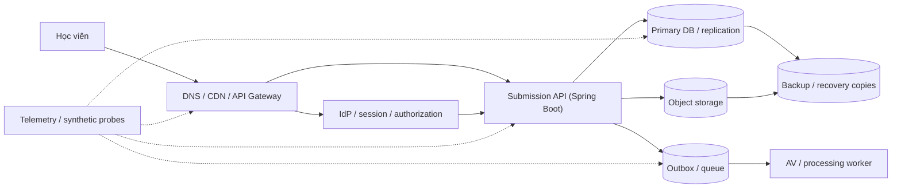
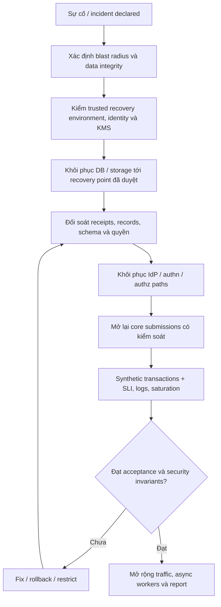

# Requirement về availability trong Security Assurance: từ mục tiêu kinh doanh đến bằng chứng vận hành

## 1. Availability requirement là gì?

**Availability (tính sẵn sàng)** là thuộc tính bảo mật phản ánh việc **hệ thống, dữ liệu và chức năng được những chủ thể được phép sử dụng vào thời điểm cần thiết**. Trong bộ ba CIA (*Confidentiality – Integrity – Availability*), availability không chỉ là “server vẫn chạy”. Một hệ thống có HTTP 200 nhưng không trả được điểm, người dùng không đăng nhập được, dữ liệu không truy cập đúng hạn hoặc hàng đợi bị tắc vẫn có thể **không sẵn sàng về mặt nghiệp vụ**.

**Requirement về availability** là một yêu cầu có thể kiểm tra, quy định *đối tượng dịch vụ, hành vi cần duy trì, điều kiện tải và sự cố, chỉ số, ngưỡng, cửa sổ thời gian, ngoại lệ, trách nhiệm và phép kiểm chứng*.

Trong chương **Security requirements** của module **SECURITY_SECURITY_ASSURANCE**, mục tiêu không phải chỉ ghi “hệ thống phải luôn sẵn sàng” mà là xây dựng chuỗi:

**Bối cảnh nghiệp vụ → kịch bản rủi ro → requirement đo được → kiến trúc/control → kiểm thử → evidence → đánh giá đạt/không đạt → khắc phục và đánh giá lại.**

Ví dụ với nền tảng học tập Java/Spring Boot:

- Học viên phải xem được bài giảng và nộp bài vào thời điểm trước hạn.
- Giáo viên phải truy cập được danh sách lớp và chấm điểm theo đúng quyền.
- Việc xác thực/ủy quyền không được biến thành “mở toàn bộ quyền” khi IdP hoặc policy service hỏng.
- Các bản ghi nộp bài đã xác nhận phải được bảo vệ khỏi mất mát khi database hoặc vùng hạ tầng gặp sự cố.
- Hệ thống phải có cách đo **người học thực sự hoàn thành tác vụ**, không chỉ đo container có hoạt động.

> **Nguyên tắc:** Availability phải được định nghĩa cho **một hành trình người dùng, một thời gian và một mức chất lượng cụ thể**. Không đánh đồng uptime của hạ tầng với khả năng hoàn thành nghiệp vụ.

### Mục tiêu học tập

Sau bài này, người học có thể:

1. Phân biệt availability, reliability, resiliency, durability, recoverability, performance và security.
2. Viết requirement **rõ phạm vi, đo được và kiểm thử được**, thay cho các tính từ mơ hồ.
3. Định nghĩa SLI/SLO, error budget, business criticality, RTO/RPO và các giả định đo lường.
4. Phân tích threat scenarios: DDoS, resource exhaustion, dependency outage, lỗi triển khai, ransomware, data corruption và failure tại control bảo mật.
5. Chọn security controls/architecture cho high availability, graceful degradation, rate limit, circuit breaker, backup, disaster recovery và monitoring.
6. Thiết kế kiểm thử load/stress/soak/failover/restore/chaos **được phê duyệt**, đánh giá outcome và bảo toàn security invariants.
7. Lập traceability matrix từ business objective đến requirement, control, test, evidence, finding và continuous assurance.

## 2. Availability khác reliability, resilience, performance và durability

| Khái niệm | Câu hỏi nó trả lời | Ví dụ LMS | Điều không được suy ra |
| --- | --- | --- | --- |
| **Availability** | Người dùng được phép có sử dụng được chức năng khi cần không? | Nộp bài thành công trước hạn. | CPU còn hoạt động không bảo đảm tác vụ thành công. |
| **Reliability** | Chức năng có hoạt động đúng, ổn định trong thời gian và điều kiện xác định không? | Mỗi yêu cầu nộp bài được xử lý nhất quán. | Reliability cao không tự đảm bảo khôi phục nhanh sau thảm họa. |
| **Resilience** | Khi gặp lỗi/tấn công, hệ thống hấp thụ, thích nghi và khôi phục ra sao? | Một node chết, các node còn lại tiếp nhận traffic. | Có auto-restart không có nghĩa hệ thống chịu được mọi loại lỗi. |
| **Recoverability** | Có thể phục hồi dịch vụ/dữ liệu sau gián đoạn không, trong bao lâu? | Restore database và đưa API về hoạt động. | Có bản backup không chứng minh restore thành công. |
| **Durability** | Dữ liệu đã cam kết có tồn tại qua hỏng hóc không? | Bài nộp đã báo thành công không biến mất. | Uptime cao không bảo đảm dữ liệu không bị mất/sai. |
| **Performance** | Độ trễ/thông lượng dưới tải là bao nhiêu? | p95 nộp bài hoàn tất dưới ngưỡng. | Trang phản hồi nhanh nhưng trả lỗi cũng không sẵn sàng. |
| **Capacity** | Khả năng phục vụ tải dự kiến và tăng đột biến. | Phục vụ hàng nghìn lượt thi/nộp bài đồng thời. | Scale-out không giải quyết bottleneck DB hoặc nhà cung cấp. |
| **Security availability** | Có phòng ngừa/phát hiện/phục hồi tác động làm mất dịch vụ do lỗi hay tấn công? | Rate limit chặn bot nhưng không khóa toàn bộ học viên hợp lệ. | Tăng availability không được đánh đổi bằng cách bỏ xác thực/phân quyền. |

**Các thuộc tính liên quan nhưng không thay thế nhau.** Một API có availability 99,99% theo network health check vẫn có thể bị người dùng coi là không khả dụng nếu mỗi lượt nộp bài mất 3 phút và hết hạn.

## 3. Xác định service boundary và user journey

Trước khi đặt chỉ tiêu phần trăm, phải nêu rõ **dịch vụ nào và hành vi nào** được bảo đảm. Ví dụ của nền tảng học tập:

| User journey / capability | Thành phần chính | Hậu quả nếu gián đoạn |
| --- | --- | --- |
| **Đăng nhập học viên** | IdP/SSO, auth gateway, session service. | Không vào hệ thống dù app/backend còn chạy. |
| **Xem bài giảng** | Web/API, CDN, object storage, authorization. | Gián đoạn học tập; có thể fallback nội dung cache đã được phép. |
| **Nộp bài** | Submission API, DB, object storage, virus scan/queue. | Không hoàn tất trước deadline; có nguy cơ mất bài hoặc nhận trùng. |
| **Xem điểm** | Grade API, DB, authorization, audit. | Người dùng không biết kết quả; dữ liệu nhạy cảm cần bảo vệ. |
| **Thi trực tuyến** | Session/proctoring nếu áp dụng, timer, submission, DB. | Ảnh hưởng đánh giá/công bằng và quy trình thi. |
| **Gửi thông báo** | Event bus, outbox, email/push vendor. | Thông báo đến muộn; có thể chấp nhận độ trễ có kiểm soát. |
| **Báo cáo vận hành** | Warehouse/analytics/dashboard. | Có thể giảm ưu tiên trong giờ thi để bảo vệ tác vụ cốt lõi. |

### Scope statement mẫu

> **AV-SCOPE-01:** Đánh giá availability cho hành trình “học viên đã xác thực nộp bài trước hạn”, từ web/API gateway qua xác thực, API nhận metadata, object storage, database commit đến biên nhận submission; áp dụng production khu vực triển khai đã định, trong các đợt nộp bài và cửa sổ 30 ngày. Không bao gồm chất lượng kết nối internet của người dùng cuối, nhưng mọi dependency do tổ chức lựa chọn phải được kiểm kê và chỉ rõ cách đo/ngoại lệ.

Điều quan trọng là **không tự động loại mọi sự cố third party khỏi SLO**. Nếu IdP hay cloud storage là dependency mà doanh nghiệp đã chọn, việc người dùng không sử dụng được dịch vụ vẫn là tác động thực tế. Phạm vi đo và trách nhiệm theo hợp đồng phải được định nghĩa minh bạch.

## 4. Từ business impact đến mục tiêu availability

Không nên chọn “five nines” vì nghe chuyên nghiệp. Mức yêu cầu xuất phát từ hậu quả nếu gián đoạn trong từng khung thời gian và đối tượng.

| Tiêu chí | Ví dụ câu hỏi | Hướng xử lý |
| --- | --- | --- |
| **Criticality** | Mất dịch vụ ảnh hưởng học viên, điểm thi, quyền lợi hay doanh thu thế nào? | Ưu tiên nộp bài/thi hơn dashboard thống kê. |
| **Time sensitivity** | Có deadline hoặc thời điểm cao điểm không? | Đặt profile cao điểm khác thời gian bình thường nếu được phê duyệt. |
| **User population** | Một lớp hay toàn tổ chức bị ảnh hưởng? | Xem phân tán theo region, tenant, cohort. |
| **Data loss tolerance** | Có thể mất bao nhiêu dữ liệu đã xác nhận? | Xác định RPO và acknowledgment semantics. |
| **Recovery urgency** | Cần phục hồi trước mốc nào? | Xác định RTO cho từng tier/dịch vụ. |
| **Adversarial exposure** | Có bị bot/DDoS, credential attacks, malware, ransomware? | Thiết kế controls theo threat model. |
| **Dependencies** | IdP, DNS, payments, storage, cloud region, vendor nào là single point of failure? | Vẽ dependency graph và fallback hợp lệ. |
| **Legal/contract** | Có cam kết availability và quy trình thông báo/khắc phục nào? | Phân biệt SLO nội bộ với SLA hợp đồng. |

### Business Impact Analysis (BIA)

Một **BIA** liên kết chức năng với tác động theo khoảng thời gian gián đoạn. Nó cung cấp cơ sở chọn recovery objectives và ưu tiên khôi phục. BIA không tự là technical architecture: hai dịch vụ cùng RTO có thể cần giải pháp hoàn toàn khác vì dependencies, ngân sách và dữ liệu.

Ví dụ định hướng: *Nếu học viên không nộp được bài trong 15 phút cuối trước hạn, hậu quả có thể cao hơn một giờ lỗi dashboard vào đêm khuya.* Vì vậy phải kiểm **error distribution theo thời điểm**, không chỉ trung bình tháng.

## 5. Viết availability requirement có thể kiểm chứng

Một requirement tốt thường chứa:

1. **Identifier + version:** mã duy nhất, người duyệt, trạng thái.
2. **Capability + eligible users:** chức năng và chủ thể được áp dụng.
3. **Operating conditions:** tải, vùng, thời gian, dependencies, giả định.
4. **Expected behavior:** một outcome rõ, gồm xử lý lỗi và dữ liệu.
5. **Metric + threshold + window:** đo bằng gì, ngưỡng nào, trong khoảng nào.
6. **Measurement method:** điểm quan sát, mẫu số, exclusions, synthetic/user monitoring.
7. **Verification:** test nào, expected/actual/evidence và quyết định đạt.
8. **Owner + escalation:** ai triển khai, ai theo dõi, ai phê duyệt ngoại lệ.

### Ví dụ yêu cầu mơ hồ và bản viết lại

| Câu mơ hồ | Vì sao chưa đạt | Requirement tốt hơn |
| --- | --- | --- |
| “Hệ thống phải luôn online.” | Không xác định chức năng, ngưỡng và thời gian. | “API nộp bài có SLI successful eligible submissions ≥99,95% trong cửa sổ 30 ngày, tính theo định nghĩa SLI-AV-01.” |
| “Khôi phục nhanh khi lỗi.” | Không có mốc tính, thứ tự service, test. | “Sau khi declared regional DB outage, khôi phục khả năng tiếp nhận submission được phép trong RTO đã duyệt, xác minh bằng failover drill.” |
| “Không được mất dữ liệu.” | Không nói dữ liệu nào, trước/sau commit, loại lỗi. | “Bài nộp đã trả receipt COMMITTED được bảo vệ theo RPO áp dụng; test đối soát receipts với objects/DB sau restore.” |
| “Chống DDoS.” | Không định nghĩa mức tải, người dùng hợp lệ, cách đo. | “Tại tải thử đã phê duyệt, rate controls giới hạn traffic bot và duy trì SLO/latency của user cohort hợp lệ.” |
| “Có backup để bảo đảm availability.” | Không chứng minh backup restore hay dependency. | “Bản backup theo retention và RPO, restore drill đạt RTO/data-integrity criteria với evidence.” |

### Mẫu Given–When–Then

> **AV-REQ-01 – Submission availability:** **Given** học viên được xác thực, có quyền nộp, file nằm trong giới hạn và hệ thống đang vận hành trong traffic envelope đã duyệt; **When** gửi request nộp bài hợp lệ trong measurement window; **Then** tỷ lệ hoàn tất thành công theo SLI-AV-01 đạt ít nhất 99,95% trong cửa sổ 30 ngày, các lỗi được đo và báo cáo theo cohort/region, kể cả các dependency trong phạm vi.

Giá trị 99,95% là **ví dụ**, không phải mục tiêu bắt buộc cho mọi tổ chức. Phải xác định cách đo và business review trước khi cam kết.

## 6. SLI, SLO và SLA: ba khái niệm không đồng nhất

- **SLI (Service Level Indicator):** số đo thực tế về một thuộc tính dịch vụ, ví dụ tỉ lệ yêu cầu nộp bài đủ điều kiện thành công.
- **SLO (Service Level Objective):** mục tiêu cho SLI trong cửa sổ và phạm vi xác định, ví dụ ≥99,95% trong 30 ngày.
- **SLA (Service Level Agreement):** cam kết hợp đồng/dịch vụ có phạm vi, trách nhiệm và hệ quả khi vi phạm; không nhất thiết đồng nhất SLO kỹ thuật.

### SLI theo request-based availability

\[
\mathrm{SLI}_{availability} =
\frac{\text{số eligible good events}}
{\text{số eligible total events}}\times100\%
\]

**“Good” và “eligible” phải được định nghĩa.** Ví dụ:

- “Good”: request nộp bài hợp lệ nhận receipt `COMMITTED` với dữ liệu bền vững theo contract, trong giới hạn thời gian đã duyệt.
- “Eligible”: request từ học viên có quyền, format/kích thước hợp lệ, đến endpoint production thuộc scope.
- HTTP 4xx do client thiếu quyền hoặc file không hợp lệ có thể không thuộc mẫu số availability, **nhưng 429/503 áp lên học viên hợp lệ do server quá tải** không nên tự động loại để làm đẹp chỉ số.
- HTTP 200 khi server chỉ queue task không có guarantee và sau đó làm mất bài **không nên tính “Good”** nếu nghiệp vụ yêu cầu biên nhận bền vững.
- Retries có thể làm tăng tổng request và che trải nghiệm người dùng; cần đo cả *attempt-based* và *user-journey-based* khi phù hợp.

### Time-based availability

\[
\mathrm{Availability}_{time} =
\frac{\text{thời gian đáp ứng tiêu chí service}}
{\text{tổng thời gian thuộc scope}}\times100\%
\]

Time-based có thể phù hợp với service probes, nhưng **“process alive” không đồng nghĩa “journey usable”**. Tỷ lệ theo thời gian và theo request có thể rất khác nhau trong giờ cao điểm; khi cần cả hai, công bố rõ từng chỉ số.

## 7. Error budget và cách tránh che giấu sự cố

**Error budget** biểu diễn phần lỗi/downtime mà SLO cho phép trong cửa sổ được định nghĩa.

Với một SLO request-based là 99,95%, error budget là 0,05% eligible events. Nếu có 2.000.000 eligible events trong cửa sổ đó, ngân sách tương ứng **1.000 bad events**. Với time-based SLO 99,95% trong cửa sổ 30 ngày (43.200 phút), ngân sách tương ứng khoảng **21,6 phút** dịch vụ không đạt tiêu chí. Hai phép tính này **không hoán đổi** nếu phân bố traffic thay đổi.

| SLO minh họa | Error budget time-based trong 30 ngày | Điều kiện |
| --- | --- | --- |
| 99,0% | 432 phút (7 giờ 12 phút) | Giả định đo trên toàn bộ 43.200 phút. |
| 99,9% | 43,2 phút | Không tự loại planned maintenance nếu chưa được định nghĩa/duyệt. |
| 99,95% | 21,6 phút | Cần thống nhất cách làm tròn/tính khoảng lỗi. |
| 99,99% | 4,32 phút | Chi phí và độ khó vận hành có thể tăng đáng kể. |

**Error budget không phải giấy phép để tạo lỗi hay bỏ qua bảo mật.** Nó hỗ trợ cân bằng thay đổi, phát hành và mức rủi ro; security controls vẫn phải đáp ứng nghĩa vụ riêng.

### Các cách làm sai SLO

- Chỉ đo uptime ở node khỏe nhất.
- Bỏ qua sự cố authentication vì “IdP do vendor vận hành”.
- Loại tất cả yêu cầu 5xx trong giờ cao điểm với lý do “abnormal traffic”.
- Thay đổi SLI definition giữa tháng nhưng không version/reconcile.
- Cộng số phút outage theo các region không có user traffic như downtime toàn bộ service.
- Chỉ tính synthetic probe từ cùng VPC mà user ngoài internet thực sự không truy cập được.

**Assurance yêu cầu phương pháp đo có thể tái tạo**, gồm pipeline query, metric labels, retention, exclusion decisions và quyền thay đổi dashboard.

## 8. Phân phối lỗi và chỉ số theo trải nghiệm

Không đánh giá availability chỉ bằng trung bình toàn bộ. Cần nhìn:

| Góc nhìn | Vì sao cần? | Ví dụ |
| --- | --- | --- |
| **Region/AZ** | Mất một region có thể được trung bình toàn cầu che lấp. | Học viên ở khu vực A không tải được bài giảng. |
| **Tenant/cohort** | Một trường hoặc lớp bị lỗi trong khi tổng hệ thống vẫn xanh. | Một tenant có mapping sai storage bucket. |
| **User journey** | Login tốt nhưng nộp bài thất bại. | Submit receipt không commit được. |
| **Time of day** | Outage 5 phút trước deadline nghiêm trọng hơn khi ít người dùng. | Hệ thống thi trong giờ tập trung. |
| **Client type** | Mobile, web, browser cũ chịu lỗi khác nhau. | Mobile timeout do DNS/cert. |
| **Dependency** | API availability bị chi phối bởi DB/IdP/storage. | DB read-only replica stale hoặc storage down. |
| **Latency/tail** | p95/p99 tăng có thể khiến journey không dùng được dù không có 5xx. | Request nộp mất 90 giây, user bỏ cuộc. |

Một availability requirement có thể cần **companion latency/quality requirement**, ví dụ “95% good submissions hoàn tất trong 3 giây ở tải đã định”, nhưng **ngưỡng và phương pháp đo phải được phê duyệt theo business need**; không mặc định mọi use case giống nhau.

## 9. RTO, RPO và mục tiêu phục hồi

**RTO (Recovery Time Objective)** là thời hạn mục tiêu để khôi phục một hoạt động/dịch vụ sau sự cố theo mốc và định nghĩa đã chọn. **RPO (Recovery Point Objective)** là mức mất dữ liệu theo thời gian mà tổ chức có thể chấp nhận khi phục hồi.

| Mục tiêu | Trả lời | Ví dụ và cách kiểm |
| --- | --- | --- |
| **RTO** | Sau gián đoạn được định nghĩa, phải khôi phục khả năng phục vụ trong bao lâu? | Khôi phục API nộp bài ở trạng thái usable trong ≤30 phút sau khi declare incident; test failover/restore. |
| **RPO** | Dữ liệu đã ghi trước sự cố có thể bị mất tối đa tương đương bao nhiêu thời gian? | Recovery point không cũ hơn 5 phút so với mốc mất dịch vụ; đối soát commits. |
| **Maximum tolerable downtime / disruption** | Tổ chức chịu đựng gián đoạn tối đa trước khi tác động không chấp nhận được? | BIA xác lập giới hạn; RTO thường nên nằm trong giới hạn đó. |
| **Backup retention** | Giữ bản phục hồi bao lâu? | 30 ngày hoặc theo chính sách thực tế; không thay thế RPO. |
| **Recovery verification** | Sau restore có đúng dữ liệu, quyền và kiểm soát không? | Receipt reconciliation, security invariants, corruption tests. |

Các con số trên là **minh họa**, cần lựa chọn theo rủi ro/nghiệp vụ. RTO và RPO là **mục tiêu thiết kế/đo**, không tự là bảo đảm đạt trong mọi tình huống.

### Phân biệt recovery point và bản backup

Nếu chỉ backup DB mỗi 24 giờ, không thể tự khẳng định RPO 5 phút. Muốn đạt RPO nhỏ cần thiết kế log shipping/replication, backup khác, transaction durability và xác minh failover. **Replication không thay backup**: xóa nhầm, corruption hoặc ransomware có thể được sao chép sang replica.

### RTO bắt đầu khi nào?

Cần xác định mốc: từ khi lỗi thực sự bắt đầu, được phát hiện, được declare, hay khi failover được kích hoạt? Nếu SLO ghi “30 phút từ lúc declare” nhưng detection mất 45 phút, người dùng có thể bị ảnh hưởng 75 phút. Nên đo thêm **time to detect, time to declare, time to mitigate và total user-visible outage**.

## 10. Sơ đồ phụ thuộc và điểm lỗi đơn

Một hành trình nộp bài có nhiều thành phần độc lập; muốn availability end-to-end, phải kiểm chúng như một chuỗi.



**Các câu hỏi thiết kế:**

- DNS, ingress, load balancer, nodes và service discovery có đường dự phòng?
- IdP/token validator/authorization có gây outage khi không truy vấn được?
- Database/queue/storage có single point of failure hoặc giới hạn quota/rate?
- Nếu object storage nhận file nhưng DB commit thất bại, trạng thái submission là gì?
- Nếu DB đã commit nhưng HTTP response bị mất, retry có tạo submission trùng không?
- Nếu virus scan/worker chậm, có nên chặn nhận bài hay tách pending/accepted semantics?
- Backup có thể restore khi primary account bị compromise, encryption key bị mất hoặc region down?

**Availability là đặc tính của một hành trình**, không phải phép nhân đơn giản các uptime quảng cáo của vendor; các failures có thể tương quan (cùng region, DNS, IAM, control plane, KMS hoặc operator).

## 11. Ranh giới bảo mật: availability không được tạo fail-open

Một hệ thống sẵn sàng nhưng cho phép truy cập sai quyền sẽ thất bại về security assurance. Khi dependency bảo mật lỗi, cần **failure policy có chủ đích**.

| Tình huống | Hành vi nguy hiểm | Hành vi cần đánh giá |
| --- | --- | --- |
| **IdP down** | Bỏ xác thực để học viên “vẫn vào được”. | Phân biệt phiên/token đã được xác minh và login mới; TTL/caching theo risk. |
| **Authorization PDP unavailable** | Cho phép tất cả role/tenant vì “không truy vấn được policy”. | Fail closed đối với hành động nhạy cảm, hoặc cơ chế stale decision rất hạn chế nếu được duyệt. |
| **KMS unavailable** | Đưa plaintext/hard-coded key fallback vào production. | Degraded/queue/retry theo khả năng; không làm lộ dữ liệu/khóa. |
| **WAF/rate limit outage** | Tắt mọi chống lạm dụng vô thời hạn. | Emergency policy có traffic protection, owner, thời hạn và monitoring. |
| **Audit pipeline unavailable** | Im lặng bỏ security events quan trọng. | Buffer/retry hoặc hạn chế action không thể audit theo policy; cảnh báo thiếu evidence. |
| **Storage read-only** | Cho phép nộp bài và trả SUCCESS dù không commit. | Từ chối/queue bền vững với biên nhận có ngữ nghĩa chính xác. |

Không phải mọi chức năng đều phải ngừng khi dependency bảo mật lỗi. Có thể tiếp tục **đọc nội dung công khai**, dùng **cache được xác minh cho người có quyền trong thời hạn ngắn** hoặc hiển thị thông báo bảo trì. Nhưng bất kỳ graceful degradation nào cũng cần **policy, scope, security invariants và test**.

## 12. Threat modeling cho availability

| Threat ID | Kịch bản | Hệ quả | Control cần đánh giá |
| --- | --- | --- | --- |
| **THR-AV-01** | DDoS volumetric ở edge. | Học viên hợp lệ không truy cập được. | Upstream mitigation, CDN/WAF, traffic drills và vendor capacity. |
| **THR-AV-02** | Application-layer request flood hoặc bot login. | Exhaust threads, connections, DB pool. | Rate limits theo identity/IP/context, quotas, backpressure. |
| **THR-AV-03** | Slowloris/large payload, zip bomb, parser abuse. | Tốn memory/CPU, chết worker. | Body limits, timeouts, bounded parsing/scanning. |
| **THR-AV-04** | DB primary mất điện hoặc region outage. | Submission không commit được. | HA/failover, multi-AZ, tested recovery. |
| **THR-AV-05** | Queue consumer ngừng, backlog tăng vô hạn. | Thông báo/scanning nộp bài chậm, exhausted storage. | Queue depth alerts, DLQ, scaling, retries, priority. |
| **THR-AV-06** | IdP, KMS hoặc DNS vendor gặp outage. | User journey gián đoạn. | Dependency risk, cache policy, alternate paths hợp lệ. |
| **THR-AV-07** | Deploy lỗi hoặc schema migration không tương thích. | API crash/5xx trên diện rộng. | Canary, feature flags, compatibility, rollback, release gates. |
| **THR-AV-08** | Ransomware xóa/mã hóa DB, backup online. | Dịch vụ ngừng, data recovery bị chặn. | Immutable/offline backups, credential separation, restore drill. |
| **THR-AV-09** | Certificate/key hết hạn hoặc rotation sai. | TLS/secret access ngừng. | Inventory, expiry alerts, overlap tests. |
| **THR-AV-10** | Học viên nộp lặp khi response timeout. | Duplicate writes, inconsistency, tăng tải. | Idempotency key, transaction semantics, retry budget. |
| **THR-AV-11** | Cache stampede/hot key. | Cascading failure tới DB. | TTL jitter, request coalescing, concurrency bounds. |
| **THR-AV-12** | Observability pipeline chết. | Không phát hiện outage, báo SLO sai. | Synthetic probes, telemetry health, independent checks. |
| **THR-AV-13** | Attacker lạm dụng khóa tài khoản/rate limit. | Denial-of-service với người dùng hợp lệ. | Adaptive controls, safe lockout, anti-enumeration. |
| **THR-AV-14** | Dữ liệu bị corruption và replication lan lỗi. | Khôi phục từ replica thất bại. | Point-in-time recovery, backup isolation, restore verification. |
| **THR-AV-15** | Split-brain/write dual-master khi failover. | Mất/ghi đè submission. | Fencing, leader election, consistency policy, drills. |
| **THR-AV-16** | Nhân viên có đặc quyền xóa tài nguyên hoặc sửa policy sai. | Outage lớn hoặc DR bị vô hiệu. | Least privilege, change review, break-glass, audit. |

**Threat model là mô tả khả năng xảy ra; finding cần bằng chứng** rằng một control không đáp ứng requirement trong scope. Dùng rủi ro để ưu tiên đánh giá, không tự gán mọi threat một trạng thái FAIL.

## 13. Các loại sự cố cần đưa vào reliability envelope

Một requirement muốn kiểm được phải chỉ ra hệ thống có thể chịu **những loại lỗi nào**:

| Fault model | Ví dụ | Bằng chứng kiểm thử |
| --- | --- | --- |
| **Single-instance failure** | Một pod Spring Boot crash. | Kubernetes restart, traffic reroute, request outcomes. |
| **Zone failure** | Một availability zone không truy cập được. | Multi-AZ failover drill, regional metrics. |
| **Region failure** | Data center/vùng cloud mất. | DR switch procedure, data recovery và DNS timing. |
| **Dependency degradation** | IdP/KMS/queue tăng latency hoặc timeout. | Timeout/circuit breaker, security failure tests. |
| **Network partition** | Service không liên lạc DB/leader. | Consistency/fencing, failover correctness. |
| **Capacity pressure** | Load tăng đột biến, connection pool cạn. | Stress/overload tests, queue/backpressure metrics. |
| **Malicious traffic** | Bots tăng request rate. | Load + abuse tests có phê duyệt, legitimate-user SLI. |
| **Data loss/corruption** | Storage error, operator mistake, ransomware. | PITR/immutable backup restore và reconciliation. |
| **Change-induced failure** | Deploy/schema/cert/secret rotation lỗi. | Canary/rollback/compatibility drills. |

Không tuyên bố “chịu được thảm họa” nếu chỉ thử kill một pod. Fault model cần gắn **giả định, recovery tier, giới hạn test và source evidence**.

## 14. Availability control phải gắn với failure domain

**High Availability (HA)** là tập thiết kế nhằm giảm tác động từ những lỗi thuộc failure model đã chọn. HA không đồng nghĩa “không bao giờ downtime”, và không tự thay thế **Disaster Recovery (DR)**.

| Mục tiêu | Control thiết kế | Failure mode cần xem | Assurance evidence |
| --- | --- | --- | --- |
| Một instance chết nhưng dịch vụ vẫn phục vụ. | Replicas, readiness probes, health routing. | Shared config/DB/pool vẫn có thể lỗi. | Pod-kill drill, synthetic user flow. |
| Một AZ mất vẫn phục vụ ở AZ khác. | Multi-AZ, load-balancer spread, DB failover. | Quorum, cross-AZ latency, zonal dependencies. | AZ-failure exercise, placement and traffic evidence. |
| Release lỗi không gây gián đoạn diện rộng. | Canary/blue-green, feature flags, rollback. | Schema changes, shared migrations và bad config. | Canary gates, rollback tests, change records. |
| DB failover không làm hỏng submissions. | Replication, fencing, transaction durability. | Split-brain, stale replica, lost acknowledged writes. | Failover tests + data reconciliation. |
| Region outage không làm gián đoạn quá RTO. | Cross-region DR, backups, runbooks, routing. | Control plane, data sync, DNS TTL, KMS/IdP regionality. | Timed recovery drill + RPO evidence. |
| Attack traffic không ngăn user hợp lệ. | Upstream DDoS protection, rate limiting, quotas. | Shared rate-limit store, false positives, resource exhaustion. | Adversarial capacity test có phê duyệt. |

### Tránh “redundancy ảo”

Hai instance cùng một node hoặc AZ, hai storage copies trong cùng account, hay hai API gateways phụ thuộc cùng một IAM/control plane **không tạo fault independence** tương ứng. Phải đánh giá:

- **Failure domains:** process, node, rack, AZ, region, account, provider, organization.
- **Common-mode failures:** cấu hình chung, lỗi release, certificate, DNS, identity provider, KMS, mạng.
- **Operational dependency:** con người, quyền khôi phục, tài liệu và khả năng truy cập công cụ khi sự cố.
- **Capacity after failover:** bên còn lại có phục vụ traffic khi một phần hạ tầng mất không?

Availability target càng nghiêm ngặt, càng cần **evidence về failure independence và khả năng phục hồi** thay vì chỉ số replicas.

## 15. Phân loại tier và đặt mục tiêu có cơ sở

Tổ chức có thể chia dịch vụ theo **criticality tier** và thiết lập profile khác nhau. Bảng sau chỉ minh họa cách thể hiện, **không là tiêu chuẩn bắt buộc**:

| Tier minh họa | Capability | Mục tiêu chính | Kiểm chứng cần ưu tiên |
| --- | --- | --- | --- |
| **T1 – Mission critical** | Nộp bài thi trong phiên có thời hạn. | SLO chặt theo journey/peak window, RTO/RPO phù hợp BIA. | E2E submit, overload, AZ/DB outage, restore, receipts. |
| **T2 – Business critical** | Đăng nhập/xem dữ liệu cá nhân. | SLO theo user journeys, authn/authz không fail-open. | IdP outage, token TTL, DB failover, p95/p99. |
| **T3 – Important** | Xem bài giảng, tài liệu được cấp quyền. | Graceful degradation, caching và đo theo vùng. | CDN/object storage failure, client experience. |
| **T4 – Deferrable** | Báo cáo analytics không theo thời gian thực. | Backlog/reprocessing và deadline hoàn tất. | Queue recovery, idempotency, data freshness, batch completion. |

T1 không luôn phải là “99,999%”; đôi khi **thời điểm thi và khả năng kéo dài deadline có quy trình** quan trọng hơn tối ưu uptime tháng. Business owner phải chấp nhận recovery strategy, không chỉ SRE tự đặt SLO.

## 16. Graceful degradation: giảm chức năng nhưng giữ nguyên security invariants

**Graceful degradation** cho phép hệ thống tiếp tục cung cấp **một tập chức năng nhỏ hơn** khi một dependency lỗi, với trạng thái hiển thị trung thực.

| Sự cố | Có thể giữ | Phải tránh |
| --- | --- | --- |
| Recommendation engine down | Hiển thị danh sách khóa học không cá nhân hóa. | Dùng dữ liệu gợi ý của người khác do cache nhầm tenant. |
| Email provider down | Vẫn ghi submission bền vững; gửi thông báo lại từ outbox sau. | Coi email gửi thành công là tiêu chí duy nhất xác nhận nộp bài. |
| Analytics warehouse down | Tiếp tục học/nộp bài, trì hoãn dashboard. | Đẩy mọi API vào retry tới warehouse làm nghẽn tài nguyên. |
| Auth service chậm | Dùng phiên đã xác minh với TTL/rules được phê duyệt. | Tự cho login mới không cần kiểm hoặc bỏ authorization. |
| DB chỉ read-only | Cho xem thông tin đã được phép nếu dữ liệu hợp lệ. | Trả receipt thành công cho submission chưa commit. |
| Một AZ mất | Route tới AZ khỏe đủ capacity. | Cố ghi cả hai primaries dẫn tới split-brain. |

### Degraded-mode requirement mẫu

> **AV-REQ-07:** Khi recommendation dependency không sẵn sàng quá timeout đã duyệt, trang danh sách khóa học phải tiếp tục hiển thị các khóa học công khai/được phân quyền mà không gọi API recommendation đồng bộ; không làm lộ dữ liệu cá nhân, và trạng thái degraded được phản ánh trong telemetry.

“Fail closed” ở authorization và “gracefully degrade” ở giao diện không mâu thuẫn nếu thiết kế **đường public/đã xác minh rõ ràng**.

## 17. Resource exhaustion, rate limiting và admission control

Một availability requirement cần quan tâm cả **tải lành tính** và **tải đối kháng**. Khi quá tải, hệ thống phải tránh biến một thành phần chậm thành lỗi dây chuyền.

### Các lớp kiểm soát

1. **Edge/WAF/CDN/DDoS protection:** lọc/chặn/làm chậm traffic không hợp lệ tại điểm phù hợp.
2. **Authentication-aware rate limits:** theo account, IP, tenant, token/client, hành động và risk profile.
3. **Per-resource quotas:** giới hạn upload size, API concurrency, session creation, job budgets.
4. **Timeouts/deadlines:** giới hạn tổng thời gian chờ; propagating deadlines qua call chains.
5. **Bulkheads:** tách thread/connection pools giữa chức năng quan trọng và không quan trọng.
6. **Circuit breakers:** không tiếp tục dồn yêu cầu vào dependency đang lỗi, có half-open/recovery policy.
7. **Backpressure/admission control:** từ chối sớm hoặc đưa vào hàng đợi có giới hạn, không giữ vô hạn.
8. **Autoscaling/capacity planning:** scale theo signals phù hợp, có headroom và budget.
9. **Retry discipline:** chỉ retry lỗi có khả năng hồi phục, jitter/exponential backoff, capped attempts.
10. **Priority/fairness:** bảo vệ traffic hợp lệ và chức năng critical; tránh starvation.

### Rate limit có thể gây DoS cho user hợp lệ

Nếu toàn trường dùng chung NAT IP, một bot có thể vượt giới hạn IP khiến học viên bị khóa. Cần kiểm **tính công bằng, giới hạn theo user/tenant, phân biệt abuse với giờ cao điểm, retry-after và cách mở khóa**. Không lấy tỉ lệ block requests làm bằng chứng availability cao nếu requests hợp lệ bị chặn.

### Retry storms

Giả sử API A gọi B, B gọi C; mỗi lớp retry ba lần. Một request có thể tạo số lượt tới C tăng mạnh trong lỗi cascade. Cần **retry budget tổng**, deadlines, idempotency, circuit breaker, exponential backoff và jitter; không dùng “retry vô hạn cho chắc”.

## 18. Spring Boot: health probes là tín hiệu, không phải lời bảo đảm

Spring Boot Actuator thường cung cấp **liveness** và **readiness** probes. Cần hiểu:

- **Liveness:** process/app có kẹt trong trạng thái không thể phục hồi bằng tiếp tục chạy không? Dùng để restart khi thật sự cần.
- **Readiness:** instance có thể nhận traffic mới an toàn không? Dùng cho traffic routing.
- **Dependency availability:** DB/IdP/KMS đang đáp ứng? Không nhất thiết đồng nghĩa liveness của process.
- **User-journey availability:** người học có thể hoàn thành thao tác thật? Cần synthetic/E2E probes và telemetry ngoài health.

### Cấu hình minh họa

```yaml
# Spring Boot configuration example; check actual Boot/Actuator version.
management:
  endpoint:
    health:
      probes:
        enabled: true
      group:
        readiness:
          additional-path: server:/readyz
        liveness:
          additional-path: server:/livez
  endpoints:
    web:
      exposure:
        include: health,info,prometheus

server:
  shutdown: graceful

spring:
  lifecycle:
    timeout-per-shutdown-phase: 30s
```

**Đây là ví dụ cấu hình**, không bảo đảm tất cả version/port/topology hỗ trợ cùng thuộc tính. Endpoint metrics phải được bảo vệ phù hợp, không public secrets/PII. Với hệ thống dùng Kubernetes/ingress, phải test **readiness transitions, startup, graceful termination và routing** trong cluster thực tế.

### Những lỗi probe phổ biến

| Anti-pattern | Hệ quả | Cách đánh giá |
| --- | --- | --- |
| Liveness gọi DB/KMS/IdP ngoài. | Dependency outage khiến mọi pod restart liên tục. | Dependency-failure drill, restart counts. |
| Readiness luôn trả UP dù app không dùng được. | Traffic gửi đến instance lỗi. | Synthetic transaction, controlled dependency failure. |
| Probe quá nặng hoặc qua mạng xa. | Probe tự góp phần tăng tải/outage. | Probe latency/timeout tests. |
| Startup probe thiếu cho app khởi động lâu. | Pod bị kill trước khi sẵn sàng. | Cold-start/load tests. |
| Không graceful shutdown. | Request đang xử lý bị cắt gây submission duplicate/lost. | Rolling update/drain tests. |
| Một readiness failure tắt toàn bộ pods đồng thời. | Cascading outage. | Fault injection và capacity analysis. |

**Kết luận giới hạn:** `/actuator/health` trả UP chỉ hỗ trợ claim một mức **component health**; nó không thay chứng cứ SLO user journey.

## 19. Java/Spring: idempotency cho thao tác nộp bài

Tăng availability thường cần retry; retry ở request ghi có thể **tạo dữ liệu trùng hoặc thay đổi trạng thái ngoài ý muốn**. Biên nhận cần có ngữ nghĩa rõ: chỉ phản hồi “COMMITTED” khi transaction/data bền vững đã đáp ứng contract.

### Pseudocode minh họa

```java
// Simplified application pseudocode, not copy-paste production code.
@Service
public class SubmissionService {
    private final SubmissionRepository submissions;
    private final AuthorizationPolicy policy;
    private final ReceiptRepository receipts;

    @Transactional
    public SubmissionReceipt submit(
            AuthenticatedPrincipal principal,
            UUID assignmentId,
            String idempotencyKey,
            SubmissionCommand command) {
        policy.requireCanSubmit(principal, assignmentId);

        // One subject + assignment + idempotency key identifies an intent.
        // A real implementation must use a DB unique constraint/lock
        // and verify matching request payload for repeated keys.
        SubmissionReceipt previous = receipts.findCommitted(
            principal.subjectId(), assignmentId, idempotencyKey);
        if (previous != null) {
            previous.requireSamePayload(command);
            return previous;
        }

        Submission stored = submissions.createAuthorized(
            principal.subjectId(), assignmentId, command);
        return receipts.recordCommitted(
            stored.id(), idempotencyKey, command.digest());
    }
}
```

**Giới hạn rất quan trọng:** Mã là pseudocode của phần transaction database. Nếu file được upload lên object storage ngoài DB transaction, không có atomicity tự động giữa hai hệ thống. Cần **upload/session state, content checksum, transaction/outbox, compensation/reconciliation, durable receipt semantics, duplicate requests và crash recovery** được thiết kế riêng. Không dùng `@Transactional` làm bằng chứng mọi writes trên storage/queue đều atomic.

### Mẫu acceptance criteria

> **AV-REQ-09:** Khi một request submission hợp lệ bị timeout sau khi server đã commit, retry cùng idempotency key và payload phải trả lại cùng receipt, không tạo thêm một submission hay ghi đè dữ liệu khác; retry cùng key nhưng khác payload phải bị từ chối hoặc xử lý conflict theo policy, có audit an toàn.

**Tính toàn vẹn là điều kiện của availability có ý nghĩa:** “service trả được response” không có giá trị nếu kết quả bị trùng/sai.

## 20. Circuit breaker, timeout và bulkhead cho dependencies

Ví dụ, service `course-page` gọi `recommendation-service` để gợi ý khóa học. Khi recommendation chậm, không nên làm trang học tập chính treo vô hạn.

### Pseudocode cấu hình Resilience4j minh họa

```yaml
resilience4j:
  circuitbreaker:
    instances:
      recommendation:
        slidingWindowSize: 100
        minimumNumberOfCalls: 20
        failureRateThreshold: 50
        waitDurationInOpenState: 30s
  timelimiter:
    instances:
      recommendation:
        timeoutDuration: 800ms
  bulkhead:
    instances:
      recommendation:
        maxConcurrentCalls: 30
        maxWaitDuration: 0ms
```

**Những số này chỉ là ví dụ cần load-test/tune**; property support phụ thuộc Resilience4j/Spring versions, execution model và cách thực sự áp dụng annotation/decorator. Cấu hình được viết ra không chứng minh code đã dùng circuit breaker, hoặc time limiter thực sự cancel HTTP call.

### Các câu hỏi bắt buộc

- Timeout budget của call chain có phù hợp với deadline user journey?
- Khi circuit breaker OPEN, service có fallback **an toàn, được phân quyền và không lộ PII**?
- Bộ đếm lỗi có tách 4xx do user input khỏi 5xx/timeout thật?
- Cơ chế half-open có tránh traffic spike làm dependency lỗi tiếp?
- Thread/connection pool được tách khỏi luồng nộp bài critical?
- Khi dependency hồi phục, dữ liệu stale/cached có còn được phép dùng và được kiểm freshness?
- Có test chứng minh fallback hoạt động **trong runtime** thay vì chỉ dựa vào property file?

## 21. Kubernetes và autoscaling: tăng pods không tự đạt SLO

### Một manifest minh họa

```yaml
apiVersion: autoscaling/v2
kind: HorizontalPodAutoscaler
metadata:
  name: submission-api
spec:
  scaleTargetRef:
    apiVersion: apps/v1
    kind: Deployment
    name: submission-api
  minReplicas: 3
  maxReplicas: 12
  metrics:
    - type: Resource
      resource:
        name: cpu
        target:
          type: Utilization
          averageUtilization: 65
```

Các giá trị chỉ phục vụ minh họa. Một HPA cần **resource requests và metrics**, scheduling capacity, pod startup, DB/storage/headroom, autoscaler behavior và rollout constraints; minReplicas=3 không chứng minh 3 pod ở các failure domains độc lập.

### Các điều kiện cần đánh giá cùng HPA

| Control | Tại sao cần? | Test |
| --- | --- | --- |
| **Pod distribution/anti-affinity/topology spread** | Tránh mọi pod ở một node/AZ. | Terminate node/AZ scenario. |
| **PodDisruptionBudget** | Giới hạn voluntary disruptions; không ngăn mọi involuntary outage. | Rolling upgrade/drain. |
| **Readiness/startup/liveness** | Route và restart đúng. | Cold start, dependency faults. |
| **Resource requests/limits** | Scheduler có cơ sở đặt pods; tránh OOM/starvation. | Stress, OOM/load test. |
| **Connection pools** | Scale API có thể làm cạn DB connections. | Connection exhaustion drill. |
| **Queue and worker capacity** | API tiếp nhận nhanh nhưng worker backlog có thể bùng nổ. | Queue depth, processing deadline. |
| **Circuit breaker/backpressure** | Tránh bắn request vào dependency đang quá tải. | Inject timeouts/429/503. |

Availability architecture cần **capacity after failure**: khi mất một AZ, autoscaling/remaining nodes có đủ để xử lý tải critical trong giới hạn mục tiêu không?

## 22. Database availability, consistency và durability

Database thường là dependency khó nhất của high-availability architecture:

| Kịch bản | Vấn đề | Cách đánh giá |
| --- | --- | --- |
| Primary failover | Leader đổi nhưng transaction đang xử lý có thể chưa hoàn tất. | Failover duration, transaction outcomes, duplicate retries. |
| Async replication lag | Replica có thể thiếu writes mới nhất. | RPO measurement, lag alert, user-visible consistency. |
| Split-brain | Hai leaders nhận writes song song gây xung đột. | Fencing, quorum/leader election, conflict tests. |
| Storage corruption | Lỗi được replication sang các copies khác. | PITR/backup restore, integrity check. |
| Connection exhaustion | API pods cùng retry làm cạn DB connections. | Pool quotas, backpressure và stress tests. |
| Schema migration | New/old code không tương thích trong rollout. | Expand-migrate-contract và rollback rehearsal. |
| Hot partitions | Một tenant/assignment quá tải gây lỗi cho tất cả. | Per-tenant rate/capacity, workload isolation. |
| DB credentials/key rotation | Client mất quyền sau khi rotate sai. | Overlap/reconnect, secret distribution, KMS tests. |

### Một điểm phải định nghĩa trong submission API

**Tại điểm nào “nộp bài thành công” được coi là bền vững?** Nếu database trả ACK trước khi transaction được replication theo mức được yêu cầu, khả năng mất dữ liệu khi failover phải được ghi trong RPO. Nếu frontend hiển thị success khi file vẫn đang ở memory/queue chưa bền vững, yêu cầu về durability/availability có thể chưa đạt.

**RPO bằng 0** là cam kết rất mạnh, đòi điều kiện kiến trúc/consistency và test trong fault model cụ thể. Không tuyên bố zero data loss vô điều kiện trên mọi thảm họa.

## 23. Backup và Disaster Recovery: phải restore được

**Backup tồn tại** là điều kiện cần trong nhiều phương án phục hồi nhưng không đủ. Một chương trình DR phải kiểm **dữ liệu, hệ thống, khóa mã hóa, quyền truy cập, con người và playbook**.

### Backup/restore checklist

1. **Coverage:** DB, object storage, config, infrastructure-as-code, KMS/keys, certificates, secrets references, audit, metadata.
2. **Consistency:** backup dữ liệu liên quan ở cùng một điểm phục hồi hoặc có phương pháp reconciliation rõ.
3. **Frequency/retention:** phù hợp RPO, data lifecycle, nghĩa vụ và threat model.
4. **Separation:** tài khoản/region/quyền, immutable/offline controls khi cần để chống ransomware.
5. **Integrity:** checksums/signatures, alert khi backup job không thành công, kiểm dữ liệu chứ không chỉ file.
6. **Confidentiality:** encryption và quyền truy cập backup/restore; key recovery được kiểm.
7. **Restore environment:** đủ compute/network/IAM/DNS/KMS và chi phí năng lực khi phục hồi.
8. **Runbook:** thao tác, thứ tự service, người chịu trách nhiệm, approvals, fallback và safety checks.
9. **Drill:** đo elapsed time và actual recovery point, đối soát receipts với records.
10. **Evidence:** ngày test, restore scope, data sample, RTO/RPO expected vs actual, gaps, retests.

### Ransomware và backup immutability

Attacker có quyền quản trị production có thể xóa backup online hoặc phá KMS credentials. Nếu yêu cầu là phục hồi sau ransomware, cần **isolation, write-once/immutability, separation of duties, protected recovery identities và thử nghiệm tình huống compromise**, không chỉ replication tới cùng security boundary.

### DR runbook không thể chỉ là PDF

Nó phải được kiểm bằng người trực và hạ tầng có thể vận hành trong điều kiện failure thật. Một runbook yêu cầu đăng nhập qua IdP đang outage hoặc decrypt backup bằng key chỉ có ở region đã mất là **phụ thuộc vòng tròn**. Cần đánh giá break-glass access theo security policy và audit.

## 24. Recovery ordering và hệ thống đa thành phần

Một DR không chỉ là “khởi động lại tất cả pods”. Cần quyết định **thứ tự và nguyên tắc khôi phục**:



Sơ đồ là **mẫu ý tưởng**: thứ tự chính xác phụ thuộc kiến trúc, BIA và sự cố. Nếu authn/authz là điều kiện để mở DB hoặc phục hồi ứng dụng, cần sắp xếp theo dependency thực tế, tránh vòng lặp và bảo đảm không dùng shortcut thiếu kiểm soát.

## 25. Observability: đo khả dụng khi telemetry cũng có thể lỗi

Các tín hiệu vận hành thông dụng gồm **latency, traffic, errors, saturation** cùng business outcome/quality. Nhưng một dashboard đẹp không tự chứng minh hệ thống đáng tin.

| Dữ liệu | Ví dụ | Rủi ro diễn giải |
| --- | --- | --- |
| **Business SLI** | Tỷ lệ submission receipts đạt chuẩn. | Chỉ đếm request thành công, bỏ người dùng không vào được login. |
| **Latency distribution** | p50/p95/p99 per journey/region. | Trung bình che tail latency và peak. |
| **Errors** | 5xx, timeouts, DB commit failures, auth dependency errors. | 4xx/429 có thể liên quan overload, không được loại vô điều kiện. |
| **Traffic** | Eligible requests/s, concurrent sessions, peak deadline. | Traffic quá thấp có thể do outage tại DNS/edge, không phải hệ thống khỏe. |
| **Saturation** | CPU, memory, thread pools, DB connections, queue depth, disk. | CPU thấp không chứng minh end-to-end availability. |
| **Dependency health** | DNS, IdP, KMS, DB, object storage, vendor. | Health checks nội bộ có thể khác đường user. |
| **Telemetry health** | Collector lag, dropped metrics/logs, probe coverage. | “0 alerts” khi sensor ngừng là NOT VERIFIED. |
| **Recovery** | Detection/declare/mitigate/recover timing, RPO data loss. | Tính từ lúc declare có thể bỏ qua thời gian phát hiện. |

### Synthetic checks

Synthetic probes nên chạy từ các vantage points **độc lập, đại diện cho người dùng**, sử dụng identity/test data hợp lệ, đo các bước user journey mà không gửi nội dung thật hoặc tạo side effects không kiểm soát. Đối với submission, có thể dùng **lớp assignment giả** với cleanup/reconciliation và rate limits; không chạy tải nặng vào production vô ý.

### Alerting theo mức tiêu thụ error budget

Không cảnh báo chỉ vì CPU vượt 80% trong một phút. Kết hợp **SLI burn rate, đa cửa sổ, business impact và saturation** để giảm false positives. Cần có owner/on-call, runbook, severity và cơ chế escalation.

**Nếu không có dữ liệu**, ghi “SLI unknown” hoặc NOT VERIFIED, không ghi 100% availability.

## 26. Threats về availability từ security controls

Một security control có thể **bảo vệ availability hoặc gây outage** nếu thiết kế sai. Đây là phần quan trọng của module security assurance:

| Control | Bảo vệ gì? | Rủi ro làm giảm availability | Test nên có |
| --- | --- | --- | --- |
| **WAF / bot defense** | Chặn traffic độc hại. | Chặn hàng loạt học viên hợp lệ/false positives. | Peak login/submission với traffic pha trộn. |
| **Rate limiting / account lockout** | Chống brute force/abuse. | Attacker cố tình khóa accounts. | Fairness, NAT, lockout recovery. |
| **MFA / IdP** | Ngăn account takeover. | Provider down làm mọi login thất bại. | Outage, token/session validity, no fail-open. |
| **Authorization PDP** | Ngăn vượt quyền. | PDP timeout làm chặn cả chức năng hợp lệ. | Safe cache/degraded modes, TTL và audit. |
| **Encryption / KMS** | Bảo vệ dữ liệu và khóa. | KMS outage làm không đọc được dữ liệu. | Graceful handling, DR key recovery, no plaintext fallback. |
| **Malware scanning** | Chặn file nguy hiểm. | Queue scan nghẽn chặn nộp bài. | Pending/accepted semantics, scanning limits và quarantine. |
| **Audit requirements** | Truy vết/sự cố. | Logger blocking làm sập API hoặc drop log. | Backpressure, loss accounting, secure buffer. |
| **Policy-as-code** | Bảo vệ triển khai. | Bản policy sai chặn mọi connections. | Canary policy, rollback, change gates. |

**Yêu cầu đúng không phải “availability thắng bảo mật”**, mà là định nghĩa **security invariants** (không mạo danh, không vượt quyền, không lộ dữ liệu/khóa, không xác nhận dữ liệu chưa commit) và test hệ thống duy trì chúng khi degraded hoặc phục hồi.

## 27. Requirement baseline mẫu cho nền tảng học tập

Các mã `AV-REQ-01` đến `AV-REQ-20` là **minh họa để học cách đặc tả**, không phải tiêu chí pháp lý/tiêu chuẩn bắt buộc. Mọi ngưỡng, đo lường và ngoại lệ phải được các owner phê duyệt.

| Requirement ID | Phát biểu yêu cầu có thể kiểm chứng | Phương pháp xác minh |
| --- | --- | --- |
| **AV-REQ-01** | Hành trình submission của eligible learners đạt successful completion SLI ≥99,95% trong rolling 30-day window theo SLI-AV-01. | E2E telemetry + independent synthetic checks; kiểm numerator, denominator, exclusions. |
| **AV-REQ-02** | Tại traffic envelope được phê duyệt, p95 submission completion latency không vượt ngưỡng 3 giây cho luồng test xác định. | Load tests và production latency distribution, cohort/region. |
| **AV-REQ-03** | Khi một submission API pod mất, remaining instances phục vụ eligible traffic mà không vi phạm SLO/các security invariants theo fault model. | Pod kill/drain test, readiness và real journey outcomes. |
| **AV-REQ-04** | Mất một AZ không dẫn đến mất quyền nộp bài vượt RTO được duyệt; capacity failover đáp ứng peak envelope. | Zone-failure exercise, auto-scaling/DB failover, recorded outage. |
| **AV-REQ-05** | Regional disaster phải có recovery plan/test chứng minh RTO ≤30 phút cho capability đã chọn. | Timed DR drill end-to-end; log detect/declare/recover separately. |
| **AV-REQ-06** | Recovery point cho submissions đã cam kết đáp ứng RPO ≤5 phút trong fault model đã duyệt. | DB/object storage restore + receipt reconciliation; inspect acknowledged writes. |
| **AV-REQ-07** | Recommendation outage không ngăn truy cập nội dung khóa học đã được phân quyền; không fallback vượt quyền. | Dependency timeout/circuit-breaker test, negative authz tests. |
| **AV-REQ-08** | Security dependencies down không cho fail-open với protected data/actions. | IdP/PDP/KMS fault injection, deny/access audit tests. |
| **AV-REQ-09** | Retry một submission cùng idempotency key/payload không tạo duplicate; key khác payload gây conflict được xác định. | Concurrent retry + lost-response tests, DB verification. |
| **AV-REQ-10** | Upload/file/body sizes, timeouts và concurrency có giới hạn, không gây resource exhaustion vượt envelope. | Abuse-resistant overload tests, memory/pool metrics. |
| **AV-REQ-11** | Dưới traffic bot giả lập đã phê duyệt, tỷ lệ phục vụ learners hợp lệ vẫn trong profile được phê duyệt. | Combined legitimate+adversarial traffic tests, fairness cohorts. |
| **AV-REQ-12** | Graceful deployment/rollback không làm mất committed submissions hoặc phát hành receipt giả. | Rolling/canary/rollback tests với requests in flight. |
| **AV-REQ-13** | Data store có recovery copies tách failure domain và khả năng khôi phục theo retention/RPO đã duyệt. | Backup policy, integrity/restore drills, IAM/key access review. |
| **AV-REQ-14** | Monitoring phát hiện khi business SLI giảm, telemetry pipeline hỏng hoặc error budget bị tiêu thụ bất thường. | Alert pipeline tests, synthetic monitor failure, incident records. |
| **AV-REQ-15** | Queue backlog, retries và dead-letter được giới hạn/giám sát; worker có thể phục hồi mà không làm trùng tác vụ. | Queue crash/retry/replay tests, completion SLI. |
| **AV-REQ-16** | KMS/IdP/cert rotation và outage có runbook/đường xử lý đã kiểm, không dùng unsafe secret/auth fallback. | Rotation/outage drills, configuration and negative tests. |
| **AV-REQ-17** | Mọi critical dependency có owner, failure mode, recovery dependency và impact mapping. | Dependency inventory, architecture review, third-party evidence. |
| **AV-REQ-18** | Service interruption có on-call/escalation, incident timeline, communication và post-incident review đúng policy. | Incident drill, evidence sampling và retrospective. |
| **AV-REQ-19** | Security/availability changes phải qua approved release gates và SLO impact assessment; rollback được thử khi khả thi. | Change records, CI test reports, rollout evidence. |
| **AV-REQ-20** | Findings, exception, evidence và reassessment triggers có owner/expiry và trạng thái rõ. | Control register, review/retest và risk decisions. |

### Phân tích mức độ cụ thể của AV-REQ-05 và AV-REQ-06

Mục tiêu RTO ≤30 phút và RPO ≤5 phút trong bảng **chưa đủ triển khai** nếu không ghi:

- Sự kiện nào khởi động đo: crash một node, AZ mất, region mất hay ransomware?
- Mốc RTO bắt đầu ở lúc lỗi, detect, declare hay trigger khôi phục?
- Dữ liệu nào thuộc RPO: chỉ DB row, file objects, hay **toàn bộ submissions đã trả receipt**?
- Có áp dụng vào giờ thi cao điểm hay chỉ ngoài giờ?
- Được phép khôi phục ở read-only/degraded mode không, và thế nào là usable?
- Cần kiểm security/authorization và data reconciliation sau restore ra sao?

Baseline table là **điểm khởi đầu**, owner phải bổ sung measurement contract và acceptance tests trước khi cam kết.

## 28. Requirement record nên được version hóa

Một bản ghi requirement trong backlog/control register có thể bao gồm:

| Thuộc tính | Ví dụ |
| --- | --- |
| ID | `AV-REQ-01` |
| Tên | Successful submission availability |
| Mục tiêu bảo mật | Availability của các thao tác nộp bài hợp lệ. |
| Business capability | Submission API và web journey. |
| Source/rationale | BIA exam-deadline impact và `THR-AV-01/04/07/10`. |
| Scope | Production tenant/cohort/region/endpoints, excluded assumptions. |
| Trigger/conditions | Traffic envelope, network conditions, fault model. |
| Measurable statement | SLI ≥99,95% trong rolling 30-day. |
| SLI definition/version | `SLI-AV-01/v1` với query/data dictionary, eligibility rules. |
| Controls | Edge protection, HA, DB durability, admission, idempotency. |
| Verification | `TC-AV-01/03/09/14` và operating evidence. |
| Owner | Submission service owner; business approver; independent assessor. |
| Evidence | Dashboard snapshots + export/query version + tests + build. |
| State | PROPOSED/APPROVED/IMPLEMENTED/VERIFIED/FAILED/EXCEPTION (theo workflow). |
| Review triggers | Peak traffic, schema/IdP/DB changes, incident, standard changes. |

**Approval của requirement khác assessment result**. Một yêu cầu APPROVED có thể chưa triển khai, một control IMPLEMENTED có thể chưa được chứng minh hoạt động, và exception không đổi kết quả FAIL thành PASS.

## 29. Traceability từ threat tới evidence

Một requirement có giá trị trong security assurance khi có thể truy ngược từ **rủi ro và business objective** đến test và kết quả.

| Business/Risk | Requirement | Control | Assessment test | Evidence | Limit |
| --- | --- | --- | --- | --- | --- |
| Học viên mất quyền nộp bài khi pod chết. | AV-REQ-03 | Replicas, readiness, graceful shutdown. | TC-AV-03 | Pod kill + request outcomes + placement. | Chưa chứng minh zone/region failover. |
| DDoS làm nghẽn luồng học viên hợp lệ. | AV-REQ-11 | WAF/rate limits, quotas, capacity. | TC-AV-11/12 | Mixed-traffic synthetic results, false-block rates. | Chỉ trong tải đã phê duyệt. |
| DB lỗi làm mất bài đã xác nhận. | AV-REQ-06/09 | Transaction/receipt, replication, restore. | TC-AV-06/09/18 | Receipt reconciliation + recovery point. | Chưa bao phủ mọi ransomware variants. |
| KMS down làm app lộ plaintext fallback. | AV-REQ-08/16 | Key isolation, timeout, controlled fail behavior. | TC-AV-16 | Audit, negative decrypt path, config review. | Cần review cả backups/legacy apps. |
| Rollout mới làm outage rộng. | AV-REQ-12/19 | Canary/rollback, compatibility migrations. | TC-AV-17 | Change record, deployment trace, rollback drill. | Một build/cluster/release cụ thể. |
| Metrics collector chết nhưng báo “100%”. | AV-REQ-14 | Telemetry health, independent synthetic checks. | TC-AV-22 | Missing-data alert and incident test. | Không bảo đảm mọi vantage points. |

### Assurance case

**Claim C1:** “Người học hợp lệ có thể hoàn tất nộp bài theo availability profile đã phê duyệt.”

**Subclaims:** gateway và auth không tạo fail-open; API tiếp nhận đủ tải; DB/object store giữ dữ liệu đã cam kết; lỗi đơn thành phần có thể chịu được; khôi phục đạt giới hạn; telemetry phản ánh hành vi thật.

**Evidence:** SLI definition/query, production observations đúng scope, load+failure tests, DR drills, identity/authorization negative tests, database receipt reconciliation, approvals và exceptions.

**Limitation:** Không tự suy claim C1 đúng trên toàn cầu hoặc mọi disaster scenario nếu chưa đo điều kiện tương ứng.

## 30. Bộ test kiểm chứng availability requirements

Các mã test dưới đây là ví dụ nội bộ. Thực thi phải có **quyền, phạm vi, test data và rollback plan**; tránh thử DDoS/fault injection ngoài môi trường được phép.

| Test ID | Kịch bản | Tiêu chí chấp nhận/evidence |
| --- | --- | --- |
| **TC-AV-01** | Gửi request hợp lệ tại tải bình thường. | Tạo receipt bền vững, end-to-end SLI numerator/denominator đúng. |
| **TC-AV-02** | Gửi request sai quyền/format, sau đó request hợp lệ. | Errors được phân loại đúng; không làm đẹp chỉ số bằng cách loại server failures. |
| **TC-AV-03** | Kill một API pod trong traffic đang chạy. | Traffic chuyển sang healthy instances, duplicate/loss không vượt contract. |
| **TC-AV-04** | Drain node/rolling update ở giờ tải giả định. | Graceful shutdown và readiness giúp đạt SLO/RTO profile. |
| **TC-AV-05** | Mất một AZ, service traffic tăng ở AZ còn lại. | Failover và capacity được đo, giữ security invariants. |
| **TC-AV-06** | Fail primary DB khi có concurrent submissions. | RPO/transaction consistency, receipts đối soát; đo failover time. |
| **TC-AV-07** | Network partition giữa application và DB. | Không split-brain, không SUCCESS nếu data chưa durable. |
| **TC-AV-08** | Object storage nhận upload nhưng DB commit fail. | Có pending/cleanup/reconciliation policy, không phát receipt sai. |
| **TC-AV-09** | Server commit submission nhưng client timeout rồi retry. | Cùng idempotency key/payload trả cùng receipt, không duplicate. |
| **TC-AV-10** | Retry cùng idempotency key nhưng nội dung khác. | Conflict/deny theo contract và audit an toàn. |
| **TC-AV-11** | Stress/lưu lượng tăng đến ngưỡng đã phê duyệt. | SLI/latency/queue/pool được đo, không OOM uncontrolled. |
| **TC-AV-12** | Mix traffic user hợp lệ và bot giả lập. | WAF/rate policy chặn abuse, không chặn quá mức cohort hợp lệ. |
| **TC-AV-13** | Recommendation dependency latency/timeouts. | Fallback an toàn, chức năng core vẫn chạy, circuit breaker hoạt động. |
| **TC-AV-14** | IdP down nhưng service có phiên đang hợp lệ. | Login/authz behavior đúng policy; không mở quyền trái phép. |
| **TC-AV-15** | Authorization PDP unavailable. | Protected operations không fail-open; degraded behavior được ghi. |
| **TC-AV-16** | KMS down, invalid/corrupted encrypted data. | Không plaintext fallback, xử lý lỗi/telemetry đúng, không lộ khóa. |
| **TC-AV-17** | Deploy bad release rồi rollback. | Canary/rollback đáp ứng tiêu chí; schema/transaction không corruption. |
| **TC-AV-18** | Restore database + object store tới recovery point. | RPO/RTO đo được; khớp receipts, objects và permissions. |
| **TC-AV-19** | Backup bị cố xóa bằng quyền production hạn chế. | Isolation/immutability theo policy; có audit. |
| **TC-AV-20** | Queue worker crash sau khi xử lý một phần. | Idempotent retries, DLQ/backlog, processing deadline đúng. |
| **TC-AV-21** | TLS certificate/key rotation sai hoặc expired test certificate. | Alert, fail behavior an toàn, recovery path đạt mục tiêu. |
| **TC-AV-22** | Tắt một collector và synthetic probe trong lab. | Dashboard báo missing data/unknown, alert về loss of coverage. |
| **TC-AV-23** | Một tenant/region lỗi nhưng tenant khác khỏe. | Report slice theo tenant/region, không che outage bởi global SLI. |
| **TC-AV-24** | Client mobile/web có network latency cao. | User journey measurement phản ánh timeout và retry behavior. |
| **TC-AV-25** | DR region failover; primary region không thể truy cập. | End-to-end recovery, DNS/cert/IdP/KMS/DB readiness được đo. |
| **TC-AV-26** | Cloud control plane unavailable trong lúc scale/failover. | Runbook/automation có giới hạn rõ, không cam kết không thể đạt. |
| **TC-AV-27** | Backup được restore nhưng key cần decrypt bị mất. | Drill phát hiện recovery dependency và tạo finding. |
| **TC-AV-28** | Bài nộp giờ cao điểm, một course/assignment cực hot. | Kiểm fairness, hot partition, queue/DB saturation và p99. |
| **TC-AV-29** | Client nhận HTTP 200 trước DB/object commit. | Test phát hiện false-positive success và sửa receipt semantics. |
| **TC-AV-30** | Session/cache stale sau failover hoặc auth service outage. | Không đọc dữ liệu tenant khác, không hồi quyền đã revoke. |
| **TC-AV-31** | Incident report ghi recover nhanh nhưng detect chậm. | Sự cố có đầy đủ actual start/detect/declare/mitigate/restore, không che time. |
| **TC-AV-32** | Evidence không ghi release, traffic profile hoặc test scope. | Đánh giá NOT VERIFIED cho claim vượt ngoài evidence. |

### Mỗi test case cần ghi gì?

- **ID và requirement link**, test environment, fault type, date/time và người thực hiện.
- **Traffic envelope** (users, rate, payload size, duration, data shape, regions).
- **Baseline state** trước test: versions, topology, config, dataset, backup point.
- **Injection/trigger** và các safety guards để không ảnh hưởng ngoài scope.
- **Expected outcome**: SLI/latency/RTO/RPO, security invariants, data integrity.
- **Observed outcome**: timeline, logs, metrics, traces, receipt reconciliation, exceptions.
- **Cleanup/recovery**, re-run results và limitations.

Một test pass khi kill một pod **không** tự chứng minh RTO cho region outage. Ngược lại, một failover đáp ứng RTO nhưng làm mất submissions nhiều hơn RPO là **không đạt toàn bộ recovery assurance**.

## 31. Load, stress, spike, soak và chaos: các phép thử khác nhau

| Phương pháp | Mục tiêu | Phép đo trọng yếu |
| --- | --- | --- |
| **Load test** | Xác minh ứng dụng ở tải dự kiến/baseline. | Throughput, successful business outcomes, p95/p99, pool/DB/queue. |
| **Stress test** | Xác định giới hạn và failure behavior ngoài tải bình thường. | Saturation, controlled rejection, recovery after stress. |
| **Spike test** | Đánh giá tải tăng/giảm đột ngột. | Autoscale lag, request burst, admission và queue backlog. |
| **Soak/endurance** | Tìm leaks/creeping resource exhaustion trong thời gian dài. | Memory, threads, connections, queue lag, error trend. |
| **Failover test** | Xác minh chuyển đổi khi một failure domain mất. | Business SLI, downtime, data consistency, capacity after failure. |
| **Chaos experiment** | Kiểm giả thuyết resilience bằng fault injection có kiểm soát. | Steady-state hypothesis, blast radius, guardrails, outcomes. |
| **Restore/DR drill** | Đo khả năng khôi phục dữ liệu/dịch vụ. | Actual RTO/RPO, data integrity, security posture. |
| **Abuse-resistant test** | Xem hợp pháp và traffic độc hại cạnh tranh thế nào. | False blocking, legitimate SLI, rate-limit impact. |

### Một chaos hypothesis tốt

> “Khi một pod submission-api bị terminate trong giờ tải giả 500 users đồng thời, request routing tới replicas khỏe hoàn tất trong giới hạn đã duyệt, ≥99,95% eligible submissions được ghi nhận đúng theo cửa sổ test; không có duplicate committed records hoặc bypass authorization.”

Test phải có **stop conditions**, quyền thực hiện, quan sát cả user impact và security, rollback/fault cleanup. Không tự chạy fault injection/DDoS vào production hoặc hạ tầng bên thứ ba khi chưa được phê duyệt.

### Load test không chứng minh DDoS mitigation tuyệt đối

Một test đạt 10.000 requests/second từ lab không chứng minh chịu mọi volumetric DDoS: network ingress, upstream ISP, adversary distribution, bot behavior và dịch vụ chống DDoS có thể khác. Ghi rõ **loại traffic, attack model, network vantage, rate và giới hạn claim**.

## 32. Đặc tả SLI bằng metrics và data contract

Một SLI tốt phải truy về **business event có ngữ nghĩa** thay vì số lượng HTTP responses chung chung.

### Ví dụ metrics

```text
submission_attempts_total{
  environment="prod", region="r1",
  eligibility="eligible", outcome="committed"
}

submission_attempts_total{
  environment="prod", region="r1",
  eligibility="eligible", outcome="server_failed"
}

submission_attempts_total{
  environment="prod", region="r1",
  eligibility="eligible", outcome="timeout"
}
```

Giả định application xuất counter có cardinality được kiểm soát. Không đưa studentId, email, assignmentId tùy ý hoặc token vào metric labels vì có nguy cơ **PII leak/cardinality explosion**.

### Công thức PromQL minh họa

```promql
# Illustration only: labels and instrumentation need validation.
sum(increase(submission_attempts_total{
  environment="prod", eligibility="eligible",
  outcome="committed"
}[30d]))
/
sum(increase(submission_attempts_total{
  environment="prod", eligibility="eligible"
}[30d]))
```

**Cẩn trọng:** PromQL không chấp nhận dấu `#` trong mọi bối cảnh trình bày như một biểu thức dashboard; dòng chú thích chỉ để người đọc hiểu ví dụ. Trên Prometheus, long-range increase có giới hạn do retention, counter resets, sampling và partial data. Cần recording rules/observability storage đủ dài, time-window alignment, measurement source và kiểm missing-data. Tỷ lệ chỉ có ý nghĩa nếu mỗi eligible intent được đếm thống nhất; nếu mỗi retry được đếm thành attempt mới thì SLI này là **attempt-based**, không thay được user-journey SLI.

### Phân biệt tỷ lệ lỗi với latency

Một request timeout cần được đánh dấu bad event ngay cả khi job hoàn tất sau đó, nếu SLA/journey yêu cầu phản hồi trong deadline. Ngược lại, nếu contract nói “accepted asynchronously” và receipt đảm bảo bền vững, cần định nghĩa thêm **time to final processing** để không che backlog dưới HTTP 202.

## 33. Acceptance evidence: không chỉ test đã chạy

| Evidence artifact | Điều có thể chứng minh | Giới hạn |
| --- | --- | --- |
| **Approved BIA / business tier** | Mức độ criticality, tác động và recovery priority. | Không chứng minh implementation. |
| **Requirement/SLI contract** | Phạm vi, mục tiêu, cách đo, quyền và ownership. | Yêu cầu có thể chưa đạt. |
| **Architecture and dependency graph** | Failure domains, control/dependency design. | Có thể khác runtime topology thực tế. |
| **Traffic/capacity model** | Giả định về concurrent users, throughput, hot spots. | Có thể lỗi thời so với enrollment/peak. |
| **Load/stress/chaos test** | Behavior dưới fault/traffic xác định. | Lab không tương đương mọi incident. |
| **Production SLI data** | Outcome trong cửa sổ được đo. | Có thể thiếu telemetry/region/cohort; query thay đổi. |
| **Backup and DR drills** | Restore ability và actual RTO/RPO trong fault model. | Một lần drill chưa chứng minh mọi disaster paths. |
| **Data reconciliation** | Receipts khớp submissions/objects sau failover. | Phạm vi sample và point-in-time limits. |
| **Change/rollback evidence** | Release gates và phản ứng với bản lỗi. | Chưa chứng minh rủi ro vendor/region failure. |
| **Security negative tests** | Không bypass identity, policy và data access khi degraded. | Bao phủ paths đã kiểm, không phải mọi bypass. |
| **Third-party reports** | Provider control trong kỳ/phạm vi của họ. | Không tự chứng minh app/tenant end-to-end SLO. |
| **Incident/postmortem records** | Timeline, remediation và retest. | Ticket closed không đồng nghĩa control operating effective. |

### Evidence quality và chain of reasoning

Assessor cần xác định **ai tạo evidence, ở hệ thống nào, lúc nào, liên quan requirement và build nào, có thể tái lập không, đã che dữ liệu nhạy cảm chưa và những phần chưa kiểm là gì**.

Ví dụ, screenshot dashboard “99,98% availability” không đủ nếu không có **SLI query, time window, eligible events, data completeness, monitoring health, deployment/region coverage và exclusion log**.

Một backup console báo “success” chưa chứng minh **restore** hoàn tất đúng dữ liệu, bảo vệ quyền truy cập và đáp ứng RTO/RPO.

## 34. Design vs implementation vs operating effectiveness

| Lớp đánh giá | Câu hỏi | Evidence |
| --- | --- | --- |
| **Design adequacy** | Kiến trúc và yêu cầu có khả năng giải quyết threat model? | Architecture review, BIA, SLO/RTO/RPO design, runbook. |
| **Implementation correctness** | Code/config thực sự triển khai control đúng và không bypass? | Tests, config review, pipeline, negative authz, failure simulations. |
| **Operating effectiveness** | Trong thời gian đo, control có hoạt động đều, drift/failure được xử lý? | Production SLI, incidents, DR exercises, alerts, access reviews. |

**Ba lớp không thay thế nhau.** Một architecture review PASS không chứng minh failover chạy đúng. Một test failover PASS không chứng minh SLO 30 ngày. Một dashboard “green” không chứng minh security invariants vẫn được giữ khi IdP/KMS gặp outage.

## 35. Kết luận assessment, finding và trạng thái chưa xác minh

| Trạng thái | Cách hiểu | Ví dụ |
| --- | --- | --- |
| **PASS** | Có bằng chứng requirement đạt trong phạm vi, thời gian, fault model và measurement definition đã duyệt. | Failover một AZ đạt ngưỡng, receipts được đối soát, không bypass authz. |
| **FAIL** | Test/operating evidence cho thấy yêu cầu không đạt. | Restore 90 phút trong khi RTO được duyệt 30 phút. |
| **NOT VERIFIED** | Thiếu bằng chứng, dữ liệu đo không đủ, scope khác, test chưa chạy hoặc outcome không chắc chắn. | Chỉ có hình “backup success”, chưa từng restore. |
| **N/A** | Yêu cầu không áp dụng theo phạm vi/thiết kế đã phê duyệt, có lý do và reviewer. | DR của chức năng không còn tồn tại và đã được loại khỏi inventory. |
| **EXCEPTION / ACCEPTED GAP** | Yêu cầu áp dụng nhưng chưa đạt, được xử lý/chấp nhận rủi ro theo thẩm quyền nếu cho phép. | Legacy dependency chưa thể cross-region, có giới hạn, compensating controls, deadline. |

### Không tự chuyển FAIL thành PASS bằng risk acceptance

Ví dụ DR test cho thấy RPO thực là 12 phút so với yêu cầu ≤5 phút. Dù business risk owner chấp nhận rủi ro tạm thời, **điều kiện kỹ thuật vẫn chưa đạt**; hồ sơ phải lưu FAIL/exception và theo dõi remediation/retest.

### Finding record minh họa

| Trường | Giá trị ví dụ |
| --- | --- |
| Finding ID | `FIND-AV-07` |
| Requirement | `AV-REQ-06` – RPO của submissions. |
| Expected | Khôi phục dữ liệu đã xác nhận theo RPO ≤5 phút trong regional outage fault model. |
| Actual | Test failover phục hồi tới điểm 12 phút trước sự cố; một số receipts thiếu objects. |
| Evidence | Backup/replication timeline, synthetic submissions, reconciliation script/report, release/config ID. |
| Risk/impact | Mất bài nộp đã xác nhận; hậu quả nghiêm trọng trong kỳ thi. |
| Owner | Database/storage recovery owner cùng submission service owner. |
| Immediate treatment | Hạn chế hoạt động/điều chỉnh quy trình kỳ thi theo thẩm quyền nếu cần. |
| Remediation | Thiết kế replication/PITR consistency, receipt semantics và DR runbook. |
| Closure criteria | Retest RPO, receipts integrity, load/fault conditions và independent review đạt. |
| Residual risk decision | Business/risk owner, security/privacy/legal khi có nghĩa vụ liên quan. |

Không kết luận đã có sự cố mất bài thật chỉ dựa trên một test mô phỏng; tuy vậy, test thất bại là **finding về khả năng đáp ứng requirement** và có thể cần remediation trước production release.

## 36. Ngoại lệ, thay đổi và kiểm soát rủi ro còn lại

Một exception không nên chỉ viết “chấp nhận downtime”. Nó cần:

1. **Requirement ID**, bản version, failure mode, service/tenant/region/time scope.
2. **Business impact** và lý do chưa đạt; các dữ liệu hoặc thao tác bị ảnh hưởng.
3. **Actual vs target**: SLO, RTO, RPO, load/fault limits bằng chứng.
4. **Compensating controls** đã kiểm (ví dụ queue admission, manual exam deadline extension, backup bổ sung, support channel).
5. **Owner và approver** đúng thẩm quyền; rủi ro đã được thông tin đầy đủ.
6. **Expiration và milestones** với kế hoạch sửa, thời hạn retest.
7. **Monitoring/trigger** khi tiêu chí xấu hơn hoặc dependency thay đổi.
8. **Communication** tới người dùng/đơn vị chịu ảnh hưởng theo chính sách và nghĩa vụ.

Nếu một control chịu ràng buộc pháp lý/hợp đồng không được phép loại trừ, **không thể thay bằng chữ ký chấp nhận rủi ro**. Phải xử lý theo nghĩa vụ thực tế và người có thẩm quyền.

### Change management và freeze windows

Có thể hạn chế deploy trong giờ thi cao điểm, nhưng **freeze không thay testing/rollback**. Có những bản vá bảo mật khẩn cần triển khai ngay; quyết định cần cân nhắc **rủi ro khai thác so với rủi ro gián đoạn**, có approval, canary/rollback phù hợp và evidence sau thay đổi.

## 37. Ownership, RACI và shared responsibility

Availability là kết quả hợp tác giữa business owner, product, SRE, platform, security, data và vendor; không phải chỉ một người trực máy chủ.

| Vai trò | Trách nhiệm |
| --- | --- |
| **Business capability owner** | BIA, deadline, acceptable downtime/data loss, recovery priority và business approval. |
| **Service/application owner** | Requirement implementation, idempotency, graceful degradation, testing và remediation. |
| **SRE/operations owner** | SLI/SLO definitions, observability, incident/on-call, error budget, capacity và DR exercises. |
| **Platform/Kubernetes/cloud owner** | Fault domains, load balancing, autoscaling, ingress, network, IaC và resilience. |
| **Database/storage owner** | Transaction durability, replication, backup, recovery point và reconciliation. |
| **IAM/security owner** | IdP/PDP/KMS dependency, security invariants, rate limits, DDoS posture. |
| **Third-party/vendor owner** | Contracts, service commitments, escalation, recovery/reporting và shared controls. |
| **Security assurance assessor** | Kiểm tra requirement, risk-to-test mapping, evidence, scope, findings và retest. |
| **Risk owner** | Chọn treatment, quyết định residual risk/exception trong đúng thẩm quyền. |
| **Incident response/communications** | Điều phối containment, stakeholder updates, incident timeline và hậu kiểm. |

### RACI minh họa

R = Responsible; A = Accountable; C = Consulted; I = Informed. Tổ chức phải tùy chỉnh theo cơ cấu và quyền quyết định.

| Hoạt động | Business owner | App/SRE | Platform/Data | Assessor | Risk owner |
| --- | :---: | :---: | :---: | :---: | :---: |
| Chọn business criticality, SLO/RTO/RPO | **A** | **R** | C | C | C |
| Viết và áp dụng requirement/baseline | C | **A/R** | R | C | I |
| HA/DR architecture, backup, capacity | C | **A** | **R** | C | I |
| SLI instrumentation và monitoring | I | **A/R** | R | C | I |
| Load/failover/restore tests | C | **A/R** | **R** | C | I |
| Đánh giá độc lập evidence/controls | C | C | C | **A/R** | I |
| Khắc phục findings | I | **A/R** | **R** | C | C |
| Chấp nhận residual risk theo quyền | C | C | C | C | **A/R** |
| Incident review và reassessment | C | **A/R** | R | C | I |

### Shared responsibility với cloud/vendor

Cloud provider có thể cam kết availability của một dịch vụ cơ sở trong phạm vi SLA của họ, nhưng **ứng dụng phải tự thiết kế multi-AZ, failover, retry, backup, key/IAM, data integrity và monitoring phù hợp**. Không lấy SLA vendor 99,99% thay yêu cầu availability end-to-end của hành trình nộp bài.

Nếu third-party outage làm ứng dụng không dùng được, báo cáo người dùng cần phản ánh tác động **thật**, đồng thời hợp đồng/escalation/risk treatment mới xác định trách nhiệm giữa các bên.

## 38. Case study: nộp bài giờ cao điểm, retry gây lỗi dây chuyền

### Bối cảnh

Một kỳ thi trực tuyến có 12.000 học viên gần như cùng lúc nộp bài ở 10 phút cuối. Hệ thống triển khai ba replicas của `submission-api` với liveness/readiness đều báo UP. Một vùng database bị mất kết nối chập chờn. API calls timeout, client tự retry bốn lần, backend tiếp tục retry storage/DB nhiều lần. Connection pool đầy, queue tăng, một số requests nhận HTTP 200 trước khi object thực sự được commit. Không có traceability giữa receipt và dữ liệu đã lưu.

Dashboard báo “API uptime 99,99%” vì health probes vẫn UP. Nhưng người dùng khiếu nại không thể nộp bài hoặc đã thấy “thành công” mà không có bài trong DB.

### Phân tích theo availability assurance

| Lớp | Observation | Kết luận |
| --- | --- | --- |
| **Uptime measurement** | Liveness/readiness UP. | Không phản ánh business outcome; SLI sai/thiếu. |
| **Capacity** | Peak traffic + retries vượt DB connection pool. | Thiếu overload envelope/backpressure/retry budget. |
| **Durability** | API trả SUCCESS trước khi commit/receipt bền vững. | Không đạt data integrity/receipt requirement. |
| **Fault tolerance** | DB partial outage lan thành cascade. | Circuit breaker/bulkheads/DB failover chưa đủ. |
| **Idempotency** | Retry tạo duplicate/pending inconsistent records. | Thiếu constraint/transaction/reconciliation. |
| **Monitoring** | Không đo eligible submission success và storage commit. | Evidence uptime không đủ cho claim availability. |
| **Security** | Nếu bỏ authz lúc dependency lỗi, nguy cơ truy cập sai điểm/bài. | Không được dùng fail-open như cách tăng uptime. |

### Phương án xử lý minh họa

1. **Containment:** giảm tải campaign/analytics, giới hạn retry, áp admission control theo fairness và hỗ trợ quy trình thi theo business authority.
2. **Incident timeline:** xác định lúc bắt đầu user-visible failures, peak rate, timeout, retry amplification, receipt/data mismatches.
3. **Data reconciliation:** dùng idempotency key/receipt và object metadata để tìm submissions đã được xác nhận nhưng thiếu dữ liệu; điều tra scope thực tế.
4. **Fix transaction semantics:** chỉ trả COMMITTED khi durable contract được đáp ứng; async paths có trạng thái rõ.
5. **Retry discipline:** client/server retry budget, backoff+jitter, timeouts, per-dependency circuit breaker, bulkheads.
6. **Capacity/HA:** DB pool limits, multi-AZ failover, hot partitions, zone-independent replicas, peak load tests.
7. **Monitoring:** business SLI, p95/p99, receipts mismatches, queue age, DB saturation và telemetry health.
8. **Security regression:** IdP/PDP/KMS outage không fail-open, không bypass tenant/object authorization.
9. **Retest:** `TC-AV-06/08/09/11/12/17/28/29` trong môi trường/tải đã duyệt, có expected/actual và reviewer.
10. **Reassess:** chọn SLO/DR targets theo BIA, cập nhật runbook, incident/exception record và release gates.

### Kết luận có giới hạn

Sau khắc phục, assessor có thể tuyên bố **“Trong test peak load và fault model xác định, các eligible submissions đạt ngưỡng thành công, không có receipt sai hoặc duplicate trong dataset đã kiểm”**. Không được tuyên bố “nền tảng không thể outage” hoặc “mọi sự cố đã được loại bỏ”.

## 39. Continuous assurance, sai lầm phổ biến và bài tập

### 39.1. Chu trình continuous assurance

| Giai đoạn | Hoạt động | Evidence |
| --- | --- | --- |
| **Design** | BIA, criticality, threat model, SLO/RTO/RPO/SLI selection, exception policy. | Approved requirements, dependency graph, risk decisions. |
| **Implementation** | HA, backup, resilience, security failure policy, instrumentation. | Code/config reviews, IaC, tests, architecture decisions. |
| **Release** | Canary/load/negative tests và rollback readiness. | Test results, build ID, deployment approvals. |
| **Production** | Monitor business SLI, error budget, saturation, incidents, capacity. | Versioned dashboards, SLI queries, alerts, on-call records. |
| **Periodic** | Failover/restore drills, third-party reviews, backup integrity, exception aging. | Drill reports, evidence completeness, findings. |
| **After change/incident** | Impact assessment, remediation, regression, operating retest. | Postmortem, change records, updated control/evidence maps. |

### KPI/KRI cần xem cùng nhau

- **Journey SLO attainment:** tỉ lệ đạt theo user journey, cohort, tenant, region và peak.
- **Error-budget burn:** mức tiêu thụ theo cửa sổ ngắn/dài và business impact.
- **Actual RTO/RPO:** thời gian khôi phục và độ mất dữ liệu thật trong drill/incident.
- **Backup restore success:** khả năng phục hồi dữ liệu đủ nguyên vẹn, không chỉ backup job success.
- **Dependency/telemetry health:** IdP/KMS/DB/DNS/vendor/monitor availability và data completeness.
- **Saturation and retry amplification:** queue age, thread/connection pool, retries per user intent.
- **Change-failure indicators:** canary rollback, failed deployment, time to rollback và incidents.
- **Security invariant failures:** unauthorized fallback, token/key exposure, data integrity mismatches.
- **Finding/exception age:** phần còn chưa đạt, thời hạn, retest và owner.

### Trigger đánh giá lại

1. Enrollment/capacity tăng, đến kỳ thi mới hoặc thay business deadline.
2. Thay regional/AZ topology, Kubernetes scheduling, load balancer, DNS/CDN.
3. Thay DB/storage replication, queues, key/cert/IdP/KMS hoặc retry policy.
4. Thay submission receipt semantics, schema migrations hoặc data retention.
5. Thêm vendor/region/tenant, mobile client, external dependency.
6. Thay SLI definition, metrics collector, telemetry retention hoặc monitoring coverage.
7. Có DDoS, ransomware, security incident, prolonged outage hoặc DR test FAIL.
8. SLA/contract, BIA, risk appetite hoặc exceptions đến hạn.

### 39.2. Những sai lầm cần tránh

| Nhầm lẫn | Vì sao sai? | Cách sửa |
| --- | --- | --- |
| “Có 3 replicas nên hệ thống HA.” | Replicas có thể cùng node/AZ và phụ thuộc DB đơn. | Fault-domain review và kill/zone tests. |
| “Health 200 nghĩa người dùng nộp được bài.” | Health không phản ánh business commit. | User-journey SLI và synthetic transaction. |
| “Vendor SLA 99,99% là availability ứng dụng.” | Sự cố end-to-end gồm nhiều dependencies. | Đo app/user outcome, inventory shared responsibility. |
| “RPO 0 vì có replica.” | Async lag/corruption/split-brain có thể mất writes. | Replication model + receipts/restore tests. |
| “Có backup nghĩa đạt DR.” | Backup có thể thiếu keys/permission hoặc không restore được. | Timed restore/drill, data reconciliation. |
| “Auto-restart đủ khôi phục mọi lỗi.” | Common-mode/region/data corruption không được giải quyết. | Resilience + recovery architecture. |
| “Retry vô hạn giúp availability.” | Retry storm làm lỗi cascade và duplicate. | Retry budgets, idempotency, backpressure. |
| “Bỏ authentication khi IdP down là ưu tiên availability.” | Truy cập trái quyền gây security failure. | Degraded safe mode, no fail-open. |
| “Chỉ đo trung bình tháng.” | Giờ thi/tenant/region có thể bị outage riêng. | Cohort/time/region slices, deadline windows. |
| “Không có metrics nghĩa 100% uptime.” | Thiếu evidence/telemetry. | Unknown/NOT VERIFIED, synthetic monitoring. |
| “Load test đạt là chịu được mọi DDoS.” | Attack model và upstream khác test. | Scope/rate-specific assurance claims. |
| “Exception đã ký nên requirement đạt.” | Chấp nhận rủi ro không đổi kết quả. | Giữ FAIL/exception riêng, retest. |

### 39.3. Bài tập có gợi ý trả lời

**A. SLA cloud 99,9%, LMS cần 99,95%.** Một cloud dependency quảng cáo 99,9%, business yêu cầu SLO 99,95% cho submission. **Hỏi:** Có mâu thuẫn không? **Gợi ý:** Một dependency SLA không là công thức SLO toàn hệ thống; phải xem kiến trúc redundancy/failover, correlated outages, traffic/user SLI, capacity và measurable claim. Không tự chứng minh đạt bằng hợp đồng.

**B. Backup chạy hằng đêm, RPO 5 phút.** **Hỏi:** Phải điều chỉnh gì? **Gợi ý:** Transaction logging/replication/PITR, backup consistency, restore drills; nightly backup một mình không đủ chứng minh RPO 5 phút.

**C. IdP down, API cho mọi user tạm truy cập.** **Hỏi:** Availability đạt chưa? **Gợi ý:** Không, vì security invariants bị phá; cần policy cho session đã xác minh, public functionality, protected operations fail closed.

**D. Student bấm nộp ba lần vì timeout và hệ thống tạo ba bản ghi.** **Hỏi:** Requirement nào và test gì? **Gợi ý:** `AV-REQ-09` với idempotency/duplicate constraints, cùng payload và khác payload; kiểm DB và receipt semantics.

**E. Health endpoint xanh nhưng queue chậm hai giờ.** **Hỏi:** Có availability issue không? **Gợi ý:** Có thể có nếu journey contract yêu cầu xử lý trong deadline; cần đo queue age, completion SLI, failed/pending semantics và tình trạng telemetry.

**F. Một availability zone gặp sự cố, remaining AZ thiếu capacity.** **Hỏi:** Phát hiện gap nào? **Gợi ý:** Thiết kế multi-AZ không bảo đảm khả năng đáp ứng peak after failover; kiểm capacity headroom, HPA, DB pool, load test trong fault mode.

**G. Báo cáo DR đạt RTO 20 phút nhưng phục hồi thiếu bài nộp.** **Hỏi:** Có PASS không? **Gợi ý:** Không thể PASS toàn bộ; cần RPO/durability và reconciliation, mở finding riêng dù RTO đạt.

**H. Dashboard SLO 100% sau khi metric collector ngừng 8 giờ.** **Hỏi:** Trạng thái assessment? **Gợi ý:** NOT VERIFIED cho khoảng thiếu bằng chứng; monitor telemetry health, independent synthetic checks và khôi phục data quality.

## 40. Checklist cuối bài và tài liệu tham khảo

Trước khi đánh dấu **availability requirement** đã được kiểm chứng, hãy rà soát:

1. **Business objective:** Có BIA, critical user journey, impact và deadline?
2. **Scope:** Service endpoints, users, tenants, regions, dependencies, operating conditions và exclusions rõ?
3. **Risk/threat model:** DDoS, misuse, resource exhaustion, deploy, provider outage, corruption, ransomware, insider?
4. **SLI:** Định nghĩa good/eligible events, điểm quan sát, numerator/denominator, data quality?
5. **SLO/SLA:** Có ngưỡng, window, alert/error budget và sự khác nhau với hợp đồng?
6. **Latency/capacity:** Có p95/p99, peak load, payload, concurrency và fairness conditions?
7. **Recovery:** RTO/RPO đo từ mốc nào, data consistency và user-visible recovery thế nào?
8. **Architecture:** Failure domains, common-mode dependencies, redundancy và capacity after failover?
9. **Security:** Fail-closed authorization, secret/key safety, no unauthorized degraded path?
10. **Rate/overload:** DDoS/WAF/quotas, retry budget, circuit breaker, bulkhead, backpressure?
11. **Stateful data:** Receipt, idempotency, DB commit, object/queue consistency, duplicate protection?
12. **Backup/DR:** Isolated copies, KMS/identity dependencies, restore drills và reconciliation?
13. **Operations:** Incident on-call, runbook, escalation, communications và rollback?
14. **Testing:** Positive/negative/failure, load/stress/soak/failover/restore trong approved scope?
15. **Runtime evidence:** SLI query/version, build, environment, fault model, result, security/data checks?
16. **Provider responsibilities:** Shared-control coverage, contracts, reporting và risk dependencies?
17. **Evaluation state:** PASS/FAIL/NOT VERIFIED/N/A/EXCEPTION được phân biệt?
18. **Remediation:** Finding có owner, root cause, impact, deadline, retest và risk decision?
19. **Measurement integrity:** Nếu collector/probe down, kết quả có chuyển unknown thay vì tự ghi đạt?
20. **Continuous assurance:** Trigger change/incident/peak traffic/provider review và evidence freshness?

**Ghi nhớ:** Availability không phải uptime của một tiến trình. Đó là **khả năng thực hiện hành vi được phép với chất lượng và tính toàn vẹn cần thiết trong điều kiện đã xác định**. Một requirement chỉ có giá trị assurance khi nó **đo được, kiểm thử được, có owner, được liên kết với risk/control/evidence và được đánh giá lại khi hệ thống hoặc rủi ro thay đổi**.

### Tài liệu tham khảo định hướng

- **ISO/IEC 27001 và ISO/IEC 27002:** quản trị hệ thống thông tin, business continuity, information security, redundancy và nhà cung cấp theo scope.
- **ISO 22301:** business continuity management; tham khảo BIA và recovery objectives.
- **NIST SP 800-34:** Contingency Planning Guide for Federal Information Systems; phương pháp contingency/DR/backup và kiểm thử.
- **NIST SP 800-53, SP 800-53A:** các controls và assessment methods (examine/interview/test), ví dụ contingency planning, availability, system monitoring.
- **NIST SP 800-61:** incident response guidance; kiểm phiên bản áp dụng trước khi viện dẫn yêu cầu cụ thể.
- **NIST Cybersecurity Framework:** Detect, Respond, Recover và governance/risk alignment.
- **Google SRE Workbook / SRE Book:** SLI, SLO, error budgets, monitoring, incident response và reliability engineering.
- **OWASP Denial of Service Cheat Sheet, API Security Top 10 và Authentication Cheat Sheet:** chống lạm dụng tài nguyên, rate limits và bảo vệ dịch vụ.
- **Kubernetes Documentation:** readiness/liveness/startup probes, HPA, PodDisruptionBudget và workload topology; đối chiếu phiên bản.
- **Spring Boot Actuator / Micrometer / Resilience4j Documentation:** health, metrics, resilience primitives; kiểm API/property theo phiên bản thực tế.
- **Cloud provider documentation:** multi-AZ/region, backups, DR, KMS, SLA và shared responsibility theo dịch vụ/profile được chọn.

Các mã yêu cầu, ví dụ SLO/RTO/RPO, snippets YAML/Java/PromQL, sơ đồ, ngưỡng và bài test trong tài liệu là **mẫu học tập**. Chúng không chứng nhận một hệ thống production có SLA hoặc đạt một tiêu chuẩn nhất định. Khi áp dụng thật, phải xác nhận **business risk, version, dữ liệu đo, fault model, environment, quyền kiểm thử và bằng chứng operating effectiveness**.
