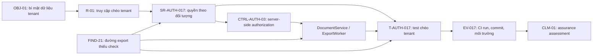
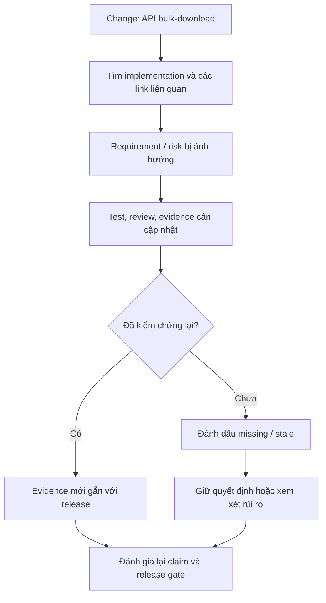
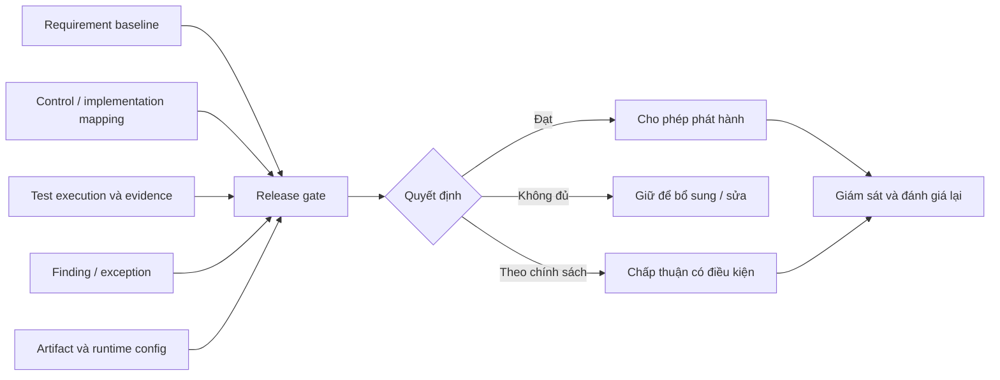

# Traceability requirement

Một hệ thống quản lý hồ sơ khách hàng có yêu cầu: “Người dùng của tổ chức B không được đọc hồ sơ thuộc tổ chức A”. Nhóm phát triển đã bổ sung kiểm tra `tenant_id` trong API, viết một vài bài kiểm thử và đánh dấu ticket hoàn tất. Ba tháng sau, nhóm bổ sung API xuất dữ liệu theo lô. API mới chạy qua một worker bất đồng bộ và có đường truy cập dữ liệu riêng. Khi kiểm toán hỏi “yêu cầu phân quyền ban đầu đã được kiểm tra cho API xuất dữ liệu chưa?”, không ai chỉ ra được phép kiểm thử nào, phiên bản nào hay bằng chứng nào trả lời câu hỏi đó.

Vấn đề ở đây là **thiếu truy vết yêu cầu** (*requirement traceability*): khả năng đi từ một yêu cầu đến nguồn gốc, thiết kế, control, triển khai, phép kiểm chứng, phát hiện và quyết định liên quan, đồng thời đi ngược từ một kết quả kiểm tra hoặc thay đổi về đúng yêu cầu đã thúc đẩy nó.

Trong **security assurance**, truy vết yêu cầu giúp tổ chức xây dựng niềm tin có căn cứ rằng hệ thống đáp ứng mục tiêu bảo mật. Niềm tin ấy cần nối được **phân tích rủi ro → security requirements → security controls → kiểm thử/audit → bằng chứng → khắc phục và quyết định rủi ro**. Việc có nhiều tài liệu hoặc kết quả CI riêng lẻ không tạo ra kết luận đáng tin nếu các mắt xích không xác định được.

## 1. Requirement traceability là gì?

**Requirement traceability** là khả năng duy trì những quan hệ rõ ràng, có thể kiểm tra giữa một yêu cầu với các hiện vật có liên quan trong suốt vòng đời hệ thống. Hiện vật (*artifact*) có thể là risk register, threat model, bản thiết kế, mã nguồn, cấu hình, test case, test execution, build, báo cáo audit, finding hoặc biên bản phê duyệt.

Hãy xét một security requirement:

> **SR-AUTH-017** — Trong bản phát hành được đánh giá, mọi thao tác đọc, tải xuống và xuất tài liệu phải kiểm tra quyền của người yêu cầu trên chính tài liệu đó; quyền và tenant của người yêu cầu phải đến từ danh tính được xác thực.

Một hồ sơ truy vết có giá trị phải trả lời được:

- **Vì sao yêu cầu tồn tại?** Nó giải quyết nguy cơ người dùng truy cập chéo tenant, được ghi trong risk register và threat model nào?
- **Điều gì đáp ứng yêu cầu?** Control nào được thiết kế; lớp API, service, database hoặc object storage nào thực thi?
- **Bằng cách nào biết control hoạt động?** Có test cho truy cập hợp lệ, không có quyền, chéo tenant, token hết hạn, export và download không?
- **Bằng chứng thuộc phiên bản nào?** Test run gắn với commit, artifact, policy và môi trường nào?
- **Còn gì chưa đạt?** Có finding, ngoại lệ, giới hạn phạm vi hoặc giả định nào?
- **Thay đổi ảnh hưởng tới yêu cầu ra sao?** Khi xuất hiện endpoint mới, ai biết phải cập nhật test, review và assurance case?

Truy vết không yêu cầu mỗi yêu cầu chỉ liên kết một control hoặc một bài test. Trong hệ thống thực tế, các quan hệ thường là **nhiều-nhiều**: một control hỗ trợ nhiều yêu cầu; một yêu cầu có nhiều control; mỗi control được kiểm chứng bằng nhiều phương pháp.

### 1.1. Phân biệt mục tiêu, yêu cầu, control và bằng chứng

| Thành phần | Vai trò | Ví dụ |
| --- | --- | --- |
| **Security objective** | Kết quả cần bảo vệ | Không lộ dữ liệu giữa các tổ chức |
| **Risk / threat** | Kịch bản cần phòng ngừa hoặc giảm tác động | Người dùng thay `documentId` để đọc hồ sơ tổ chức khác |
| **Security requirement** | Điều kiện hệ thống phải thỏa, đủ rõ để kiểm chứng | Mọi đường đọc tài liệu kiểm tra quyền theo người dùng, đối tượng và tenant |
| **Security control** | Cơ chế thực hiện yêu cầu | Authorization phía server, tenant-scoped query, policy object storage |
| **Implementation artifact** | Thành phần triển khai control | Service method, IAM policy, network policy, migration |
| **Verification method** | Cách đánh giá control và requirement | Code review, unit/integration test, pentest, policy check |
| **Evidence** | Kết quả có thể kiểm tra của lần xác minh | CI run có commit, kết quả test, review record, cấu hình kiểm tra |
| **Assurance claim / decision** | Kết luận có phạm vi, lập luận và rủi ro còn lại | Claim được hỗ trợ cho release X; export API còn thiếu bằng chứng |

Một requirement đã có ID, link tới mã nguồn và test chưa chắc đã được đáp ứng. **Traceability cho biết mối liên hệ và trạng thái bằng chứng; verification cho biết điều kiện đã được kiểm tra thế nào; assurance đánh giá mức tin cậy có thể rút ra.**

### 1.2. Traceability khác với “liệt kê tài liệu liên quan”

Một thư mục chứa 200 file PDF không phải là RTM (*Requirements Traceability Matrix*) hữu ích nếu người đánh giá không biết tệp nào chứng minh requirement nào. Ngược lại, một bảng nhỏ với mã yêu cầu, quan hệ có ngữ nghĩa, kết quả và nguồn bằng chứng đúng release có thể rất giá trị.

Một liên kết cần rõ **loại quan hệ**. “Liên quan đến” thường quá mơ hồ. Nên diễn đạt cụ thể: risk **dẫn tới** requirement, control **đáp ứng** requirement, test **xác minh** requirement, finding **vi phạm** requirement, evidence **hỗ trợ** claim.

## 2. Lợi ích của truy vết đối với security assurance

### 2.1. Chứng minh độ bao phủ các mục tiêu bảo mật

Nếu hệ thống có 40 yêu cầu bảo mật quan trọng, nhóm phải biết yêu cầu nào có control, yêu cầu nào đã được kiểm chứng, yêu cầu nào có kết quả không đạt và yêu cầu nào chưa có bằng chứng. Đây là nền tảng để xác định khoảng trống bảo vệ.

Một tỷ lệ bao phủ chỉ có ý nghĩa khi biết **mẫu số** là những yêu cầu nào, mức quan trọng ra sao và quy tắc xác định “đã được kiểm chứng”. Một bài test bất kỳ gắn với requirement không chứng minh toàn bộ hành vi của nó đã được bao phủ.

### 2.2. Phân tích tác động khi thay đổi

Thay đổi API, schema, credential, dependency, policy hoặc trust boundary có thể làm yêu cầu hoặc bằng chứng cũ không còn phù hợp. Quan hệ truy vết giúp hỏi:

> Nếu thay `ExportWorker`, những requirement nào, test nào, finding nào, evidence nào và approval nào phải xét lại?

Truy vết tốt không chỉ giúp biết “đã làm gì” mà còn giúp biết **điều gì cần kiểm chứng lại trước khi phát hành**.

### 2.3. Tăng tính minh bạch của audit và quyết định rủi ro

Auditor, security reviewer hoặc người chấp nhận rủi ro không cần tin vào một ô trạng thái “Done”. Họ có thể đi từ yêu cầu đến chứng cứ trên bản phát hành thực tế, nhìn thấy phần chưa đánh giá, quyết định ngoại lệ và người chịu trách nhiệm.

### 2.4. Hỗ trợ khắc phục đúng nguyên nhân

Khi pentest phát hiện thiếu authorization, hệ thống truy vết chỉ ra requirement và control liên quan, giúp nhận diện các endpoint cùng sử dụng một cơ chế lỗi. Khi vá xong, nhóm kiểm chứng lại yêu cầu ở phạm vi rộng hơn một ticket đơn lẻ.

### 2.5. Duy trì bảo đảm trong vận hành

Một yêu cầu về logging, thu hồi quyền hoặc phục hồi không kết thúc khi unit test pass. Nó còn liên quan tới cấu hình production, alert, diễn tập và bằng chứng mới khi môi trường thay đổi. Traceability làm rõ vòng đời và hạn hiệu lực của các kết luận đó.

## 3. Truy vết xuôi, ngược và hai chiều

Ba cách nhìn giúp phát hiện những loại thiếu sót khác nhau.

| Hướng | Câu hỏi | Phát hiện điển hình |
| --- | --- | --- |
| **Forward traceability** (truy vết xuôi) | Từ risk/requirement, đã có control, triển khai, test và evidence tương ứng chưa? | Yêu cầu quan trọng chưa có test |
| **Backward traceability** (truy vết ngược) | Từ code change, control, test hoặc finding, nó phục vụ requirement/risk nào? | Security control không có nhu cầu rõ hoặc test không gắn mục tiêu |
| **Bidirectional traceability** (hai chiều) | Có thể đi qua lại giữa các mắt xích và phân tích ảnh hưởng cả hai chiều không? | Một thay đổi làm hỏng kết luận assurance cũ nhưng không ai nhận biết |

**Truy vết hai chiều** không phải tạo hai bản ghi thủ công cho cùng một quan hệ. Chỉ cần lưu một quan hệ chuẩn hóa, hệ thống truy vấn có thể đi theo hai hướng, ví dụ `T-AUTH-017 verifies SR-AUTH-017` và truy vấn ngược `SR-AUTH-017 is verified by T-AUTH-017`.



Sơ đồ mô tả quan hệ logic. Khi làm thật, mã `EV-017` phải trỏ tới kết quả chạy cụ thể, có thời điểm và phiên bản; bản thân tên file hoặc link không xác nhận phép thử đã pass.

### 3.1. Truy vết dọc và truy vết ngang

Ngoài hướng xuôi/ngược, có thể phân biệt:

- **Truy vết dọc (vertical):** nối các tầng mức trừu tượng khác nhau, như objective → risk → requirement → design → implementation → test → release.
- **Truy vết ngang (horizontal):** nối các hiện vật cùng hoặc gần tầng, như requirement A phụ thuộc requirement B, test regression liên quan test negative, hoặc thay đổi cùng tác động tới hai service.

Một requirement có thể cần cả hai. Ví dụ, yêu cầu bảo vệ đường export phụ thuộc yêu cầu kiểm soát session và yêu cầu phân quyền theo đối tượng; các phụ thuộc ngang này giúp phân tích tác động khi một control chung thay đổi.

## 4. Xác định phạm vi và mức chi tiết của truy vết

Không nên tạo link tới từng dòng code cho mọi requirement nếu chi phí duy trì vượt giá trị. Cần chọn mức chi tiết đủ để hỗ trợ quyết định và kiểm chứng.

**Đơn vị truy vết thường dùng:**

- Một **risk scenario** cụ thể với tài sản và hậu quả.
- Một **security requirement** có hành vi và tiêu chí chấp nhận rõ.
- Một **control** hoặc tập control có chủ sở hữu.
- Một **implementation component** đủ ổn định, như service, endpoint, IAM policy hoặc module.
- Một **test case** có mục đích xác minh một hoặc nhiều tiêu chí.
- Một **test execution/evidence record** gắn với release.
- Một **finding/exception/decision** liên quan tới yêu cầu.

Nếu requirement quá rộng, ví dụ “Hệ thống bảo mật tốt”, khó xác định test nào xác minh đủ. Nếu requirement quá vụn, ví dụ “Mỗi dòng code phải dùng tên biến X”, ma trận sẽ nhiều liên kết nhưng ít giá trị assurance.

### 4.1. Viết requirement dễ truy vết

Một yêu cầu tốt nên:

1. **Có mã ổn định**, ví dụ `SR-AUTH-017`, không dùng số thứ tự hàng làm định danh.
2. **Độc lập về nội dung cốt lõi:** chứa đúng một nghĩa vụ chính hoặc nhóm hành vi gắn chặt với nhau.
3. **Rõ chủ thể và phạm vi:** người dùng, workload, dữ liệu, endpoint hoặc môi trường.
4. **Có tiêu chí xác minh:** biết quan sát thế nào để kết luận đạt/chưa đạt.
5. **Truy được nguồn gốc:** liên kết risk, threat, chính sách hoặc nghĩa vụ.
6. **Có người sở hữu và vòng đời:** draft, approved, implemented, verified, retired, v.v.
7. **Có phiên bản/baseline:** biết requirement nào có hiệu lực với release nào.

Ví dụ:

**Chưa đủ:** “API phải có xác thực an toàn.”

**Cụ thể hơn:** “`SR-IDENT-004`: API trả hồ sơ nhạy cảm chỉ chấp nhận principal đã được xác thực; mọi yêu cầu không có hoặc có credential không hợp lệ phải bị từ chối trước khi dữ liệu được truy xuất.”

**Acceptance criteria:** phép thử không có token, token sai chữ ký, hết hạn và token hợp lệ trả hành vi phù hợp; không tiết lộ dữ liệu trong phản hồi lỗi.

Yêu cầu không nên mô tả chi tiết công nghệ triển khai nếu mục tiêu có thể thực hiện bằng nhiều control, trừ khi chính sách hoặc thiết kế bắt buộc một công nghệ cụ thể.

## 5. Thiết kế ID, quan hệ và trạng thái

Một hồ sơ traceability cần đủ đơn giản để được duy trì thường xuyên nhưng đủ nghiêm ngặt để auditor không phải suy đoán.

### 5.1. Sơ đồ ID minh họa

| Loại | ID ví dụ | Ý nghĩa |
| --- | --- | --- |
| Mục tiêu | `OBJ-SEC-01` | Bảo đảm bí mật dữ liệu giữa các tenant |
| Rủi ro | `RISK-0042` | Đọc trái quyền qua direct object reference |
| Yêu cầu | `SR-AUTH-017` | Server xác minh quyền theo tài liệu/tenant |
| Control | `CTRL-AUTH-03` | Kiểm tra quyền và giới hạn truy vấn |
| Implementation | `IMP-DOC-READ` | Service API đọc tài liệu |
| Test case | `TC-AUTH-017-B` | Tài khoản B đọc tài liệu A bị từ chối |
| Test run | `TR-2026-0815` | Một lần kiểm thử trên build xác định |
| Evidence | `EV-RELEASE-42-01` | Kết quả có liên kết đến artifact và test |
| Finding | `FIND-0231` | Phát hiện bỏ qua kiểm tra tại export |
| Decision | `DEC-RELEASE-42` | Quyết định chấp nhận hay chặn phát hành |

Các ID là ví dụ; không bắt buộc mã giống vậy. **Tính ổn định và duy nhất trong phạm vi quản lý** quan trọng hơn định dạng. Đổi tên file hoặc chuyển repository không được làm đứt chuỗi truy vết.

### 5.2. Quan hệ nên có ngữ nghĩa rõ

| Quan hệ | Diễn giải | Ví dụ |
| --- | --- | --- |
| `originates_from` | Yêu cầu bắt nguồn từ rủi ro, chính sách hoặc nghĩa vụ | `SR-AUTH-017` → `RISK-0042` |
| `refines` | Yêu cầu chi tiết hóa mục tiêu hoặc yêu cầu cấp cao | `SR-DATA-02` → `OBJ-SEC-01` |
| `satisfied_by` | Control hoặc design đáp ứng yêu cầu | `SR-AUTH-017` → `CTRL-AUTH-03` |
| `implemented_by` | Control được thực thi bởi thành phần | `CTRL-AUTH-03` → `IMP-DOC-READ` |
| `verified_by` | Yêu cầu được kiểm tra bởi test hoặc review | `SR-AUTH-017` → `TC-AUTH-017-B` |
| `executed_as` | Test case có lần chạy xác định | `TC-AUTH-017-B` → `TR-2026-0815` |
| `supported_by` | Kết luận hoặc test result có bằng chứng cụ thể | `CLM-01` → `EV-RELEASE-42-01` |
| `violated_by` | Finding cho thấy điều kiện không đạt | `SR-AUTH-017` → `FIND-0231` |
| `depends_on` | Yêu cầu hoặc control phụ thuộc điều kiện khác | `SR-EXPORT-01` → `SR-AUTH-017` |
| `affected_by` | Thay đổi tác động tới yêu cầu, control hoặc evidence | `SR-AUTH-017` → `CHG-0102` |

Một số công cụ chỉ hỗ trợ link generic. Nếu vậy, nên thống nhất cú pháp hoặc trường bổ sung để phân biệt ý nghĩa; link chỉ ghi “relates to” thường không đủ cho truy vấn assurance.

### 5.3. Tách trạng thái vòng đời và kết quả xác minh

Một lỗi phổ biến là dùng một trường `status: done` đại diện cho mọi thông tin.

Cần phân biệt:

- **Requirement lifecycle:** `DRAFT`, `APPROVED`, `DEPRECATED`, `RETIRED`.
- **Implementation status:** `NOT_STARTED`, `IN_PROGRESS`, `IMPLEMENTED`.
- **Verification status:** `NOT_TESTED`, `PASS`, `FAIL`, `INCONCLUSIVE`, `STALE`.
- **Risk decision:** `PENDING`, `ACCEPTED_WITH_CONDITIONS`, `REJECTED`.
- **Evidence status:** `AVAILABLE`, `MISSING`, `EXPIRED`, `INVALID`.

Requirement có thể đã `APPROVED` và `IMPLEMENTED` nhưng verification còn `FAIL`. Đó là thông tin quan trọng cho release gate. Không nên dùng “đã code xong” để suy ra “đã kiểm chứng đạt”.

## 6. Requirements Traceability Matrix (RTM)

**RTM** là cách thể hiện các quan hệ truy vết dưới dạng bảng, phục vụ review, audit và phân tích khoảng trống. RTM có thể nằm trong spreadsheet, công cụ quản lý yêu cầu, issue tracker hoặc được tạo từ dữ liệu có cấu trúc. Bảng là một **view** của các quan hệ; không nhất thiết là nguồn dữ liệu gốc duy nhất.

### 6.1. Ma trận mẫu cho ứng dụng nhiều tenant

| Requirement | Nguồn | Control / triển khai | Verification | Evidence phiên bản | Vấn đề còn mở |
| --- | --- | --- | --- | --- | --- |
| `SR-AUTH-017`: kiểm tra quyền đọc tài liệu | `RISK-0042` | `CTRL-AUTH-03`; DocumentService | `TC-AUTH-017-A/B/C` | `EV-REL42-01` | Chưa đánh giá download URL |
| `SR-EXP-006`: export tôn trọng phân quyền | `RISK-0042`, `RISK-0050` | `CTRL-EXP-02`; ExportWorker | `TC-EXP-006-A/B` | `EV-REL42-02` | `FIND-0231` đang mở |
| `SR-LOG-003`: ghi audit khi xuất dữ liệu | `RISK-0061` | `CTRL-AUD-01`; EventPublisher | `TC-LOG-003`, review log | `EV-REL42-03` | Cần test alert production |
| `SR-KEY-002`: khóa không xuất hiện trong mã nguồn/artifact | `RISK-0020` | Secret manager, CI policy | Secret scan, review IAM | `EV-REL42-04` | Không có phát hiện đã biết |

Các giá trị và trạng thái trong bảng **chỉ là ví dụ**. Với release thật, cần có đường dẫn và kết quả chính xác; nếu một finding quan trọng vẫn mở, không được báo requirement đã đạt toàn phạm vi.

### 6.2. RTM tối thiểu nên có gì?

Tùy rủi ro, một bản ghi có thể gồm:

- `requirement_id`, phiên bản, nội dung, mức quan trọng, trạng thái và owner;
- nguồn gốc: objective, risk, threat hoặc chính sách;
- control, design và implementation liên quan;
- các test case và review method;
- lần chạy gần nhất áp dụng cho release, outcome, thời điểm;
- evidence reference và bối cảnh artifact/môi trường;
- finding, exception, giả định và phần chưa kiểm chứng;
- quyết định, approver và trigger đánh giá lại.

Nên lưu **test case** và **test run** tách biệt: test case mô tả phương pháp; test run chứng minh phương pháp đó đã thực thi trên phiên bản cụ thể. Link requirement → test case mà không có lần chạy không đủ để khẳng định điều kiện đã đạt.

### 6.3. Chất lượng quan hệ quan trọng hơn số lượng link

Một requirement có 30 link nhưng tất cả trỏ đến một test không có assertion phân quyền có thể kém đáng tin hơn requirement có 3 link chất lượng gồm code review, negative test và kiểm tra cấu hình thực tế.

RTM phải giúp người đọc xác định **lý do một bằng chứng hỗ trợ yêu cầu**; số lượng link chỉ là tín hiệu quản lý.

## 7. Ví dụ xuyên suốt: truy vết yêu cầu phân quyền

Giả sử nền tảng SaaS cung cấp:

- `GET /api/documents/{id}` để đọc metadata;
- `GET /api/documents/{id}/download` để tải nội dung;
- `POST /api/documents/export` để xuất theo lô qua worker;
- kho dữ liệu gắn mỗi tài liệu với `tenant_id`.

Tài khoản thử nghiệm `user-b` thuộc tenant B; tài liệu `doc-a` thuộc tenant A.

### 7.1. Nguồn gốc và yêu cầu

**Risk `RISK-0042`:** Kẻ tấn công sử dụng tài khoản hợp lệ của tenant B để thay ID tài liệu và đọc dữ liệu tenant A. Tác động: lộ thông tin và vi phạm giới hạn xử lý dữ liệu.

**Requirement `SR-AUTH-017`:**

> Mọi đường đọc, tải và xuất tài liệu trong phạm vi phải kiểm tra quyền của principal được xác thực đối với tài liệu và tenant; các yêu cầu ngoài quyền không được nhận nội dung hoặc metadata bị bảo vệ.

**Tiêu chí chấp nhận:**

1. User hợp lệ đọc/tải dữ liệu được cấp quyền thành công.
2. User không xác thực bị từ chối theo hợp đồng API.
3. User thuộc tenant khác bị từ chối, không lộ nội dung.
4. Các đường export, URL tải và cache phải tôn trọng chính sách.
5. Khi quyền bị thu hồi, hành vi phản ánh thời hạn thu hồi đã quy định.
6. Các ngoại lệ quản trị hoặc chia sẻ liên tenant, nếu có, được yêu cầu và kiểm chứng riêng.

### 7.2. Phân rã thành control và implementation

| ID | Control | Thành phần | Cách xác minh |
| --- | --- | --- | --- |
| `CTRL-AUTH-03` | Xác thực principal và kiểm tra quyền theo đối tượng | Auth context, DocumentService | Review nguồn tenant/role; negative test |
| `CTRL-DATA-05` | Giới hạn truy vấn theo tenant và tài liệu | Repository | Integration test, review truy vấn |
| `CTRL-EXPORT-02` | Kiểm tra quyền trong export worker, không tin toàn bộ dữ liệu job | ExportWorker | Job test chéo tenant |
| `CTRL-DOWN-01` | Kiểm soát URL tải và object storage | Download service, bucket policy | Test URL bị đánh cắp/hết hạn, policy review |
| `CTRL-AUD-01` | Ghi nhận truy cập nhạy cảm và bất thường | Audit pipeline | Event-to-log/alert verification |

Một control có thể đáp ứng nhiều requirement. Ví dụ, `CTRL-AUD-01` còn hỗ trợ requirement về accountability; cần ghi quan hệ tới cả hai yêu cầu có liên quan, không tạo bản sao control thiếu nhất quán.

### 7.3. Ví dụ code Java có gắn requirement

Một phương án triển khai API đọc tài liệu có thể lấy tenant từ principal đã xác thực:

```java
/**
 * Implements SR-AUTH-017 via CTRL-AUTH-03 and CTRL-DATA-05.
 * Example only: real systems may require per-document permissions,
 * sharing rules, admin exceptions and separate download policies.
 */
public DocumentView readDocument(UUID id, AuthenticatedPrincipal principal) {
    if (!principal.hasPermission("document:read")) {
        throw new AccessDeniedException("Access denied");
    }

    Document document = repository
        .findByIdAndTenantId(id, principal.tenantId())
        .orElseThrow(DocumentNotFoundException::new);

    return mapper.toView(document);
}
```

Comment chứa ID giúp truy vết, nhưng không nên coi comment là nguồn chân lý duy nhất: code có thể đổi trong khi comment vẫn cũ. Nên có liên kết từ requirement tới component, pull request/review và test; xác minh rằng code và control thực tế còn phù hợp.

### 7.4. Thiết kế test case và lần chạy riêng biệt

```java
// TC-AUTH-017-B verifies SR-AUTH-017.
// Illustrative test; assumes a real seeded document in tenant A.
@Test
void tenantBCannotReadTenantADocument() throws Exception {
    mockMvc.perform(get("/api/documents/{id}", "doc-a")
            .with(jwt().jwt(token ->
                    token.claim("tenant_id", "tenant-b"))))
        .andExpect(status().isNotFound());
}
```

Kết quả `404` trong ví dụ chỉ phù hợp nếu ứng dụng chọn trả `404` cho tài liệu không được truy cập; một hệ thống khác có thể dùng `403`. Test này phải chạy với fixture có `doc-a` thuộc tenant A, security filter được bật và repository thực thi logic cần đánh giá. Nếu `doc-a` không tồn tại hoặc mock luôn trả `404`, test có thể pass sai mục đích.

Một bản ghi **test run** cần bổ sung:

```yaml
test_case_id: TC-AUTH-017-B
requirement_id: SR-AUTH-017
execution_id: TR-REL42-017B
result: PASS # Ví dụ dữ liệu, không phải kết quả thực tế
source_commit: "<commit-sha>"
artifact_digest: "sha256:<digest>"
environment: "<test-environment>"
dataset_ref: "<fixture-id>"
run_at: "<timestamp>"
report_ref: "<test-report-location>"
```

Test case có thể tái sử dụng qua nhiều release; mỗi lần chạy có ID và evidence khác. Khi code hoặc cấu hình liên quan thay đổi, phải xác định liệu bằng chứng cũ vẫn áp dụng được hay cần chạy lại.

### 7.5. Từ kết quả test đến security claim

Một assurance claim có thể là:

> **CLM-DATA-01:** Bản phát hành `document-api` được đánh giá ngăn người dùng tenant B đọc hoặc xuất dữ liệu của tenant A qua các luồng đã xác định trong phạm vi.

Để hỗ trợ claim, không thể chỉ dẫn một test `TC-AUTH-017-B`. Cần giải thích:

- Các endpoint và worker nào đã được liệt kê;
- Control nào bảo vệ từng đường;
- Test nào xác minh positive và negative cases;
- Cấu hình object storage và export có được kiểm tra không;
- Có finding nào còn mở hoặc điều kiện nào chưa thử;
- Evidence gắn với đúng release, artifact và môi trường hay không.

Giả sử review phát hiện worker export dùng credential toàn quyền và không kiểm tra tenant: `FIND-0231` phải liên kết tới `SR-AUTH-017`, `CTRL-EXPORT-02` và các test cần chạy lại. Khi đó claim không được đánh dấu “đạt toàn phạm vi” cho đến khi khắc phục và xác minh lại hoặc phạm vi phát hành được giới hạn hợp lệ.

## 8. Biểu diễn traceability bằng dữ liệu có cấu trúc

Đối với nhóm phát triển, dữ liệu có cấu trúc giúp review và tự động kiểm tra các quan hệ quan trọng. Ví dụ YAML sau là **mẫu mô hình**, không phải schema được một công cụ cụ thể hỗ trợ sẵn:

```yaml
requirements:
  - id: SR-AUTH-017
    version: 3
    title: "Phân quyền theo đối tượng và tenant"
    status: APPROVED
    priority: critical
    owner: "document-platform-team"
    sources:
      - type: risk
        id: RISK-0042
    acceptance_criteria:
      - "Không đọc chéo tenant qua API metadata, download, export"
      - "Các đường truy cập đều kiểm tra principal đã xác thực"
    controls:
      - CTRL-AUTH-03
      - CTRL-DATA-05
      - CTRL-EXPORT-02
      - CTRL-DOWN-01
    implementation:
      - component: "document-api/DocumentService"
      - component: "document-api/ExportWorker"
    verification:
      - test_id: TC-AUTH-017-A
      - test_id: TC-AUTH-017-B
      - test_id: TC-EXP-017
      - method: code-review
        review_id: "<review-id>"
    active_findings:
      - FIND-0231
    release_assessments:
      - release_id: "<release-id>"
        artifact_digest: "sha256:<digest>"
        evidence_refs:
          - "<test-report>"
          - "<review-record>"
        outcome: "INCOMPLETE"
        limitations:
          - "ExportWorker chưa được xác minh khắc phục"
        assessed_at: "<timestamp>"
```

Tính nhất quán cần được kiểm tra: các ID tham chiếu có tồn tại không, loại quan hệ đúng không, test case có thuộc phạm vi áp dụng không, evidence có đúng phiên bản không và trạng thái có mâu thuẫn với finding đang mở không.

### 8.1. Một mô hình dữ liệu tối thiểu

Có thể dùng bảng quan hệ hoặc graph database. Một cách trừu tượng gồm:

- `Artifacts(id, type, version, owner, status, location)`: lưu thực thể có ID.
- `Links(source_id, relation_type, target_id, valid_from, valid_to)`: lưu quan hệ có thời hạn/phiên bản nếu cần.
- `Executions(run_id, test_id, release_id, artifact_digest, environment, result, executed_at)`: lưu lần xác minh.
- `Assessments(claim_id, release_id, decision, evidence_refs, assessed_by, assessed_at)`: lưu kết luận và cơ sở.
- `Findings(id, affected_requirement, severity, status, resolution_evidence)`: lưu phát hiện và quá trình khắc phục.

Đây là mô hình logic, chưa phải thiết kế database hoàn chỉnh. Cần bảo vệ tính toàn vẹn của ID, nguồn dữ liệu, phân quyền và audit trail khi sửa/xóa quan hệ.

### 8.2. Ví dụ các phép kiểm tra tự động

Pseudo-code minh họa các điều kiện để phát hiện khoảng trống:

```text
for each security_requirement that applies to target_release:
    assert requirement has a stable ID and owner
    assert requirement has a source (risk / policy / obligation)
    assert requirement links to one or more applicable controls
    assert every required verification method is linked
    assert evidence belongs to the target release/artifact/context
    assert required verification executed successfully
    assert no unaccepted finding invalidates the requirement
    otherwise:
        flag requirement as INCOMPLETE or FAILED for review
```

Trong môi trường thực, không nên bắt buộc **mọi** requirement phải có test tự động: một số yêu cầu được kiểm chứng bằng architecture review, audit, cấu hình runtime hoặc diễn tập khôi phục. Điều quan trọng là **phương pháp xác minh phù hợp với loại yêu cầu**, và có bằng chứng thực thi phương pháp đó.

## 9. Phân tích tác động khi một yêu cầu hoặc hệ thống thay đổi

Traceability có giá trị rõ nhất khi thay đổi xảy ra. Giả sử nhóm thêm API `POST /api/documents/bulk-download`.

Nhóm không nên chỉ tìm xem file source nào bị sửa. Cần kiểm tra các quan hệ:

1. API mới có truy cập tài liệu không? Nếu có, nó nằm trong phạm vi `SR-AUTH-017`.
2. Nó tái sử dụng `CTRL-AUTH-03` hay có đường riêng?
3. Có export worker, presigned URL hoặc cache dẫn tới control mới không?
4. Threat model có xuất hiện trust boundary mới không?
5. Test case hiện có có bao phủ bulk download không?
6. Bằng chứng và claim của release trước còn được áp dụng ở mức nào?
7. Rủi ro mới có cần yêu cầu bảo mật hoặc control bổ sung không?



### 9.1. Các trigger đánh giá lại

Một trigger có thể là:

- Endpoint hoặc workflow mới chạm dữ liệu nhạy cảm.
- Thay đổi logic authorization, caching, token hoặc policy IAM.
- Thêm thành phần bên ngoài, storage mới hoặc thay đổi luồng dữ liệu.
- Sửa thư viện xác thực, mã hóa, quản lý secret hoặc network policy.
- Cập nhật tiêu chuẩn hoặc nghĩa vụ hợp đồng ảnh hưởng yêu cầu.
- Có finding, incident hoặc exploit mới làm thay đổi giả định.
- Thay đổi cách test chạy, test fixture, build pipeline hoặc deployment configuration.

Mỗi trigger nên có owner, quy tắc xác định yêu cầu liên quan và cách đánh dấu evidence cần xem xét lại.

### 9.2. Baseline và phiên bản hóa requirement

Requirement `SR-AUTH-017` có thể ở version 2 cho release A, version 3 cho release B. Không nên âm thầm thay đổi nội dung version 2 rồi giữ nguyên kết luận cũ. Cần biết **bản requirement nào được áp dụng khi đánh giá release nào**.

Một số cách quản lý:

- Snapshot baseline requirement cùng release;
- Version control với review/approval cho thay đổi requirement;
- Link test và evidence tới requirement version;
- Ghi migration từ requirement cũ sang requirement mới khi tách/gộp.

Nếu một requirement được tách thành hai, cần đánh dấu bản cũ là superseded, liên kết sang hai bản mới và điều chỉnh các test/evidence tương ứng. Không xóa lịch sử vì cần giữ khả năng kiểm toán các release trước.

## 10. Chất lượng và hiệu lực của liên kết truy vết

Một RTM đầy đủ về số lượng vẫn có thể đưa ra cảm giác an toàn sai nếu các link bị sai hoặc evidence không đủ tin cậy.

### 10.1. Những liên kết cần kiểm tra đặc biệt

| Dấu hiệu | Tại sao đáng lo | Cách xác minh |
| --- | --- | --- |
| Requirement không có nguồn | Không rõ tại sao cần yêu cầu hoặc ai phê duyệt | Review nguồn rủi ro, chính sách, nghĩa vụ |
| Requirement không có control | Yêu cầu có thể chưa được triển khai | Design review, tìm implementation owner |
| Control không có requirement | Có thể là control thừa hoặc nhu cầu chưa được ghi | Review kiến trúc và rủi ro tương ứng |
| Requirement không có verification | Không biết cách chứng minh đạt | Thiết kế test/review/operational verification |
| Test có link nhưng không có execution | Có phương pháp nhưng chưa có bằng chứng chạy | Kiểm tra CI hoặc biên bản test |
| Execution pass trên commit khác | Kết quả có thể không áp dụng cho release | Đối chiếu commit, digest, cấu hình |
| Finding mở nhưng requirement hiển thị PASS | Có thể che lấp một thiếu sót | Review finding, giới hạn phạm vi và approval |
| ID bị đổi hoặc link bị hỏng | Mất lịch sử và khó phân tích thay đổi | Kiểm tra tham chiếu, redirect/migration |
| Bằng chứng quá cũ | Claim có thể mất hiệu lực sau thay đổi | Đánh giá dependency và trigger review |
| Link chỉ là “related” | Không rõ bằng chứng chứng minh điều gì | Ghi quan hệ cụ thể, review ngữ nghĩa |

### 10.2. Bằng chứng đáng tin phải gắn với ngữ cảnh

Ví dụ một báo cáo test có:

```yaml
evidence_id: EV-REL42-01
requirement_id: SR-AUTH-017
requirement_version: 3
test_run_id: TR-REL42-017B
source_commit: "<commit>"
artifact_digest: "sha256:<digest>"
environment: "<environment>"
dataset_ref: "<test-fixture>"
result: PASS
executed_at: "<timestamp>"
executor: "<ci-workflow-or-reviewer>"
report_ref: "<immutable-report-reference>"
limitations: ["<documented-exclusions-if-any>"]
```

Thông tin này giúp người đánh giá phân biệt một test có dữ liệu thật, có kiểm soát security filter với một test mock thiếu ngữ cảnh. Không phải mọi kết quả cần cùng định dạng YAML; dữ liệu có thể được lưu trong CI, hệ thống quản lý kiểm thử hoặc kho evidence. Nhưng các trường thiết yếu phải truy được.

### 10.3. Tránh tuyên bố quá mức

Nếu test `TC-AUTH-017-B` xác minh một endpoint `GET /api/documents/{id}`, kết quả pass không chứng minh `POST /api/documents/export` cũng an toàn. Khi phạm vi test hẹp hơn requirement, nhóm phải:

- bổ sung test, review hoặc phương pháp đánh giá khác;
- chia requirement thành các điều kiện nhỏ có thể xác minh;
- hoặc ghi giới hạn và giữ kết luận chưa hoàn chỉnh cho phạm vi còn lại.

**Không biến một ô màu xanh trong RTM thành khẳng định “hệ thống an toàn”**.

## 11. Tích hợp truy vết vào công cụ và CI/CD

Một giải pháp thực tế có thể phối hợp issue tracker, repository, test management, CI, vulnerability scanner và evidence store. Không bắt buộc mua một nền tảng lớn để bắt đầu; điều quan trọng là định nghĩa ID, quan hệ và điểm kiểm tra thống nhất.

### 11.1. Quy trình tích hợp tối thiểu

1. **Issue tracker:** tạo requirement có ID, nguồn, owner, risk và acceptance criteria.
2. **Repository:** pull request liên kết requirement và mô tả control được thay đổi.
3. **Test management/code:** test case ghi requirement ID hoặc dùng mapping được review.
4. **CI/CD:** test run báo outcome, commit và artifact digest; lưu báo cáo phù hợp.
5. **Finding register:** scanner/pentest/incident tạo finding liên kết requirement hoặc control.
6. **Release manifest:** hợp nhất version requirement, test execution, evidence và finding.
7. **Release gate:** đọc trạng thái truy vết và chính sách rủi ro để quyết định.
8. **Operations:** cập nhật bằng chứng sau deploy và khi xảy ra thay đổi/sự cố.

### 11.2. Tự động kiểm tra việc thiếu liên kết

Một pipeline có thể báo lỗi hoặc cảnh báo khi:

- Requirement quan trọng không có ID/owner.
- Pull request thay đổi một control nhạy cảm nhưng không liên kết requirement.
- Test mapping chứa ID không tồn tại hoặc đã bị retired.
- Bằng chứng test áp dụng cho release cũ.
- Security claim có requirement chưa được xác minh.
- Finding vượt ngưỡng vẫn mở và không có quyết định rủi ro hợp lệ.
- Requirement version thay đổi nhưng acceptance criteria/test không được review.
- Artifact được deploy khác digest đã được kiểm chứng.

Tuy nhiên, tự động hóa chỉ kiểm tra được các quan hệ hoặc tiêu chí đã được mô hình hóa. Nó có thể phát hiện “có link hay không”, nhưng không luôn đánh giá được link **có đúng ngữ nghĩa hay đủ sức hỗ trợ claim**. Vì vậy cần review chọn mẫu và review chuyên môn ở các điểm rủi ro cao.

### 11.3. Gợi ý quy tắc cho pull request

Một mẫu mô tả PR ngắn có thể là:

```text
Security requirement IDs: SR-AUTH-017, SR-EXP-006
Risk / threat IDs: RISK-0042
Controls changed: CTRL-AUTH-03, CTRL-EXPORT-02
Affected paths: read, download, export worker
Verification: TC-AUTH-017-A/B, TC-EXP-006-A/B
Evidence / CI run: <link>
Unverified scenarios: <none-or-list>
Open findings / exception: <IDs>
```

Người review cần xác minh các mã này có tồn tại, phạm vi phù hợp và không bị người tạo PR tự khai sai. Một trường PR được điền đầy đủ không tự động xác minh control đã được thực thi.

## 12. Vai trò và quản trị truy vết

Traceability là một hoạt động quản trị liên tục, không chỉ là công việc nhập bảng cho auditor.

| Vai trò | Trách nhiệm chính |
| --- | --- |
| **Risk owner / business owner** | Xác định tác động, mức ưu tiên và nguồn yêu cầu từ rủi ro/nghĩa vụ |
| **Security architect / champion** | Dẫn giải yêu cầu, review liên kết risk-control và phương pháp xác minh |
| **Product / requirements owner** | Quản lý nội dung requirement, baseline, acceptance criteria và thay đổi |
| **Developer / technical lead** | Gắn control và implementation với requirement, cập nhật khi sửa code |
| **QA / test engineer** | Duy trì test mapping, test execution và bằng chứng, đặc biệt negative case |
| **DevOps / platform / SRE** | Bảo đảm evidence build/deploy/runtime gắn artifact và cấu hình đúng |
| **Security assurance / audit** | Đánh giá tính đầy đủ, độ tin cậy của liên kết và rủi ro còn lại |
| **Approver** | Quyết định khi có ngoại lệ hoặc bằng chứng chưa đủ theo thẩm quyền |

Một người có thể kiêm vai trò trong nhóm nhỏ. Với rủi ro cao, nên có người kiểm tra hoặc nguồn chứng cứ độc lập thích hợp để tránh việc cùng một người vừa tuyên bố control đạt vừa là người duy nhất xác nhận.

### 12.1. Quy tắc quản trị quan trọng

- ID không được tái sử dụng cho nội dung hoàn toàn khác.
- Mọi thay đổi requirement quan trọng phải có review và lịch sử.
- Quan hệ truy vết cần owner và quy tắc xác minh định kỳ.
- Bằng chứng nhạy cảm phải được phân quyền, bảo vệ tính toàn vẹn và lưu giữ theo quy định.
- Không xóa finding hoặc evidence bất lợi để làm báo cáo trông đẹp.
- Khi control hoặc requirement ngừng dùng, ghi trạng thái và quan hệ thay thế.
- Những khoảng trống có tác động đến release gate phải được xử lý hoặc có quyết định rủi ro hợp lệ.

## 13. Đo lường chất lượng traceability

Chỉ số có ích cần cho biết hệ thống có khả năng trả lời câu hỏi assurance tốt hơn không. Một số chỉ số:

| Chỉ số | Cách tính minh họa | Giới hạn |
| --- | --- | --- |
| **Source coverage** | Số requirement áp dụng có nguồn risk/policy rõ / tổng requirement áp dụng | Không chứng minh nguồn đánh giá đầy đủ |
| **Control mapping coverage** | Số requirement quan trọng có control áp dụng / tổng requirement quan trọng | Không chứng minh control hoạt động |
| **Verification linkage** | Số requirement có phương pháp xác minh phù hợp / tổng requirement | Link test sai ngữ nghĩa có thể gây ảo tưởng |
| **Evidence-backed coverage** | Số requirement có bằng chứng hợp lệ cho release / tổng requirement áp dụng | Cần xem chất lượng và kết quả evidence |
| **Stale evidence ratio** | Số requirement có bằng chứng hết hiệu lực / tổng requirement cần xác minh | Phụ thuộc quy tắc phát hiện thay đổi |
| **Orphan artifacts** | Số control/test/finding thiếu liên kết cần thiết | Một số artifact hợp lệ có thể không cần link |
| **Change impact timeliness** | Thời gian từ change đến khi xác định và cập nhật quan hệ ảnh hưởng | Chỉ đo tốc độ, không đo đúng đắn |
| **Trace correction rate** | Số liên kết sai được phát hiện qua review / số liên kết được kiểm tra | Cần review mẫu đại diện |

Ví dụ: 18/20 requirement quan trọng có test mapping = 90% **link coverage**, không đồng nghĩa “hệ thống an toàn 90%”. Hai requirement thiếu có thể chính là mục tiêu bí mật dữ liệu quan trọng nhất.

### 13.1. Không chấm điểm bằng số lượng link thuần túy

Tối đa hóa link có thể khuyến khích gắn ID cho đủ chỉ tiêu. Thay vào đó, lấy mẫu các requirement rủi ro cao, yêu cầu reviewer đi từ risk tới code/test/evidence và đi ngược từ finding tới requirement. Nếu chuỗi không tái hiện được trên release cụ thể, cần cải thiện chất lượng quan hệ.

## 14. Mối quan hệ với release gate và quyết định assurance

Một release gate có thể dùng RTM để đánh giá:

1. Những requirement nào **áp dụng cho bản phát hành**?
2. Những requirement nào được coi là **hard gate** theo chính sách?
3. Các phương pháp xác minh bắt buộc đã chạy trên đúng artifact/config chưa?
4. Kết quả có `FAIL`, `UNKNOWN` hoặc `STALE` không?
5. Finding nào làm một requirement chưa đạt hoặc không còn đủ bằng chứng?
6. Ngoại lệ nào được chấp nhận theo thẩm quyền, phạm vi và thời hạn?
7. Claim và quyết định cuối cùng có giới hạn nào cần công bố?



Nếu `SR-AUTH-017` là yêu cầu bắt buộc và export chưa được kiểm chứng, gate không nên suy ra đạt nhờ kết quả của API đọc metadata. Kết luận phù hợp là **chưa đủ bằng chứng cho toàn phạm vi**, cần kiểm tra bổ sung, sửa lỗi hoặc giới hạn phạm vi phát hành theo quyết định hợp lệ.

**Assurance case** có thể dùng RTM làm bản đồ dẫn đến evidence. RTM không thay thế lập luận về vì sao các control, test và giả định đủ hỗ trợ claim; đó vẫn là công việc đánh giá chuyên môn.

## 15. Các sai lầm thường gặp

| Sai lầm | Hệ quả | Cách cải thiện |
| --- | --- | --- |
| Chỉ gắn một requirement ID vào ticket | Không biết control, test hoặc evidence nào thực sự áp dụng | Dùng các quan hệ có ngữ nghĩa |
| Requirement quá chung chung | Không có tiêu chí để xác minh đầy đủ | Chia thành điều kiện cụ thể, đo được |
| Không phân biệt test case và test run | “Có test” bị hiểu thành “đã chạy và đạt” | Lưu riêng execution, outcome và bối cảnh |
| Chỉ truy vết xuôi | Khi thay đổi code khó biết requirement nào bị ảnh hưởng | Hỗ trợ truy vấn ngược và impact analysis |
| Link tới file không có version | Bằng chứng cũ được dùng cho release mới | Baseline requirement, commit, digest, môi trường |
| Mọi link đều là “related” | Không rõ quan hệ đáp ứng hay xác minh | Chuẩn hóa loại quan hệ |
| Requirement có finding mở vẫn ghi PASS | Che lấp rủi ro và tình trạng khắc phục | Tách lifecycle, verification và risk decision |
| Copy bảng RTM thủ công không đồng bộ | Link và trạng thái nhanh lỗi thời | Có nguồn dữ liệu chuẩn và sinh view tự động |
| Chỉ theo dõi số link | Nhiều link nhưng không có giá trị chứng minh | Review chất lượng link, coverage theo rủi ro |
| Đổi ID hoặc xóa lịch sử khi refactor | Mất truy vết release cũ và audit trail | Version hóa, mapping superseded |
| Chỉ duy trì RTM trước audit | Thay đổi hằng ngày làm bằng chứng hết hiệu lực | Gắn cập nhật traceability vào PR, CI và release |
| Lưu evidence nhạy cảm không kiểm soát | Log, report có thể lộ dữ liệu và secret | Phân quyền, phân loại, che dữ liệu và retention |

## 16. Quy trình triển khai traceability từ mức tối thiểu

### Bước 1: Chọn những requirement quan trọng

Bắt đầu với các yêu cầu có tác động lớn như phân quyền theo đối tượng, bảo vệ secret, mã hóa dữ liệu nhạy cảm, audit log và phục hồi. Không cần lập tức theo dõi từng dòng code của toàn bộ hệ thống.

### Bước 2: Đặt ID và chuẩn hóa nội dung

Mỗi requirement có ID ổn định, nguồn rủi ro, owner, tiêu chí chấp nhận và phạm vi áp dụng. Review với developer, QA và security để tránh định nghĩa không thể kiểm chứng.

### Bước 3: Ánh xạ control và implementation

Nêu rõ control nào thực hiện requirement và thành phần nào chịu trách nhiệm. Nếu nhiều đường truy cập, cần rà soát từng đường, bao gồm API nội bộ, batch job, export, cache, database và storage.

### Bước 4: Liên kết phương pháp và bằng chứng xác minh

Dùng test IDs, review IDs và execution IDs. Ghi phạm vi, phương pháp, kết quả, commit/artifact và môi trường. Với yêu cầu liên tục như logging hay phục hồi, bổ sung kiểm chứng vận hành.

### Bước 5: Liên kết findings và quyết định

Finding phải trỏ đến requirement/control chịu ảnh hưởng, trạng thái xử lý và retest evidence. Nếu chấp nhận rủi ro còn lại, ghi approver, hạn và điều kiện đánh giá lại.

### Bước 6: Tự động kiểm tra tính nhất quán

Bắt đầu bằng orphan ID, missing links và stale evidence, sau đó bổ sung những quy tắc release gate theo rủi ro. Tránh chặn mọi thay đổi bởi một policy chưa được kiểm thử hoặc tạo quá nhiều false positives.

### Bước 7: Đưa traceability vào thay đổi hằng ngày

Trong PR, yêu cầu người tạo thay đổi xác định requirement và control bị ảnh hưởng. Trong release, kiểm tra evidence theo artifact. Sau incident, cập nhật risk/requirement/test và kiểm tra lại các đường cùng nguyên nhân.

### Bước 8: Đánh giá chất lượng theo mẫu

Chọn một vài requirement quan trọng, thử đi từ threat tới release evidence và quay ngược từ một finding về yêu cầu. Hỏi người khác trong nhóm có thể tự tái dựng kết luận không; nếu không, bổ sung quan hệ hoặc làm rõ ngữ nghĩa.

## 17. Checklist tự đánh giá

- [ ] Mỗi security requirement quan trọng có ID duy nhất, owner và phiên bản/baseline.
- [ ] Mỗi requirement có nguồn từ mục tiêu, rủi ro, chính sách hoặc nghĩa vụ phù hợp.
- [ ] Requirement có điều kiện và acceptance criteria có thể kiểm chứng.
- [ ] Control và implementation liên quan được xác định với phạm vi rõ ràng.
- [ ] Có thể truy vấn xuôi từ risk tới evidence và ngược từ test/finding về requirement.
- [ ] Test case và test execution được phân biệt, có kết quả thực tế.
- [ ] Evidence được liên kết với đúng commit, artifact, môi trường, thời gian và phạm vi.
- [ ] Trạng thái implementation, verification, finding và quyết định rủi ro không bị gộp thành một ô “Done”.
- [ ] Các ngoại lệ, giả định và phần chưa kiểm chứng được hiển thị rõ.
- [ ] Việc thêm endpoint, thay đổi kiến trúc, policy hoặc dependency kích hoạt impact analysis.
- [ ] Có cơ chế phát hiện missing link, orphan artifact và stale evidence.
- [ ] RTM hoặc traceability view giúp người khác tái dựng kết luận assurance và quyết định release.
- [ ] Evidence và dữ liệu truy vết nhạy cảm được bảo vệ theo quyền và thời hạn lưu giữ.
- [ ] Các liên kết quan trọng được review về **ý nghĩa và độ tin cậy**, không chỉ về số lượng.

## 18. Câu hỏi tình huống để vận dụng

**Tình huống A.** Requirement `SR-AUTH-017` đã liên kết với ba unit test, tất cả đều pass. Có thể xác nhận mọi đường đọc và xuất tài liệu đã an toàn chưa?

Chưa. Cần đối chiếu phạm vi requirement và test; unit test có thể chỉ kiểm tra một service method hoặc dùng mock bỏ qua authorization. Cần xác minh các đường download/export/cache, cấu hình và test execution trên release.

**Tình huống B.** Developer đổi tên module `DocumentService` thành `ContentService` nhưng không thay đổi logic. Có phải tạo requirement mới không?

Không nhất thiết. Giữ ID requirement ổn định; cập nhật liên kết implementation và bảo đảm các kiểm chứng còn hợp lệ. Nếu refactor ảnh hưởng logic, quyền hoặc luồng dữ liệu, cần impact analysis và kiểm thử lại.

**Tình huống C.** Một pentest phát hiện thiếu kiểm tra tenant ở export worker. RTM phải thay đổi gì?

Gắn finding với requirement/control/implementation; cập nhật verification status và phạm vi assurance claim; bổ sung hoặc sửa test; sau khắc phục lưu kết quả retest trên bản phát hành liên quan và cập nhật quyết định rủi ro.

**Tình huống D.** Test case được link với requirement nhưng chưa chạy kể từ khi thư viện xác thực được nâng cấp. Release gate có thể dùng link đó để cho qua không?

Không. Link test case chứng minh có phương pháp dự kiến, chưa chứng minh kết quả đang hiệu lực. Cần xác định tác động nâng cấp và chạy lại hoặc có căn cứ xác minh thay thế theo chính sách.

**Tình huống E.** Một nhóm báo cáo “100% requirements có links”, nhưng không có ai xem các links có đúng không. Chỉ số này thể hiện điều gì?

Nó thể hiện mức độ điền quan hệ theo công cụ, chưa thể hiện chất lượng bằng chứng hay mức đáp ứng mục tiêu bảo mật. Cần review mẫu theo rủi ro, kiểm tra tính đúng đắn và khả năng tái dựng kết luận cho release thực tế.

## 19. Kết luận

**Traceability requirement** biến yêu cầu bảo mật từ một câu trong tài liệu thành một chuỗi có thể kiểm tra: nguồn rủi ro, security objective, requirement có ID, control, implementation, phương pháp xác minh, evidence theo release, finding, khắc phục và quyết định rủi ro. Truy vết hai chiều giúp phát hiện yêu cầu thiếu kiểm chứng, các hiện vật mất nguồn gốc và tác động của thay đổi.

Trong **security assurance**, mục đích của traceability không phải tạo một bảng càng nhiều ô xanh càng tốt. Mục đích là để một người đánh giá độc lập có thể đi từ mục tiêu bảo mật tới bằng chứng hiện hành, hiểu phần nào được xác minh, phần nào còn thiếu và vì sao quyết định phát hành hoặc chấp nhận rủi ro là có cơ sở.

**Một yêu cầu được truy vết tốt vẫn có thể chưa đạt. Giá trị của traceability là làm trạng thái thật và căn cứ của kết luận trở nên rõ ràng, đồng thời giữ được sự rõ ràng đó khi hệ thống thay đổi.**
