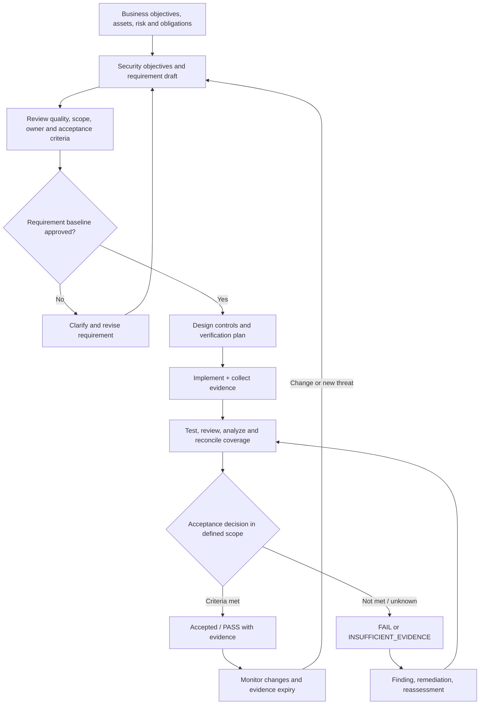
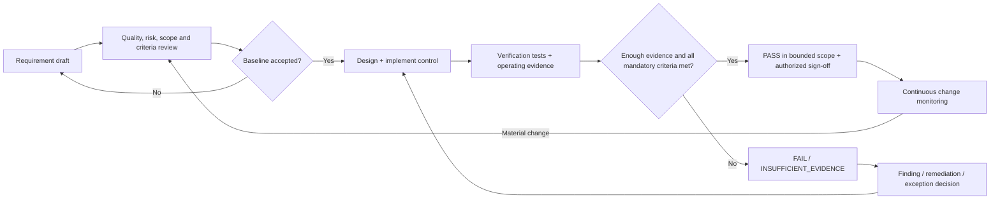
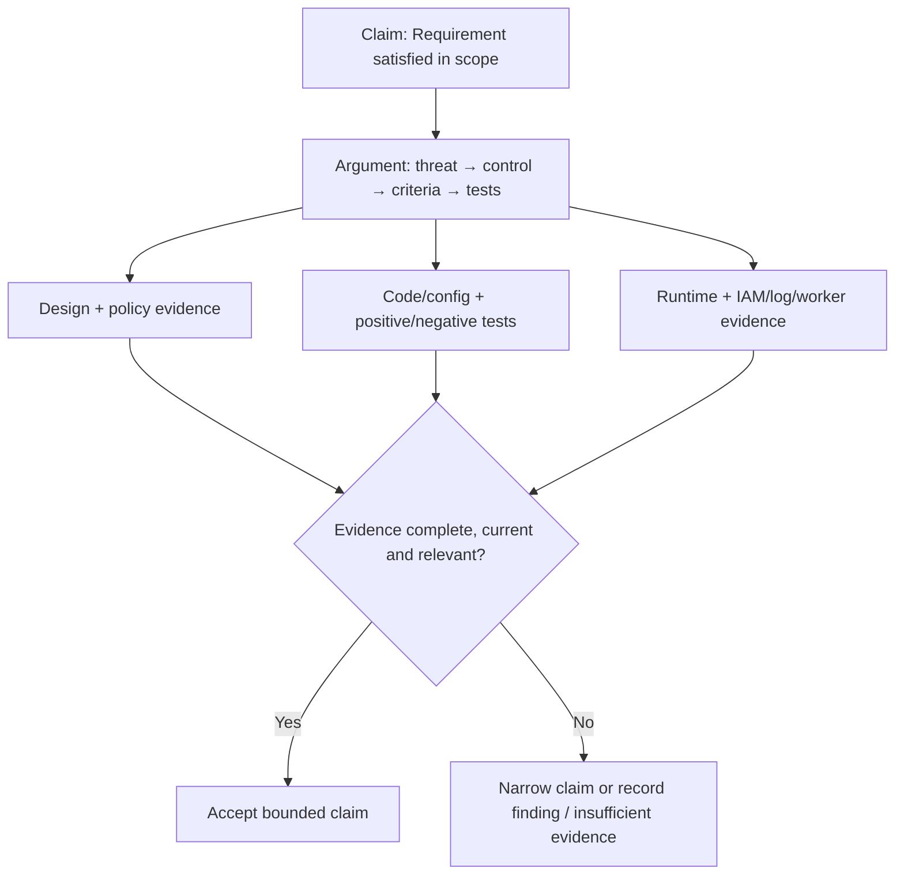

# Chấp nhận requirement

## Mục tiêu học tập

Sau bài học này, bạn có thể:

- Giải thích **chấp nhận security requirement** trong hai ngữ cảnh: **chấp thuận yêu cầu để đưa vào baseline** và **chấp nhận kết quả thực hiện yêu cầu dựa trên bằng chứng**.
- Phân biệt **requirement acceptance**, **acceptance criteria**, **verification**, **validation**, **sign-off**, **risk acceptance**, **exception/waiver** và **release approval**.
- Chuyển một phát biểu bảo mật chung chung thành requirement **đúng phạm vi, có chủ sở hữu, có tiêu chí kiểm chứng, có kịch bản thất bại và truy vết được tới rủi ro**.
- Thiết kế một quy trình chấp nhận gồm rà soát chất lượng yêu cầu, thống nhất phương pháp xác minh, kiểm tra bằng chứng, xử lý sai lệch và phê duyệt đúng thẩm quyền.
- Thực hiện acceptance đối với yêu cầu xác thực/phân quyền, dữ liệu, API, khóa mã hóa, logs, network và asynchronous processing trong hệ thống Java/Spring Boot.
- Tạo **Requirements Traceability Matrix (RTM)** và hồ sơ **Claim – Argument – Evidence** với trạng thái `PASS`, `FAIL`, `INSUFFICIENT_EVIDENCE` và ngoại lệ được ghi nhận rõ.
- Xác định khi nào phải **đánh giá lại yêu cầu đã chấp nhận** vì thay đổi kiến trúc, môi trường, chính sách, mối đe dọa hoặc bằng chứng mất hiệu lực.

## 1. “Chấp nhận requirement” có nghĩa gì?

Trong phát triển hệ thống, *requirement* là điều kiện hoặc năng lực hệ thống cần đáp ứng. **Security requirement** cụ thể hóa mục tiêu bảo mật thành hành vi, giới hạn hoặc thuộc tính có thể đánh giá. Ví dụ: “Chỉ giáo viên được phân công lớp và còn quyền hợp lệ mới được xem bảng điểm của lớp đó”.

Từ **chấp nhận requirement** dễ gây nhầm lẫn vì xuất hiện ở **hai thời điểm khác nhau**:

1. **Chấp thuận bản thân requirement (requirement approval/baselining):** các bên liên quan thống nhất yêu cầu được viết rõ, phù hợp rủi ro và nghĩa vụ, khả thi, có owner, ưu tiên và acceptance criteria; yêu cầu được đưa vào bản baseline có kiểm soát.
2. **Chấp nhận việc đáp ứng requirement (acceptance of fulfillment):** bên có thẩm quyền xem bằng chứng cho thấy implementation hoặc control đã đáp ứng **tiêu chí chấp nhận** trong đúng phạm vi, bản build, môi trường và thời điểm được kiểm tra.

Hai quyết định **không hoán đổi cho nhau**. Một requirement được viết rất tốt và được phê duyệt vẫn có thể chưa triển khai; một test thành công vẫn có thể không đủ để chấp nhận nếu test không kiểm đúng threat hoặc yêu cầu ban đầu không đầy đủ.

### 1.1. Ví dụ mở đầu

Nền tảng học tập có endpoint:

```text
GET /api/courses/{courseId}/grades
```

Đội phát triển đề nghị requirement: “Chỉ giáo viên có quyền được xem bảng điểm”. Câu này có thể đúng hướng nhưng chưa đủ để chấp thuận: **quyền** là theo vai trò chung hay theo lớp? Có tenant/trường khác nhau không? Người vừa bị thu hồi phân công thì sao? Khi policy service không truy cập được, API phải xử lý thế nào? Bằng chứng nào cho thấy quyền bị chặn trên **mọi đường đọc**?

Requirement sau khi làm rõ:

> **SR-AUTHZ-001:** Trong production, khi một principal yêu cầu xem bảng điểm của `courseId`, API chỉ trả dữ liệu nếu principal đã được xác thực và policy phía server xác nhận có quyền `VIEW_GRADES` trên course đó trong đúng tenant, tại thời điểm xử lý; nếu không đủ điều kiện hoặc không xác minh được quyền, hệ thống không tiết lộ bảng điểm. Các đường truy cập trực tiếp/bất đồng bộ liên quan phải có control tương đương theo scope đã được phê duyệt.

Các bên có thể **phê duyệt requirement** này cùng acceptance criteria và owner. Nhưng chỉ sau khi có code review, positive/negative tests, cấu hình phù hợp và bằng chứng kiểm tra đúng phiên bản thì mới xem xét **chấp nhận việc đáp ứng** nó.

### 1.2. Chấp nhận yêu cầu khác chấp nhận rủi ro

| Khái niệm | Quyết định đang được đưa ra | Kết quả đúng |
| --- | --- | --- |
| **Requirement approval** | “Đây có phải yêu cầu cần thực hiện, được mô tả đủ rõ và kiểm chứng được không?” | Bổ sung vào baseline có version, owner, criteria. |
| **Requirement verification** | “Bản triển khai có đáp ứng điều kiện quy định không?” | Evidence và kết quả test/review có phạm vi. |
| **Requirement acceptance** | “Bằng chứng đã đủ để người có thẩm quyền chấp nhận trong scope này chưa?” | Quyết định có căn cứ; pass/fail/unknown rõ ràng. |
| **Risk acceptance** | “Tổ chức có chấp nhận residual risk còn tồn tại trong thẩm quyền không?” | Quyết định risk riêng, có điều kiện/thời hạn khi áp dụng. |
| **Exception/waiver** | “Có cho phép sai khác khỏi một yêu cầu nội bộ trong phạm vi đã xác định không?” | Ngoại lệ được theo dõi, không giả làm PASS của control. |
| **Release approval** | “Release có đủ điều kiện để đưa vào môi trường đích không?” | Quyết định tổng hợp từ nhiều điều kiện, không chỉ một requirement. |

**RISK_ACCEPTED không có nghĩa REQUIREMENT_PASSED.** Nếu một control không đáp ứng, kết quả xác minh phải giữ nguyên sự thật; quyết định chấp nhận rủi ro, nếu được phép, là một record khác. Không dùng ngoại lệ nội bộ để tự miễn nghĩa vụ pháp luật hoặc hợp đồng bắt buộc.

## 2. Vai trò của requirement acceptance trong security assurance

Service **SECURITY_SECURITY_ASSURANCE** đặt trọng tâm vào việc **đánh giá có bằng chứng** rằng hệ thống đáp ứng các mục tiêu bảo mật: từ risk, requirements, security controls tới test, audit, finding và remediation. Vì vậy, requirement acceptance là **điểm nối giữa điều tổ chức cam kết và điều đã chứng minh được**.



Chuỗi cần có **traceability**:

```text
Risk R-01: Cross-tenant grade disclosure
  → Objective SO-01: Confidentiality of academic grades
    → Requirement SR-AUTHZ-001: Object- and tenant-level authorization
      → Control design C-AUTHZ-01: Server-side policy and denied access
        → Implementation: GradeService + policy + storage access model
          → Verification: MockMvc, policy tests, IAM/runtime review
            → Evidence: test report/build, effective permissions, logs
              → Acceptance decision: scope, result, owner, date
                → Finding / exception / reassessment when needed
```

Một requirement không có nguồn rủi ro hoặc mục tiêu rõ ràng có thể gây lãng phí; một rủi ro quan trọng không có requirement/control cũng tạo khoảng trống. **Chấp nhận requirement phải kiểm tra cả chất lượng phát biểu lẫn khả năng truy vết tới nguyên nhân cần bảo vệ**.

## 3. Tiêu chí để chấp thuận một security requirement vào baseline

Một yêu cầu cần đủ chất lượng trước khi team cam kết triển khai. Không nên dùng một câu chung chung như “ứng dụng phải có bảo mật tốt” làm tiêu chí nghiệm thu.

### 3.1. Thuộc tính của requirement tốt

| Thuộc tính | Câu hỏi kiểm tra | Dấu hiệu chưa đạt |
| --- | --- | --- |
| **Necessary/relevant** | Yêu cầu giải quyết mục tiêu, threat, risk hoặc nghĩa vụ nào? | “Cứ bật tất cả security features” mà không có mục đích. |
| **Clear/unambiguous** | Người triển khai và người kiểm thử có hiểu cùng một hành vi không? | Dùng “đủ mạnh”, “nhanh”, “kịp thời” mà không định nghĩa. |
| **Atomic/cohesive** | Có thể xác minh từng nghĩa vụ quan trọng riêng biệt? | Trộn MFA, logs, backup và encryption trong một câu không tách acceptance criteria. |
| **Bounded scope** | Áp dụng cho actor, hệ thống, data, môi trường, transaction nào? | “Mọi dữ liệu luôn an toàn” không xác định phạm vi. |
| **Feasible** | Có giải pháp và nguồn lực khả thi mà không phá vỡ mục tiêu khác? | Đòi zero downtime và zero risk vô điều kiện. |
| **Verifiable** | Có cách test, inspect, analyze hoặc demonstration? | “Hệ thống tin cậy tuyệt đối”. |
| **Traceable** | Nối được tới risk, control, design, test và evidence? | Requirement ID không liên kết tài sản/owner. |
| **Consistent** | Có mâu thuẫn với requirement khác hoặc policy không? | “Không lưu log” trong khi yêu cầu có audit trail. |
| **Prioritized** | Mức quan trọng, điều kiện release và thẩm quyền rõ? | Tất cả đánh dấu Critical không có căn cứ. |
| **Maintainable** | Có version và trigger cập nhật khi phạm vi thay đổi? | Requirement chỉ có trong email hoặc không ai sở hữu. |

Không nhất thiết một requirement phải có một test duy nhất. Một yêu cầu bảo mật quan trọng có thể cần **nhiều loại evidence** để chứng minh toàn bộ hành vi trong phạm vi.

### 3.2. Từ phát biểu mơ hồ sang requirement có thể chấp nhận

| Phát biểu mơ hồ | Requirement có kiểm chứng được | Evidence tối thiểu gợi ý |
| --- | --- | --- |
| “Mật khẩu phải mạnh.” | Mật khẩu phải được xử lý theo password policy đã phê duyệt, với độ dài, blocklist, rate limits, storage và recovery flows tương ứng. | Policy revision, positive/negative tests, password storage design. |
| “API phải an toàn.” | API xem điểm chỉ trả dữ liệu cho principal có quyền trên đúng course/tenant; deny không lộ điểm. | Object authz tests, code review, runtime controls. |
| “Dữ liệu phải mã hóa.” | Dữ liệu bảng điểm được mã hóa khi lưu và truyền theo cryptographic profile đã phê duyệt, với key lifecycle/KMS scope rõ. | Config, KMS policy, decrypt/negative tests, key inventory. |
| “Hệ thống phải log đầy đủ.” | Các thao tác export thành công/bị từ chối tạo audit events có actor/resource/action/outcome/time, không chứa grade/token thô. | Event schema, log-to-sink samples, negative error-path tests. |
| “Backup phải sẵn sàng.” | Dữ liệu và key dependencies được khôi phục bằng quy trình đã duyệt trong mục tiêu RTO/RPO của service theo bài thử DR có scope. | Restore results, integrity check, RTO/RPO evidence. |
| “Đối tác không được lấy dữ liệu thừa.” | Outbound analytics event chỉ chứa các field được duyệt theo schema revision và destination ID; field ngoài allowlist bị loại/chặn. | Contract tests, payload/egress review, transfer decision. |

**Ví dụ trong bảng không áp đặt thuật toán, thời gian hay con số compliance cố định.** Những chi tiết như cryptoperiod, RTO/RPO hoặc thời hạn giữ log phải được xác định từ risk, mục tiêu nghiệp vụ và quy định áp dụng rồi mới làm tiêu chí nghiệm thu.

### 3.3. Metadata tối thiểu của một requirement

Nên lưu:

- **Requirement ID, title, version và statement**.
- Nguồn: security objective, risk scenario, policy/standard, hợp đồng hoặc nghĩa vụ áp dụng.
- **Scope**: application/service, actor, asset, dữ liệu, environment, region, release.
- Priority/severity và người **chịu trách nhiệm yêu cầu**.
- Acceptance criteria, negative/failure behavior và phương pháp verification.
- Implementation/control owner, reviewer, approver/risk authority.
- Links tới design/ADR, code/config, tests, evidence và findings.
- Trạng thái, ngày quyết định, hiệu lực, exceptions, reassessment triggers.

**Requirement owner** không nhất thiết là developer viết code. Người xác định cần bảo vệ gì (data/business/security owner) và người triển khai control có trách nhiệm khác nhau; điểm giao nhau phải được thể hiện trong record.

## 4. Acceptance criteria: cầu nối giữa câu chữ và bằng chứng

**Acceptance criteria** là điều kiện cụ thể quyết định requirement được xem là đáp ứng trong phạm vi. Criteria phải được xác định **trước khi kiểm thử**, nếu không tổ chức dễ thay ngưỡng theo kết quả để “đạt”.

### 4.1. Cấu trúc tiêu chí chấp nhận

Với một security requirement, nên có:

1. **Điều kiện bắt đầu:** trạng thái người dùng, dữ liệu, phiên bản và giả định môi trường.
2. **Stimulus/action:** request, job, sự kiện, thay đổi quyền hoặc tình huống lỗi.
3. **Allow behavior:** hành vi hợp lệ phải tiếp tục hoạt động.
4. **Deny/failure behavior:** hành vi trái phép hoặc không xác định phải bị từ chối, chờ xử lý hoặc hạn chế theo policy.
5. **No-leak/no-side-effect condition:** dữ liệu/secret không bị lộ, job không tạo, file không xuất, audit không chứa thông tin ngoài scope.
6. **Coverage/population:** những role/tenant/object, endpoints, data types, environments và bypass paths nào phải được kiểm.
7. **Evidence/measurement:** cách đo, artifact, expected result, tolerances nếu có.
8. **Decision authority:** ai xác nhận criteria và ai có quyền chấp nhận kết quả.

Ví dụ:

```text
Requirement: SR-AUTHZ-001
Given: teacher-a has VIEW_GRADES on course 42 in tenant A
When: teacher-a calls GET /api/courses/42/grades
Then: authorized grade DTOs are returned.

Given: teacher-b has the same TEACHER role but no assignment to course 42
When: teacher-b calls the same endpoint
Then: no grade data is returned and the request is denied.

Given: a teacher from tenant A targets course 99 in tenant B
When: the endpoint is called
Then: the request cannot read tenant B records.

Given: the policy source is unavailable
When: the endpoint is called
Then: the system does not grant access based on role alone.
```

### 4.2. Criteria phải gồm positive và negative

Security acceptance chỉ dùng negative tests có thể dẫn đến **deny-all**: mọi request bị 403, yêu cầu bảo mật có vẻ đạt nhưng tính năng không dùng được. Chỉ dùng positive tests thì có thể **allow-all**: người đúng quyền dùng được nhưng người sai quyền cũng dùng được.

Để chấp nhận đúng phải chứng minh **cả quyền hợp lệ được thực hiện và quyền không hợp lệ bị giới hạn**, đồng thời kiểm tra không có side effect trái phép.

| Ca | Expected behavior | Vì sao cần |
| --- | --- | --- |
| Giáo viên được phân công course 42 | Cho phép xem DTO bảng điểm đúng scope. | Tránh false PASS do deny-all. |
| Giáo viên cùng role nhưng không được phân công | Deny, không trả grade, không tạo export. | Phát hiện BOLA/IDOR. |
| Giáo viên tenant A truy cập course tenant B | Deny và không lộ dữ liệu cross-tenant. | Kiểm isolation theo tenant. |
| Principal không xác thực | Không được đọc grade. | Xác minh authn boundary. |
| Quyền bị thu hồi ngay trước request | Deny theo policy hiệu lực. | Kiểm stale claims/cache. |
| Policy store lỗi | Không cho phép chỉ vì thiếu quyết định. | Fail-safe trong tình huống bất định. |
| Đường API/worker/download khác | Không bypass requirement. | Kiểm completeness của paths. |

### 4.3. Yêu cầu định lượng và phi chức năng

Một số requirements cần **ngưỡng đo lường**, nhưng số đo phải có nguồn:

- RTO/RPO: chọn từ business impact và recovery policy.
- Session timeout: theo threat/risk, trải nghiệm và điều kiện áp dụng.
- Audit retention: theo policy, hợp đồng, nghĩa vụ và yêu cầu điều tra.
- Rate limit/abuse threshold: theo workload capacity và threat model.
- Mức độ bao phủ: ví dụ toàn bộ endpoints trong **được kiểm kê đầy đủ** của một resource class, chứ không chỉ vài URL tự chọn.

Nếu dùng mục tiêu như “100% critical APIs có object authorization”, phải định nghĩa **mẫu số** gồm những API nào và cách phát hiện API chưa được đăng ký. Không lấy tỷ lệ 100% từ một danh sách thiếu.

### 4.4. Tiêu chí không phải chi tiết triển khai cứng nhắc

Requirement mô tả **kết quả cần đạt**, còn design/control mô tả **cách đạt**. Ví dụ, “chỉ role TEACHER mới truy cập” có thể là **requirement sai** nếu bỏ object relationship. Ngược lại, “phải có đúng annotation `@PreAuthorize` ở dòng 18” là một **ràng buộc implementation**; có thể không phù hợp nếu hệ thống dùng policy engine, gateway hoặc phương pháp khác có bảo đảm tương đương.

Chấp nhận một giải pháp thay thế phải dựa trên việc nó đáp ứng **security property và bằng chứng**, không chỉ giống syntax của mẫu.

## 5. Phân biệt verification và validation

Trong đánh giá requirements:

- **Verification:** điều đã triển khai có đáp ứng requirement/đặc tả và criteria được định nghĩa không?
- **Validation:** requirement và giải pháp có thật sự giải quyết nhu cầu bảo vệ, tình huống sử dụng, rủi ro và mục tiêu nghiệp vụ không?

Ví dụ, team viết requirement “chỉ người có role TEACHER xem được bảng điểm”, xây code/test và tất cả pass. **Verification của requirement yếu** có thể pass, nhưng **validation** thất bại vì một giáo viên không được phép xem mọi lớp. Do đó, chấp nhận requirement phải xem cả **tính đúng của điều được yêu cầu** và **bằng chứng đáp ứng**.

### 5.1. Phương pháp verification

| Phương pháp | Kiểm tra cái gì? | Ví dụ | Giới hạn |
| --- | --- | --- | --- |
| **Inspection/review** | Document, code, config, quyền, thiết kế. | Review annotation, IAM policy, data schema. | Có code đúng chưa chứng minh runtime áp dụng. |
| **Static analysis** | Pattern/lỗi có thể phát hiện từ source/IaC/dependency. | SAST, secret scanning, IaC rules. | Có false positive/negative và khó thấy business logic. |
| **Automated test** | Hành vi tại một môi trường/fixture. | MockMvc object-authz; contract test outbound schema. | Không tự bao phủ mọi đường, mọi dữ liệu hay production. |
| **Integration/system test** | Tương tác giữa các thành phần. | API → queue → worker → storage → download. | Sandbox có thể khác quyền/network thực. |
| **Analysis/modeling** | Lập luận/định lượng từ kiến trúc/threat/số liệu. | Threat coverage, capacity model, key dependency analysis. | Phụ thuộc giả định và độ tin cậy của dữ liệu đầu vào. |
| **Demonstration/operation** | Khả năng thực hiện tác vụ có quan sát. | Restore drill, key rotation, failover test. | Một lần diễn tập không chứng minh liên tục. |
| **Runtime evidence/audit** | Cấu hình và hành vi production trong scope. | Effective IAM, flow logs, KMS events, alerts. | Snapshot/log có thể thiếu coverage hoặc bị mất event. |

**Không có một loại bằng chứng là “mạnh nhất” cho mọi requirement.** Nhiều claims yêu cầu kết hợp design review, tests và runtime evidence.

### 5.2. Design, implementation và operating effectiveness

| Lớp đánh giá | Câu hỏi | Bằng chứng |
| --- | --- | --- |
| **Design effectiveness** | Nếu triển khai như mô tả, control có giải quyết threat và requirement không? | DFD, security design review, threat model, ADR, acceptance criteria. |
| **Implementation effectiveness** | Code/config đã thực thi đúng quyết định chưa? | Code review, unit/integration tests, IaC, deployment record. |
| **Operating effectiveness** | Control có duy trì hiệu lực trong vận hành không? | Runtime permissions, logs, alerts, periodic tests, drift review. |

Kết luận “design được duyệt” không thể tự gọi là “requirement được thực hiện thành công ở production”. Phải xác định **đang chấp nhận lớp nào** và tránh trộn các tầng.

## 6. Baseline, traceability và quản lý thay đổi

### 6.1. Requirement baseline là gì?

**Baseline** là một tập yêu cầu đã được thống nhất, có phiên bản, được dùng làm mốc cho thiết kế, triển khai, testing và acceptance. Baseline không phải thứ bất biến; khi threat, dữ liệu, mục đích hoặc luật áp dụng thay đổi, yêu cầu có thể cần được sửa thông qua **change control**.

Ví dụ:

```text
Baseline B1:
 SR-AUTHZ-001 rev1: TEACHER may read grades of assigned courses.

Change C-021:
 Support staff gains limited incident-only access.
 → New actor / privilege / purpose / audit requirement.
 → Security + Data owner impact review.

Baseline B2:
 SR-AUTHZ-001 rev2: precise TEACHER and incident-support policy.
 SR-AUDIT-004 rev1: ticket-bound, audited support access.
```

Nếu test cũ chạy theo rev1, không thể tự dùng làm evidence đủ cho rev2. Test và decision phải **gắn requirement version**.

### 6.2. Requirements Traceability Matrix (RTM)

| Req ID / rev | Risk / objective | Control location | Verification IDs | Evidence / outcome |
| --- | --- | --- | --- | --- |
| `SR-AUTHZ-001/r2` | Grade confidentiality, cross-tenant access. | Spring policy, worker, download authz. | `T-AUTH-01..08`, effective IAM review. | Build+test refs; chưa đánh giá đầy đủ đường worker → `INSUFFICIENT_EVIDENCE`. |
| `SR-DATA-002/r1` | PII minimization in exports. | DTO/schema, CSV generator, logging. | `T-DATA-01..05`. | Schema and log-to-sink tests. |
| `SR-KEY-003/r1` | Keys protected by scoped KMS. | KMS policy, key lifecycle, workloads. | `T-KMS-01..04`. | Effective IAM, KMS audit, rotation evidence. |
| `SR-LOG-004/r1` | Audit without PII/secret leakage. | Structured event producer/collector. | `T-LOG-01..05`. | Event samples incl. error paths. |
| `SR-DR-005/r1` | Recovery capability within approved objectives. | Backup/restore, key dependencies. | `T-DR-01..03`. | Restore drill, RTO/RPO measurements. |

Các ID, trạng thái và số lượng test ở đây **chỉ là ví dụ**. Thực tế cần lưu link bằng chứng có truy cập kiểm soát và bản build/môi trường xác định. Một hàng RTM chưa có test hoặc evidence không nên được mặc định “hoàn thành” chỉ vì requirement có owner.

### 6.3. Coverage hai chiều

RTM phải hỗ trợ đi theo hai hướng:

1. **Requirement → controls/tests/evidence:** từng yêu cầu có được thực thi và chứng minh không?
2. **Test/control → requirement/risk:** phép kiểm này phục vụ mục tiêu nào và có kiểm nhầm điều không quan trọng trong khi bỏ sót risk lớn không?

Đối soát với **asset/API inventory, routes, data flows, cloud resources, vendor records, IAM/network runtime** để tránh “100% coverage” trên một mẫu số chưa đầy đủ.

### 6.4. Thay đổi và evidence expiry

Review lại khi thêm API/role/tenant relationship, thay data category, chuyển cloud region, thêm vendor/subprocessor, thay IdP/KMS, đổi worker/job contract hoặc có sự cố/threat mới. Có thể đánh giá tác động theo từng requirement, không nhất thiết làm lại toàn bộ, nhưng phải ghi **phần nào mất hiệu lực, cần kiểm lại test nào và ai quyết định**.

## 7. Quy trình chấp nhận requirement từng bước

### Bước 1 – Xác định đề xuất và nguồn yêu cầu

Business/data owner và security team nêu tài sản, mục tiêu và risk scenario. Ví dụ, cần ngăn giáo viên truy cập bảng điểm trái phân công. Nguồn yêu cầu có thể là risk assessment, policy, quy định/hợp đồng hoặc security objective đã phê duyệt.

### Bước 2 – Rà soát tính đầy đủ/chính xác của requirement

Reviewer kiểm scope, actor, data, condition, exceptions, outcome, failure behavior, tính nhất quán và cách xác minh. Nếu mục tiêu không rõ, trả về **NEEDS_CLARIFICATION**, không ghi `APPROVED` chỉ vì có tên trong backlog.

### Bước 3 – Thống nhất acceptance criteria và bằng chứng

Trước triển khai, xác định test dương/âm, các môi trường, population, threshold, công cụ và reviewer. Nếu require runtime evidence thì không dùng một unit test để thay.

### Bước 4 – Phê duyệt baseline

Người có thẩm quyền phù hợp với lĩnh vực phê duyệt requirement/version: data owner với phạm vi dữ liệu, security owner với mục tiêu/control, service owner với feasibility, legal/privacy với nghĩa vụ liên quan, risk owner với residual risk theo thẩm quyền. Ghi lại **decision, rationale, date, conditions**.

### Bước 5 – Thiết kế và thực thi controls

Team triển khai ứng dụng, worker, IAM/network, KMS, logging, privacy controls theo traceability matrix. Code review và design review phải kiểm cả các đường phụ. Khi design khác đáng kể so với baseline, tạo change request và xem lại.

### Bước 6 – Thu thập evidence đã định

Chạy tests và thu artifact; đối chiếu environment/release, fixtures, configuration, auth policy, error paths và runtime. Không sửa expected results sau khi thấy test thất bại chỉ để đạt acceptance.

### Bước 7 – Đánh giá kết quả

Reviewer xác định:

- Criteria nào đạt/không đạt?
- Evidence nào thiếu hoặc không đáng tin?
- Có endpoint, actor, environment hoặc dữ liệu nào chưa được bao phủ?
- Có finding, exception hoặc residual risk nào cần owner?
- Với requirement phức hợp, có phần nào cần tách ra để tránh ghi một PASS che nhiều FAIL?

### Bước 8 – Quyết định chấp nhận và lưu hồ sơ

Authorized acceptor ký hoặc ghi decision có căn cứ. **Không ép mọi kết quả về true/false**; trạng thái chưa đủ bằng chứng là một kết quả hợp lệ và quan trọng.

### Bước 9 – Khắc phục/re-test khi cần

Nếu FAIL hoặc thiếu evidence, tạo finding với owner, remediation, deadline và test/decision cần thực hiện. Chỉ đánh dấu verified closure khi có bằng chứng mới phù hợp **đúng version/môi trường**.

### Bước 10 – Theo dõi hiệu lực và review lại

Sau acceptance, giám sát drift, findings, access/secret/region changes, key rotation, changes to policy; khi có trigger, decision cũ có thể **hết hiệu lực đối với scope mới**.



## 8. Ví dụ Java/Spring Boot: chấp nhận requirement phân quyền

### 8.1. Phạm vi bài toán

Một ứng dụng Spring Boot lưu bảng điểm cho nhiều trường (multi-tenant). Trường A có course 42, trường B có course 99. `teacher-a` và `teacher-b` đều có role `TEACHER`, nhưng chỉ `teacher-a` có phân công còn hiệu lực trên course 42. `teacher-a` không có quyền với course 99.

**Requirement `SR-AUTHZ-001/r2`:** API chỉ cho xem bảng điểm khi principal được xác thực và policy server xác nhận quyền theo **action + course + tenant + trạng thái phân công**. Nếu không đủ quyền hoặc không xác minh được, không trả bảng điểm.

### 8.2. Anti-pattern: chấp nhận sai vì chỉ kiểm role

```java
@RestController
class GradeController {
    private final GradeRepository repository;

    GradeController(GradeRepository repository) {
        this.repository = repository;
    }

    @GetMapping("/api/courses/{courseId}/grades")
    @PreAuthorize("hasRole('TEACHER')")
    List<GradeView> list(@PathVariable long courseId) {
        return repository.findViewsByCourseId(courseId);
    }
}
```

Nếu repository không tự kiểm quyền, code trên có thể cho mọi giáo viên đọc điểm của mọi course. Một test `teacher-a` đọc course 42 thành công **không đủ** để đánh dấu requirement PASS. Đây là tình huống **verification coverage sai**: chỉ kiểm trường hợp hợp lệ, không kiểm threat dẫn đến yêu cầu.

### 8.3. Triển khai gần đúng thiết kế đã duyệt

```java
@Configuration
@EnableMethodSecurity
class MethodSecurityConfiguration {}

@Service
class GradeService {
    private final GradeRepository repository;

    GradeService(GradeRepository repository) {
        this.repository = repository;
    }

    @PreAuthorize(
        "@courseAccess.canViewGrades(authentication, #courseId)"
    )
    @Transactional(readOnly = true)
    public List<GradeView> getGrades(long courseId) {
        return repository.findViewsByCourseId(courseId);
    }
}
```

`courseAccess` là **bean policy giả định** của ứng dụng; không phải API có sẵn tự giải quyết BOLA. Bean phải đọc thông tin principal từ nguồn tin cậy, xác định course/tenant thực và phân công có hiệu lực. Nó phải có chính sách rõ khi database/policy source unavailable. Không tin một trường `tenantId` do client gửi như bằng chứng quyền.

**Giới hạn thiết kế:** Spring Method Security cần được cấu hình và được gọi qua proxy phù hợp; self-invocation, direct repository access, batch worker hoặc API khác có thể bypass. Vì vậy requirement acceptance cần inventory **mọi đường truy cập bảng điểm thuộc scope**, không chỉ một method.

### 8.4. Acceptance test với MockMvc

```java
@SpringBootTest
@AutoConfigureMockMvc
class GradeAccessAcceptanceIT {
    @Autowired
    MockMvc mockMvc;

    @Test
    @WithMockUser(username = "teacher-a", roles = "TEACHER")
    void assignedTeacherCanViewOwnCourse() throws Exception {
        mockMvc.perform(get("/api/courses/42/grades"))
            .andExpect(status().isOk())
            .andExpect(jsonPath("$").isArray());
    }

    @Test
    @WithMockUser(username = "teacher-b", roles = "TEACHER")
    void anotherTeacherCannotViewCourse() throws Exception {
        mockMvc.perform(get("/api/courses/42/grades"))
            .andExpect(status().isForbidden());
    }

    @Test
    @WithMockUser(username = "teacher-a", roles = "TEACHER")
    void anotherTenantIsNotAccessible() throws Exception {
        mockMvc.perform(get("/api/courses/99/grades"))
            .andExpect(status().isForbidden());
    }
}
```

Đây là **ví dụ giảng dạy**, cần bổ sung controller, fixtures, imports và dependencies Spring Security/Test phù hợp. Hệ thống có thể chọn trả `404` thay vì `403` để không xác nhận sự tồn tại của tài nguyên theo policy; tiêu chí nghiệm thu phải ghi **hành vi và response policy được chấp nhận** trước khi chạy test.

Với test deny, cần kiểm thêm **response không chứa bất cứ grade/PII nào**, không có job hay side effect ngoài policy. `403` đơn lẻ có thể do route không tồn tại, cấu hình CSRF hoặc test security setup sai; phải có **positive control** và xác minh bean policy thực được gọi. MockMvc **không tự chứng minh** IAM của database, load balancer, network, logs hoặc API/worker khác.

### 8.5. Một acceptance evidence bundle

| Evidence ID | Nội dung | Khi nào được coi phù hợp? |
| --- | --- | --- |
| `EV-AUTHZ-DESIGN` | Threat model, DFD, object relationship và review decision. | Nêu course/tenant/role, paths và trust assumptions. |
| `EV-AUTHZ-CODE` | Code review policy và service/query scope. | Gắn với commit/build dùng để test, không có bypass đã biết. |
| `EV-AUTHZ-TEST` | Positive/negative tests, fixtures và test report. | Tests chạy thật trên build có hiệu lực; ca sai tenant/role fail closed. |
| `EV-AUTHZ-RUNTIME` | Security config, identities, logs và effective permissions. | Xác nhận môi trường triển khai thuộc phạm vi, kênh truy cập liên quan. |
| `EV-AUTHZ-FINDINGS` | Những issue còn mở và re-test. | Không che critical finding bằng tổng số tests xanh. |

**Acceptance decision minh họa:** nếu ba test API pass nhưng worker/export dùng cùng database credentials có quyền bypass policy và chưa được đánh giá, kết luận có thể là “API path đạt trong phạm vi thử”, còn **requirement tổng thể vẫn `INSUFFICIENT_EVIDENCE`** nếu scope bao gồm cả đường worker.

## 9. Yêu cầu bảo mật trên queue, worker và file export

Một API có thể xác thực/phân quyền lúc tạo job nhưng worker xử lý sau vài phút, khi quyền đã bị thu hồi. Nếu requirement chỉ nói “API kiểm quyền”, tổ chức có thể bỏ sót **trust boundary giữa request và tác vụ nền**.

### 9.1. Các yêu cầu cần chấp nhận riêng

| Req ID | Requirement và scope | Acceptance evidence |
| --- | --- | --- |
| `SR-EXPORT-01` | Chỉ principal có quyền export course/tenant mới tạo job. | API positive/negative tests, no job on deny. |
| `SR-EXPORT-02` | Job scope được xác định bởi server, được bảo vệ integrity; worker không tin input tùy ý trong message. | Job schema review, tampered/replayed message tests. |
| `SR-EXPORT-03` | Worker phải xử lý thay đổi quyền/trạng thái job theo mô hình đã phê duyệt. | Revoked permission, stale approval, duplicate job tests. |
| `SR-EXPORT-04` | Worker chỉ đọc dữ liệu và ghi object/storage trong scope cần thiết. | Runtime IAM, negative access tests, network policy. |
| `SR-EXPORT-05` | File CSV chỉ có field cần thiết, được bảo vệ chống lộ qua file/download/log. | Schema, direct object denial, log-to-sink và cross-user tests. |
| `SR-EXPORT-06` | File có TTL/retention/deletion phù hợp và không tồn tại vô thời hạn khi retry lỗi. | Cleanup/reconciliation, orphan object tests, retention logs. |
| `SR-EXPORT-07` | Download kiểm quyền theo người nhận/tài nguyên và policy về expiry/revocation. | Other-user, expired/revoked, copied-link tests. |

Nếu requirement tổng gồm nhiều nghĩa vụ, **không lấy một test API `201 Created` hoặc `202 Accepted` làm bằng chứng cả chuỗi**. Worker, storage, queue, logs và download cần evidence tương ứng.

### 9.2. Hành vi khi quyền thay đổi

Ví dụ:

1. Giáo viên A có quyền với lớp 42 và tạo export job.
2. Administrator thu hồi phân công trước khi worker chạy.
3. Worker nhận job từ queue và chuẩn bị truy vấn bảng điểm.

Thiết kế phải xác định **quyền được snapshot theo job hay phải kiểm tại thời điểm thực thi** và cơ sở chấp thuận quyết định đó. Với hệ thống bảo vệ dữ liệu học viên, có thể yêu cầu **recheck gần thời điểm đọc dữ liệu** và kiểm quyền lại khi tải. Điều này phải là một requirement/acceptance criterion riêng; tránh suy đoán rằng một lần allow ban đầu sẽ hợp lệ mãi mãi.

### 9.3. Negative tests chống lách bằng success status

| Scenario | Chứng minh điều gì? |
| --- | --- |
| Quyền bị thu hồi trước worker execution. | Không xử lý dữ liệu khi điều kiện không còn hợp lệ. |
| Message có `jobId` ngoài tenant. | Worker không tin job reference chưa được authorize. |
| Duplicate delivery/retry. | Không tạo nhiều file trái kiểm soát; state transition idempotent. |
| Object storage upload thành công nhưng DB commit lỗi. | Cleanup/reconciliation và quyền vẫn bảo vệ orphaned object. |
| User khác lấy `exportId` hoặc shared URL. | Download không vượt scope, expiry/revocation hợp lệ. |
| Logger gặp exception chứa CSV và token. | Sink không nhận dữ liệu trái data handling policy. |
| Policy store không truy cập được. | Fail-safe/hold theo yêu cầu, không tự cho phép. |

**Không kiểm thử môi trường thật bằng cách trích xuất dữ liệu học viên thực.** Dùng fixtures synthetic và hệ thống thử nghiệm được quản trị; với production, thực hiện safe runtime verification có scope/authorization.

## 10. Chấp nhận các yêu cầu không chỉ thuộc ứng dụng

### 10.1. Encryption và key management

Requirement ví dụ: “Các bản ghi bảng điểm được mã hóa khi lưu theo profile được phê duyệt, khóa được quản lý bởi KMS/HSM với quyền sử dụng đúng purpose, version và lifecycle.”

Chấp nhận yêu cầu này cần kiểm:

- Thuật toán/mode/parameters và authenticated encryption có đúng profile?
- Key material có bị hardcode hoặc ghi vào log/config không?
- Workload nào được quyền encrypt/decrypt/wrap/unwrap?
- Ciphertext, wrapped DEK, key ID/version và nonce được lưu/xác thực phù hợp?
- Key rotation, rewrap/re-encrypt và backup/restore có được thiết kế/kiểm chứng?
- Khi KMS unavailable, hệ thống có fallback sang plaintext hoặc key tĩnh không?

Một unit test “AES encrypt/decrypt khớp” **không đủ** nếu runtime IAM cho mọi service giải mã key hoặc backup không phục hồi được sau rotate. Ngược lại, chỉ có ảnh console “KMS enabled” cũng không chứng minh tất cả bảng điểm đều mã hóa đúng.

### 10.2. Audit logs và privacy

Requirement ví dụ: “Các lần đọc/export dữ liệu nhạy cảm phải tạo audit record có actor, action, resource reference, timestamp, outcome và correlation ID; audit sink không được chứa dữ liệu bảng điểm và secrets ngoài policy.”

Acceptance nên có:

- Positive test tạo event khi truy cập hợp lệ.
- Negative test tạo event khi bị từ chối, nếu policy yêu cầu.
- Error-path test, log-to-sink samples và tracing/APM collector review.
- Access control/retention/integrity của audit logs.
- Kiểm việc audit pipeline lỗi: action có bị chặn, degraded hay buffered theo requirement?

Không khẳng định “không có PII trong log” chỉ từ một log sample. Cần **population các log sources/sinks và loại error path** được kiểm.

### 10.3. Network segmentation

Requirement ví dụ: “Trong production, database chỉ cho các workload ID/zone được duyệt kết nối trên port cần thiết, các workload khác không thể truy cập qua đường mạng trong scope.”

Evidence cần effective cloud firewall/security group, Kubernetes NetworkPolicy/CNI capability, positive/negative packet tests và flow logs. **Một YAML NetworkPolicy tồn tại trong Git không chứng minh CNI đang thực thi**; một timeout không tự chứng minh policy chặn vì service có thể đang down.

### 10.4. Recovery và availability

Requirement ví dụ: “Hệ thống khôi phục dữ liệu và signing/encryption keys theo mục tiêu RTO/RPO đã được duyệt, không bỏ qua data integrity và auth khi DR.”

Chấp nhận dựa trên **backup/restore drill** có số đo thật, data/key dependencies, failover network/IAM và kết quả integrity. Không dùng kế hoạch DR chưa thử hoặc snapshot tạo thành công thay cho bằng chứng khôi phục.

### 10.5. Third-party và cross-border processing

Requirement phải nêu recipient, data categories, purpose, location/region, processor/subprocessor và conditions trong phạm vi. Chỉ có DPA hoặc TLS không tự chứng minh việc chuyển phù hợp pháp lý hay payload tối thiểu; cần **Legal/Privacy review hiện hành khi quy định áp dụng yêu cầu**, contract evidence, schema tests, runtime egress và vendor review.

## 11. Ai có thẩm quyền chấp nhận?

**Acceptance là quyết định quản trị dựa trên bằng chứng**, không phải developer tự tick ô “Done”. Mỗi tổ chức có RACI khác nhau nhưng cần phân biệt ít nhất các vai trò:

| Vai trò | Trách nhiệm |
| --- | --- |
| **Business/product owner** | Xác nhận mục tiêu nghiệp vụ, phạm vi use case và mức cần thiết của requirement. |
| **Data owner/Privacy** | Xác định điều kiện xử lý dữ liệu, classification, mục đích, quyền cá nhân và nghĩa vụ liên quan. |
| **Security requirement/control owner** | Soạn/challenge security property, threat/risk mapping và acceptance criteria. |
| **Solution architect/tech lead** | Đánh giá feasibility, security design và trade-offs. |
| **Developer/Operator** | Triển khai, thu evidence và giải thích hành vi thực tế. |
| **QA/Security tester** | Thiết kế và thực hiện verification có ca dương/âm; quản lý fixtures và test provenance. |
| **Independent assurance reviewer** | Đánh giá độ tin cậy, completeness, giới hạn evidence và finding. |
| **Risk owner** | Quyết định residual risk/exception trong thẩm quyền, không tự đổi FAIL thành PASS. |
| **Release authority** | Ra quyết định release tổng hợp từ accepted requirements và điều kiện khác. |

Tách **người triển khai**, **người xác minh** và **người chấp nhận rủi ro** ở mức phù hợp. Không phải mọi requirement đều cần chữ ký của cùng một hội đồng, nhưng yêu cầu có ảnh hưởng lớn tới PII, identity, privileged access hoặc pháp lý cần đúng reviewer/approver.

### 11.1. Ba loại sign-off không được trộn

| Sign-off | Điều được xác nhận | Điều chưa được xác nhận |
| --- | --- | --- |
| **Requirement baseline sign-off** | Câu chữ, mục đích, scope, criteria và trách nhiệm phù hợp. | Control đã triển khai hoặc chạy đúng. |
| **Requirement fulfillment acceptance** | Bằng chứng phù hợp chứng minh criteria đạt trong scope. | Mọi threat/hệ thống ngoài scope đều an toàn. |
| **Release decision** | Release đáp ứng tập điều kiện chấp nhận và rủi ro còn lại theo authority. | Không có lỗ hổng hoặc sự cố nào sẽ xảy ra. |

### 11.2. Không phê duyệt trên dữ kiện không đầy đủ

Nếu công cụ test lỗi, runtime IAM chưa xem, vendor chưa xác nhận region hoặc một worker path chưa được kiểm tra, quyết định phù hợp có thể là **`INSUFFICIENT_EVIDENCE`**. Nếu đã biết control không đáp ứng, ghi **`FAIL`**. Chỉ dùng `PASS` khi criteria đã được chứng minh trong phạm vi; tránh “PASS with major gaps” mà không ghi rõ yêu cầu nào chưa đạt.

## 12. Trạng thái acceptance và xử lý exception

### 12.1. Trạng thái theo từng giai đoạn

| Nhóm | Trạng thái ví dụ | Ý nghĩa |
| --- | --- | --- |
| **Requirement definition** | `DRAFT`, `NEEDS_CLARIFICATION`, `BASELINED` | Yêu cầu đang soạn, cần làm rõ hoặc đã đưa vào baseline. |
| **Implementation** | `PLANNED`, `IN_PROGRESS`, `READY_FOR_VERIFICATION` | Control đang thực hiện hoặc chờ đánh giá. |
| **Verification** | `PASS`, `FAIL`, `INSUFFICIENT_EVIDENCE`, `NOT_APPLICABLE` | Kết quả phép kiểm có scope; N/A phải có căn cứ đúng phạm vi. |
| **Governance** | `ACCEPTED`, `REJECTED`, `CONDITIONALLY_ACCEPTED` | Quyết định có thẩm quyền theo policy, không thay kết quả test. |
| **Risk treatment** | `RISK_ACCEPTED`, `EXCEPTION_APPLIED`, `SUSPENDED` | Record riêng về residual risk, sai khác hoặc đình chỉ. |
| **Lifecycle** | `SUPERSEDED`, `RETIRED`, `REASSESS_REQUIRED` | Baseline hoặc bằng chứng không còn áp dụng nguyên vẹn. |

Không nhất thiết mỗi tổ chức dùng đúng những tên này. Quan trọng là mô hình trạng thái phải **không che sai lệch**, có điều kiện chuyển và liên kết tới version, evidence và authority.

### 12.2. “Conditionally accepted” nghĩa gì?

Có thể chấp nhận có điều kiện **khi policy cho phép**, nhưng cần phân biệt:

- Requirement có criteria thiết kế đã đạt, còn runtime verification là **điều kiện trước production**.
- Requirement được triển khai một phần, có **control bù trừ** và risk decision giới hạn, nhưng phần chưa đạt vẫn được ghi FAIL/exception rõ.
- Một điều kiện bắt buộc theo luật/hợp đồng chưa đủ: **không thể dùng conditional acceptance nội bộ để tự bỏ qua**.

Mọi điều kiện phải có **owner, deadline, release restriction, measurement, reassessment trigger**. Không dùng chuỗi “Accepted pending everything” để biến một issue chưa xử lý thành hoàn tất.

### 12.3. Quy trình xử lý finding

1. Ghi rõ requirement ID/revision, acceptance criterion bị vi phạm và affected assets.
2. Thu evidence trước/sau theo quy trình không lộ dữ liệu nhạy cảm.
3. Đánh giá severity, scope, threat, exposure và impact.
4. Chọn remediation, control bù trừ hoặc escalation; xác định owner và due date.
5. Nếu exception hợp lệ, ghi rationale, residual risk, approver, scope, expiry và monitoring.
6. Thực hiện fix, re-test trên build/config phù hợp và kiểm soát regression.
7. Reviewer xác minh đủ evidence trước `CLOSED_VERIFIED`; cập nhật RTM và acceptance decision.

Một finding `RISK_ACCEPTED` vẫn là rủi ro tồn tại; không ghi nó thành `CLOSED_VERIFIED` nếu chưa sửa control.

## 13. Claim – Argument – Evidence cho requirement acceptance

### 13.1. Claim về baseline

**Claim A:** “Security requirements của tính năng xem và xuất bảng điểm phiên bản B2 đã được rà soát, có nguồn rủi ro, phạm vi, criteria, owner và phương pháp verification, đồng thời được chấp thuận để dùng làm baseline theo authority phù hợp.”

**Argument A:**

1. Risk/asset analysis xác định cần ngăn truy cập trái quyền và rò dữ liệu.
2. Các requirements bao phủ API/worker/storage/logging/key dependencies liên quan.
3. Phát biểu đã được kiểm tính rõ ràng, nhất quán, khả thi và verifiable.
4. Positive/negative criteria và planned evidence được reviewer thống nhất.
5. Các stakeholder chịu trách nhiệm đã phê duyệt version/scope và ghi giả định chưa rõ.

**Evidence A:** requirement catalogue/RTM, review comments, DFD, risk mapping, approved acceptance criteria, baseline ID và decision record.

### 13.2. Claim về fulfillment

**Claim B:** “Trong build R và environment production scope X đã kiểm tra, requirement `SR-AUTHZ-001/r2` về phân quyền xem điểm theo course/tenant được triển khai và đáp ứng các acceptance criteria đã phê duyệt.”

**Argument B:**

1. Policy nguồn tin cậy ràng buộc principal, action, course, tenant và hiệu lực phân công.
2. Code review xác nhận điểm enforcement trên những path thuộc scope.
3. Positive và negative tests chứng minh allow đúng quyền, deny sai lớp/tenant/revoked/policy unavailable.
4. Evidence runtime xác minh build/config/security controls tương ứng.
5. Các findings liên quan đã khắc phục hoặc được nêu rõ phạm vi, trạng thái và residual risk.

**Evidence B:** source/PR/build IDs, fixtures và test reports, runtime config/permissions, logs có kiểm soát, RTM, review decision và re-test artifacts.

### 13.3. Chất lượng và giới hạn của evidence

| Thuộc tính | Câu hỏi để chấp nhận | Bằng chứng yếu |
| --- | --- | --- |
| **Relevance** | Evidence có kiểm đúng criterion và threat không? | Test đăng nhập thành công cho requirement chống BOLA. |
| **Integrity/provenance** | Có nguồn, build, thời gian, người/công cụ và bảo vệ chống sửa không? | Screenshot không rõ hệ thống/ngày. |
| **Freshness** | Có áp dụng cho revision và môi trường hiện tại? | Test chạy trước khi thay IAM/worker. |
| **Completeness** | Population, paths, roles, tenants và failure cases nào đã được xét? | Chỉ một endpoint/happy path được chọn. |
| **Independence** | Reviewer có đủ độc lập tương xứng rủi ro? | Tác giả tự khai PASS không artifact. |
| **Reproducibility** | Có thể truy vết fixtures, steps, config và expected result? | “Đã thử bằng tay thấy ổn”. |
| **Limitations** | Có ghi điều chưa bao phủ và giả định không? | Khẳng định “100% secure” từ một unit test. |

**CAE không dùng để tô đẹp kết luận.** Nếu evidence không hỗ trợ claim, phải thu hẹp claim hoặc bổ sung bằng chứng; không tăng chữ trong argument để che khoảng trống.



## 14. Hồ sơ requirement acceptance có thể audit

### 14.1. Ví dụ YAML

Đây là **mẫu dữ liệu minh họa**, không phải requirement đã được phê duyệt hoặc kiểm thử trong dự án thật. Trạng thái chờ là cố ý.

```yaml
requirement_id: "SR-AUTHZ-001"
revision: "r2"
title: "Object- and tenant-level access to course grades"
statement: >
  Only authenticated principals with current VIEW_GRADES permission
  on the requested course in the correct tenant may access grade data.
source:
  security_objective_id: "SO-GRADE-CONFIDENTIALITY"
  risk_id: "R-CROSS-TENANT-READ"
  policy_refs: ["<approved-policy-version>"]
scope:
  service: "learning-api"
  environment: "production"
  release: "<verified-build-id>"
  data_categories: ["course-grades", "learner-identifiers"]
  actors: ["assigned-teacher", "unassigned-teacher", "other-tenant"]
  entry_points: ["GET /api/courses/{courseId}/grades"]
  excluded_paths: ["<explicitly-justified-out-of-scope>"]
ownership:
  requirement_owner_role: "academic-data-owner"
  control_owner_role: "learning-api-lead"
  test_owner_role: "security-qa"
  acceptance_authority_role: "authorized-security-approver"
baseline:
  state: "BASELINED"
  decision_ref: "<actual-baseline-signoff>"
acceptance_criteria:
  - id: "AC-ALLOW-01"
    behavior: "Assigned teacher in same tenant may read authorized DTOs"
    verification_ref: "<positive-test-id>"
  - id: "AC-DENY-02"
    behavior: "Same-role unassigned teacher cannot read grades"
    verification_ref: "<negative-test-id>"
  - id: "AC-DENY-03"
    behavior: "Cross-tenant access is denied without data leakage"
    verification_ref: "<negative-test-id>"
  - id: "AC-FAILSAFE-04"
    behavior: "Policy uncertainty does not grant access"
    verification_ref: "<failure-test-id>"
traceability:
  design_ref: "<versioned-design>"
  threat_model_ref: "<verified-threat-model>"
  implementation_refs: ["<code-review>", "<policy-source>"]
verification:
  test_report_ref: "<actual-CI-artifact>"
  runtime_review_ref: "<actual-effective-config>"
  population_coverage_ref: "<endpoint-and-tenant-inventory>"
  result: "INSUFFICIENT_EVIDENCE"
  assessed_at: null
  assessor_role: "independent-assurance-reviewer"
exceptions: []
findings:
  - id: "F-WORKER-PATH"
    state: "OPEN"
    reason: "Worker access path not verified in current scope"
acceptance:
  fulfillment_state: "NOT_ACCEPTED"
  decision_ref: null
  conditions: ["Verify worker-related access paths"]
reassess_on:
  - "Authorization model, tenant relation or IdP change"
  - "New grade access API, worker or download path"
  - "New critical finding or policy/source availability change"
```

Hồ sơ thật phải có **references tới artifact có quyền truy cập kiểm soát**. Không lưu token, khóa, password, raw bảng điểm hoặc dữ liệu cá nhân nhạy cảm trong requirement record chỉ để chứng minh một yêu cầu.

### 14.2. Mẫu acceptance decision

| Trường | Nội dung phải có |
| --- | --- |
| Decision ID / date / authority | Mã quyết định, người có thẩm quyền, thời điểm. |
| Requirement ID/revision | Đúng baseline và statement được xem. |
| Scope | Service, endpoints, tenants, data categories, environment, release/region. |
| Criteria evaluated | Từng criterion và expected behavior. |
| Evidence | Link test/review/runtime có provenance và retention. |
| Result | PASS/FAIL/INSUFFICIENT_EVIDENCE theo từng criterion và tổng thể. |
| Findings/exception | ID, owner, remediation, residual risk, approval và expiry khi phù hợp. |
| Decision & rationale | Accepted/rejected/conditional theo policy và điều kiện rõ. |
| Reassessment | Trigger, thời hạn nếu có và người theo dõi. |

**Không tạo bản ghi acceptance bằng cách tự đổi `verification.result` thành `PASS` trong Git mà bỏ qua approval workflow.** Workflow phải bảo đảm tính toàn vẹn của quyết định và sự tách biệt phù hợp giữa người viết control, người kiểm và người chấp nhận.

## 15. Acceptance gates trong SDLC và CI/CD

### 15.1. Ba gate thường gặp

| Gate | Điều kiện minh họa | Không nên cho qua khi |
| --- | --- | --- |
| **Requirements gate** | Baseline, source/risk, scope, criteria và owner được phê duyệt. | Security property mơ hồ hoặc requirement mâu thuẫn chưa giải quyết. |
| **Implementation/verification gate** | Code/config, tests và design review đáp ứng criteria đã chọn. | Critical negative test FAIL, evidence không đúng build, uncovered bypass path quan trọng. |
| **Release/operating gate** | Runtime config, access/network/storage, monitoring và residual risk được đánh giá đúng scope. | Rule mở, thiếu mandatory legal/privacy review hoặc production evidence bắt buộc. |

CI/CD có thể tự động kiểm:

- Mỗi requirement bắt buộc có ID/version, owner và acceptance criteria.
- Test IDs và artifacts tồn tại, có build/config tương ứng.
- Tests liên quan không thất bại và không bị disable ngoài workflow.
- IaC/secret/SCA checks đáp ứng điều kiện kỹ thuật.
- Những requirement có change impact được review lại.

Nhưng **CI không tự thay decision authority**: một thay đổi về mục đích xử lý dữ liệu, luật áp dụng hoặc residual risk không thể chỉ dựa trên một YAML flag do developer viết.

### 15.2. Gherkin acceptance scenarios

```gherkin
Feature: Course grade access within the authorized tenant

  Scenario: Assigned teacher reads an authorized course
    Given teacher-a is assigned to course 42 in tenant A
    When teacher-a requests grades for course 42
    Then the response contains only grades allowed by policy

  Scenario: A teacher with the same role is not assigned
    Given teacher-b has the TEACHER role but no assignment to course 42
    When teacher-b requests grades for course 42
    Then the request is denied
    And no grade data is disclosed

  Scenario: Cross-tenant course access
    Given teacher-a belongs to tenant A
    And course 99 belongs to tenant B
    When teacher-a requests grades for course 99
    Then the request is denied without cross-tenant data leakage
```

Đây là **acceptance specification**, không phải bằng chứng test đã chạy. Chỉ khi gắn vào test runner phù hợp, chạy trên build/config có scope và lưu report mới tạo evidence kiểm chứng.

### 15.3. False PASS và cách tránh

Một yêu cầu có thể bị đánh dấu PASS sai vì:

1. Test gọi mock policy đã được lập trình sẵn trả `false`.
2. Mọi request trả `403` do CSRF hoặc route sai, không vì object authorization.
3. Dùng fixture không có user khác tenant.
4. Chỉ test controller; worker/direct storage vẫn mở.
5. CI chạy trên code mới nhưng production đang ở build cũ.
6. Evidence không có timestamp, environment, test population hoặc reviewer.
7. Một exception được nhập thành `PASSED` cho dễ làm dashboard.
8. Rule được khai báo trong IaC nhưng runtime đã drift hoặc nằm ở region khác.

Để giảm false PASS, kết hợp **positive controls, negative tests, side-effect assertions, path inventory, test provenance và runtime reconciliation**.

## 16. Continuous assurance và quản lý acceptance sau release

Requirement không chỉ được xem ở ngày go-live. Sau khi phát hành, hệ thống có thể thêm service, vendor, token issuer, KMS, data classification hoặc thay policy. Những thay đổi này làm evidence cũ **không còn chứng minh toàn bộ scope**.

### 16.1. Trigger đánh giá lại

| Thay đổi | Vì sao ảnh hưởng acceptance? | Hành động |
| --- | --- | --- |
| Thêm API/export path | Tăng population và đường bypass policy. | Cập nhật inventory/RTM, thiết kế thêm tests. |
| Thêm role/tenant relation | Điều kiện authorization thay đổi. | Review requirement/version và test cross-role/cross-tenant. |
| Thay IdP/token issuer/claims | Authentication/authorization trust assumption thay đổi. | Token validation, audience, key rollover và runtime tests. |
| Đổi KMS/crypto profile | Key access, lifecycle và data recovery có thể đổi. | New evidence về key usage, rotation, backup. |
| Cloud region/network policy thay | Security boundary, data residency và egress đổi. | Design/Privacy/Legal review khi áp dụng, effective policy tests. |
| New vendor/subprocessor | New recipient, purpose hoặc external data flow. | Contract/privacy review, data schema/egress verification. |
| Security incident hoặc new high-risk finding | Threat/risk basis cũ có thể sai. | Reassess criteria, controls, remediation và acceptance decision. |
| Log/export schema change | Có thể lộ PII/secret hoặc vượt minimization. | Log-to-sink/data classification tests và re-approval. |

### 16.2. Monitor acceptance không chỉ theo số PASS

| KPI/KRI | Câu hỏi quản trị | Cách tránh diễn giải sai |
| --- | --- | --- |
| Tỷ lệ critical requirements có criteria và owner | Chất lượng baseline ra sao? | Mẫu số phải bao phủ requirements từ risk/asset inventory. |
| Tỷ lệ requirements có tests và evidence trong đúng build | Verification coverage thế nào? | Có test ID không chứng minh test đã chạy hoặc đúng threat. |
| Số `INSUFFICIENT_EVIDENCE` quá hạn | Những khoảng trống assurance tồn tại ở đâu? | Không tự chuyển unknown thành pass để làm đẹp chỉ số. |
| Số FAIL/critical finding chưa remediation | Rủi ro nào đang ngăn acceptance? | Phân biệt technical FAIL và accepted risk/exception. |
| Thời gian từ FAIL đến verified closure | Hiệu quả remediation/re-test? | Ticket Done không phải evidence re-test. |
| Tỷ lệ release có đủ requirement sign-off | Gate có hoạt động? | Sign-off hình thức không thay test/runtime evidence. |
| Tỷ lệ change trigger dẫn tới reassessment | Acceptance có được duy trì khi hệ thống đổi? | Phải tính thay đổi ngoài code: cloud, vendor, IAM, logs. |
| Tỷ lệ requirements có negative cases/bypass path review | Kiểm thử threat thực tế? | Số test không thay chất lượng hoặc completeness. |
| Số exception hết hạn/chưa có owner | Residual risk có được quản lý? | Exception không đồng nghĩa requirement đạt. |

### 16.3. Audit sampling đúng population

Audit không nên chỉ chọn các requirements đã ở trạng thái `ACCEPTED`. Để tìm phần bị bỏ sót cần đối chiếu:

- Risk register/security objectives và data inventory.
- Requirements backlog và approved baselines.
- API/workload/data-flow inventory, cloud/Kubernetes resources và third-party integrations.
- Tests/CI artifacts, release records, runtime config, finding/incident register.
- Exceptions, overdue reviews và superseded requirements vẫn còn được dùng.

**Chỉ lấy mẫu từ danh sách “đã pass” sẽ đánh giá sai coverage.** Auditor phải nêu cách xác định population, phương pháp lấy mẫu và giới hạn của kết luận.

## 17. Những sai lầm thường gặp

| Sai lầm | Hệ quả | Cách làm đúng |
| --- | --- | --- |
| “Requirement đã approved nghĩa là hệ thống đạt.” | Nhầm baseline với fulfillment. | Tách hai sign-off và verification evidence. |
| “Risk accepted thì requirement PASSED.” | Che control failure/residual risk. | Giữ FAIL, lưu risk decision riêng có scope/expiry. |
| “Một test xanh đủ cho toàn requirement.” | Bỏ sót negative/failure/worker paths. | Criteria coverage + positive/negative + runtime theo scope. |
| “Test 403 chứng minh authz đúng.” | CSRF/route config có thể tạo 403 giả. | Positive control, kiểm policy execution và side effects. |
| “Chỉ cần role TEACHER.” | BOLA/cross-tenant grade leakage. | Object-level và tenant-level checks theo server policy. |
| “Requirement viết chung sẽ linh hoạt hơn.” | Không biết khi nào đạt hoặc ai chịu trách nhiệm. | Rõ actor, asset, scope, failure behavior, verification. |
| “Có CI test là đủ cho production.” | IAM/storage/network/runtime khác. | Gắn build/config, post-deploy verification, evidence freshness. |
| “Nhiều control cùng trong một câu đều PASS nếu một control đạt.” | Che finding về log/backup/key. | Tách atomic criteria và đánh giá từng mục. |
| “Không có evidence tức là PASS theo kinh nghiệm.” | Không xác định được assurance. | Dùng `INSUFFICIENT_EVIDENCE` và owner/action. |
| “Exception có thể vô hạn.” | Sai khác không được sửa và risk tích lũy. | Owner, condition, expiry, monitoring, reassessment. |
| “Requirement chỉ cần review lúc đầu.” | Scope và threat thay đổi theo thời gian. | Version, change impact và acceptance revalidation. |
| “Có TLS là data security đạt.” | Bỏ qua authz, recipient, logging và key management. | Thiết kế controls theo threat/data flow. |
| “Dashboard 100% PASS nghĩa mọi service an toàn.” | Mẫu số thiếu API, worker, vendor hoặc requirements. | Inventory/RTM reconciliation và risk-based sampling. |
| “Một sign-off chung đủ cho mọi lĩnh vực.” | Authority không phù hợp với Privacy/Legal/Security/Risk. | Phê duyệt đúng owner theo yêu cầu và rủi ro. |
| “Đã sửa code thì finding đóng.” | Chưa deploy, chưa kiểm runtime hoặc test đúng threat. | Verified closure và evidence mới. |

## 18. Bài tập tình huống: nghiệm thu security requirements của tính năng export điểm

**Bối cảnh:** nền tảng học tập Java/Spring Boot phục vụ nhiều trường, bổ sung chức năng xuất CSV bảng điểm. Feature đi qua API → queue → worker → object storage → download. Team chuẩn bị release và đưa ra các “bằng chứng”:

1. Requirement `SR-01` ghi “chỉ người dùng được phép có thể export”, nhưng chưa định nghĩa quyền theo lớp/tenant.
2. Controller dùng `hasRole('TEACHER')`; test positive của giáo viên được phân công trả HTTP `202 Accepted`.
3. Không có negative test cho người cùng role khác lớp hoặc khác tenant.
4. Worker nhận `tenantId` và `courseId` từ message, đọc dữ liệu bằng DB account có quyền trên toàn bộ bảng điểm.
5. Download API kiểm tra file tồn tại nhưng không kiểm người tải thuộc tenant/lớp được phép.
6. Một presigned URL dùng được trong thời gian dài; team tuyên bố object storage đã có encryption nên an toàn.
7. Error log chứa bearer token và một số dòng CSV; log gửi tới SaaS observability chưa có trong data-flow inventory.
8. Backup đang dùng KMS key version cũ nhưng chưa có restore test sau rotation.
9. Team sửa code một vài chỗ, đánh dấu ticket `Done` và đổi requirement status thành `PASS` trong YAML của PR.
10. Risk owner ký chấp nhận rủi ro tạm thời về download URL nhưng không ghi expiry hoặc tiêu chí kiểm tra lại.
11. QA chạy test trên staging; chưa có runtime IAM/storage/egress evidence cho production.
12. Dashboard thể hiện “100% requirements accepted” nhưng chỉ tính các requirement có test ID.

### 18.1. Nhiệm vụ thực hành

1. **Viết lại ít nhất năm security requirements** có ID, scope, actor, điều kiện, behavior, owner và risk source. Tách API authz, worker, download, data minimization/logs, IAM/KMS và recovery nếu cần.
2. Xây **acceptance criteria** cho `SR-AUTHZ-001` với trường hợp người đúng quyền, cùng role sai lớp, khác tenant, quyền bị thu hồi và policy unavailable.
3. Phân biệt **requirement baseline approval** với **verification/fulfillment acceptance** và **release approval**. Những record nào cần được ký trước khi release?
4. Lập **Requirements Traceability Matrix** nối requirement → threat/objective → control → test → evidence → owner → status.
5. Phân loại từng dữ kiện hiện có là bằng chứng thiết kế, implementation, operating hay **chưa đủ**. Giải thích vì sao HTTP `202` không chứng minh export đúng quyền.
6. Thiết kế positive/negative tests cho worker message tampering/replay, quyền bị thu hồi, download sai người, log error path và backup restore.
7. Xác định **ít nhất sáu findings/unknowns**; phân biệt FAIL được xác nhận với `INSUFFICIENT_EVIDENCE` do thiếu test/runtime evidence.
8. Xem việc risk owner ký chấp nhận download URL có thể làm requirement PASS không? Cần điều kiện, scope, authority, expiry và residual risk record nào?
9. Đề xuất **release gate**: mục nào block, mục nào cần review thêm, mục nào có thể accepted có điều kiện theo đúng policy? Không tự bỏ yêu cầu bắt buộc.
10. Viết **Claim – Argument – Evidence** về baseline chất lượng và claim về implementation đúng của feature. Nêu giới hạn môi trường staging so với production.
11. Giải thích vì sao tỷ lệ “100% accepted” có thể sai; làm thế nào xác định mẫu số từ risk, APIs, worker, data inventory và vendor?
12. Thiết kế trigger tái chấp nhận khi thêm trường `learnerEmail`, đổi IdP, thêm worker hoặc thay provider object storage.

### 18.2. Gợi ý tự đối chiếu

- `SR-01` chưa đủ rõ để nghiệm thu vì chưa xác định **object/tenant/action**. Yêu cầu cần được sửa và chấp thuận lại vào baseline.
- `hasRole('TEACHER')` không chứng minh quyền với course cụ thể; cần test cùng role khác course/tenant.
- HTTP `202` chỉ chứng minh request được nhận/queued trong tình huống kiểm; không chứng minh worker đã tạo file đúng và download an toàn.
- Worker, queue, object storage, log exporter và backup là **những điểm kiểm soát riêng**; một API test không bao phủ.
- Có evidence log chứa bearer token/CSV thì đó là **FAIL** của data-handling control tương ứng, không chỉ “chưa đủ bằng chứng”.
- Thiếu restore test sau key rotation là **khoảng trống evidence**; cần kiểm thêm hiệu lực key/backup trước khi kết luận recovery.
- Tài khoản DB quá rộng là một risk/control issue cần đánh giá effective permissions và blast radius; không chỉ xem tên role.
- Test staging không tự chứng minh production IAM, network và data flows; cần post-deploy verification phù hợp.
- Quyết định chấp nhận risk không biến verification FAIL thành PASS, đặc biệt khi thiếu scope, owner, expiry và condition.
- Test ID không tự là artifact có kết quả; **population và coverage** phải kiểm với hệ thống thực, không chỉ backlog.
- Kết luận nên giữ các trạng thái riêng: `BASELINED`, `PASS`, `FAIL`, `INSUFFICIENT_EVIDENCE`, `RISK_ACCEPTED` và `REASSESS_REQUIRED`.

## Tổng kết

**Chấp nhận requirement** có hai tầng không được nhầm: **chấp thuận một yêu cầu bảo mật đủ rõ để đưa vào baseline** và **chấp nhận bằng chứng rằng yêu cầu đã được đáp ứng trong phạm vi thực thi cụ thể**. Muốn làm đúng, cần xác định **security objective/risk → requirement có chất lượng → acceptance criteria → control và thiết kế → verification tests/runtime evidence → authorized acceptance decision → findings, exception và reassessment**.

Trong **security assurance**, giá trị của acceptance không nằm ở việc một ô trạng thái chuyển thành `PASS`, mà ở khả năng giải thích **điều gì đã được chứng minh, bằng chứng nào hỗ trợ, trong môi trường/bản build nào, những đường nào chưa bao phủ và ai chịu trách nhiệm với rủi ro còn lại**. Khi yêu cầu không rõ phải làm rõ; khi control sai phải ghi FAIL và khắc phục; khi thiếu bằng chứng phải ghi `INSUFFICIENT_EVIDENCE`. Chỉ những kết luận có phạm vi, truy vết, thẩm quyền và bằng chứng phù hợp mới có giá trị làm căn cứ quyết định phát hành và cải tiến bảo mật liên tục.
