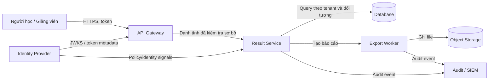
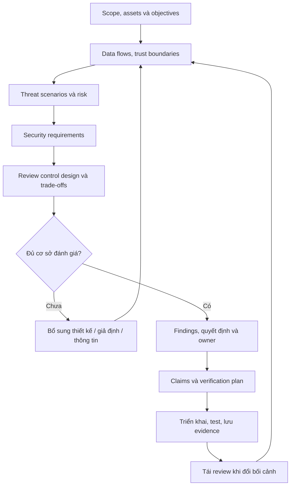

# Mục tiêu Security Design Review: đánh giá thiết kế để tạo cơ sở bảo đảm bảo mật

## 1. Vì sao cần review bảo mật ngay từ thiết kế?

Giả sử một nền tảng học tập cung cấp API xem điểm thi cho nhiều tổ chức. Nhóm phát triển đã bổ sung đăng nhập bằng OAuth 2.0/OIDC, dùng HTTPS và có kế hoạch chạy SAST trước mỗi lần phát hành. Tuy vậy, trong sơ đồ kiến trúc, dịch vụ truy vấn điểm thi lại lấy trực tiếp `resultId` do trình duyệt gửi và truy vấn cơ sở dữ liệu mà không kiểm tra tài nguyên thuộc tenant nào. Dù các cơ chế xác thực, mã hóa và kiểm tra mã nguồn hoạt động đúng, kiến trúc vẫn có thể cho phép người dùng của tổ chức A đọc kết quả của tổ chức B.

Nếu sai sót này được phát hiện sau khi các service, API, cache và báo cáo đã triển khai, chi phí sửa có thể lớn: phải chỉnh mô hình phân quyền, giao diện lập trình, truy vấn, dữ liệu test và cấu hình triển khai. **Security design review** giúp phát hiện và xử lý các quyết định thiết kế không phù hợp **trước khi chúng trở thành hành vi hệ thống khó thay đổi**.

**Security design review (rà soát thiết kế bảo mật)** là hoạt động xem xét có cấu trúc một thiết kế hệ thống hoặc một thay đổi kiến trúc để xác định:

- Mục tiêu và yêu cầu bảo mật có phù hợp với tài sản, bối cảnh và rủi ro hay không.
- Kiến trúc có nhận diện đúng ranh giới tin cậy, tác nhân, luồng dữ liệu và các đường tấn công hay không.
- Những security controls được đề xuất có khả năng kiểm soát các kịch bản rủi ro trọng yếu hay không.
- Trách nhiệm thực thi, giả định, giới hạn, điểm chưa rõ và rủi ro còn lại đã được ghi nhận chưa.
- Có đủ tiêu chí và phương pháp kiểm chứng để xác nhận thiết kế sau khi triển khai hay không.

Trong chương **Security design review** của module **SECURITY_SECURITY_ASSURANCE**, review thiết kế đóng vai trò một mắt xích trong chương trình security assurance liên tục: từ rủi ro, yêu cầu và controls đến luận điểm bảo đảm, bằng chứng kiểm thử, audit, xử lý finding và đánh giá lại khi hệ thống thay đổi.

### Mục tiêu học tập

Sau bài này, bạn có thể:

1. Phát biểu mục tiêu của security design review dưới dạng kết quả cụ thể, có thể đánh giá.
2. Phân biệt design review với threat modeling, code review, penetration testing và audit.
3. Xác định phạm vi, đầu vào và câu hỏi cần trả lời khi đánh giá kiến trúc.
4. Liên kết tài sản, rủi ro, yêu cầu bảo mật, thiết kế controls và kế hoạch verification.
5. Đánh giá thiết kế của một nền tảng Java/Spring Boot nhiều tenant bằng bằng chứng có thể truy vết.
6. Nhận diện khi nào review đủ điều kiện kết luận, cần bổ sung thông tin hoặc phải chuyển rủi ro đến người có thẩm quyền.

## 2. Review thiết kế nhằm đạt kết quả gì?

Một buổi họp có nhiều bình luận kỹ thuật chưa chắc là design review hiệu quả. Kết quả cần đạt là **một kết luận có lý do và có giới hạn về mức phù hợp của thiết kế với những mục tiêu bảo mật đã xác định**, cùng danh sách hành động cần thiết trước hoặc sau khi triển khai.

Có thể chia mục tiêu thành bảy nhóm:

| Nhóm mục tiêu | Câu hỏi trọng tâm | Kết quả mong đợi |
|---|---|---|
| **G1. Hiểu đúng bối cảnh và tài sản** | Bảo vệ tài sản nào, chống sự kiện gì, trong phạm vi nào? | Asset inventory, data classification, phạm vi, giả định |
| **G2. Xác định risk và trust boundaries** | Những đường tấn công, tác nhân và ranh giới quan trọng đã được xét chưa? | Data flow diagram, threat scenarios, risk register |
| **G3. Đánh giá yêu cầu bảo mật** | Requirements có đủ rõ để thiết kế và kiểm thử không? | Requirements và acceptance criteria được truy vết |
| **G4. Đánh giá khả năng giảm rủi ro của kiến trúc** | Controls đặt đúng chỗ, có lớp bảo vệ và đường bypass nào không? | Quyết định kiến trúc, control mapping, phát hiện thiết kế |
| **G5. Xác minh khả năng vận hành an toàn** | Khi hệ thống hỏng, thay đổi hoặc bị tấn công, có còn kiểm soát được không? | Phương án failure handling, logging, recovery và quản trị |
| **G6. Tạo cơ sở security assurance** | Có thể chứng minh control sẽ hoạt động bằng evidence nào? | Claims, verification plan, test criteria và owner |
| **G7. Hỗ trợ quyết định và giảm rework** | Cần sửa gì, ai làm, khi nào được chấp thuận bước tiếp theo? | Findings, lựa chọn xử lý, residual risk, review decision |

Các nhóm mục tiêu liên kết với nhau. Ví dụ, nếu không xác định được dữ liệu nhạy cảm đi qua service nào (G1), không thể vẽ đủ trust boundary (G2), chọn đúng biện pháp kiểm soát (G4) hoặc thiết kế test có ý nghĩa (G6).

### Đầu ra phải phục vụ quyết định

Security design review thành công khi những người tham gia có thể trả lời:

> Đối với phiên bản thiết kế và phạm vi được đánh giá, các rủi ro trọng yếu đã được nhận diện và có yêu cầu/controls phù hợp đến đâu? Những giả định nào chưa kiểm chứng, phát hiện nào phải xử lý, bằng chứng nào cần thu thập sau triển khai, và ai có quyền quyết định bước tiếp theo?

Kết luận review là **đánh giá thiết kế tại một thời điểm và trong phạm vi xác định**, không phải chứng nhận rằng phần mềm đã triển khai an toàn.

## 3. Mục tiêu G1: hiểu đúng hệ thống và các tài sản cần bảo vệ

Không thể đánh giá thiết kế bảo mật chỉ bằng tên công nghệ. Hai dịch vụ cùng dùng Spring Boot và PostgreSQL có thể có mức rủi ro khác nhau nếu một dịch vụ chứa tài liệu công khai và dịch vụ kia quản lý kết quả thi hoặc dữ liệu thanh toán.

Reviewer cần làm rõ:

1. **Business purpose:** hệ thống phục vụ người dùng và hoạt động nào?
2. **Assets:** dữ liệu cá nhân, điểm thi, tài khoản quản trị, secret, token, khóa mã hóa, tính liên tục dịch vụ.
3. **Security objectives:** tính bí mật (*confidentiality*), toàn vẹn (*integrity*), sẵn sàng (*availability*), trách nhiệm giải trình, riêng tư khi liên quan.
4. **Actors:** người học, giảng viên, quản trị viên, hỗ trợ khách hàng, workload, nhà cung cấp, đối tượng tấn công.
5. **Data lifecycle:** thu thập, truyền, xử lý, lưu, truy xuất, chia sẻ, sao lưu và xóa.
6. **Environment:** Internet, cloud, mạng nội bộ, CI/CD, môi trường phát triển, production và third-party services.
7. **Scope:** dịch vụ và luồng nào được review, luồng nào chưa được xem xét và vì sao.

### Ví dụ: phân loại tài sản

| Tài sản | Đặc tính cần bảo vệ | Điều gì có thể gây hại? |
|---|---|---|
| Kết quả bài thi | Bí mật, toàn vẹn, truy vết | Lộ điểm xuyên tenant; sửa điểm trái phép |
| Tài khoản và quyền người dùng | Xác thực, phân quyền, tính toàn vẹn | Chiếm quyền giảng viên hoặc tài khoản quản trị |
| Token và secret tích hợp | Bí mật, tính hợp lệ và giới hạn quyền | Lộ token truy cập dữ liệu hoặc API của đối tác |
| Dịch vụ tổ chức thi | Sẵn sàng, phục hồi | Gián đoạn trong thời gian thi, mất dữ liệu nộp bài |
| Audit events | Toàn vẹn, khả năng truy xuất, riêng tư | Không điều tra được truy cập hoặc sửa đổi trái phép |

**Tiêu chí đạt G1:** reviewer có đủ bối cảnh để giải thích hậu quả của một quyết định thiết kế đối với tài sản và người dùng cụ thể; các phần ngoài phạm vi được ghi minh bạch.

## 4. Mục tiêu G2: làm rõ trust boundaries và kịch bản tấn công

**Trust boundary (ranh giới tin cậy)** xuất hiện khi thông tin, quyền hoặc yêu cầu đi từ vùng có giả định bảo mật này sang vùng khác. Đó có thể là trình duyệt đến API, API đến database, dịch vụ đến nhà cung cấp hoặc workload giữa các tenant.

Khi thiết kế đi qua trust boundary, reviewer phải biết:

- Chủ thể ở phía gửi có thể được tin cậy điều gì, không được tin cậy điều gì?
- Danh tính nào được kiểm chứng, tại đâu, và có bị giả mạo qua header/parameter không?
- Dữ liệu đầu vào được kiểm tra định dạng, quyền và mức nhạy cảm ở đâu?
- Có thông tin hoặc chức năng nào vượt quyền bằng đường đi khác?
- Khi service hoặc hệ thống cấp quyền không sẵn sàng, hệ thống cho phép, từ chối hay giới hạn hành động ra sao?
- Logs có giúp phát hiện truy cập sai mà không làm lộ dữ liệu nhạy cảm?

### Sơ đồ luồng dữ liệu minh họa



Sơ đồ này giúp đặt câu hỏi: ai có quyền gọi `Export Worker`? Worker có nhận tenant từ dữ liệu đáng tin cậy không? File trong object storage có tên đoán được không? Đường tải file có kiểm tra quyền hay chỉ dựa vào URL? API nội bộ có thể bỏ qua gateway không? Token dịch vụ có audience và scope phù hợp không?

Các câu hỏi ấy là **giả thuyết cần đánh giá**, không phải kết luận hệ thống có lỗ hổng. Review nên dựa vào thiết kế, hợp đồng API, sơ đồ mạng, chính sách và giải thích của các chủ sở hữu.

### Mối liên hệ với threat modeling

Threat modeling có thể là một hoạt động trọng tâm trong security design review, nhưng không đồng nghĩa toàn bộ design review. Threat modeling tập trung vào tác nhân, kịch bản tấn công và điều kiện khai thác. Design review còn xem cách kiến trúc xử lý yêu cầu, phân chia trách nhiệm, đảm bảo khả năng vận hành, kiểm chứng controls và đưa ra quyết định thiết kế.

**Tiêu chí đạt G2:** có sơ đồ dữ liệu và ranh giới đủ chi tiết cho phạm vi review, các kịch bản rủi ro trọng yếu được mô tả có tác nhân, điểm yếu giả định, tài sản và hậu quả.

## 5. Mục tiêu G3: chuyển risk thành yêu cầu bảo mật có thể kiểm chứng

Yêu cầu chung chung như “phải có bảo mật tốt” không giúp reviewer quyết định thiết kế đạt hay không. Cần xác định **chủ thể, tài nguyên, hành động, điều kiện, hành vi mong đợi và cách kiểm tra**.

| Risk scenario | Requirement thiết kế | Acceptance criteria minh họa |
|---|---|---|
| Người dùng tenant A truy cập điểm thi tenant B | Mọi luồng đọc/sửa/xuất phải kiểm tra quyền tenant và đối tượng tại backend | Request xuyên tenant không trả dữ liệu, không tạo export trái phép |
| Token bị sử dụng cho sai dịch vụ | Mọi API phải xác minh issuer, audience, signature, expiry của token | Token sai audience/issuer hoặc hết hạn bị từ chối |
| Dữ liệu tải lên chứa input độc hại | Parser phải chạy với quyền tối thiểu, giới hạn tài nguyên và xử lý input lỗi an toàn | Input bất thường không vượt quyền hoặc gây ảnh hưởng vượt giới hạn xác định |
| Lộ secret qua build | Secret không được hardcode; cấp quyền CI có giới hạn và có quy trình xoay vòng | Không có secret có hiệu lực trong repo/artifact; quyền build được review |
| Hệ thống mất database trong kỳ thi | Có phương án backup, phục hồi và mục tiêu RTO/RPO được duyệt | Diễn tập phục hồi đạt tiêu chí trong điều kiện đã thử |
| Không điều tra được sửa điểm trái phép | Ghi audit event có subject, action, object, result và correlation ID | Có thể truy vết thay đổi mà không ghi token/secret |

### Phân biệt ba mức phát biểu

**Objective:** dữ liệu điểm thi được cô lập giữa các tenant.

**Requirement:** mỗi đường truy cập phải kiểm tra danh tính, quyền trên đối tượng và tenant trước khi đọc/sửa dữ liệu.

**Design decision:** service kiểm tra authorization bằng policy dựa trên principal đã được xác thực; repository truy vấn có điều kiện tenant; export worker nhận job đã được kiểm tra và thực thi kiểm tra quyền tại ranh giới phù hợp.

Objective diễn tả trạng thái mong muốn, requirement diễn tả điều phải đáp ứng, design decision giải thích giải pháp dự kiến. Khi review phải tránh sử dụng một quyết định công nghệ như “đã dùng API gateway” thay cho chứng minh yêu cầu phân quyền.

**Tiêu chí đạt G3:** những rủi ro ưu tiên có yêu cầu đủ rõ để tạo test, review hoặc bằng chứng vận hành; các yêu cầu có chủ sở hữu và liên kết đến quyết định kiến trúc.

## 6. Mục tiêu G4: kiểm tra kiến trúc có security controls phù hợp

Mục tiêu này không đơn thuần là hỏi “đã bật HTTPS/MFA hay chưa”. Reviewer cần xác định controls **được đặt ở đúng ranh giới, bao phủ đủ đường truy cập, có thể bị bypass không, và có phụ thuộc vào giả định yếu nào không**.

### 6.1. Những nhóm câu hỏi kiến trúc cần đánh giá

| Nhóm thiết kế | Câu hỏi review | Ví dụ control hoặc thiết kế liên quan |
|---|---|---|
| **Identity & authentication** | Danh tính user/workload từ đâu, token/chứng thư được xác minh thế nào? | OIDC validation, workload identity, mTLS khi phù hợp |
| **Authorization** | Ai được làm gì, trên đối tượng nào, điều kiện nào và kiểm tra ở đâu? | RBAC/ABAC, object-level authorization, deny by default |
| **Tenant isolation** | Có đường dữ liệu, cache, job hoặc export nào trộn tenant không? | Tenant scope ở service/query/storage, authorization tests |
| **Input/output security** | Dữ liệu không tin cậy đi qua parser, template, query nào? | Validation, parameterized query, encoding, sandbox |
| **Data protection** | Dữ liệu được phân loại và mã hóa ra sao, khóa do ai quản lý? | TLS, encryption at rest, KMS, retention |
| **Session/token lifecycle** | Token bị lộ, thu hồi, hết hạn hoặc đổi quyền thì sao? | Token TTL, revocation, step-up cho hành động nhạy cảm |
| **Service-to-service** | Dịch vụ nội bộ có tin tưởng nhau quá mức không? | Workload identity, scoped credentials, service policy |
| **Dependency/supply chain** | Plugin, thư viện và image có nguồn rõ và được kiểm soát không? | Version constraints, SBOM, provenance, CI isolation |
| **Logging/monitoring** | Sự cố có được phát hiện và truy vết, log có an toàn? | Security events, SIEM, correlation ID, log access control |
| **Availability/resilience** | Khi thành phần lỗi hoặc quá tải, hệ thống duy trì an toàn thế nào? | Timeouts, rate limits, fail-safe behavior, backup/restore |
| **Deployment/operations** | Cấu hình production có giữ đúng security assumptions không? | IaC review, secrets management, config drift checks |

Danh sách trên là khung gợi ý để mở câu hỏi. Tùy hệ thống, review cần tập trung vào nhóm có tác động cao; không phải mọi dự án đều cần cùng một bộ controls hoặc cùng độ sâu đánh giá.

### 6.2. Defense in depth và bypass

Ví dụ kiểm tra quyền tenant:

- Gateway xác thực token, nhưng có thể không biết chủ thể được xem `resultId` nào.
- Service cần kiểm tra quyền với đối tượng và tenant.
- Query hoặc dữ liệu có thể được ràng buộc thêm bằng tenant scope, hoặc cơ chế cách ly dữ liệu phù hợp.
- Export worker, queue, batch job, cache và object storage cần duy trì quy tắc tương đương.

Nếu mọi yêu cầu đều đi qua API gateway nhưng service hoặc background job vẫn có đường truy cập trực tiếp, một lớp kiểm tra ở gateway chưa đủ. Review phải chỉ ra các **đường thực thi ngoài luồng chính**.

### 6.3. Bản chất của trade-off

Không có kiến trúc nào tối ưu tuyệt đối mọi mục tiêu. Review cần ghi lý do lựa chọn, ví dụ:

- Token ngắn hạn giảm thời gian lạm dụng nhưng tăng tần suất refresh.
- Policy engine tập trung giúp nhất quán nhưng cần xử lý downtime, cache và độ trễ.
- Tách database theo tenant có thể tăng mức cô lập nhưng tăng chi phí vận hành.
- Log chi tiết giúp điều tra nhưng có thể tạo rủi ro lộ dữ liệu hoặc vượt giới hạn lưu trữ.
- Fail-closed bảo vệ truy cập nhạy cảm nhưng có thể ảnh hưởng tính sẵn sàng.

Một trade-off được chấp nhận khi lựa chọn, rủi ro còn lại, cơ sở quyết định và điều kiện vận hành được ghi rõ. Nhóm review không nên mô tả một biện pháp là “an toàn” nếu điều kiện để biện pháp hoạt động vẫn chưa được xác minh.

**Tiêu chí đạt G4:** mỗi rủi ro thiết kế trọng yếu có control hoặc phương án xử lý được chỉ rõ; các điểm bypass và phụ thuộc được đánh giá; quyết định kiến trúc và trade-off được lưu.

## 7. Mục tiêu G5: bảo đảm thiết kế vận hành an toàn khi điều kiện thay đổi

Thiết kế có thể hoạt động tốt trong sơ đồ “happy path” nhưng thất bại khi identity provider mất kết nối, hàng đợi bị lặp job, token bị thu hồi, cache lỗi thời hoặc dependency thay đổi.

Reviewer nên đánh giá các tình huống:

1. **Failure mode:** khi một dịch vụ hoặc nguồn danh tính không sẵn sàng, thao tác nhạy cảm có bị cho phép ngoài ý muốn không?
2. **Timeout, retry và idempotency:** retry có tạo hành động lặp gây sai lệch dữ liệu hoặc mở rộng phạm vi quyền không?
3. **Revocation:** khi tài khoản/role bị thu hồi, quyền cũ tồn tại trong token/cache/worker bao lâu?
4. **Configuration drift:** thay đổi policy, service mesh hoặc bucket ACL có được kiểm tra và cảnh báo không?
5. **Recovery:** bản sao lưu và quy trình khôi phục có duy trì phân quyền, mã hóa và tính toàn vẹn không?
6. **Secret/key rotation:** có thể thu hồi hoặc xoay vòng credential mà không làm gián đoạn nghiêm trọng?
7. **Monitoring:** sự kiện quan trọng được ghi nhận ở đâu, ai phản ứng, bằng quy trình nào?
8. **Change management:** điều kiện nào buộc tái review khi mở rộng hệ thống?

### Ví dụ: export bất đồng bộ

API có thể kiểm tra quyền lúc người dùng tạo job, nhưng worker chỉ chạy sau 30 phút. Nếu quyền giảng viên đã bị thu hồi trong khoảng thời gian đó, thiết kế phải xác định **có đánh giá lại quyền lúc chạy hoặc lúc tải kết quả không**. Không có một chính sách chung áp dụng mọi nghiệp vụ, nhưng một quyết định thiết kế cần có lý do theo risk, thời hạn hiệu lực và tiêu chí kiểm chứng.

**Tiêu chí đạt G5:** phương án lỗi, phục hồi, thu hồi quyền và thay đổi trạng thái được mô tả cho các luồng trọng yếu; có owner và kế hoạch kiểm thử hoặc giám sát tương ứng.

## 8. Mục tiêu G6: làm rõ sẽ chứng minh thiết kế hoạt động đúng bằng cách nào

Đây là điểm liên kết trực tiếp giữa security design review và **security assurance**. Một thiết kế có thể hợp lý trên giấy nhưng implementation sai, cấu hình production khác dự kiến hoặc test bỏ sót luồng có rủi ro cao. Vì vậy, review cần xác định **assurance claims** và phương pháp thu thập evidence ngay khi thiết kế.

### 8.1. Từ risk đến claim và evidence

| Thành phần | Ví dụ trong nền tảng học tập |
|---|---|
| **Risk R-01** | Người dùng tenant A đọc kết quả tenant B qua API hoặc export |
| **Security objective** | Cô lập dữ liệu học tập giữa các tenant |
| **Requirement REQ-01** | Mọi đường truy cập kết quả kiểm tra identity, tenant và object permission |
| **Design control CTRL-01** | Authorization ở service; tenant scope tại query; export có kiểm tra quyền |
| **Design claim CLM-D01** | Thiết kế đã xác định đầy đủ điểm kiểm tra quyền cho các luồng đọc/xuất trong phạm vi review |
| **Design evidence EV-D01** | DFD, access matrix, ADR, bảng mapping endpoint → control, biên bản review |
| **Implementation claim CLM-I01** | Release R từ chối request xuyên tenant ở các đường truy cập thuộc inventory |
| **Implementation evidence EV-I01** | Code review, integration tests, test export, build và deployment config |
| **Residual risk/decision** | Các đường chưa bao phủ được ghi rõ, có owner và quyết định xử lý |

Điểm quan trọng: **design evidence chứng minh sự phù hợp của thiết kế theo phạm vi review; implementation evidence mới giúp chứng minh hành vi thực tế**. Không được dùng một thiết kế có approval để thay thế kết quả kiểm thử hoặc kiểm tra triển khai.

### 8.2. Tiêu chí review phải có thể kiểm tra

**Tiêu chí chưa rõ:** “Kiến trúc đáp ứng best practices”.

**Tiêu chí có thể kiểm tra:** “Mỗi API đọc/sửa/xuất dữ liệu thuộc inventory phải được mapping đến một điểm enforcement; principal và tenant phải đến từ nguồn được xác minh; mô hình phải chỉ rõ xử lý khi token hết hạn, service thất bại hoặc worker chạy trễ; có negative tests tương ứng cho từng kiểu đường đi”.

Kết luận review cần ghi cả điều đã xác nhận và điều chưa xác nhận. Nếu inventory thiếu một endpoint, có thể ghi trạng thái **INCOMPLETE** cho coverage thay vì mặc định một sơ đồ tổng quan đã bao phủ mọi đường truy cập.

### 8.3. Chất lượng evidence

Một bộ evidence hữu ích cần:

| Tiêu chí | Cách đánh giá |
|---|---|
| **Relevance** | Evidence liên quan trực tiếp risk/control/claim cần chứng minh |
| **Completeness** | Bao phủ các luồng dữ liệu, vai trò, trust boundaries và thay đổi trong scope |
| **Correctness** | Có cơ sở và phản ánh thiết kế thực tế, không chứa giả định sai |
| **Freshness** | Gắn version thiết kế và thay đổi gần nhất |
| **Provenance** | Có tác giả/reviewer, thời điểm, nguồn và phiên bản |
| **Integrity** | Có lịch sử thay đổi hoặc cơ chế đối chiếu, tránh chỉnh sửa không được kiểm soát |
| **Reviewability** | Người khác có thể theo dõi claim, lý do và bằng chứng hỗ trợ |
| **Independence** | Mức phản biện/kiểm tra độc lập phù hợp với mức rủi ro |

**Tiêu chí đạt G6:** có claim cụ thể và kế hoạch verification cho controls trọng yếu; biết ai tạo, ai review, kiểm tra trong môi trường nào và evidence sẽ được lưu ở đâu.

## 9. Mục tiêu G7: hỗ trợ quyết định trước khi đầu tư triển khai hoặc phát hành

Design review cần dẫn đến quyết định có thể thực thi. Các kết quả điển hình:

| Kết quả review | Ý nghĩa | Hành động tiếp theo |
|---|---|---|
| **Accepted within scope** | Thiết kế đáp ứng tiêu chí review trong phạm vi và giả định đã ghi | Triển khai và thực hiện verification plan |
| **Accepted with actions/conditions** | Có khoảng trống được kiểm soát hoặc cần bổ sung trước mốc xác định | Giao owner, thời hạn, điều kiện phải chứng minh |
| **Changes required** | Có rủi ro kiến trúc hoặc yêu cầu chưa được đáp ứng | Sửa thiết kế và review lại phần ảnh hưởng |
| **Insufficient information** | Thiếu sơ đồ, risk assessment hoặc thông tin quan trọng | Bổ sung đầu vào, chưa kết luận cho phần chưa rõ |
| **Escalated risk decision** | Rủi ro vượt quyền nhóm review hoặc risk appetite | Chuyển risk owner/cấp có thẩm quyền quyết định |

Những trạng thái trên là ví dụ quản lý, không phải hệ thống nhãn bắt buộc. Điều quan trọng là **không dùng trạng thái “approved” để che giấu điều kiện chưa hoàn thành**.

### Security reviewer có tự chấp nhận rủi ro không?

Reviewer có thể tư vấn, đánh giá mức độ phù hợp và nêu khuyến nghị; **quyền chấp nhận residual risk** phải được tổ chức phân định rõ cho risk owner hoặc người được ủy quyền. Quyết định chấp nhận cần ghi kịch bản, mức ảnh hưởng, controls bù đắp, lý do, thời hạn và trigger xem xét lại.

Nếu thiết kế dựa vào control chưa có hoặc chưa được kiểm chứng, trạng thái nên phản ánh **dự kiến** và **giới hạn của bằng chứng**. Review thiết kế không thể tự động biến rủi ro còn lại thành “thấp” chỉ nhờ một phương án trên tài liệu.

**Tiêu chí đạt G7:** mọi finding quan trọng có owner, mức ưu tiên, hạn, hành động và điều kiện đóng; quyết định được ghi nhận bởi đúng người có thẩm quyền.

## 10. Design review khác threat modeling, code review, testing và audit như thế nào?

| Hoạt động | Câu hỏi chính | Đối tượng | Kết quả |
|---|---|---|---|
| **Security design review** | Thiết kế có phù hợp với mục tiêu bảo mật và risk trong scope? | Kiến trúc, data flow, giao diện, policy, quyết định thiết kế | Findings, ADR, control mapping, verification plan |
| **Threat modeling** | Tác nhân có thể gây hại bằng những kịch bản nào? | Assets, trust boundaries, attack surface, assumptions | Threat scenarios, ưu tiên risk, mitigation ideas |
| **Code review** | Implementation có đúng yêu cầu và an toàn trong thay đổi cụ thể? | Source code, diff, test và cấu hình liên quan | Review comments, approval, defect, evidence code |
| **Security testing** | Hành vi của system/build có đáp ứng tiêu chí đã định? | Chương trình chạy, API, pipeline, image, môi trường | Test result, scan report, finding, retest |
| **Penetration testing** | Có đường tấn công thực tế nào trong phạm vi và điều kiện thử? | Hệ thống được triển khai hoặc môi trường kiểm thử | Kịch bản khai thác, tác động, khuyến nghị |
| **Audit/assurance độc lập** | Quy trình và controls có thiết kế, triển khai, vận hành đúng tiêu chí? | Hồ sơ và mẫu thực hiện | Kết luận độc lập, findings, hành động cải tiến |

Các hoạt động bổ sung cho nhau. Threat modeling thường được tích hợp vào design review; code review và test sau đó kiểm chứng những quyết định thiết kế. Audit có thể kiểm tra bằng chứng và chất lượng của toàn bộ chuỗi.

**Ví dụ:** design review yêu cầu export worker phải kiểm tra tenant; code review xác minh check tồn tại; integration test chứng minh yêu cầu ngoài quyền bị từ chối; audit đối chiếu evidence với policy và release đang chạy. Mỗi hoạt động trả lời một phần câu hỏi assurance khác nhau.

## 11. Khi nào nên thực hiện security design review?

Review có giá trị nhất khi vẫn có thể thay đổi kiến trúc với chi phí hợp lý, và cần được lặp lại khi giả định an ninh bị ảnh hưởng.

| Thời điểm/trigger | Lý do | Ví dụ |
|---|---|---|
| Tạo hệ thống hoặc dịch vụ mới | Chưa có kiến trúc, đường dữ liệu và controls được xác nhận | Xây service quản lý kết quả học tập |
| Thêm dữ liệu hoặc nghiệp vụ nhạy cảm | Thay đổi tài sản và impact | Bổ sung hồ sơ sức khỏe hoặc thanh toán |
| Thay đổi identity/authorization | Ảnh hưởng trust boundary và đường truy cập | Chuyển IdP, thêm RBAC/ABAC, liên thông tenant |
| Thêm integration/third-party | Dữ liệu và quyền vượt ranh giới tổ chức | Kết nối nhà cung cấp phân tích học tập |
| Đổi kiến trúc triển khai | Thay đổi đường vào, network và vận hành | Monolith → microservices, thêm service mesh |
| Thêm export/batch/background jobs | Có đường thực thi mới và dữ liệu có thể thoát khỏi kiểm soát | Export hàng loạt kết quả thi |
| Sự cố hoặc finding kiến trúc | Giả định bảo mật bị bác bỏ | Lỗi phân quyền lặp lại trên nhiều endpoint |
| Thay đổi risk/applicable requirements | Controls cũ có thể không còn phù hợp | Đối tượng tấn công mới hoặc yêu cầu bảo vệ dữ liệu mới |

Với thay đổi nhỏ và không ảnh hưởng security assumptions, review có thể gọn hơn. Với thay đổi trust boundary, dữ liệu nhạy cảm hoặc quyền đặc biệt, nên review sâu và cần phản biện độc lập phù hợp. Không cần tổ chức lại một buổi review toàn hệ thống sau mọi thay đổi nhỏ; có thể dùng **design review delta** tập trung vào phần bị tác động, cùng kiểm tra phụ thuộc xung quanh.

## 12. Đầu vào tối thiểu để thực hiện review có ý nghĩa

Trước buổi review, nhóm chuẩn bị:

- **Problem statement và business context:** cần thêm tính năng gì, vì sao.
- **Scope và version thiết kế:** bản diagram, repository/ADR liên quan, phần chưa triển khai.
- **Asset/data inventory:** dữ liệu, mức nhạy cảm, tác nhân, quyền và nơi lưu/truyền.
- **Architecture diagrams:** context, container/service, data flow, trust boundaries, network boundaries.
- **API/event contracts:** yêu cầu/đáp ứng, queue/message, source of identity và authorization.
- **Security requirements và policies:** yêu cầu bắt buộc, acceptance criteria, nghĩa vụ.
- **Risk/threat model ban đầu:** kịch bản và biện pháp dự kiến, mức ưu tiên.
- **Key decisions/assumptions:** những lựa chọn kiến trúc, lý do và giới hạn.
- **Operations model:** môi trường, CI/CD, secrets, key management, logging, recovery.
- **Owners:** kiến trúc sư, product owner, service owner, security reviewer, risk owner.

Không bắt buộc mọi dự án phải chuẩn bị hàng chục tài liệu riêng. Có thể dùng một tài liệu thiết kế cô đọng kèm sơ đồ và đường dẫn đến thông tin cần thiết. Tuy nhiên, những điểm quan trọng phải đủ rõ để reviewer không phải phỏng đoán cách hệ thống hoạt động.

## 13. Cách review hướng mục tiêu: một quy trình tham khảo

### Bước 1 — Khẳng định scope và security objectives

Đầu tiên ghi thiết kế nào đang được review, phiên bản, tài sản trọng yếu, phạm vi và kết quả mong đợi. Nêu rõ những nội dung chưa thuộc review, nhất là integration hoặc môi trường chưa triển khai.

### Bước 2 — Lần theo data flows và trust boundaries

Chọn những luồng quan trọng: đăng nhập, đọc dữ liệu, sửa dữ liệu, export, import, admin, service-to-service. Với mỗi luồng, nhận diện danh tính, nguồn dữ liệu, quyền, nơi kiểm tra và nơi lưu/log.

### Bước 3 — Đưa ra threat và risk scenarios

Dùng các cách tiếp cận như STRIDE hoặc phân tích abuse case nếu phù hợp. Không chỉ liệt kê “SQL injection, XSS”; phải gắn mối đe dọa vào tài sản, luồng và hậu quả cụ thể.

### Bước 4 — Đánh giá requirements và controls

Xác định yêu cầu đã có chưa, controls được đề xuất ở đâu, có đường bypass hoặc single point of failure nào không. Đánh giá cả điều kiện lỗi, dữ liệu quá hạn và vòng đời tài khoản/credential.

### Bước 5 — Tạo findings và đề xuất thiết kế

Ghi vấn đề, nguyên nhân, kịch bản tác động, mức ưu tiên, phương án sửa, owner, hạn và phụ thuộc. Đề xuất nên đủ cụ thể để nhóm kỹ thuật thực hiện.

### Bước 6 — Xác định verification plan

Với từng control trọng yếu, nêu claim và evidence dự kiến sau khi triển khai: test nào, code/config review nào, môi trường nào, ai chịu trách nhiệm, tiêu chí đạt.

### Bước 7 — Ghi quyết định và kế hoạch review lại

Phê duyệt trong phạm vi hoặc yêu cầu bổ sung, ghi nhận giả định và rủi ro còn lại. Đặt trigger tái review, chẳng hạn thêm luồng dữ liệu, thay policy, thay service boundary hoặc xuất hiện finding mới.



Quy trình là cách tổ chức công việc. Mục tiêu cốt lõi vẫn là đánh giá được **risk → control → claim → evidence**, không phải hoàn thành đủ biểu mẫu để đánh dấu đã review.

## 14. Ví dụ xuyên suốt: review thiết kế dịch vụ kết quả học tập đa tenant

### 14.1. Bối cảnh

Một nền tảng Java/Spring Boot có:

- `result-service` lưu điểm thi và kết quả học tập trong PostgreSQL.
- `identity-provider` xác thực người dùng và phát token.
- `export-worker` xử lý yêu cầu xuất bảng điểm qua queue.
- Object storage giữ file xuất tạm thời.
- API gateway kiểm tra một phần điều kiện truy cập.
- Người học, giảng viên và quản trị viên thuộc nhiều tenant.

Nhóm sản phẩm muốn bổ sung chức năng **export kết quả cả lớp**. Nhóm kiến trúc đề xuất: API xác thực người gọi, tạo job chứa `tenantId` và `classId`; worker lấy job, truy vấn database, lưu file và trả link tải.

### 14.2. Review theo bảy mục tiêu

| Mục tiêu | Câu hỏi review cụ thể | Ví dụ phát hiện hoặc yêu cầu |
|---|---|---|
| **G1. Context/assets** | File export chứa dữ liệu gì, có chia sẻ ra ngoài tenant không? | File chứa dữ liệu cá nhân; cần phân loại và retention |
| **G2. Trust boundaries** | Queue job và link object storage có qua ranh giới tin cậy nào? | Client không được tự khai `tenantId` như nguồn quyền |
| **G3. Requirements** | Ai có quyền export và điều kiện nào phải đạt? | Chỉ giảng viên được phân công lớp, trong tenant hợp lệ |
| **G4. Control design** | Worker có kiểm tra quyền, query có tenant filter không? | Kiểm tra tại service, worker và khi tải file theo chính sách |
| **G5. Failure handling** | Quyền giảng viên bị thu hồi sau lúc tạo job thì sao? | Xác định thời điểm/TTL đánh giá lại và cách hủy job |
| **G6. Assurance** | Có thể chứng minh không export xuyên tenant bằng gì? | Negative tests, review queue payload/query/storage, log |
| **G7. Decision** | Có thể triển khai thiết kế hiện tại chưa? | Yêu cầu sửa thiết kế nếu job tin `tenantId` do client gửi |

### 14.3. Thiết kế ban đầu có khoảng trống

Pseudocode minh họa luồng nguy hiểm:

```text
POST /api/reports/export
body = { "tenantId": "tenant-B", "classId": "class-B1" }

API:
  verify user is logged in
  publish ExportJob(body.tenantId, body.classId)

Worker:
  results = query("SELECT ... WHERE tenant_id = ?", job.tenantId)
  generateFile(results)
```

Lọc `tenant_id` trong SQL chưa đủ nếu giá trị tenant do client lựa chọn tùy ý. Thiết kế này có nguy cơ cho phép một người đã đăng nhập yêu cầu xuất dữ liệu của tenant khác. Reviewer cần xác nhận quyền ở cấp lớp, tenant và thao tác export.

### 14.4. Quyết định thiết kế được sửa

Một phương án an toàn hơn về mặt nguyên tắc:

1. API xác minh token và lấy `principal` đáng tin cậy từ server-side security context.
2. Service kiểm tra quyền export đối với `classId` và tenant thực tế của lớp từ nguồn dữ liệu đã xác minh.
3. Tạo job có định danh actor, class, tenant, quyền thao tác và phiên bản/chính sách cần đối chiếu; hạn chế dữ liệu nhạy cảm trong message.
4. Worker xác minh tính hợp lệ và nguồn gốc job, thực thi quyền/hạn theo policy đã định, không tin payload tùy ý.
5. Truy vấn database với tenant scope được xác định phía server và quyền tối thiểu.
6. Lưu file trong object storage có ACL chặt, TTL và đường truy cập/download được kiểm tra quyền hoặc sử dụng URL có thời hạn hợp lý theo risk.
7. Ghi audit log cho yêu cầu, kết quả, owner của file và sự kiện tải file.
8. Khi role/tenant assignment thay đổi, có chính sách về hủy job, vô hiệu link hoặc tái xác minh quyền.

Thiết kế ở trên là **phương án đề xuất cần thực thi và kiểm chứng**. Dùng Spring Security, JPA hay queue không tự động chứng minh mọi điều kiện đã đúng; cần review cấu hình, code, luồng bất đồng bộ và test thực tế.

### 14.5. Ma trận acceptance criteria và evidence

| Claim thiết kế | Acceptance criteria | Evidence cần thu thập sau triển khai |
|---|---|---|
| CLM-D01: API chỉ tạo job hợp lệ | Thiếu quyền export hoặc sai tenant bị từ chối | Policy mapping, code review, integration tests |
| CLM-D02: Worker không thể bị bypass bằng message giả | Chỉ job từ nguồn tin cậy được xử lý, có kiểm tra phạm vi | Queue ACL/config, workload identity, negative tests |
| CLM-D03: Truy vấn không trả dữ liệu ngoài tenant | Query và object authorization giữ tenant scope | Repository tests, query review, test nhiều tenant |
| CLM-D04: File export không lộ ngoài quyền | Storage ACL và download kiểm tra quyền, link có TTL phù hợp | Config review, negative access tests, expiry tests |
| CLM-D05: Sự kiện có thể truy vết | Có correlation ID, actor, action, tenant, result; không lộ secret | Audit event samples, log access review |
| CLM-D06: Thu hồi quyền có tác dụng | Job/link không kéo dài quyền ngoài giới hạn đã duyệt | Revocation test, time-bound assertions, logs |

### 14.6. Ví dụ ghi finding từ design review

```yaml
review_id: "SDR-EXPORT-DEMO-01"
scope: "Thiết kế export kết quả học tập đa tenant"
design_version: "proposal-v2"
finding_id: "F-01"
title: "Export job chấp nhận tenantId do client cung cấp"
risk:
  scenario: "Người dùng tenant A tạo export job cho tenant B"
  affected_asset: "Dữ liệu điểm và kết quả học tập"
  current_assessment: "HIGH (minh họa, cần đánh giá theo policy tổ chức)"
requirement_id: "REQ-EXPORT-01"
proposed_action:
  - "Xác định tenant và quyền từ principal + dữ liệu server"
  - "Kiểm tra quyền tại API và đường xử lý worker"
  - "Thêm negative tests cho export/download xuyên tenant"
owner: "result-service engineering lead"
status: "OPEN"
verification_required:
  - "Security design review của luồng đã sửa"
  - "Integration tests trên release build"
  - "Review cấu hình queue/storage trong môi trường đích"
```

Ví dụ này không phải finding có thật hoặc đánh giá đã thực hiện trên hệ thống đang chạy. Nó minh họa cách một review biến nhận định thiết kế thành hành động có thể kiểm tra và liên kết với bằng chứng.

## 15. Hồ sơ review cần ghi gì để có giá trị assurance?

Hồ sơ nên đủ để một người không dự họp vẫn hiểu được kết luận và giới hạn. Có thể lưu dưới dạng issue, design doc, ADR hoặc một bản ghi trong hệ thống quản lý risk.

| Trường thông tin | Nội dung |
|---|---|
| **Review identity** | ID, ngày, service, tên thay đổi và design version |
| **Scope/out-of-scope** | Thành phần, data flow, môi trường nào được/không được xem |
| **Business/security context** | Tài sản, người dùng, mức nhạy cảm, mục tiêu |
| **Reviewers/owners** | Người tham gia, vai trò, risk owner và người ra quyết định |
| **Inputs** | Links đến DFD, architecture docs, threat model, requirements, ADR |
| **Risk and control mapping** | Risk → requirement → control → luận điểm thiết kế |
| **Findings** | Mô tả, tác động, bằng chứng, mức ưu tiên, owner và hạn |
| **Design decisions** | Phương án chọn/bỏ, lý do, trade-off và assumptions |
| **Verification plan** | Test/review/config checks cần thực hiện sau triển khai |
| **Residual risk/exception** | Điều còn lại, điều kiện và cấp phê duyệt nếu có |
| **Decision/status** | Accepted, conditional, changes required hoặc incomplete theo quy ước |
| **Re-review triggers** | Các thay đổi làm mất hiệu lực kết luận |

### Gợi ý template ghi kết quả

```markdown
# Security Design Review Record

- Review ID:
- Service / Feature:
- Design version / commit / ADR:
- Scope / Out of scope:
- Security objectives:
- Assets and data classification:
- Threat scenarios and risk IDs:
- Security requirements and control mapping:
- Trust boundaries reviewed:
- Open assumptions and limitations:

## Findings
| ID | Severity | Risk | Proposed action | Owner | Due | Status |
|---|---|---|---|---|---|---|

## Verification plan
| Claim ID | Acceptance criteria | Evidence method | Owner | Stage |
|---|---|---|---|---|

## Decision
- Result:
- Conditions:
- Risk owner / approval reference:
- Date and re-review trigger:
```

Biên bản ngắn nhưng có liên kết đúng và đầy đủ có giá trị hơn bộ checklist dài chỉ ghi “đã xem qua”. Nội dung cần được lưu với version và lịch sử thay đổi để có thể đối chiếu trong audit hoặc khi xảy ra sự cố.

## 16. Đánh giá hiệu quả review thiết kế

Số cuộc họp hoặc số checklist đã hoàn thành không trực tiếp cho biết chương trình giảm được rủi ro bao nhiêu. Nên kết hợp chỉ số về coverage, chất lượng phát hiện và hiệu lực xử lý.

| Chỉ số | Ý nghĩa | Giới hạn cần chú ý |
|---|---|---|
| **High-risk design change review coverage** | Tỷ lệ thay đổi thiết kế rủi ro cao được review trước triển khai | Cần định nghĩa rõ mẫu số và cách phân loại rủi ro |
| **Risk-to-control traceability** | Tỷ lệ risk trọng yếu có requirement và control mapping | Mapping tồn tại chưa chứng minh control hiệu quả |
| **Open design findings** | Số finding và tuổi theo severity/owner | Ít finding có thể do review thiếu chiều sâu |
| **Pre-implementation discovery** | Tỷ lệ vấn đề kiến trúc được phát hiện trước coding/release | Cần diễn giải cùng độ thay đổi và chất lượng review |
| **Finding closure with verification** | Tỷ lệ finding có bằng chứng thiết kế sửa và test sau triển khai | “Resolved” trong ticket chưa chắc đã xác minh |
| **Re-review trigger compliance** | Tỷ lệ thay đổi ảnh hưởng trust boundary có review lại | Dựa trên change inventory đầy đủ |
| **Critical claim evidence coverage** | Tỷ lệ claim quan trọng có kế hoạch/evidence còn phù hợp | Claim phải có scope và acceptance criteria rõ |
| **Repeat architectural defects** | Loại finding kiến trúc lặp lại qua dịch vụ | Giúp điều chỉnh shared patterns, chuẩn và đào tạo |

Mục tiêu đo lường là tìm khoảng trống và cải tiến quyết định. Không nên tạo áp lực để reviewer ghi ít finding hơn hoặc phê duyệt nhanh hơn bằng cách giảm phạm vi kiểm tra.

## 17. Những sai lầm phổ biến

| Sai lầm | Vì sao có vấn đề? | Cách khắc phục |
|---|---|---|
| Review chỉ tập trung chọn công nghệ | Không nhìn thấy rủi ro nghiệp vụ và dữ liệu | Bắt đầu từ assets, threat scenarios và security objectives |
| Dùng checklist chung cho mọi hệ thống | Bỏ sót luồng đặc thù và trust boundaries | Điều chỉnh theo bối cảnh và risk |
| Xem gateway/VPN là nơi tin cậy tuyệt đối | Có thể bỏ qua object authorization ở backend | Kiểm tra quyền tại các lớp và đường thực thi phù hợp |
| Chỉ review happy path | Không phát hiện lỗi thu hồi quyền, retry, downtime, cache | Thêm failure mode, exception và abuse cases |
| Đồng nhất design approval với assurance cuối cùng | Implementation và production config có thể khác thiết kế | Gắn claims với test, code/config review và deployment evidence |
| Không ghi giả định hoặc phần ngoài phạm vi | Người sau hiểu quá rộng kết luận | Ghi scope, limitations và re-review triggers |
| Không có owner/hạn cho finding | Vấn đề tồn tại kéo dài | Dùng finding tracker và verification criteria |
| Reviewer tự chấp nhận mọi rủi ro | Không bảo đảm thẩm quyền và trách nhiệm giải trình | Escalate đúng risk owner hoặc cấp được ủy quyền |
| Chỉ review lúc bắt đầu dự án | Thiết kế thay đổi nhưng kết luận không được làm mới | Gắn trigger review với thay đổi kiến trúc quan trọng |
| Kết luận “an toàn” không có bằng chứng | Không thể kiểm toán hoặc tái thực hiện | Ghi claim, lý do, input và evidence dự kiến |

## 18. Checklist mục tiêu cho một buổi security design review

### Hiểu hệ thống và rủi ro

- [ ] Phạm vi, phiên bản thiết kế, tài sản và mục tiêu nghiệp vụ đã rõ?
- [ ] Dữ liệu nhạy cảm, vai trò người dùng và trách nhiệm hệ thống được nhận diện?
- [ ] Có sơ đồ data flow và trust boundaries của các luồng trọng yếu?
- [ ] Các threat scenarios có tác nhân, điều kiện, tài sản và hậu quả cụ thể?
- [ ] Phần chưa xét và giả định được ghi minh bạch?

### Kiểm tra yêu cầu và controls

- [ ] Mỗi risk ưu tiên có yêu cầu bảo mật và acceptance criteria?
- [ ] Điểm thực thi authorization xác định rõ, kể cả background/export/admin?
- [ ] Thiết kế xác thực identity/workload và quản lý token/key/secret phù hợp?
- [ ] Data protection, input validation, logging, monitoring và resilience đã được xét?
- [ ] Đường bypass, failure mode và phụ thuộc third-party được xem xét?
- [ ] Các trade-off, cấu hình, rủi ro còn lại có lý do và owner?

### Khả năng kiểm chứng và quyết định

- [ ] Mỗi control quan trọng có claim và kế hoạch verification sau triển khai?
- [ ] Evidence dự kiến gắn với build, môi trường, phạm vi và điều kiện test?
- [ ] Finding có owner, mức ưu tiên, hạn, đề xuất sửa và điều kiện đóng?
- [ ] Quyết định review thuộc đúng thẩm quyền và có trạng thái rõ?
- [ ] Có lịch hoặc trigger tái review nếu kiến trúc, quyền hay rủi ro thay đổi?

Checklist chỉ giúp kiểm soát phạm vi. **Mục tiêu của review là đánh giá được thiết kế và các rủi ro thật**, không phải đánh dấu tất cả ô mà thiếu lập luận hoặc bằng chứng.

## 19. Bài tập tình huống

Một nhóm đề xuất thêm tính năng xuất báo cáo học tập từ API sang object storage. Thiết kế dựa vào API gateway để xác thực token, cho phép người dùng truyền `tenantId` trong body, tạo job bất đồng bộ và gửi một đường dẫn tải về qua email. Nhóm cho rằng đã an toàn vì API dùng HTTPS, bucket không public và gateway xác thực JWT.

Hãy thực hiện:

1. Liệt kê tài sản, chủ thể và ít nhất ba trust boundaries cần review.
2. Mô tả bốn kịch bản rủi ro, bao gồm truy cập xuyên tenant, lạm dụng link tải, tài khoản bị thu hồi quyền và worker bị gọi ngoài luồng chính.
3. Viết tối thiểu bốn security requirements có acceptance criteria cụ thể.
4. Đề xuất controls ở API, worker, database và object storage; giải thích vì sao chúng cần phối hợp.
5. Viết hai **design claims** và hai **implementation claims** tương ứng; đề xuất evidence để chứng minh từng claim.
6. Ghi một finding theo mẫu ID, impact, recommendation, owner, status và verification required.
7. Nêu trạng thái review phù hợp khi nhóm chưa xác định được ai có quyền tải link sau khi job hoàn thành.

**Gợi ý đánh giá:** HTTPS bảo vệ một phần kênh truyền, bucket private giới hạn truy cập trực tiếp và gateway xác thực danh tính; cả ba chưa đủ chứng minh phân quyền tenant/đối tượng đúng. Phần còn thiếu cần có thiết kế và bằng chứng về authorization, vòng đời job, quyền truy cập link, dữ liệu lưu trữ và audit.

## 20. Câu hỏi tự ôn tập

1. Vì sao security design review cần bắt đầu từ asset và risk thay vì từ danh sách công nghệ?
2. Design review có thể chứng minh điều gì, và điều gì cần kiểm chứng sau khi implementation hoàn tất?
3. Trust boundary khác kết nối mạng thông thường ở điểm nào?
4. Tại sao một yêu cầu “API phải an toàn” không đủ làm tiêu chí review?
5. Hãy nêu ba ví dụ về đường bypass mà sơ đồ API đơn giản có thể bỏ sót.
6. Với một export job chạy sau 30 phút, những failure mode và tình huống đổi quyền nào cần thiết kế trước?
7. Một reviewer phát hiện thiết kế chưa có cách thu hồi quyền trên link tải nhạy cảm. Ai cần quyết định cách xử lý và evidence nào được yêu cầu?
8. Khi nào nên thực hiện lại design review cho một dịch vụ đã được chấp thuận trước đó?

## 21. Ghi nhớ

- **Mục tiêu security design review** là đánh giá xem thiết kế có tạo nền tảng hợp lý để đáp ứng các mục tiêu và yêu cầu bảo mật đối với những rủi ro đã xác định hay không.
- Review cần làm rõ **assets, trust boundaries, threat scenarios, requirements, controls, failure modes và quyết định thiết kế**.
- Một kết quả tốt nối được **risk → requirement → design control → claim → verification plan → evidence → decision**.
- **Design review** đánh giá thiết kế; code review, kiểm thử và kiểm tra cấu hình tiếp tục chứng minh implementation và vận hành.
- Kết luận phải có **scope, version, assumptions, limitations, findings, owner và thẩm quyền**.
- Thay đổi kiến trúc, quyền, data flow, nhà cung cấp hoặc bằng chứng mới có thể buộc review lại.
- Bằng chứng về thiết kế là một phần của chương trình **security assurance liên tục**, giúp tổ chức giải trình và giảm rủi ro trong phát triển lẫn vận hành.

### Tài liệu tham khảo định hướng

- **NIST SP 800-218 — Secure Software Development Framework (SSDF):** thực hành đưa bảo mật vào quy trình phát triển, đánh giá và quản lý lỗ hổng.
- **NIST SP 800-160 Vol. 1 — Systems Security Engineering:** nguyên tắc đưa cân nhắc an ninh vào hoạt động kỹ thuật hệ thống.
- **OWASP Application Security Verification Standard (ASVS):** tham khảo thiết lập yêu cầu có thể kiểm chứng cho bảo mật ứng dụng.
- **OWASP Threat Modeling:** cách nhận diện đe dọa và sử dụng mô hình hệ thống để phân tích.
- **NIST SP 800-53 — Security and Privacy Controls:** thư viện controls để tham chiếu khi xác định biện pháp theo risk.
- **ISO/IEC 27001 và ISO/IEC 27005:** tham chiếu cho quản lý an toàn thông tin và quản lý rủi ro.

Các tài liệu trên là nguồn định hướng. Khi sử dụng trong dự án, hãy đối chiếu phiên bản và phạm vi áp dụng, xác định tiêu chí theo rủi ro thực tế và lưu bằng chứng trên thiết kế, bản build và môi trường đang được đánh giá.
