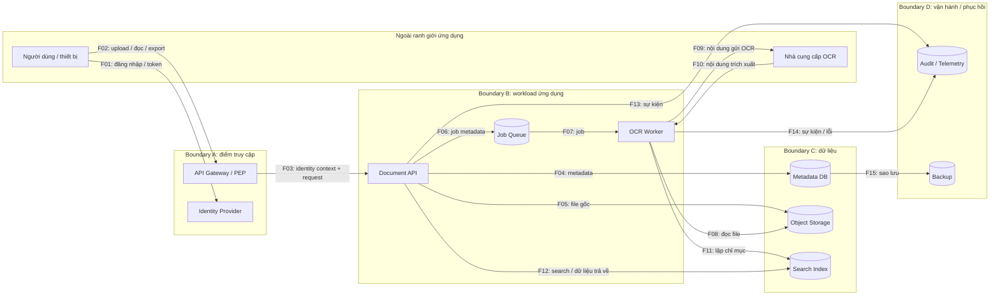
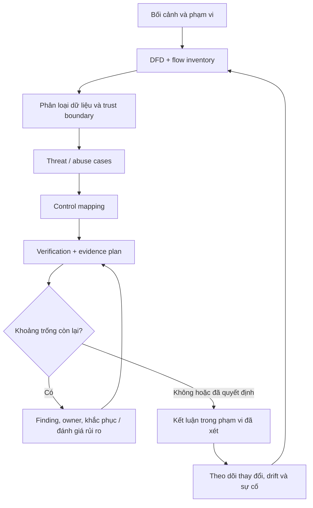

# Review luồng dữ liệu

Một nền tảng SaaS cho phép khách hàng tải tài liệu lên, trích xuất nội dung bằng dịch vụ OCR và tìm kiếm tài liệu. Nhóm phát triển đã bổ sung xác thực, HTTPS và mã hóa kho lưu trữ. Tuy nhiên, trong quá trình xử lý, hệ thống gửi nội dung tài liệu sang nhà cung cấp OCR bên ngoài, worker ghi một phần nội dung vào log khi gặp lỗi, còn cache kết quả tìm kiếm dùng khóa thiếu định danh tenant. Các đường truyền này có thể làm lộ dữ liệu dù API tải lên ban đầu được bảo vệ.

**Review luồng dữ liệu (data flow review)** là hoạt động đánh giá có hệ thống **dữ liệu nào di chuyển từ đâu đến đâu, qua thành phần và ranh giới tin cậy nào, được biến đổi/lưu giữ ra sao, ai có quyền truy cập, và control nào bảo vệ từng bước**. Đây là một hoạt động quan trọng của **security design review**: phát hiện thiếu sót kiến trúc trước khi chúng trở thành lỗi triển khai hoặc sự cố vận hành.

Đối với chương trình **SECURITY_SECURITY_ASSURANCE**, review luồng dữ liệu còn tạo bằng chứng rằng các security requirements và security controls có khả năng đáp ứng mục tiêu bảo mật đã xác định. Kết luận chỉ có căn cứ khi có thể liên kết **rủi ro → yêu cầu → luồng dữ liệu → control → kiểm chứng → bằng chứng → phát hiện và quyết định**, đồng thời ghi rõ phạm vi và phần chưa được xác minh.

## 1. Tại sao phải review luồng dữ liệu?

Một ứng dụng có thể có API specification hoàn chỉnh nhưng chưa mô tả hết dữ liệu thực sự đi qua những đâu. Bên cạnh các API đồng bộ còn có hàng đợi, batch job, webhook, cache, backup, metrics, log, công cụ hỗ trợ vận hành, nhà cung cấp bên thứ ba và các đường quản trị.

Nếu không xét đầy đủ các đường đó, nhóm thường bỏ sót:

- **Đường truy cập vòng:** API kiểm tra quyền, nhưng worker hoặc URL tải trực tiếp cho phép truy cập không cùng chính sách.
- **Rò rỉ chéo tenant:** cache key, truy vấn hoặc storage path không mang đủ định danh tenant.
- **Dữ liệu đi ra ngoài dự kiến:** payload hoặc log chứa thông tin nhạy cảm được gửi đến một dịch vụ bên thứ ba.
- **Mất toàn vẹn khi chuyển đổi:** message bị sửa, xử lý lặp hoặc nhầm phiên bản gây cập nhật sai bản ghi.
- **Dữ liệu tồn tại quá lâu:** bản sao trong queue, backup, search index và log không tuân theo chính sách lưu giữ/xóa.
- **Giả định sai về ranh giới tin cậy:** dịch vụ nội bộ nhận header do client gửi mà coi là danh tính đáng tin.
- **Điểm mù vận hành:** luồng xử lý chính có audit log nhưng luồng lỗi, retry hoặc phục hồi không được giám sát.

Một review tốt không chỉ ghi “dùng TLS”, “mã hóa database” hoặc “có JWT”. Nó đặt các câu hỏi về **nguồn của dữ liệu, danh tính chủ thể, cách kiểm tra quyền, điều kiện dữ liệu được sử dụng, thời hạn tồn tại và nơi bằng chứng phát sinh**.

### 1.1. Luồng dữ liệu không đồng nhất với sơ đồ triển khai

Sơ đồ triển khai có thể cho biết ba service chạy trong Kubernetes. Sơ đồ luồng dữ liệu (Data Flow Diagram, **DFD**) cần cho biết:

- Người dùng gửi tài liệu, metadata và thông tin phiên tới đâu;
- Gateway xác minh gì và chuyển gì xuống service;
- Worker nhận job qua queue thế nào, lấy quyền và dữ liệu từ đâu;
- Nội dung được lưu ở object storage, trích xuất ở OCR và lập chỉ mục vào search thế nào;
- Log, metrics, backup, export và bên thứ ba nhận những trường dữ liệu nào.

Sơ đồ triển khai, sequence diagram, API documentation và DFD bổ trợ cho nhau. DFD tập trung vào **dòng chảy và biến đổi dữ liệu**, giúp phát hiện đường đi mà sơ đồ thành phần có thể che khuất.

## 2. Mục tiêu và đầu ra của một data flow review

Review nên trả lời sáu câu hỏi:

1. **Dữ liệu nào?** Nội dung, phân loại, mức nhạy cảm, chủ sở hữu, mục đích xử lý và yêu cầu lưu giữ.
2. **Từ ai, đến ai?** Nguồn phát, thành phần xử lý, nơi lưu, nơi tiêu thụ, bên thứ ba và người vận hành.
3. **Qua ranh giới nào?** Mạng công khai/nội bộ, tenant, account cloud, vùng, tổ chức, vai trò hoặc ranh giới quản trị.
4. **Được bảo vệ bằng cách nào?** Xác thực, phân quyền, kiểm tra đầu vào, bảo vệ truyền/lưu, tách tenant, kiểm soát xuất dữ liệu, audit và phục hồi.
5. **Control có thể thất bại ra sao?** Threat scenario, abuse case, cấu hình sai, retry, luồng lỗi, credential bị chiếm, dependency lỗi.
6. **Có bằng chứng gì?** Thiết kế, review, mã nguồn, cấu hình, test, log và kết quả kiểm chứng trong phạm vi phiên bản đã xét.

Đầu ra thường gồm DFD đã review, danh mục luồng, danh mục dữ liệu, trust boundaries, rủi ro/phát hiện, ánh xạ yêu cầu và control, kế hoạch kiểm chứng, giới hạn phạm vi và quyết định review.

### 2.1. Thành phần cơ bản của DFD

| Ký hiệu/khái niệm | Ý nghĩa | Câu hỏi review |
| --- | --- | --- |
| **External entity** | Người dùng hoặc hệ thống ngoài phạm vi kiểm soát đang xét | Ai xác thực entity và nó được phép nhận/gửi dữ liệu gì? |
| **Process** | Thành phần xử lý hoặc biến đổi dữ liệu | Nó dựa vào danh tính và quyền nào? Có thay đổi phân loại dữ liệu không? |
| **Data store** | Database, object storage, cache, queue, index, log hoặc backup | Ai được đọc/ghi, dữ liệu nằm bao lâu, có được mã hóa và xóa không? |
| **Data flow** | Thông tin truyền giữa hai điểm | Payload, giao thức, quyền, tần suất, thời hạn và cơ chế bảo vệ là gì? |
| **Trust boundary** | Nơi giả định tin cậy hoặc trách nhiệm kiểm soát thay đổi | Cần xác thực và áp chính sách nào khi đi qua? |
| **Control point** | Vị trí thực thi một chính sách cụ thể | Có đường vòng không, có cách kiểm chứng không? |

Không nhất thiết dùng cùng một bộ hình dạng DFD trong mọi công cụ. Điều cốt lõi là các ký hiệu được giải thích, sơ đồ có phạm vi/phiên bản, luồng được đặt ID và review có thể truy vết tới hiện vật thực tế.

## 3. Xác định phạm vi trước khi vẽ sơ đồ

Một review quá hẹp có thể dẫn tới kết luận sai: “API tài liệu an toàn” dù export worker và đường chia sẻ bên ngoài chưa được xem xét.

Hãy xác định:

- **Chức năng hoặc use case:** tải lên tài liệu, xử lý OCR, tìm kiếm, xem/tải, xuất, xóa.
- **Phiên bản và môi trường:** bản thiết kế, release, cấu hình staging/production, khu vực triển khai.
- **Loại người dùng và workload:** người dùng thường, admin, support, service account, batch job, third-party client.
- **Phạm vi dữ liệu:** tài liệu gốc, metadata, nội dung trích xuất, token, khóa, định danh tenant, thông tin log.
- **Điểm vào/ra:** API, UI, webhook, queue, DNS, storage URL, admin console, backup/restore.
- **Ranh giới hệ thống:** thành phần nào do nhóm sở hữu, thành phần nào do đối tác/cloud provider vận hành.
- **Ngoại lệ và phần chưa biết:** một luồng legacy chưa có tài liệu, region chưa có inventory, vendor chưa cung cấp chi tiết lưu trữ.

Review theo tính năng có thể bắt đầu từ luồng quan trọng nhất rồi mở rộng sang đường phụ. Tuy nhiên, phải ghi rõ **luồng bị loại khỏi phạm vi**; kết luận assurance chỉ áp dụng cho những luồng đã được đánh giá.

## 4. Phân loại dữ liệu, mục đích và vòng đời

Một luồng chỉ được đánh giá đúng khi biết nội dung của nó. “JSON payload” hoặc “file” không phải phân loại bảo mật.

### 4.1. Danh mục dữ liệu theo nghĩa vụ và rủi ro

| Dữ liệu | Ví dụ | Vấn đề cần kiểm tra |
| --- | --- | --- |
| Dữ liệu công khai | Trang hướng dẫn, ảnh công khai | Toàn vẹn nội dung, phân phối an toàn, khả năng chống sửa trái phép |
| Dữ liệu nội bộ | Cấu hình nghiệp vụ, mã đơn hàng nội bộ | Quyền truy cập, phân vùng môi trường và log |
| Dữ liệu nhạy cảm | Hợp đồng, thông tin tài khoản, hồ sơ khách hàng | Phân quyền theo đối tượng, mã hóa, giới hạn bên nhận, export |
| Dữ liệu cá nhân | Họ tên, số liên hệ, thông tin nhận dạng | Mục đích, tối thiểu hóa, thời hạn lưu giữ, quyền của chủ thể dữ liệu |
| Thông tin xác thực/bí mật | Token, khóa, password, credential service | Không ghi log, scope, thời hạn, luân chuyển và thu hồi |
| Dữ liệu vận hành | Audit log, trace, metrics, backup, crash dump | Có chứa dữ liệu nhạy cảm không, ai xem được, lưu và xóa thế nào |

Phân loại phải căn cứ chính sách và nghĩa vụ của tổ chức. Một chuỗi định danh tưởng như không nhạy cảm có thể trở thành dữ liệu cần bảo vệ khi liên kết với hồ sơ hoặc log.

### 4.2. Theo dõi vòng đời đầy đủ

Với mỗi loại dữ liệu, xem ít nhất:

1. **Thu thập:** ai đưa dữ liệu vào, người dùng có được thông báo mục đích xử lý không, input có được kiểm tra không?
2. **Truyền:** đi qua mạng, proxy, queue, service mesh hay webhook nào?
3. **Xử lý/chuyển đổi:** chuẩn hóa, OCR, giải nén, masking, tổng hợp, biến đổi và kết hợp dữ liệu.
4. **Lưu trữ:** database, object storage, index, cache, log, backup, bản sao tạm.
5. **Chia sẻ/xuất:** tài khoản khác, tenant khác, nhà cung cấp, đối tác, URL chia sẻ, báo cáo.
6. **Lưu giữ/xóa:** TTL, chính sách retention, yêu cầu xóa, xử lý các bản sao và backup.
7. **Phục hồi và ngừng sử dụng:** dữ liệu còn trong snapshot, môi trường thử nghiệm hay hệ thống cũ không?

Đừng nhầm **dữ liệu được xóa khỏi database chính** với **mọi bản sao đã được xóa**. Search index, queue bị retry, object version, backup và bản ghi audit có thể cần chính sách riêng; việc xóa backup tức thời có thể không khả thi hoặc không được phép theo nghĩa vụ lưu giữ. Review phải ghi cơ chế và giới hạn thực tế.

## 5. Nhận diện trust boundary và quyền kiểm soát

**Trust boundary** là nơi hệ thống cần thay đổi cách đánh giá sự tin cậy của dữ liệu hoặc chủ thể. Ranh giới có thể là kỹ thuật, quản trị, dữ liệu hoặc pháp lý.

Ví dụ thường gặp:

- Internet → API gateway.
- Thiết bị người dùng → identity provider.
- API gateway → application service (không mặc định service nhận mọi header là đáng tin).
- Workload A → workload B.
- Tenant A → tenant B trong cùng database hoặc cache.
- Ứng dụng → secret manager hoặc key management.
- Ứng dụng → bên thứ ba xử lý OCR/email.
- Production → log/monitoring hoặc backup environment.
- Tài khoản vận hành → control plane cloud.

### 5.1. Tránh suy luận “nội bộ thì an toàn”

Mạng nội bộ, VPC hoặc cluster chỉ là một phần bối cảnh. Một service bị chiếm quyền có thể gửi yêu cầu nội bộ; tài khoản service có quyền quá rộng có thể đọc dữ liệu ngoài mục đích. Xác thực giữa workload, authorization theo tài nguyên, phân đoạn và audit cần được xem xét theo mức rủi ro.

### 5.2. Đánh giá danh tính ở từng hop

Ví dụ request đi qua `Browser → Gateway → DocumentService → Database`.

Ở gateway, token có thể được kiểm tra chữ ký, issuer, audience và thời hạn. Nhưng service vẫn cần biết claim nào đáng tin, ai chuyển tiếp chúng, có thể bỏ qua gateway hay không, và quyền theo tài liệu/tenant được thực thi tại đâu.

Nếu `tenant_id` lấy trực tiếp từ header client rồi truyền vào query, hệ thống có thể trộn dữ liệu chéo tổ chức dù API có xác thực. Review phải phân biệt **giá trị được client cung cấp** với **giá trị được suy ra từ danh tính đã xác thực**.

## 6. Ví dụ DFD cho dịch vụ xử lý tài liệu nhiều tenant

Giả sử một SaaS có các thành phần:

- Người dùng đăng nhập qua Identity Provider (IdP), gọi API qua gateway.
- `Document API` xác thực quyền, lưu metadata vào database và file gốc vào object storage.
- API gửi job xử lý vào message queue.
- `OCR Worker` lấy file, gọi nhà cung cấp OCR bên ngoài và ghi kết quả vào search index.
- Người dùng tìm kiếm, tải hoặc xuất tài liệu; hệ thống gửi audit events vào pipeline giám sát.
- Backup giữ dữ liệu để phục hồi.

Sơ đồ dưới đây là **mô hình minh họa**, chưa phải bằng chứng triển khai thực tế.



Một sơ đồ duy nhất có thể không đủ khi chức năng phức tạp. Nên tách DFD mức khái quát (context/level 0), rồi DFD chi tiết cho luồng upload, xử lý bất đồng bộ, export và khôi phục. Luồng cần thể hiện được **chiều dữ liệu** và các điểm mà quyền hoặc phân loại thay đổi.

### 6.1. Kiểm kê luồng có ID

| ID | Nguồn → đích | Dữ liệu | Ranh giới/điểm kiểm soát | Câu hỏi review chính |
| --- | --- | --- | --- | --- |
| `F01` | Người dùng → IdP | Credential, thông tin xác thực | Người dùng / hệ thống định danh | Xác thực mạnh, bảo vệ phiên, token lifecycle? |
| `F02` | Người dùng → gateway | Tài liệu, yêu cầu đọc/xuất | Internet / gateway | TLS, giới hạn kích thước, xác thực, rate limit? |
| `F03` | Gateway → API | Principal, tenant, yêu cầu | Edge / workload | Claim đáng tin và có đường vòng gateway? |
| `F04` | API → DB | Metadata, tenant ID, quyền | Workload / dữ liệu | Query theo tenant và object authorization? |
| `F05` | API → object storage | File gốc | Workload / storage | Storage private, mã hóa, scope quyền? |
| `F06–F07` | API → queue → worker | Job ID, object ref, tenant context | Đồng bộ / bất đồng bộ | Job bị giả mạo, replay hoặc dùng quyền worker quá rộng? |
| `F08` | Worker → storage | File cần OCR | Workload / storage | Worker chỉ đọc file thuộc job được phê duyệt? |
| `F09–F10` | Worker ↔ OCR provider | Nội dung tài liệu và kết quả | Tổ chức / nhà cung cấp | Mục đích, dữ liệu gửi, vùng xử lý, retention, bảo mật truyền? |
| `F11–F12` | Worker/API ↔ search index | Nội dung trích xuất, kết quả | Dịch vụ / index | Search filter theo tenant, phân quyền, cache? |
| `F13–F14` | Service → telemetry | Event và thông tin lỗi | Workload / vận hành | Log có token, nội dung file, dữ liệu cá nhân không? |
| `F15` | DB → backup | Dữ liệu có thể nhạy cảm | Production / phục hồi | Backup có quyền tách biệt, mã hóa, restore được? |

Đây là inventory mẫu, cần bổ sung **luồng tải xuống, export, xóa dữ liệu, URL chia sẻ, data retention, thao tác support/admin và backup của các kho khác** nếu chúng thuộc phạm vi. Một luồng thiếu trong DFD có thể là một khoảng trống assurance quan trọng.

### 6.2. Luồng bất đồng bộ cần review riêng

Tại `F06–F08`, worker có thể nhận job sau khi phiên người dùng hết hạn hoặc quyền vừa bị thu hồi. Cần xác định chính sách:

- Job được phép chạy theo quyền tại thời điểm tạo hay phải đánh giá lại khi xử lý?
- Token người dùng có bị đưa thẳng vào queue và lưu quá lâu không?
- Worker dùng identity nào, có quyền đọc quá nhiều tenant không?
- Job message được xác thực, kiểm tra schema, chống sửa và chống replay thế nào?
- Retry và dead-letter queue chứa nội dung gì, ai xem được và lưu bao lâu?
- Một job lỗi có bị log nguyên tài liệu không?
- Có thể xử lý lặp khiến dữ liệu bị ghi trùng hoặc lộ sai tenant không?

Không có một chính sách tái xác thực phù hợp cho tất cả nghiệp vụ. Nhóm phải chọn, ghi lý do, xác định tiêu chí chấp nhận và kiểm thử cả trường hợp thay đổi quyền trong khi job chờ xử lý.

## 7. Phân tích mối đe dọa dựa trên từng luồng

Các khung như **STRIDE** giúp đặt câu hỏi hệ thống theo các nhóm giả mạo danh tính, sửa đổi trái phép, phủ nhận hành vi, lộ thông tin, từ chối dịch vụ và nâng quyền. Có thể bổ sung phân tích privacy, abuse case, yêu cầu hợp đồng và mối đe dọa đặc thù nghiệp vụ.

| Nhóm rủi ro | Câu hỏi ở một data flow | Ví dụ và hậu quả |
| --- | --- | --- |
| **Spoofing** | Ai xác thực nguồn gửi và danh tính workload? | Kẻ tấn công giả job message để worker đọc file không được phép |
| **Tampering** | Payload, metadata hoặc object reference có thể bị sửa? | Sửa `tenant_id` trong queue khiến xử lý sai tài liệu |
| **Repudiation** | Ai đã đọc, tải, sửa hoặc xuất dữ liệu; có audit trail? | Không xác định được người đã tải tập tin nhạy cảm |
| **Information disclosure** | Ai có thể đọc payload, cache, index, log hoặc bản sao? | Log lỗi hoặc OCR provider lưu nội dung tài liệu ngoài phạm vi |
| **Denial of service** | Một luồng bị lạm dụng có làm cạn queue, CPU, storage, API quota? | File lớn hoặc upload liên tục làm dịch vụ ngừng đáp ứng |
| **Elevation of privilege** | Có thể vượt quyền giữa user, tenant, workload hoặc admin? | Service account OCR có quyền truy cập toàn bộ object storage |

STRIDE gợi ý cách suy nghĩ, không phải checklist đảm bảo đã tìm hết mọi lỗi. Với luồng có dữ liệu cá nhân, cần xét cả mục đích sử dụng, tối thiểu hóa, retention, chia sẻ và quyền của chủ thể dữ liệu, kể cả khi không có mối tấn công rõ ràng.

### 7.1. Abuse case cụ thể hơn “kẻ xấu lấy dữ liệu”

Ví dụ: *Một người dùng hợp lệ của tenant B gửi API search với bộ lọc tenant A, lợi dụng cache key thiếu tenant ID để nhận kết quả đã lưu cho tenant A.*

Để review được kịch bản này, cần biết:

- Điểm vào là API nào?
- Bộ lọc tenant đến từ dữ liệu người dùng hay principal?
- Cache key được tạo từ những trường nào?
- Search index áp filter trước hay sau caching?
- Phản hồi lỗi hoặc thời gian phản hồi có tiết lộ sự tồn tại tài liệu không?
- Có negative test chéo tenant và kiểm tra cache hit/miss không?

Một kịch bản đủ cụ thể sẽ dẫn đến yêu cầu và phép kiểm chứng cụ thể.

## 8. Đánh giá các security controls tại từng điểm

### 8.1. Danh tính, phân quyền và ngữ cảnh tenant

Với các luồng đọc/ghi dữ liệu nhạy cảm:

- Xác định **principal**: user, service account hay workload identity.
- Xác định nguồn đáng tin của tenant, role, scope, permission và thời hạn.
- Kiểm tra quyền **trên đối tượng và hành động**, không chỉ việc user đã đăng nhập.
- Review đường đi vòng qua gateway, job worker, URL tải trực tiếp, cache và admin API.
- Xác định hành vi khi quyền bị thu hồi, tài khoản bị khóa hoặc IdP gặp sự cố.
- Thử cả luồng được phép và trái quyền.

Ví dụ pseudocode Java trong service layer:

```java
// Minh họa một kiểm tra tại điểm đọc metadata.
public DocumentView read(UUID id, AuthenticatedPrincipal principal) {
    if (!principal.hasPermission("document:read")) {
        throw new AccessDeniedException("Access denied");
    }

    Document doc = repository
        .findByIdAndTenantId(id, principal.tenantId())
        .orElseThrow(DocumentNotFoundException::new);

    // Hệ thống thực còn có thể cần quyền theo chính tài liệu,
    // kiểm tra chia sẻ, trạng thái tài liệu và quy tắc quản trị.
    return mapper.toView(doc);
}
```

Đoạn code giúp minh họa điểm kiểm tra, nhưng **không chứng minh mọi đường truy cập đã an toàn**. Export worker, download URL và search index có thể không đi qua method này; phải review riêng hoặc chứng minh chúng dùng chung control có hiệu lực.

### 8.2. Bảo vệ truyền và lưu trữ

Đối với dữ liệu khi truyền, review giao thức, xác thực điểm cuối, quản lý chứng chỉ, cấu hình TLS và tính tin cậy của đối tác. Nếu dùng message queue hoặc service mesh, cần hiểu lớp bảo vệ nào tồn tại trên từng hop. Kết nối đã mã hóa giúp bảo vệ trên đường truyền nhưng **không tự cung cấp authorization cho tài nguyên**.

Đối với dữ liệu lưu, review cơ chế mã hóa, khóa và quyền truy cập, cách cấp/thu hồi khóa, bản sao, snapshot, backup, quyền tài khoản quản trị. Mã hóa storage không ngăn một service có quyền hợp lệ nhưng quá rộng đọc dữ liệu của tenant khác.

### 8.3. Toàn vẹn, chống xử lý lặp và tính nhất quán

Một luồng bất đồng bộ có thể gửi lại message nhiều lần. Nhóm cần xem việc xử lý lặp có tạo bản ghi trùng, chuyển sai trạng thái hoặc phát hành hai lần hay không. Có thể dùng idempotency key, schema validation, transaction, ràng buộc DB và dấu hiệu xác thực nguồn gửi tùy threat model.

Không nên gắn chữ ký cho mọi message nếu hệ thống không có rủi ro hoặc yêu cầu đó; nhưng phải nêu rõ cách bảo đảm **message không bị tin tưởng sai**, đặc biệt khi qua trust boundary.

### 8.4. Privacy và tối thiểu hóa dữ liệu

Ở `F09`, hỏi: OCR có thực sự cần toàn bộ tài liệu hay chỉ trang cần trích xuất? Nhà cung cấp có lưu nội dung không? Vùng xử lý và bên xử lý phụ là ai? Có chính sách xóa và thông báo cho khách hàng phù hợp không? Có thể che các trường nhạy cảm hoặc dùng phương án xử lý nội bộ không?

Một review nên xét **lý do dữ liệu được xử lý** bên cạnh cách bảo vệ dữ liệu. Nếu luồng không phục vụ mục đích được cho phép, mã hóa đường truyền không làm luồng đó trở nên hợp lệ.

### 8.5. Audit, telemetry và luồng lỗi

Review dữ liệu nào được ghi khi request thất bại, timeout, retry, exception hoặc bị từ chối. Nên tránh ghi nguyên JWT, password, secret, nội dung tài liệu hoặc payload nhạy cảm; ghi metadata cần thiết để điều tra: actor, tenant, action, object reference, timestamp, outcome, correlation ID.

Cần bảo vệ log khỏi sửa/xóa trái phép, kiểm soát quyền đọc, xác định retention và test việc event được truyền tới nơi tiếp nhận. Việc có lệnh ghi log trong code không đồng nghĩa hệ thống cảnh báo vận hành đang hoạt động.

### 8.6. Phụ thuộc và khả năng phục hồi

Một luồng có thể phụ thuộc vào queue, OCR provider, KMS, IdP hoặc storage. Hỏi điều gì xảy ra nếu từng phụ thuộc chậm, lỗi, trả kết quả bất thường hoặc thay đổi hợp đồng API. Retry có gây gửi lặp dữ liệu nhạy cảm sang bên thứ ba không? Có timeout, backpressure, giới hạn kích thước và cơ chế dừng an toàn không?

Đánh giá thiết kế cần nêu hành vi khi control không khả dụng: các thao tác nhạy cảm có bị từ chối, được xếp lại hay cho phép chế độ suy giảm? Quyết định phải phù hợp với rủi ro và nghĩa vụ của hệ thống.

## 9. Review luồng tới nhà cung cấp bên thứ ba

Những luồng đi qua ranh giới tổ chức cần được xem là đối tượng review riêng; không chỉ đánh giá code gọi API.

| Hạng mục | Câu hỏi cần có câu trả lời |
| --- | --- |
| **Mục đích và nội dung** | Gửi trường nào? Có dữ liệu không cần thiết không? Có thể giảm hoặc ẩn không? |
| **Cơ sở xử lý và nghĩa vụ** | Chính sách, hợp đồng và điều kiện xử lý dữ liệu của tổ chức yêu cầu gì? |
| **Bên nhận và vị trí** | Ai xử lý, region nào, có subprocessor và dịch vụ phụ nào? |
| **Bảo vệ trong truyền/lưu** | Xác thực phía đối tác, TLS, mã hóa, phân quyền và retention được thiết kế thế nào? |
| **Danh tính và khóa** | API credential có scope tối thiểu, được lưu/luân chuyển/thu hồi ra sao? |
| **Log và dữ liệu dẫn xuất** | Provider có giữ input, output, debug log, metadata hoặc dùng dữ liệu cho mục đích khác không? |
| **Xóa và kết thúc hợp đồng** | Ai xóa dữ liệu, trong thời hạn nào, có bằng chứng hoặc cam kết gì? |
| **Sự cố và giám sát** | Nếu xảy ra lỗi hoặc vi phạm, ai nhận thông báo và ứng cứu? |
| **Giới hạn assurance** | Những control do nhà cung cấp vận hành có nguồn bằng chứng nào, phần nào không thể xác minh trực tiếp? |

Có thể dùng tài liệu thiết kế, hợp đồng, điều khoản dữ liệu, báo cáo đánh giá phạm vi phù hợp, kết quả kiểm thử tích hợp và kiểm tra cấu hình. Một chứng nhận hoặc báo cáo audit của vendor chỉ có giá trị trong phạm vi tiêu chí, thời điểm và dịch vụ cụ thể mà báo cáo bao phủ.

## 10. Một quy trình review luồng dữ liệu từ đầu tới cuối

### Bước 1: Chuẩn bị tài liệu và làm rõ chủ sở hữu

Thu thập yêu cầu bảo mật, threat model hiện có, sơ đồ, API, cơ chế xác thực, data classification, các service và dependency, chính sách retention và danh sách thay đổi. Chỉ xác định rõ những hiện vật cần thiết cho phạm vi review.

Xác định **người biết nghiệp vụ**, **người hiểu kiến trúc**, **người chịu trách nhiệm control**, **người kiểm chứng** và **người quyết định chấp nhận rủi ro**. Security reviewer không nên phải đoán hành vi của worker qua tên component.

### Bước 2: Vẽ DFD ở mức tổng quan

Liệt kê actors, processes, stores, flows và boundaries. DFD mức tổng quan cho biết nơi cần đi sâu. Đặt ID duy nhất cho luồng, ví dụ `F01`, `F02`, `F09` để liên kết với các phát hiện và bằng chứng.

### Bước 3: Đi theo một dữ liệu thực từ nguồn tới nơi cuối

Chọn tài liệu của tenant A, đi theo upload → metadata → object storage → queue → OCR → index → search → download → log → backup → xóa. Hỏi mỗi lần dữ liệu được sao chép, mã hóa, biến đổi hoặc chuyển tổ chức.

Đừng dừng ở “service gọi database”; cần biết query cụ thể ràng buộc tenant thế nào và quyền ai cho phép thao tác.

### Bước 4: Phân loại luồng và đánh dấu trust boundaries

Gắn data classification, nguồn danh tính, phương thức truyền, protocol, destination owner, vùng triển khai, quyền, TTL và yêu cầu retention. Khi vượt trust boundary, xác định những thuộc tính nào phải được xác thực lại.

### Bước 5: Phát hiện threat và abuse scenario

Có thể dùng STRIDE, privacy assessment và threat modeling theo tài sản. Với từng luồng rủi ro cao, mô tả **chủ thể tấn công, quyền có được, thao tác, điều kiện khai thác, tài sản bị tác động và hậu quả**.

### Bước 6: Xem xét control và coverage

Đánh giá control tại nguồn, trên đường truyền, tại bên nhận và tại nơi lưu. Kiểm tra các đường vòng, quyền quá rộng, trạng thái lỗi và cách thu hồi. Chú ý nhất các luồng đặc biệt: export, webhook, retry, cache, backup, support và các thành phần bên ngoài.

### Bước 7: Chuyển phát hiện thành requirement và phép kiểm chứng

Mỗi khoảng trống cần có finding và hành động rõ. Ví dụ thiếu tenant isolation trong cache có thể dẫn đến requirement “mọi cache key chứa tenant và authorization scope phù hợp” cùng test chéo tenant qua cả cache miss/hit. Các control không thể kiểm tra trực tiếp bằng test có thể cần review cấu hình, bằng chứng vận hành hoặc kiểm tra độc lập.

### Bước 8: Ghi quyết định, phần chưa xác minh và rủi ro còn lại

Không đánh dấu “Đã review” như một kết luận chung chung. Cần ghi rõ phạm vi đã review, yêu cầu liên quan, finding còn mở, giả định, mức ưu tiên, người xử lý và trạng thái ra quyết định. Những yêu cầu bắt buộc chưa đáp ứng cần chặn hoặc thu hẹp phạm vi theo chính sách phát hành; việc chấp nhận rủi ro phải thuộc thẩm quyền được quy định.

### Bước 9: Đánh giá lại khi có thay đổi

Thay đổi luồng upload, OCR provider, permission model, queue payload, bucket policy, lưu giữ log hoặc search cache có thể làm bằng chứng cũ hết hiệu lực. Review cần có trigger và owner để cập nhật trước phát hành hoặc trong vận hành.



## 11. Ma trận review luồng dữ liệu theo rủi ro

Ma trận sau minh họa cách ghi phát hiện; các mã và kết quả chỉ là dữ liệu ví dụ, không phải kết quả đánh giá hệ thống thật.

| Flow ID | Threat scenario | Requirement / control | Phép kiểm chứng cần có | Trạng thái minh họa |
| --- | --- | --- | --- | --- |
| `F03–F04` | Client giả mạo tenant và đọc tài liệu khác tổ chức | `SR-AUTH-01`; authorization theo đối tượng, tenant scoping | Review principal mapping, test API chéo tenant | Chờ test đầy đủ |
| `F06–F08` | Job bị sửa hoặc service account đọc file ngoài phạm vi | `SR-JOB-02`; job authorization, scoped identity | Review queue schema/IAM, negative test | Thiếu bằng chứng |
| `F09–F10` | Dữ liệu gửi nhà cung cấp vượt mục đích hoặc lưu quá lâu | `SR-PRIV-03`; minimization, vendor controls | Data mapping, hợp đồng, thử payload, retention review | Cần vendor review |
| `F11–F12` | Search index/cache trả kết quả tenant khác | `SR-TEN-04`; tenant filter/cache isolation | Test query/cache hit/miss với hai tenant | Finding đang mở |
| `F13–F14` | Log lỗi chứa nội dung tài liệu hoặc token | `SR-LOG-05`; redaction và access policy | Log sampling có kiểm soát, unit/integration test | Chờ xác minh |
| `F15` | Backup bị truy cập, sửa hoặc không restore được | `SR-REC-06`; backup integrity, least privilege | IAM review, restore exercise, kiểm tra retention | Cần diễn tập |

Một requirement có thể liên quan nhiều luồng và ngược lại. Đừng lặp nguyên văn control ở nhiều ô rồi coi các lần copy là bằng chứng độc lập.

### 11.1. Ví dụ một finding từ review

**Finding `DESIGN-014` — Worker OCR có quyền đọc toàn bộ tài liệu mọi tenant.**

- **Nguồn:** `F07–F08`, IAM policy cho `OCR Worker` và đường truy cập object storage.
- **Kịch bản:** nếu worker hoặc credential bị chiếm, kẻ tấn công có thể đọc nhiều dữ liệu ngoài job được phê duyệt.
- **Hậu quả:** tăng blast radius và rủi ro lộ dữ liệu chéo tenant.
- **Yêu cầu liên quan:** `SR-JOB-02`, `SR-TEN-04`.
- **Hướng giảm thiểu:** giới hạn identity, scope truy cập theo job/tài nguyên, xác minh nguồn job, audit; thiết kế cụ thể phụ thuộc storage/credential model.
- **Kiểm chứng:** thử truy cập object không thuộc job, kiểm tra IAM policy thực tế, test credential bị thu hồi và audit.
- **Trạng thái:** chưa thể đóng khi mới sửa IaC mà chưa xác minh quyền runtime.

Mô tả tìm ra **nguyên nhân, tác động, control và phương pháp chứng minh khắc phục**, giúp người xử lý không chỉ “siết policy” mà không biết test gì.

## 12. Từ data flow review tới bằng chứng assurance

Security assurance cần phân biệt rõ **design intent** (hệ thống được thiết kế thế nào), **implementation** (hệ thống thực thi thế nào) và **verified behavior** (hệ thống đã được quan sát/kiểm tra thế nào).

| Loại hiện vật | Có thể chứng minh | Chưa đủ để chứng minh |
| --- | --- | --- |
| DFD và flow inventory | Các luồng đã được nhận diện và mô tả tại thời điểm review | Các luồng thực tế đều tuân thủ sơ đồ |
| Security requirements | Có tiêu chí mong muốn về dữ liệu và truy cập | Control đã được triển khai đúng |
| Architecture decision / control mapping | Lý do chọn vị trí bảo vệ, phương án và giả định | Runtime hoàn toàn giống thiết kế |
| Code review | Logic trong mã nguồn đã được xem xét trong phạm vi | Không tồn tại đường đi khác hoặc cấu hình sai |
| Negative integration tests | Những kịch bản trái quyền cụ thể bị từ chối trong môi trường test | Mọi kịch bản tấn công đều bị chặn |
| IaC/runtime policy check | Policy khai báo/được triển khai có các điều kiện đã kiểm tra | Mọi đường truy cập bị chặn ở thực tế |
| Audit và telemetry test | Sự kiện thử nghiệm đã đến nơi giám sát | Tất cả sự cố thực tế sẽ được phát hiện |
| Vendor report | Bên thứ ba cung cấp đánh giá cho một phạm vi và thời điểm | Mọi dịch vụ, luồng và nhà thầu phụ đã được chứng minh an toàn |

### 12.1. Claim – Argument – Evidence cho data flow

**Claim mẫu `CLM-FLOW-01`:**

> Trong release và môi trường được đánh giá, mọi đường đọc, xử lý và xuất tài liệu thuộc phạm vi đã xác định đều giới hạn dữ liệu theo quyền người dùng, tenant và mục đích xử lý; các bản sao tại queue, index, log và bên thứ ba được quản lý theo chính sách tương ứng.

**Argument:** Luồng được kiểm kê đầy đủ theo danh sách phạm vi; mỗi lần vượt trust boundary có control phù hợp; các đường đồng bộ và bất đồng bộ đã được review; các đường bị cấm và trạng thái lỗi đã được kiểm tra; nghĩa vụ bên thứ ba, retention và các rủi ro còn lại được ghi nhận.

**Evidence:** DFD versioned, flow inventory, threat model, policy/review record, test runs, cấu hình runtime, vendor evidence, finding/retest và quyết định.

Nếu chỉ có DFD, claim chưa đủ bằng chứng về control thực thi. Nếu chỉ có test API, claim có thể chưa được hỗ trợ đối với OCR, export, log hoặc backup. Cần nêu rõ giới hạn thay vì kết luận rộng hơn kiểm chứng.

### 12.2. Hồ sơ review minh họa

```yaml
review:
  id: "DESIGN-FLOW-<id>"
  service: "document-platform"
  release: "<release-id>"
  architecture_version: "<commit-or-architecture-revision>"
  environment: "<target-environment>"
  scope:
    functions: ["upload", "ocr", "search", "download"]
    included_flows: ["F01", "F02", "F03", "F04", "F05", "F06", "F07", "F08", "F09", "F10", "F11", "F12", "F13", "F14", "F15"]
    exclusions: ["<unassessed-flows>"]
  data_classes:
    - "customer-documents"
    - "derived-text"
    - "audit-events"
  trust_boundaries:
    - "internet-to-edge"
    - "edge-to-workloads"
    - "workloads-to-data"
    - "organization-to-ocr-provider"
  linked_requirements:
    - "SR-AUTH-01"
    - "SR-JOB-02"
    - "SR-PRIV-03"
    - "SR-TEN-04"
    - "SR-LOG-05"
  evidence:
    - type: "dfd-and-inventory"
      ref: "<diagram-and-inventory-ref>"
    - type: "authorization-review"
      ref: "<review-ref>"
    - type: "negative-test"
      ref: "<ci-run-id>"
    - type: "runtime-policy"
      ref: "<config-evidence-ref>"
  findings:
    - "DESIGN-014"
  limitations:
    - "<known-assumptions-or-gaps>"
  decision:
    result: "<accepted|needs-work|conditional>"
    owner: "<authorized-reviewer-or-risk-owner>"
    assessed_at: "<timestamp>"
    rationale: "<explanation-and-residual-risk>"
  review_triggers:
    - "new-data-egress"
    - "new-tenant-sharing-rule"
    - "iam-or-storage-policy-change"
    - "provider-change"
```

Hồ sơ YAML chỉ là **mẫu cấu trúc**; bản thân nó không thay thế evidence gốc. Khi dùng thực tế, cần đảm bảo liên kết có thể truy cập, version phù hợp, dữ liệu nhạy cảm không bị đưa vào báo cáo vượt nhu cầu và quyết định có chữ ký/truy vết theo quy trình tổ chức.

## 13. Kế hoạch kiểm chứng các kết luận của data flow review

Mỗi finding hoặc claim nên chuyển thành điều kiện quan sát được. Ví dụ cho nền tảng đa tenant:

| Test ID | Luồng | Trường hợp kiểm tra | Kết quả mong đợi |
| --- | --- | --- | --- |
| `T-FLOW-01` | `F03–F04` | User B truy cập object của tenant A | Bị từ chối; không trả nội dung/metadata cần bảo vệ |
| `T-FLOW-02` | `F06–F08` | Job giả mạo tenant/object hoặc service account đọc ngoài job | Bị từ chối theo policy; có event audit |
| `T-FLOW-03` | `F11–F12` | Search và cache hit/miss với cùng query ở hai tenant | Không có kết quả chéo tenant |
| `T-FLOW-04` | `F09–F10` | Payload gửi OCR chứa trường không cần thiết | Trường bị loại/che theo chính sách; có bằng chứng về nội dung gửi |
| `T-FLOW-05` | `F13–F14` | Exception chứa token hoặc nội dung nhạy cảm trong input giả lập | Log không chứa dữ liệu cấm và vẫn đủ thông tin điều tra |
| `T-FLOW-06` | `F15` | Restore từ backup trong kịch bản được phê duyệt | Dữ liệu toàn vẹn, quyền phù hợp, đạt tiêu chí phục hồi |

Mỗi test phải có phạm vi, fixture, commit, môi trường, thời điểm và kết quả. Với security controls thuộc nhà cung cấp, bằng chứng có thể là review hợp đồng/cấu hình và kiểm thử tích hợp có giới hạn; không gán `PASS` cho một control không thể kiểm chứng chỉ vì vendor có tài liệu marketing.

### 13.1. Positive test và negative test

Một bài test xác nhận user A đọc được tài liệu A chỉ chứng minh luồng hợp lệ. Test bổ sung phải kiểm tra user B, user không xác thực, quyền vừa thu hồi và các đường vòng. Trong luồng bất đồng bộ, cần mô phỏng message đến trễ, được retry, bị sửa, thiếu trường hoặc không còn quyền.

### 13.2. Kiểm tra production mà không ảnh hưởng dữ liệu thật

Có thể xác minh cấu hình IAM/storage, luồng network policy, logging và telemetry bằng môi trường đại diện hoặc dữ liệu thử nghiệm. Khi kiểm thử production, phải xác định phạm vi, phê duyệt, giới hạn tải và dữ liệu an toàn. Không dùng dữ liệu khách hàng thật để thực hiện test trái quyền nếu không có cơ chế kiểm soát phù hợp.

### 13.3. Chất lượng bằng chứng cần đạt

- **Relevant:** trực tiếp hỗ trợ claim hoặc requirement gắn flow ID.
- **Traceable:** có release, commit, policy/config version, người kiểm tra, kết quả, timestamp.
- **Complete enough:** những luồng quan trọng và đường phụ liên quan được bao phủ; phần thiếu được ghi rõ.
- **Reliable:** fixture, phương pháp và môi trường phản ánh control cần đánh giá.
- **Current:** bằng chứng còn áp dụng sau thay đổi architecture, policy, provider và dữ liệu.
- **Transparent:** có cả kết quả không đạt, giả định, ngoại lệ và rủi ro còn lại.

## 14. Xem xét luồng dữ liệu trong các trường hợp đặc biệt

### 14.1. Cache và search index

Một cache key chỉ gồm `documentId` hoặc `query` có thể tái sử dụng kết quả của tenant khác. Review phải nêu phạm vi cache, điều kiện tạo key, TTL, invalidation, dữ liệu phản hồi, chính sách thu hồi quyền và nơi áp filter theo tenant.

Ở search index, cần xác minh cả truy vấn trực tiếp, gợi ý tìm kiếm, autocomplete, highlight, facet, export kết quả và quản trị index. Cơ chế phân quyền tại API đọc tài liệu chưa tự bảo vệ tất cả chức năng tìm kiếm.

### 14.2. URL tạm thời và file download

Một presigned URL có thời hạn giới hạn khả năng sử dụng về mặt thời gian, nhưng ai có URL có thể sử dụng trong thời hạn đó nếu cơ chế chỉ dựa vào chữ ký URL. Review cần hỏi URL được cấp cho ai, gắn với object nào, có bị lộ qua log/referrer hay không, thời hạn phù hợp, có cơ chế vô hiệu hóa sớm không, và policy storage có cho phép đường truy cập khác không.

### 14.3. Webhook và callback

Nếu hệ thống nhận webhook, cần xác minh nguồn, tính toàn vẹn của thông điệp, chống replay khi phù hợp, schema, idempotency, giới hạn kích thước và hành vi lỗi. Với webhook đi ra, cần kiểm soát điểm đến, nội dung dữ liệu, credential, chống SSRF ở chức năng cấu hình endpoint và retry an toàn.

### 14.4. Logging, tracing và công cụ hỗ trợ

Distributed tracing có thể mang URL, query parameter, request header và body vào nhiều hệ thống quan sát. Review phải xem interceptor, exporter, collector, retention và quyền của support/operations. Debug mode bật trong sự cố cũng là một thay đổi dữ liệu cần được kiểm soát.

### 14.5. Backup, snapshot và dữ liệu thử nghiệm

Backup và bản sao dùng cho staging/test có thể chứa dữ liệu nhạy cảm. Nếu sao chép production vào môi trường ít bảo vệ hơn, trust boundary đã thay đổi. Review chính sách masking, quyền đọc, vị trí lưu, encryption key, retention, restore và việc thu hồi credential liên quan.

## 15. Thời điểm cần review lại luồng dữ liệu

Data flow review là hoạt động theo vòng đời, không phải sơ đồ lập một lần rồi lưu trữ. Trigger phổ biến:

- Thêm API export, upload, chia sẻ, báo cáo hoặc luồng truy vấn dữ liệu.
- Thay đổi nguồn danh tính, policy phân quyền, tenant model hoặc khả năng chia sẻ liên tổ chức.
- Thêm worker/queue/event bus, webhook, cache hoặc search index.
- Chuyển dữ liệu sang cloud region, account, storage hoặc nhà cung cấp mới.
- Thêm hoặc sửa logging, observability, backup, snapshot, retention.
- Nâng cấp thành phần mã hóa, secret management hoặc identity integration làm thay đổi trust assumption.
- Một sự cố phát hiện đường dữ liệu chưa được mô tả hoặc control không hiệu lực.
- Thay đổi chính sách/nghĩa vụ khiến cùng dữ liệu cần được bảo vệ khác trước.

### 15.1. Tích hợp với pull request và release gate

Một pull request thêm `bulk-export` cần nêu các flow ID ảnh hưởng, dữ liệu mới sẽ đi qua đâu, boundaries mới, control và test bổ sung, cùng phần DFD phải cập nhật.

Gate trước release có thể kiểm tra rằng thay đổi nhạy cảm đã có review, mọi finding vượt ngưỡng đã được xử lý hoặc có quyết định hợp lệ, và evidence gắn đúng artifact/config. Gate không nên chỉ kiểm tra cờ “design review done”; cần nhìn được bằng chứng cụ thể và phần còn thiếu.

### 15.2. Phát hiện drift giữa thiết kế và thực tế

Có thể dùng inventory của service, cloud resources, API routes, queue subscriptions, network flow logs, storage access logs và quan sát vận hành để đối chiếu DFD. Tuy nhiên, telemetry chỉ thấy những sự kiện được thu thập và có thể không bao quát mọi đường dữ liệu.

Khi tìm thấy luồng không có trong DFD, cần phân tích chủ sở hữu, dữ liệu, trust boundary và cập nhật review; không mặc định coi đó là luồng hợp lệ chỉ vì nó đã tồn tại lâu.

## 16. Những sai lầm thường gặp

| Sai lầm | Hậu quả | Hướng khắc phục |
| --- | --- | --- |
| Vẽ sơ đồ thành phần nhưng không ghi dữ liệu và hướng di chuyển | Không phát hiện đường rò rỉ hoặc biến đổi dữ liệu | Đặt tên luồng, payload, nơi lưu và ranh giới |
| Chỉ xem happy path của API | Bỏ sót retry, worker, cache, export, URL tải | Review đường lỗi và xử lý bất đồng bộ |
| Coi mạng nội bộ là tin cậy hoàn toàn | Workload bị chiếm có thể di chuyển và đọc dữ liệu khác | Kiểm tra identity/authorization cho từng trust boundary |
| Coi TLS/mã hóa là đủ | Dữ liệu vẫn có thể tới sai bên nhận có quyền truy cập | Review mục đích, quyền theo đối tượng và phạm vi bên nhận |
| Bỏ qua log, index, backup và bản sao tạm | Dữ liệu nhạy cảm tồn tại ngoài kho chính | Kiểm kê toàn bộ data stores và retention |
| Chỉ ghi “đã review” | Không có căn cứ truy vết tới control và kết quả | Ghi flow ID, finding, verification và evidence |
| Tin hoàn toàn vào sơ đồ thiết kế | Thực thi có thể khác cấu hình hoặc bypass | Review mã, IaC, policy và kiểm thử runtime |
| Không xác định chủ sở hữu khi đi qua vendor | Khó đánh giá xử lý, xóa và sự cố | Vendor review, hợp đồng và bằng chứng phù hợp |
| Không ghi phần chưa xem | Kết luận assurance rộng quá mức | Công khai exclusions và giả định |
| Không cập nhật sau thay đổi | Bằng chứng cũ mất hiệu lực | Trigger review trong PR, CI/CD và vận hành |

## 17. Checklist review luồng dữ liệu

- [ ] Đã xác định use case, phiên bản, môi trường và ranh giới phạm vi review.
- [ ] Có danh sách actors, processes, stores và external services.
- [ ] Mọi luồng quan trọng có ID, hướng, nguồn, đích và loại dữ liệu.
- [ ] Dữ liệu được phân loại theo độ nhạy, mục đích và yêu cầu lưu giữ.
- [ ] Đã đánh dấu trust boundaries kỹ thuật, tenant, tổ chức và quản trị.
- [ ] Có mô tả nguồn danh tính và quyền ở các điểm nhập/xuất quan trọng.
- [ ] Đã xem đường đồng bộ, bất đồng bộ, retry, lỗi, cache, download, export và webhook.
- [ ] Đã xem log, tracing, search index, backup, snapshot và môi trường test nếu chúng chứa dữ liệu.
- [ ] Đã đánh giá rủi ro giả mạo, sửa dữ liệu, lộ dữ liệu, từ chối dịch vụ và nâng quyền.
- [ ] Đã đánh giá privacy, tối thiểu hóa dữ liệu, lưu giữ và chia sẻ với bên thứ ba.
- [ ] Có control được xác định ở từng trust boundary và lưu trữ quan trọng.
- [ ] Có test/review/audit phù hợp và bằng chứng đúng release/config.
- [ ] Phát hiện có owner, mức tác động, kế hoạch khắc phục và retest.
- [ ] Ngoại lệ và rủi ro còn lại được phê duyệt đúng thẩm quyền.
- [ ] Các phần chưa kiểm chứng được công khai, không tự đánh dấu PASS.
- [ ] Có trigger review lại khi code, hạ tầng, quyền, vendor hoặc luồng dữ liệu thay đổi.

## 18. Tình huống thực hành

**Tình huống A.** API gateway kiểm tra JWT và mọi kết nối nội bộ đều dùng TLS. Nhưng một worker nhận `tenant_id` từ queue message do client gián tiếp kiểm soát và dùng để truy vấn database. Có thể kết luận không có nguy cơ truy cập chéo tenant không?

Không. TLS và xác thực tại gateway không chứng minh nội dung job đáng tin hoặc quyền truy vấn theo đối tượng. Cần xác minh nguồn dữ liệu của `tenant_id`, quyền tạo job, quyền của worker và các negative test với job bị giả mạo/sửa đổi.

**Tình huống B.** DFD chưa có luồng gửi lỗi ứng dụng tới logging vendor. Log có thể chứa tài liệu. Đây có phải thay đổi thiết kế bảo mật cần review không?

Có. Luồng mới vượt ranh giới tổ chức, có khả năng chia sẻ dữ liệu nhạy cảm và có chính sách lưu giữ riêng. Cần cập nhật inventory, kiểm tra redaction, quyền, region, retention, vendor controls và evidence.

**Tình huống C.** Một bài test API đọc tài liệu chéo tenant đạt, nhưng search index dùng chung và cache kết quả theo query. Claim về cô lập tenant đã đủ bằng chứng chưa?

Chưa. Search và cache có đường dữ liệu riêng. Cần kiểm tra tenant scoping, cache key và các tình huống cache hit/miss, kể cả gợi ý tìm kiếm hoặc tính năng export.

**Tình huống D.** Hệ thống đã xóa bản ghi DB của khách hàng. Dữ liệu vẫn nằm trong backup và log theo chính sách lưu giữ có hiệu lực. Có nên báo “đã xóa toàn bộ dữ liệu ở mọi nơi” không?

Không nên. Cần mô tả chính xác các hệ thống lưu giữ, hạn, cơ chế cô lập/quyền và điều kiện xóa theo chính sách và nghĩa vụ áp dụng. Kết luận phải phản ánh thực tế, không vượt quá bằng chứng.

**Tình huống E.** Security reviewer đã ký duyệt DFD, sau đó đội platform thay đổi IAM cho phép OCR worker đọc toàn bucket. Review cũ còn đầy đủ không?

Không. Thay đổi IAM làm thay đổi blast radius và giả định về control. Cần phân tích tác động tới `F08`, thực hiện review chính sách, kiểm tra quyền runtime và cập nhật kết luận assurance.

## 19. Kết luận

**Review luồng dữ liệu** giúp đội thiết kế nhìn được toàn bộ hành trình của dữ liệu: từ nguồn vào, truyền, xử lý, lưu trữ, chia sẻ, logging, backup đến xóa hoặc ngừng sử dụng. Nó làm rõ ranh giới tin cậy, quyền truy cập, đường vòng kiểm soát, nguy cơ rò rỉ/chỉnh sửa và những phụ thuộc ngoài tổ chức.

Trong **security assurance**, một DFD là điểm khởi đầu để tạo **khẳng định bảo mật có phạm vi, lập luận về các control và bằng chứng kiểm chứng**. Kết quả review cần được liên kết với yêu cầu, rủi ro, triển khai, test, phát hiện và quyết định, đồng thời được làm mới khi kiến trúc hoặc môi trường thay đổi.

**Một luồng dữ liệu chỉ được xem là có mức bảo vệ đáng tin khi nhóm hiểu nó đi qua đâu, ai có thể tác động, control nào thực thi và bằng chứng nào cho thấy control đó đáp ứng mục tiêu trong phạm vi đã xác định.**
