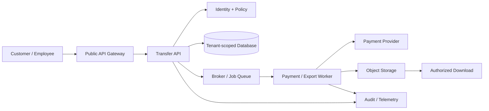
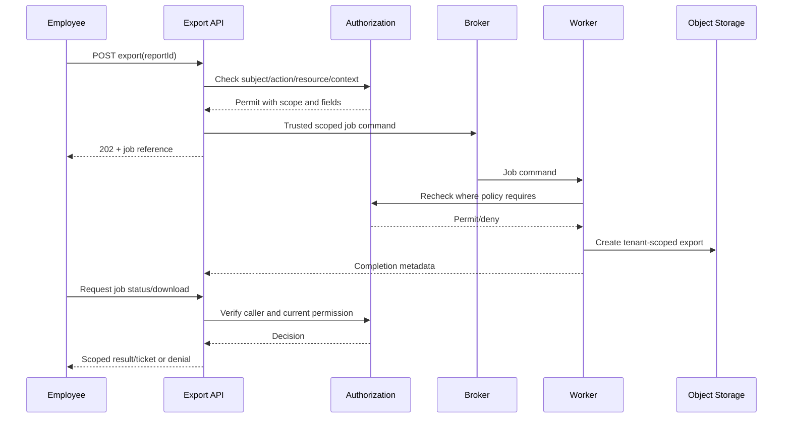
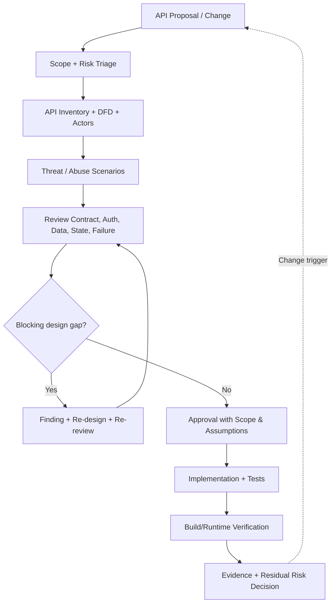
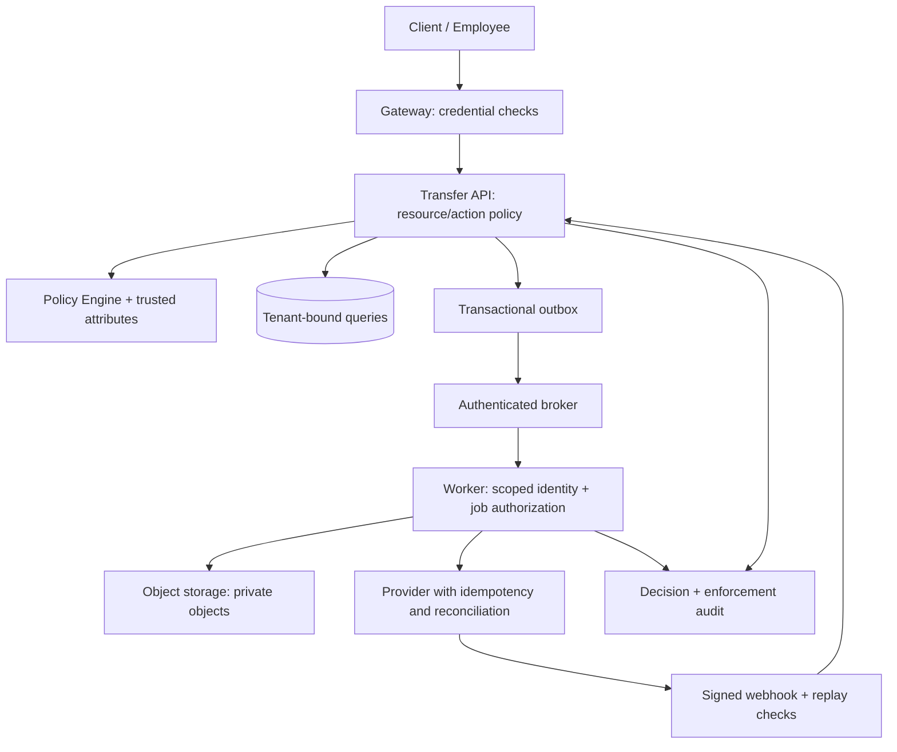

# Review API: Đánh giá thiết kế giao diện lập trình trong Security Design Review

## 1. Mục tiêu học tập

Sau bài học, người học có thể:

1. Giải thích **API security design review** là gì và khác biệt với code review, contract linting, penetration testing và API gateway configuration review.
2. Xác định **đúng phạm vi** một cuộc review: API inventory, actors, resources, actions, credentials, data flows, trust boundaries và các đường truy cập thay thế.
3. Thực hiện review theo **rủi ro và abuse cases**, đặc biệt với BOLA/IDOR, broken function-level authorization, tenant isolation, dữ liệu nhạy cảm và business logic.
4. Đánh giá API contract: methods, paths, request/response schemas, status codes, versioning, pagination, filtering, idempotency, errors và backward compatibility.
5. Thiết kế xác thực, ủy quyền, service identity, delegation, session/token lifecycle và enforcement khi API đi qua nhiều services.
6. Xem xét input validation, injection/SSRF, file upload, deserialization, webhooks, GraphQL, gRPC và API nội bộ theo mô hình đe dọa.
7. Thiết kế các giới hạn tài nguyên, chống lạm dụng, quota/rate limiting, retry, timeout và failure handling phù hợp từng operation.
8. Đánh giá confidentiality, privacy, data minimization, auditability, logging, secrets và shared responsibility.
9. Viết **security review findings, risk–control–evidence mapping, acceptance criteria và verification plan** có thể kiểm chứng.
10. Áp dụng vào nền tảng đa tenant Java/Spring Boot có API báo cáo, chuyển tiền, background worker, object storage và payment provider; tạo hồ sơ review để quyết định phát hành.

Bài thuộc chương **Security design review** của module **SECURITY_SECURITY_ASSURANCE**. Module có mục tiêu xây dựng cách đánh giá **có bằng chứng** rằng hệ thống đáp ứng mục tiêu bảo mật: từ phân tích rủi ro, xác định yêu cầu và security controls đến kiểm thử, audit, xử lý phát hiện và tổ chức assurance liên tục trong phát triển/vận hành. Đối với API, mục đích không chỉ là đánh dấu “dùng HTTPS” hay “có JWT” mà là trả lời:

> **Ai có thể gọi API nào, tác động tới tài nguyên nào, qua trust boundary nào, với kết quả và side effects ra sao — và có bằng chứng nào xác nhận thiết kế đã giải quyết những rủi ro đó?**

## 2. Review API là gì?

**API design review** là hoạt động có cấu trúc nhằm đánh giá **giao kèo truy cập và hành vi dự kiến** của một API trước khi, hoặc đồng thời với, việc triển khai. Security design review tập trung vào các quyết định có thể tạo hoặc loại bỏ attack paths, ví dụ:

- API công khai hoặc chỉ dành cho internal workloads?
- Caller phải được xác thực theo cách nào; token được phát hành cho audience nào?
- Caller có thể hành động trên resource nào, trong tenant nào?
- Có thể yêu cầu trả về fields PII mà business process không cần không?
- API gọi sang database, broker, payment provider hoặc object storage như thế nào?
- Nếu timeout sau khi side effect đã xảy ra, caller có được retry mà gây giao dịch lặp?
- Có thể tải file bằng URL đã phát hành sau khi permission bị thu hồi không?
- Khi policy engine hoặc dependency không hoạt động, API fail safe hay fail open?
- Audit/event nào cần có để truy vết quyết định và chứng minh enforcement?
- API version cũ, alternate endpoint hoặc bypass path có cùng chính sách không?

Một review thiết kế tốt phát hiện **vấn đề trước khi trở thành code**, giúp giảm chi phí sửa và tránh tình huống mỗi team tự chọn một cách phân quyền hoặc xử lý lỗi khác nhau.

### 2.1. Review API không chỉ là REST

Trong bài này, API bao gồm:

- REST/HTTP JSON.
- GraphQL.
- gRPC.
- WebSocket/event streaming subscriptions.
- Internal service-to-service APIs.
- Webhooks/callbacks từ đối tác.
- Admin/control-plane APIs.
- Asynchronous command/event interfaces qua broker.
- APIs của cloud, KMS, SaaS và third-party providers.

Không phải các giao thức đều có cùng method/response format, nhưng yêu cầu bảo vệ **subject, resource, action, data, trust boundary và side effect** vẫn áp dụng.

### 2.2. Review quyết định thiết kế, không chỉ phát hiện lỗi cú pháp

Một OpenAPI schema hợp lệ không chứng minh API bảo mật. Ví dụ `GET /transactions/{id}` có syntax đúng nhưng vẫn có thể thiếu object-level authorization. Một `POST /payments` có body hợp lệ vẫn có thể tạo hai khoản thanh toán nếu retry. Một webhook dùng TLS vẫn có thể chấp nhận thông điệp giả vì không xác minh nguồn gửi.

Review phải xem **semantics**, policy, state transitions và assurance evidence.

## 3. Security design review khác gì code review, API testing và audit?

| Hoạt động | Câu hỏi chính | Artifact thông thường | Giới hạn |
| --- | --- | --- | --- |
| **API security design review** | Hợp đồng, trust model và controls có giải quyết rủi ro không? | OpenAPI/AsyncAPI, DFD, threat model, ADR, policy matrix | Chưa chứng minh runtime implementation |
| **Code review** | Code có hiện thực đúng thiết kế và invariants không? | Pull request, diff, test references | Có thể bỏ sót quyết định kiến trúc chưa nêu |
| **Contract/schema linting** | Định dạng/schema có theo quy ước không? | Lint rules, OpenAPI validation | Không tự hiểu business authorization |
| **SAST/SCA** | Có patterns dễ lỗi hoặc dependencies rủi ro? | Scan/SBOM reports | Hạn chế với business logic và cross-service flow |
| **DAST/API security testing** | Hệ thống chạy có các hành vi không an toàn? | Test results, traffic/response evidence | Bị giới hạn bởi test data, endpoints, credentials |
| **Penetration testing** | Kịch bản tấn công có thể khai thác đường nào? | Findings, reproduction, impact | Không thay governance liên tục |
| **Assurance/audit** | Controls được thiết kế và vận hành hiệu lực trong phạm vi nào? | Claims, mapped evidence, conclusions | Không tự động chứng minh toàn hệ thống |

Một dấu `Approved` ở design review chỉ chứng minh **quyết định review trong scope**, không có nghĩa API đã được triển khai, kiểm thử, hoặc release an toàn.

### 3.1. Kiểm tra tại những thời điểm nào?

Review nên được kích hoạt khi:

- Thiết kế API mới, nhất là public, privileged, cross-tenant hoặc liên quan dữ liệu nhạy cảm.
- Thêm action mới: export, approve, delete, assign-role, change-beneficiary, sign, decrypt.
- Chuyển endpoint từ internal sang external hoặc thay trust boundary.
- Đổi authentication mechanism, scopes, token delegation hoặc workload identity.
- Đổi data schema/PII fields, filter/aggregation, response semantics.
- Đổi business state machine, async jobs, idempotency hoặc payment integration.
- Thêm webhook/callback, GraphQL, gRPC, streaming hoặc provider.
- Thay rate limits, caches, redirects, CORS hoặc mTLS termination.
- Tạo admin/debug/support endpoint hoặc emergency access.
- Đổi API gateway policy/IAM, object storage permissions hoặc secrets.
- Có incident, vulnerability finding, audit gap hoặc threat model mới.

Không nhất thiết phải mở security committee cho mọi thay đổi tài liệu. Review **theo mức rủi ro**, với tiêu chí scope và reviewer rõ.

## 4. Phạm vi và đầu ra của một API design review

Trước khi đánh giá, cần xác định:

| Thành phần | Câu hỏi | Ví dụ |
| --- | --- | --- |
| **Owner** | Ai chịu trách nhiệm thiết kế và control? | Transfer API owner |
| **Consumers** | Browser/mobile, partner, worker, admin hay SaaS? | Customer app và reconciliation worker |
| **Resources** | Dữ liệu và đối tượng nào được bảo vệ? | Transfer, account, report, export job |
| **Operations** | Read, create, approve, export, delete, subscribe? | `POST /transfers/{id}/approve` |
| **Deployment** | Gateway, ingress, cluster, region, tenant? | Production edge và internal mesh |
| **Contract** | Schema, methods, versions, events và errors? | OpenAPI/AsyncAPI revision |
| **Identity** | Credential type, issuer, audience, workload ID? | OIDC access token và mTLS |
| **Policy** | Permission/relationship/context được áp dụng? | Tenant-scoped approval |
| **Data flow** | Đi qua database, broker, vendor, object store? | API → queue → worker → provider |
| **Risk** | Threat scenarios, impact và exposure? | BOLA, replay, double-payment |
| **Tests** | How to prove controls? | Cross-tenant và concurrent retry |
| **Exceptions** | Legacy route hoặc provider hạn chế gì? | Pending webhook replay mitigation |

### 4.1. Deliverables tối thiểu

Một đợt review nên tạo được:

1. Phạm vi APIs và versions, inventory các entry points.
2. Diagram request/data flow và các trust boundaries.
3. Business/security invariants hoặc security requirements IDs.
4. Mô hình identity, authorization và data exposure.
5. Risk/abuse-case register có mitigation.
6. Review của API contract và error/failure semantics.
7. Quyết định design, trade-offs và những giả định.
8. Acceptance tests và evidence sẽ cần khi build/deploy.
9. Findings, remediation owners, deadlines và exceptions.
10. Review decision có version, scope, reviewer và residual-risk owner.

Nếu chỉ có một checklist chung “authentication/authorization/TLS: Yes” thì khó chứng minh review đã bao phủ đúng operations và nguy cơ.

## 5. Inventory API và attack surface

Không thể đánh giá API chưa được nhận diện. Inventory nên bao gồm:

- Public endpoints, authenticated user endpoints và privileged routes.
- Internal APIs, gRPC methods, GraphQL operations và subscriptions.
- Webhooks, callbacks, SSO routes và inbound partner endpoints.
- Upload/download/export, report generation, pagination/search.
- Batch/bulk/admin/support/maintenance/health endpoints.
- Debug/legacy/deprecated routes và alternative paths.
- Broker topics, command handlers, async jobs, DLQ/replay.
- API gateways, service mesh, load balancers và direct service addresses.
- Cloud control plane và third-party access tokens.
- Dev/staging/prod, regions và tenants.

### 5.1. Inventory là dữ liệu, không phải bằng chứng enforcement

Một catalog có endpoints nhưng không ghi **version, authentication mode, resource scope, owner và runtime exposure** không đủ.

Gợi ý entry:

```yaml
api_inventory_entry:
  id: "API-TRANSFER-EXPORT"
  owner: "<team>"
  protocol: "HTTP REST"
  operation: "POST /v1/reports/{reportId}/exports"
  environments: ["production"]
  exposure: "authenticated-external"
  consumers: ["reconciliation-portal"]
  resource: "tenant-report"
  actions: ["EXPORT"]
  data_classification: "confidential"
  authentication: "OIDC access token"
  authorization_policy: "AUTHZ-REPORT-EXPORT-v4"
  alternate_paths:
    - "worker-job-consumer"
    - "object-download-ticket"
  current_contract: "<openapi-revision>"
  evidence_refs: ["<review-id>", "<test-plan-id>"]
```

Đây là mẫu minh họa; không chứa tài khoản, token hoặc thông tin khách hàng thật.

### 5.2. Shadow APIs và deprecated versions

API có thể vẫn chạy trên URL cũ dù tài liệu không còn liệt kê. Review cần xác định version ẩn, direct deployment path, endpoint hỗ trợ vận hành và routes tự sinh bởi framework. Không suy ra “không được document” nghĩa là “không reachable”.

## 6. Trust boundaries và Data Flow Diagram

Trust boundary là ranh giới mà mức tin cậy, quyền hoặc chủ sở hữu bảo vệ thay đổi: Internet → gateway, user → service, service → database, workload → vendor, API → broker, storage → download client.

Ví dụ nền tảng chuyển tiền:



### 6.1. Đặt câu hỏi ở mỗi boundary

- **Caller:** danh tính nào hiện diện trước/sau boundary?
- **Credential:** token/certificate nào được kiểm tra, audience có đúng không?
- **Policy:** chủ thể được phép thực hiện action và resource scope nào?
- **Data:** thông tin nhạy cảm nào đi qua, có minimization và encryption?
- **Side effects:** database/queue/provider nào được phép thay đổi?
- **Failure:** timeout/retry/replay/partial result có ảnh hưởng quyền và integrity?
- **Observation:** có logs chứng minh authentication decision và enforcement?
- **Bypass:** có direct path không đi qua cùng PEP/controls?

### 6.2. TLS termination làm thay đổi boundary

Browser thấy HTTPS không chứng minh gateway → backend được mã hóa. Nếu TLS terminate ở gateway rồi HTTP nội bộ, phải nêu trust assumption, data classes, risk treatment và controls. Không gọi đó là “end-to-end TLS” nếu chỉ có đoạn client → gateway.

### 6.3. Đừng coi private network là authorization

Dù call chỉ từ subnet nội bộ, một workload compromise có thể gọi API admin. Network segmentation giảm exposure, **không thay thế xác thực máy/service và resource authorization** khi mục tiêu yêu cầu.

## 7. Risk-based review và mô hình lạm dụng

Review nên bắt đầu bằng mục tiêu bảo vệ và khả năng lạm dụng, không chỉ đọc từng mục checklist.

Một phương pháp:

1. Liệt kê assets/dữ liệu và business impact.
2. Liệt kê actors hợp lệ, đối tác, compromised account, workload bị chiếm.
3. Xác định access paths/trust boundaries.
4. Chọn abuse cases có khả năng và tác động đáng kể.
5. Đối chiếu controls trong thiết kế.
6. Xác định assumptions, unknowns và residual risks.
7. Viết negative/failure tests để kiểm chứng.
8. Ghi review finding/decision trước khi code.

### 7.1. Ví dụ abuse cases

| ID | Attacker/caller | Mục tiêu | Security invariant |
| --- | --- | --- | --- |
| API-R01 | User tenant A có token hợp lệ | Đọc transfer B | Không đọc resource ngoài tenant |
| API-R02 | User role viewer | Gọi approve API | Chỉ approver đúng quyền/state được approve |
| API-R03 | Nhân viên lập lệnh | Tự approve lệnh mình tạo | Maker–checker separation |
| API-R04 | Client retry sau timeout | Tạo payment lặp | Một logical payment cho một intent |
| API-R05 | Partner gửi webhook cũ | Replay trạng thái hoàn tất | Callback integrity + replay controls |
| API-R06 | User có export role | Lấy fields PII ngoài purpose | Field/purpose authorization |
| API-R07 | Compromised internal pod | Gọi internal admin API | Workload identity + action permission |
| API-R08 | Caller dùng direct object URL | Bypass export check | Download scope và expiry |
| API-R09 | Client gửi URL nội bộ | Khai thác SSRF | Outbound destination policy |
| API-R10 | Crawler tạo queries đắt | Exhaust service | Cost/rate/resource limits |

### 7.2. Bản đồ STRIDE theo quyết định API

- **Spoofing:** issuer/audience validation, service identity, webhook authenticity.
- **Tampering:** input integrity, payload signing, version/state validation.
- **Repudiation:** audit actor/action/resource/outcome và integrity.
- **Information disclosure:** BOLA, excessive response, logs, caches, object URLs.
- **Denial of service:** quotas, concurrency, query cost, payload size, timeouts.
- **Elevation of privilege:** function-level authorization, role changes, cross-tenant, confused deputy.

STRIDE là công cụ gợi ý; review vẫn cần **business logic abuse cases** vì không phải mọi rủi ro bắt nguồn từ network primitive.

## 8. Authentication: người gọi API là ai?

Authentication design review cần trả lời:

- API dành cho browser cookie session, mobile, partner, machine-to-machine hay workload?
- Identity Provider nào phát hành credential và mô hình federation ra sao?
- Access token có đúng token type, issuer, audience, expiry và signature không?
- Public/private clients xử lý token và refresh như thế nào?
- Session/token bị compromise, revoke, expire hay refresh replay thì sao?
- Partner/client chứng minh sở hữu credential như thế nào?
- Service-to-service identity có tách biệt workload, environment và purpose?
- Có kênh internal “trusted” không có authentication không?

### 8.1. OAuth 2.0/OIDC: phân định đúng vai trò

- **OIDC** hỗ trợ xác thực danh tính trên nền OAuth 2.0.
- **OAuth 2.0** là framework ủy quyền cho client nhận access token theo grant/scopes.
- **Access token** được resource server xác minh để dùng API theo audience/scope.
- **ID token** dành cho authentication context của client; không được mặc định sử dụng làm API authorization token.
- **Scopes** có thể giới hạn chức năng, nhưng không thay thế kiểm tra owner/tenant/resource.

Thiết kế nên nêu rõ loại token nào dùng ở endpoint, cách xác minh và vòng đời. JWT phải được kiểm tra bằng thư viện cấu hình đúng; không chỉ decode payload rồi tin claims.

### 8.2. Token validation acceptance criteria

Ví dụ requirement:

> API protected action phải từ chối access token có issuer, audience, signature, validity hoặc algorithm ngoài policy; token hợp lệ vẫn phải qua authorization trên action và resource cụ thể.

Test case cần có expired, wrong issuer, wrong audience, tampered signature, missing scope, revoked/disabled principal, và **valid token with unauthorized object**.

### 8.3. Cookies và CSRF

Nếu browser tự động gửi authentication cookie, review cần xét CSRF protection, SameSite/Secure/HttpOnly, session lifecycle và cross-origin handling. Không kết luận “REST JSON không có CSRF” chỉ vì dùng JSON: quyết định phụ thuộc **credential transport và khả năng browser tạo request**.

### 8.4. Client credentials và service identity

Machine client sử dụng client credentials hoặc workload identity phải có scope/audience đúng, lifetime/rotation và quản lý key/secret phù hợp. Một service certificate hợp lệ không cho phép tự động gọi mọi method của backend.

## 9. Authorization: ai được làm gì với resource nào?

Một công thức thiết kế:

```text
AuthorizationDecision =
  Policy(
    verified_subject,
    requested_action,
    trusted_resource_attributes,
    current_context,
    policy_version
  )
```

**Authentication chỉ là tiền đề.** API design review cần xét:

- Function-level permission: ai được gọi action?
- Object-level permission: ai được đọc/sửa resource cụ thể?
- Tenant ownership: subject và resource thuộc tenant nào?
- Relationship: assignment, membership, creator, approver?
- Attribute/context: data classification, transaction state, session assurance?
- Field-level: response fields, filtering, masking, export?
- Delegated access: API đang làm thay user hay service?
- Admin/support/emergency: scoped exception và separation of duties?

### 9.1. BOLA/IDOR với URL có ID

`GET /v1/transfers/{transferId}` có thể trả transfer của tenant khác nếu chỉ xác thực token và gọi database `findById`. Review phải nêu:

> Chỉ subject có relationship/tenant entitlement với resource được trả đúng dữ liệu; ID do client gửi không được dùng như bằng chứng sở hữu. Với resource ngoài scope, API phải từ chối trước data disclosure và side effects.

### 9.2. Broken Function-Level Authorization

Ẩn nút “Approve” trên giao diện không chặn client gửi `POST /v1/transfers/{id}/approve`. Review phải xác định quyền tại server cho action chứ không dựa vào visibility của UI.

### 9.3. Policy enforcement ở đâu?

Các điểm có thể bao gồm:

- API gateway: authentication và coarse scopes.
- Application/service: business authorization, ownership/state.
- Database: tenant predicate/row-level security khi phù hợp.
- Worker: trusted job authorization và re-evaluation.
- Storage: object ACL, scoped download URL.
- Third-party integration: credential privileges và business state.

Nếu chỉ có gateway, direct worker, batch, gRPC hoặc object store có thể bypass. Design review phải phân bổ controls theo **mọi đường có khả năng gây side effect hoặc disclosure**.

## 10. Tenant isolation: đọc, tìm kiếm, export và cache

Multi-tenant API có nhiều điểm disclosure hơn endpoint `GET by ID`.

| API pattern | Rủi ro | Design question |
| --- | --- | --- |
| `GET /reports/{id}` | BOLA | Resource tenant/owner được kiểm tra server-side? |
| `GET /reports?tenant=X` | Filter manipulation | Tenant có lấy từ trusted entitlement? |
| `GET /reports/count` | Metadata leak | Count/aggregation có tenant filter? |
| `POST /reports/batch` | Một item vượt scope | Có per-item authorization/batch semantics? |
| `POST /reports/exports` | Export PII | Purpose, action, fields và async enforcement? |
| `GET /exports/{id}/download` | Ticket replay/cross-user | Binding, expiry, revocation và object ACL? |
| `GET /analytics` | Aggregation leak | Data grouping có che tenant/PII? |
| Cache `report:{id}` | Cross-user cache leak | Cache có authz binding/validation? |
| Subscription `tenant-events` | Streaming leak | Subscribe và từng event có scope đúng? |

### 10.1. Không tin tenant ID do client cung cấp

Một request có header `X-Tenant-ID` hoặc path tenant ID có thể dùng để chọn context, nhưng phải xác minh **đã được cấp quyền trên tenant đó**. Không tự suy từ string header thành quyền.

### 10.2. Bulk operation và partial authorization

Thiết kế phải quy định: nếu 100 records gồm 99 thuộc tenant A và 1 thuộc B, API **all-or-nothing** hay cho phép partial trong scope? Cách nào cũng cần quyết định rõ, kết quả không tiết lộ record B, và không tạo unauthorized side effects.

### 10.3. Caching

Cache key chứa tenant chưa đủ nếu cùng tenant có nhiều roles/field permissions. Có thể cache raw data rồi áp dụng authorization khi trả, hoặc cache scoped data với policy-aware invalidation. Review cần kiểm tra **mức chia sẻ cache, token/permission revocation và versioning**.

## 11. Thiết kế REST contract: resource, method và semantics

Một API design review nên kiểm tra:

- Resource naming và operation intent.
- Method safety/idempotency: `GET` không được tạo side effects nghiệp vụ; `PUT`/`DELETE` có semantics rõ; `POST` có thể cần idempotency.
- Path/query/body parameters và quy tắc conflict/precedence.
- Content types, size limits và supported encodings.
- Schema validation và unknown field handling.
- API versioning, deprecation và compatibility.
- Pagination/filter/sort và query cost.
- Response projection, sensitive fields và cache headers.
- Error/status codes, retryability và correlation IDs.
- Authz requirements cho mỗi action và alternative route.

### 11.1. HTTP method không tự quyết định bảo mật

`GET` được coi là safe method theo HTTP semantics, nhưng endpoint mang tên “get” vẫn có thể trigger payment hoặc thay status nếu thiết kế sai. Thiết kế phải nêu **effect thật** và hạn chế các hành động state-changing qua safe methods.

### 11.2. Response error semantics

- `401` thường cho authentication thiếu/không hợp lệ.
- `403` thường cho authorization denied.
- `404` có thể được dùng để không tiết lộ resource tồn tại theo policy.
- `409` có thể cho business state/version conflict.
- `429` cho rate limit.
- `202` cho accepted asynchronous processing.

Không áp đặt một status code duy nhất cho mọi system; phải đảm bảo API contract nhất quán và **không suy đoán resource existence qua lỗi**, không tạo side effects trước deny.

### 11.3. Versioning không được làm sống lại lỗ hổng

Khi `/v2` thêm authorization mới, `/v1` vẫn chạy có thể còn lỗi. Review cần version inventory, compatibility, consumer migration, deprecation deadline và evidence cả đường cũ/đường mới trong kỳ hoạt động.

## 12. Request schema, validation và anti-injection

Review request schema theo:

1. **Type & shape:** integer, decimals, enum, UUID, object nesting.
2. **Bounds:** length, count, file size, pagination, recursion depth.
3. **Meaning:** state transitions, currency, amount, owner, tenant, date/zone.
4. **Source trust:** field nào client được phép quyết định?
5. **Normalization:** Unicode, paths, URLs, canonical representation.
6. **Downstream sinks:** SQL, shell, template, LDAP, search, logs, redirects.
7. **Unknown fields:** reject/ignore và compatibility implications.
8. **Multipart/mixed content:** file type/magic, scanning, content disposition.
9. **Error behavior:** không lộ internal parser/SQL stack.
10. **Security tests:** boundary, invalid schema, tampered fields, attacker-controlled inputs.

### 12.1. Input validation khác authorization

Một `tenantId` là UUID hợp lệ về cú pháp nhưng không chứng minh caller được truy cập tenant đó. `reportId` đúng định dạng vẫn có thể là ID của người khác.

### 12.2. Mass assignment / overposting

Nếu API nhận request body rồi map thẳng lên database entity, client có thể gửi `isAdmin`, `approved`, `ownerId`, `status` hoặc `tenantId`. Thiết kế phải **allowlist mutable fields theo action**, tách DTO/command schema và không cho client tự quyết định security-sensitive state.

### 12.3. Query và injection

Parameterized SQL là control triển khai; ở cấp thiết kế yêu cầu không để client kiểm soát query language/identifier ngoài allowlist đã định nghĩa. Với sort/filter, cho phép field name trong danh sách cho phép và ràng buộc tenant ở tất cả query paths. Cần xét SSRF nếu API nhận URL; xem phần webhook/integrations.

### 12.4. File upload

Đặt giới hạn loại nội dung, kích thước, số file, thời gian xử lý, nơi lưu, tên/đường dẫn, AV/sandbox nếu risk yêu cầu, và quyền tải lại. Không tin filename/MIME do client tự khai làm căn cứ đủ.

## 13. Response schema, dữ liệu nhạy cảm và privacy

Thiết kế response phải hỏi **“caller có cần field này cho mục đích này không?”**.

Ví dụ một DTO gồm:

```json
{
  "reportId": "example-id",
  "status": "READY",
  "tenantId": "tenant-A",
  "createdBy": "subject-ref",
  "customerEmail": "redacted@example.invalid",
  "paymentAccount": "MASKED",
  "internalRiskNotes": "INTERNAL_ONLY"
}
```

Nếu endpoint dành cho customer, `internalRiskNotes` có thể không được phép; nếu dành reconciliation, email/financial fields vẫn cần purpose/field-level policy. Không nên serialize nguyên entity rồi hy vọng @JsonIgnore bảo vệ mọi use case.

### 13.1. Data minimization

Review phải xác định:

- PII, financial, secret hoặc regulated data classes.
- Field nào phục vụ chức năng, field nào chỉ internal.
- Response types khác nhau theo actor/action.
- Mask/redact và field projection rules.
- Pagination/export/search có lộ nhiều hơn single-object API?
- Caching/CDN, browser history, telemetry có giữ plaintext?
- Retention/deletion, downstream processing và provider copies.
- Cross-border/cross-tenant transfers khi có ràng buộc áp dụng.

### 13.2. HTTP caching và data leakage

Dữ liệu nhạy cảm có thể bị cache trong browser/proxy/CDN nếu headers và cache keys không phù hợp. API review phải chọn chính sách cache theo data class, auth context và threat model; không mặc định `Cache-Control: public` cho dữ liệu cá nhân hóa.

### 13.3. Error body không được là kho thông tin nội bộ

Không trả stack trace, SQL errors, internal URLs, token claims đầy đủ, key references nhạy cảm hoặc policy reasoning quá chi tiết. Dùng correlation ID và error code ổn định, giữ chi tiết kỹ thuật trong log được kiểm soát.

## 14. API workflow, state machine và business invariants

Các lỗ hổng nghiêm trọng có thể tồn tại dù authentication, TLS và schema đều tốt.

Ví dụ payment:

```text
DRAFT
  -> PENDING_APPROVAL
  -> APPROVED
  -> PROCESSING
  -> COMPLETED / FAILED / UNKNOWN
```

Review cần mô tả:

- Actor nào tạo từng transition?
- Có thể tự approve không (maker–checker)?
- Điều kiện amount/beneficiary có bị sửa sau approval?
- Thao tác nào cần approval lại?
- Khi request đến đồng thời, ai thắng?
- Có thể gọi `execute` trên transfer đã hủy hoặc hoàn tất?
- External provider timeout được diễn giải thế nào?
- Callback có thay đổi trạng thái vượt quyền không?
- Audit log nào chứng minh được việc chuyển trạng thái hợp lệ?

### 14.1. Security invariant mẫu

> Một transfer chỉ có thể chuyển từ `PENDING_APPROVAL` sang `APPROVED` khi actor có quyền đúng tenant/limit, không là creator, và bản snapshot được duyệt khớp dữ liệu sẽ được execute.

### 14.2. State thuộc resource authorization

Permission `APPROVE_TRANSFER` không đủ nếu transfer đã `CANCELLED` hoặc reviewer muốn phê duyệt giao dịch vượt hạn mức. Authorization còn phụ thuộc **resource state, relationship và policy context**.

### 14.3. TOCTOU và concurrency

Nếu API kiểm tra quyền/trạng thái rồi thực thi sau một khoảng thời gian mà không khóa hoặc kiểm tra lại, state có thể thay đổi. Thiết kế có thể dùng transaction, optimistic version, conditional update và state revalidation. Không mặc định thêm một `if` trong controller sẽ giải quyết race conditions.

## 15. Idempotency, retries và double-processing

Một operation tạo side effect (payment, job export, role change) cần thiết kế cho retry.

### 15.1. Tại sao?

Client gửi `POST /transfers/{id}/execute`, server đã gửi payment nhưng mạng timeout trước response. Client retry; nếu không có idempotency và reconciliation, giao dịch có thể bị thực hiện hai lần.

### 15.2. Questions cho API design review

- Client gửi idempotency key ở đâu và phạm vi gì?
- Key gắn với subject, tenant, action và canonical payload?
- Key trùng với payload khác được xử lý thế nào?
- Duplicate requests đồng thời có atomic protection?
- Key retention/TTL được quy định theo business risk?
- Retry trả cùng result, in-progress status hay conflict?
- Nếu external provider đã nhận nhưng response mất, làm sao lookup/reconcile?
- Outbox/queue consumer có xử lý at-least-once và duplicate event?
- “Exactly once” là **logical business guarantee có điều kiện** hay tuyên bố không chứng minh được?

### 15.3. Requirement mẫu

> **API-IDEMP-001:** Lệnh execute payment phải nhận diện cùng một business intent theo một idempotency scope được xác minh; concurrent/replayed requests trong phạm vi đó không được tạo hơn một logical payment. Tình trạng không xác định ở provider phải được đối soát trước khi thử lại.

### 15.4. Giao dịch phải có trạng thái UNKNOWN khi cần

`timeout` không chứng minh `payment failed`. Không dùng auto-retry mù chỉ vì HTTP status/error dễ diễn giải; thiết kế nên có trạng thái pending/unknown, reconciliation và audit.

## 16. Asynchronous API và job authorization

Ví dụ `POST /reports/{id}/exports` trả `202 Accepted` với `jobId`; worker tạo file và trả download ticket.



### 16.1. Design questions

- Producer nào có thể enqueue?
- Worker chứng minh producer/job authenticity ra sao?
- Job chứa trusted authorization context nào, có TTL và integrity protection không?
- Job đã tạo lúc user có quyền nhưng chạy sau revocation được xử lý thế nào?
- Worker service identity có quyền đọc dữ liệu mọi tenant không?
- Job ID có phải opaque và không cho enumeration không?
- Status endpoint có tiết lộ PII/đối tượng tenant khác?
- File/object được bảo vệ ở storage hay chỉ bằng URL frontend?
- Ticket có expiry, scope và revocation semantics rõ không?
- Retry, crash, DLQ replay có tạo duplicate files hoặc external effects không?
- Khi deny trước enqueue, có chắc không tạo job/object không?

### 16.2. Confused deputy

Một worker với database quyền rộng có thể bị lợi dụng nếu caller kiểm soát `tenantId` hoặc `objectKey` trong job. Requirement phải ràng buộc **delegation context**, trusted producer, authorization khi thực thi và least privilege tại storage/database.

## 17. Webhook/callback và external integrations

Webhook là **inbound API từ bên ngoài**, không được tin chỉ vì partner có tên tuổi.

### 17.1. Threat scenarios

- Attacker giả mạo event “payment completed”.
- Event cũ bị replay để tái kích hoạt business state.
- Endpoint webhook bị flood.
- Partner key bị compromise và chưa rotate.
- Webhook payload khai báo tenant/transaction không khớp resource.
- Redirect/URL callback bị lợi dụng cho SSRF.
- Timing/race giữa callback và internal state.
- Thiếu reconciliation nếu webhook delivery thất bại.

### 17.2. Thiết kế xác minh nguồn

Có thể áp dụng signature/HMAC trên **exact request bytes theo provider contract**, timestamp/nonce/delivery ID, integrity, key rotation, body size limit và replay cache. Không tự suy một “chữ ký đúng” chứng minh event hợp lệ về **business state**; vẫn cần đối chiếu transaction ID, tenant, amount, currency và expected transition.

### 17.3. HMAC và key management

HMAC chỉ xác minh bên có shared secret, không phân biệt hai bên cùng giữ key là ai. Cần bảo vệ secret, rotation, per-provider segregation, error handling và logs không lộ key. Nếu provider dùng asymmetric signature, cần trust root/key rollover đúng.

### 17.4. Outbound SSRF và egress

API cho khách hàng cấu hình webhook destination cần policy về scheme, host, ports, redirects, DNS resolution, private/link-local/metadata endpoints, network egress, credentials và revalidation. Không chỉ dùng regex “URL bắt đầu với https” làm defense. Với hệ thống cho phép URLs tùy chọn, nên kết hợp application checks và network-level egress restrictions.

## 18. Transport security, network boundaries và API exposure

- TLS tại public endpoints theo baseline được duyệt.
- Hostname/certificate chain validation cho outbound calls.
- mTLS/workload identity ở service-to-service khi risk yêu cầu.
- Không truyền access tokens qua URL/query/log.
- Không tự động fallback từ secure connection sang plaintext.
- Bảo vệ private keys/secrets và vòng đời rotation.
- Kiểm soát gateway → backend, proxy → service và multi-region hops.
- Cấu hình forwarded headers, trusted proxies và client IP parsing đúng.
- API nội bộ/admin không được public chỉ vì route chưa document.
- Network policy/egress restrictions hạn chế blast radius.

### 18.1. CORS không phải authorization

CORS là cơ chế browser kiểm soát cross-origin web requests; một non-browser client vẫn có thể gửi request trực tiếp. Không dùng CORS allowlist để thay authentication/authorization. Nếu dùng credentialed CORS, phải đánh giá allowed origins, credentials, browser behavior và caching.

### 18.2. API gateway không bảo đảm object permissions

Gateway có thể kiểm tra token và coarse scopes, nhưng không biết chính xác report thuộc tenant nào. Thiết kế cần authorization có **resource context** tại layer phù hợp, cộng data query/worker/storage controls.

### 18.3. Proxy trust và client IP

Không tin `X-Forwarded-For` hoặc `Forwarded` do client tự gửi nếu không có trusted proxy chain và sanitize rõ. Đặc biệt khi dùng IP cho quotas/risk decisions, nguồn client IP phải được xác định đáng tin.

## 19. Rate limiting, quotas và chống resource exhaustion

Rate limiting không chỉ là cấu hình “100 requests/giây”.

Review cần trả lời:

- Giới hạn theo **user, client, tenant, IP, token, endpoint hay business resource**?
- Có nhiều keys khi distributed/rotating IP không?
- Request nào tiêu tốn nhiều CPU, database, KMS, provider quota hoặc tiền?
- Bulk/export/search/pagination có bound chặt không?
- GraphQL queries có depth/complexity/cost limits?
- Một account có thể tạo vô hạn async jobs không?
- Quotas được chia giữa tenants/partners như thế nào?
- `429` có Retry-After và backoff hợp lý?
- Các legitimate high-volume workflows được phục vụ an toàn thế nào?
- Mức rate limit có thể bị bypass qua multiple nodes/regions?
- Rate limit được giám sát và phân biệt với authorization?

### 19.1. Quota không tự giải quyết BOLA

Giới hạn số request có thể giảm blast radius nhưng không biến truy cập trái quyền thành hợp lệ. Deny đối tượng không có quyền vẫn phải được kiểm tra ngay cả khi caller chưa vượt quota.

### 19.2. Resource cost là một phần của API contract

Nếu client gửi `pageSize=1000000` hoặc GraphQL nested query sâu, hệ thống có thể quá tải. Thiết kế cần upper bounds, cost accounting, pagination/safe defaults và quotas dựa rủi ro.

## 20. Error handling, failure modes và tính nhất quán

| Failure scenario | Rủi ro | Thiết kế/điều kiện nghiệm thu |
| --- | --- | --- |
| IdP không sẵn sàng | Chấp nhận identity không xác minh | Không cấp quyền mới mặc định |
| Policy engine timeout | API fail open | Deny/restricted mode theo risk |
| DB timeout sau update | Client retry trùng | Idempotency và transaction outcome reconciliation |
| Provider trả timeout | Payment có thể đã chạy | UNKNOWN state/lookup thay vì blind retry |
| Broker duplicate event | Worker lặp side effects | Deduplication và invariant tests |
| Export storage lỗi | URL/file partial có thể lộ | Không publish incomplete artifact |
| Signed URL hết hạn | Download behavior không rõ | Expiry/refresh qua authorization |
| Attribute/cache stale | Role/tenant đã đổi | Revocation bounds và version-aware invalidation |
| Certificate hết hạn | Service ngắt hoặc bypass TLS | Renewal, alert và reject invalid trust |
| Audit pipeline hỏng | Mất chứng cứ | Alert/gap record/buffering theo policy |
| Một region chạy policy cũ | Quyền không nhất quán | Drift detection và staged rollout |
| Data schema migration lỗi | Resource ownership lệch | Backward/forward compatible validations |

### 20.1. “Fail closed” vẫn cần xem availability

Với payment/PII export hoặc privileged operations, không thể xác minh điều kiện bắt buộc thì thường không được cho phép. Với public metadata có thể tồn tại restricted mode được duyệt. Review nên nêu **điều kiện, business impact, owner và test**, không gắn cùng một fallback cho mọi operation.

### 20.2. Retry contracts

Trình bày rõ actions nào client được retry, status nào retryable, idempotency scope, backoff/jitter, deadline và những tình huống phải đối soát. HTTP 500/503/timeout không tự cho biết server chưa thực hiện side effect.

## 21. Logging, audit và khả năng điều tra

API cần tạo evidence đủ để giải thích **ai muốn làm gì trên resource nào, policy quyết định gì và kết quả thực thi ra sao**.

Các metadata hữu ích:

- Correlation/request ID và trace context.
- Subject reference (opaque ID) và client/workload identity.
- Action, resource type và opaque resource reference.
- Tenant reference nếu phù hợp và được bảo vệ.
- Policy ID/version, decision, reason code.
- Authentication class/method khi cần, không phải raw credential.
- Enforcement outcome và side effect/job reference.
- Status code, latency, error category.
- Timestamp/region/environment/build ID.
- Approved emergency/exception reference.

### 21.1. Không ghi dữ liệu bí mật để “đủ audit”

Không ghi raw JWT, cookie, password, API key, private key, payment payload, customer contact hoặc body PII vào logs theo mặc định. Ghi metadata tối thiểu có giá trị chứng minh, redaction và access controls.

### 21.2. Decision không đồng nghĩa enforcement

Log “Policy Engine: DENY” có thể đúng nhưng worker đã tạo file trước khi nhận decision. Để chứng minh cần **decision + enforcement + resource state**. API design review nên đặt yêu cầu telemetry tại điểm tạo side effects.

### 21.3. Audit event provenance

Audit logs cần retention, integrity/immutability phù hợp, timestamp/source, access control và gap detection. Nếu nhân viên có quyền sửa policy đồng thời xóa audit logs, assurance yếu ngay cả khi API response đúng.

## 22. Quản trị API versions, dependencies và vòng đời contract

Một API hoạt động nhiều năm cần review khả năng thay đổi mà không tạo cửa hậu.

- **Versioning:** cùng một requirement được enforce cho versions còn hỗ trợ.
- **Deprecation:** sunset/consumer migration và khả năng chặn route cũ.
- **Schema compatibility:** tránh client gửi field mới điều khiển security state ngoài schema cũ.
- **Generated SDK:** credentials và retry behavior của SDK không làm lộ token hoặc duplicate action.
- **Documentation:** OpenAPI/AsyncAPI cần mô tả authentication, errors và sensitivity, nhưng không để documentation tự trở thành bằng chứng runtime.
- **Feature flags:** không mở route/skip auth trong production do fallback.
- **Test contracts:** consumer-driven contract tests phải đi cùng security tests.
- **Dependencies:** API gateway plugins, serializers, auth libraries, brokers và SDK có version/support status.
- **Policy ownership:** ai approve thay scopes, audience, tenant boundaries và data fields?

### 22.1. Backward compatibility không biện minh giữ đường trái quyền

Nếu client cũ không cung cấp credential đủ mạnh, cần migration plan, restricted capability hoặc termination theo risk decision. “Không thể breaking change” không là lý do tự bỏ authorization.

### 22.2. Managed gateway và shared responsibility

Gateway/cloud provider có thể hỗ trợ TLS, rate limiting, token validation và logs. Nhưng tổ chức vẫn chịu trách nhiệm **đặc tả object-level access, tenant scopes, API data handling, worker authorization và policy wiring**. Provider attestation không tự chứng minh custom policies trong tenant đã được cấu hình đúng.

## 23. GraphQL: review schema, resolver và query cost

GraphQL đưa nhiều thao tác vào một endpoint và cho phép client chọn fields/nested relationships. Điều này mở rộng bề mặt đánh giá so với API REST với response cố định.

### 23.1. Những câu hỏi đặc thù

- API có phân biệt operations `query`, `mutation` và `subscription` không?
- Mỗi **resolver** có đánh giá authorization theo object/action, kể cả nested fields?
- Parent object được xem không đồng nghĩa children đều được phép.
- Có giới hạn query depth, breadth, aliases, complexity, pagination và execution cost?
- Input queries có thể tạo N+1 DB calls hoặc fan-out tới provider?
- Introspection/schema discovery có policy phù hợp environment/use case?
- Batching/persisted queries có giới hạn, audit và authorization?
- Error extensions có lộ stack, resolver paths, schema/private fields không?
- Federation schema/gateway có vượt tenant boundary ở downstream services?
- Subscription có kiểm tra quyền khi đăng ký và khi emit events?
- Có phân biệt authenticated client với object-level permission ở từng resolver không?

### 23.2. Ví dụ object-level authz

```graphql
query {
  report(id: "report-A") {
    status
    customer {
      email
    }
  }
}
```

Ngay cả khi caller được xem report status, họ có thể không được đọc `customer.email`. Review phải yêu cầu **field-level policy tại resolver và data access**; không dựa vào việc UI thông thường không chọn field này.

### 23.3. Deep nesting và DoS

Một GraphQL query sâu có thể kích hoạt nhiều DB/service calls. Design review yêu cầu budget/cost model, maximum nesting/pagination, concurrency, timeouts và resource isolation theo tenant/client. Tắt introspection có thể giảm schema discovery ở một số bối cảnh nhưng **không thay authorization hay query-cost controls**.

## 24. gRPC, WebSocket và streaming API

### 24.1. gRPC

Review cần kiểm tra:

- Identity và authorization metadata ở mỗi RPC, không chỉ initial connection.
- mTLS/peer identity nếu dùng, cùng method-level/resource-level policy.
- Unary khác streaming: mỗi stream có quyền gì, có thể tiếp tục sau revoke không?
- Protobuf schema evolution, defaults, unknown fields, enum handling.
- Message size, stream limits, deadlines, cancellation và backpressure.
- Error mapping có lộ metadata/sensitive info không?
- Reflection service có exposure policy phù hợp?
- Client/server interceptors có thực sự chạy trên mọi protected methods?
- Retry semantics theo idempotency và deadlines.

Một gRPC channel được xác thực không đồng nghĩa mọi RPC sau đó được phép truy cập mọi tenant.

### 24.2. WebSocket và server-sent events

Một kết nối thành công là **session admission**, không cấp quyền vô hạn cho mọi message/topic.

Yêu cầu cần nêu:

- Ai được subscribe/publish topic nào?
- Có kiểm tra resource scope khi nhận mỗi command và khi phát event?
- Tenant/channel IDs trong message có được xác minh server-side?
- Quyền thay đổi trong khi kết nối kéo dài xử lý thế nào?
- Có giới hạn message size, tần suất, fan-out và buffer?
- Reconnection và token expiration/rotation semantics?
- Có chống cross-tenant event leakage khi dùng broker chung?

### 24.3. Async event schema review

Event mang dữ liệu mật cần fields/provenance đủ để consumer xác minh nguồn và purpose, đồng thời hạn chế PII. Một message queue không phải trusted authorization boundary chỉ vì broker nằm trong cluster.

## 25. OpenAPI: đặc tả contract để review và test

Một contract machine-readable giúp reviewer và QA nhìn rõ entry points, HTTP semantics, authentication schema, body/response, status/error semantics. Tuy nhiên, OpenAPI không tự biểu đạt trọn vẹn object-level business policies; cần bổ sung requirement IDs, policy matrix và acceptance tests.

### 25.1. Ví dụ OpenAPI rút gọn cho export report

```yaml
openapi: 3.1.0
info:
  title: Transfer Reporting API (training example)
  version: "1.0.0"
servers:
  - url: https://api.example.invalid

security:
  - bearerAuth: []

paths:
  /v1/reports/{reportId}/exports:
    post:
      operationId: requestReportExport
      summary: Request a tenant-scoped report export
      description: >
        Requires REPORT_EXPORT permission for this report,
        trusted tenant membership, purpose approval and
        additional session assurance where policy requires.
        Actual authorization is enforced by the service and worker.
      parameters:
        - in: path
          name: reportId
          required: true
          schema:
            type: string
            format: uuid
        - in: header
          name: Idempotency-Key
          required: true
          schema:
            type: string
            minLength: 12
            maxLength: 128
      requestBody:
        required: true
        content:
          application/json:
            schema:
              type: object
              additionalProperties: false
              required: [format, purpose]
              properties:
                format:
                  type: string
                  enum: [csv, json]
                purpose:
                  type: string
                  enum: [reconciliation, audit]
      responses:
        "202":
          description: Accepted, not yet completed
          content:
            application/json:
              schema:
                type: object
                additionalProperties: false
                required: [jobId, status]
                properties:
                  jobId:
                    type: string
                    format: uuid
                  status:
                    type: string
                    enum: [QUEUED]
        "400":
          description: Invalid request
        "401":
          description: Authentication required or invalid
        "403":
          description: Authorization denied
        "404":
          description: Report not found or hidden by policy
        "409":
          description: Conflicting state or idempotency request
        "429":
          description: Rate limit exceeded
        "503":
          description: Dependency unavailable; safe failure

components:
  securitySchemes:
    bearerAuth:
      type: http
      scheme: bearer
      bearerFormat: JWT
```

Đây là **API contract minh họa**, dùng domain giả, không phải production configuration. `bearerFormat: JWT` chỉ mang tính mô tả; resource server vẫn phải xác minh token thực tế và quyết định authorization. Enum `purpose` từ client chỉ biểu đạt requested purpose, không tự chứng minh purpose đã được phê duyệt.

### 25.2. Điều OpenAPI không tự chứng minh

- Token có đúng issuer/audience/expiry/signature không?
- Resource thuộc đúng tenant, owner, purpose và state không?
- Idempotency key có lưu/kiểm soát atomically hay không?
- Permission được revoke có tác dụng với worker và ticket không?
- File tạo ra có được bảo vệ ở object storage không?
- Error body có tiết lộ data qua implementation không?
- Endpoint legacy có hành vi tương tự không?
- Contract có khớp runtime build/policy revision không?

Review phải chuyển mô tả hợp đồng thành **requirements và evidence plan**, không chỉ chạy linter.

### 25.3. Contract review checklist

- [ ] Operation ID duy nhất, owner và data classification rõ?
- [ ] Có authentication scheme hợp lệ và public routes được đánh dấu chủ đích?
- [ ] Mỗi operation có authorization requirement ID?
- [ ] Request schema có limits, allowed fields và unknown-field behavior?
- [ ] Response chỉ chứa fields được phép theo action?
- [ ] Có async/idempotency/retry/error semantics khi có side effects?
- [ ] Có rate limiting/cost bounds cho paths đắt?
- [ ] Có deprecation/versioning và backward-compatibility policy?
- [ ] Có alternate paths, worker/webhook/object access được map?
- [ ] Có acceptance tests cho misuse và dependency failures?

## 26. Security Design Review workflow cho API

Quy trình theo risk và evidence:



### 26.1. Stage 1 — Intake và triage

Input nên có:

- API owner và business use case.
- Người dùng/workload/third parties.
- Assets, data classification và operation list.
- Proposed OpenAPI/AsyncAPI/GraphQL/gRPC schema.
- Existing threat model/architecture nếu có.
- New trust boundaries và dependencies.
- Security-relevant changes compared with current version.
- Mức impact và release schedule.
- Existing security requirements, risk owners và exceptions.

Triage mức rủi ro theo exposure, impact, novelty và uncertainty, không dựa chủ yếu vào LOC hoặc số endpoints.

### 26.2. Stage 2 — Review cuộc tấn công khả dĩ

Cho từng operation, hỏi:

1. Ai được phép và **ai không**?
2. Resource nào, owner/tenant nào?
3. Nếu client đổi ID, action, role, amount, source/destination?
4. Nếu bypass gateway qua internal port, storage URL hoặc worker?
5. Nếu access token bị lộ hoặc credential đã revoke?
6. Nếu gọi lại, gọi đồng thời hoặc sai thứ tự?
7. Nếu callback giả, chậm hoặc duplicate?
8. Nếu request rất lớn, nested hoặc gây expensive query?
9. Nếu dependency hỏng giữa state transitions?
10. Nếu log/cache/error/response tiết lộ dữ liệu?

### 26.3. Stage 3 — Review controls và trade-offs

Controls cần giải quyết nguyên nhân; không lấy rate limit để thay authorization, lấy TLS để thay webhook authenticity, hoặc lấy ẩn button để thay function-level permission.

### 26.4. Stage 4 — Kết luận design review

Có thể phân trạng thái:

- **Approved for implementation:** thiết kế đủ căn cứ và required controls/tests rõ.
- **Approved with conditions:** còn actions/verification gates bắt buộc trước release.
- **Needs changes:** có finding blocking cần sửa thiết kế.
- **Insufficient information:** thiếu data flow/resource model/policy/source.
- **Risk exception:** người có thẩm quyền chấp nhận một gap có scope và expiry.

Một design reviewer không tự thay thế risk owner chấp nhận ngoại lệ; một design approval không tự giải phóng release gate.

## 27. Review findings: ghi rõ vấn đề để xử lý

Một finding hiệu quả cần:

| Thuộc tính | Nội dung |
| --- | --- |
| Finding ID | Định danh và liên kết tới API/review |
| Affected operations | Paths, methods, gRPC/GraphQL fields, versions |
| Threat scenario | Actor, preconditions, misuse path |
| Violated requirement | Security invariant/control objective |
| Consequence | Confidentiality/integrity/availability/privacy/business |
| Exposure/likelihood | Internet/partner/internal, prerequisites |
| Severity and priority | Methodology + rationale |
| Proposed treatment | Design change/compensating controls |
| Owner | Service/data/security/risk owner |
| Verification | Tests, evidence, pass criteria |
| State | Open, redesign, ready-for-retest, closed, accepted |
| Limits | Paths/regions/versions không được kiểm tra |

### 27.1. Ví dụ finding BOLA

> **API-FIND-001 — Blocking:** `GET /v1/reports/{reportId}` dự kiến chỉ kiểm tra role `REPORT_VIEW` nhưng không xác minh tenant/ownership của report. Subject tenant A có thể yêu cầu report B nếu đoán được ID. Requirement bị ảnh hưởng: `AUTHZ-TEN-001`. Yêu cầu thiết kế policy server-side theo subject/resource/action, query ràng buộc tenant và kiểm tra direct export/storage/worker paths. Verification cần token tenant A hợp lệ, report B thực sự tồn tại và kiểm tra denial/no disclosure.

### 27.2. Finding severity theo risk thực tế

Một object-level leak có thể có impact lớn nếu dữ liệu PII/tài chính; nhưng cần xét population, exposure và attacker prerequisites. Không chỉ gán severity tự động vì tên category. Một “API chưa có HTTPS” trong môi trường khác nhau có thể có risk khác nhau, nhưng phải được mô tả trung thực.

### 27.3. Đóng finding khác việc giải thích

“Đã thêm `@PreAuthorize`” hoặc “Gateway có policy” không đủ đóng finding nếu resource/tenant check hoặc bypass paths chưa được kiểm thử. Đóng finding khi có evidence về mitigation, tests và đúng build/policy scope.

## 28. Ma trận Risk → Requirement → Control → Evidence

| Risk ID | Security requirement | Design control | Verification/evidence |
| --- | --- | --- | --- |
| API-R01 BOLA | User chỉ đọc object có entitlement | Object authorization và tenant query | Token A → object B negative test |
| API-R02 BFLA | Mỗi protected action cần permission riêng | Action-level policy, admin restrictions | Viewer gọi approve/role-change denied |
| API-R03 SoD | Maker không tự approve | Maker-checker relation/state | Self-approve và state-transition tests |
| API-R04 Double payment | Một logical payment cho intent | Scoped idempotency, outbox, reconcile | Concurrent/retry/provider timeout tests |
| API-R05 Fake webhook | Chỉ nhận events thật đúng state | Signature/HMAC, timestamp, replay check | Invalid/tampered/duplicate webhook tests |
| API-R06 Excessive PII | Trả đúng fields theo purpose | DTO/projection/field policy | Sensitive-field response tests |
| API-R07 Service lateral movement | Workload không gọi action ngoài scope | Workload IAM, mTLS, authorization | Wrong service identity/permission tests |
| API-R08 Direct download bypass | File chỉ tải trong authorized scope | Ticket binding, expiry, object ACL | Cross-user URL, expired/revoked tests |
| API-R09 SSRF | Không gọi vào destinations bị cấm | Destination/effective IP + egress policy | Redirect/DNS/private-IP tests |
| API-R10 Resource exhaustion | Giới hạn cost theo tenant/client | Quota/rate/size/depth/backpressure | Burst/oversize/deep-query tests |
| API-R11 Stale token | Quyền thay đổi được enforce trong bound | Short lifetime/revocation/revalidation | Role-change latency test |
| API-R12 Fail-open PDP | Không permit khi không thể xác minh | Safe failure/restricted mode | Policy outage/timeout tests |
| API-R13 Version bypass | Supported versions enforce policy tương đương | Version inventory/deprecation | v1/v2/legacy path matrix |
| API-R14 Secret disclosure | Không đưa secrets vào API/logs | Secure credential handling/redaction | Log/trace/response inspection |
| API-R15 Inconsistent gateway/backends | Backend không bỏ qua policy | Service/resource PEP + config trace | Direct backend/worker test |
| API-R16 Over-posting | Client không sửa privileged fields | Allowlisted input DTO + state logic | Inject `isAdmin`/`status`/`tenantId` |
| API-R17 Audit gap | Quyết định và side effects được trace | Decision + enforcement telemetry | Correlated event verification |
| API-R18 Schema drift | Runtime đúng approved contract | Contract tests/runtime version mapping | Diff against deployed spec |

Matrix cần giữ traceability IDs ổn định. Một API operation có thể liên quan nhiều risks; một risk có thể cần nhiều controls. **Độ phủ phải được đánh giá theo paths, data classes và actors**, không theo số lượng hàng trong bảng.

## 29. Positive, negative, abuse và failure test matrix

Design review nên xác định test oracles **trước triển khai**, để QA và dev có thể chứng minh control.

| ID | Tình huống | Kết quả mong muốn |
| --- | --- | --- |
| API-T01 | User đúng tenant/permission truy cập report được giao | Permit, đúng fields |
| API-T02 | Token hợp lệ tenant A đọc report tồn tại tenant B | Deny, không tiết lộ dữ liệu/metadata |
| API-T03 | User chỉ có view role gọi export/approve | Deny, không job/side effect |
| API-T04 | Token expired/wrong issuer/wrong audience/bad signature | Authentication reject |
| API-T05 | Token đúng nhưng subject disabled/revoked | Từ chối trong bound policy |
| API-T06 | Client thêm `tenantId`, `isAdmin`, `approved` vào body | Không nâng quyền/đổi state |
| API-T07 | Batch chứa record ngoài scope | All-or-nothing/partial theo policy, không leak |
| API-T08 | External client gọi direct internal/admin route | Bị chặn theo boundary |
| API-T09 | GET report count/search có tenant filter sai | Không leak totals/records |
| API-T10 | Export URL bị dùng bởi identity khác | Từ chối theo binding policy |
| API-T11 | URL hết hạn hoặc quyền bị revoke | Behavior đúng policy và evidence |
| API-T12 | Job được replay/đổi tenant trong message | Worker reject hoặc deduplicate |
| API-T13 | Webhook signature/timestamp sai | Reject, không cập nhật state |
| API-T14 | Webhook hợp lệ nhưng duplicate/out-of-order | Idempotent/state-safe |
| API-T15 | POST execute bị retry đồng thời | Một logical payment |
| API-T16 | Provider timeout sau khi nhận request | UNKNOWN/reconcile, không blind duplicate |
| API-T17 | Maker tự approve | Deny, state không đổi |
| API-T18 | Amount thay sau approval | Reapproval/deny trước execute |
| API-T19 | PDP unavailable | Không unsafe permit |
| API-T20 | Proxy/gateway policy khác service | Không bypass resource policy |
| API-T21 | Request body/file/pageSize quá lớn | Bound/reject, availability maintained |
| API-T22 | Query depth/GraphQL cost vượt policy | Reject/limit, không tài nguyên quá tải |
| API-T23 | Outbound URL chuyển sang private IP/redirect | Không SSRF |
| API-T24 | Cookie authenticated request từ origin không được phép | CSRF/CORS behavior đúng threat model |
| API-T25 | Wrong client cert hoặc TLS hostname | Không có insecure fallback |
| API-T26 | Error body/log khi invalid input | Không có secrets, stack/PII |
| API-T27 | Role thay trong session dài | Enforce/re-evaluate trong bound |
| API-T28 | Multi-region policy versions khác | Drift được phát hiện, không unsafe permit |
| API-T29 | Worker crash sau object creation | Không publish partial/unauthorized export |
| API-T30 | GraphQL nested field không được phép | Field-level deny/redaction theo contract |
| API-T31 | gRPC stream tiếp tục sau revocation | Hành vi theo session/revalidation policy |
| API-T32 | API v1 legacy có cùng resource | Không bypass v2 security requirements |

### 29.1. Test oracle và tính đúng của setup

Một test “tenant B không đọc được report A” chỉ có giá trị nếu:

- Identity B đã authenticated đúng, token còn hiệu lực.
- Report A thực sự tồn tại.
- B có cùng function-level role nhưng thiếu đúng resource entitlement.
- Request đến đúng path, không bị authn chặn trước.
- Kết quả không leak report hoặc side effects.
- Test được chạy trên đúng build/config/policy version.

Nếu test dùng token hết hạn hoặc report không tồn tại, response 401/404 **không chứng minh object-level authorization**.

### 29.2. Assert no side effects

Đối với denied request, hãy kiểm tra database state, queue, object storage, outgoing provider calls và audit trace. Trả 403 sau khi đã enqueue export hoặc gửi payment vẫn là lỗi.

### 29.3. Failure injection

KMS/IdP/PDP/broker/database/provider outages không được tự tạo fallback yếu. Review cần định nghĩa thời điểm safe failure, retry, timeout và cách quan sát drift/degraded behavior. Không dùng production payment thật để tạo tình huống kiểm thử nếu có môi trường sandbox/fixtures an toàn.

## 30. YAML: mẫu hồ sơ API design review

Mẫu sau là **evidence manifest học tập**, không phải review thật hoặc cấu hình tự động có hiệu lực.

```yaml
api_design_review:
  review_id: "API-REVIEW-DEMO-005"
  service: "transfer-platform"
  module: "SECURITY_SECURITY_ASSURANCE"
  owner: "<api-owner>"
  security_reviewer: "<reviewer-reference>"
  risk_owner: "<risk-owner-reference>"
  review_status: "draft"
  scope:
    environment: "<target-environment>"
    region: "<region>"
    api_revisions:
      - "<openapi-revision>"
    operations:
      - "POST /v1/reports/{reportId}/exports"
      - "GET /v1/exports/{jobId}"
      - "POST /v1/transfers/{transferId}/approve"
      - "POST /v1/transfers/{transferId}/execute"
    alternative_paths:
      - "export-worker-consumer"
      - "object-download-ticket"
      - "payment-provider-webhook"
    data_classification:
      - "confidential-financial"
      - "personal-data"
  assumptions:
    - "Identity provider issues audience-bound tokens"
    - "Resource tenant metadata is server-side authoritative"
  reviewed_artifacts:
    - type: "openapi"
      version: "<version>"
      link: "<protected-reference>"
    - type: "data-flow-diagram"
      version: "<version>"
      link: "<protected-reference>"
    - type: "threat-model"
      version: "<version>"
      link: "<protected-reference>"
    - type: "authorization-matrix"
      version: "<version>"
      link: "<protected-reference>"
  risk_controls:
    - risk_id: "API-R01"
      requirement_id: "AUTHZ-TEN-001"
      planned_control:
        - "resource-level-authorization"
        - "tenant-scoped-data-access"
      planned_verification:
        - "API-T02"
        - "API-T08"
      evidence_status: "pending"
    - risk_id: "API-R04"
      requirement_id: "API-IDEMP-001"
      planned_control:
        - "scoped-idempotency"
        - "outbox-reconciliation"
      planned_verification:
        - "API-T15"
        - "API-T16"
      evidence_status: "pending"
  findings:
    - id: "API-FIND-001"
      severity: "high"
      operation: "GET /v1/reports/{reportId}"
      issue: "Missing tenant/object authorization"
      state: "open"
      owner: "<remediation-owner>"
      retest_ref: null
  review_decision:
    state: "needs-changes"
    approval_date: null
    conditions_before_release:
      - "Close API-FIND-001 and test alternative paths"
      - "Verify authz and idempotency on deployed build"
    exceptions: []
    residual_risk: "<assessment-pending>"
  evidence_provenance:
    collected_at: "<UTC-time>"
    source: "<design-repo-and-review-system>"
    artifact_digest: "<digest-or-managed-integrity-ref>"
    retention_policy: "<retention-reference>"
  re_review_triggers:
    - "New API operation, tenant boundary or data field"
    - "New vendor callback or authentication mode"
    - "Authorization, idempotency or state-machine change"
    - "Security finding, incident or policy update"
```

### 30.1. Mẫu có thể kiểm chứng thế nào?

Trong dự án thật cần thay placeholder bằng ID/link an toàn và bổ sung:

- Test reports với command, preconditions, actual results.
- Build/image digest và deployed environment.
- Runtime gateway/PEP policy versions.
- Evidence về access enforcement và side effects.
- Findings closure có retest và owner approval.
- Scope/exclusions và privacy-safe artifact handling.

**Không ghi raw keys, credentials, access tokens, PII hoặc full customer payload vào manifest.**

## 31. Claim–Argument–Evidence cho API security design

Ví dụ claim:

> **CLAIM-API-AUTHZ:** Report export API bảo vệ dữ liệu theo tenant/resource/action và không có đường được review nào cho phép export ngoài authorized scope.

**Argument:**

1. API catalog liệt kê ingress, report API, worker và download paths.
2. Resource/tenant metadata lấy từ nguồn server-side đáng tin.
3. Identity được xác minh trước authorization.
4. Service kiểm tra action, tenant/owner/field policy.
5. Worker xác minh trusted job context và reauthorization conditions.
6. Object storage giới hạn download scope/expiry.
7. Negative tests cho valid token cross-tenant, role-only, direct URL, revoked ticket và replay.
8. Decision và enforcement telemetry đối chiếu được với resource state.

**Planned evidence ở design stage:** approved API contract, DFD, policy matrix, risk/abuse-case mapping và test design.

**Actual evidence để kết luận runtime:** code/config review, integration/security tests, gateway/storage/worker settings, build/deployment references và logs/runtime retest.

**Assumptions:** API inventory đầy đủ, identity source đáng tin, không có bypass routes chưa khai báo.

**Limitations:** có thể chưa kiểm thử legacy endpoint hoặc provider behavior; không suy rộng kết luận vượt phạm vi.

### 31.1. Phân biệt mức độ assurance

| Mức | Điều thực sự có | Không được tuyên bố |
| --- | --- | --- |
| Proposed | API concept và risks sơ bộ | Controls đã hoạt động |
| Reviewed design | Contract, DFD, requirements và review | Runtime secure |
| Implemented | Code/config đã phát triển | Đã kiểm tra đường lỗi/bypass |
| Tested in scope | Tests trên build và environment nêu rõ | Mọi đường/tenant/region đều an toàn |
| Operating evidence | Runtime config/logs và kiểm tra theo kỳ | Không có rủi ro còn lại |
| Accepted exception | Gap có risk owner/scope/expiry | Control đạt và không còn finding |

Một review approval tốt nên ghi **điều kiện trước release** và trách nhiệm kiểm chứng sau implementation.

## 32. Case study: Review API cho nền tảng chuyển tiền đa tenant

### 32.1. Thiết kế được đề xuất

Hệ thống có:

- Browser/mobile và nhân viên đối soát.
- Java/Spring Boot Transfer API.
- PostgreSQL và Redis cache.
- Kafka/RabbitMQ-like broker cho export/payment jobs.
- Payment provider nhận execute requests và gửi callback.
- Object storage chứa báo cáo đã xuất.
- Identity provider và policy service.
- API gateway, service mesh và central audit.

Đội phát triển muốn thêm:

- `POST /v1/reports/{reportId}/exports`: khởi tạo export.
- `GET /v1/exports/{jobId}`: trạng thái.
- `GET /v1/exports/{jobId}/download`: download ticket.
- `POST /v1/transfers/{id}/approve`: duyệt transfer.
- `POST /v1/transfers/{id}/execute`: gửi payment.
- `POST /v1/webhooks/payments`: callback provider.

### 32.2. Findings đầu tiên

| Finding | Nguy cơ | Review decision |
| --- | --- | --- |
| F-01 Gateway chỉ kiểm tra `REPORT_EXPORT` role | Cross-tenant export qua report ID | Blocking |
| F-02 Worker tin `tenantId` trong message | Confused deputy/foreign tenant | Blocking |
| F-03 Download ticket không gắn actor/expiry rõ | URL replay/copy | Blocking |
| F-04 Payment execute không có idempotency scope | Duplicate payment | Blocking |
| F-05 Callback chỉ dựa IP allowlist | Fake/replay event nếu nguồn không chắc | Needs redesign |
| F-06 Export trả toàn bộ customer details | Excessive data disclosure | Requires classification/field policy |
| F-07 Không có policy khi PDP timeout | Fail-open/availability ambiguity | Blocking |
| F-08 Version legacy có direct report download | Authorization bypass | Scope investigation required |

### 32.3. Kiến trúc đề xuất sau review



**Thiết kế kiểm soát tương ứng:**

1. Tenant/owner/role/field-level policy tại service; database queries ràng buộc tenant.
2. Job envelope có authorized scope và integrity, producer/consumer identity rõ.
3. Worker recheck tại execution theo contract; không tin tự khai tenant.
4. Private storage và download ticket có subject/resource/expiry/risk semantics.
5. Export chỉ chứa approved fields, policy purpose và data retention.
6. Atomic state transitions, idempotency/reconciliation với provider.
7. Callback signature/timestamp/delivery ID cùng business-state validation.
8. Safe failure cho operations nhạy cảm khi IdP/PDP không xác minh được.
9. Negative/failure/concurrency tests và release provenance.
10. Version inventory/retirement plan cho legacy route.

### 32.4. Kịch bản abuse tiêu biểu

Một employee tenant A được phép export của tenant A. Họ thay `reportId` thành ID của tenant B. Gateway xác nhận token và role `REPORT_EXPORT` hợp lệ; nếu API chỉ enqueue job mà không kiểm tra resource tenant, worker có thể export dữ liệu B.

**Chặn tại hai điểm:**

- API chỉ enqueue sau khi có authorization theo report/tenant/action.
- Worker xác minh job context và resource scope, không xử lý payload vượt quyền.

File được lưu private, download ticket cũng xác minh caller. Nếu worker fail mà export job còn pending, system không tự mở quyền bypass để hoàn thành.

### 32.5. Kịch bản retry payment

Client execute transfer, provider nhận request nhưng response timeout. API nghĩ thất bại và gửi lại lệnh mới.

Design review yêu cầu:

- Idempotency key gắn transfer, tenant, operation, payload và provider contract.
- DB state transitions đúng transaction/locking strategy.
- Outbox/worker at-least-once nhưng logical idempotency.
- Provider lookup/reconciliation khi outcome unknown.
- Audit fields: original intent, external ref, retry sequence, outcome.
- Failure tests cho provider timeout, duplicate callback và worker crash.

### 32.6. Quyết định review

Nếu F-01 tới F-04 vẫn mở, kết luận design là **NEEDS CHANGES**, không approve release chỉ vì deadline. Có thể tiếp tục phát triển các phần khác, nhưng API nhạy cảm phải có controls/acceptance evidence được phê duyệt trước release.

### 32.7. Evidence để đóng findings

- Updated DFD, authorization matrix và contract revision.
- Policy owner approval và traceability IDs.
- Tests đúng valid token/real resource/cross-tenant contexts.
- Worker forged/replayed job tests và no-side-effect checks.
- Concurrent execute, provider timeout, callback tamper/replay tests.
- Storage direct URL/revocation tests và data minimization inspection.
- CI reports, image digest, deployed configuration/policy version.
- Runtime decision/enforcement logs có provenance.
- Explicit limitations: untested legacy paths hoặc provider behavior.
- Residual risk owner và plan khi chưa xử lý được tất cả.

## 33. Evidence package và chất lượng bằng chứng

Không nên thu một chồng screenshot rồi gọi là assurance. Một evidence package nên có:

| Artifact | Được dùng để chứng minh | Không tự chứng minh |
| --- | --- | --- |
| API contract | Declared operations/schemas/auth schemes | Runtime enforcement |
| DFD và trust-boundary review | Thiết kế paths/trust assumptions | Inventory đầy đủ thực tế |
| Threat/abuse-case mapping | Rủi ro và requirements đã xét | Mọi lỗ hổng đã được tìm |
| Authorization matrix | Rule được phê duyệt | API/worker áp dụng đúng |
| Design decision/ADR | Trade-off và owners | Config/build đã triển khai |
| Code review | Implementation đã được xem | Không có bypass ở runtime |
| Negative/failure tests | Hành vi đã thử trong scope | Mọi input/tình huống |
| Gateway/IAM/storage export | Chính sách được cấu hình | Tất cả data copy đều bảo vệ |
| Runtime traces | Hành vi thực tế trong kỳ | Mọi thời điểm/region |
| Vendor assurance | Provider control scope | Custom tenant policies |
| Incident/finding records | Gap/remediation/retest history | Control hiện tại tự động đạt |

### 33.1. Metadata cho evidence

Evidence ID, claim/control ID, service, environment, region, protocol, operation, actor/tenant, tested build, API/policy/config version, collected-at UTC, source/collector, method, result, exclusions, integrity/provenance và reviewer/owner.

### 33.2. Evidence freshness

Thay đổi version API, auth policy, data schema, gateway, worker, provider hoặc trust boundary có thể làm evidence trước đó không còn áp dụng. Design review cần xác định **trigger để đánh giá lại**, không chỉ lịch đánh giá theo quý.

### 33.3. Evidence confidentiality

Logs và test reports có thể chứa authorization topology, identifiers, PII hoặc secrets. Nên lưu ở kho được kiểm soát, dùng test data giả, redaction và retention hợp lý; không biến việc chứng minh security thành đường lộ dữ liệu.

## 34. Design effectiveness và operating effectiveness

### 34.1. Design effectiveness

Đánh giá liệu kiến trúc **nếu được triển khai đúng** có thể đạt objectives:

- Inventory entry points và trust boundaries đủ.
- Identity, tenant, action, resource, ownership rõ.
- Controls thích hợp với threat scenarios.
- Authn/authz enforcement không có bypass rõ.
- Data minimization, SSRF, webhook, quotas, state/idempotency được xử lý.
- Failure/revocation/backward compatibility có thiết kế.
- Testability và auditability đầy đủ.
- Owners, exception semantics và release gates rõ.

### 34.2. Operating effectiveness

Cần evidence hệ thống vận hành trong kỳ:

- Deployed image/build và contract/policy version tương ứng.
- Runtime gateway/service/storage/worker configurations.
- Authorization tests với valid actor/resource, including direct paths.
- Negative/failure/concurrency results ở môi trường nêu rõ.
- Audit decision + actual enforcement và data state.
- Access/secret/cert reviews, provider integration tests.
- Monitoring drift, incident handling, findings/remediation/retest.

### 34.3. Đừng suy luận quá mức

OpenAPI tài liệu hóa `403` không chứng minh backend trả đúng `403`; service trả `403` không chứng minh worker chưa tạo job. Design review là **bằng chứng về thiết kế và yêu cầu kiểm tra tiếp**, không phải khẳng định runtime assurance cuối cùng.

## 35. Metrics cho chương trình API design review

| Metric | Đo điều gì? | Giới hạn |
| --- | --- | --- |
| Tỷ lệ exposed APIs có inventory/owner | Visibility | Shadow/legacy APIs có thể bị thiếu |
| Tỷ lệ high-risk API changes được design review | Governance coverage | Approval hình thức không bảo đảm chất lượng |
| Tỷ lệ protected operations có resource/action policy | Requirements coverage | Policy được document không chắc enforce |
| Tỷ lệ APIs có DFD và data classification | Threat/asset coverage | DFD có thể lỗi thời |
| Tỷ lệ abuse cases mapped tới controls/tests | Test planning | Chỉ số không nói test đúng |
| Tỷ lệ high-risk findings đóng có retest | Remediation validity | Retest phải dùng đúng actor/resource |
| Tỷ lệ API versions có deprecation/owner | Lifecycle | Chưa chứng minh runtime không còn route cũ |
| PEP/alternate-path coverage | Enforcement completeness | Phải xác minh direct DB/worker/storage |
| Revocation latency by action | Session/workload controls | Phải xét multi-region/caches |
| Retry/duplicate-payment incidents | Business integrity | Ít reports không đồng nghĩa không có lỗi |
| API quota/cost limit violations | Abuse/resilience | Có thể gồm legitimate bursts |
| Evidence freshness và build alignment | Assurance quality | Evidence mới nhưng sai scope vẫn yếu |
| Exceptions quá hạn | Residual risk | Accepted risk không đồng nghĩa control pass |
| Production incidents do API design gaps | Feedback loop | Attribution và reporting bias |

### 35.1. Định nghĩa mẫu số

```text
High-risk API Design Review Coverage =
  High-risk API changes with completed,
  appropriately scoped design reviews
  ------------------------------------------
  All identified high-risk API changes
```

Nếu bỏ direct commits, legacy APIs hoặc unregistered webhooks khỏi mẫu số, kết quả có thể bị thổi phồng.

### 35.2. Chỉ số không nên là mục tiêu duy nhất

“100% APIs có Swagger”, “0 findings”, “100% auth enabled” đều có thể phản ánh compliance hình thức. Nên kết hợp coverage với chất lượng sample, negative tests, escaped defects và monitoring.

## 36. Roles & Responsibilities trong API review

| Vai trò | Trách nhiệm |
| --- | --- |
| **API/Product Owner** | Business semantics, actor/action/resource, version lifecycle |
| **Security Architect/AppSec** | Threat model, trust boundaries, review findings và controls |
| **Identity/IAM Owner** | Token/client/workload identity, access governance |
| **Data/Privacy Owner** | Classification, purpose, field-level access và retention |
| **Platform/Gateway Team** | TLS termination, routing, rate limits, policy delivery |
| **Application Engineering** | Service-level authz, data-layer scope, state logic, implementation |
| **SRE/Operations** | Failure behavior, observability, rollout/rollback và runtime evidence |
| **QA/Security Testing** | Negative/failure/concurrency test strategy và oracles |
| **Vendor/Integration Owner** | Webhooks, provider tokens, limits và shared responsibility |
| **Risk Owner** | Chấp nhận ngoại lệ có scope/expiry, quyết định residual risk |
| **Independent Assessor/Audit** | Review evidence và design/operating effectiveness theo scope |

Cần có **reviewer phù hợp chuyên môn** và independent challenge cho critical changes. Không coi số người nhấn approve là chỉ báo đủ.

## 37. Sai lầm thường gặp khi Review API

| Sai lầm | Hệ quả | Cách khắc phục |
| --- | --- | --- |
| Chỉ review OpenAPI syntax | Bỏ sót tenant/state/side effects | Review semantics và abuse cases |
| Có JWT nên coi đã phân quyền | BOLA/BFLA | Subject–action–resource policy |
| CORS được xem như authz | Non-browser clients bypass | Authentication/authorization thực |
| Tin `X-Tenant-ID` từ client | Cross-tenant access | Server-side trusted attributes |
| Ẩn nút Approve trên UI | Direct API gọi được | Server action-level permissions |
| Chỉ có gateway auth | Worker/storage/internal bypass | Multi-layer enforcement và path inventory |
| GET dùng làm state change | CSRF, caching/prefetch side effects | Safe method semantics |
| Không xét old API versions | Legacy bypass | Version audit/migration |
| HTTP 403 là proof | Side effect có thể đã xảy ra | Resource-state assertions |
| Không có valid token trong negative tests | Authn failure che authz gap | Correct preconditions |
| Trả full entity rồi hide một số field | Excessive data exposure | DTO/data minimization |
| Cho client cập nhật `approved`/`isAdmin` | Mass assignment | Allowed fields/action controls |
| Retry mọi timeout | Duplicate payment | Idempotency + reconciliation |
| Bỏ qua queue replay | Duplicate/unauthorized worker effects | Scoped job identity và dedupe |
| Chỉ allowlist webhook IP | Fake/replay provider events | Authenticated payload + replay controls |
| Dựa vào TLS cho webhook authenticity | Endpoint security không chứng minh sender | Signature/HMAC/mTLS theo contract |
| URL bắt đầu https là SSRF-safe | Redirect/DNS/private network attack | Destination + egress rules |
| Không limit GraphQL cost | Resource exhaustion | Cost/depth/complexity budgets |
| Disable introspection là đủ | Không giải quyết resolver BOLA | Per-field/resource authorization |
| gRPC channel identity là toàn quyền | Unauthorized RPC actions | Method/resource policy |
| Rate limit thay authz | Ít request trái quyền vẫn lộ | Deny unauthorized always |
| Logs raw token/payload để điều tra | Tạo disclosure mới | Minimal, protected audit metadata |
| Design approval = runtime verified | Assurance claim quá mức | Build/config/test/runtime trace |
| “Emergency” bỏ tất cả gates | Hotfix tạo control bypass | Minimum checks, owner, post-review |
| Chỉ đo số API reviewed | Coverage có thể sai | Inventory + sample quality + tests |

## 38. Checklist tổng hợp cho reviewer

### 38.1. Scope và design artifacts

- [ ] API entry points, versions, protocols, consumers và owners đã được inventory?
- [ ] Public, partner, internal, admin, async và legacy routes đã được xét?
- [ ] Data classes, resource owner/tenant và business objectives được xác định?
- [ ] DFD/trust boundaries bao phủ gateway, service, data, queue, storage và vendor?
- [ ] Threat scenarios/abuse cases có actors, preconditions và impacts?
- [ ] Security requirement IDs và exception references rõ?
- [ ] Reviewer/owner/risk authority phù hợp mức độ rủi ro?

### 38.2. Authentication và authorization

- [ ] Đúng token type, issuer, audience, signature, expiry và trust?
- [ ] Human/workload/client identities có lifecycle và permission scope?
- [ ] Server-side object/action/tenant/relationship checks được thiết kế?
- [ ] Không tin `tenantId`/role/owner do client tự khai?
- [ ] Có field/purpose permissions và least privilege?
- [ ] Admin/support/delegation/emergency paths có scope, expiry, audit?
- [ ] Authorization được áp dụng trước side effects?
- [ ] Direct API, worker, broker, storage, GraphQL/gRPC và streaming paths không bypass?
- [ ] Revocation, session/token cache và policy stale behavior đã xác định?

### 38.3. Contract, dữ liệu và business workflow

- [ ] Methods, status codes, error contracts và versioning đúng semantics?
- [ ] Request schemas ràng buộc size, type, enum, nested depth và allowed fields?
- [ ] Không có mass assignment, injection hoặc SSRF paths chưa xử lý?
- [ ] Response và errors không lộ fields/metadata nhạy cảm?
- [ ] Pagination/search/export/aggregation có tenant và cost restrictions?
- [ ] HTTP caching, CDN và download tickets có scope thích hợp?
- [ ] State machine/SoD và concurrency invariants được mô tả?
- [ ] Idempotency, retry, timeout và UNKNOWN-provider state rõ?
- [ ] Webhook signature/integrity/replay và key rotation được thiết kế?
- [ ] Async jobs có trusted producer, delegated scope và reauthorization khi cần?

### 38.4. Availability, privacy và operations

- [ ] TLS/trust/termination đã được xem trên các relevant hops?
- [ ] Quotas/rate/depth/CPU/DB/provider cost controls theo risk?
- [ ] Fail-safe/restricted mode khi IdP/PDP/broker/storage/provider lỗi?
- [ ] Logs giảm thiểu PII/secrets nhưng vẫn hỗ trợ traceability?
- [ ] Audit decision gắn enforcement và side effects?
- [ ] Rollout/rollback, feature flag, multi-region drift và deprecation rõ?
- [ ] Cloud/vendor shared responsibility được phân định?

### 38.5. Evidence và decision

- [ ] Findings ghi ID, scenario, impact, severity, owner, remediation?
- [ ] Positive/negative/failure/concurrency acceptance tests được định nghĩa?
- [ ] Negative tests có subject hợp lệ và protected resource thực sự tồn tại?
- [ ] Tests kiểm tra no unauthorized DB/queue/storage/provider effects?
- [ ] Evidence có provenance, integrity, scope, build/config/policy version?
- [ ] Review kết luận design, không tự nhận runtime assurance?
- [ ] Conditions trước release, exceptions, expiry và residual-risk owner rõ?
- [ ] Re-review triggers cho API, dữ liệu, identity, third party và threats rõ?

Checklist là **công cụ hỗ trợ reviewer**, không thay thế threat modeling hoặc đánh giá chính xác cho một nghiệp vụ cụ thể.

## 39. Bài tập vận dụng

**Bài 1 — Scope.** Một API chỉ được nhóm dev gọi là “internal” nhưng có direct ingress address. Lập inventory, trust boundaries, identity requirements và evidence để xác nhận exposure.

**Bài 2 — BOLA.** `GET /v1/reports/{id}` kiểm tra `REPORT_VIEW` nhưng không so resource tenant. Viết finding, remediation controls và negative test với token hợp lệ tenant B, report tồn tại tenant A.

**Bài 3 — BFLA.** UI ẩn nút approve cho người thường. Viết API security requirement chặn direct `POST /approve` và kiểm tra không đổi state.

**Bài 4 — GraphQL.** User được xem report status nhưng không được xem `customer.email` qua nested resolver. Đặc tả field-level policy, test query và masking/deny semantics.

**Bài 5 — gRPC.** Service A có mTLS đúng nhưng gọi method admin của service B. Xác định chứng cứ identity, method permission và tests cho workload trái quyền.

**Bài 6 — WebSocket.** Session sau login được phép subscribe tenant A, sau đó quyền bị revoke. Thiết kế reauthorization trigger, event filtering, disconnect semantics và test.

**Bài 7 — Mass assignment.** API nhận JSON chuyển tiền có field `approved=true`. Thiết kế allowlisted command DTO, state transition và negative test.

**Bài 8 — Idempotency.** Hai request execute với cùng key nhưng khác amount; quy định scope, conflict response, atomic processing và evidence concurrency.

**Bài 9 — Timeout.** Provider đã nhận payment nhưng response bị mất. Thiết kế state UNKNOWN, lookup/reconciliation, retry policy và abuse/failure tests.

**Bài 10 — Async authorization.** Export job chạy 30 phút sau khi user bị thu hồi permission. Viết requirement về delegated scope, recheck policy, TTL, worker identity và no-side-effect evidence.

**Bài 11 — Signed download.** Ticket bị chia sẻ cho user khác và hết hạn. Xây risk, binding, expiry/revocation policy và test matrix.

**Bài 12 — SSRF.** Customer cấu hình webhook destination trỏ qua redirect tới metadata endpoint. Thiết kế application validation và network egress controls, theo dõi DNS/redirect behavior.

**Bài 13 — Rate limiting.** API export làm tăng chi phí KMS/provider. Đề xuất per-tenant/client/action quotas, resource-cost accounting, backpressure và observability.

**Bài 14 — CSRF/CORS.** Một SPA dùng cookie-based authentication và cross-origin requests. Giải thích CORS khác CSRF/authz và thiết kế controls dựa credential transport.

**Bài 15 — OpenAPI.** Review spec cho `POST /exports` thiếu authentication description, body bounds, `429` và idempotency. Bổ sung items cần và giải thích điều gì vẫn phải kiểm chứng runtime.

**Bài 16 — Privacy.** Một response API chứa email, full account number và internal risk notes. Thiết kế data classification, field-level permission, masking và response contract.

**Bài 17 — Legacy version.** `/v2` có tenant authz nhưng `/v1` public. Xây version inventory, deprecation plan, release gate và abuse tests.

**Bài 18 — Claim–Argument–Evidence.** Soạn assurance claim cho “mọi protected export đều bị giới hạn theo tenant và action”, mô tả chứng cứ design vs operating và limitations.

**Bài 19 — Review findings.** Một review phát hiện fake webhook và worker replay. Viết hai findings đủ scenario, severity rationale, owner, remediation, retest và residual risk.

**Bài 20 — Decision.** API mới có threat model và contract review nhưng chưa có runtime test cho direct object storage access. Chọn design decision và viết release conditions, tránh kết luận quá mức.

## 40. Kết luận

**Review API** trong **Security design review** là hoạt động kiểm chứng có hệ thống các giả định và quyết định thiết kế về **actors, API operations, protected resources, trust boundaries, authentication, authorization, data handling, workflow state, concurrency, integrations và failure behavior**. Một contract đúng cú pháp, một token hợp lệ, gateway có TLS hay security scanner pass không tự chứng minh API an toàn. Đặc biệt cần đánh giá **BOLA/BFLA, tenant isolation, excessive data exposure, async confused deputy, duplicate side effects, callback authenticity, alternate access paths và resource exhaustion**.

Trong **SECURITY_SECURITY_ASSURANCE**, kết luận đáng tin phải nối **risk/abuse case → security objective/requirement → API contract và architecture → controls tại các enforcement boundaries → negative/failure/concurrency tests → evidence đúng build, policy, environment → findings/remediation và residual risk**. Review thiết kế đưa ra cơ sở và điều kiện để triển khai; verification thực thi và evidence vận hành mới hỗ trợ kết luận rằng controls hoạt động trong phạm vi xác định. Khi thêm operation, đổi data fields, versions, trust boundaries, identities hoặc providers, cần xem xét lại thiết kế và bằng chứng để duy trì security assurance liên tục.
