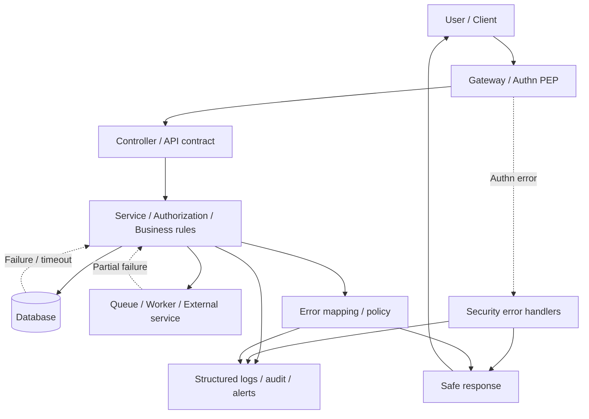
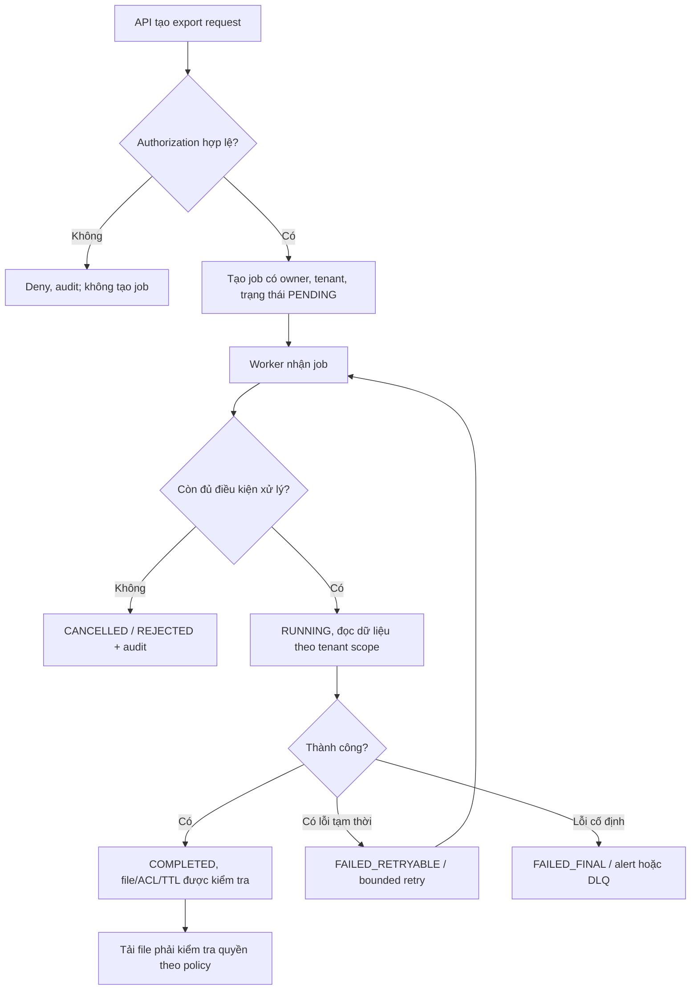

# Review error handling: rà soát thiết kế xử lý lỗi dưới góc độ bảo mật

## 1. Xử lý lỗi cũng là một phần của kiến trúc bảo mật

Một nền tảng học tập sử dụng Java/Spring Boot để cung cấp API xem kết quả thi, quản lý lớp học và xuất báo cáo. Trong điều kiện bình thường, API kiểm tra JWT, xác định tenant, truy vấn cơ sở dữ liệu và trả dữ liệu hợp lệ. Nhưng khi có vấn đề xảy ra thì sao?

- Một người dùng cố tình gửi `resultId` thuộc tenant khác.
- Token của giảng viên hết hạn khi đang tải báo cáo.
- Cơ sở dữ liệu lỗi kết nối ngay sau khi ứng dụng đã nhận một lệnh ghi.
- Dịch vụ cấp quyền mất kết nối đúng lúc hệ thống cần xác minh quyền quản trị.
- Worker xuất báo cáo chạy lại sau timeout và gửi cùng dữ liệu cho người dùng hai lần.
- API trả nguyên thông báo lỗi SQL, đường dẫn máy chủ hoặc stack trace ra trình duyệt.

Mỗi trường hợp đều liên quan đến **error handling (xử lý lỗi)**, nhưng không phải lỗi nào cũng chỉ là vấn đề trải nghiệm người dùng. Một quyết định xử lý lỗi thiếu an toàn có thể làm lộ dữ liệu, bỏ qua kiểm soát truy cập, ghi sai trạng thái, tạo hành động trùng lặp, khiến dịch vụ mất khả dụng hoặc làm mất dấu vết phục vụ điều tra.

**Review error handling** là hoạt động rà soát cách một kiến trúc phát hiện, phân loại, lan truyền, xử lý, ghi nhận và phục hồi khi có lỗi. Trong **security design review**, trọng tâm không chỉ là “đã có `try/catch` chưa”, mà là **hệ thống có giữ đúng các yêu cầu bảo mật khi điều kiện bất thường xảy ra hay không**.

Trong chương **Security design review** của module **SECURITY_SECURITY_ASSURANCE**, review error handling liên kết thiết kế với chương trình security assurance liên tục: từ nhận diện rủi ro, xác định yêu cầu và security controls đến lập kế hoạch kiểm thử, thu thập bằng chứng, đánh giá finding, audit và khắc phục trong phát triển cũng như vận hành.

### Mục tiêu học tập

Sau bài này, bạn có thể:

1. Giải thích vì sao luồng thất bại phải được xem như một phần của security architecture.
2. Nhận diện các kịch bản xử lý lỗi dẫn đến information disclosure, authorization bypass, enumeration, inconsistency và denial of service.
3. Đánh giá error contract, cơ chế xử lý ngoại lệ và hành vi fail-safe ở từng lớp hệ thống.
4. Phân tích lỗi trong giao dịch, retry, queue, background job và hệ thống phân tán.
5. Đề xuất thiết kế xử lý lỗi, logging và giám sát phù hợp cho API Java/Spring Boot.
6. Xây dựng assurance claims, negative test cases và evidence để kiểm chứng thiết kế.

## 2. Mục tiêu bảo mật của error handling

Error handling tốt phải cân bằng **thông báo đủ để bên gọi hành động**, **không tiết lộ thông tin không cần thiết**, **duy trì tính đúng đắn của trạng thái** và **hỗ trợ vận hành/điều tra**.

| Mục tiêu | Câu hỏi security review | Ví dụ |
|---|---|---|
| **Confidentiality** | Thông báo lỗi có tiết lộ dữ liệu, schema, path, secret hoặc sự tồn tại của tài nguyên? | Không trả stack trace hoặc chi tiết tenant khác |
| **Integrity** | Lỗi có tạo cập nhật một phần, ghi trùng hoặc bỏ qua ràng buộc quyền? | Lệnh sửa điểm thất bại không để lại trạng thái sai |
| **Availability** | Retry hoặc xử lý lỗi có làm hệ thống quá tải, kẹt tài nguyên, tự lặp vô hạn? | Retry có giới hạn, timeout và backoff |
| **Authorization safety** | Khi không xác minh được quyền, hệ thống có cấp quyền mặc định không? | Không cho phép export nhạy cảm khi policy engine không khả dụng |
| **Accountability** | Có thể xác định lỗi thuộc request, actor, policy và thành phần nào? | Correlation ID và security event có cấu trúc |
| **Recoverability** | Người dùng và hệ thống có biết hành động nào đã hoàn tất, cần retry hay bù trừ? | Job export có trạng thái rõ và idempotency key |
| **Privacy** | Log lỗi có chứa token, thông tin cá nhân, nội dung bài thi hoặc dữ liệu vượt nhu cầu? | Log dùng mã lỗi, resource ID tối thiểu, redaction |
| **Auditability** | Có bằng chứng giải thích thiết kế, hành vi thử nghiệm và quyết định risk? | ADR, threat model, failure tests, incident runbook |

Không phải cứ trả về lỗi chung `500` là an toàn. Nếu API trả thông báo chung nhưng vẫn ghi dữ liệu trái phép, làm lộ thông tin qua thời gian phản hồi hoặc log toàn bộ token, mục tiêu bảo mật vẫn chưa đạt.

### Ba nguyên tắc cần nhớ

1. **Fail safely:** lỗi xảy ra không được làm hệ thống chuyển sang trạng thái ít an toàn hơn mức chính sách cho phép.
2. **Separate public errors from internal diagnostics:** thông tin công khai đủ dùng nhưng không phơi bày nội bộ; chi tiết điều tra đi qua kênh vận hành được bảo vệ.
3. **Make failures observable and testable:** các kịch bản lỗi phải có tiêu chí mong đợi, cơ chế phát hiện và bằng chứng kiểm chứng.

## 3. Phân loại lỗi trước khi chọn cách xử lý

Một sai lầm kiến trúc là đưa mọi ngoại lệ vào cùng một nhánh “có gì đó sai” rồi trả thành công giả hoặc `500`. Cần phân biệt **nguyên nhân, mức tin cậy của đầu vào, ảnh hưởng đến trạng thái và khả năng phục hồi**.

| Loại lỗi | Ví dụ | Trách nhiệm xử lý và yêu cầu bảo mật |
|---|---|---|
| **Syntax/validation** | JSON sai cú pháp, trường bắt buộc thiếu, giá trị vượt giới hạn | Từ chối yêu cầu; trả mã lỗi ổn định, không echo dữ liệu nhạy cảm |
| **Authentication** | Không có token, token hết hạn, chữ ký sai | Không cấp quyền; phản hồi theo cơ chế xác thực, không lộ thông tin nội bộ |
| **Authorization** | Vai trò hoặc phạm vi tenant không hợp lệ | Từ chối trước khi truy cập dữ liệu; thống nhất cách che giấu sự tồn tại tài nguyên |
| **Business-rule conflict** | Đăng ký lớp đã khóa, yêu cầu trùng | Không ghi sai trạng thái; trả lỗi nghiệp vụ được định nghĩa |
| **Resource absent** | Không tìm thấy ID trong phạm vi được phép | Phản hồi không làm lộ tài nguyên ngoài phạm vi |
| **Rate limit/quota** | Client gửi quá nhiều request | Hạn chế tải; thông tin retry chỉ khi có cơ sở, không lộ ngân sách bảo mật |
| **Dependency unavailable** | Database, IdP, KMS hoặc service khác timeout | Thời hạn chờ, circuit breaker, policy fail-mode và trạng thái rõ |
| **Internal defect** | Null pointer, sai invariant, bug serialization | Không trả thông tin kỹ thuật; log/alert và tìm nguyên nhân |
| **Asynchronous/partial failure** | Queue giao lại message, worker ghi file rồi crash | Idempotency, transaction boundary, retry/DLQ và bù trừ |
| **Security event** | Credential bị thu hồi, nghi ngờ brute force, policy violation | Deny theo policy, audit sự kiện và kích hoạt xử lý nếu cần |

**Một mã HTTP không đủ mô tả rủi ro.** Hai lỗi cùng trả `503` có thể có hệ quả khác nhau: dịch vụ thống kê công khai tạm thời không sẵn sàng và dịch vụ cấp quyền không sẵn sàng khi kiểm tra giao dịch quản trị đều là lỗi dependency, nhưng cách fail-safe phải dựa trên độ nhạy cảm tài nguyên.

## 4. Threat model của xử lý lỗi

Để review đúng trọng tâm, hãy xem lỗi là một **đường tương tác mà kẻ tấn công có thể chủ động kích hoạt**.

### 4.1. Information disclosure

Lỗi có thể tiết lộ:

- Stack trace, tên package Java, lớp nội bộ và cấu trúc source.
- Tên bảng, cột, câu SQL, connection string, tên database hoặc đường dẫn filesystem.
- Phiên bản framework, thư viện, hostname và địa chỉ nội bộ.
- Token, API key, session cookie, credential hoặc nội dung header `Authorization`.
- Dữ liệu cá nhân, nội dung bài thi, email và ID thuộc người dùng/tenant khác.
- Rule bảo mật chi tiết giúp kẻ tấn công né tránh phát hiện.

**Yêu cầu review:** xác định nơi exception gốc được chuyển thành public response, log, telemetry và thông báo phía client. Không chỉ kiểm tra response JSON; còn phải xét header, proxy, gateway, trang lỗi HTML, gRPC status, error event và các luồng export/batch.

### 4.2. User/resource enumeration

Nếu một API trả “Email chưa đăng ký” cho tài khoản không tồn tại nhưng trả “Sai mật khẩu” cho tài khoản có thật, người gọi có thể suy ra danh sách người dùng. Tương tự, API đọc điểm thi trả `403` cho result ID của tenant khác nhưng `404` cho ID không tồn tại có thể trở thành oracle nhận biết tài nguyên.

Các cách giảm rủi ro tùy hệ thống:

- Chuẩn hóa phản hồi cho những trường hợp cần che giấu sự tồn tại tài nguyên.
- Tránh đưa chi tiết ownership, role hoặc tenant vào public error.
- Kiểm soát thời gian và hành vi phụ có thể tạo khác biệt quá lớn.
- Có rate limit và giám sát thử nghiệm nhiều ID nếu phù hợp.

**Không có một quy tắc “luôn trả 404” cho mọi lỗi phân quyền.** `403` vẫn phù hợp trong nhiều trường hợp; khi cần tránh lộ sự tồn tại, có thể dùng `404` thống nhất theo chính sách. Quan trọng là quyết định được ghi trong API contract và kiểm thử hành vi thực tế.

### 4.3. Fail-open authorization

Ví dụ thiết kế nguy hiểm:

```text
try:
    allowed = authorizationService.check(user, action, resource)
catch TimeoutException:
    allowed = true  # nguy hiểm: lỗi hạ tầng thành cấp quyền mặc định

if allowed:
    exportSensitiveData()
```

Trong trường hợp này, kẻ tấn công có thể tìm cách làm dịch vụ xác minh quyền timeout để được truy cập. Với tài nguyên nhạy cảm, khi không thể xác minh điều kiện bắt buộc, hệ thống thường cần **deny hoặc giới hạn thao tác theo policy** và ghi nhận sự cố; phương án degraded mode cần được thiết kế và phê duyệt trước.

### 4.4. Inconsistent state và duplicate side effects

Nếu API ghi điểm mới vào database, gửi sự kiện cập nhật và sau đó timeout, client có thể retry toàn bộ yêu cầu. Thiếu idempotency hoặc transaction design có thể khiến:

- Điểm bị cập nhật hai lần không mong muốn.
- Gửi email kết quả hoặc thanh toán trùng.
- File export được tạo nhiều lần với ACL khác nhau.
- Audit record nói “thất bại” trong khi dữ liệu đã thay đổi.
- Worker xử lý lại job cũ bằng quyền đã bị thu hồi.

Review phải phân biệt **client không nhận được phản hồi** với **thao tác chắc chắn chưa được thực hiện**.

### 4.5. Error amplification và denial of service

Một lỗi nhỏ có thể gây phản ứng dây chuyền nếu hệ thống retry vô hạn, không có timeout, giữ transaction mở hoặc tạo quá nhiều log/alert. Ví dụ một downstream chậm khiến hàng nghìn thread chờ; từng request bị retry đồng thời dẫn tới quá tải lớn hơn.

Kiểm soát thường gồm timeout hợp lý, bounded retries, exponential backoff có jitter, circuit breaker, concurrency limits, rate limits, queue backpressure và giám sát tài nguyên.

## 5. Điểm cần review trong kiến trúc và luồng truyền lỗi

Reviewer nên vẽ đường đi của một lỗi từ **nguồn phát sinh → lớp chuyển đổi → external response → trạng thái dữ liệu → audit/monitoring → recovery**.



Các câu hỏi theo lớp:

| Lớp | Câu hỏi kiểm tra |
|---|---|
| **Gateway/WAF** | Có trả lỗi do proxy chứa thông tin nội bộ? Có chuẩn hóa auth error? Rate limit áp dụng đúng nguồn? |
| **Identity/security filters** | `401`/`403` do ai xử lý? Token lỗi có bị log nguyên vẹn hoặc bỏ qua khi IdP lỗi? |
| **Controller/API** | Validation và mapping lỗi có theo contract? Có trả stack trace hoặc echo dữ liệu đầu vào? |
| **Domain/service** | Failure có bảo vệ invariant và quyền? Exception nào được phép đi qua boundary? |
| **Persistence** | Lỗi transaction có rollback? Các thao tác ngoài database có được phối hợp riêng? |
| **Message broker/worker** | Message lỗi bị retry bao nhiêu lần, dead-letter ở đâu, có idempotency không? |
| **External service** | Timeout, circuit breaker, dữ liệu nhạy cảm và lỗi từ nhà cung cấp được xử lý ra sao? |
| **Client/UI** | Có hiển thị thông tin kỹ thuật hoặc khuyến khích retry thao tác không an toàn? |
| **Logging/telemetry** | Có correlation ID đáng tin, redaction và phân quyền log? Có missing audit events? |
| **Operations** | Có runbook, alert, owner và cách khôi phục sau lỗi không? |

### Câu hỏi về ranh giới tin cậy

Lỗi sinh từ external API, JSON, HTTP header, database hoặc plugin không nên tự động được coi là thông tin an toàn để phản hồi cho người dùng. Ví dụ, `ex.getMessage()` có thể chứa chuỗi đến từ input không tin cậy, query, dữ liệu cá nhân hoặc thông điệp nhà cung cấp. Thiết kế nên **phân loại lỗi nội bộ thành mã lỗi do ứng dụng kiểm soát**, thay vì copy nguyên thông báo gốc ra response.

## 6. Thiết kế error contract cho API

Một API cần có hợp đồng lỗi nhất quán, cho phép client biết loại vấn đề và hành động phù hợp mà không làm lộ cấu trúc nội bộ. Với HTTP API, có thể dùng định dạng **Problem Details (RFC 9457)** hoặc một schema nội bộ được quản lý có version.

### 6.1. Các thành phần hữu ích

- **HTTP status:** nhóm lỗi và ý nghĩa ở lớp giao thức.
- **Type/code ổn định:** định danh loại lỗi để client xử lý và theo dõi.
- **Title/detail an toàn:** mô tả đủ hiểu, không chứa stack trace hay dữ liệu nhạy cảm.
- **Correlation ID:** liên kết public response với log nội bộ, do hệ thống tạo hoặc xác minh tin cậy.
- **Timestamp (nếu cần):** hỗ trợ điều tra nhưng không thay thế trace ID; tránh lộ cấu trúc ngoài nhu cầu.
- **Retry guidance:** chỉ đưa ra khi thao tác và hệ thống hỗ trợ retry an toàn.
- **Documentation link (nếu có):** tài liệu API công khai, không phải đường dẫn nội bộ.

Ví dụ phản hồi lỗi an toàn cho client:

```http
HTTP/1.1 503 Service Unavailable
Content-Type: application/problem+json
Cache-Control: no-store
Retry-After: 30

{
  "type": "https://api.example.org/problems/service-temporarily-unavailable",
  "title": "Dịch vụ tạm thời không khả dụng",
  "status": 503,
  "detail": "Không thể hoàn tất yêu cầu vào lúc này.",
  "code": "DEPENDENCY_UNAVAILABLE",
  "correlationId": "req-demo-8f3c"
}
```

Tên miền, correlation ID, giá trị Retry-After và nội dung ở trên là **ví dụ minh họa**. Không nên tự động phát `Retry-After` khi chưa xác định được thời gian retry phù hợp. Nếu server không biết trạng thái thao tác trước đó, client không được tự suy ra rằng retry một yêu cầu ghi là an toàn.

### 6.2. Mã HTTP và ý nghĩa bảo mật

| HTTP status | Tình huống thường gặp | Điểm cần review |
|---|---|---|
| `400 Bad Request` | JSON sai cú pháp, dữ liệu không hợp lệ | Không lộ parser internals; validation an toàn |
| `401 Unauthorized` | Thiếu hoặc không có thông tin xác thực hợp lệ | Xử lý `WWW-Authenticate` khi áp dụng; không tiết lộ thông tin credential |
| `403 Forbidden` | Danh tính hợp lệ nhưng thiếu quyền | Không cho đi tiếp tới thao tác hoặc dữ liệu |
| `404 Not Found` | Không có tài nguyên trong phạm vi nhìn thấy hoặc dùng để che giấu tồn tại theo policy | Giữ nhất quán, tránh resource enumeration |
| `409 Conflict` | Xung đột phiên bản hoặc quy tắc trạng thái | Không để ghi một phần; phản hồi retry có điều kiện |
| `413 Content Too Large` | Payload vượt giới hạn | Giới hạn tại gateway và server, tránh tiêu tốn tài nguyên |
| `415 Unsupported Media Type` | Loại dữ liệu không hỗ trợ | Không parse loại nội dung không được phép |
| `429 Too Many Requests` | Rate limit | Rate limit hiệu quả, không lộ cấu hình bảo vệ không cần thiết |
| `500 Internal Server Error` | Lỗi ngoài dự kiến | Phản hồi chung; log/alert nội bộ bảo vệ |
| `502 Bad Gateway` | Gateway nhận phản hồi không hợp lệ từ upstream | Không copy nguyên thông tin lỗi nội bộ |
| `503 Service Unavailable` | Tạm thời không đáp ứng | Fail-mode đã thiết kế; không phát success giả |
| `504 Gateway Timeout` | Gateway timeout upstream | Không khẳng định thao tác chưa xảy ra nếu thiếu xác minh |

HTTP status không thể thay thế business error code. Chẳng hạn nhiều loại validation có thể cùng là `400` nhưng client có thể cần biết trường nào được sửa; thông tin đó vẫn phải tuân thủ giới hạn về dữ liệu và việc che giấu tài nguyên.

### 6.3. Không dùng thành công giả

Phản hồi `200 OK` với body `{"success": false}` cho mọi lỗi có thể khiến client, proxy, monitoring và retry logic hiểu sai trạng thái. Ngược lại, trả `500` cho lỗi input của client có thể gây retry sai và báo động giả.

Thiết kế nên giữ ý nghĩa giao thức, phân biệt lỗi nghiệp vụ có kiểm soát và lỗi hạ tầng, đồng thời ghi rõ khi nào một thao tác đã hoàn thành, thất bại hoặc chưa rõ kết quả.

## 7. Review lỗi xác thực và phân quyền

Lỗi liên quan danh tính và quyền là trọng tâm của security design review vì quyết định sai có thể dẫn đến **security bypass**.

### 7.1. Authentication failure

Reviewer cần kiểm tra:

1. Request không có hoặc có token không hợp lệ bị từ chối trước khi xử lý tài nguyên?
2. Có xác minh issuer, audience, signature, expiry và những điều kiện token cần thiết?
3. Token bị thu hồi, tài khoản bị khóa hoặc phiên hết hạn có được áp dụng theo chính sách?
4. Khi identity provider không sẵn sàng, có bỏ qua kiểm tra hoặc tin vào dữ liệu client gửi không?
5. Public response có làm lộ tài khoản tồn tại, lý do token bị từ chối chi tiết hoặc thông tin nội bộ không?
6. Lỗi ở filter chain có được xử lý độc lập với controller exception hay không?

### 7.2. Authorization failure

- Kiểm tra quyền với **hành động, đối tượng, tenant và ngữ cảnh**, không chỉ vai trò chung.
- Từ chối phải xảy ra **trước side effect**.
- Một request bị từ chối không được đưa dữ liệu trái phép vào response, cache hoặc log không được bảo vệ.
- Luồng batch/export/download phải giữ quy tắc quyền tương đương với API tạo yêu cầu.
- Nếu cần che giấu sự tồn tại của tài nguyên, phải có quyết định nhất quán về `403`/`404` và test tương ứng.
- Khi policy engine hoặc nguồn quyền lỗi, không mặc nhiên coi đó là cho phép.

### 7.3. Tránh tiết lộ qua lỗi đăng nhập

Trong những hệ thống có nguy cơ liệt kê tài khoản, thông báo bên ngoài có thể thống nhất “Thông tin đăng nhập không hợp lệ” thay vì phân biệt “Không có tài khoản” và “Sai mật khẩu”. Nội bộ vẫn cần ghi nhận mã nguyên nhân phù hợp để vận hành. Cũng nên xem xét chênh lệch thời gian phản hồi, giới hạn thử đăng nhập, recovery flow và các tác động phụ (gửi email/SMS) có thể làm lộ trạng thái tài khoản.

Không nên dùng biện pháp che giấu lỗi để giảm khả năng hỗ trợ người dùng một cách không cần thiết; chính sách cụ thể phải dựa trên threat model, yêu cầu UX và rủi ro thực tế.

## 8. Review validation, parsing và lỗi nghiệp vụ

Các thông báo lỗi do input không tin cậy cần được xử lý khác lỗi hệ thống:

| Tình huống | Hành vi cần có | Nguy cơ nếu thiết kế sai |
|---|---|---|
| JSON không hợp lệ hoặc dữ liệu quá dài | Từ chối sớm, giới hạn kích thước và thời gian xử lý | Parser abuse, resource exhaustion |
| ID không đúng định dạng | Trả lỗi hợp đồng an toàn, không truy vấn trái phép | Enumeration hoặc log chứa input độc hại |
| ID thuộc tenant khác | Không trả dữ liệu hoặc thông tin tồn tại trái quyền | Broken object-level authorization |
| Validation nhiều trường | Chỉ nêu trường và lỗi được phép tiết lộ | Echo PII/secret hoặc dữ liệu hệ thống |
| Race condition khi cập nhật | Xử lý optimistic lock/transaction phù hợp | Lost update hoặc trạng thái nghiệp vụ sai |
| Gửi trùng lệnh quan trọng | Idempotency hoặc cơ chế chống trùng | Tạo hai giao dịch, xuất hai báo cáo hoặc sửa hai lần |
| Resource không còn tồn tại | Phản hồi ổn định theo policy | Truy cập dữ liệu đã thu hồi hoặc rò rỉ thông tin |

### Error message không được trở thành kênh XSS hoặc injection

Nếu API echo một trường dữ liệu đầu vào vào error message, giao diện có thể hiển thị nội dung không an toàn. Client cần render văn bản theo cơ chế an toàn (ví dụ text, không phải HTML tùy ý), và server cần giới hạn các trường được phản hồi. Lỗi cũng có thể mang ký tự xuống dòng hoặc payload khiến log bị giả mạo (*log injection*); structured logging và escaping giúp giảm rủi ro.

**Thông điệp không đáng tin** có thể đi qua nhiều hệ thống. Không chỉ cần xử lý khi response cho trình duyệt mà cả khi gửi sang email, logging pipeline, webhook hoặc dashboard vận hành.

## 9. Review xử lý ngoại lệ trong Java/Spring Boot

Spring Boot thường có nhiều lớp sinh lỗi:

- **Servlet filter và Spring Security filter chain** xử lý xác thực/phân quyền ở ranh giới HTTP.
- **Spring MVC/controller** xử lý mapping request, validation và lỗi từ handler.
- **Service/domain** xử lý quy tắc nghiệp vụ, authorization trên đối tượng và giao dịch.
- **Repository/transaction layer** xử lý database exceptions và trạng thái dữ liệu.
- **Async worker, scheduler, message listener** thường không đi qua cơ chế lỗi HTTP.

Mỗi lớp cần xác định **loại lỗi có thể chuyển thành response bên ngoài, sự kiện nào phải ghi audit và ai chịu trách nhiệm rollback/retry**.

### 9.1. Global exception handler là một control, không phải toàn bộ giải pháp

Ví dụ minh họa cho Spring Boot 3 / Spring Framework 6, dùng `ProblemDetail` để trả thông điệp có kiểm soát. Các import và cấu hình liên quan được lược bỏ để tập trung vào ý tưởng:

```java
@RestControllerAdvice
public class SafeApiErrorHandler {

    private static final Logger log =
        LoggerFactory.getLogger(SafeApiErrorHandler.class);

    @ExceptionHandler(MethodArgumentNotValidException.class)
    ResponseEntity<ProblemDetail> handleValidation(
            MethodArgumentNotValidException ex,
            HttpServletRequest request) {
        return problem(HttpStatus.BAD_REQUEST,
            "INVALID_REQUEST",
            "Dữ liệu yêu cầu không hợp lệ.",
            request);
    }

    @ExceptionHandler(Exception.class)
    ResponseEntity<ProblemDetail> handleUnexpected(
            Exception ex,
            HttpServletRequest request) {
        String correlationId = serverCorrelationId(request);
        // Không đưa ex.getMessage() hay thông tin nhạy cảm vào public response.
        log.error("api_unhandled_error correlationId={} exceptionType={}",
            correlationId, ex.getClass().getSimpleName());
        return problem(HttpStatus.INTERNAL_SERVER_ERROR,
            "INTERNAL_ERROR",
            "Không thể xử lý yêu cầu.",
            request);
    }

    private ResponseEntity<ProblemDetail> problem(
            HttpStatus status, String code, String detail,
            HttpServletRequest request) {
        ProblemDetail body =
            ProblemDetail.forStatusAndDetail(status, detail);
        body.setTitle(status.getReasonPhrase());
        body.setProperty("code", code);

        String correlationId = serverCorrelationId(request);
        if (correlationId != null) {
            body.setProperty("correlationId", correlationId);
        }
        return ResponseEntity.status(status)
            .cacheControl(CacheControl.noStore())
            .body(body);
    }

    private String serverCorrelationId(HttpServletRequest request) {
        // Được tạo/xác minh trước đó bởi filter do server quản lý.
        return (String) request.getAttribute("serverCorrelationId");
    }
}
```

**Giới hạn quan trọng của ví dụ:**

- Đây là mã rút gọn, không phải thư viện error handling hoàn chỉnh để copy thẳng vào production.
- Exception từ **Spring Security filter chain** thường được xử lý bởi `AuthenticationEntryPoint` hoặc `AccessDeniedHandler`, không mặc nhiên đi qua `@RestControllerAdvice`.
- Phải có mapping riêng cho các lỗi domain có ý nghĩa (ví dụ xung đột trạng thái), tránh biến mọi lỗi nghiệp vụ thành `500`.
- Log trong ví dụ chỉ ghi loại exception và correlation ID để giảm nguy cơ lộ dữ liệu. Nếu cần stack trace phục vụ điều tra, phải đưa vào kênh logging bảo vệ có lọc dữ liệu nhạy cảm.
- Correlation ID phải được tạo hoặc xác minh bởi thành phần tin cậy, không ghi nhận mọi giá trị header từ client như dữ liệu đáng tin.
- Những lỗi có side effect trước khi throw cần được xử lý ở transaction/domain boundary; handler chỉ biến lỗi thành response, không sửa được trạng thái đã ghi sai.

### 9.2. Phân biệt lỗi filter và lỗi trong controller

Một thiết kế nên có sơ đồ trách nhiệm:

```text
HTTP request
  -> Security filter chain
      -> No/invalid credential: AuthenticationEntryPoint
      -> Insufficient authority: AccessDeniedHandler
  -> Controller / service
      -> Validation/domain error: typed exception mapping
      -> Unexpected error: generic public response
  -> Background worker
      -> Retry / DLQ / alert / state transition
```

Nếu chỉ viết `@ExceptionHandler(Exception.class)`, hệ thống vẫn có thể trả error page khác nhau từ gateway, container, security filters hoặc worker. Review cần kiểm tra **mọi boundary thật sự có thể đưa lỗi ra ngoài**.

### 9.3. Tránh catch rồi nuốt lỗi

Mẫu nguy hiểm:

```java
try {
    auditService.recordGradeChange(actor, resultId);
    gradeRepository.updateGrade(resultId, newGrade);
} catch (Exception ignored) {
    return "OK"; // lỗi bị ẩn; client tưởng cập nhật đã thành công
}
```

Lỗi không nên bị nuốt chỉ để pipeline hoặc UX “xanh”. Cần xác định trạng thái thực tế, rollback hoặc bù trừ phù hợp, ghi nhận finding khi có sai lệch, và phản hồi đúng cho caller. Với sự kiện audit quan trọng, cần thiết kế thứ tự ghi, mức độ bắt buộc, transaction boundary hoặc cơ chế outbox sao cho một lỗi logging không dẫn đến hành vi mơ hồ hoặc mất khả năng truy vết.

## 10. Transaction, partial failure và tính nhất quán

Khi xử lý dữ liệu nhạy cảm, error handling phải bảo vệ **business invariants** — những điều luôn phải đúng ngay cả khi một bước thất bại.

Ví dụ invariant:

- Một lần cập nhật điểm chỉ được thực hiện bởi chủ thể có quyền.
- Không có kết quả nào được xuất ra tenant khác.
- Mỗi yêu cầu export có một trạng thái rõ và không tạo quyền download vượt hạn.
- Nếu thay đổi điểm thành công thì phải có dấu vết phục vụ truy vết theo chính sách.

### 10.1. Transaction cục bộ

Database transaction giúp nhóm thao tác trong cùng một hệ quản trị dữ liệu được commit hoặc rollback theo ranh giới thiết kế. Nhưng **transaction database không tự bao phủ email, object storage, HTTP call hoặc queue**.

Ví dụ:

```text
1. Lưu kết quả thi vào database.
2. Gửi sự kiện "ResultPublished" tới message broker.
3. Trả 200 OK.
```

Nếu bước 1 commit nhưng bước 2 thất bại, dữ liệu có thể đã công bố mà downstream chưa nhận sự kiện. Nếu trả lỗi và client retry, lần gửi sau có thể làm lặp nghiệp vụ. Review cần xác định transaction boundary và cách đồng bộ side effects.

Một cách tiếp cận phổ biến là **transactional outbox**: ghi thay đổi nghiệp vụ và outbox event trong cùng transaction database, sau đó publisher gửi event từ outbox. Consumer vẫn cần xử lý lặp có kiểm soát. Mô hình này không tự đem lại “exactly once” cho toàn bộ hệ thống; cần xác minh semantics của broker, producer và consumer.

### 10.2. Idempotency và retry

**Idempotency** có nghĩa thực hiện cùng thao tác một hoặc nhiều lần tạo hiệu ứng nghiệp vụ phù hợp với semantics đã định. Với lệnh tạo tài nguyên hoặc xuất dữ liệu, có thể dùng idempotency key:

- Gắn với đúng subject/tenant, loại hành động và fingerprint của request.
- Kiểm tra key có thuộc cùng phạm vi quyền không.
- Lưu kết quả hoặc trạng thái xử lý theo thời hạn hợp lý.
- Không để client dùng lại key để thay đổi payload mà không bị phát hiện.
- Bảo vệ idempotency store trước race condition và truy cập xuyên tenant.

Ví dụ client gửi lại một yêu cầu export sau timeout. Nếu worker đã nhận yêu cầu lần đầu, lần gửi thứ hai nên trả về trạng thái của cùng job (khi policy cho phép), thay vì tạo thêm một export không kiểm soát.

**Không retry mù quáng một thao tác ghi chỉ vì client thấy `504`.** Timeout cho biết phản hồi không đến đúng hạn; server hoặc downstream vẫn có thể đã thực hiện thao tác.

### 10.3. Retry có giới hạn

| Yếu tố | Câu hỏi review |
|---|---|
| Timeout | Có timeout tại từng hop và thời hạn tổng thể, hay request chờ vô hạn? |
| Retry budget | Có giới hạn số lần và thời gian retry không? |
| Backoff/jitter | Có tránh retry đồng loạt gây khuếch đại tải? |
| Idempotency | Hành động có an toàn khi chạy lại không? |
| Circuit breaker | Khi dependency lỗi kéo dài, có giảm lượng yêu cầu tới nguồn lỗi? |
| State visibility | Client/worker có biết request đang pending, completed, failed hay unknown? |
| Alerting | Lỗi kéo dài có được phát hiện, giao owner và xử lý? |

Retry chỉ là một biện pháp phục hồi. Với lỗi xác thực/phân quyền, input sai hoặc invariant bị vi phạm, retry tự động thường không giải quyết nguyên nhân và có thể tạo nhiễu hoặc hành vi nguy hiểm.

## 11. Worker, message queue và lỗi bất đồng bộ

Kiến trúc phân tán không nên giả định message được xử lý đúng một lần. Worker có thể nhận lại message sau timeout, crash sau khi tạo file hoặc nhận dữ liệu thay đổi quyền khi job đang chờ.

### Vòng đời job nên được thiết kế rõ



### Các câu hỏi review bắt buộc

1. Job nhận những thông tin nào từ client? Trường nào phải xác minh lại từ nguồn server?
2. Worker xác minh nguồn message và quyền xử lý như thế nào?
3. Nếu người dùng đổi vai trò hoặc bị khóa sau khi tạo job, chính sách xử lý là gì?
4. Khi worker ghi file thành công nhưng cập nhật database thất bại, hệ thống dọn dẹp và đối soát thế nào?
5. Một message lỗi được retry bao nhiêu lần; khi vào **dead-letter queue (DLQ)**, ai xử lý?
6. DLQ có chứa dữ liệu nhạy cảm, token hoặc payload cần mã hóa/giới hạn quyền không?
7. Có cơ chế chống xử lý trùng, kiểm soát số job đồng thời và chặn retry storm?
8. Trạng thái API phản ánh đúng job đang chạy, thất bại hay chưa rõ kết quả không?

Không nên hiển thị “export thất bại” cho người dùng khi file vẫn còn trên object storage với URL có thể truy cập. Error handling phải bao gồm cả **dọn trạng thái, vô hiệu quyền và đối chiếu side effects**.

## 12. Fail-safe, fail-closed, fail-open và degraded mode

Các thuật ngữ này thường bị dùng như khẩu hiệu, nhưng thiết kế cần xác định **điều kiện, ranh giới và hệ quả**.

- **Fail-safe / fail securely:** khi có lỗi, hệ thống không vi phạm mục tiêu bảo mật và an toàn đã xác định. Hành vi cụ thể phụ thuộc nghiệp vụ.
- **Fail-closed:** không cho thực hiện hành động khi không xác minh được điều kiện bắt buộc.
- **Fail-open:** tiếp tục cho phép một hành động dù một thành phần kiểm soát không khả dụng; có thể tăng tính sẵn sàng nhưng tăng rủi ro.
- **Degraded mode:** chỉ cung cấp một tập chức năng giới hạn, dùng bằng chứng còn hiệu lực hoặc yêu cầu xác minh bổ sung.

| Tình huống | Cách thiết kế thường cần cân nhắc |
|---|---|
| Policy engine không khả dụng khi xuất dữ liệu cá nhân | Từ chối hoặc trì hoãn; không cấp quyền mặc định |
| Service public catalog không truy cập được cache | Có thể dùng dữ liệu cache trong giới hạn freshness nếu không ảnh hưởng quyền riêng tư |
| KMS không khả dụng khi cần giải mã secret | Không bỏ qua mã hóa hoặc dùng secret hardcoded; báo lỗi theo policy |
| Audit sink tạm mất kết nối khi thay đổi quyền quản trị | Quy định xem control này có bắt buộc đồng bộ; cân nhắc hàng đợi bền vững hoặc từ chối nếu không bảo đảm audit |
| Quota/rate-limit service lỗi | Chính sách riêng cho từng loại API; tránh mặc định bỏ qua bảo vệ của endpoint nhạy cảm |
| Database read replica không cập nhật quyền mới | Đặt giới hạn độ trễ, cache invalidation và nguồn kiểm tra quyền phù hợp |

Thiết kế cần giải thích **tại sao** lựa chọn phù hợp với risk appetite và các nghĩa vụ dịch vụ. Không phải mọi tài nguyên đều bắt buộc fail-closed theo cùng cách; chặn hoàn toàn một hệ thống có yêu cầu sẵn sàng cao cũng có thể gây hậu quả nghiêm trọng.

## 13. Logging, audit và correlation ID

Xử lý lỗi an toàn cần đủ thông tin điều tra, nhưng **log không phải nơi chứa mọi thứ**.

### 13.1. Phân biệt public response và internal event

| Đối tượng | Nên cung cấp | Không nên cung cấp |
|---|---|---|
| Người dùng/API client | Mã lỗi ổn định, thông điệp an toàn, correlation ID, hướng dẫn retry nếu phù hợp | Stack trace, SQL, token, topology nội bộ, dữ liệu tenant khác |
| Application log | Error code, event type, request/trace ID, component, thời điểm, trạng thái, scope tối thiểu | Secret, session cookie, password, payload nhạy cảm nguyên vẹn |
| Security audit event | Actor, action, resource reference tối thiểu, decision, policy, result, correlation | Nội dung không cần thiết của bài thi, PII không liên quan |
| Alert/incident record | Severity, phạm vi, tác động, owner, nguồn evidence và cách xử lý | Trích xuất secret hoặc dữ liệu nhạy cảm không kiểm soát |

### 13.2. Correlation ID không phải bằng chứng xác thực

Mã tương quan giúp ghép nhiều bản ghi của một request xuyên gateway, service và worker. Nên:

- Tạo hoặc kiểm tra chặt ID tại trust boundary.
- Chuẩn hóa định dạng và độ dài, tránh log injection hoặc ID quá lớn.
- Truyền trong internal trace context theo chính sách.
- Không cho client chọn ID dùng để định danh chủ thể hay trao quyền.
- Duy trì phân quyền truy cập log, retention và khả năng đối soát thời gian.

Một correlation ID trong response chỉ hữu ích nếu có thể tra được record tương ứng và record đó liên kết đúng sự kiện.

### 13.3. Cần log lỗi nào?

- Authorization denied hoặc policy violation có ý nghĩa bảo mật.
- Credential bị từ chối theo mức chi tiết và quy tắc giảm thông tin phù hợp.
- Tác vụ nhạy cảm thất bại, bị rollback, bị retry hoặc bị bù trừ.
- Kết nối dependency trọng yếu gián đoạn, cache quá hạn hoặc khả năng thu hồi quyền bị ảnh hưởng.
- Bất thường lặp lại như enumeration, brute force, retry storm hoặc upload lỗi có chủ đích.
- Thay đổi cấu hình error mapping, fail-mode, policy hoặc tắt logging.

Không nên coi tất cả `404` là security incident hoặc log đầy đủ từng request gây tốn tài nguyên và rò rỉ dữ liệu. Cần tiêu chí phân cấp, tổng hợp, sampling phù hợp với yêu cầu audit và giữ sự kiện quan trọng.

## 14. Ví dụ xuyên suốt: API và worker xuất báo cáo của nền tảng đa tenant

### 14.1. Bối cảnh thiết kế

Hệ thống Java/Spring Boot phục vụ nhiều trường học. Giảng viên có quyền export kết quả của các lớp được phân công. Luồng xử lý:

1. Người dùng gửi yêu cầu qua API gateway.
2. Spring Security xác thực danh tính.
3. `report-service` kiểm tra quyền xuất dữ liệu cho `classId`.
4. Job được đưa vào queue.
5. Worker đọc dữ liệu, tạo file trong object storage.
6. Người dùng tải file bằng endpoint/download link hợp lệ.

Mục tiêu: **không ai có thể xuất hoặc tải dữ liệu ngoài quyền, và khi lỗi xảy ra không để tồn tại file/job/record trái chính sách**.

### 14.2. Kịch bản lỗi cần review

| ID | Kịch bản lỗi | Rủi ro | Hành vi mong đợi |
|---|---|---|---|
| ERR-01 | Token của giảng viên hết hạn trước khi tạo job | Bypass xác thực | Từ chối trước khi tạo job; không lộ token trong log |
| ERR-02 | `classId` thuộc tenant B nhưng user ở tenant A | BOLA/IDOR và enumeration | Từ chối hoặc trả not found theo policy; không tiết lộ lớp B |
| ERR-03 | Policy engine timeout khi kiểm tra quyền export | Fail-open, lộ dữ liệu | Không tạo job cho đến khi đủ điều kiện, hoặc theo degraded policy đã duyệt |
| ERR-04 | Database commit tạo job thành công nhưng response timeout | Duplicate job khi client retry | Idempotency, trả trạng thái job nhất quán |
| ERR-05 | Worker tạo file nhưng crash trước khi ghi COMPLETED | File mồ côi hoặc lộ link | Reconciliation/cleanup, ACL/TTL chặt, retry an toàn |
| ERR-06 | Quyền giảng viên bị thu hồi khi job đang chờ | Quyền cũ bị dùng sau thu hồi | Tái kiểm tra theo policy, hủy hoặc giới hạn job |
| ERR-07 | Object storage trả lỗi chứa bucket path nội bộ | Information disclosure | Map lỗi nội bộ thành thông điệp an toàn |
| ERR-08 | Client tải link đã hết hạn | Lộ trạng thái tài nguyên hoặc mở lại quyền | Từ chối thống nhất, audit theo mức rủi ro |
| ERR-09 | Cùng message được giao cho worker hai lần | Duplicate side effects | Idempotent processing, không tạo file trái trạng thái |
| ERR-10 | DLQ đầy hoặc monitoring mất kết nối | Mất giám sát, lỗi treo kéo dài | Backpressure, cảnh báo, runbook và cơ chế xử lý phù hợp |

### 14.3. Thiết kế bất an toàn cần bị phát hiện

```text
POST /api/export
  if authService.check(actor, classId) throws Timeout:
      continue  // lỗi trở thành cấp quyền

  queue.publish({ tenantId: request.tenantId, classId: request.classId })
  return { status: "success" }

Worker:
  file = exportAllRows(job.tenantId, job.classId)
  if storageUploadFails:
      log.warn("upload failed: " + exception.message)
  markCompleted(job.id)
```

Các vấn đề:

- Authorization timeout bị biến thành allow.
- Worker tin `tenantId` do client khai báo.
- API trả thành công mà không xác định trạng thái job.
- Worker có thể đánh dấu completed dù upload thất bại.
- Log có thể chứa thông tin nhạy cảm từ exception của provider.
- Không có idempotency, retry policy, cleanup hoặc kiểm tra quyền tải file.

### 14.4. Thiết kế cải thiện

1. **Validate request:** kiểm tra định dạng và giới hạn; lấy danh tính từ security context, không tin role/tenant do client khai báo.
2. **Authorize before side effects:** xác minh quyền với class và tenant xác định từ server.
3. **Handle auth dependency failure:** nếu không xác minh được quyền, không tạo export nhạy cảm; ghi event và trả lỗi an toàn.
4. **Persist job transactionally:** tạo job ở trạng thái `PENDING`, owner, tenant, policy context và idempotency key được ràng buộc.
5. **Publish reliably:** có outbox hoặc mô hình tương đương để tránh mất message giữa commit và publish.
6. **Verify in worker:** kiểm tra nguồn message, tình trạng job và điều kiện quyền theo policy khi chạy.
7. **Process idempotently:** chống xử lý trùng; upload file bằng đường tạm có ACL, TTL và cơ chế cleanup.
8. **Finalize atomically where possible:** chỉ đưa job sang `COMPLETED` sau khi đủ điều kiện; có reconciliation cho side effects không thể transaction chung.
9. **Secure download:** kiểm tra quyền hoặc cơ chế truy cập có thời hạn theo thiết kế trước khi trả file.
10. **Observe and recover:** record state transition, correlation ID, error code, retry count, alert và điều kiện đưa vào DLQ.

Thiết kế trên là khuyến nghị kiến trúc cần tùy chỉnh theo công nghệ, threat model và yêu cầu dịch vụ. **Không thể kết luận an toàn chỉ từ sơ đồ**; phải kiểm chứng implementation và cách triển khai thực tế.

### 14.5. Error contract minh họa

| Trường hợp | HTTP API tạo job | Trạng thái job | Điều kiện audit/monitoring |
|---|---|---|---|
| Không xác thực | `401` | Không tạo | Ghi auth failure theo policy |
| Không có quyền export | `403` hoặc `404` theo policy | Không tạo | Ghi deny; không leak class/tenant |
| Payload không hợp lệ | `400` | Không tạo | Ghi lỗi validation có giới hạn |
| Yêu cầu tạo job thành công | `202 Accepted` | `PENDING` | Ghi owner, ID và correlation |
| Cùng idempotency key và payload hợp lệ | Phản hồi hiện trạng job theo contract | Không tạo trùng | Có dấu vết deduplication |
| Dependency tạm không sẵn sàng trước khi tạo job | `503` hoặc mã phù hợp | Không tạo nếu chưa commit; nếu mơ hồ phải có tra cứu trạng thái | Alert và truy vết |
| Worker thất bại sau khi nhận job | API tra cứu trạng thái theo contract | `FAILED_RETRYABLE` / `FAILED_FINAL` | Retry count, DLQ, owner |
| Quyền tải file bị thu hồi | `403` hoặc `404` theo policy | Có thể `CANCELLED` / `EXPIRED` | Ghi từ chối và cleanup |

Mã `202` chỉ có ý nghĩa yêu cầu đã được **chấp nhận để xử lý**, không phải job đã hoàn tất. Thiết kế cần cung cấp cách tra cứu trạng thái đáng tin và ngăn caller truy cập job của tenant khác.

## 15. Kế hoạch verification và assurance evidence

Review error handling chỉ hoàn thành tốt khi biết **sẽ chứng minh từng kiểm soát bằng cách nào**.

### 15.1. Ma trận claim → criteria → evidence

| Assurance claim | Tiêu chí cần chứng minh | Evidence cần thu thập |
|---|---|---|
| **CLM-ERR-01: Public errors không tiết lộ bí mật** | Response không có stack trace, SQL, secret, dữ liệu tenant khác | Contract review, negative API tests, response samples |
| **CLM-ERR-02: Auth failure không tạo side effect** | Token sai/hết hạn hoặc deny không tạo job/file/ghi dữ liệu | Security filter tests, DB/job assertions, audit event |
| **CLM-ERR-03: Policy timeout không mở quyền** | Khi nguồn quyền lỗi, export nhạy cảm không được thực hiện ngoài policy | Failure injection test, policy trace, service logs |
| **CLM-ERR-04: Retry không gây trùng** | Cùng request hợp lệ được xử lý theo idempotency contract | Concurrency/integration tests, DB state, worker logs |
| **CLM-ERR-05: Partial failure giữ trạng thái an toàn** | Upload lỗi, worker crash và retry không làm lộ file hoặc đánh dấu completed sai | Chaos/failure tests, storage ACL review, reconciliation logs |
| **CLM-ERR-06: Lỗi được truy vết đúng** | Correlation ID liên kết response, gateway, service, worker và audit | Log sampling, distributed trace, event schema |
| **CLM-ERR-07: Error contract nhất quán** | Các lớp trả status/code/message theo quy định | API contract tests ở gateway/MVC/security |
| **CLM-ERR-08: Kênh log không làm lộ dữ liệu nhạy cảm** | Log, alert và error telemetry được lọc, phân quyền, retention đúng | Log review, redaction tests, access audit |
| **CLM-ERR-09: Hệ thống phục hồi trong giới hạn** | Timeout, backoff, DLQ, circuit breaker không gây retry storm | Load/fault-injection tests, metrics và runbook |

### 15.2. Test cases tiêu biểu

| Test | Thao tác | Kết quả mong đợi |
|---|---|---|
| Invalid JWT | Gửi JWT sai chữ ký hoặc audience | Từ chối; không chạm nghiệp vụ; response không chứa token |
| Cross-tenant request | Dùng người dùng tenant A yêu cầu dữ liệu tenant B | Bị từ chối; không có side effect; không lộ tồn tại ngoài policy |
| Policy service timeout | Mô phỏng timeout khi kiểm tra quyền | Hành vi fail-mode đúng policy; không xuất dữ liệu trái phép |
| Malformed JSON | Gửi dữ liệu quá lớn, sai format, ký tự bất thường | Status phù hợp; không echo dữ liệu nguy hiểm/nhạy cảm |
| Unhandled exception | Kích hoạt exception trong môi trường test | Generic error, correlation ID; log được bảo vệ |
| Duplicate request | Gửi cùng lệnh đồng thời hoặc retry sau timeout | Một hiệu ứng nghiệp vụ theo idempotency contract |
| Database transaction failure | Làm lỗi giữa hai bước cập nhật | Rollback hoặc trạng thái đã định; không sai invariant |
| Queue redelivery | Giao lại cùng message | Không duplicate file/record/truy cập |
| Worker crash after upload | Crash sau tạo file nhưng trước cập nhật job | Cleanup/reconciliation; file không lộ trái quyền |
| Credential/role revocation | Thu hồi quyền trong khi job đang xử lý | Áp dụng policy thu hồi, giới hạn job/file đúng thời hạn |
| Downstream returns sensitive error | Giả lập lỗi chứa hostname/SQL/token giả | Public error không lộ chuỗi nhạy cảm |
| Retry storm | Cho downstream lỗi kéo dài và tăng tải | Retry bounded, backpressure, metrics, không làm cạn tài nguyên vượt ngưỡng |

**Cần kiểm tra cả response và trạng thái hệ thống.** Test `403` chỉ xác nhận HTTP status mà không kiểm tra database, queue, file hoặc audit có thể bỏ sót một side effect trái phép đã xảy ra trước khi lỗi được trả về.

### 15.3. Ví dụ test âm tính trong Spring Boot

Ví dụ pseudo-integration test sử dụng `MockMvc`; giả định test fixtures có sẵn, chính sách dùng `404` để tránh lộ tài nguyên xuyên tenant:

```java
@Test
void crossTenantExportMustNotCreateJob() throws Exception {
    String tokenA = tokens.forTeacher("tenant-A", "teacher-A");
    UUID classInTenantB = fixtures.classIdOf("tenant-B");

    mockMvc.perform(post("/api/reports/export")
            .header("Authorization", "Bearer " + tokenA)
            .contentType(MediaType.APPLICATION_JSON)
            .content("{\"classId\":\"" + classInTenantB + "\"}"))
        .andExpect(status().isNotFound())
        .andExpect(jsonPath("$.code")
            .value("RESOURCE_NOT_FOUND"));

    assertThat(jobRepository.countForClass(classInTenantB)).isZero();
    assertThat(storageProbe.containsExportFor(classInTenantB)).isFalse();
}
```

Đây là minh họa ý tưởng kiểm chứng, không phải code đầy đủ để chạy trực tiếp: `tokens`, `fixtures`, `jobRepository` và `storageProbe` là test helpers giả định. Khi triển khai thật, cần kiểm tra toàn bộ lớp có thể tạo side effect, bảo đảm state được reset giữa tests và xác minh không có luồng khác bypass chính sách.

### 15.4. Evidence cần gắn với phiên bản thực tế

Một kết quả pass có giá trị khi xác định:

- Risk ID, requirement, control, claim và acceptance criteria.
- Thiết kế, ADR, phiên bản API error contract và policy.
- Commit, build ID, artifact digest, môi trường và cấu hình test.
- Công cụ, version, dữ liệu mô phỏng, fault injection và thời điểm thực hiện.
- Kết quả expected/actual, logs/traces được giảm nhạy cảm, DB/job/storage assertions.
- Mức coverage, những trường hợp chưa thử, giả định và giới hạn.
- Reviewer, finding status, remediation commit và retest result nếu có.

Chỉ khi evidence gắn với build và môi trường liên quan mới nên kết luận claim đạt trong phạm vi tương ứng. Việc review code hoặc chụp dashboard không thay thế negative tests cho luồng xử lý lỗi.

## 16. Hồ sơ finding và quyết định design review

Khi phát hiện kiến trúc xử lý lỗi nguy hiểm, ghi finding đủ cụ thể để nhóm kỹ thuật sửa và reviewer xác nhận:

```yaml
review_id: "SDR-ERROR-DEMO-01"
scope: "Export report API, worker và object storage"
design_version: "proposal-v3"
finding:
  id: "F-ERR-01"
  title: "Policy service timeout dẫn đến cho phép export"
  risk_scenario: "Người dùng lợi dụng timeout để vượt kiểm tra quyền"
  affected_asset: "Kết quả và dữ liệu học tập đa tenant"
  severity: "HIGH (minh họa, cần đánh giá theo tiêu chí tổ chức)"
  current_status: "OPEN"
  owner: "report-service engineering lead"
  recommended_action:
    - "Không coi timeout là allow"
    - "Thiết kế fail-mode cho export dữ liệu nhạy cảm"
    - "Ghi log với correlation ID, không lộ dữ liệu"
  verification_criteria:
    - "Fault-injection test: policy timeout không tạo job"
    - "Negative test: không sinh file hoặc database record trái quyền"
    - "Review error response và audit event"
  residual_risk: "Chưa kết luận cho đến khi remediation được kiểm chứng"
  approval: "Required from authorized risk owner if exception requested"
```

Đây là **record minh họa**, không phải finding thực tế. Một vấn đề cần **review và retest** trước khi coi là đã xử lý; nếu chấp nhận tạm thời, hồ sơ phải ghi risk owner, người phê duyệt đúng thẩm quyền, biện pháp bù đắp, thời hạn và điều kiện đánh giá lại.

### Trạng thái review phù hợp

| Trạng thái | Khi nào sử dụng? |
|---|---|
| **Accepted within scope** | Thiết kế đã có cơ sở phù hợp với tiêu chí và những giả định được ghi |
| **Accepted with conditions** | Có hành động bắt buộc và kiểm soát được, điều kiện được phê duyệt |
| **Changes required** | Thiết kế có rủi ro không phù hợp hoặc fail-mode nguy hiểm |
| **Insufficient information** | Không rõ side effects, transaction, retry hoặc quyền khi gặp lỗi |
| **Escalated** | Vấn đề vượt thẩm quyền review hoặc ngưỡng risk của nhóm |

**Approval thiết kế không đồng nghĩa phần mềm đã triển khai đáp ứng claim.** Kết quả design review cần liên kết với verification plan của development, CI/CD và vận hành.

## 17. Khi nào cần review lại error handling?

Luồng lỗi thay đổi khi:

- Chuyển từ synchronous API sang queue/worker.
- Thêm service mới hoặc đổi nhà cung cấp identity, storage, payment, email.
- Thay đổi cơ chế token, policy, role, tenant hoặc revocation.
- Đổi transaction boundary, cache strategy, retry/circuit breaker.
- Chuyển database, message broker, cloud hoặc thay đổi network gateway.
- Mở thêm endpoint quản trị, export, bulk import hoặc API cho đối tác.
- Có sự cố lộ dữ liệu qua lỗi, retry storm, mất audit hoặc duplicate side effect.
- Có thay đổi error contract, thông điệp client hoặc logging/observability pipeline.

Review lại nên tập trung vào **delta thiết kế** và ảnh hưởng lan truyền tới những thành phần phụ thuộc. Nếu thay đổi worker làm việc theo cơ chế khác, test cũ ở controller chưa đủ để khẳng định invariant vẫn đúng.

## 18. Metrics và giám sát hiệu quả

| Chỉ số | Cách dùng | Giới hạn |
|---|---|---|
| **Sensitive error disclosure findings** | Theo dõi lỗi lộ thông tin qua API/log | Ít finding có thể do thiếu test |
| **Unhandled exception rate** | Phát hiện lỗi ngoài dự kiến tăng đột biến | Cần phân biệt lỗi nghiệp vụ có kiểm soát |
| **Auth deny without side effects** | Tỷ lệ test/kiểm tra chứng minh từ chối quyền không gây thao tác trái phép | Test coverage phải đại diện các đường chính |
| **Timeout/retry rate** | Theo dõi dependency không ổn định và retry storm | Retry count cao không chỉ là lỗi downstream |
| **Duplicate job prevention** | Số duplicate request và hiệu quả idempotency | Không chỉ đếm request mà kiểm tra trạng thái thực |
| **DLQ age/depth** | Phát hiện lỗi không tự phục hồi và backlog kéo dài | Phải có owner/retention và xử lý payload an toàn |
| **Partial-failure reconciliation latency** | Thời gian xử lý file/job/record ở trạng thái mơ hồ | Cần định nghĩa kết quả cuối và SLA |
| **Error contract compliance** | Tỷ lệ API đúng status/code/schema | Không tự chứng minh không có lỗ hổng |
| **Correlation coverage** | Tỷ lệ lỗi quan trọng liên kết được log/trace/audit | Không thay thế bảo vệ dữ liệu trong log |
| **Critical failure-mode test coverage** | Tỷ lệ kịch bản lỗi trọng yếu có test còn mới | Cần đánh giá hiệu quả, không chỉ có test ID |

**Không nên tối ưu số lỗi bằng cách nuốt exception hoặc đổi lỗi thành `200`.** Chỉ số phải phản ánh hành vi thực và khả năng phát hiện, khắc phục; giảm báo cáo lỗi không đồng nghĩa rủi ro giảm.

## 19. Sai lầm thường gặp và cách sửa

| Sai lầm | Hậu quả | Cách cải thiện |
|---|---|---|
| Trả `ex.getMessage()` hoặc stack trace ra ngoài | Lộ schema, PII, secret, topology | Error mapping có kiểm soát, redaction |
| Mọi lỗi đều thành `500` | Client retry sai, thiếu khả năng phân loại | Error taxonomy và API contract |
| Mọi lỗi đều trả `200` | Mất ngữ nghĩa giao thức và giám sát | Status phù hợp, job state rõ |
| Authorization timeout thành allow | Vượt quyền khi hạ tầng lỗi | Fail-mode theo risk, kiểm chứng bằng fault injection |
| Chỉ review `@RestControllerAdvice` | Bỏ sót gateway, security filter, worker | Review mọi error boundary |
| Catch exception rồi bỏ qua | Trạng thái nghiệp vụ sai, mất dấu vết | Rethrow/map đúng, rollback/bù trừ |
| Retry không giới hạn | DoS, tăng tải, duplicate actions | Timeout, budget, backoff, jitter, idempotency |
| Chỉ kiểm tra HTTP code | Side effect có thể đã xảy ra | Assert DB, queue, storage, log/audit |
| Dùng header client làm correlation ID đáng tin | Log injection, trace confusion | Tạo/validate ở server trust boundary |
| Ghi toàn bộ request vào log lỗi | Rò rỉ dữ liệu, log vượt retention | Structured logs, minimization, masking |
| Không thiết kế cleanup sau partial failure | File mồ côi, link còn truy cập | Reconciliation, TTL, quyền storage chặt |
| Không review khi chuyển sang async | Lỗi duplicate, revocation và thứ tự trạng thái | Design delta review và failure tests |

## 20. Checklist thực hành cho buổi review error handling

### Error contract và thông tin trả ra

- [ ] Có phân loại validation, authentication, authorization, business, dependency và internal errors?
- [ ] HTTP status, error code và message theo API contract nhất quán?
- [ ] Public response không lộ stack trace, SQL, credential, PII, dữ liệu tenant khác?
- [ ] Có chính sách chống resource/user enumeration phù hợp?
- [ ] Client có cơ sở phân biệt retryable/non-retryable và trạng thái chưa rõ?

### Bảo vệ quyền và tính nhất quán

- [ ] Lỗi xác thực/phân quyền không tạo side effect trước khi từ chối?
- [ ] Có fail-mode rõ khi IdP, policy engine hoặc KMS không khả dụng?
- [ ] Không dùng timeout hoặc exception như mặc định cấp quyền?
- [ ] Transaction, rollback và side effects ngoài database đã được phân tích?
- [ ] Retry có giới hạn và idempotency cho thao tác nhạy cảm?
- [ ] Queue/worker có DLQ, chống xử lý trùng, trạng thái job và cleanup?
- [ ] Truy cập file/report sau khi job hoàn thành vẫn được kiểm tra quyền?

### Khả năng vận hành và assurance

- [ ] Logging/audit có correlation ID tin cậy, redaction, retention và access control?
- [ ] Alert/runbook xác định owner khi lỗi không tự phục hồi?
- [ ] Có sơ đồ các error boundaries: gateway, filter, controller, service, DB, worker?
- [ ] Mỗi failure mode trọng yếu có requirement, claim và negative test?
- [ ] Test kiểm tra response **và** side effects thực tế?
- [ ] Evidence gắn design version, commit/build, môi trường và fault injection?
- [ ] Findings có owner, hành động, hạn, retest và risk decision?
- [ ] Trigger tái review đã được xác định khi kiến trúc thay đổi?

Checklist giúp nhắc phạm vi. Một review có giá trị phải chứng minh các kịch bản rủi ro trọng yếu **được hiểu, được thiết kế cách xử lý và có tiêu chí kiểm chứng**.

## 21. Bài tập tình huống

Một service Java/Spring Boot có endpoint tạo báo cáo:

1. Gateway xác thực JWT.
2. Controller nhận `tenantId` do client truyền.
3. Service gọi `authorization-service` để kiểm tra quyền.
4. Khi auth service timeout, code ghi warning rồi tiếp tục.
5. Service gửi job vào queue.
6. Worker đọc database và upload file.
7. Nếu upload lỗi, worker log exception và đánh dấu job `COMPLETED` để tránh retry.
8. API trả `200 OK` ngay sau khi nhận yêu cầu.

**Yêu cầu:**

1. Liệt kê ít nhất năm điểm thất bại về security/integrity/availability trong thiết kế.
2. Phân loại lỗi theo nhóm và xác định error contract phù hợp.
3. Viết lại flow theo nguyên tắc fail-safe và quyền tối thiểu, tách API job acceptance khỏi job completion.
4. Thiết kế cơ chế idempotency và cách xử lý message được giao lại.
5. Đưa ra ba negative tests về authorization failure và hai tests về partial failure.
6. Đề xuất cấu trúc audit event không làm lộ dữ liệu nhạy cảm.
7. Viết một assurance claim về “không tạo job khi không xác minh được quyền”, cùng evidence và tiêu chí đạt.
8. Nêu cách ghi finding nếu chưa có đủ thông tin về cách worker cleanup file mồ côi.

**Gợi ý tự đánh giá:** Trả lời tốt phải chỉ ra rằng authentication ở gateway không thay thế object/tenant authorization; timeout không được mặc định allow; worker không được tin tenant do client tự chọn; upload lỗi không thể đánh dấu completed; client không được hiểu việc nhận job là báo cáo đã tạo xong; retry cần idempotency, state machine và bằng chứng side effects.

## 22. Câu hỏi tự ôn tập

1. Vì sao error handling là một phần của security architecture chứ không chỉ xử lý ngoại lệ trong code?
2. Phân biệt public error message, internal diagnostic log và security audit event.
3. Lỗi `401`, `403`, `404` và `503` cần được cân nhắc ra sao khi liên quan quyền và resource enumeration?
4. Tại sao `@RestControllerAdvice` không xử lý được mọi lỗi trong Spring Security filter chain và background worker?
5. Điều gì có thể xảy ra khi client retry một request ghi sau `504 Gateway Timeout`?
6. Transactional outbox giải quyết vấn đề nào, và vì sao consumer vẫn cần idempotency?
7. Khi nào nên dùng fail-closed hoặc degraded mode thay vì fail-open?
8. Test cho authorization denial cần kiểm tra thêm những trạng thái nào ngoài HTTP status?
9. Bằng chứng nào có thể chứng minh không có file export lộ ra sau worker crash?
10. Những thay đổi kiến trúc nào làm mất hiệu lực kết luận review error handling cũ?

## 23. Ghi nhớ

- **Review error handling** đánh giá hệ thống giữ mục tiêu bảo mật như thế nào trong **failure paths**, không chỉ trong happy path.
- Error contract cần rõ nhưng không tiết lộ secret, dữ liệu trái quyền hoặc chi tiết nội bộ; các lớp gateway, security filters, controller, service và worker đều cần được xét.
- Lỗi xác thực và phân quyền phải **không tạo side effects trái phép**. Khi không xác minh được điều kiện bắt buộc, cần áp dụng fail-mode đã thiết kế theo rủi ro.
- Partial failure, timeout và retry trong hệ thống phân tán đòi hỏi transaction boundary, idempotency, state machine, cleanup và cơ chế phục hồi.
- Logging, correlation và audit phải giúp truy vết mà không tạo nguồn rò rỉ thông tin.
- Security assurance liên kết **risk → requirement → design control → claim → negative tests → evidence → finding → decision**.
- Một thiết kế được review không chứng minh implementation đã đúng; cần kiểm thử và thu thập evidence trên đúng bản build, cấu hình và môi trường.

### Tài liệu tham khảo định hướng

- **OWASP Error Handling Cheat Sheet:** nguyên tắc xử lý lỗi, quản lý thông tin trong response và logging.
- **OWASP Logging Cheat Sheet:** sự kiện cần ghi, cấu trúc log, bảo vệ dữ liệu và chống log injection.
- **OWASP REST Security Cheat Sheet:** kiểm soát truy cập, mã lỗi và bảo mật API.
- **OWASP Application Security Verification Standard (ASVS):** tham chiếu yêu cầu và tiêu chí kiểm chứng bảo mật ứng dụng.
- **RFC 9457 — Problem Details for HTTP APIs:** định dạng truyền tải thông tin về lỗi cho HTTP API.
- **NIST SP 800-218 — Secure Software Development Framework (SSDF):** phát triển an toàn và xác minh trong SDLC.
- **NIST SP 800-53 — Security and Privacy Controls:** tham chiếu controls cho access control, audit, resilience và integrity.

Các nguồn tham khảo cung cấp nguyên tắc chung. Khi áp dụng, cần dùng phiên bản tài liệu phù hợp, xem xét đặc tính nghiệp vụ, đánh giá rủi ro theo bối cảnh và kiểm chứng hành vi lỗi trên hệ thống thực tế.
