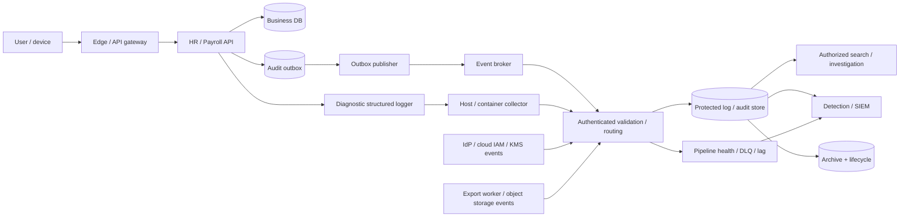
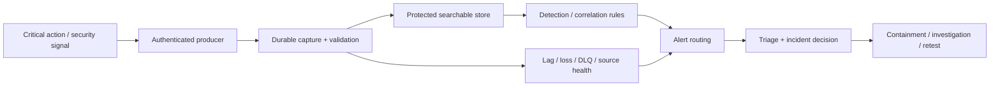

# Review logging: rà soát thiết kế ghi log để bảo mật, vận hành và tạo bằng chứng đáng tin

## 1. Review logging giải quyết vấn đề gì?

Một API thay tài khoản nhận lương có thể trả kết quả thành công, nhưng sau đó khách hàng phản ánh thông tin bị sửa trái phép. Nhóm điều tra cần biết ai thực hiện, từ phiên và thiết bị nào, tác động tới bản ghi/tenant nào, chính sách nào cho phép và giao dịch đã commit hay chưa. Nếu ứng dụng chỉ in dòng `Update success`, hoặc dữ liệu cần thiết nằm rải rác giữa container logs đã bị xoá sau vài giờ, việc truy vết rất khó khăn.

Ở chiều ngược lại, ghi quá nhiều không đồng nghĩa an toàn hơn. Bật debug toàn bộ payload có thể đưa số tài khoản, hồ sơ nhân sự, token, khóa API hoặc nội dung nhạy cảm vào kho tập trung mà nhiều người có quyền đọc. Một log đầy đủ nhưng có thể bị sửa/xóa bởi chính account bị xâm nhập cũng không đáng tin. Log được tạo nhưng bị pipeline đánh rơi, parser loại bỏ hoặc không thể tìm lại khi điều tra cũng không đạt mục tiêu.

**Review logging** là hoạt động đánh giá thiết kế trước và trong quá trình thay đổi hệ thống để xác định:

1. Những hành vi và tín hiệu nào **cần được ghi**, ở điểm nào trên data/control flow và để giải quyết câu hỏi nào?
2. Event/log có **ngữ nghĩa, actor, resource, timestamp và correlation** đủ tin cậy không?
3. Dữ liệu log có bị **ghi thừa, làm lộ bí mật, giả mạo hoặc chèn nội dung gây sai lệch** không?
4. Pipeline vận chuyển, lưu, lập chỉ mục và tra cứu có bảo đảm **độ bền, thời gian, quyền và khả năng phát hiện lỗi** phù hợp?
5. Thiết kế có thể được **kiểm chứng bằng tests, runtime evidence, findings và quyết định về rủi ro còn lại** không?

Trong chương **Security design review** của dịch vụ **SECURITY_SECURITY_ASSURANCE**, Review logging là một bước đánh giá thiết kế có bằng chứng: chuyển phân tích rủi ro, yêu cầu và security controls thành quyết định kiến trúc, kiểm thử, audit và kế hoạch khắc phục có thể theo dõi liên tục trong phát triển/vận hành.

### Kết quả học tập

Sau bài này, người học có thể:

- Chuẩn bị hồ sơ đầu vào và điều hành một logging design review có tiêu chí ra quyết định.
- Vẽ luồng ghi log xuyên application, identity, workload, cloud và bên nhận.
- Rà soát event catalog, dữ liệu tối thiểu, nguồn thông tin đáng tin, correlation và time semantics.
- Phát hiện điểm yếu thường gặp: lộ secrets/PII, log injection, log forging, mất sự kiện, quyền truy cập rộng và audit tampering.
- Đề xuất kiến trúc logging bền vững, bảo vệ bản gốc và quan sát được sức khỏe pipeline.
- Thiết kế test matrix, yêu cầu bằng chứng, xác định mức độ finding và lập review decision.
- Phân biệt rõ **thiết kế tốt**, **đã triển khai** và **đã chứng minh hoạt động đúng**.

> **Phạm vi:** bài học trình bày phương pháp review theo rủi ro. Tần suất, thời hạn lưu, loại sự kiện phải ghi và nghĩa vụ bảo toàn có thể khác nhau theo luật, hợp đồng, ngành và chính sách tổ chức. Những schema/ID/thời gian trong ví dụ là minh họa, không phải chuẩn bắt buộc hay dữ liệu khách hàng thực.

## 2. Phân biệt design review với logging, monitoring và audit assessment

**Logging** là việc tạo/ghi dữ liệu về sự kiện. **Design review** là việc chất vấn thiết kế đó có đáp ứng mục tiêu bảo mật và vận hành hay không, từ trước khi deploy cho tới khi thay kiến trúc. **Operating assurance** là việc kiểm chứng trạng thái triển khai bằng bằng chứng hoạt động, không chỉ dựa trên sơ đồ hoặc tài liệu.

| Hoạt động | Đối tượng | Câu hỏi chính | Kết quả |
| --- | --- | --- | --- |
| **Logging implementation** | Mã và cấu hình producer/collector | Event nào được phát, format nào, gửi đi đâu? | Code, schema, agent và pipeline đang chạy. |
| **Security design review** | Threat model, architecture, event catalog, policies | Thiết kế có đủ, đúng, an toàn và có thể kiểm chứng không? | Review record, decisions, gaps, actions và test criteria. |
| **Monitoring/detection review** | Rule, alert routing và response | Log có chuyển thành tín hiệu hữu ích khi xảy ra rủi ro không? | Detection logic, alert-to-response tests. |
| **Operational audit/assurance** | Effective runtime state và hành vi | Sự kiện thực có được ghi đúng, lưu bền, truy xuất và bảo vệ không? | Test results, runtime evidence, findings và residual risk. |
| **Compliance/legal review** | Nghĩa vụ theo phạm vi áp dụng | Loại log, thời gian, quyền, bảo vệ và retention có đáp ứng nghĩa vụ không? | Legal/privacy determinations có thẩm quyền. |

### 2.1. Bốn loại log không nên nhập nhằng

- **Application/diagnostic logs:** thông tin để phát hiện lỗi chương trình, dependency, retry, timeout.
- **Security/audit events:** hành vi quan trọng cần trách nhiệm giải trình: xác thực, truy cập tài nguyên, đổi quyền, export, thay cấu hình.
- **Infrastructure/control-plane logs:** thay IAM, KMS grants, deployment, resource policy, network connections.
- **Metrics/traces:** dữ liệu hiệu năng, lỗi và correlation, có thể bị lấy mẫu.

Một event có thể phục vụ nhiều mục đích; tuy nhiên **sampled trace không tự thay audit trail bắt buộc**, và log debug không phải bằng chứng đáng tin cho một giao dịch đã commit.

### 2.2. Design review không chỉ tìm xem có logger hay không

Hãy xem hai bản thiết kế:

**Thiết kế A:** mọi request gọi `logger.info(request.toString())`; collector thu stdout, SIEM hiển thị dashboard xanh. Thiết kế vẫn có nguy cơ lộ token/PII, làm sai actor, mất event khi crash, bị log injection và không có ngữ nghĩa giao dịch.

**Thiết kế B:** event catalog từ risk scenarios; actor lấy từ authenticated context; giao dịch nhạy cảm ghi outbox cùng transaction; log lỗi loại secrets; pipeline xác thực producer, phân quyền kho lưu; thất bại được giám sát; có tests và định nghĩa retention. Thiết kế B có cơ sở kiểm chứng tốt hơn, nhưng **chỉ được kết luận hiệu lực sau khi triển khai và test đúng phạm vi**.

## 3. Khi nào cần thực hiện Review logging?

Nên đưa review vào các cổng thiết kế và thay đổi có ý nghĩa:

1. Xây dịch vụ/API, job, integration hoặc môi trường mới chứa dữ liệu nhạy cảm.
2. Thay đổi **authentication/authorization**, tenant isolation, quyền quản trị hoặc business-critical workflow.
3. Mở chức năng **export, bulk read, data sharing, backup/restore, delete**.
4. Chuyển đổi log collector, queue, SIEM, retention, account/region hoặc nhà cung cấp.
5. Thay logger/framework, schema version, exception handling, debug settings hoặc distributed tracing.
6. Thay policy bảo mật, danh mục dữ liệu, nghĩa vụ theo hợp đồng/pháp luật.
7. Xuất hiện incident/finding cho thấy log thiếu, sai, lộ dữ liệu hoặc bị chỉnh sửa.
8. Onboarding hệ thống legacy, SaaS, service identity hoặc cloud control plane mới.

Review có thể diễn ra trong architecture review, pull request, security gate, readiness review hoặc vòng định kỳ. Không cần họp dài cho mỗi thay đổi nhỏ, nhưng **phải có cơ chế phân loại tác động** để một thay đổi log có nguy cơ cao không đi thẳng vào production mà thiếu thẩm định.

### 3.1. Entry criteria

Trước buổi review cần tối thiểu:

- Mô tả mục tiêu nghiệp vụ và dữ liệu theo classification.
- Sơ đồ thành phần, data/control flows và trust boundaries.
- Danh sách entry points, user/workload identities, tenant và downstream recipients.
- Risk scenarios, security/privacy requirements có liên quan.
- Event catalog và format/schema dự kiến, hoặc danh sách thiếu để xây.
- Thiết kế pipeline, storage, access policy, retention và failure behavior.
- Chỗ nào chưa biết: legacy service, provider capability, log source chưa có quyền xem.

Nếu thiếu dữ liệu quan trọng, reviewer có thể trả **Needs information**, nêu owner và thời hạn, không tự giả định rằng thiết kế an toàn.

### 3.2. Exit criteria

Review đủ điều kiện kết thúc khi: các quyết định được ghi và có người duyệt đúng thẩm quyền; risks/requirements có mapping tới controls và tests; findings có chủ sở hữu; còn thiếu evidence gì được ghi rõ; các hành động ngăn release nếu cần được xác định; và có trigger để đánh giá lại sau khi sửa/triển khai.

## 4. Phạm vi review: phải theo đường dữ liệu, không theo tên hệ thống

Một logging design review chỉ nhìn sơ đồ “application → SIEM” sẽ bỏ lỡ **job nền, database, object storage, identity provider, control plane, browser/mobile, backup, cache và đối tác**. Cùng một hành động có thể tạo sự kiện ở nhiều tầng và không tầng nào đơn lẻ thấy trọn sự thật.

### 4.1. Inventory theo nguồn và đích

| Inventory field | Cần ghi | Ví dụ HR SaaS |
| --- | --- | --- |
| **Asset/source ID** | Chủ thể phát event và đường vào/ra. | `SRC-PAYROLL-API`, `SRC-EXPORT-WORKER`. |
| **Classification** | Mức nhạy cảm của dữ liệu nguồn và nội dung log. | Restricted đối với payroll action. |
| **Tenant/environment** | Scope của data và request. | Tenant A/B, production/staging. |
| **Event categories** | Authentication, authorization, data change, export, admin. | `payroll.destination.changed`. |
| **Actor/workload identity** | Người hoặc service có quyền tạo event. | Human operator / payroll job. |
| **Producer mechanism** | Logger, audit outbox, cloud event, access log. | Structured audit + app diagnostic logs. |
| **Transport** | Agent, broker, OTLP, API, batch export theo thiết kế. | Collector qua authenticated connection. |
| **Destination** | Store, index, SIEM, cold archive, partner. | Protected audit store + alerting. |
| **Owner** | Chịu trách nhiệm coverage, schema và xử lý lỗi. | Engineering, Platform, SOC. |
| **Retention/deletion** | Quy tắc theo category và bản sao. | Schedule được phê duyệt. |
| **Verification** | Cách chứng minh source-to-store và access. | Synthetic event + query + deny test. |

### 4.2. Sơ đồ luồng minh họa



**Trust boundaries cần đánh dấu:** client → gateway, app → DB, producer → broker, control plane → collector, collector → store, store → index/SIEM, người điều tra → query/export và kho lưu → backup/archive. Ở mỗi boundary phải hỏi **ai xác thực ai, quyền gì, dữ liệu có thể bị thay ở đâu, ai quan sát lỗi và bằng chứng nào còn lại nếu một thành phần bị xâm nhập**.

### 4.3. Luồng bị bỏ sót cần rà soát

Ngay cả khi API chính đã có logs, kiểm tra thêm:

- Batch/cron và queue consumer không có HTTP request.
- Direct file download từ object storage bằng signed URL.
- Database admin, warehouse query, export-to-partner.
- Guest/vendored identity và account đã hết quyền.
- Backup, DR restore, data retention/deletion jobs.
- Cloud IAM, KMS grants, secrets, CI/CD deployment và thay đổi policy.
- Health logs của chính logging platform.
- Trace/exporter, crash dump, exception monitoring và bản sao bên ngoài.

**Không được đánh dấu “Not applicable” chỉ vì không có sơ đồ cho một nguồn.** Cần phân loại **Unknown/Unverified** và kế hoạch làm rõ.

## 5. Review event coverage theo mục tiêu rủi ro

Không phải mọi hành vi đều cần event có giá trị pháp lý/audit. Review cần phân loại **critical audit events**, **security events**, **application diagnostics** và **performance telemetry**, rồi xác định loại nào cần không lấy mẫu, loại nào có thể dùng sampling, loại nào chỉ lưu ngắn.

### 5.1. Threat-to-event matrix

| Threat/risk ID | Tình huống | Câu hỏi điều tra | Events/nguồn cần review |
| --- | --- | --- | --- |
| **R-LOG-01** | BOLA: tenant A gọi API đọc hồ sơ tenant B. | Ai gọi, object/tenant nào, quyền được quyết định ra sao? | API `resource.access.denied` với trusted resource tenant. |
| **R-LOG-02** | Payroll destination bị thay trái phép. | Ai sửa, ai phê duyệt, giá trị nào bị thay ở mức an toàn, commit chưa? | `payroll.destination.change.requested/committed/denied`. |
| **R-LOG-03** | Export bảng lương hàng loạt. | Ai yêu cầu, worker nào tạo file, ai thực sự tải/gửi? | `export.requested/completed`, `download.authorized/delivered`. |
| **R-LOG-04** | Privileged user tự nâng quyền. | Ai cấp cho ai, scope gì, có change/approval hợp lệ? | IAM/PAM `privilege.granted`, admin session events. |
| **R-LOG-05** | Workload key bị dùng trái nhu cầu. | Service identity nào gọi KMS, cho resource nào, outcome? | KMS key-use/grant events khi nền tảng cung cấp. |
| **R-LOG-06** | Attacker tắt logging trước khi exfiltrate. | Ai đổi config, health giảm khi nào, có alert ngoài miền không? | `logging.config.changed`, control-plane audit, collector health. |
| **R-LOG-07** | Log bị sửa/xóa sau sự cố. | Ai có quyền, thay đổi bị ngăn hoặc phát hiện thế nào? | Storage IAM, delete/retention actions, integrity check. |
| **R-LOG-08** | Debug log làm lộ token hoặc dữ liệu riêng tư. | Route nào ghi raw payload, ai đọc được, bản sao tồn tại bao lâu? | Sanitization tests, log export policy, leakage scan. |
| **R-LOG-09** | Collector lỗi làm mất event tài chính. | Có bao nhiêu transaction commit so với event được lưu? | Business source/outbox, broker lag, store reconciliation. |
| **R-LOG-10** | SIEM không phát hiện hàng loạt deny. | Event có đến rule không, ai triage, thời gian bao lâu? | Event-to-alert-to-response evidence. |

### 5.2. Câu hỏi review event coverage

1. Event nào là **điều kiện bắt buộc** để trả lời câu hỏi điều tra/risk?
2. Event được tạo ở điểm **biết kết quả thật** hay chỉ theo hành động UI?
3. Có cả **allow/deny, success/failure, requested/committed** khi cần không?
4. Bulk operation, async job, retry và background task được theo dõi thế nào?
5. Thay quyền, cấu hình, retention và **tắt logging** được ghi ở miền đủ độc lập chưa?
6. Event nào có nguy cơ quá nhiều: có sampling/rate limit và tiêu chí không bỏ critical events không?
7. Đường truy cập trực tiếp ngoài UI/API có nguồn event tương ứng không?
8. Ai là owner của từng event type và ai phê duyệt thay đổi semantic?

### 5.3. Sai lầm: lấy lượng dòng làm số đo coverage

Một dịch vụ tạo một triệu log debug/ngày vẫn có thể không ghi `admin.role.changed`. Review cần đo coverage theo **tập hành động quan trọng và entry points**, không theo số lượng log. Ngược lại, việc ghi quá nhiều lỗi lặp lại có thể làm nghẽn collector và che mất tín hiệu giá trị cao.

## 6. Review ngữ nghĩa và schema: sự kiện có thực sự đáng tin?

Một event hợp lệ cần trả lời được **ai, làm gì, tác động lên tài nguyên nào, khi nào, kết quả nào, liên quan đến request/transaction nào**, với nguồn đáng tin và không chứa dữ liệu nhạy cảm không cần thiết.

### 6.1. Các trường nền tảng

| Field | Mục tiêu review | Nguồn nên dùng |
| --- | --- | --- |
| `event_id` | Unique logical event để kiểm tra retry/dedup. | Producer/outbox có bảo đảm tạo ID. |
| `event_type`, `schema_version` | Meaning và contract có thể quản trị. | Event catalog được version hóa. |
| `occurred_at` | Mốc hành động tại nguồn, có timezone rõ. | Nguồn server/transaction đáng tin. |
| `ingested_at` | Mốc collector nhận để đo latency. | Collector; không ghi đè source time. |
| `actor_ref` / `workload_ref` | Principal thực hiện hành vi. | Verified identity/security context. |
| `initiator_ref` / `on_behalf_of_ref` | Người khởi tạo job nếu có delegation. | Trusted workflow/job metadata. |
| `tenant_ref`, `resource_ref` | Đối tượng/tenant thật bị tác động. | Resource repository/authorization service. |
| `action`, `outcome` | Read/update/approve/export, allow/deny/commit/fail. | Policy decision và business transaction result. |
| `request_ref`, `trace_ref`, `transaction_ref` | Kết nối các bước phân tán. | Server-generated context được truyền có kiểm soát. |
| `source_service`, `source_version` | Provenance của producer và build. | Deployment metadata, workload identity. |
| `policy_ref`, `approval_ref` | Giải thích quyền/approval trong hành động nhạy cảm. | Verified policy/change management service. |
| `error_code` | Chẩn đoán theo danh mục lỗi chuẩn. | Server-side mapping, tránh raw exception. |

Tùy event, một số trường không áp dụng. Schema contract cần phân biệt **required, conditional, optional và forbidden fields**; không yêu cầu job nền điền giả device ID, hoặc event sign-in điền một resource ID bịa đặt.

### 6.2. Requested, allowed, committed, delivered không đồng nghĩa

Xét workflow export:

1. API nhận yêu cầu → `export.requested`.
2. Policy cho phép → `export.authorized`.
3. Worker tạo file → `export.completed` hoặc `export.failed`.
4. Link được phát hành → `export.link_issued` nếu có.
5. Người dùng tải thành công theo ngữ nghĩa storage → `export.download_completed` nếu thực sự kiểm chứng được.

Một HTTP 202 không chứng minh file được tạo. Một log “download URL generated” không chứng minh file đã được tải. Một transaction rollback không được phát `change.committed`. Review cần xem **định nghĩa trigger và source of truth**, không chỉ format.

### 6.3. Versioning để tránh silently breaking consumers

Schema/version thay đổi có thể làm parser, detection rule, report hoặc search query nhận sai trường. Hỏi:

- Có compatibility policy cho producer và collector không?
- Thêm/đổi/loại field có kích hoạt schema review và regression tests không?
- Event name cũ có bị tái sử dụng với nghĩa khác không?
- Consumer cũ xử lý unknown version thế nào: DLQ và alert hay drop im lặng?
- Có migration/query cho bản ghi cũ trong thời hạn retention không?

## 7. Trustworthiness: nguồn actor, tenant, timestamp và correlation

### 7.1. Không tin thông tin do caller tự khai

Đừng lấy `actor=admin` từ `X-User` hoặc `tenant=A` từ tham số chưa xác minh rồi gán thành sự thật trong audit. Actor phải được tạo từ **verified security principal**; tenant và resource dựa trên authoritative business record/membership. Với batch job, cần phân biệt **workload identity thực thi** với **human initiator** nếu có.

### 7.2. Thời gian và thứ tự

Producer nên ghi timestamp có timezone rõ (thường chuẩn hóa UTC), đồng bộ đồng hồ và giám sát clock drift theo ngưỡng được phê duyệt. Collector ghi thêm ingest time để nhận biết lag, không nên sửa source timestamp rồi che nguồn. Trong microservices, thứ tự ghi nhận có thể khác thứ tự hành vi; transaction ID, aggregate sequence/version và correlation giúp điều tra.

**Không suy luận causality chỉ từ timestamp hoặc trace ID.** Nếu một approval event xảy ra trước một data export, cần đối chiếu quyền, resource, approval scope và effective time, không chỉ dựa vào thứ tự.

### 7.3. Correlation không được biến thành credential

Request/trace/correlation IDs có thể được truyền giữa services để nối sự kiện, nhưng không nên chứa email, số tài khoản hoặc secret. Đừng dùng correlation ID như bằng chứng authentication hay authorization. Nếu client có thể gửi trace ID, backend cần định nghĩa cách làm sạch/generate context và kiểm soát sự pha trộn giữa tenants.

## 8. Review nguy cơ lộ bí mật và dữ liệu cá nhân qua log

Logging là một **đường sao chép dữ liệu** từ hệ thống nghiệp vụ sang các nền tảng thường có quyền đọc rộng hơn: logger, agent, bộ thu, broker, index, SIEM, dashboard, alert notification, bản export, ticket và archive. Review cần xem từng bản sao chứ không chỉ dòng source code ghi log.

### 8.1. Những dữ liệu nguy hiểm khi đưa vào log

| Loại | Ví dụ | Hậu quả |
| --- | --- | --- |
| **Credentials** | Password, password reset token, OTP, API key, OAuth access/refresh token, session cookie. | Chiếm tài khoản hoặc gọi API bằng quyền nạn nhân. |
| **Cryptographic material** | Private key, plaintext DEK/KEK, seed, recovery phrase. | Giải mã hoặc giả mạo danh tính/chữ ký. |
| **Dữ liệu cá nhân nhạy cảm** | Thông tin lương, tài khoản ngân hàng, sức khỏe, giấy tờ định danh. | Lộ riêng tư, hậu quả đối với cá nhân và nghĩa vụ xử lý. |
| **Secrets trong URL/header** | Authorization header, signed URL có token, query string chứa credential. | Nhiều lớp proxy, trace và error report vô tình lưu lại. |
| **Dữ liệu của tenant khác** | Record/payload từ tenant B trong log truy vấn tenant A. | Cross-tenant disclosure ngay qua công cụ quan sát. |
| **Thông tin vận hành nhạy cảm** | Token nội bộ, secret path, thông tin hạ tầng/chính sách không cần thiết. | Hỗ trợ attacker reconnaissance, lateral movement. |

### 8.2. Hạn chế nguồn gốc trước khi redaction

Thứ tự ưu tiên thường là:

1. **Không đưa dữ liệu cấm vào log từ đầu.** Ghi event type và mã tham chiếu đủ điều tra.
2. **Dùng structured logging và allowlist fields** theo schema, tránh log toàn bộ object.
3. **Redact/mask/tokenize** các trường chỉ được ghi ở dạng hạn chế khi có căn cứ.
4. **Kiểm tra đa tầng** ở SDK, middleware, exception handler, collector và exporter vì dữ liệu có thể đi đường phụ.
5. **Bảo vệ những phần vẫn nhạy cảm** bằng IAM, encryption, retention và access audit.

Regex redaction ở collector là một lớp dự phòng, **không phải lý do để ứng dụng gửi token thô lên pipeline trước đó**. Khi redaction fail hoặc parser không nhận format mới, dữ liệu nhạy cảm có thể đã qua broker hoặc lưu trong dead-letter queue.

### 8.3. Review exception paths và debug toggles

Cần đọc thiết kế cho trường hợp:

- HTTP client/server library bật wire logging, request/response body.
- ORM hoặc SQL debug in parameters, câu query chứa secrets.
- Exception message chứa raw request hoặc credentials.
- Crash dump, profiler, APM agent thu headers hoặc environment.
- Ghi webhook payload để điều tra, nhưng payload có PII/token.
- CI/CD build logs in secret environment variables, CLI flags hoặc deploy credential.
- Chức năng “bật debug tạm” không có expiry/owner/change approval.

**Câu hỏi review:** nếu một developer bật debug level cho production, control nào ngăn payload nhạy cảm tràn sang log sink, trong bao lâu, ai có thể thực hiện và sự kiện thay cấu hình được ghi ở đâu?

### 8.4. Ghi log là một hoạt động xử lý dữ liệu

Đối với dữ liệu cá nhân, phải xem mục đích/điều kiện cho logging, thông báo nếu áp dụng, quyền, nơi lưu, đối tác/region, retention và xóa theo yêu cầu/ngoại lệ hợp lệ. Thiết kế không nên mặc định rằng vì log phục vụ bảo mật nên có thể giữ mọi PII vô hạn.

## 9. Log injection, log forging và hành vi đầu vào không tin cậy

Ngoài lộ dữ liệu, logger còn có thể trở thành nơi attacker **chèn ký tự điều khiển, định dạng hoặc nội dung giả** để đánh lừa người đọc, parser, SIEM hoặc quy trình tự động xử lý log.

### 9.1. Ví dụ log forging

Giả sử code nối chuỗi:

```text
logger.info("Login failed for username: " + username);
```

Nếu `username` chứa newline, carriage return hoặc ký tự điều khiển, bản ghi text có thể hiển thị thành nhiều dòng. Ví dụ một giá trị cố ý chứa `\nINFO admin login success` có thể làm người điều tra hiểu sai rằng có một event thành công khác, nếu log viewer/parser không phân biệt boundaries.

**Không dùng một dòng log định dạng tự do làm ranh giới tin cậy**. Nên dùng structured logging, escaping/serialization đúng định dạng, giới hạn độ dài/ký tự và schema validation. Không tự tạo JSON bằng cách nối chuỗi từ dữ liệu do client cung cấp.

### 9.2. Các trường hợp khác cần threat model

- **Control characters/terminal escapes:** có thể che, đổi hoặc làm khó đọc nội dung khi hiển thị console.
- **CSV/formula injection khi export log:** một trường untrusted bắt đầu bằng ký tự công thức có thể gây rủi ro khi mở ở phần mềm bảng tính nếu không được xử lý theo định dạng và ngữ cảnh.
- **HTML/script injection trong log viewer:** nếu dashboard hiển thị user-controlled field không encode đúng, có thể phát sinh XSS.
- **Parser confusion:** producer dùng nhiều timezone, locale, JSON version hoặc multiline stacktrace làm sai field extraction.
- **Oversized payload/log flooding:** attacker gây tốn bộ nhớ, nghẽn collector hoặc che event quan trọng.
- **Fake producer/replay:** một nguồn không xác thực gửi event giống hệ thống đáng tin hoặc phát lại event cũ.
- **Confused context:** cùng trace ID do client tự đặt khiến event của nhiều chủ thể bị ghép sai.

### 9.3. Review controls và expected outcomes

| Review question | Yêu cầu thiết kế thích hợp |
| --- | --- |
| Untrusted strings có thể tạo dòng giả? | Serializer structured/escaping, field length limit và test newline/control chars. |
| Log viewer có thể thực thi nội dung untrusted? | Output encoding/escaping, safe rendering, CSP khi phù hợp, test XSS. |
| Log export thành CSV có an toàn? | Formula-safe export rules, phân quyền và negative test với marker giả. |
| Collector có xác thực nguồn không? | Producer/workload identity, transport protection, permission và replay handling. |
| Attacker có thể tạo vô số events? | Resource budgets, backpressure, rate controls không làm mất critical audit âm thầm. |
| Parser lỗi sẽ làm gì? | Quarantine/DLQ, reject counter, alert và quy trình sửa schema. |

Design review phải đánh giá cả **đường hiển thị/trích xuất**, không chỉ đầu vào logger: một event an toàn ở JSON sink vẫn có thể nguy hiểm khi xuất CSV hoặc render HTML sai.

## 10. Review SDK, framework và logging API trong ứng dụng

### 10.1. Tránh log cả object mặc định

Các lệnh như `logger.info("Request {}", request)`, `toString()` của entity hoặc serialization toàn bộ DTO thường làm lộ fields ngoài event catalog. Reviewer nên kiểm tra **log call sites**, interceptor, exception handler, ORM logging, HTTP clients và APM instrumentation theo đường dữ liệu nhạy cảm.

Tốt hơn là dùng **typed event builders hoặc structured fields được kiểm soát**, ví dụ event type, resource ref, action, outcome, correlation ref và reason code. Code vẫn cần review vì một field tên `context` có thể vô tình chứa raw payload.

### 10.2. Logging level phải có ranh giới

| Level/nhóm | Mục tiêu | Review concern |
| --- | --- | --- |
| **Error** | Lỗi chức năng/vận hành có tác động. | Không log stack/raw request chứa secrets; đủ mã lỗi/correlation. |
| **Warn** | Điều kiện bất thường cần xử lý. | Không tạo alarm flood hoặc gọi mọi user mistake là security incident. |
| **Info** | Sự kiện vận hành/đổi trạng thái hữu ích. | Tránh ghi PII không cần thiết, semantics rõ. |
| **Debug/Trace** | Chẩn đoán chi tiết trong môi trường được phép. | Không phát tán payload/credentials khi bật, cần expiry/owner. |
| **Security/audit event** | Dấu vết bắt buộc theo policy. | Không phụ thuộc vào debug level hoặc sampling. |

Các thư viện có thể định nghĩa levels khác nhau; điểm cốt lõi là **security events bắt buộc không biến mất khi thay log level** nếu yêu cầu nêu chúng phải được lưu.

### 10.3. Performance, overhead và backpressure

Tác động của logging đến latency, CPU, I/O, storage và cost phải được phân tích. Logger synchronous có thể kéo chậm request; asynchronous logger có thể mất events khi process dừng nếu chỉ nằm trong bộ nhớ. Có thể dùng batch, queue, bounded buffer và phân luồng audit/diagnostic theo ưu tiên. Review cần định nghĩa **đường nào được phép drop, đường nào không, điều gì xảy ra khi full buffer**, và cách phát hiện điều đó.

### 10.4. Không tin code review thay runtime verification

Một wrapper được kiểm tra tốt có thể bị vượt qua qua thư viện khác, framework update hoặc code mới. Thiết kế cần có tests và scan cho exception path, request instrumentation và môi trường production-equivalent.

## 11. Review kiến trúc vận chuyển và lưu trữ

### 11.1. Những điểm cần hỏi trên pipeline

- Producer → collector có authentication, encryption, trust anchor và quyền gửi hạn chế không?
- Một service có thể giả làm source khác hoặc gửi event với tenant ID giả không?
- Có event validation, schema registry/versioning, DLQ và alert khi reject không?
- Broker/agent có retention, quota, retry, ordering/idempotency phù hợp không?
- Log store có thể bị sửa/xóa bởi runtime service hay developer không?
- Có replication/backup và restore được bằng khóa/quyền đã quản lý không?
- Search index/preview/export có cùng mức bảo vệ và lifecycle phù hợp không?
- Khi log được forward tới SIEM/vendor, dữ liệu đi tới account/region/recipient nào?
- Ai sở hữu việc đối soát **producer-side → stored → queryable**?

### 11.2. Phân biệt loại dữ liệu và đường vận chuyển

Audit critical events có thể yêu cầu cơ chế lưu bền trước khi trả success. Diagnostic logs có thể dùng bounded asynchronous buffer với chính sách drop và cảnh báo. Distributed traces có thể dùng sampling có kiểm soát. Reviewer cần kiểm tra rõ những quyết định ấy, không cho phép “mọi log dùng cùng một queue mặc định” mà không có failure model.

### 11.3. Bản gốc và bản đã được biến đổi

Collector đôi khi normalize, redact, enrich hoặc reformat event. Cần biết:

1. Trường nào đã được biến đổi và bởi rule/version nào?
2. Event gốc lưu ở đâu, có được bảo vệ và có cần giữ không?
3. Dữ liệu nhạy cảm có bị đưa vào đường trung gian trước khi redaction không?
4. Trường bị thiếu/sai format được nhận diện như thế nào?
5. Người điều tra có thể xác minh kết quả normalized với nguồn gốc trong scope nào?

Không mặc định raw log phải được lưu bằng mọi giá: với secrets/PII, thiết kế tốt có thể **tránh thu thập raw data ngay từ producer**. Khi cần bản gốc cho mục tiêu được duyệt, phải có cơ chế bảo vệ và retention riêng.

## 12. Durability và failure semantics: mất event là rủi ro thiết kế

### 12.1. Những cửa sổ lỗi kinh điển

| Thời điểm lỗi | Nếu chỉ gọi logger async | Hướng kiểm soát |
| --- | --- | --- |
| Sau khi DB commit, trước khi ghi log | Business state đổi, event mất. | Transactional outbox hoặc cơ chế atomicity phù hợp. |
| Sau khi publisher gửi, trước khi nhận ack | Event có thể gửi trùng khi retry. | Stable event ID và idempotent consumer/dedup. |
| Collector nhận nhưng parser reject | Event không xuất hiện trong search. | Schema validation, quarantine/DLQ, alert. |
| Broker backlog vượt retention | Event hết hạn trước khi được xử lý. | Capacity/lag monitoring, retention và catch-up plan. |
| Search index lỗi dù store còn data | Không truy vấn được trong thời hạn mục tiêu. | Stored-vs-indexed reconciliation và recovery tests. |
| KMS hoặc storage outage | Không ghi/đọc được logs đã mã hóa. | Availability/DR design và restore drill. |
| Log flood từ attacker | Events quan trọng bị drop hoặc service chậm. | Quota, priority, bounded buffers và overload tests. |

### 12.2. Transactional outbox: khi nào đáng cân nhắc?

Với thay đổi nghiệp vụ quan trọng (ví dụ sửa tài khoản nhận lương), service có thể ghi **bản ghi business và audit outbox trong cùng transaction DB**. Publisher riêng lấy outbox, gửi với retry, và consumer dedup theo event ID. Cơ chế này giảm rủi ro commit business nhưng không còn dấu vết khi app crash.

Tuy nhiên, outbox vẫn cần review phần **quyền truy cập, tăng trưởng dữ liệu, scheduler, cleanup, replay, integrity, DLQ, sink lag và query completeness**. Cũng không thể dùng cùng transaction để ghi một event `authorization.denied` nếu nghiệp vụ đã rollback trước khi tạo outbox; deny cần đường bền và độc lập phù hợp.

### 12.3. “Exactly once” cần định nghĩa phạm vi

Trong hệ thống phân tán, không nên tin câu “exactly once” nếu chưa biết điều đó áp dụng cho **producer, broker, consumer hay business outcome**. Thông thường có thể nhận physical duplicate nhưng vẫn giữ **một logical event** qua ID/dedup; điều quan trọng là không bỏ event thật, không đếm event giả và có bằng chứng reconciliation.

### 12.4. Failure behavior theo criticality

Nếu audit store không sẵn sàng, một nghiệp vụ cực nhạy cảm có thể cần không commit khi không có bản ghi outbox bền; sự kiện ít quan trọng hơn có thể chấp nhận buffer/retry theo SLO. Cần ghi rõ:

- Hành động nào **block**, **degrade** hoặc **continue with durable queue**.
- Bounded buffer/quota, retry policy, timeout và circuit breaker.
- Alert/escalation khi lag, drop hoặc backpressure tăng.
- Quy trình phục hồi mà không tạo event giả/lặp.
- Ai phê duyệt trade-off availability và audit completeness.

Không mặc định mọi thao tác phải chặn khi SIEM không sẵn sàng; cũng không được “cho qua rồi mất log âm thầm” với hành động có requirement bắt buộc.

## 13. Bảo vệ integrity và nguồn gốc của log

### 13.1. Threat-to-integrity controls

| Threat | Câu hỏi review | Control hướng tới |
| --- | --- | --- |
| Producer giả mạo | Ai được phép gửi `source_service=X`? | Authenticated producer identity, schema-bound source metadata. |
| Event bị sửa trên đường | Đường truyền có bảo vệ toàn vẹn và peer identity? | Secure transport và broker/collector access policy. |
| Collector bỏ event | Có monitor rejected/dropped counters? | Pipeline health, DLQ, reconciliation. |
| App admin xóa dấu vết | Runtime role có delete trên audit store không? | Tách quyền, protected store, append-oriented controls. |
| Cloud admin đổi retention | Thay policy có approval/independent audit không? | Change control, tamper alert, protected control-plane events. |
| Report bị sửa sau export | Có provenance và lịch sử chuyển giao? | Authorized export, integrity digest/signature khi phù hợp. |

### 13.2. Bất biến không chứng minh event đúng

Write-once/read-many, object lock, append-only ledger hoặc hash-chain có thể hỗ trợ chống sửa/xóa theo cấu hình và threat model. Nhưng **một event sai actor được ghi bất biến vẫn là event sai**; event không được producer phát thì không tự hiện ra trong immutable store. Vì vậy design review phải có cả **source authenticity, semantic correctness, completeness, tamper resistance và retrieval**.

### 13.3. Tách nhiệm vụ

Người quản trị ứng dụng không nên mặc định có quyền xoá log bảo mật của chính ứng dụng; người có quyền xem records không tự được sửa retention; service ingest không cần quyền đọc toàn bộ dữ liệu. Với môi trường nhỏ không thể tách người, xác định reviewer chéo, approval, audit độc lập hoặc controls bù đắp có bằng chứng.

### 13.4. Audit-the-auditors

Các sự kiện truy vấn/export dữ liệu audit nhạy cảm, thay quyền, thay retention, disable logging, delete attempt và key policy change cần dấu vết phù hợp. Khi kẻ có thể thay logging platform cũng có thể xóa mọi dấu vết thay đổi, cân nhắc thu thập các sự kiện quản trị ở miền có quyền độc lập.

## 14. Review quyền truy cập, multi-tenancy và privacy

### 14.1. Tách quyền đọc log khỏi quyền phát log

Một service ghi log không nên tự có quyền truy vấn toàn bộ logs của mọi tenant; một analyst xem event phục vụ incident không cần quyền sửa/xóa; một admin collector không nhất thiết được đọc mọi PII. Review effective IAM, inherited grants, wildcard roles, API keys, third-party integrations, debug access, break-glass và access review.

### 14.2. Ranh giới tenant của logging platform

SaaS có thể có log tập trung đa tenant. Cần kiểm tra **query filter, resource ACL, index partition, field-level access, export API, saved search, SIEM alert và support dashboard**. Không chỉ kiểm tra giao diện; direct API hoặc report export có thể bypass tenant scoping.

| Chủ thể | Hành động | Kết quả mong đợi |
| --- | --- | --- |
| Admin tenant A | Truy vấn event cho A trong phạm vi cấp quyền. | Cho phép đúng dữ liệu/fields của A. |
| Admin tenant A | Gọi API search theo tenant B. | Từ chối hoặc kết quả đúng scope, không lộ metadata B. |
| Support có ticket A | Tra cứu event cần cho ticket A. | Có điều kiện, giới hạn scope/thời gian và audit. |
| Application writer | Gửi event cho service của mình. | Không tự được đọc/xóa mọi event đã lưu. |
| SOC responder | Truy vấn nhiều tenant theo incident scope. | Theo quyền được phê duyệt, JIT nếu cần và audit-the-auditor. |

### 14.3. Nơi lưu và bản sao

Inventory phải bao gồm collector buffers, broker/DLQ, hot index, cold archive, backup, SIEM vendor, dashboard cache, email/slack-style notification và evidence export. Mỗi đích có data classification, region/recipient, retention, key/access policy và owner. Nếu có luồng tới bên thứ ba, đối chiếu ràng buộc hợp đồng/pháp luật và trách nhiệm cung cấp log.

### 14.4. Privacy by design trong logging

Mỗi event nên có mục đích, nhóm dữ liệu và thời hạn theo policy; có thể áp dụng masking, aliasing, aggregation, minimization và phân quyền theo vai trò. Đừng đồng nhất pseudonymization với anonymization: khi có bảng đối chiếu hoặc tổ hợp metadata, data subject vẫn có thể được tái xác định.

## 15. Retention, archive và legal hold: review vòng đời của log

Retention không chỉ là số ngày trên một bucket. Design review cần biết loại log nào phải giữ, vì mục đích gì, khi nào có thể xóa, bản sao ở đâu và điều kiện nào buộc giữ tiếp.

### 15.1. Các lớp cần rà soát

| Vị trí | Review concern | Evidence/verification tương ứng |
| --- | --- | --- |
| Producer buffer/local disk | Log nhạy cảm bị lưu tạm quá lâu hoặc bị xóa sớm. | Buffer/rotation config, crash/disk-full test. |
| Broker/queue/DLQ | Event rejected nằm trong DLQ ngoài policy. | Retention config, quyền DLQ, lifecycle test. |
| Hot search index | Quyền truy vấn rộng, index giữ lâu hơn cần thiết. | Effective search permissions và expiry tests. |
| Cold archive | Không thể tìm lại hoặc thiếu key giải mã khi cần. | Restore/retrieval drill, index/catalog metadata. |
| Backup/replica | Bản sao còn lại sau thời hạn ở primary. | Backup inventory, retention dependency và test. |
| SIEM/vendor | Có bản sao/correlation/alert ngoài kho chính. | Data-sharing agreement, vùng lưu, vendor evidence. |
| Report/export/case | File được tạo khi điều tra có lifecycle riêng. | Authorized export, access logs, deletion/hold verification. |

### 15.2. Review câu hỏi theo yêu cầu áp dụng

- Policy có chỉ rõ **event category, classification, basis, owner, thời hạn/trigger** không?
- Thời hạn lưu có tính từ `occurred_at`, `ingested_at` hay một sự kiện khác?
- Khi hết thời hạn, kho chính, index, DLQ, backup và export được xử lý thế nào?
- Có cơ chế legal/investigation hold theo thẩm quyền với phạm vi và ngày review không?
- Nếu backup bất biến không thể xóa ngay, trạng thái retention và quyền được hạn chế ra sao?
- Ai có thể giảm retention, tắt lifecycle hoặc đổi nơi lưu? Thay đổi có audit không?
- Khi data subject hoặc cơ quan có thẩm quyền yêu cầu xử lý dữ liệu, đội nào đánh giá nghĩa vụ và ngoại lệ?

Không tự áp dụng một con số “30/90/365 ngày” cho mọi tổ chức. **Nguồn yêu cầu và quyết định của data/privacy/legal owner** cần được ghi rõ; reviewer đánh giá khả năng thi hành và kiểm chứng chứ không tự sáng tạo thời hạn pháp lý.

### 15.3. Khả năng khôi phục để điều tra

Nếu log phải lưu ở cold archive trong nhiều năm nhưng không ai biết cách khôi phục, không còn key hoặc metadata thiếu, mục tiêu audit chưa được đảm bảo. Cần test **restore, integrity, index/query, permission và thời gian truy xuất** trong ngưỡng đã phê duyệt.

## 16. Detection, monitoring và response: log có dùng được không?

Tuy logging review tập trung vào thiết kế, cũng phải hỏi **event có được consumer sử dụng để phát hiện và điều tra** trong những threat scenarios ưu tiên hay không.

### 16.1. Event-to-response path



### 16.2. Review detection use cases

| Detection use case | Dữ liệu tối thiểu | Câu hỏi design review |
| --- | --- | --- |
| Nhiều lần deny chéo tenant | Actor/session ref, resource tenant, timestamp, outcome/reason. | Có ghi cả deny ở backend? Có rate/aggregation chống flood? |
| Export lớn hoặc đột biến | Actor, scope, record count/band, tenant, action/outcome. | Có event worker completed, không chỉ API requested? |
| Privilege escalation trái luồng | Grantor, grantee, role, approval, effective time. | Control-plane event có được thu và không bị chính admin sửa? |
| KMS grant bất thường | Principal/key ref, operation, resource, policy context. | Nền tảng cung cấp event đủ chi tiết? Missing fields xử lý thế nào? |
| Logging disabled | Source ID, config change, who, before/after refs. | Alert độc lập nếu nguồn chính bị vô hiệu hóa? |
| Collector ingestion outage | Ingest count, lag, canary, DLQ, source heartbeat. | Health xanh giả khi không còn event có bị phát hiện? |
| Suspicious secret logging | Synthetic secret marker, field/path và collector rejection. | Có cơ chế phát hiện không làm lộ secret thật? |

### 16.3. Telemetry sức khỏe của chính pipeline

Các tín hiệu cần xem gồm producer heartbeat/canary, outbox backlog age, broker lag, rejected/dropped events, DLQ depth, ingestion/indexing latency, clock drift, storage capacity, schema compatibility, replication status, access-denied anomalies và alert routing. **Một collector không có lỗi trong log của chính nó không chứng minh nó đang nhận đầy đủ event**; cần đối chiếu nguồn và synthetic canary.

### 16.4. Tách “có rule” khỏi “phát hiện được”

Một SIEM rule tồn tại trong repository là **design/implementation evidence**. Để chứng minh hiệu lực, cần tạo synthetic scenario được phép, xác minh event đến rule, alert thực sự sinh ra, tới đúng responder, được triage và có action. Đo độ trễ event → alert → triage theo mục tiêu, đồng thời kiểm tra false positives/false negatives trong tập kịch bản đã xác định.

## 17. Review dịch vụ cloud/SaaS và trách nhiệm của nhà cung cấp

Nhiều nguồn log quan trọng nằm ngoài ứng dụng: identity provider, database managed, object storage, CI/CD, KMS, CDN, firewall, backup platform hoặc nhà cung cấp giám sát. Reviewer phải xác định **ai tạo log, ai bật, ai có quyền đọc/xóa, ai quản lý retention và loại sự kiện nào dịch vụ không cung cấp**.

### 17.1. Shared responsibility matrix

| Thành phần | Provider thường có thể cung cấp | Tổ chức cần kiểm chứng |
| --- | --- | --- |
| Cloud control plane | API/permission change events theo capability. | Bật đúng account/region/service, destination và effective grants. |
| Identity provider | Authentication/lifecycle/privilege events. | Nguồn, schema, coverage, forwarding, access/retention và revoke test. |
| Managed database | Audit/connection/query configuration theo dịch vụ. | Những hành động nghiệp vụ không thể suy ra từ query log; review DB grants. |
| Object storage | Access/control-plane logs theo cấu hình. | Export/download semantics, signed URL, tenant authorization, retention. |
| KMS/HSM service | Key state/grant/use events theo capability. | Bật logging và quan sát đúng key/operations; quyền admin và anti-tamper. |
| Observability vendor | Ingest/search/alert/retention capabilities. | Không gửi secrets/PII thừa, kiểm tra data residency, quyền/backup/export. |

Một nhãn “logging supported” hoặc báo cáo kiểm toán của vendor **không chứng minh các nguồn/thành phần của tổ chức đã được cấu hình đúng**. Xác minh scope của artifact vendor, thời gian áp dụng, version và shared responsibility.

### 17.2. Tích hợp vendor có thể trở thành điểm rò dữ liệu

Agent/SDK có thể tự thu request bodies hoặc environment variables; SaaS có thể sao chép logs cho support; alert có thể gửi dữ liệu nhạy cảm qua email/webhook. Review **data processing/retention, default fields, export permissions, region, onward transfer và credential lifecycle** của integration. Không đính bí mật vào ticket gửi vendor chỉ vì cần gỡ lỗi.

## 18. Checklist Design Review: yêu cầu gì, kết luận trên bằng chứng nào?

Checklist cần trả lời theo từng resource/flow và có **owner, risk, verification criteria**. Không chỉ tick “Yes” ở cấp hệ thống. Một số câu hỏi quan trọng:

| Review ID | Review question | Bằng chứng thiết kế cần xem | Acceptance/negative check |
| --- | --- | --- | --- |
| **LOG-R01** | Phạm vi assets, identities và flows đủ chưa? | Inventory, DFD, integrations, trust boundaries. | Có mapping entry points và unknown list. |
| **LOG-R02** | Critical actions có event catalog riêng? | Risk-to-event mapping và owners. | Mỗi hành động rủi ro cao có trigger/source. |
| **LOG-R03** | Producer ghi đúng event semantics? | Transaction/job design, schema contract. | Requested/denied/committed/failed phân biệt. |
| **LOG-R04** | Actor/resource/tenant lấy từ nguồn tin cậy? | Auth/context architecture, authoritative DB. | Forged headers không sửa audit actor/tenant. |
| **LOG-R05** | Event IDs, times, version/correlation rõ? | Schema và timestamp specification. | Cross-service + duplicate/out-of-order test. |
| **LOG-R06** | Không có secrets/PII không cần? | Field allowlist, redaction design, logging call inventory. | Marker scan ở success/error/debug/traces. |
| **LOG-R07** | Có chống log injection/forging? | Structured serializer, source auth, viewer/export design. | Newline/HTML/CSV marker tests. |
| **LOG-R08** | Critical events có durable capture? | Outbox/transaction/queue design. | Crash/retry không làm mất logical event. |
| **LOG-R09** | Collector và schema error có giám sát? | DLQ, metrics, alert rules, health runbook. | Parser failure và lag không im lặng. |
| **LOG-R10** | Event có thể tìm lại đúng SLO? | Storage/index architecture, query model. | Source-to-sink retrieval và latency. |
| **LOG-R11** | IAM, tenancy và export bảo vệ logs? | Roles, grants, resource/access policy. | Negative query/export theo tenant/role. |
| **LOG-R12** | Log gốc khó bị sửa/xóa trái phép? | Append/WORM/tamper architecture và key policies. | Unauthorized modify/delete và config change tests. |
| **LOG-R13** | Access và sửa cấu hình log có audit? | Admin/control-plane event mapping. | Audit-the-auditor, alert khi disable logging. |
| **LOG-R14** | Retention và bản sao có nguồn phê duyệt? | Schedule, legal hold, backup/archive inventory. | Expiry/hold/recovery theo loại. |
| **LOG-R15** | Encryption, key và DR được đánh giá? | Storage/transport/key management, restore design. | Key outage và restore drill. |
| **LOG-R16** | Logs hỗ trợ detection/response? | Use cases, rule/alert routing, SOC runbook. | Event-to-alert-to-triage drill. |
| **LOG-R17** | Dependencies và failure mode rõ? | FMEA, overload/backpressure/fallback design. | Collector/PIP/SIEM failure tests. |
| **LOG-R18** | Provider và third-party scope được đối soát? | Vendor capabilities, data flow, sharing records. | Source coverage và provider evidence. |
| **LOG-R19** | Schema/logging config có change gate? | ADR, PR template, schema registry, CI checks. | Compatibility/negative tests khi đổi schema. |
| **LOG-R20** | Kết luận review có giới hạn và owner? | Findings, risk decision, release gates. | Không Pass cho đường chưa xác minh. |

### 18.1. Cách dùng checklist hiệu quả

Với mỗi dòng:

1. Nêu **asset/flow** cụ thể, không chỉ hệ thống tổng quát.
2. Ghi **claim** cần chứng minh và risk severity.
3. Xác định **artifact** hiện có và version/time.
4. Xem thiết kế có đáp ứng về mặt logic không.
5. Ghi **test/evidence cần làm sau triển khai**, không đánh đồng design pass với operating pass.
6. Nếu thiếu thông tin, ghi **Unverified/Needs information** có owner/hạn.
7. Nếu sai yêu cầu, tạo finding, owner, priority và gate.

### 18.2. Không dùng một chữ “OK” cho tất cả layers

Hệ thống có thể **đúng event schema** nhưng **không bền khi crash**; có thể **mã hóa storage** nhưng **cho support role truy vấn mọi tenant**; có thể **có SIEM rule** nhưng **mất event ở collector**. Cần ghi trạng thái theo từng control và phạm vi, không quy về một nhãn “logging secure”.

## 19. Tài liệu cần có sau buổi review

Một hồ sơ security design review có thể gồm:

- **Scope sheet:** asset/tenant/environment, flows, assumptions, exclusions/unknowns.
- **DFD/trust-boundary diagram:** producer, collector, store, search, consumers và admin planes.
- **Event catalog:** event type, trigger, actor/resource/outcome semantics, schema version, classified fields.
- **Control mapping:** requirements, threats, mitigations và owners.
- **Threat review notes:** abuse cases, attacker capabilities, bypass/failure scenarios.
- **Access/retention design:** IAM, security controls, storage/key/backup, privacy/legal determinations.
- **Architecture Decision Record (ADR):** options, chosen design, tradeoffs và reason.
- **Test/evidence plan:** test IDs, environment/build, expected results, source-to-sink evidence.
- **Findings/action register:** severity, current/target residual risk, remediation, reviewer và release gate.
- **Review decision:** Approved, Approved with conditions, Rework required hoặc Needs information theo policy.

### 19.1. Phân biệt loại bằng chứng

| Mức | Ví dụ | Điều chưa thể kết luận |
| --- | --- | --- |
| **Design evidence** | DFD, ADR, schema, policy specification. | Runtime đã áp đúng hoặc mọi entry point đủ coverage. |
| **Implementation evidence** | Java code, IaC, collector config, SIEM rule. | Không drift, không bypass, không mất khi crash. |
| **Operating evidence** | Test event/query, effective IAM, ingestion counters, alert drill. | Mọi môi trường/thời gian ngoài scope đều an toàn. |
| **Remediation evidence** | PR, deployment, negative retest, source-to-store reconciliation. | Ticket đóng có nghĩa rủi ro hoàn toàn bằng 0. |

### 19.2. Cách kết luận theo giới hạn evidence

Một report tốt nói: “Trong build X tại staging, change event có actor/resource/outcome đúng và không chứa token; luồng collector crash chưa được test, effective IAM của production chưa được xem, nên durability và quyền truy vấn chưa được xác minh.” Điều này hữu ích hơn lời khẳng định tuyệt đối “logging đã bảo mật”.

## 20. Quyết định thiết kế: lựa chọn giải pháp và tradeoffs

### 20.1. Các lựa chọn thường phải cân nhắc

| Decision | Option A | Option B | Tiêu chí chọn |
| --- | --- | --- | --- |
| Critical event capture | App logger async | Transactional outbox/event store | Atomicity với business commit, RPO, complexity, recovery. |
| Log format | Free-text | Structured events + schema | Truy vấn, parser safety, cross-service consistency. |
| Storage | Local logs | Protected centralized/segmented store | Tamper/loss risk, admin separation, cost, availability. |
| Ingestion | Best-effort | At-least-once + dedup | Criticality, duplicate handling, backlog limits. |
| Confidentiality | Log raw request | Field allowlist/minimization + sanitization | Investigation needs, privacy, secret leakage risk. |
| Access | Broad developer access | Purpose/role/tenant-limited query | Operational needs, insider risk và investigation scope. |
| Retention | Một thời hạn cho mọi log | Per-category schedule + hold | Nghĩa vụ, data classification, cost và recovery. |
| Error handling | Fail open silently | Durable buffer, bounded fallback hoặc block critical action | Security vs availability theo action risk. |

### 20.2. Mẫu lập luận cho một quyết định

“Chọn transactional outbox cho `payroll.destination.changed` vì rủi ro không truy vết được sau transaction commit vượt ngưỡng chấp nhận. Chấp nhận thêm chi phí publisher, outbox storage và monitoring. Không dùng outbox business transaction cho denial events vì không có commit; thiết kế denial path riêng với bounded durable capture. Success được đo bằng source-to-store reconciliation và fault-injection tests; các dependencies còn lại được ghi trong risk register.”

Một ADR có giá trị khi ghi **why**, assumptions, tradeoffs, failure modes, alternatives rejected và review triggers, không chỉ lưu sơ đồ.

## 21. Case study: rà soát logging cho HR SaaS đa tenant

### 21.1. Kiến trúc và yêu cầu

Một HR SaaS phục vụ nhiều khách hàng doanh nghiệp. Hệ thống có web/mobile app, API gateway, identity provider, employee profile service, payroll service, job tạo CSV, object storage, analytics pipeline, support portal, cloud IAM/KMS, database, broker, backup, log collector, SIEM và archive.

Nhóm thiết kế yêu cầu logging vừa hỗ trợ debug, vừa cho phép điều tra **truy cập sai tenant, thay thông tin chi trả, export dữ liệu và thay quyền quản trị**. Hệ thống phải giảm khả năng lộ thông tin lương/credentials qua log, bảo vệ event nguồn, phát hiện collector outage và có khả năng phục hồi.

### 21.2. Findings giả định

| Finding ID | Quan sát thiết kế | Tác động | Trạng thái review |
| --- | --- | --- | --- |
| **F-LOG-01** | Middleware in full Authorization header khi API trả 500. | Token có thể lộ sang log store, dashboard hoặc vendor. | **Design fail – High**. |
| **F-LOG-02** | Controller ghi `payroll.destination.changed` trước DB commit. | False success khi rollback, không đáng tin khi điều tra. | **Design fail – High**. |
| **F-LOG-03** | Export chỉ ghi `export.requested`; worker/storage không có event hoàn tất/tải. | Không tái dựng được việc dữ liệu thực sự được tạo/giao. | **Design gap – High/Medium tùy impact**. |
| **F-LOG-04** | Support portal lọc tenant ở UI, nhưng query API nhận `tenant_id` do client gửi. | Có thể đọc log nhạy cảm chéo tenant. | **Design fail – High**. |
| **F-LOG-05** | Container logs buffer trong memory; collector outage không có cảnh báo. | Critical events có thể mất âm thầm. | **Design fail – High** nếu bắt buộc ghi. |
| **F-LOG-06** | Log storage mã hóa nhưng app admin role có quyền delete/đổi retention. | Có thể xóa dấu vết sau compromise. | **Design fail – High**. |
| **F-LOG-07** | SIEM rule bulk export phụ thuộc vào sampled traces. | Có thể không có event khi hành vi rủi ro xảy ra. | **Design gap – High** cho critical coverage. |
| **F-LOG-08** | Backup audit đã tạo nhưng chưa có key dependency/restore design. | Không chứng minh truy xuất sau DR. | **Partial/unverified**. |
| **F-LOG-09** | Log viewer render untrusted username như HTML không escape. | Có nguy cơ injection trong dashboard. | **Design fail – theo exploitability**. |
| **F-LOG-10** | Third-party APM thu raw request bodies nhưng không có inventory. | Có thể gửi payroll data tới recipient ngoài scope. | **Needs investigation**. |

**Mức độ:** High/Medium là mức giả định học tập. Severity thực phải dựa trên classification, reachability, exploitability, hậu quả, blast radius và controls hiện hành.

### 21.3. Review các luồng cụ thể

**Luồng A — Đổi tài khoản nhận lương:** review call sites, transaction boundary, auth context, approval, minimization, outbox, parser và store. Event `changed` chỉ phản ánh commit; deny/failure paths có semantics riêng. Không lưu số tài khoản nguyên bản.

**Luồng B — Export CSV:** API 202 chỉ chứng minh job được nhận. Cần worker result, export object metadata và download event khi capability đủ. Signed URL có thể được chia sẻ; log request tải không tự chứng minh người thật dùng link nếu thiếu identity binding.

**Luồng C — Truy vấn audit:** review principal, ticket scope, backend tenant filters, query/export API, field-level restrictions và audit-of-audit. UI filter không đủ.

**Luồng D — Thay IAM/KMS/logging config:** event có thể xuất phát từ cloud control plane chứ không từ app. Xác định nguồn, quyền bật/tắt và alert ở miền độc lập nếu phù hợp.

**Luồng E — Outage:** collector/broker unavailable, outbox backlog, parser errors, missing canary và restore. Failure behavior cần owner, giới hạn, monitoring và test plan.

### 21.4. Review decision mẫu

**Kết luận:** **Rework required** cho phần critical logging và access. Chưa chấp nhận một release còn lỗi đọc log chéo tenant hoặc ghi Authorization header khi chưa xử lý và xác minh theo gate đã duyệt.

**Điều kiện cần đóng:** loại raw headers/payload khỏi producers và đường phụ; sửa event theo commit; đóng query API cross-tenant; tách quyền xoá audit; bổ sung export event coverage; thiết kế durable capture, collector failure monitoring; đảm bảo log viewer encode output.

**Việc có thể song song:** hoàn thiện cold archive restore, provider APM inventory, SIEM mapping và retention review, với owner và deadline.

### 21.5. Tránh kết luận sai

Khi kỹ sư đã merge logging code mới, đó mới là **implementation evidence**. Sau deploy cần runtime test event, query/export permissions, pipeline loss/injection, effective IAM và detection. Một design review **Approved with conditions** không phải chứng chỉ toàn hệ thống đã đạt assurance.

## 22. Ví dụ Java: structured logging và audit context an toàn

Đoạn Java sau minh họa **tách log chẩn đoán khỏi event nghiệp vụ cần audit**, dùng ID tham chiếu đáng tin và không đưa raw bank account/token vào log. Đây là đoạn minh họa khái niệm; các interfaces/middleware trong ứng dụng thực cần được triển khai và kiểm thử.

```java
import java.time.Clock;
import java.time.Instant;
import java.util.UUID;
import org.slf4j.Logger;
import org.slf4j.LoggerFactory;

record VerifiedActor(String subjectRef, String actorType) {}
record TrustedResource(UUID id, String tenantRef) {}
record AuditEvent(
    UUID eventId,
    String eventType,
    int schemaVersion,
    Instant occurredAt,
    String actorRef,
    String actorType,
    String tenantRef,
    String resourceRef,
    String action,
    String outcome,
    String requestRef
) {}

interface AuditOutbox {
    // A production implementation must persist atomically with
    // the related business transaction when required.
    void save(AuditEvent event);
}

final class PayrollChangeHandler {
    private static final Logger log =
        LoggerFactory.getLogger(PayrollChangeHandler.class);
    private final AuditOutbox outbox;
    private final Clock clock;

    PayrollChangeHandler(AuditOutbox outbox, Clock clock) {
        this.outbox = outbox;
        this.clock = clock;
    }

    // Invoked inside an approved business transaction boundary.
    void recordCommittedChange(
        VerifiedActor actor,
        TrustedResource employee,
        String serverRequestRef
    ) {
        AuditEvent event = new AuditEvent(
            UUID.randomUUID(),
            "payroll.destination.changed",
            1,
            Instant.now(clock),
            actor.subjectRef(),
            actor.actorType(),
            employee.tenantRef(),
            employee.id().toString(),
            "payroll.destination.change",
            "committed",
            serverRequestRef
        );
        outbox.save(event);

        // Diagnostics: IDs only, never raw bank account or credentials.
        log.info("payroll_change_recorded event_id={} request_ref={}",
            event.eventId(), serverRequestRef);
    }
}
```

### 22.1. Reviewer phải ghi nhận các giả định

- `VerifiedActor` và `TrustedResource` phải được tạo từ middleware/DB/authority đáng tin, **không truyền thẳng từ client headers**.
- Event `committed` chỉ chính xác nếu **outbox và business update cùng transaction với commit semantics được kiểm tra**. Tên hàm không bảo đảm tính nguyên tử; code production phải thiết kế transaction boundary đúng.
- Outbox chưa phải event đã vào protected store: publisher, retry, dedup, metrics và query retrieval vẫn cần có.
- Các trường actor/tenant/request refs vẫn cần validation, classification, độ dài và kiểm soát log injection.
- Khi quyền bị từ chối trước transaction không tạo `changed`; event deny có đường phát riêng thích hợp.
- Wrapper logger không thay việc review exception handlers, HTTP libraries, framework instrumentation hoặc APM.

### 22.2. Anti-pattern

```java
// Anti-pattern: DO NOT use in production.
log.error("Request failed. Headers: {} Body: {}",
    request.getHeaders(), request.getBody());
```

Đoạn này có thể đưa token, session cookie, thông tin lương vào kho log. Thay bằng **error code đã chuẩn hóa, operation/resource reference, correlation ID và safe diagnostics**; dữ liệu nhạy cảm chỉ được xem qua hệ thống nghiệp vụ có quyền. Regex redaction ở collector không phải bảo đảm duy nhất khi raw payload đã được gửi ra khỏi ứng dụng.

## 23. Mẫu YAML Security Design Review Record

Mẫu sau mô tả **scope, review decision, risks, findings, requirements và test/evidence plan**. Đây là mẫu học tập, không phải schema do một framework/vendor bắt buộc. Các định danh và thời điểm giả định.

```yaml
review_id: "SDR-LOG-HR-008"
service: "SECURITY_SECURITY_ASSURANCE"
chapter: "Security design review"
topic: "Review logging"
decision_status: "rework_required"
reviewed_at: "2026-11-28T10:30:00+07:00"
scope:
  system: "HR SaaS multi-tenant example"
  environments: ["production-design", "staging-verification"]
  tenants: ["tenant-A", "tenant-B"]
  components:
    - "payroll-api"
    - "export-worker"
    - "cloud-iam"
    - "audit-collector"
    - "protected-audit-store"
  entry_points:
    - "web-api"
    - "direct-export-download"
    - "background-job"
    - "admin-control-plane"
  open_unknowns:
    - "Legacy APM raw request capture scope"
requirements:
  - id: "LOG-REQ-01"
    objective: "Sensitive actions have correct event semantics"
    risk_refs: ["R-LOG-02", "R-LOG-03"]
    review_checks: ["LOG-R02", "LOG-R03", "LOG-R08"]
    test_refs: ["LOG-T01", "LOG-T02", "LOG-T08"]
  - id: "LOG-REQ-02"
    objective: "Secrets and sensitive payloads are excluded"
    risk_refs: ["R-LOG-08"]
    review_checks: ["LOG-R06", "LOG-R07"]
    test_refs: ["LOG-T04", "LOG-T05"]
  - id: "LOG-REQ-03"
    objective: "Audit access is scoped, tampering resisted or detected"
    risk_refs: ["R-LOG-06", "R-LOG-07"]
    review_checks: ["LOG-R11", "LOG-R12", "LOG-R13"]
    test_refs: ["LOG-T11", "LOG-T12"]
artifacts:
  data_flow_ref: "DFD-HR-LOG-04"
  event_catalog_ref: "CAT-HR-AUD-03"
  access_design_ref: "POL-AUD-ACCESS-02"
  retention_review_ref: "RET-HR-LOG-01"
  architecture_decision_ref: "ADR-LOG-09"
findings:
  - id: "F-LOG-01"
    severity: "high"
    issue: "Raw Authorization header in error logs"
    owner_role: "Application engineering lead"
    action: "Field allowlist and exception logging remediation"
    required_tests: ["LOG-T04", "LOG-T05"]
    status: "open"
  - id: "F-LOG-04"
    severity: "high"
    issue: "Support API trusts caller-provided tenant"
    owner_role: "Support API engineering lead"
    action: "Enforce authoritative tenant in backend query"
    required_tests: ["LOG-T11"]
    status: "open"
  - id: "F-LOG-05"
    severity: "high"
    issue: "Collector outage silently loses critical events"
    owner_role: "Platform observability lead"
    action: "Durable outbox, bounded retry and alerting"
    required_tests: ["LOG-T08", "LOG-T09"]
    status: "open"
gates:
  before_release:
    - "High-risk findings resolved and independently retested"
    - "Critical event retrieval and access checks pass"
  post_release:
    - "Pipeline health and detection drill reviewed"
    - "Unverified provider source inventory closed"
review:
  facilitator_role: "Security design reviewer"
  business_risk_owner_role: "HR product owner"
  verifier_role: "Security QA"
  approval_ref: "PENDING-DESIGN-DECISION"
  next_review_triggers:
    - "New entry point or event type"
    - "Collector/storage/retention change"
    - "Security incident or logging failure"
```

**Lưu ý:** `decision_status: rework_required` là quyết định thiết kế, không phải kết quả runtime. `approval_ref: PENDING-DESIGN-DECISION` chưa được xem là phê duyệt. Người đánh giá độc lập phải mở được các artifact gốc theo quyền, không chỉ tin một bản manifest có các references.

## 24. Test plan sau design review: từ claim đến actual behavior

Review phải xác định trước những tests cần làm khi thiết kế được triển khai. Các ca dưới đây sử dụng **tài khoản, dữ liệu và tenant giả**; expected results là tiêu chí xác minh, không phải tuyên bố hệ thống thật đã đạt.

| Test ID | Tình huống | Expected | Evidence |
| --- | --- | --- | --- |
| **LOG-T01** | Transaction đổi thông tin lương thành công. | Event committed có actor/tenant/resource đã xác minh, transaction ref; không có raw account. | DB state, outbox, store query và source version. |
| **LOG-T02** | Transaction rollback/validation fail. | Không có false committed event; failed/denied event đúng catalog. | Business result, event comparison. |
| **LOG-T03** | Client gửi actor/tenant/request ID giả. | Event không tin dữ liệu chưa xác minh; attribution đúng. | Forged test headers và security context. |
| **LOG-T04** | Error path chứa marker mô phỏng token/PII. | Không có marker nhạy cảm ở app log, APM, broker, SIEM, DLQ. | Controlled marker scan, source/sink results. |
| **LOG-T05** | Debug mode và exception handler. | Không ghi raw body, credentials, KMS key/secret. | Config, synthetic fixture, log scan. |
| **LOG-T06** | Username chứa newline/control characters. | Không tạo bản ghi giả hoặc làm hỏng parser. | Structured event, viewer/query result. |
| **LOG-T07** | Username có HTML/CSV formula marker. | Viewer/export render an toàn, không thực thi nội dung. | Authorized viewer/export test. |
| **LOG-T08** | Crash sau business commit trước publisher ack. | Event không mất; retry không tạo hai logical events. | Outbox/event IDs, sink reconciliation. |
| **LOG-T09** | Collector/broker/storage outage hoặc backlog đầy. | Durable/failure behavior đúng design, alert và recovery. | Fault drill, lag/drop/DLQ, query after recovery. |
| **LOG-T10** | Parser nhận schema không tương thích. | Reject/quarantine/alert, không drop âm thầm. | Schema diff, DLQ, owner action. |
| **LOG-T11** | Support tenant A query/export log tenant B. | Deny hoặc chỉ trả A, không lộ metadata B. | IAM, API/query negative tests. |
| **LOG-T12** | App admin thử sửa/xóa critical audit event. | Ngăn hoặc phát hiện theo threat model; alert độc lập. | Policy, tamper test, change audit. |
| **LOG-T13** | Retention hết hạn và một case có hold hợp lệ. | Expiry/hold đúng loại/phạm vi; không xóa held evidence. | Lifecycle rule, verification, approval. |
| **LOG-T14** | Khôi phục audit archive/backup. | Dữ liệu còn đọc/tra cứu trong SLO với quyền phù hợp. | Restore drill, key dependencies, query evidence. |
| **LOG-T15** | Request qua API, queue, worker và storage. | Correlation/source semantics đúng, actor delegation rõ. | End-to-end event IDs và transaction refs. |
| **LOG-T16** | N hành động nguồn có ID đã biết. | N logical critical events truy xuất được; duplicate/missing phân loại. | Source-to-sink reconciliation. |
| **LOG-T17** | Export tạo file, gửi link, người dùng tải. | Các giai đoạn có event đúng, không false delivered. | Worker job, object access, event query. |
| **LOG-T18** | Cloud admin đổi IAM/KMS/logging policy. | Control-plane event được thu và cảnh báo theo scope. | Cloud events, change records, alert. |
| **LOG-T19** | Synthetic suspicious export. | Event → rule → alert → triage theo ngưỡng được duyệt. | Detector version, response timeline. |
| **LOG-T20** | Service/region mới chưa có event source mapping. | Inventory review tìm gap, action có owner/hạn. | Resource vs log-source reconciliation. |
| **LOG-T21** | Tải cao với oversized untrusted input. | Không mất critical event âm thầm hoặc vượt budget. | Buffer/CPU/storage metrics, failure outcome. |
| **LOG-T22** | Điều tra viên export audit report. | Export đúng scope, có access audit/provenance và lifecycle. | Query/filter, export event, protected artifact. |

### 24.1. Mỗi test phải có provenance

Ghi **environment, build, policy/schema version, resource/tenant, identity giả, thời gian, preconditions, expected/actual, người chạy, nguồn evidence, giới hạn và finding ref**. Dùng synthetic fixtures và kho bằng chứng có phân quyền. Một ảnh dashboard không thay truy vấn source-to-sink với mốc, filter và khả năng tái lập.

### 24.2. Sampling và giới hạn kết luận

Test pass ở staging không chứng minh production IAM/collector giống hệt. Một lần simulated outage không chứng minh mọi outage. Khi sampling, ghi population, thời gian và cách chọn mẫu. Với critical resources, có thể cần kiểm tra toàn bộ paths/permissions quan trọng.

### 24.3. An toàn khi test

Không tự ý làm tê liệt collector production, thử injection trên hệ thống ngoài quyền, xóa audit thật hoặc xuất token/PII để chứng minh vấn đề. Sử dụng môi trường được phép, dữ liệu giả, approval, rollback và giám sát. Nếu phát hiện lộ dữ liệu thật, xem xét kích hoạt incident response theo thẩm quyền.

## 25. Traceability và gói bằng chứng cho design review

### 25.1. Từ risk tới control và kết luận

Một review không đủ nếu chỉ nhận xét “cần thêm logs”. Hãy nối các đối tượng:

**Asset/flow → threat/risk → security requirement → design control/decision → implementation → test → evidence → finding/action → residual risk → authorized decision.**

Ví dụ đối với việc giả mạo actor trong log:

| Bước | ID minh họa | Nội dung |
| --- | --- | --- |
| Asset | `DA-HR-LOG-01` | Audit event truy cập dữ liệu bảng lương đa tenant. |
| Threat | `R-LOG-01` | User giả actor/tenant từ header để che truy cập sai quyền. |
| Requirement | `LOG-REQ-ATTRIB-01` | Event phải dùng verified principal và authoritative resource tenant. |
| Design control | `CTRL-LOG-SOURCE-01` | Tách trusted context khỏi caller input và validation tại producer. |
| Review check | `LOG-R04` | Review actor/resource/tenant provenance và trust boundary. |
| Test | `LOG-T03` | Forged headers không làm thay actor/tenant thực. |
| Evidence | `EV-LOG-03` | Request fixture, runtime auth context, queried event, build version. |
| Finding | `F-LOG-11` nếu fail | Log actor sai, risk owner và action cụ thể. |
| Decision | `DEC-LOG-04` | Reviewer/risk owner quyết định gate theo evidence. |

### 25.2. Evidence design khác operating evidence

| Loại bằng chứng | Ví dụ | Giá trị và giới hạn |
| --- | --- | --- |
| **Design** | DFD, event catalog, schema, ADR, IAM/retention design. | Cho thấy mục tiêu và kiến trúc dự kiến; không chứng minh runtime. |
| **Implementation** | Code logging call sites, IaC, collector pipeline, dashboards, detection rule. | Cho thấy đã xây, nhưng có thể chưa deploy hoặc drift. |
| **Operating** | Source/sink reconciliation, negative IAM, event retrieval, tamper test và alert drill. | Chứng minh hành vi đúng trong môi trường, thời điểm, version đã kiểm. |
| **Remediation** | Before/after config, PR, deployment evidence, retest kết quả, reviewer. | Hỗ trợ khép finding; PR merged đơn lẻ chưa đủ. |

### 25.3. Bảy yếu tố quyết định chất lượng evidence

1. **Coverage:** entry points, asset classes, tenants, services, background jobs và control plane có đầy đủ không?
2. **Accuracy:** event semantics, actor, outcome, timestamp và nguồn dữ liệu đã được xác minh chưa?
3. **Completeness:** có nguồn độc lập để phát hiện event mất, không chỉ đếm sink?
4. **Freshness:** bằng chứng còn đúng sau release, policy/collector change hoặc config drift không?
5. **Provenance:** ai thu thập, từ hệ thống nào, query/filter nào, build/schema version nào, lúc nào?
6. **Integrity:** artifact có bảo vệ chống sửa/xóa ngoài quyền, hash/chain of custody khi phù hợp không?
7. **Privacy and independence:** có bảo vệ secrets/PII, phân quyền reviewer và trách nhiệm đánh giá độc lập theo rủi ro không?

Đừng dùng hash của một file log làm căn cứ rằng **mọi hành động đã được ghi đầy đủ**; hash chỉ hỗ trợ xác minh file không bị thay so với một mốc đáng tin. Cần có nguồn đối soát nghiệp vụ hoặc control-plane, và quy trình điều tra kiểm chứng được.

### 25.4. Evidence manifest ví dụ

```yaml
manifest_id: "EVM-SDR-LOG-008"
design_review_ref: "SDR-LOG-HR-008"
assessment_scope:
  environment: "staging"
  build_ref: "HR-BUILD-124"
  resources: ["payroll-api", "export-worker", "audit-store"]
  tenants: ["tenant-test-A", "tenant-test-B"]
  reviewed_at: "2026-11-28T11:10:00+07:00"
artifacts:
  - id: "EV-LOG-ARCH-01"
    category: "design"
    source: "Architecture decision and data-flow diagram"
    control_ref: "LOG-R01"
    result: "design_documented"
    storage_ref: "protected-evidence-store:EV-LOG-ARCH-01"
  - id: "EV-LOG-TEST-02"
    category: "operating"
    source: "Synthetic token marker test"
    test_ref: "LOG-T04"
    expected: "No token-like marker in captured sinks"
    actual: "Marker found in APM error record"
    result: "failed"
    finding_ref: "F-LOG-01"
    storage_ref: "protected-evidence-store:EV-LOG-TEST-02"
  - id: "EV-LOG-TEST-03"
    category: "operating"
    source: "Cross-tenant support query negative test"
    test_ref: "LOG-T11"
    expected: "Tenant-A user cannot read Tenant-B events"
    actual: "Export API returned Tenant-B metadata"
    result: "failed"
    finding_ref: "F-LOG-04"
    storage_ref: "protected-evidence-store:EV-LOG-TEST-03"
  - id: "EV-LOG-IAM-04"
    category: "implementation"
    source: "Audit store role/resource policies"
    control_ref: "LOG-R12"
    result: "implemented_unverified"
    limitation: "Production effective policy test pending"
    storage_ref: "protected-evidence-store:EV-LOG-IAM-04"
review:
  reviewer_role: "Security design reviewer"
  verifier_role: "Security QA"
  risk_owner_role: "HR product risk owner"
  decision_ref: "DEC-LOG-04"
  outstanding_actions: ["ACT-LOG-01", "ACT-LOG-04"]
protection:
  classification: "restricted"
  access: "Need-to-know review/audit"
  retention: "Per approved evidence policy"
```

Manifest ghi **references đến artifacts được bảo vệ**, không phải nơi lưu token thật hoặc payload nhạy cảm. Các giá trị `failed` và `implemented_unverified` là kết quả ví dụ, không đại diện hệ thống thực.

## 26. Findings, severity và điều kiện release gate

### 26.1. Mẫu finding tốt

| Field | Nội dung phải có |
| --- | --- |
| `finding_id` / date | Định danh, thời điểm review/test và reviewer. |
| Asset, flow, tenant, environment | Vị trí, dữ liệu và đối tượng chịu tác động. |
| Requirement/control refs | Tiêu chí mong đợi và decision/trust boundary liên quan. |
| Observed design flaw | Sơ đồ, code path, policy hoặc hành vi cụ thể sai. |
| Evidence, confidence, limitations | Artifact gốc và những điều chưa biết. |
| Exploitability/impact | Hậu quả, blast radius, mức phơi nhiễm và điều kiện attacker cần. |
| Current mitigation | Biện pháp giới hạn tức thời theo thẩm quyền. |
| Root cause/action owner | Nguyên nhân cần sửa và người chịu trách nhiệm. |
| Acceptance/retest | Những positive/negative/runtime tests phải đạt. |
| Due date, review gate | Hạn, độ ưu tiên và điều kiện release. |
| Residual risk decision | Người có thẩm quyền và trạng thái chấp nhận/không chấp nhận. |

### 26.2. Phân loại trạng thái chính xác

| Kết luận | Khi nào dùng |
| --- | --- |
| **Design approved** | Thiết kế đáp ứng tiêu chí trong scope với assumptions được ghi, vẫn cần runtime verification khi triển khai. |
| **Approved with conditions** | Các điều kiện còn lại có owner, deadline, gate và thẩm quyền phù hợp; không tự mặc định được release. |
| **Rework required** | Có lỗ hổng kiến trúc hoặc requirement trọng yếu chưa đáp ứng. |
| **Needs information / Unverified** | Chưa đủ thông tin để kết luận; có action làm rõ. |
| **Implementation verified in scope** | Code/config đã được đối chiếu phạm vi/phiên bản cụ thể. |
| **Operating pass in scope** | Runtime test/evidence đạt tiêu chí đã định trong scope. |
| **Failed** | Có evidence sai điều kiện; không dùng N/A để che. |
| **N/A with reason** | Có căn cứ chứng minh control không áp dụng, được review. |

Nếu user nói “review đã duyệt” nhưng hồ sơ chỉ ghi design approved, không được suy ra production log retention, IAM hoặc source-to-sink tests đã pass.

### 26.3. Current residual và target residual risk

**Current residual** là rủi ro còn lại với controls đang có hiệu lực trong môi trường thực và evidence phù hợp. **Target residual** là mức dự kiến nếu biện pháp mới được triển khai và xác minh.

Ví dụ: thiết kế chuyển từ logging async thuần memory sang outbox nhưng mới merge PR. **Current residual risk chưa tự giảm** vì production vẫn có thể mất event. Khi deploy, chạy crash/retry/reconciliation và kiểm tra log store/alert, risk owner mới có cơ sở đánh giá lại.

### 26.4. Khép vòng finding

1. Xác nhận phạm vi ảnh hưởng: sources, entry points, data classes, tenants và consumers.
2. Đánh giá containment nếu có dấu hiệu exposure/incident đang diễn ra.
3. Sửa root cause, không chỉ che một dòng log.
4. Kiểm tra cùng lỗi ở các sources/SDK/agents khác.
5. Deploy đúng môi trường và test dựa trên expected/actual đã duyệt.
6. Thu thập evidence mới, ghi giới hạn và kết quả risk reassessment.
7. Reviewer độc lập hoặc người được ủy quyền xác minh; chỉ sau đó đóng finding/đổi gate.

Một ngoại lệ phải có owner, scope, lý do, compensating controls, expiry, trigger review và cấp phê duyệt. Nó không thể miễn trừ nghĩa vụ bắt buộc hoặc làm biến mất một finding có bằng chứng.

## 27. RACI và lịch review có trách nhiệm

**R** = thực hiện, **A** = chịu trách nhiệm cuối cùng, **C** = tham vấn, **I** = được thông báo. Mỗi hàng trong ví dụ có **một A**; tổ chức phải điều chỉnh theo quyền thực tế.

| Hoạt động | Lãnh đạo (LD) | Data/Product owner (PO) | Engineering (ENG) | Platform/Observability (PLAT) | Security/GRC (SEC) | QA/Assessor (QA) | Privacy/Legal (PRIV) |
| --- | :---: | :---: | :---: | :---: | :---: | :---: | :---: |
| Xác định risk và câu hỏi điều tra nghiệp vụ | I | **A/R** | C | C | R | C | C |
| Xác định privacy/retention obligations | I | C | C | C | R | C | **A/R** |
| Duyệt event catalog theo nghiệp vụ | I | **A** | R | C | R | C | C |
| Thiết kế producer/schema và safe logging | I | C | **A/R** | R | C | C | C |
| Thiết kế collector/storage/IAM/DR | I | C | R | **A/R** | C | C | C |
| Điều hành security design review | I | C | R | R | **A/R** | R | C |
| Viết test plan và kiểm chứng runtime | I | C | R | R | C | **A/R** | C |
| Thực hiện detection/alert/response | I | C | C | **R** | **A** | C | C |
| Remediation lỗi trong ứng dụng | I | C | **A/R** | C | C | R | C |
| Remediation lỗi collector/IAM/log storage | I | C | C | **A/R** | C | R | C |
| Tổng hợp evidence và báo cáo gaps | I | C | R | R | **A** | **R** | C |
| Chấp nhận residual risk trong thẩm quyền | I | **A** | C | C | R | C | C |
| Rủi ro vượt thẩm quyền | **A** | R | C | C | R | C | C |
| Review chương trình định kỳ và thay đổi lớn | **A** | R | R | R | R | C | C |

### 27.1. Ai phải có mặt khi review?

Tối thiểu có owner hệ thống/data, một người hiểu producer code, người quản lý log pipeline và security reviewer. Với event chứa PII/retention hoặc chia sẻ tới vendor, cần Privacy/Legal phù hợp; với detection/response, cần SOC/incident team; với control plane/KMS, cần platform/key owner.

### 27.2. Tránh review chỉ mang tính hình thức

Đảm bảo reviewer có **khả năng chất vấn assumptions và quyền dừng release khi gate không đạt** theo quy trình. Nếu người xây thiết kế cũng là người duyệt chính và có quyền xóa evidence, cần review chéo hoặc kiểm soát bù đắp. Biên bản nên ghi tranh luận/tradeoffs quan trọng, không chỉ chữ ký.

## 28. Metrics đo chất lượng logging design và assurance

| KPI/KRI | Định nghĩa có mẫu số | Giới hạn |
| --- | --- | --- |
| **Design review coverage** | Flows/critical assets đã review / tổng flows/assets đã đối soát. | Inventory thiếu làm tỷ lệ cao giả. |
| **Event catalog completeness** | Risk-critical actions có event trigger/schema/owner / tổng actions trong scope. | Tài liệu chưa chứng minh runtime. |
| **Critical event source-to-sink coverage** | Event types có test capture/retrieval / tổng critical event types. | Test staging không tự đại diện production. |
| **Attribution quality** | Events với verified actor/tenant/resource trong mẫu test / tổng events cần attribution. | Field có giá trị không đồng nghĩa chính xác. |
| **Sensitive-field leakage** | Call sites/sinks phát hiện token/PII markers vượt policy, theo severity. | Test marker chỉ bao phủ fixtures và đường được thử. |
| **Schema rejection & DLQ age** | Events bị reject/quarantine và thời gian chưa xử lý, theo source/version. | Dữ liệu không tới collector không có trong mẫu số. |
| **Durability/reconciliation** | Logical events tìm lại được so với known source actions, theo window. | Cần đối soát nguồn độc lập và xử lý duplicates. |
| **Ingestion/search latency** | Độ trễ occurred→ingested→searchable theo phân vị và event class. | Mean che đuôi trễ lớn/late events. |
| **Audit access isolation** | Query/export paths có negative IAM/tenant tests / tổng paths rủi ro cao. | Dashboard pass không thay API export. |
| **Tamper/change control coverage** | Stores/configs có review grants và tamper tests / tổng high-risk targets. | WORM enabled không chứng minh source authenticity. |
| **Retention & recovery verification** | Categories/copies được test expiry/hold/restore / tổng thuộc scope. | Backup success không phải restore pass. |
| **Detection-to-response** | Test scenarios có alert được triage/response / tổng scenarios trong plan. | Không chứng minh tất cả attacks đều bị phát hiện. |
| **Finding aging** | Findings High/Critical chưa verify, theo tuổi và blast radius. | Ticket closed không thay retest. |
| **Stale design evidence** | Design artifacts quá hạn sau trigger hoặc không đúng deployed version. | Không tính thành Pass. |

### 28.1. Dashboard tránh che rủi ro

Một dashboard ghi “98% sources gửi log” có thể vẫn thất bại nếu 2% còn lại là **payment destination API hoặc KMS admin plane**. Nên báo theo asset criticality và loại lỗi: **Missing, Incorrect, Unprotected, Unsearchable, Unverified**. Số dòng log tăng chưa chắc chất lượng review tốt hơn.

### 28.2. Review theo trigger thay vì theo lịch cứng đơn thuần

Thiết kế đã duyệt cần được xem lại khi: thêm API/job/tenant, đổi classification hoặc purpose xử lý, đổi logging framework, bật debug production, thay outbox/broker/collector, đổi index/SIEM/vendor, thay key/IAM/retention, xuất hiện log leak, outage hoặc incident. Các trigger này có thể quan trọng hơn chu kỳ review định kỳ.

## 29. Anti-patterns thường gặp trong logging design review

| Anti-pattern | Vì sao nguy hiểm? | Cách review và khắc phục |
| --- | --- | --- |
| Chỉ hỏi có bật logging chưa. | Không biết event nào cần, ai là actor và có tìm lại được không. | Risk-to-event mapping, schema và source-to-sink tests. |
| Logging bằng toàn bộ request/response. | Có thể ghi token, PII, raw payroll. | Field allowlist, classification, redaction và marker tests. |
| Coi log level Info/Debug là thay cho audit. | Critical audit có thể biến mất khi đổi level/sampling. | Dedicated event contract/durable path cho hành động trọng yếu. |
| Dùng client header làm actor/tenant. | Attacker có thể tạo dấu vết sai. | Verified security context và authoritative resource mapping. |
| Ghi “success” trước transaction commit. | False success hoặc mất dấu vết sau rollback. | Phân biệt request/commit; atomic outbox cho use case cần. |
| Không ghi deny events. | Mất bằng chứng truy cập sai quyền/dò resource. | Định nghĩa trigger, rate/priority và chống flood. |
| Dùng trace ID làm evidence identity. | Correlation không chứng minh ai hoặc quyền. | Verified actor, decision ref, tenant/resource attribution. |
| Không kiểm tra log injection. | Untrusted string có thể giả dòng, phá parser hoặc XSS viewer. | Structured serialization, escaping và output/export tests. |
| Chỉ có log trên host/application. | Host compromise có thể xóa chứng cứ. | Protected store, independent access, tamper detection. |
| KMS/storage mã hóa nên coi log đã an toàn. | Quyền truy vấn/xóa có thể rộng, event vẫn sai nguồn. | Effective IAM, least privilege, source authenticity tests. |
| Vendor nói “log supported” nên kết luận đủ coverage. | Chưa chắc bật đúng region/resource/event. | Shared responsibility và runtime source inventory. |
| Không bao gồm direct download và background job. | Bỏ qua tác động thực sau request 202. | Mapping API → queue → worker → storage và job events. |
| Ghi event ở collector nhưng không đối soát nguồn. | Missing event trước collector vô hình. | Business source-to-sink reconciliation, canary. |
| “Exactly once” nhưng không nêu scope. | Retry/drop/duplicate có thể vẫn xảy ra. | Event IDs, semantics, dedup và fault tests. |
| Parser lỗi thì bỏ event. | Logging platform mất dấu vết âm thầm. | DLQ/quarantine, alert, schema compatibility tests. |
| Log retention chung một giá trị không có căn cứ. | Có thể vi phạm privacy/obligation hoặc mất evidence. | Per-category approved retention, legal hold, copy inventory. |
| Chỉ xem dashboard UI permissions. | Query/export API có thể trả dữ liệu chéo tenant. | Negative tests cho mọi đường search/export. |
| Audit admin có thể xóa log và dấu vết xóa. | Khó phát hiện tampering bởi privileged actor. | Separation, protected control-plane events, alert. |
| SIEM có rule nên coi detection đã đạt. | Event có thể không tới rule hoặc không được triage. | Event-to-alert-to-response drill. |
| Coi PR merged là finding resolved. | Runtime, IAM, collector, index còn có thể khác. | Deploy evidence, effective state, retest và independent review. |
| Dùng N/A khi nguồn legacy chưa xem được. | Che các đường rủi ro cao. | Unknown/unverified, owner, deadline và compensating controls. |
| Bất kỳ cảnh báo nào cũng cho là sự cố. | Noise lớn làm responder bỏ qua tín hiệu. | Detection tuning, severity và documented triage. |

### 29.1. Ba tình huống dễ đánh lừa reviewer

**(1) “Có đầy đủ JSON fields” nhưng sai nguồn:** `actor_ref` có mặt ở mọi event, nhưng được lấy từ request body do client kiểm soát. Đạt schema không có nghĩa attribution đáng tin.

**(2) “Không tìm thấy token trong log” nhưng thiếu coverage:** quét chỉ một hot index, chưa xem APM, DLQ, traces, backup hoặc vendor export. Một negative scan không chứng minh toàn bộ pipeline không lưu secrets.

**(3) “Có 100% events ở collector” nhưng không biết missing source events:** 100% chỉ tính trên những gì đã tới collector. Cần nguồn độc lập, transaction/job IDs và đối soát để xác định event không bao giờ tới.

## 30. Bài tập thực hành: Review logging cho nền tảng đặt lịch y tế

**Bối cảnh:** một nền tảng SaaS đặt lịch y tế đa tenant cho phòng khám, có dữ liệu liên hệ, lịch hẹn, ghi chú khám trong phạm vi chức năng được duyệt, thông báo email/SMS và cổng hỗ trợ. Thành phần gồm API gateway, identity provider, application services, message queue, worker, database, object storage, analytics warehouse, error monitoring SaaS, audit store, SIEM và backup.

Trong đợt review, nhóm nhận thấy:

- Một interceptor có thể ghi `Authorization` header khi API lỗi.
- Một API cập nhật thông tin cuộc hẹn chỉ ghi `update success`, không có resource/tenant hoặc transaction ID.
- Worker gửi SMS nhận event từ queue nhưng không biết user nào khởi tạo từ API.
- Error monitoring SDK tự thu request body trong production.
- Bộ lọc log trong support portal chỉ kiểm tra tenant ở giao diện.
- Hệ thống dùng một service account chung để xuất log và thay retention.
- Collector có in-memory buffer, không alert khi drop; SIEM vẫn xanh do nhận log từ service khác.
- Event schema đổi tên `userId` thành `actorId`, detection rule cũ không được cập nhật.
- Cold archive được mã hóa nhưng chưa kiểm tra key/restore.
- Một nhà cung cấp SMS lưu payload và delivery metadata, chưa có data-flow và retention mapping.

### 30.1. Nhiệm vụ học tập

1. **Scope review:** xác định data assets, classifications, business risks, identities, roles, tenants và recipients; ghi giả định, phần chưa biết.
2. **Vẽ DFD và trust boundaries:** nêu mọi đường từ API/job/cloud/provider tới collector, store, dashboard, archive; đánh dấu entry points bypass.
3. **Risk-to-event matrix:** tối thiểu 8 threat scenarios (wrong-tenant read, impersonation, sensitive payload leakage, privilege tampering, log loss, injection, retention drift, provider failure).
4. **Event catalog:** ít nhất 12 event types, gồm trigger, source-of-truth, actor/resource/tenant, action/outcome, version, required/forbidden fields.
5. **Design decisions:** so sánh application logger và outbox cho thay lịch, source events cho SMS delivery, cách collector xử lý outage, access/retention.
6. **Review logging calls:** nêu 5 vị trí có thể ghi bí mật hoặc actor sai; đề xuất structured logging/allowlist và test marker.
7. **Log injection threat model:** xét newline/control characters, HTML viewer, CSV export và spoofed producer; xác định thiết kế bảo vệ.
8. **Review IAM/tenant separation:** principal nào được write, read, query, export, delete và quản lý logging configuration; có tách quyền không?
9. **Privacy và retention:** xác định event nào cần dữ liệu cá nhân, các bản sao ở APM/SMS vendor/backup/notification và người xác nhận nghĩa vụ.
10. **Test plan:** chọn ít nhất 15 test từ LOG-T01 đến LOG-T22, gồm positive/negative, commit/rollback, crash/retry, lost event, tenant query, DLQ, detection và restore.
11. **Evidence manifest:** ghi artifacts thiết kế/triển khai/vận hành, source, build, environment, time, expected/actual, limitation, protected storage và reviewer.
12. **Findings và gate:** phân loại ít nhất 6 findings theo mức độ, owner, containment, remediation, retest và review decision; nêu những vấn đề phải đóng trước release.
13. **Metrics:** thiết kế dashboard không chỉ đếm log volume; có source-to-sink coverage, secret leakage, reject/drop, query isolation, stale evidence và aging findings.
14. **Change scenario:** release mới thêm ghi chú bác sĩ vào event; mô tả trigger rà soát privacy, schema, logs, collector, consumers và retention trước deploy.

### 30.2. Bài nộp nên có gì?

Một gói review tối thiểu gồm DFD/flow inventory, event catalog, 20 câu hỏi checklist đã đánh giá theo scope, ADR về critical event capture, bảng risk-control-test, review findings, evidence plan, RACI và quyết định release gate. Mỗi điều chưa xác minh cần owner và hạn xử lý, không tự gắn nhãn Pass.

**Tiêu chí đạt:** reviewer khác có thể lần theo **sự kiện và hành động nghiệp vụ → câu hỏi điều tra → source/flow → event schema/control → threat/test → evidence → finding → retest → decision**, hiểu rõ dữ liệu nào chưa được kiểm chứng. Mọi thí nghiệm dùng thông tin giả trong môi trường được phép; không yêu cầu khám phá log hoặc dữ liệu bệnh nhân thật.

## 31. Câu hỏi tự kiểm tra

**1. Review logging khác kiểm tra logging đã bật thế nào?**  
Review xác định log cần ghi gì, ở đâu, nguồn/ngữ nghĩa có đúng không, có an toàn/bền/tra cứu được không và cách chứng minh. Một cờ bật chỉ cho thấy cấu hình dự kiến hoặc tình trạng một nguồn.

**2. Tại sao cần data-flow diagram và trust boundaries?**  
Để biết log có thể phát, bị sửa, rò rỉ hoặc biến mất ở đâu, ai có quyền và bản sao nào nằm ngoài pipeline chính.

**3. Một event có đủ actor/resource/outcome fields có chứng minh đúng không?**  
Không. Phải kiểm tra nguồn authoritative, transaction semantics và thời điểm; field có giá trị vẫn có thể do client giả mạo.

**4. Vì sao không ghi toàn bộ request body để có “full evidence”?**  
Vì dễ chứa secrets/PII, làm tăng exposure và có thể sai mục đích. Cần event fields tối thiểu, IDs đáng tin và dữ liệu bổ sung truy xuất qua workflow có quyền.

**5. Vì sao cần xem cả exception handler và APM?**  
Chúng có thể thu headers, query parameters, environment variables hoặc raw payload mà business logger đã lọc.

**6. Log injection khác SQL injection ở điểm nào?**  
Log injection nhắm tới ranh giới bản ghi, parser, viewer hoặc export của log; có thể giả event hoặc thực thi nội dung khi render sai. Dùng structured serialization, validation và output encoding phù hợp.

**7. Transactional outbox có ích khi nào?**  
Khi critical event cần tồn tại bền cùng business transaction commit. Nó giảm cửa sổ mất dấu vết, nhưng vẫn cần publisher, retry, dedup, sink và retrieval tests.

**8. Tại sao event ID khác correlation ID?**  
Event ID nhận diện logical event để dedup/reconcile; correlation ID nối nhiều bước request/job, không tự chứng minh identity, quyền hay kết quả giao dịch.

**9. WORM/immutable store có chứng minh sự kiện luôn đúng không?**  
Không. Nó hỗ trợ chống sửa/xóa theo phạm vi, không chứng minh producer phát đầy đủ hoặc actor đúng.

**10. Vì sao cần negative test cho dashboard, search API và export?**  
Vì UI có thể ẩn log tenant B nhưng API hoặc saved query vẫn trả dữ liệu ngoài quyền.

**11. Một SIEM rule có tồn tại nghĩa là phát hiện được không?**  
Không. Cần chứng minh event tới rule, alert được gửi, responder nhận/triage và response đạt mục tiêu.

**12. Review retention chỉ xem cấu hình hot index có đủ không?**  
Không. Cần đối chiếu broker, DLQ, cold archive, backup, vendor, alert và evidence exports, cùng legal hold nếu áp dụng.

**13. Đếm tất cả events tại collector có chứng minh không mất log không?**  
Không. Những event không tới collector sẽ vô hình. Cần known source events/transactions và source-to-sink reconciliation.

**14. Nếu collector outage, có nên luôn cho phép nghiệp vụ chạy và bỏ log?**  
Không. Failure behavior phải dựa trên criticality và ngưỡng được duyệt; critical changes có thể cần durable outbox/block, các logs ít quan trọng có fallback/buffer.

**15. Design review pass có bằng operating assurance pass không?**  
Không. Design pass chứng minh kiến trúc đề xuất hợp lý trong scope; runtime cần triển khai, test và evidence đúng môi trường/phiên bản.

**16. Khi nào được hạ current residual risk?**  
Khi controls đã có hiệu lực và được kiểm chứng bằng evidence phù hợp, sau đó risk owner/cấp có thẩm quyền đánh giá. Merge PR hoặc tạo policy mới chưa đủ.

**17. Nếu một log source chưa có quyền kiểm tra, nên ghi N/A không?**  
Không. Ghi Unknown/Unverified, owner, deadline và risk/compensating control nếu cần.

**18. Điều gì phải kích hoạt review lại logging design?**  
Đường dữ liệu/API mới, đổi schema/SDK/collector/provider, thay IAM/retention, phát hiện secret leak, outage, incident hoặc thay các yêu cầu liên quan.

## 32. Tổng kết

**Review logging là đánh giá kiến trúc và thiết kế các nguồn ghi log, luồng vận chuyển, nơi lưu, quyền, bảo vệ dữ liệu và khả năng sử dụng log như bằng chứng.** Nó không chỉ hỏi “có log hay không” mà chất vấn **event có đúng ngữ nghĩa, actor/tenant/resource có nguồn đáng tin, secrets có bị lộ, có log injection/forging, critical event có bị mất khi lỗi, log có thể bị sửa/xóa, có được tìm lại đúng thời hạn và chuyển thành phát hiện/ứng phó hay không**.

Trong **SECURITY_SECURITY_ASSURANCE**, chuỗi đảm bảo cần nối **asset/flow inventory → threat model → logging requirements → event catalog → security design review/ADR → controls và implementation → positive/negative/failure tests → provenance & runtime evidence → findings/remediation/retest → residual risk → authorized decision → continuous assurance**. Chỉ khi phân biệt rõ **đã thiết kế, đã triển khai và đã được chứng minh hoạt động trong phạm vi nào**, tổ chức mới có thể đưa ra kết luận bảo mật logging trung thực, có thể kiểm tra lại và hữu ích cho phát triển lẫn vận hành.
