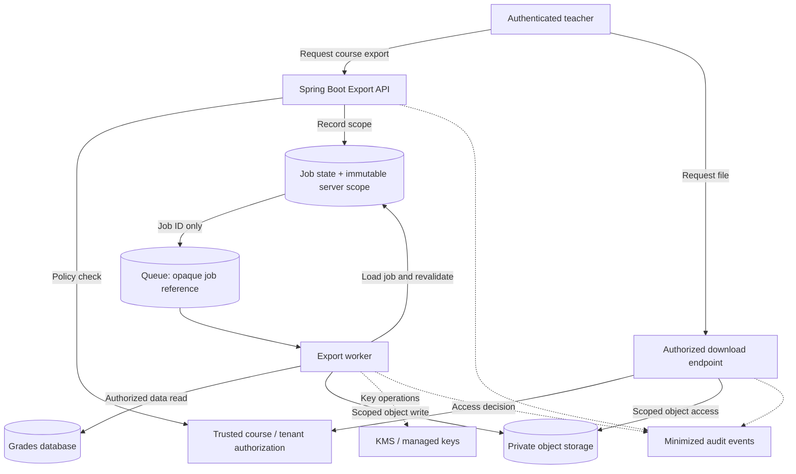
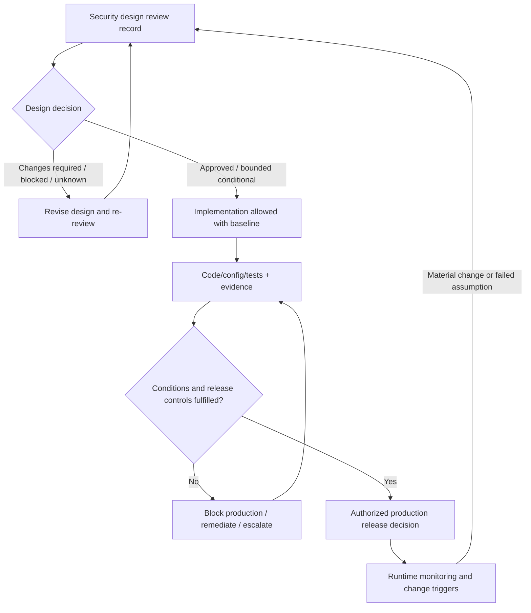

# Kết luận design review

## Mục tiêu học tập

Sau bài học này, bạn có thể:

- Giải thích **kết luận security design review** là gì và vì sao kết luận có giá trị phải đi kèm **phạm vi, baseline, lập luận, bằng chứng, giới hạn, điều kiện và người chịu trách nhiệm**.
- Phân biệt **design review decision**, **phê duyệt thiết kế**, **xác minh triển khai**, **nghiệm thu security requirement**, **risk acceptance** và **release approval**.
- Chọn trạng thái phù hợp: `DESIGN_APPROVED`, `CONDITIONALLY_APPROVED`, `CHANGES_REQUIRED`, `BLOCKED`, `INSUFFICIENT_EVIDENCE` hoặc kết luận giới hạn theo cấu trúc governance đã định.
- Đánh giá chất lượng đầu vào review, mức bao phủ threat/asset/data flow, security control và evidence; biết khi nào **không đủ căn cứ** để đưa ra một kết luận khẳng định.
- Soạn **finding, điều kiện phải đáp ứng, quyết định ngoại lệ, action plan và tiêu chí đóng** có thể kiểm tra được; áp dụng independent challenge và phân quyền phê duyệt tương xứng rủi ro.
- Dùng mô hình **Claim – Argument – Evidence (CAE)** để viết review conclusion không vượt quá những gì bằng chứng thực sự hỗ trợ.
- Xây dựng mẫu biên bản kết luận cho thiết kế **Java/Spring Boot** gồm API, queue, worker, database, object storage, IAM, KMS, logging và bên thứ ba.
- Thiết lập trigger **re-review** khi thay đổi kiến trúc, quyền, loại dữ liệu, môi trường, mối đe dọa hoặc khi phát hiện assumption/evidence không còn hợp lệ.

## 1. Kết luận design review là gì?

**Kết luận security design review** là đánh giá chính thức, có giới hạn, về mức độ một **thiết kế được định danh rõ** đã xử lý các security objectives, security requirements, trust boundaries, threat scenarios và quyết định kiểm soát trong **phạm vi review**. Nó cho biết:

1. **Đã xem xét cái gì?** Thiết kế, revision, môi trường mục tiêu, dịch vụ, data flows và phần loại trừ.
2. **Dựa vào tiêu chí nào?** Requirements, risk, threat model, policy, architecture standards và điều kiện review.
3. **Đã kiểm tra bằng chứng gì?** DFD, ADR, API contract, IAM model, design alternatives, review comments và các kết quả thử nghiệm nếu đã có.
4. **Phát hiện điều gì?** Controls đủ/chưa đủ, giả định chưa xác minh, findings, trade-offs và residual risks.
5. **Quyết định là gì?** Phê duyệt, phê duyệt có điều kiện, yêu cầu sửa, tạm chặn hoặc chưa đủ bằng chứng.
6. **Ai chịu trách nhiệm?** Design owner, security reviewer, data/risk owners, người phê duyệt và người thực hiện.
7. **Tiếp theo phải làm gì?** Action, deadline, release gate, verification plan, exception expiry và trigger rà soát lại.

Một câu “**Đã review, OK**” không phải kết luận đủ chất lượng. Nó không cho biết review đã bao phủ gì, những điều kiện nào được kiểm tra, người nhận quyền quyết định là ai, và một người triển khai sau này cần làm gì để không phá các giả định được duyệt.

### 1.1. Ví dụ mở đầu

Nền tảng học tập muốn cung cấp chức năng xuất bảng điểm qua một Spring Boot API. Quy trình dự kiến:

```text
Teacher → Grade Export API → Job Queue → Export Worker
                                    ├→ Grades Database
                                    └→ Private Object Storage → Download API → Teacher
                                               └→ Audit / Monitoring
```

Sau review, team báo “thiết kế đã an toàn vì có JWT, HTTPS và storage mã hóa”. Nhưng dữ kiện cho thấy:

- Controller mới chỉ kiểm role `TEACHER`, chưa kiểm quan hệ giáo viên–lớp và tenant.
- Queue message chứa `tenantId` do client gửi; worker dùng tài khoản DB đọc toàn bộ bảng điểm.
- Đường tải tệp kiểm tra file tồn tại nhưng chưa kiểm người sở hữu file.
- Object storage private nhưng presigned URL có thể bị chia sẻ ngoài phạm vi.
- Chưa thiết kế cách thu hồi quyền nếu job nằm chờ khi phân công lớp thay đổi.

Trong tình huống này, **kết luận “DESIGN_APPROVED” là không có cơ sở**. Kết luận đúng phải nêu các thiếu sót, mức ảnh hưởng, requirement vi phạm, phạm vi chưa có evidence, hành động sửa thiết kế và trạng thái quyết định theo policy. Nếu những thiếu sót mở đường truy cập dữ liệu trái quyền và không có mitigation phù hợp, review có thể **`CHANGES_REQUIRED` hoặc `BLOCKED`**; không được dùng một tính năng như TLS để bù cho thiếu authorization.

### 1.2. Kết luận không phải lời đảm bảo tuyệt đối

Một bản design review kỹ lưỡng có thể chứng minh **thiết kế đã được phân tích hợp lý với kiến thức, scope và evidence tại thời điểm xét duyệt**. Nó **không chứng minh**:

- Code cuối cùng không có lỗi implementation.
- Network/IAM/KMS runtime chắc chắn đúng như sơ đồ.
- Không tồn tại threat hoặc bypass chưa được nhận diện.
- Mọi vendor/third-party đang tuân thủ mọi điều kiện.
- Mọi thay đổi tương lai đều nằm trong phạm vi đã phê duyệt.

Với dịch vụ **SECURITY_SECURITY_ASSURANCE**, kết luận design review là một **evidence-backed decision trong chuỗi assurance liên tục**, không phải chứng chỉ “hệ thống bảo mật tuyệt đối”.

## 2. Phân biệt năm loại quyết định dễ bị nhầm

| Quyết định | Câu hỏi cần trả lời | Bằng chứng trọng tâm | Không nên suy ra |
| --- | --- | --- | --- |
| **Design review conclusion** | Thiết kế được đề xuất có xử lý hợp lý các security concerns và còn điều kiện nào? | Baseline/DFD/threat model, requirements, decisions, review artifacts. | Code hoặc control runtime đã đạt. |
| **Design approval** | Có thể tiếp tục thiết kế/triển khai trên baseline này theo conditions không? | Kết luận review, authority và control plan. | Release được phép ngay. |
| **Security requirement acceptance** | Requirement có được đáp ứng với tests/evidence trong đúng scope không? | Design + implementation + tests + runtime evidence theo requirement. | Mọi requirement khác hoặc phần ngoài scope cũng đạt. |
| **Risk acceptance / exception** | Residual risk hoặc sai khác có được người có thẩm quyền chấp nhận trong điều kiện được phép? | Risk assessment, compensating controls, owner, hạn và decision. | Technical finding biến thành PASS. |
| **Release / go-live approval** | Tổng các gates và điều kiện có cho phép triển khai/release không? | Build, tests, runtime readiness, operations, risk/exception status. | Thiết kế không còn cần re-review. |

### 2.1. Ba tầng assurance

**Design effectiveness:** Nếu kiểm soát được triển khai đúng như thiết kế, nó có giải quyết threat và requirement không?

**Implementation effectiveness:** Code, IaC, cấu hình, policy và dependencies có triển khai đúng quyết định thiết kế không?

**Operating effectiveness:** Control có hoạt động ổn định trong môi trường chạy thực, kể cả lỗi, drift, credential changes hoặc incident không?

Một kết luận chỉ dựa trên DFD, ADR và workshop **chủ yếu nói về design effectiveness**. Nếu đã xem tests và runtime artifacts, có thể ghi nhận chúng, nhưng phải **phân loại lớp bằng chứng**, không vô tình biến review design thành chứng nhận operating effectiveness.

### 2.2. Vấn đề chữ “approved”

Trong nhiều tổ chức, “approved” có thể chỉ là:

- Approved **để bắt đầu implementation**.
- Approved **sau khi thay một số quyết định**.
- Approved **theo assumptions chưa được xác minh**.
- Approved **trong một environment và revision cụ thể**.
- Approved **cho mục đích thử nghiệm**, nhưng chưa được deploy production.

Vì vậy, cần luôn nói rõ **approved for what**, **under which conditions**, **on which design version**, **by whom**, và **until which trigger**.

## 3. Điều kiện đầu vào trước khi đưa ra kết luận

Một reviewer không nên ký kết luận trên một bản sơ đồ thiếu các đối tượng và luồng rủi ro cao. Để xác định review đã có đủ cơ sở, cần kiểm tra tối thiểu các nhóm sau:

### 3.1. Baseline và traceability

| Artifact | Điều phải thể hiện | Nếu thiếu sẽ ảnh hưởng gì? |
| --- | --- | --- |
| **Architecture/design revision** | Version, change ID, service/environment/region mục tiêu. | Không biết người triển khai dùng bản thiết kế nào. |
| **Data Flow Diagram (DFD)** | Actors, entries, trust boundaries, dữ liệu, queue, storage, external recipients. | Có thể bỏ sót đường bypass hoặc data exfiltration. |
| **Asset/data inventory** | Data classification, owner, purpose, retention, key/secret dependencies. | Đánh giá impact thấp hơn thực tế. |
| **API/event/schema** | Routes, inputs/outputs, claims, IDs, message topics, error paths. | Không nhận diện BOLA, tampering, mass assignment và leaks. |
| **Identity/permission model** | Human/workload identities, roles, resource relationships, privileged actions. | Không xác định người nào được phép làm gì trên object nào. |
| **Threat model/risk assessment** | Attack scenarios, prioritization, assumptions và mitigations. | Review kiểm checklist chung mà bỏ qua risk thật. |
| **Security requirements** | ID, scope, acceptance criteria, control/test mapping. | Không có chuẩn rõ để kết luận thiết kế đáp ứng. |
| **ADRs/design options** | Lựa chọn, trade-offs, alternatives và lý do. | Không biết vì sao chấp nhận một mức residual risk. |
| **Deployment/operations design** | Network, IAM, KMS, logging, backup/DR, failure behavior và monitoring. | Thiết kế chỉ an toàn trên giấy, không có kế hoạch enforcement. |
| **Previous findings/changes** | Các finding mở, exception, incident và thay đổi gần nhất. | Duyệt lại một vấn đề đã biết mà chưa xử lý. |

Không phải mọi review nhỏ đều cần một bộ hồ sơ khổng lồ. Với tính năng ít rủi ro, có thể dùng diagram/ADR ngắn hoặc template đã duyệt. Nhưng nếu **data-flow/trust boundary quan trọng chưa biết**, không nên tự giả định đã đầy đủ chỉ để kịp deadline.

### 3.2. Kiểm tra dữ liệu đầu vào có hiện hành

Reviewers nên đối chiếu phiên bản tài liệu với:

- Source/architecture repository và release scope.
- Service catalog, API routes, topic/queue registry và dependency inventory.
- Cloud accounts/projects, VPC/subnet/SG, Kubernetes workloads, namespaces, ingress/egress.
- Role/tenant relationships, workload service accounts, KMS/secrets consumers.
- Đối tác, analytics/log sinks, backup/replica, region và data retention.
- Findings từ audit, penetration testing, incident và operations.

**Architecture diagram cũ không có service mới không chứng minh service đó không tồn tại.** Nếu inventory chưa hoàn chỉnh, ghi rõ coverage gap và `INSUFFICIENT_EVIDENCE` khi kết luận phụ thuộc dữ kiện đó.

### 3.3. Câu hỏi bắt buộc về phạm vi

Trước review, thống nhất:

1. **Tên hệ thống/feature** và mục tiêu nghiệp vụ là gì?
2. **Revision/baseline** nào được xem, thay đổi nào so với bản trước?
3. Áp dụng cho **production, staging, tenant, region, deployment** nào?
4. Luồng nào thuộc scope: API, job, database, file, log, backup, vendor?
5. Những điểm nào **out-of-scope**, vì sao, và ai chịu trách nhiệm review riêng?
6. Threat, security objective, requirement hoặc nghĩa vụ nào là tiêu chí chính?
7. Reviewer có đủ chuyên môn/độc lập với mức rủi ro không?
8. Bằng chứng nào **chưa có và không thể có trước implementation**? Điều kiện verification tiếp theo là gì?

Một kết luận tốt có thể nói “approved for implementation, not yet for production release”, vì đó chính là cách tránh suy luận vượt phạm vi.

## 4. Bộ trạng thái kết luận và ý nghĩa

Không có một taxonomy bắt buộc cho mọi tổ chức. Dưới đây là **mô hình đề xuất** nhằm tách kết quả review khỏi tiến độ phát triển và residual risk.

| Trạng thái | Khi nào sử dụng | Tác động |
| --- | --- | --- |
| **`DESIGN_APPROVED`** | Các tiêu chí thiết kế bắt buộc đã được giải quyết, không còn blocking design issue trong scope; verification plan và owner rõ. | Có thể đi tiếp theo lifecycle/gates được duyệt; **chưa tự là go-live PASS**. |
| **`CONDITIONALLY_APPROVED`** | Thiết kế đủ cơ sở đi tiếp **trong giới hạn cụ thể**, với điều kiện hữu hạn, có owner, deadline, blocking stage và tiêu chí kiểm tra. | Chỉ được tiến tới stage đã nêu; không mở tự động production khi chưa thỏa điều kiện. |
| **`CHANGES_REQUIRED`** | Có design flaw/gap cần sửa trước khi approval, hoặc review đã xác định phương án hiện tại không đáp ứng requirement. | Sửa baseline rồi review lại phần thay đổi và ảnh hưởng. |
| **`BLOCKED`** | Có blocker nghiêm trọng hoặc điều kiện bắt buộc chưa thể cho phép bước tiếp theo theo policy. | Không tiếp tục stage bị chặn; cần escalation hoặc phương án khác. |
| **`INSUFFICIENT_EVIDENCE`** | Thiếu scope, DFD, security model, threat/control rationale hoặc proof cần thiết để đưa ra judgment. | Thu thập/chỉnh tài liệu, không coi unknown là PASS/FAIL. |
| **`OUT_OF_SCOPE` / `DEFERRED`** | Một hạng mục được loại khỏi review có lý do và owner riêng, hoặc dời assessment theo kế hoạch hợp lệ. | Không tạo bảo đảm cho mục chưa xem; lưu dependency và giới hạn kết luận. |

### 4.1. Design approved vẫn cần release controls

Ví dụ, thiết kế dùng server-side authorization theo course/tenant, job record có scope đáng tin, private storage và download gateway. Reviewer có thể phê duyệt **mô hình thiết kế** nếu requirements, threat model và failure modes đã có cách xử lý phù hợp, nhưng việc triển khai vẫn phải chứng minh:

- Policy thực sự enforce tại controller/service/worker/download.
- Positive/negative tests chạy với fixture cùng role/khác course/tenant.
- IAM/NetworkPolicy và bucket access đúng trên deployment.
- Logs, data minimization, TTL, key lifecycle và recovery đúng scope.
- Findings/conditions được xử lý và re-test.

Không nên viết “bảo mật đã hoàn tất” khi mới duyệt bản vẽ.

### 4.2. Có điều kiện nhưng không phải “PASS mập mờ”

`CONDITIONALLY_APPROVED` hợp lệ khi điều kiện:

- Rõ **việc cần làm** và lý do;
- Có **owner** và thời hạn/mốc lifecycle;
- Có **evidence/acceptance criterion**;
- Nêu **stage được phép đi tiếp** và **stage bị chặn**;
- Có reviewer/approver theo policy;
- Có hệ thống theo dõi tự động hoặc thủ công đáng tin;
- Có cơ chế **expire, revoke hoặc re-review** nếu điều kiện không được đáp ứng.

Ví dụ: “Thiết kế API và authorization được phê duyệt cho implementation. **Không deploy production** trước khi review bucket policy và chứng minh worker-side re-authorization bằng tests.” Đây là condition cụ thể, không phải “approved, security team kiểm sau”.

### 4.3. Thiếu bằng chứng khác với xác định sai

- Nếu review đã chứng minh thiết kế download cho phép mọi user biết `exportId` tải tệp của nhau, đó là **design flaw / `CHANGES_REQUIRED` hoặc `BLOCKED`**, không phải chỉ “chưa đủ evidence”.
- Nếu sơ đồ không cho biết endpoint download có authz hay không, và không có thiết kế chi tiết, đó có thể là **`INSUFFICIENT_EVIDENCE`**; cần bổ sung trước khi kết luận.
- Nếu có control được thiết kế đúng nhưng một phần triển khai chưa test, **design** có thể approved trong phạm vi, còn **implementation acceptance** vẫn chưa đạt hoặc chưa đủ evidence.

Không dùng trạng thái thiếu evidence để né ghi nhận một lỗi đã được chứng minh; cũng không suy ra lỗi tồn tại khi đơn giản là chưa có dữ kiện.

## 5. Ma trận quyết định theo rủi ro và tiêu chí

Reviewer không nên chọn trạng thái chỉ từ cảm giác “có vẻ ổn”. Cần xác định các **decision factors** và ngưỡng theo governance/risk appetite, không gán điểm giả chính xác.

| Tiêu chí | Câu hỏi cốt lõi | Kết luận khi còn lỗ hổng đáng kể |
| --- | --- | --- |
| **Security objectives và risk** | Thiết kế đã xử lý những threat có ảnh hưởng cao được nhận diện chưa? | Thay đổi hoặc chặn nếu threat quan trọng chưa có mitigation. |
| **Scope/data-flow completeness** | Tài sản, actor, entry points, đường phụ và external recipients đã được định danh? | Không đủ evidence khi thiếu population quan trọng. |
| **Authorization model** | User/service chỉ thực hiện action được phép trên object/tenant đúng? | Block/change khi có đường truy cập trái quyền đã thấy. |
| **Data protection/privacy** | Classification, minimization, retention, encryption, audit và data transfer phù hợp? | Sửa/điều kiện Privacy review, không giả định hợp lệ. |
| **Controls at trust boundaries** | Mỗi boundary có identity, validation, authz, failure mode và owner? | Yêu cầu thiết kế control rõ nếu có bypass. |
| **Failure and abuse modes** | Timeout, retry, duplicate, replay, stale access, compromise có xử lý? | Điều kiện hoặc sửa thiết kế tùy mức risk. |
| **Architecture/deployment feasibility** | IAM, network, KMS, monitoring, backup có cơ chế thực thi được? | Sửa design nếu control không khả thi. |
| **Evidence quality** | Artifact có version, owner, provenance, scope và câu trả lời đúng tiêu chí? | Chưa đủ evidence hoặc thu hẹp claim. |
| **Findings/exceptions** | Mọi issue có owner, priority, conditions và authority phù hợp? | Không approval khi blockers chưa được xử lý. |
| **Verification plan** | Đã định nghĩa test/evidence cho implementation và runtime chưa? | Không xem design approval là unconditional release. |

### 5.1. Không có công thức PASS cứng cho mọi trường hợp

Tổ chức có thể định nghĩa mức độ như Critical/High/Medium/Low, nhưng phải có **định nghĩa rõ, khả năng phân loại và thẩm quyền**. Không nên tuyên bố chung rằng “còn ≤ 2 High findings vẫn PASS” khi chưa có policy cho risk acceptance và chưa xem data sensitivity.

Ví dụ, lộ bảng điểm của nhiều tenant có thể là blocker dù số lượng finding chỉ là một. Ngược lại, một nhãn sơ đồ thiếu nhất quán nhưng không làm sai security property có thể được ghi thành action không blocking nếu owner và tiêu chí sửa rõ.

### 5.2. Những tình huống thường phải escalation

- Thiết kế cho phép truy cập dữ liệu cá nhân/bảng điểm trái role hoặc trái tenant.
- Khóa signing/encryption, secrets hoặc management privilege có scope quá rộng so với tài sản.
- Chưa xác minh nghĩa vụ xử lý dữ liệu/nhà cung cấp/region khi tính năng phụ thuộc vào nó.
- Control giả định “trusted internal service” trong khi attacker có thể khai thác/mạo danh workload.
- Không có cách khả thi thực thi, test hoặc audit control bắt buộc.
- Một finding nghiêm trọng đã được phát hiện trước đó chưa được xử lý hoặc có risk decision hợp lệ.

Các nghĩa vụ pháp lý/pháp quy và hợp đồng **phải được chuyên gia có thẩm quyền kiểm tra theo bản hiện hành**, không thể tự chấp thuận bỏ qua bằng một quyết định nội bộ.

## 6. Viết câu kết luận có đầy đủ các thành phần

Một review conclusion chất lượng nên có cấu trúc:

```text
DECISION:
  State:
  Allowed next stage:
  Blocked stage / release restriction:
SCOPE:
  System, feature, design revision:
  Environments/regions, assets and flows:
  Explicit exclusions:
BASES:
  Security objectives, requirements and threat/risk sources:
  Reviewed artifacts, versions and dates:
FINDINGS:
  Blocking, non-blocking, unknown and accepted risks:
RATIONALE:
  Why selected decision follows from criteria/evidence:
CONDITIONS AND FOLLOW-UP:
  Action, owner, due date, re-test/approval and closure gate:
AUTHORITY:
  Reviewer(s), decision maker, role and decision timestamp:
REVIEW AGAIN WHEN:
  Material changes, conditions expire, new findings or incidents:
```

### 6.1. Ví dụ kết luận chưa đạt

> Review completed. Thiết kế đủ an toàn. Security team đã đồng ý. Team có thể release.

Vấn đề: không rõ scope, revision, requirements, rationale, evidence, owner, reviewer, findings hay quyền release. Đây **không phải** kết luận có thể kiểm toán.

### 6.2. Ví dụ kết luận có căn cứ (minh họa)

> **Kết luận: CHANGES_REQUIRED.** Review thiết kế `grade-export` revision `D-4`, mục tiêu production cluster `learning-prod`, bao gồm API tạo job, queue, worker, grades database, object storage, download và audit. Thiết kế hiện tại chỉ kiểm role TEACHER tại API, chưa có chính sách quyền theo course/tenant cho worker và download. Điều này không đáp ứng `SR-GRADE-AUTHZ-01` và tạo đường xuất dữ liệu sai lớp. Team phải cập nhật chính sách nguồn tin cậy, mô hình job/permission và download gateway; gửi DFD/ADR revision mới và test plan cho re-review. **Chưa phê duyệt production release**. Các vấn đề về vendor analytics và backup key dependency được giao owner review riêng; không thuộc kết luận PASS hiện tại.

Kết luận mẫu này **không khẳng định một sự cố đã xảy ra**; nó ghi nhận khả năng vi phạm yêu cầu từ thiết kế được mô tả. Reviewer cần gắn đúng evidence IDs và người có thẩm quyền trong hồ sơ thực.

### 6.3. Viết ngắn nhưng không bỏ thông tin quan trọng

Trong buổi báo cáo, kết luận có thể nằm trong một đoạn ngắn nhưng phải dẫn đến **decision record có đầy đủ chi tiết**. Một câu “Approved with conditions; see ADR-12, F-03/F-05, gate G-PROD-4” chỉ hữu ích nếu các references tồn tại, có quyền truy cập và không bị sửa tùy tiện sau khi ký.

## 7. Quản lý findings, conditions, recommendations và unknowns

Không nên gom mọi nhận xét review vào một danh sách không phân loại. Các đối tượng có mục đích khác nhau:

| Loại | Ý nghĩa | Ví dụ | Cách đóng |
| --- | --- | --- | --- |
| **Blocking finding** | Lỗi thiết kế hoặc thiếu control khiến stage không được phép đi tiếp. | Không có object-level authorization cho bảng điểm. | Design revision + re-review; tiếp theo kiểm implementation. |
| **Non-blocking finding** | Vấn đề có thật nhưng policy cho phép giải quyết theo action có hạn. | Chưa tối ưu log schema cho một event ít rủi ro. | Owner, deadline, evidence và review closure. |
| **Condition** | Điều phải thỏa trước stage/release cụ thể. | Phải có test revoked access của worker trước production. | Evidence, reviewer/authority sign-off cho gate. |
| **Recommendation** | Cải tiến hữu ích không nhất thiết là requirement bắt buộc. | Dùng reusable policy library trong các service khác. | Backlog owner/decision theo priority. |
| **Unknown/assumption** | Điều chưa xác minh, có thể làm đổi kết luận. | Chưa xác định có external support access vào object storage. | Discovery/validation; đánh giá lại impact. |
| **Accepted risk/exception** | Sai khác trong scope được authority chấp nhận hợp lệ nếu policy cho phép. | Kéo dài overlap một credential vì dependency có biện pháp bù trừ. | Risk register + expiry, không đánh dấu control PASS. |

### 7.1. Finding phải kiểm chứng được

Một finding nên có:

- ID, title, mô tả factual và loại/độ ưu tiên.
- Requirement/security objective/threat có liên quan.
- Affected assets/data category, actors, trust boundary, environment và design revision.
- Đường có thể bị lạm dụng và điều kiện ảnh hưởng; phân biệt **thiết kế có lỗ hổng** với **dữ liệu đã bị khai thác**.
- Evidence IDs, nguồn và giới hạn.
- Remediation options, chosen decision và rationale.
- Owner, due date, reviewer, acceptance criteria và gate bị ảnh hưởng.
- State, residual risk, exception nếu có, trigger re-test/re-review.

Ví dụ:

```yaml
finding_id: "SDR-F-017"
type: "BLOCKING_DESIGN_FINDING"
requirement_id: "SR-GRADE-AUTHZ-01"
asset: "course-grades"
scenario: "Same-role teacher requests another tenant's export"
trust_boundary: "request-to-api-and-worker-to-data"
design_revision: "D-4"
evidence_ref: "<versioned-API-and-worker-flow>"
impact: "Unauthorized disclosure of grade data"
remediation: "Server-defined scope, worker re-check, authorized download"
owner_role: "grade-export-service-owner"
due_date: "<approved-date>"
closure_criteria:
  - "Reviewed DFD and authorization decision flow"
  - "Positive and negative test plan for cross-course/tenant"
  - "Independent review of revised control design"
status: "OPEN"
```

Đây là **mẫu finding**, không phải sự cố thực. Không điền tên người dùng, dữ liệu học viên thật hay token vào minh chứng chỉ để minh họa.

### 7.2. Conditions phải có ràng buộc lifecycle

Một condition nên chỉ rõ:

```text
CONDITION-ID: COND-04
Applies to: D-5 / production release
Required outcome: Export worker must not process revoked/expired jobs
Proof: Negative tests for permission revocation + reviewed runtime IAM
Owner: Grade export engineering lead
Due: Before production deployment gate
Verifier: Security reviewer
Failure response: Block production; create finding and re-plan
```

“Security sẽ xem sau” thiếu outcome, owner và deadline. “Phải sửa sau launch” có thể trái release policy nếu đây là mandatory control. **Điều kiện được duyệt không có nghĩa tự động bỏ qua finding**.

## 8. Lập luận Claim – Argument – Evidence cho kết luận

Mô hình **Claim – Argument – Evidence (CAE)** buộc reviewer trình bày điều họ tin là đúng, tại sao lập luận hợp lý và bằng chứng nào hỗ trợ.

### 8.1. Claim về design review

**Claim D-1:** “Thiết kế `grade-export` revision D-5 đã được đánh giá trong scope API–queue–worker–data store–download, và các security requirements trọng yếu về object/tenant authorization, data minimization, workload permissions và audit được xử lý bằng các controls đã định nghĩa, với phần còn chờ verification được nêu rõ.”

### 8.2. Argument

1. **Population:** System/flow inventory và DFD chỉ rõ actors, data categories, entry points và trust boundaries.
2. **Threat coverage:** abuse cases về BOLA, cross-tenant, queue tampering, stale permissions, leaked URL, log leakage và worker compromise đã được xem xét.
3. **Control appropriateness:** mỗi threat trọng yếu có policy/enforcement point hoặc phương án giảm rủi ro khả thi.
4. **Requirements traceability:** mỗi control gắn với requirement ID, owner và acceptance criteria.
5. **Design decisions:** alternatives/trade-offs, failure modes, known limitations và residual risk có decision theo thẩm quyền.
6. **Verification plan:** tests và runtime evidence cần sau triển khai được giao owner và gate.

### 8.3. Evidence

| Luận cứ | Evidence cần có | Điều evidence không tự chứng minh |
| --- | --- | --- |
| Flow đầy đủ | Versioned DFD, asset/API/service inventories, scope decisions. | Mọi hệ thống ngoài inventory không tồn tại. |
| Threat được xét | Threat scenarios, review comments, attack-path analysis. | Không còn threat mới hoặc zero vulnerabilities. |
| Authorization design | Policy model, course–teacher/tenant relationship, decisions và tests dự kiến. | Code đã enforce chính xác trên runtime. |
| Workload/data controls | IAM design, object storage/queue policy, DLP/log handling design. | Effective permissions đã áp dụng. |
| Lý do quyết định | ADR, trade-off, approved requirements, reviewer challenge. | Risk đã được chấp nhận nếu chưa có authority. |
| Conditions và follow-up | Findings register, action owners, verification gates. | Việc đã được hoàn thành chỉ vì có action. |

### 8.4. Claim nào không được kết luận từ design artifacts?

Không được viết “**production đã chặn mọi cross-tenant request**” nếu mới có design. Claim đó cần **positive/negative integration tests, runtime policies, deployed build và path coverage**. Có thể đặt nó thành **future implementation/operating assurance claim** để thu evidence ở gate sau.

**Kết luận muốn đáng tin phải tách:**

- **Design claim:** control được thiết kế phù hợp trong scope.
- **Implementation claim:** control đã được triển khai và kiểm đúng version.
- **Operating claim:** control hoạt động trong môi trường thực, không có drift ngoài giới hạn đánh giá.

## 9. Phân quyền phê duyệt và independent challenge

### 9.1. Vai trò

| Vai trò | Trách nhiệm trong kết luận |
| --- | --- |
| **Design owner/architect** | Chuẩn bị baseline, giải thích quyết định/trade-offs, nhận action sửa. |
| **Service/product owner** | Xác nhận mục tiêu nghiệp vụ, phạm vi và tác động triển khai. |
| **Data owner/Privacy reviewer** | Chất lượng dữ liệu, mục đích, classification, retention, transfer và nghĩa vụ phù hợp. |
| **Security reviewer** | Kiểm security objectives, threat model, trust boundaries, requirement/control mapping và conditions. |
| **Platform/Operations** | Chất lượng phương án IAM, network, KMS, runtime monitoring, backup/DR và vận hành. |
| **QA/Verification lead** | Thiết kế phương pháp kiểm tra, fixtures, positive/negative tests và evidence plan. |
| **Risk owner** | Quyết định risk acceptance/exception theo thẩm quyền khi được phép. |
| **Decision authority / architecture board** | Phê duyệt kết luận design/release gate theo governance, sau khi xét evidence và findings. |
| **Independent assurance/auditor** | Đánh giá chất lượng lập luận và evidence; kiểm closure khi được yêu cầu. |

Vai trò có thể kiêm nhiệm theo quy mô tổ chức, nhưng **người viết thiết kế không nên tự là người duy nhất phê duyệt ngoại lệ rủi ro cao của chính thiết kế**, và người có quyền chấp nhận residual risk phải được xác định bởi governance chứ không chỉ bằng chức danh kỹ thuật.

### 9.2. Sign-off phải nói rõ điều gì?

Decision/sign-off cần ít nhất:

1. Review ID, version và baseline/revision được xét.
2. Decision state và lifecycle stage được phép tiếp tục.
3. Criteria, sources, evidence references và giới hạn claim.
4. Blocking findings, non-blocking items, conditions và unresolved assumptions.
5. Risk/exception decisions và authority riêng nếu có.
6. Người review/approve, role, thời điểm, cơ chế bảo vệ integrity và lịch sử chỉnh sửa.
7. Re-review triggers và người theo dõi.

Không coi một email “OK” thiếu baseline/scope là phê duyệt cho mọi lần thay đổi sau này.

### 9.3. Bất đồng giữa reviewer và engineering

Nếu team engineering đánh giá risk thấp nhưng security reviewer đánh giá cao:

- Ghi hai giả định và cơ sở riêng (threat path, data sensitivity, blast radius, mitigation).
- Yêu cầu thêm dữ liệu/test hoặc phân tích phương án thay thế.
- Đưa vấn đề lên **decision/risk authority** phù hợp khi không đạt đồng thuận.
- Ghi rõ điều kiện, người chịu trách nhiệm, thời hạn và trigger mở lại.
- Không xóa ý kiến phản biện chỉ vì đã chốt release date.

Independent challenge là **cơ chế cải thiện độ tin cậy của quyết định**, không phải biểu diễn có thêm người ký.

## 10. Kết luận theo phạm vi: tránh PASS vượt quá coverage

### 10.1. Scope hẹp và scope rộng

Ví dụ cùng một feature có thể có những kết luận khác nhau:

| Scope | Có thể kết luận | Chưa thể kết luận |
| --- | --- | --- |
| **API authorization design** | Policy model theo course/tenant hợp lý và có test plan. | Worker, storage, download hoặc IAM đã an toàn. |
| **Full export design** | API, queue, worker, storage, download, log và data minimization được xét. | Production runtime triển khai đúng. |
| **Implementation verification** | Các behavior được thử trên build R trong staging. | Production permissions/network có giống staging. |
| **Operating assurance** | Các runtime controls đã kiểm trong production snapshot/event window. | Hiệu lực vĩnh viễn hoặc các đường chưa inventory. |

Nếu reviewer chỉ xét API, không được ghi “hệ thống export bảng điểm an toàn” trừ khi đã có assessment đáng tin cho các thành phần khác.

### 10.2. Coverage của threat và data flows

Một kết luận cần xem ít nhất:

- Actors: user hợp lệ/không hợp lệ, admin/support, worker/service account, vendor.
- Assets: grades, learner identity, certificates, tokens, secrets, keys, audit trail.
- Entry points: routes, jobs/events, object downloads, admin/debug paths, callbacks.
- Trust boundaries: browser→API, API→queue, worker→data, app→storage/KMS, app→vendor/log.
- Failure paths: missing role, stale permission, retry, timeout, replay, error handling, rollback, compromised credential.
- Environments/regions: target deployment, backup/DR, external recipients nếu áp dụng.

Không nhất thiết mỗi review bao phủ mọi lĩnh vực với độ sâu như nhau; nhưng **loại trừ phải rõ lý do và owner của review khác**, thay vì quên chúng.

### 10.3. So sánh evidence tốt và evidence yếu

| Bằng chứng | Mạnh hơn khi | Yếu khi |
| --- | --- | --- |
| DFD | Có version, actors, data categories, trust boundaries, external flow và reviewer notes. | Chỉ là sơ đồ box-and-arrow không thể hiện dữ liệu nhạy cảm hoặc scope. |
| ADR | Có alternatives, threat/risk rationale, reviewer và decision date. | Ghi “chọn X vì dễ làm”, không nêu trade-offs. |
| Policy specification | Nêu identity, action, resource, tenant, data source và deny behavior. | Chỉ viết “authenticated user required”. |
| Test plan | Có fixtures dương/âm, failure modes, inventory và expected outcomes. | “QA sẽ test security” không có case. |
| Prototype/test result | Có build/config, tool/fixture, result và giới hạn. | Screenshot không có timestamp/region. |
| Runtime config | Có effective permissions, environment và reviewer. | Một file IaC chưa deploy hoặc screenshot từ staging. |

### 10.4. Không dùng số lượng comment làm chất lượng

“Không có issue nào” có thể vì thiết kế thực sự tốt, nhưng cũng có thể vì review quá hẹp, người review không có đúng chuyên môn, hoặc tài liệu thiếu. “Có 20 comments” cũng không có nghĩa review tốt nếu chúng chỉ sửa chính tả. Hãy đánh giá **coverage, threat-to-control mapping, quality of evidence, decision clarity và follow-up**.

## 11. Case study: kết luận thiết kế export bảng điểm Java/Spring Boot

### 11.1. Bối cảnh và yêu cầu

Nền tảng học tập có nhiều trường/tenant. Giáo viên được phân công cho một hoặc nhiều lớp, có thể yêu cầu file CSV bảng điểm. Hệ thống thực hiện bất đồng bộ để không chặn HTTP request:

- Teacher đăng nhập thông qua IdP, sử dụng access token.
- API Spring Boot tạo export job và lưu job metadata vào database.
- Queue kích hoạt worker đọc bảng điểm và tạo file.
- Worker ghi file vào object storage có mã hóa.
- Download endpoint xác minh quyền và cung cấp dữ liệu hoặc chuyển hướng tới một phương thức tải được kiểm soát.
- Audit pipeline ghi sự kiện yêu cầu, xử lý, tải và từ chối.

Các requirements trọng yếu (ID chỉ minh họa):

| ID | Security property | Acceptance criteria sẽ cần ở bước triển khai |
| --- | --- | --- |
| `SR-EXP-01` | Chỉ principal được phân công và đủ quyền export course trong tenant tương ứng được tạo job. | Positive/negative tests cho cùng role khác course/tenant; không có job khi deny. |
| `SR-EXP-02` | Job lưu scope do server xác định; không tin `tenantId`, object key hoặc URL do client tự khai. | Message tampering/replay và job scope inspection. |
| `SR-EXP-03` | Worker xử lý job đúng identity, job state, owner và permission policy đã duyệt, kể cả quyền bị thu hồi. | Revoked/stale/replayed jobs, policy-unavailable tests, effective permissions. |
| `SR-EXP-04` | CSV được phân loại, chỉ gồm trường được duyệt, private và có retention/cleanup đúng scope. | Schema minimization, bucket access, expired/orphan file tests. |
| `SR-EXP-05` | Tải file yêu cầu quyền hợp lệ tại điểm truy cập, không dựa duy nhất vào một URL có thể chia sẻ. | Cross-user, other-tenant, expired/revoked link tests. |
| `SR-EXP-06` | Workload IAM/KMS/network giới hạn quyền và đường kết nối; lỗi control không biến thành allow. | Effective IAM, negative network/storage tests, KMS outage. |
| `SR-EXP-07` | Audit đủ truy vết actor/action/resource/outcome mà không chứa điểm, token hoặc secret trái policy. | Event schema và log-to-sink/error-path review. |
| `SR-EXP-08` | Retry, duplicate delivery và partial failure không tạo dữ liệu ngoài phạm vi/retention. | Idempotency, concurrency, reconciliation và cleanup tests. |

Các tiêu chí này cho thấy review không dừng ở câu “API có authentication”; nó phải xác định **các security properties xuyên suốt vòng đời file**.

### 11.2. DFD review và điểm chốt control



**Trust boundaries cần chốt trong review:**

1. Browser/client → API: input chưa đáng tin, identity và claims phải kiểm theo model đã duyệt.
2. API → job store/queue: message không mang quyền vĩnh viễn; scope do server tạo.
3. Queue → worker: caller/service account phải được xác thực và xác minh job current/authorized.
4. Worker → database/storage/KMS: quyền tối thiểu ở các hệ thống đích, không chỉ application role.
5. Teacher → download → storage: phải kiểm quyền lúc tải và bảo vệ cả direct object access.
6. All components → audit/log sink: đủ điều tra nhưng không lộ grade/token; vendor/exporters thuộc data flow.

### 11.3. Thiết kế D-4: findings và kết luận

Giả sử revision `D-4` của nhóm kỹ thuật có các thuộc tính:

- API dùng `hasRole('TEACHER')`; tenant và course nhận từ request.
- Queue chuyển nguyên payload gồm email và `courseId`; worker tin payload.
- Worker có `SELECT` trên toàn bộ database và quyền ghi tất cả object storage prefixes.
- Tải file bằng presigned URL không kiểm lại quan hệ người tải–file.
- Log exception có thể chứa dữ liệu CSV.

Reviewer phân loại:

| Finding | Phân tích | Loại | Action |
| --- | --- | --- | --- |
| `F-01` Không có object/tenant authorization | Một giáo viên có thể chọn `courseId` khác trong thiết kế. | Blocking design finding. | Trusted policy dựa trên assignment và tenant; deny behavior. |
| `F-02` Job scope do client kiểm soát | Worker có thể xử lý dữ liệu ngoài scope nếu message giả/mất integrity. | Blocking design finding. | Opaque ID, trusted immutable scope, replay/permission checks. |
| `F-03` Download không kiểm quyền | File có thể bị truy cập qua link sai chủ thể theo kiến trúc dự kiến. | Blocking hoặc condition theo risk và phương án sửa. | Authorized download gateway hoặc thiết kế tương đương. |
| `F-04` Worker IAM quá rộng | Compromise worker có blast radius lớn. | High finding, có thể blocking theo policy. | IAM theo dataset/prefix/purpose, reviewer platform. |
| `F-05` Log exposure | Thiết kế lỗi ghi CSV thô vào sink chưa đánh giá. | Finding cần sửa. | Structured logging, field allowlist, error-path controls. |
| `U-01` Backup/retention chưa mô tả | Chưa đủ dữ liệu về file cleanup và DR. | Unknown/insufficient evidence. | Bổ sung lifecycle, backup flow và test plan. |

**Kết luận đối với D-4:** `CHANGES_REQUIRED`; nếu governance quy định các lỗi authorization nêu trên là gate blockers thì stage deployment bị `BLOCKED`. Không cần khẳng định có attacker đã khai thác; chỉ cần chứng minh **thiết kế hiện tại không loại trừ truy cập trái quyền**.

### 11.4. Revision D-5 sau sửa và quyết định có giới hạn

Nhóm đề xuất `D-5`:

1. API và download endpoint dùng server-side course/tenant authorization, không tin `tenantId` từ client.
2. Job chứa trusted course/tenant scope, requestor identity, state/version, expiry và một opaque reference trong message.
3. Worker đọc job từ trusted store, xử lý policy expiry/revocation theo phương án được duyệt và chống duplicate/replay.
4. File trong private bucket/prefix, có owner, classification, TTL và logic cleanup/orphan reconciliation.
5. Worker dùng workload identity hẹp; KMS, object storage, DB permissions và egress cần được xác nhận trong triển khai.
6. Audit events chỉ ghi actor/resource reference, outcome và correlation ID theo schema được duyệt; không ghi grade/token thô.

Thiết kế mới có thể **đủ để tiếp tục implementation**, nhưng phần reviewer chưa kiểm được gồm actual IAM, runtime bucket policy, worker negative tests, log-to-sink và restore drill. Vì thế kết luận có thể là **`CONDITIONALLY_APPROVED` cho implementation, production release bị chặn cho tới khi các điều kiện được chứng minh**, nếu không còn blocking design flaw và policy cho phép. Nếu điều kiện thiết kế quan trọng vẫn chưa rõ, không dùng trạng thái này; chuyển `INSUFFICIENT_EVIDENCE` hoặc `CHANGES_REQUIRED`.

### 11.5. Ví dụ câu kết luận theo baseline D-5

> **State:** CONDITIONALLY_APPROVED — implementation stage only.  
> **Baseline:** Grade-export design D-5, learning platform, production-target, services API/queue/worker/storage/download.  
> **Rationale:** DFD và revised policy model đã giải quyết các design findings F-01, F-02 và F-03 trong phạm vi được review; log/data/IAM controls có design owner và requirements rõ.  
> **Conditions blocking production:** xác minh IAM/NetworkPolicy/storage/KMS trên môi trường đích, hoàn tất negative tests cho stale/replayed job và cross-tenant download, kiểm log-to-sink và backup/retention, đóng findings còn mở sau re-test.  
> **Exclusions:** third-party analytics trong một release khác; cần review riêng nếu kết nối thực tế xuất hiện.  
> **Authority:** decision owner theo quy trình, thời điểm và record tham chiếu.  
> **Re-review triggers:** thay job contract, auth model, storage provider, data category hoặc phát hiện threat/finding mới.

Kết luận này có ích vì **hướng dẫn việc tiếp theo**. Đặc biệt, nó không tự đánh dấu `F-04`/`F-05` đã xử lý khi mới có kế hoạch kiểm thử.

## 12. Spring Boot: kết luận thiết kế liên hệ với mã và kiểm thử thế nào?

### 12.1. Thiết kế application authorization dự kiến

Đoạn mã chỉ để minh họa **enforcement point** cho requirement object-level authorization:

```java
@Configuration
@EnableMethodSecurity
class MethodSecurityConfiguration {}

@Service
public class GradeExportService {
    private final ExportJobRepository jobs;
    private final CourseCatalog courses;

    public GradeExportService(
            ExportJobRepository jobs,
            CourseCatalog courses
    ) {
        this.jobs = jobs;
        this.courses = courses;
    }

    @PreAuthorize(
        "@gradeExportPolicy.canRequest(authentication, #courseId)"
    )
    public ExportJobId requestExport(long courseId) {
        CourseScope scope = courses.getTrustedScope(courseId);
        return jobs.createWithTrustedScope(
                scope.courseId(),
                scope.tenantId(),
                scope.datasetRevision()
        );
    }
}
```

`gradeExportPolicy` là bean business authorization **giả định**; `ExportJobRepository`, `CourseCatalog` và các record types cũng phải được triển khai. Policy phải kiểm principal, tenant, phân công course còn hiệu lực, action và state trên nguồn tin cậy; không chấp nhận dữ liệu do client tự cung cấp làm chứng cứ quyền.

Các câu hỏi reviewer cần ghi trong kết luận:

- Service method có được gọi qua Spring Security proxy thực hay self-invocation bỏ qua `@PreAuthorize`?
- Endpoint khác, message consumer, admin endpoint và direct repository path có bypass policy?
- Các endpoint trả file/đọc job có kiểm quan hệ resource và tenant tương đương?
- Nếu authorization store unavailable, hệ thống có deny/hold theo policy hay fallback role-only?
- Có race khi quyền bị thu hồi giữa authorization và tạo job/đọc dữ liệu?
- Method Security và HTTP filter chain thực sự hoạt động trên build mục tiêu?

**Một đoạn code mẫu trong tài liệu thiết kế không phải bằng chứng đã triển khai**. Nó giúp reviewer chấp nhận **control strategy** nếu phù hợp; việc hiện thực được xác minh ở stage sau.

### 12.2. Worker-side decisions (pseudo-code)

```java
public void processJob(ExportJobId jobId) {
    ExportJob job = jobStore.loadTrustedJob(jobId);
    if (!policy.isStillAuthorized(job)) {
        jobStore.markDenied(jobId);
        return;
    }
    if (!jobStore.tryClaim(jobId, job.version())) {
        return; // Already claimed or stale version
    }
    exportEngine.generateScopedFile(job);
    jobStore.completeIfCurrent(jobId, job.version());
}
```

Đây là pseudo-code cho **discussion về thiết kế**, không phải implementation hoàn chỉnh. Nó chưa giải quyết transaction boundary, lease/lock, object cleanup, stale permission sau bước kiểm, các điều kiện rollback và retry; các vấn đề đó phải được **nêu thành control decisions hoặc conditions** thay vì che bằng việc có method `isStillAuthorized`.

### 12.3. Test plan gắn với design conclusion

```java
@SpringBootTest
@AutoConfigureMockMvc
class GradeExportAuthorizationIT {
    @Autowired
    MockMvc mockMvc;

    @Test
    @WithMockUser(username = "teacher-a", roles = "TEACHER")
    void assignedTeacherCanCreateJob() throws Exception {
        mockMvc.perform(post("/api/courses/42/grades/exports")
                .with(csrf()))
            .andExpect(status().isAccepted());
    }

    @Test
    @WithMockUser(username = "teacher-b", roles = "TEACHER")
    void unassignedTeacherCannotCreateJob() throws Exception {
        mockMvc.perform(post("/api/courses/42/grades/exports")
                .with(csrf()))
            .andExpect(status().isForbidden());
    }

    @Test
    @WithMockUser(username = "teacher-a", roles = "TEACHER")
    void crossTenantExportIsDenied() throws Exception {
        mockMvc.perform(post("/api/courses/99/grades/exports")
                .with(csrf()))
            .andExpect(status().isForbidden());
    }
}
```

Giả định fixtures: `teacher-a` được phân công course 42 thuộc tenant A, `teacher-b` có cùng role nhưng không được phân công, course 99 thuộc tenant B. Test mẫu cần controller, Spring Security, `spring-security-test`, imports, fixtures và policy thực. **Mã `403` không tự chứng minh object authorization** nếu route/CSRF/security config bị sai; cần positive control và side-effect assertions rằng request bị deny **không tạo job**.

### 12.4. Acceptance mapping cho stage sau

| Thiết kế đã xác định | Implementation test/evidence cần thêm | Không được ghi trong design conclusion |
| --- | --- | --- |
| API phải kiểm resource/tenant. | MockMvc, policy unit tests, code review, fixtures. | “Mọi user sai quyền đã bị chặn ở production.” |
| Worker phải không tin queue input. | Tampered/replayed/expired job tests, trusted store validation. | “Worker chắc chắn không có bypass.” |
| Storage phải private với authorized download. | Bucket/identity config, direct-object negative test, shared link test. | “Mọi file an toàn vì object storage hỗ trợ encryption.” |
| IAM phải least privilege. | Effective permissions theo workload, KMS, DB, egress, audit. | “Có role tên readonly nghĩa là quyền ít.” |
| Logs không chứa grade/token. | Structured event schema và log-to-sink/error-path tests. | “Không có PII trong toàn bộ logging pipeline.” |
| Retry không sinh file ngoài scope. | Idempotency, concurrency, partial-failure, orphan cleanup tests. | “Có `tryClaim` là đã giải quyết mọi race.” |

**Phân biệt ba mức:** một test plan trong DFD là **planned verification**; test chạy thật trên build cụ thể là **implementation evidence**; đối soát quyền/luồng/log trên production là **operating evidence**. Đánh giá stage nào thì sử dụng bằng chứng đúng stage đó.

## 13. Gate handoff: kết luận review điều khiển SDLC ra sao?

Kết luận review cần được chuyển đến người chịu trách nhiệm implementation, QA, platform và release, không chỉ lưu vào một biên bản không ai đọc.

### 13.1. Gate theo vòng đời

| Gate | Hỏi gì? | Evidence/conditions | Quyền đi tiếp |
| --- | --- | --- | --- |
| **Design readiness** | Thiết kế và controls có xử lý threat quan trọng, còn design blocker không? | DFD, threat model, ADR, requirements, review findings/decision. | Triển khai theo baseline và conditions. |
| **Implementation readiness** | Code/config theo design, các test cần thiết đã chạy chưa? | PR/code review, SAST/SCA/IaC, integration/negative tests. | Chuẩn bị triển khai theo policy. |
| **Deployment/production readiness** | Runtime permissions, storage, KMS, network, logs và recovery đã kiểm chưa? | Effective policies, runtime artifacts, DR/operational evidence. | Quyết định production theo release authority. |
| **Post-release assurance** | Controls còn hiệu lực, drift/incident thay đổi risk không? | Monitoring, audit, change triggers, periodic review, re-test. | Duy trì hoặc mở lại findings/decision. |

### 13.2. Điều kiện được truyền qua gate

Mỗi condition cần có **gate mà nó chặn**, không chỉ due date trên lịch. Ví dụ:

- `COND-API-01`: test cross-tenant deny; **chặn implementation acceptance** nếu fail.
- `COND-WORK-02`: worker tests stale/revoked jobs; **chặn production release**.
- `COND-IAM-03`: effective IAM KMS/storage/db theo identity production; **chặn production release**.
- `COND-LOG-04`: log-to-sink không có grade/token trên happy/error path; **chặn production release** theo data policy.
- `COND-DR-05`: backup/restore evidence trước activation của tính năng xuất hàng loạt nếu policy yêu cầu.

Điều kiện chỉ được đóng bằng **artifact phù hợp** và reviewer được chỉ định. Không dùng việc một PR merged hoặc ticket Done để tự qua gate.

### 13.3. Không để CI flag thay thế người có thẩm quyền

CI/CD có thể:

- Kiểm có decision record cho design revision đang phát hành.
- Xác minh không còn blocking conditions chưa đóng.
- Phát hiện artifact/test missing hoặc test failure.
- Liên kết build với design baseline và approval ID.
- Kiểm version/config drift và rule policy-as-code.

Nhưng **không tin một developer tự đổi `review_status: APPROVED`** trong YAML để bypass gate nếu không có workflow xác thực nguồn quyết định. Approval phải có provenance/authority, không chỉ là một chuỗi trong file do người triển khai sửa được.



## 14. Mẫu hồ sơ kết luận design review

### 14.1. YAML kết luận đầy đủ

Ví dụ dưới đây có **status chưa phê duyệt thật**, chỉ minh họa cấu trúc record. Các references trong dấu ngoặc góc là placeholders, không có artifact thực.

```yaml
review_id: "SDR-GRADE-EXPORT-010"
review_type: "SECURITY_DESIGN_REVIEW"
module_service: "SECURITY_SECURITY_ASSURANCE"
subject: "Grade export design conclusion"
baseline:
  design_id: "grade-export"
  revision: "D-5"
  architecture_ref: "<versioned-architecture>"
  dfd_ref: "<versioned-DFD>"
  adr_refs: ["<ADR-job-scope>", "<ADR-authorized-download>"]
scope:
  target_environment: "production"
  region_refs: ["<verified-target-region>"]
  components:
    - "grade-export-api"
    - "job-store-and-queue"
    - "export-worker"
    - "grades-database"
    - "private-object-storage"
    - "download-api"
    - "audit-events"
  data_categories: ["academic-grades", "learner-identifiers"]
  exclusions:
    - item: "third-party-analytics-in-other-release"
      owner_role: "privacy-and-data-owner"
      followup_ref: "<separate-assessment>"
basis:
  objectives: ["CONFIDENTIALITY", "INTEGRITY", "ACCOUNTABILITY"]
  requirement_refs:
    - "SR-EXP-01"
    - "SR-EXP-02"
    - "SR-EXP-03"
    - "SR-EXP-04"
    - "SR-EXP-05"
    - "SR-EXP-06"
    - "SR-EXP-07"
    - "SR-EXP-08"
  threat_model_ref: "<reviewed-threat-model>"
  risk_register_ref: "<current-risk-basis>"
  criteria_ref: "<approved-design-review-criteria>"
review_evidence:
  reviewed_artifacts:
    - "<versioned-policy-model>"
    - "<job-scope-state-machine>"
    - "<IAM-and-key-usage-design>"
    - "<download-authorization-design>"
    - "<audit-schema>"
  reviewer_comments_ref: "<review-comments-and-responses>"
  completeness:
    status: "UNDER_REVIEW"
    outstanding_assumptions:
      - "Exact worker retry and revocation race behavior"
findings:
  blocking:
    - id: "SDR-F-017"
      topic: "Worker revocation behavior not yet specified"
      state: "OPEN"
      owner_role: "export-service-owner"
      remediation_ref: "<revised-design>"
  non_blocking: []
  unknowns:
    - id: "SDR-U-004"
      topic: "Backup/retention mapping requires validation"
      owner_role: "data-platform-owner"
conditions:
  - id: "COND-WORK-02"
    must_prove: "Worker denies revoked and stale jobs"
    gate: "BEFORE_PRODUCTION"
    evidence_ref: "<future-negative-tests>"
    verification_owner_role: "security-qa"
  - id: "COND-IAM-03"
    must_prove: "Effective least-privilege DB/KMS/storage permissions"
    gate: "BEFORE_PRODUCTION"
    evidence_ref: "<future-production-config-review>"
    verification_owner_role: "platform-security"
decision:
  state: "INSUFFICIENT_EVIDENCE"
  approved_next_stage: null
  blocked_stage: "PRODUCTION_RELEASE"
  rationale: >
    Unresolved worker revocation design and backup dependency questions
    prevent an approval decision for this design revision.
  decision_record_ref: null
authorities:
  design_owner_role: "grade-export-tech-lead"
  security_reviewer_role: "security-architect"
  data_owner_role: "academic-data-owner"
  risk_authority_role: "authorized-risk-owner"
  final_approver_role: "design-decision-authority"
  approved_at: null
followup:
  next_review_on: "<after-revised-DFD-and-state-machine>"
  trigger_events:
    - "Authorization or tenant model changes"
    - "New worker, data store, vendor or recipient"
    - "Incident, new critical finding or policy change"
assurance:
  design_effectiveness: "NOT_CONCLUDED"
  implementation_effectiveness: "NOT_ASSESSED"
  operating_effectiveness: "NOT_ASSESSED"
```

**Cần thống nhất state với findings:** ví dụ này dùng `INSUFFICIENT_EVIDENCE` vì còn unknown về cách thực hiện chính sách và chưa có quyết định; với một design flaw đã chứng minh vi phạm requirement, state có thể là `CHANGES_REQUIRED`/`BLOCKED`. Không điền `DESIGN_APPROVED` khi còn blocking finding chưa được xử lý chỉ vì có mẫu YAML sẵn.

### 14.2. Decision record ngắn cho lãnh đạo

Một bản tóm tắt riêng có thể dùng các trường:

| Trường | Ví dụ nội dung |
| --- | --- |
| **Decision** | `CHANGES_REQUIRED` cho revision D-4. |
| **Reason** | Không có kiểm quyền theo course/tenant ở worker và download. |
| **Scope** | API/queue/worker/DB/storage/download; production target. |
| **Required actions** | Sửa policy model, job contract, download control và DFD. |
| **Owner and next review** | Tech lead sửa, security reviewer re-review, ngày/mốc rõ. |
| **Evidence references** | DFD-D4, F-01..F-05, requirement matrix và review comments. |
| **Restriction** | Không production release dựa trên baseline hiện tại. |
| **Authority** | Decision role và timestamp theo workflow. |

Tóm tắt có thể ngắn hơn hồ sơ kỹ thuật, nhưng phải **truy xuất lại được reasoning và artifacts**, không dùng những mô tả như “đã đồng ý qua trao đổi” để thay provenance.

### 14.3. Ràng buộc tính toàn vẹn và quyền truy cập

Review conclusion chứa thông tin nhạy cảm về threat, lỗ hổng, security architecture và đôi khi vendor access. Cần:

- Lưu trong hệ thống có version/audit history, quyền xem/sửa phù hợp.
- Bảo vệ identity của approver và chống sửa decision sau sign-off.
- Giữ liên kết tới evidence có retention phù hợp, không sao chép raw secrets hoặc PII.
- Ghi thời điểm và môi trường để xác định freshness.
- Xử lý supersede/revoke conclusion bằng trạng thái mới, không xóa lịch sử quyết định.
- Quản lý quyền xem có thể hạn chế, nhưng vẫn cho reviewer/auditor có thẩm quyền truy vết.

## 15. Khi nào kết luận mất hiệu lực hoặc cần re-review?

Một design approval thường có **phạm vi và giả định cụ thể**. Nếu các yếu tố đó thay đổi, không nên dùng chữ ký cũ để hợp thức hóa thiết kế mới.

### 15.1. Trigger quan trọng

| Trigger | Vì sao có thể làm kết luận cũ không còn phù hợp | Hành động |
| --- | --- | --- |
| Thêm API, privileged action, role hoặc tenant relationship. | Authorization properties/attack surface mới. | Update policy model, DFD và negative tests. |
| Thêm worker, queue topic, retry mode hoặc job contract. | New trust boundary, replay/concurrency risk. | Review worker auth, message integrity, failure modes. |
| Thay storage provider, bucket visibility hoặc download strategy. | Link/ACL/recipient/key handling thay đổi. | Re-review storage, download, IAM và data lifecycle. |
| Bổ sung analytics/log vendor hoặc cross-border flow. | New data recipient và obligations. | Privacy/data owner/legal review khi cần, schema/egress evidence. |
| Thay IdP, token audience/claims hoặc KMS/signing keys. | Trust assumptions và auth/key lifecycle khác. | Review identity, crypto, rotation, emergency recovery. |
| Chuyển region/cloud/cluster/CNI. | Network, residency, IAM và DR thay đổi. | Review deployment boundary và runtime verification. |
| Có incident, penetration finding hoặc new threat. | Risk model và mitigations cũ có thể không đủ. | Reopen threat/design review và findings. |
| Một condition/exception quá hạn. | Không còn quyền dựa vào conditional approval. | Chặn stage liên quan hoặc escalation theo governance. |
| DFD/asset inventory bị phát hiện thiếu luồng quan trọng. | Claim coverage của review cũ bị phá. | Thu hẹp hoặc đình chỉ conclusion, bổ sung scope và re-review. |

### 15.2. Quản lý status khi supersede

Một quy trình có thể dùng:

```text
DESIGN_APPROVED (D-5)
  → CHANGE IMPACT IDENTIFIED (D-6 proposed)
  → REVIEW_REQUIRED_FOR_D-6
  → D-5 remains valid only for unchanged original scope
  → D-6 receives independent review and decision
```

Nếu D-5 không còn được triển khai hoặc giả định nền bị bác bỏ, đánh dấu **`SUPERSEDED` hoặc `REASSESS_REQUIRED`** phù hợp với workflow. Không để một record cũ tự áp dụng cho mọi release mới.

### 15.3. Re-review theo phần bị ảnh hưởng

Không nhất thiết mỗi sửa lỗi UI đều cần lặp lại toàn bộ threat workshop. Một thay đổi nhỏ có thể review phần ảnh hưởng; một thay đổi về tenancy, encryption keys, public API hoặc cross-border data flow có thể mở rộng phạm vi. **Impact assessment phải nói rõ phần được dùng lại, phần nào test/review lại, và evidence nào đã hết hiệu lực**.

## 16. Kiểm toán và đo lường chất lượng kết luận

### 16.1. Câu hỏi audit

Một auditor/assurance reviewer có thể hỏi:

1. Những design changes nào **phải** được review theo policy? Population có đầy đủ không?
2. Ai xác định risk level và reviewer phù hợp, có độc lập với tác giả không?
3. Review kết luận trên revision nào, có khớp bản release/implementation không?
4. Các findings từ threat model, pentest, incident và kỳ review trước được xử lý thế nào?
5. Có điều kiện production nào bị bỏ qua hoặc đóng khi chưa có evidence không?
6. Risk acceptance/exception nào có đúng authority, scope và expiry?
7. Re-review triggers có thực sự tạo action khi thay IAM, data flow hoặc vendor?
8. Các quyết định được lưu có provenance, audit history và links đầy đủ không?

### 16.2. KPI/KRI

| Chỉ số | Ý nghĩa | Rủi ro hiểu sai |
| --- | --- | --- |
| **Coverage design changes cần review** | Tỷ lệ các thay đổi trọng yếu có decision record. | Mẫu số thiếu thay đổi cloud/vendor hoặc bypass gate. |
| **Tỷ lệ conclusions đủ baseline/scope/criteria** | Chất lượng cấu trúc hồ sơ. | Đủ trường không chứng minh lập luận đúng. |
| **Tỷ lệ findings có owner/acceptance criteria** | Khả năng chuyển review thành hành động. | Có action không chứng minh action đã hoàn tất. |
| **Số blocking findings chưa xử lý theo tuổi** | Rủi ro còn mở trước release. | Cần phân biệt blocking stage và risk level. |
| **Tỷ lệ conditional approvals có conditions đúng hạn** | Hiệu lực của cơ chế conditions. | Đóng ticket không đủ nếu không có evidence. |
| **Số kết luận bị supersede nhưng vẫn được viện dẫn** | Nguy cơ dùng approval cũ cho thiết kế mới. | Phải kiểm revision/release linkage. |
| **Số exception quá hạn hoặc thiếu risk authority** | Residual risks không được quản lý. | Exception không đồng nghĩa design đạt. |
| **Tỷ lệ findings được phát hiện sớm trước code/release** | Khả năng phát hiện rủi ro từ thiết kế. | Phụ thuộc số lượng thay đổi và test coverage. |
| **Tỷ lệ re-review được kích hoạt đúng thay đổi** | Governance theo kịp kiến trúc. | Không chỉ đếm meeting mà phải kiểm scope. |
| **Tỷ lệ kết luận có verification handoff rõ** | Design decisions chuyển thành tests/operating evidence. | Verification plan chưa phải verification result. |

**Không tối ưu KPI bằng cách giảm số findings hoặc tăng `DESIGN_APPROVED`.** Mục tiêu là phát hiện sớm, giảm mức phơi bày, nâng chất lượng quyết định và theo dõi control thực tế.

### 16.3. Mẫu population và sampling

Khi đánh giá chương trình design review, không chỉ chọn các decision records đã hoàn tất. Cần đối chiếu:

- Release/change inventory và PRs có impact tới data/identity/crypto/network/vendor.
- ADRs/DFD revisions, API/workload catalog, cloud configuration changes.
- Risk register, incidents, penetration findings và exception lists.
- Những release có `CONDITIONALLY_APPROVED` hoặc từng `BLOCKED`.
- Các system/team không có review record nhưng có đổi trust boundary.

Chỉ lấy mẫu từ “đã approved” sẽ làm tỷ lệ chất lượng giả cao và bỏ sót trường hợp **đáng lẽ phải review nhưng không được review**.

## 17. Các sai lầm khi đưa ra kết luận

| Sai lầm | Hậu quả | Cách làm đúng |
| --- | --- | --- |
| “Security review done, OK” là đủ. | Không có scope, criteria, finding hoặc owner. | Decision record có baseline, rationale, evidence và action. |
| Phê duyệt design được hiểu là production an toàn. | Bỏ qua code/runtime verification. | Tách design, implementation, operating claims và gates. |
| Dùng `CONDITIONALLY_APPROVED` để lùi mọi việc sau go-live. | Blocker mất kiểm soát. | Gắn conditions với stage, owner, deadline, proof và authority. |
| Gọi unknown là FAIL mà không có evidence. | Đưa ra kết luận không có căn cứ. | Dùng `INSUFFICIENT_EVIDENCE` và yêu cầu discovery. |
| Gọi lỗi đã chứng minh là “thiếu evidence”. | Giảm severity và né remediation. | Ghi design finding, risk, decision thích hợp. |
| Dùng TLS/KMS để bù thiếu object authorization. | Dữ liệu vẫn bị truy cập sai người. | Mỗi threat cần control đúng boundary. |
| DFD chỉ có happy path. | Không thấy queue replay, log leakage, backup/vendor, revocation. | Review dữ liệu end-to-end và failure/bypass paths. |
| Một reviewer tự đánh giá, tự chấp nhận rủi ro. | Thiếu independent challenge và sai authority. | Phân vai phù hợp với mức risk. |
| Ticket Done đồng nghĩa condition met. | Implementation chưa có re-test hoặc chưa deploy. | Verified closure dựa trên artifact đúng build/env. |
| Chỉnh YAML thành `APPROVED` không có workflow. | Bypass sign-off và mất auditability. | Approval có provenance, role và integrity control. |
| Review chỉ xét API, lại kết luận cả feature. | Worker/storage/download/monitoring bỏ sót. | Thu hẹp claim hoặc mở rộng scope và evidence. |
| Không ghi out-of-scope. | Người đọc mặc định đã xét mọi thứ. | Exclusions, rationale và owner review khác. |
| Risk accepted nghĩa design PASS. | Che control deficiency và residual risk. | Risk decision riêng; giữ technical findings đúng trạng thái. |
| Không cập nhật khi đổi vendor, tenant, key hay worker. | Conclusion dựa vào assumptions lỗi thời. | Change impact, supersede và re-review triggers. |
| KPI yêu cầu 100% approved. | Tạo áp lực che findings, approve hình thức. | Đo coverage, quality, closure và risk-based effectiveness. |

## 18. Bài tập tình huống: ký kết luận cho tính năng xuất chứng chỉ và bảng điểm

**Bối cảnh:** nền tảng học tập sắp phát hành tính năng gồm xuất bảng điểm và phát hành PDF chứng chỉ. Nhóm đã tổ chức một buổi security design review, nhưng bản kết luận hiện tại chỉ ghi “approved because JWT, HTTPS and KMS are enabled”.

Các thông tin bổ sung:

1. Backend Spring Boot nhận `courseId`, `tenantId` và `certificateTemplateId` từ client.
2. Method security chỉ kiểm role `TEACHER`, chưa kiểm phân công hoặc quyền với course cụ thể.
3. Worker xử lý queue với service account có quyền đọc mọi bảng điểm và dùng signing key chung với một service khác.
4. File CSV/PDF lưu trong private bucket; presigned URL có thể được tải sau khi người dùng mất quyền.
5. Một vendor analytics nhận events gồm email, courseId, điểm; bên nhận/region chưa được thể hiện trên DFD.
6. Một error handler ghi token và vài dòng CSV vào log sink bên ngoài.
7. Nhóm chưa mô tả race condition khi job được approve trước nhưng quyền bị thu hồi trước khi worker chạy.
8. Chưa có kế hoạch restore sau key rotation; chưa biết backup key dependencies.
9. Có `CONDITIONALLY_APPROVED` trong ticket, nhưng không có owner, deadline, decision authority hay release restrictions.
10. QA có MockMvc tests trên staging chỉ cho happy path; production IAM chưa được đánh giá.
11. Risk owner ký một exception cho download URL nhưng không giới hạn scope hoặc expiry.
12. Release team dự định triển khai vì “mọi review comments đã chuyển thành backlog tasks”.

### 18.1. Nhiệm vụ

1. Xác định **review baseline, scope, exclusions và trust boundaries** cần mô tả trước khi đưa ra kết luận có căn cứ.
2. Phân loại từng thông tin trên thành **blocking design finding**, non-blocking issue, unknown, acceptance condition hoặc runtime evidence gap; giải thích khác biệt.
3. Chọn **decision state thích hợp cho revision hiện tại** và nêu lý do; có đủ căn cứ `DESIGN_APPROVED` hoặc `CONDITIONALLY_APPROVED` không?
4. Viết ít nhất **sáu control/requirements** cho object-level authz, trusted job scope, worker identity, signing key, private storage, logging, analytics và recovery.
5. Thiết kế **ma trận threat → control → reviewer → test/evidence**, có positive/negative tests cho cross-tenant và permission revocation.
6. Phân biệt điều gì được review design ngay, điều gì phải chứng minh trong **implementation** và điều gì chỉ xác nhận được với **runtime**.
7. Soạn **decision summary 200–300 từ** gồm trạng thái, rationale, findings, owner, điều kiện và stage bị chặn.
8. Thiết kế **conditions trước production release**, mỗi condition có owner, deadline/gate, evidence và reviewer xác nhận.
9. Risk owner có thể biến lỗi download thành PASS bằng exception không? Nếu có ngoại lệ hợp lệ, cần dữ kiện/authority/expiry và compensating controls nào?
10. Viết **Claim – Argument – Evidence** cho phạm vi thiết kế đã review và nêu rõ exclusions/unknowns. Không khẳng định implementation đã đạt nếu chưa có tests/runtime evidence.
11. Đề xuất policy bảo vệ review record chống bị developer tự chỉnh trạng thái approved trong YAML.
12. Xác định các **re-review triggers** khi đổi IdP, multi-tenancy model, signing key, vendor region, worker contract hoặc file download strategy.
13. Nếu security reviewer và engineering lead bất đồng về mức risk, đề xuất tuyến challenge/escalation đúng, không tự loại bỏ comment.

### 18.2. Gợi ý tự đối chiếu

- Role TEACHER không đủ để chứng minh quyền trên một lớp/tenant; thiết kế thiếu object-level authorization là **finding thực chất**.
- Queue/worker là trust boundary riêng. Nếu worker tin payload do client gây ảnh hưởng hoặc dùng identity quá rộng, cần policy và control rõ.
- Presigned URL và private bucket không tự đảm bảo một user đã bị thu hồi quyền không còn tải được file; phải có model revocation/expiry phù hợp.
- KMS enabled không thay thế key-purpose restriction, service identity, signing key rotation hoặc audit.
- Vendor analytics và log sink bên ngoài là data recipients phải có trong inventory/DFD; thiếu thông tin có thể là **insufficient evidence**, còn việc log thực sự chứa bearer token là **control issue** nếu vi phạm policy.
- Test happy path trên staging không chứng minh authorization negative cases hoặc production IAM.
- `CONDITIONALLY_APPROVED` không hợp lệ về mặt governance nếu không biết điều kiện nào chặn stage nào, ai xác minh và khi nào hết hạn.
- “Đã cho vào backlog” không có nghĩa design flaw được sửa hoặc verified. Nếu critical paths chưa đạt, **không cấp production release dựa trên kết luận hiện tại**.
- Risk acceptance là một quyết định riêng, phải được giới hạn và đúng authority; không đổi technical FAIL thành PASS.
- Reviewer có thể ghi `CHANGES_REQUIRED` hoặc `BLOCKED` theo policy đối với design flaw đã rõ; những phần chưa xác định cần `INSUFFICIENT_EVIDENCE`, không được tự đoán.

### 18.3. Checklist tự kiểm tra một kết luận đã viết

Trước khi nộp bài, người học tự trả lời:

- Có đúng **design revision** không? Có lẫn artifact của revision cũ không?
- Có phân biệt **threat đã được chứng minh trong thiết kế**, **unknown** và **runtime chưa kiểm**?
- Có chỉ rõ **decision state, allowed next stage, blocked stage** không?
- Mọi blocking issue có **owner, evidence, sửa gì, tiêu chí re-review** không?
- Có giải thích **ai được ký quyết định**, ai sở hữu risk và ai re-test không?
- Có viết **một câu về giới hạn kết luận** để không bị hiểu thành giấy phép go-live?
- Có **trigger** khiến quyết định cũ phải được đánh giá lại không?

## Tổng kết

**Kết luận design review** là sản phẩm trọng yếu của rà soát thiết kế bảo mật: một **quyết định có thể kiểm toán, có giới hạn và có hành động tiếp theo**, không phải nhãn `APPROVED` đơn độc. Kết luận đúng cần kết nối **design baseline và scope → security objectives/risk/requirements → trust boundaries và threat → control decisions → evidence và residual gaps → decision state/authority → conditions, findings và re-review triggers**.

Trong **security assurance**, phải giữ ranh giới giữa **thiết kế hợp lý**, **triển khai đúng** và **control hoạt động thực tế**. Nếu thiết kế đã có lỗi cần ghi `CHANGES_REQUIRED`/`BLOCKED` theo policy; nếu chưa đủ bằng chứng cần ghi `INSUFFICIENT_EVIDENCE`; nếu được duyệt có điều kiện thì điều kiện phải có owner, deadline, bằng chứng và gate rõ ràng. **Chỉ khi lập luận phù hợp với bằng chứng, trách nhiệm rõ và kết luận không vượt quá scope**, design review mới góp phần thực chất vào quyết định phát triển và vận hành hệ thống an toàn.

