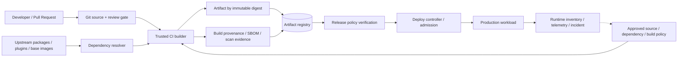
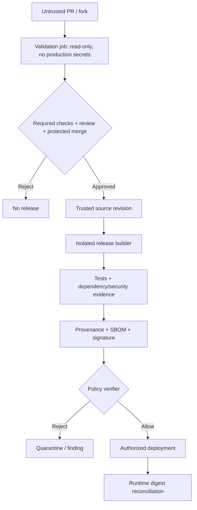
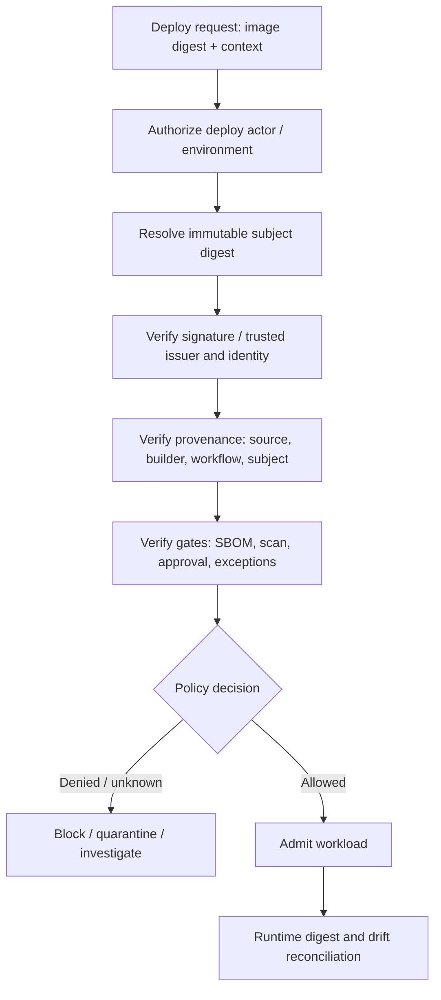

# Software supply chain trong Security Assurance: bảo vệ chuỗi tạo, cung cấp và triển khai phần mềm bằng bằng chứng

## 1. Software supply chain là gì?

**Software supply chain (chuỗi cung ứng phần mềm)** là mạng lưới **con người, quy trình, công cụ, nguồn mã, thành phần phụ thuộc, hạ tầng xây dựng, artifact, kênh phân phối và môi trường triển khai** tham gia tạo ra và đưa phần mềm đến người sử dụng. Nó không dừng ở thư viện mã nguồn mở: code nội bộ, compiler, CI runner, build plugin, package registry, container base image, signing service, deployment automation và bên cung cấp dịch vụ đều có thể tạo hoặc làm thay đổi phần mềm cuối cùng.

**Supply chain security** nhằm giảm nguy cơ các thành phần hoặc công đoạn bị giả mạo, thay thế, cài mã độc, làm sai lệch hoặc vận hành trái chính sách trước khi phần mềm tới môi trường sản xuất. **Software supply chain assurance** đi xa hơn một tập công cụ bảo vệ: tổ chức phải chứng minh bằng **bằng chứng có nguồn gốc và phạm vi rõ** rằng các kiểm soát phù hợp đã được thiết kế, triển khai, vận hành và đánh giá.

Trong module **SECURITY_SECURITY_ASSURANCE**, mục tiêu là xây dựng phương pháp đánh giá có bằng chứng từ **rủi ro → security requirements → controls → testing/audit → findings → remediation → continuous assurance**. Áp dụng cho chuỗi cung ứng phần mềm, câu hỏi then chốt gồm:

1. Artifact chạy production có đúng là bản được tạo từ nguồn và quy trình đã phê duyệt không?
2. Ai được sửa source, build workflow, dependencies, release metadata, image và manifest?
3. Dependency, plugin, container image, build service và vendor được tin dựa trên **điều kiện nào**, chứ không chỉ vì “đã từng dùng”?
4. Có thể xác minh **provenance, artifact digest, chữ ký/attestation, người phát hành, build identity và policy version** không?
5. Thành phần có lỗ hổng, mã độc, license risk hoặc đã hết hỗ trợ được phát hiện, ưu tiên và xử lý ra sao?
6. Có ngăn việc **build không được kiểm soát** hoặc **artifact không được phép** đi thẳng vào production không?
7. Khi upstream package, signing key, CI service hoặc artifact registry bị compromise, có xác định phạm vi ảnh hưởng và thu hồi/phát hành lại được không?
8. Evidence có đủ mới, đúng release và chống bị sửa để hỗ trợ kết luận assurance không?

**Ví dụ xuyên suốt:** Nền tảng học tập dùng Java/Spring Boot có `learning-api`, `grade-worker` và `notification-worker`. Mỗi dịch vụ phụ thuộc Maven/Gradle packages, JDK, build plugins, container base image và CI/CD workflow. Một bản mã sạch do developer review vẫn có thể tạo artifact độc hại nếu dependency bị chiếm, CI runner bị kiểm soát hoặc registry bị thay image.

> **Nguyên tắc:** “Đã scan mã nguồn” ≠ “chuỗi cung ứng an toàn”. Phải kiểm chứng **đúng artifact được sinh từ đúng nguồn, bằng đúng builder, với đúng dependencies, và chỉ artifact đó mới được triển khai**.

### Mục tiêu học tập

Sau bài này, người học có thể:

- Vẽ bản đồ trust boundaries của software supply chain từ source tới runtime.
- Phân biệt **SBOM, SCA, VEX, provenance, signature, attestation và reproducible build**.
- Phân tích dependency confusion, typosquatting, maintainer compromise, CI workflow injection, artifact substitution và compromised release.
- Đặt security requirements đo được cho source control, build, dependency, release, distribution và deployment.
- Hiểu cách dùng SLSA, NIST SSDF, OpenSSF, in-toto, Sigstore và các chuẩn định dạng SBOM trong một assurance program.
- Minh họa quy trình kiểm soát Maven/Gradle, container, CI/CD, Kubernetes và third-party services.
- Xây dựng **threat–control–test–evidence traceability**, đánh giá trạng thái PASS/FAIL/NOT VERIFIED và tổ chức khắc phục liên tục.

## 2. Vì sao chuỗi cung ứng phần mềm là một phần của Security Assurance?

Ứng dụng hiện đại thường dùng nhiều thành phần không do team trực tiếp viết hoặc kiểm soát. Sự cố từ một thành phần dùng chung có thể lan qua hàng trăm ứng dụng. Rủi ro không chỉ nằm ở **lỗi trong code** mà còn ở **đường hình thành và vận chuyển code**.

| Khẳng định thường nghe | Điều khẳng định đó có thể chứng minh | Điều nó chưa chứng minh |
| --- | --- | --- |
| “Pull request đã có 2 người duyệt.” | Một số thay đổi source đi qua review. | Workflow, dependency và artifact sau build chưa bị thay đổi. |
| “Pipeline CI màu xanh.” | Các job đã cấu hình báo thành công. | Job có đủ coverage, runner đáng tin và output không bị thay. |
| “Đã có SBOM.” | Có một danh sách thành phần cho scope được tạo. | Danh sách đầy đủ/chính xác, dependencies an toàn và đang chạy đúng artifact. |
| “Container image đã ký.” | Chữ ký xác nhận quan hệ giữa digest và signing identity/key theo verifier. | Image không chứa lỗ hổng; signer/builder có thực sự được phép. |
| “Registry có HTTPS.” | Kênh truyền được bảo vệ theo cấu hình TLS. | Registry, account hoặc nội dung artifact không bị compromise. |
| “Package được nhiều người tải.” | Có tín hiệu về độ phổ biến. | Package chưa bị chiếm tài khoản/đổi maintainer/cài mã độc. |
| “SLSA đã được nhắc trong policy.” | Tổ chức biết đến một framework. | Đã đáp ứng requirements/provenance/build controls của profile được chọn. |
| “Scanner không thấy CVE.” | Không có finding theo DB, version và phạm vi scan đó. | Không có lỗi chưa công bố, malicious behavior hoặc false negative. |

**Security assurance** đòi lập **claim có giới hạn** và nối mỗi claim với control, verification và evidence. Chẳng hạn, kết quả vulnerability scan chỉ hỗ trợ claim về **những thành phần và advisory mà scanner nhận diện**, không là chứng nhận tổng thể.

## 3. Phạm vi: supply chain bao gồm những gì?

### Thành phần cần lập inventory

| Nhóm | Ví dụ | Câu hỏi assurance |
| --- | --- | --- |
| **Source** | Git repository, branches, tags, submodules. | Ai có quyền write, force-push, đổi protected branch? |
| **Review/change** | Pull requests, CODEOWNERS, approvals. | Ai phê duyệt và có bypass/override không? |
| **Dependencies** | Maven libraries, Gradle plugins, npm frontend packages. | Tải từ đâu, phiên bản/metadata nào, ai kiểm soát namespace? |
| **Build toolchain** | JDK, Gradle/Maven, compiler, test framework, plugins. | Toolchain có version/digest được kiểm soát không? |
| **CI/CD** | Build workflow, hosted/self-hosted runner, secrets/OIDC. | Workflow nào được phép build và publish? |
| **Artifact storage** | Maven repository, container registry, binary repository. | Ai push/overwrite/delete/tag, có immutable digest? |
| **Provenance/signing** | Build attestation, signing identity, trusted verifier. | Có chứng minh nguồn/builder/subject digest theo policy? |
| **Release/approval** | Release tag, approval, deployment manifest. | Release artifact đúng là sản phẩm của approved build? |
| **Deployment** | Kubernetes admission, GitOps, infrastructure automation. | Chỉ image digest được duyệt mới được chạy? |
| **Runtime** | Pods, libraries loaded, sidecars, extensions. | Image đang chạy có khớp approved artifact không? |
| **Third parties** | SaaS CI, VCS host, package registry, cloud provider. | Shared responsibility, incident support và evidence coverage? |
| **People/process** | Maintainers, release managers, security reviewers. | Ownership, least privilege, offboarding và emergency access? |

Không tự giới hạn inventory ở danh sách thư viện Java. **Frontend bundle, CI actions, container base layers, IaC modules và deploy scripts** cũng thuộc phạm vi khi có thể ảnh hưởng tới sản phẩm.

### Boundary và asset

Các tài sản cần bảo vệ gồm **source integrity**, secrets/token của pipeline, artifact integrity, release identities, build logs, dependency manifests, deployment permissions, dữ liệu cá nhân trong build/test, audit evidence và khả năng thu hồi bản phát hành.

## 4. Data flow và trust boundaries từ developer tới production



**Trust boundary A – Source → CI:** code và workflow được review/approve đúng, nhưng code từ PR chưa đáng tin trước khi quyền build/publish được xác định.

**Trust boundary B – Dependency resolver → builder:** package có thể đến từ registry ngoài tổ chức; phải kiểm package identity, nguồn, version, checksum và risk.

**Trust boundary C – Builder → artifact registry:** chỉ trusted build identity được publish, artifact phải được gắn digest, provenance và các kết quả kiểm thử theo policy.

**Trust boundary D – Registry → deployment:** môi trường sản xuất không tin một image chỉ vì nó nằm trong registry; phải kiểm **digest, signer/issuer, provenance predicate, source, builder, release approval và policy**, theo thiết kế.

**Trust boundary E – Deployment → runtime:** artifact được approve có thể bị thay bởi update ngoài luồng, runtime mutation, tag drift hoặc privileged access. Cần đối soát **running digest với approved release**.

### Một claim chain mẫu

1. Repository `learning-api` chỉ cho merge vào branch release qua review và checks.
2. Workflow dùng builder được kiểm soát, không nhận secret release từ PR không đáng tin.
3. Release build tạo container digest cố định và attestation tương ứng.
4. Policy verifier xác minh signer/issuer, source revision, build type và subject digest.
5. Admission controller chỉ cho triển khai digest đã được approved.
6. Runtime inventory chứng minh workload đang chạy image digest đã duyệt.

Mỗi mắt xích phải có **evidence**; việc bỏ qua một mắt xích làm conclusion yếu đi. Không biến các kết quả riêng lẻ thành nhãn “trusted=true” không có bối cảnh.

## 5. Các đối tượng và quyền cần phân tách

| Actor | Quyền hợp lệ | Rủi ro nếu cấp rộng |
| --- | --- | --- |
| **Developer** | Đề xuất code và test; được review theo policy. | Có thể tự sửa workflow và publish release bỏ qua kiểm soát. |
| **Code reviewer** | Phê duyệt thay đổi trong scope. | Compromised reviewer account tạo malicious approval. |
| **CI build identity** | Read source/dependencies, write build artifacts theo job. | Token có thể sửa repo, đọc production secrets hoặc deploy. |
| **Release identity** | Publish signed artifact/attestation theo approved workflow. | Bất kỳ job nào giả danh release signer. |
| **Security policy owner** | Ban hành gates, exceptions, baseline. | Tự giảm policy sau khi build fail mà không audit. |
| **Artifact registry admin** | Vận hành registry, quản lý retention/access. | Có thể thay/xóa artifact, chuyển tag. |
| **Deployment controller** | Pull verified digest, rollout workload. | Có quyền chạy arbitrary image ở production. |
| **Runtime service account** | Truy cập tài nguyên nghiệp vụ giới hạn. | Nếu dùng chung CI/deploy identity, attacker mở rộng blast radius. |
| **Third-party maintainer** | Phát hành package trong namespace của họ. | Nếu bị chiếm account, nhiều downstream consumers nhận bản độc hại. |

**Phân tách nhiệm vụ** giúp hạn chế việc một identity vừa có thể đổi source, sửa workflow, cấp chữ ký, bypass policy và triển khai production. Với đội nhỏ có thể cần compensating controls, nhưng không được mặc định một admin account có mọi quyền là bình thường.

## 6. Threat modeling: tấn công đi qua những mắt xích nào?

| Threat ID | Attack scenario | Tác động | Ranh giới/control trọng yếu |
| --- | --- | --- | --- |
| **THR-SC-01** | Typosquatting: dependency tên gần giống thư viện chuẩn. | Build tải package không mong muốn. | Namespace review, allowlist, dependency verification. |
| **THR-SC-02** | Dependency confusion: internal package name bị giải từ public registry. | Code ngoài tổ chức được dùng thay internal component. | Repository priority/exclusive content, namespace reservation. |
| **THR-SC-03** | Maintainer/upstream account compromise. | Release package có malicious payload hoặc backdoor. | Update reviews, publisher trust, pinning, incident response. |
| **THR-SC-04** | Build plugin hoặc lifecycle script thực thi ngoài dự kiến. | Truy xuất secrets, sửa artifact, gọi mạng. | Build isolation, secret separation, approved plugins. |
| **THR-SC-05** | Workflow injection qua PR/untrusted metadata. | Thực thi mã trong context có publish permissions. | CI trust boundaries, review, short-lived credentials. |
| **THR-SC-06** | CI runner bị compromise hoặc tồn tại state từ job trước. | Thay output, lấy credentials, poison cache. | Ephemeral runners, isolation, builder hardening. |
| **THR-SC-07** | Artifact substitution: tag hoặc binary bị thay sau scan. | Production chạy file không được đánh giá. | Digest binding, immutable release, verified provenance. |
| **THR-SC-08** | Build provenance/attestation bị giả hoặc lấy từ job không tin cậy. | Policy chấp nhận artifact sai nguồn. | Trusted issuer/builder, attestation validation, policy. |
| **THR-SC-09** | Signing key/identity bị chiếm hoặc dùng sai. | Artifact độc hại có chữ ký “hợp lệ”. | Key/identity lifecycle, issuer conditions, revocation. |
| **THR-SC-10** | Base image chứa component có vulnerability. | Tấn công runtime sau deploy. | Base image maintenance, SBOM/SCA, runtime controls. |
| **THR-SC-11** | Scanner bỏ sót transitive dependency hoặc native library. | Rủi ro bị ghi nhận thấp giả. | Multi-layer inventory, coverage assessment. |
| **THR-SC-12** | CI dependency cache bị poison. | Build dùng bytes không đúng với nguồn phê duyệt. | Cache isolation, checksum/digest verification. |
| **THR-SC-13** | Admin bypass admission/deploy trực tiếp image theo mutable tag. | Chạy artifact ngoài approved release. | Admission, runtime reconciliation, break-glass audit. |
| **THR-SC-14** | Upstream package bị gỡ, registry outage, license/maintenance thay đổi. | Không build/restore được hoặc rủi ro pháp lý/vận hành. | Availability mirrors, support strategy, legal review. |
| **THR-SC-15** | Attacker tác động release metadata hoặc update manifest. | Client nhận sai binary dù registry còn đúng. | Signed metadata, trusted update process, digest check. |
| **THR-SC-16** | Compromised CI publish secret trong SBOM/log. | Lộ credentials hoặc thông tin nhạy cảm. | Secret scanning, evidence minimization, access control. |

**Nguồn rủi ro có thể là vô ý hoặc cố ý.** Package hết bảo trì tạo rủi ro khác với package bị cài mã độc; mức xử lý và bằng chứng cũng khác. Threat model phải phân biệt attacker capability, trust boundary, preconditions và blast radius.

## 7. Các mục tiêu bảo mật của software supply chain

| Mục tiêu | Biện pháp liên quan | Claim cần chứng minh |
| --- | --- | --- |
| **Source integrity** | Repository protection, review, signed commits nếu policy dùng. | Chỉ thay đổi được phép tới nhánh release. |
| **Dependency integrity** | Versions/digests, provenance của packages, registry policy. | Bytes và identity dependency khớp selection đã kiểm. |
| **Build integrity** | Trusted builder, isolated environment, controlled steps. | Artifact hình thành từ declared inputs theo approved workflow. |
| **Artifact integrity** | Cryptographic digest và signature/attestation binding. | Binary được verify không bị thay kể từ khi tạo/ký. |
| **Authenticity/provenance** | Identity, attestations, trust roots, build records. | Artifact được tạo/phát hành bởi nguồn/builder đã duyệt. |
| **Vulnerability hygiene** | SCA, security advisories, prioritization, patches. | Vulnerabilities đã biết được quản lý theo risk policy. |
| **Deploy control** | Release approval, image digest allowlist, admission. | Production chỉ chạy artifact đúng release policy. |
| **Confidentiality** | CI secret isolation, least privilege, vault/OIDC. | Build không lộ credentials/dữ liệu nhạy cảm ngoài scope. |
| **Resilience** | Mirrors, backup artifacts, offline rebuild/recovery capability. | Supply chain outage/compromise có phương án phục hồi. |
| **Auditability** | Evidence chain và change/exception records. | Có thể điều tra và tái dựng release lineage. |

**Integrity và authenticity không đồng nghĩa absence of vulnerabilities.** Binary được xác thực đúng nguồn vẫn có thể chứa lỗ hổng hoặc chức năng độc hại do người được phép thêm vào; cần kiểm các claim riêng.

## 8. Chính sách và requirement baseline theo giai đoạn

Để tránh danh sách kiểm tra chung chung, mỗi requirement nên có **ID, scope, policy version, owner, expected outcome, phương pháp đánh giá và evidence**.

| ID | Requirement đề xuất | Bằng chứng/kiểm chứng |
| --- | --- | --- |
| **SC-REQ-01** | Tất cả release source có owner, protected branch/tag và review policy được thực thi. | Repository config, negative bypass tests, PR/approval audit. |
| **SC-REQ-02** | Build workflows và third-party actions/plugins có pin/version và approval. | Pipeline configuration, trust review, runtime build traces. |
| **SC-REQ-03** | Dependency resolution chỉ dùng các nguồn, namespace và version đáp ứng policy. | Resolver config, dependency graph, private/public confusion test. |
| **SC-REQ-04** | Build được thực thi trong môi trường xác định, tách untrusted code khỏi publish credentials. | CI IAM, runner isolation, secret exposure tests. |
| **SC-REQ-05** | Artifact production có immutable digest và được liên kết với approved source revision. | Registry digest, build/provenance evidence, verification. |
| **SC-REQ-06** | Trusted provenance/attestations được xác minh ở release/deploy gates. | Signature/issuer/build-identity/subject-digest negative tests. |
| **SC-REQ-07** | Có SBOM theo scope; transitive dependencies và các lớp runtime quan trọng được bao phủ. | SBOM generator output, reconciliation và format validation. |
| **SC-REQ-08** | Vulnerability/SCA findings được risk triage, remediation và retest có deadline. | Scan, advisories, exploitability review, tickets và rebuild. |
| **SC-REQ-09** | Deploy pipeline chỉ nhận artifact đã approved; không bypass không được kiểm soát. | Admission tests, GitOps history, running digest reconciliation. |
| **SC-REQ-10** | CI/secrets/release signing identities có least privilege, rotation/revocation và audit. | IAM review, OIDC conditions, compromise drills. |
| **SC-REQ-11** | Base images, build tools và third-party components có inventory, owner, update cadence. | Registry/toolchain references, freshness and EOL reports. |
| **SC-REQ-12** | Incident response có khả năng xác định affected artifacts, dependency graph, rollback/rebuild và revoke. | Tabletop, lineage queries, emergency release tests. |
| **SC-REQ-13** | Exceptions, missing evidence và unsupported components được quản lý có thời hạn. | Exception register, approvals, expiry/retest. |
| **SC-REQ-14** | Có continuous monitoring cho source/workflow/dependency/registry/runtime drift. | Alerts, inventory diff, release traceability, reviews. |

Đây là mã minh họa nội bộ, **không phải điều khoản chính thức** của NIST, SLSA hay ISO. Các mức SLSA hay chính sách phải đối chiếu đúng phiên bản framework và yêu cầu tổ chức.

## 9. Source control security và review authority

Source repository là điểm đầu của nhiều đường build, nhưng kiểm soát chỉ hữu ích nếu không bị **bypass bằng quyền quản trị hoặc qua workflow khác**.

### Những control nên đánh giá

- Quy định branch/release protection, required reviews/checks, force-push/deletion policy.
- Tách identity người và automation, MFA/passkeys phù hợp, quy trình offboarding.
- Kiểm ai có quyền thay workflow files, release tags, dependency manifests và CODEOWNERS.
- Review thay đổi nhạy cảm: build scripts, registry settings, package publishing, secrets references, privileged manifests.
- Áp dụng nguyên tắc **hai người** hoặc separation of duties khi risk yêu cầu; rà soát ngoại lệ khẩn cấp.
- Không cấp release credentials cho pipeline từ fork/untrusted pull request.
- Audit quyền admin/bypass, branch protection changes, PR approvals và force merges.
- Code scanning và secrets scanning, nhưng phân biệt **phát hiện code risk** với **xác minh release provenance**.

### Signed commits có vai trò nào?

Commit signing có thể giúp xác minh một commit gắn với identity/key được chấp nhận theo chính sách, nhưng **không bảo đảm code đã được review, người ký không bị compromise hoặc artifact được tạo từ commit ấy**. Cần thêm build provenance và release verification.

### Ví dụ quy tắc review

Với `learning-api`, các thay đổi `build.gradle.kts`, `settings.gradle.kts`, `pom.xml`, CI workflows và deployment manifests phải đi qua owner có thẩm quyền, protected branch và security checks. Một PR chỉ thay tài liệu có thể cần review nhẹ hơn; policy dựa trên **rủi ro thay đổi**, không chỉ số file.

## 10. Third-party dependency trust không phải một Boolean

### Dependency direct và transitive

Một Java project phụ thuộc trực tiếp `spring-boot-starter-web` và nhiều dependencies bắc cầu. Build plugins còn có dependencies riêng; container runtime mang thêm OS packages. Một `build.gradle` hoặc `pom.xml` không tự mô tả **toàn bộ thành phần của image đang chạy**.

| Thành phần | Rủi ro | Control cần xem |
| --- | --- | --- |
| **Direct library** | Version có vulnerability, maintainer đổi. | Version policy, advisory review, update testing. |
| **Transitive library** | Không nhìn thấy trong top-level manifest. | Resolved dependency graph/SBOM. |
| **Build plugin** | Chạy mã trong builder, có thể đọc secrets. | Plugin allowlist, pinning, isolated build. |
| **CI action/task** | Nhận token/permissions của job. | Trusted publisher/digest/commit pinning, permission minimization. |
| **Container base image** | OS/runtime libraries, EOL. | Trusted base digest, OS SBOM, regular rebuild. |
| **Compiler/JDK/toolchain** | Có thể thay đổi output hoặc chứa lỗ hổng. | Version/source, checksums, trusted distribution. |
| **Private internal package** | Dependency confusion và takeover namespace. | Repository exclusivity, publication permissions. |
| **Update agent** | Có thể phân phối binary mới tới nhiều nodes. | Signed metadata, version/rollback protection, approval. |

### Những tín hiệu để đánh giá dependency

- Nguồn phân phối/namespace và nhà phát hành có đáng tin?
- Bản phát hành có integrity metadata hoặc provenance/signature có thể xác minh không?
- Dự án được bảo trì, phản hồi security issues, có owner và support lifecycle?
- Vulnerability/advisory status, exploitability trong deployment thực tế?
- License, nguồn gốc/copyright và nghĩa vụ pháp lý có được review?
- Có thể pin version và reproduce resolved graph không?
- Có hoạt động cài đặt/build scripts có side effects nguy hiểm?
- Package có được sử dụng thực tế trong artifact/runtime hay chỉ nằm trong test/build scope?

**Không chấm PASS chỉ vì có nhiều stars/downloads**, hoặc FAIL chỉ vì chưa có chữ ký nếu policy/nguồn chứng cứ khác được chấp thuận. Phải có **risk-based policy và kết luận có giới hạn**.

## 11. Dependency confusion, typosquatting và resolver policy

### Dependency confusion

Rủi ro xảy ra khi một tên package dự kiến chỉ dùng trong tổ chức có thể bị **resolver tải từ registry bên ngoài** vì thứ tự ưu tiên hoặc phân giải namespace không được kiểm soát. Đối sách gồm:

1. Phân loại internal package namespaces.
2. Cấu hình **exclusive repository mapping** hoặc cơ chế tương đương: internal group chỉ giải từ internal trusted registry.
3. Giới hạn nguồn cho build plugins và dependencies riêng nếu tool hỗ trợ.
4. Pin versions, xác minh checksum/signature và kiểm resolved source.
5. Kiểm tra tác động khi mirror/proxy/cache bị thay đổi.
6. Thử negative test trong môi trường biệt lập, **không phát hành package độc hại lên public registry**.

### Typosquatting

Một developer nhập sai tên thư viện, build tool có thể giải đúng một package khác nhưng sai chủ thể. Code review, allowlist, dependency insight, detection các tên gần giống và package owner verification giúp giảm nguy cơ.

### Version pinning chưa đủ

Pin một version cụ thể có thể làm giảm nguy cơ cập nhật bất ngờ nhưng **không ngăn package đã bị phát hành độc hại từ trước** và không tự bảo đảm bytes không bị thay. Nên kết hợp **checksum/digest verification, repository trust, update review, SCA và artifact provenance** trong phạm vi áp dụng.

## 12. Maven/Gradle: quản lý dependencies và plugin trust

### Ví dụ Gradle Kotlin DSL – điều hướng dependency sources

```kotlin
// settings.gradle.kts - illustrative only
pluginManagement {
    repositories {
        gradlePluginPortal()
        mavenCentral()
        // Add organization-approved plugin repository if needed.
    }
}

dependencyResolutionManagement {
    repositories {
        mavenCentral()
        // Map internal groups exclusively to the internal repository
        // in a separately reviewed, credentials-safe policy.
    }
}
```

**Đây không phải cấu hình chống dependency confusion đầy đủ.** Trong production phải áp dụng repository **content filters/exclusive mapping** cho internal group, cấm repository injection khi policy yêu cầu, quản lý credentials an toàn, kiểm Gradle version và config behavior.

### Các vấn đề Gradle cần rà soát

- Version catalogs giúp tập trung quản lý version nhưng không tự khóa resolved graph.
- **Dependency locking** có thể đóng băng resolved versions theo configuration; phải xem cách cập nhật lock và dynamic/changing modules.
- **Dependency verification metadata** hỗ trợ kiểm integrity/trust theo cơ chế tool, cần thiết lập/duy trì đúng.
- Kiểm **Gradle Wrapper** distribution URL, version và distribution checksum theo policy, tránh cho phép arbitrary wrapper download.
- Plugin repositories và plugin versions có trust boundary riêng với application dependencies.
- Build cache là đầu vào có thể ảnh hưởng output; cần bảo vệ key/isolation và xác minh các assumptions.
- Không đưa registry tokens vào source, printed build arguments, debug logs hoặc artifact metadata.

### Ví dụ Maven – dependency resolution cần đánh giá cả plugin

```xml
<!-- pom.xml excerpt: version pinning is only one control -->
<dependencies>
  <dependency>
    <groupId>org.springframework.boot</groupId>
    <artifactId>spring-boot-starter-web</artifactId>
    <version>REVIEWED_VERSION</version>
  </dependency>
</dependencies>
```

Giá trị `REVIEWED_VERSION` là **placeholder minh họa**, không phải version hợp lệ để copy chạy. Với Maven, cần quản lý parent/BOM, dependencyManagement, pluginManagement, repositories/pluginRepositories, snapshots, transitive dependencies và mirror settings. Resolver phải dùng source được phép; checksum/signature có giới hạn riêng tùy repository và cách thiết lập.

### Lockfile/verification không thay kiểm vulnerability

Lockfile nói **đã chọn phiên bản nào**; checksum nói **bytes có trùng reference không**; SCA nói **có advisory nào được nhận diện**; provenance nói **artifact được tạo ra bằng quá trình được khai báo và tin theo policy**. Bốn claim khác nhau, phải ghép đúng mục đích.

## 13. SBOM: Software Bill of Materials

**SBOM** là một danh mục có cấu trúc về các thành phần phần mềm và mối quan hệ của chúng trong một sản phẩm/build được xác định. Nó hỗ trợ inventory, vulnerability management, license analysis, dependency lineage và incident scoping.

### Trường thông tin hữu ích

| Trường | Ý nghĩa assurance |
| --- | --- |
| **SBOM identity/version** | Định danh document và phiên bản định dạng/spec. |
| **Subject artifact digest** | SBOM gắn với image/JAR/release nào, tránh SBOM của một build khác. |
| **Component name/version** | Tên package và phiên bản được nhận diện. |
| **Package identifier** | PURL hoặc CPE khi phù hợp để map advisories. |
| **Supplier/author/publisher** | Thông tin nguồn, không tự là chứng cứ authenticity. |
| **Relationships/dependency graph** | Package nào phụ thuộc/thành phần nào; phạm vi direct/transitive. |
| **Licenses** | Thông tin phục vụ legal/compliance review. |
| **Hashes** | Hỗ trợ nhận diện bytes khi có; không tự thay signature. |
| **Generation metadata** | Tool/version/time, phương pháp build-based hoặc scan-based. |
| **Completeness declaration** | Coverage và hạn chế, ví dụ native libraries, OS packages, dynamic downloads. |

### Định dạng thường gặp

- **SPDX:** chuẩn mô tả thành phần và quan hệ phần mềm, có khả năng biểu diễn license và provenance metadata theo phiên bản.
- **CycloneDX:** định dạng BOM cho components, dependencies và metadata bảo mật, hỗ trợ nhiều use cases gồm SBOM/VEX theo phiên bản.

Tổ chức chọn format/version theo interoperability và toolchain. **Không coi SPDX và CycloneDX là cùng một schema**, hoặc mọi công cụ đều hỗ trợ các trường giống nhau.

### SBOM cho một image Java có thể có nhiều lớp

1. Build dependencies: plugins/compiler/toolchain.
2. Application runtime dependencies: JARs được đóng gói.
3. Container base OS packages và runtime/JRE.
4. Frontend assets nếu đóng gói chung.
5. Các binary/native libraries được download trong build.

SBOM theo source tree có thể **khác SBOM theo image digest**. Khi đánh giá artifact sản xuất, phải xác định đúng **đối tượng SBOM và phương pháp tạo**; reconcile ít nhất ở những đường phụ thuộc trọng yếu.

### Sai lầm phổ biến

Một SBOM tồn tại không chứng minh:

- Nó đầy đủ hoặc chính xác.
- Thành phần không có lỗ hổng.
- Build provenance đáng tin.
- Package không chứa mã độc.
- Runtime đang chạy đúng artifact mà SBOM mô tả.

## 14. SCA, advisory, VEX và prioritization

**Software Composition Analysis (SCA)** giúp nhận diện components và các rủi ro được biết, thường dựa vào dependency metadata và vulnerability databases. Kết quả là **một nguồn chứng cứ**, không là phán quyết cuối.

| Tín hiệu | Câu hỏi | Giới hạn |
| --- | --- | --- |
| **CVE/advisory** | Có lỗ hổng nào đã được công bố? | DB có thể chậm, không đủ aliases/version ranges. |
| **Affected version** | Component/version này thuộc khoảng bị ảnh hưởng? | Version mapping/packaging có thể sai. |
| **Exploitability/reachability** | Vulnerable code có thể bị gọi trong điều kiện sản xuất? | Static reachability không chứng minh đường khai thác có/không. |
| **Exposure** | Internet-facing, privileged, secrets, dữ liệu nhạy cảm? | Phụ thuộc runtime topology và authz. |
| **Fix availability** | Có bản patched, vendor workaround hoặc compensating controls? | Update có thể gây incompatibility hoặc regression. |
| **VEX statement** | Sản phẩm/phiên bản cụ thể bị ảnh hưởng hay không, tại sao? | Phải xem tác giả, scope, tình trạng, rationale và độ mới. |

**VEX (Vulnerability Exploitability eXchange)** trao đổi đánh giá một vulnerability đối với **một sản phẩm/artifact xác định**. Nó không đơn giản là lệnh “ẩn CVE”. Một statement `not_affected` cần lý do có thể kiểm tra, đúng package/code path và firmware/build/runtime; một finding thiếu bằng chứng nên ở trạng thái **NOT VERIFIED**, không tự thành `not_affected`.

### Risk-based remediation

Không ưu tiên chỉ theo CVSS base score. Cần xét **asset criticality, exploit evidence, reachability, privilege, internet exposure, data sensitivity, detection, active exploitation, patch risk và SLA xử lý**. CVSS là đầu vào, không phải quyết định thay con người.

### Patch phải tạo artifact mới được verify

Sửa version dependency rồi chạy CI xanh chưa đủ. Sau update cần:

- Resolve dependency graph mới.
- Rebuild từ trusted inputs.
- Cập nhật SBOM, scan và provenance theo **artifact digest mới**.
- Test regression, authorization, data handling.
- Release gate và deployment gate verify.
- Xác minh runtime digest mới thay phiên bản cũ.

Không chỉ đóng ticket khi merge pull request mà không có bằng chứng production đã sử dụng bản sửa.

## 15. SLSA, build provenance và mức bảo đảm

**SLSA (Supply-chain Levels for Software Artifacts)** là framework giúp mô tả các thực hành và mức độ bảo đảm cho chuỗi cung ứng, trong đó có **build provenance** và tính toàn vẹn của build. Phải xem **phiên bản specification và track/profile được tổ chức áp dụng**; không dùng các cấp độ của một ấn bản cũ làm danh sách bất biến cho mọi bản.

### Provenance thường cần thể hiện

- **Subject:** artifact nào, định danh bằng cryptographic digest.
- **Source/materials:** nguồn, commit revision và các input có liên quan theo predicate/spec.
- **Builder identity:** hạ tầng/quy trình build nào tạo artifact.
- **Build definition/type:** workflow/script/build configuration được thực thi.
- **Invocation/context:** các tham số có ảnh hưởng, trigger, timestamps hoặc metadata theo specification.
- **Attestation integrity/authenticity:** identity/key và cơ chế xác minh phù hợp.

### Hai câu hỏi khác nhau

1. **Provenance đã được ký/tạo bởi ai?** Kiểm chứng cryptographic authenticity và trust root.
2. **Builder và quá trình mà provenance nói đến có thực sự đáng tin?** Kiểm quyền, isolation, tamper resistance, cách thu materials và phạm vi claim.

Một JSON provenance tự viết rồi ký bằng key mà mọi developer đều dùng **không tự đạt mức bảo đảm tương đương trusted builder**. Một signature hợp lệ chỉ chứng minh signer nắm key/identity theo trust policy, không chứng minh các trường trong attestation trung thực nếu builder bị compromise.

### Phân biệt các claims

| Claim | Evidence phù hợp | Chưa đủ để suy ra |
| --- | --- | --- |
| Source revision được ghi. | Provenance source field và trusted build attestation. | Commit không chứa mã độc. |
| Artifact bytes không đổi. | Digest comparison và chữ ký/attestation binding. | Artifact được build từ đúng source. |
| Artifact từ approved builder. | Builder identity, issuer, verified provenance và policy. | Builder không có vulnerability/insider. |
| Dependencies được kiểm kê. | SBOM đúng digest, resolved graph. | Không có dependency độc hại. |
| Production chạy đúng bản approved. | Admission event, deployment spec và runtime image ID/digest. | Runtime không thể bị khai thác sau deployment. |

**Assurance phải nói rõ loại claim, evidence và giới hạn**, không ghi “SLSA compliant” trừ khi đã xác định đúng phiên bản/profile, tiêu chí và phạm vi.

## 16. Build isolation và trusted builder

**Trusted builder** là môi trường/process build mà tổ chức có cơ sở tin theo threat model, ví dụ nền tảng CI có ranh giới giữa jobs, chính sách phân quyền, identity và cơ chế xuất provenance. “Dùng cloud CI” không tự đồng nghĩa builder được tin trong mọi cấu hình.

### Các đặc tính cần xem xét

| Đặc tính | Mục tiêu | Phép kiểm |
| --- | --- | --- |
| **Job isolation** | PR không tin cậy không chiếm được job release khác. | Test quyền/secret isolation, runner reuse review. |
| **Ephemeral environment** | Không giữ trạng thái nhạy cảm từ run trước. | Runner lifecycle, disk/cache cleanup audit. |
| **Secret isolation** | Untrusted source/build step không lấy production secrets. | PR-without-secrets tests, permission review. |
| **Trusted build definition** | Steps tạo release từ workflow đã duyệt. | Source revision và workflow identity evidence. |
| **Controlled inputs** | Dependencies, base images, toolchain versions được ghi nhận. | Materials/lockfiles/resolved graph verification. |
| **Network policy** | Build không tự ý tải/gửi dữ liệu ngoài các nguồn được phép khi risk yêu cầu. | Egress logs, offline/proxy build exercise. |
| **Artifact output binding** | Digest và provenance tương ứng cùng build run. | Subject digest match test. |
| **Tamper resistance** | Đường phát hành/signer không cho job chưa duyệt tự tạo attestation trusted. | Wrong-identity/unauthorized-run negative tests. |
| **Observability** | Có log, policy decision, run ID, actor, timestamp. | Reconstruct release lineage. |

### Self-hosted runners có các rủi ro đặc biệt

Self-hosted runner có thể dùng lại filesystem/container/socket của run trước. Nếu chạy build từ PR không tin cậy trên cùng máy có credentials hoặc access production, rủi ro **persistent compromise** và lateral movement rất cao. Cân nhắc:

- Runners ephemeral cho jobs có trust level khác nhau.
- Không cấp quyền write registry/repo hoặc production environment cho untrusted PR.
- Cấm mount Docker socket hoặc host directories tùy tiện trong môi trường code không tin cậy.
- OS/VM/container isolation phù hợp threat model.
- Secret-less PR validation; job release tách riêng sau approvals.
- Cache namespace riêng và integrity checks.

Không phải mọi trường hợp đều cần cùng mức cô lập. Nhưng yêu cầu phải dựa trên **rủi ro code được thực thi ở quyền nào**, không chỉ ai bấm nút build.

## 17. CI/CD pipeline: bảo vệ workflow, events và permissions

CI/CD vừa là công cụ kiểm soát vừa là mục tiêu tấn công. Workflow được phép thay đổi artifact, truy cập private registries và publish production image cần được coi như **privileged code**.

### Các lỗi thiết kế thường gặp

1. Một job chạy source từ untrusted pull request **đồng thời** giữ release credentials.
2. Workflow được trigger bằng event có trust khác dự kiến, tiếp nhận attacker-controlled metadata vào shell command.
3. Checkout code PR không tin cậy trên privileged job.
4. Third-party CI action được tham chiếu bằng mutable tag mà không có trust/update process.
5. Default token permission rộng hơn nhu cầu: được sửa repository, tạo release, publish package không cần.
6. Long-lived cloud/API tokens lưu trong CI variables và có thể in vào logs.
7. Job build từ branch bất kỳ có thể ký hoặc deploy như production release.
8. Cache hoặc artifacts của untrusted run được dùng lại trong privileged build không kiểm integrity.

### Pipeline phân tầng trust



**Quan trọng:** Sơ đồ minh họa các ranh giới; có thể triển khai bằng jobs/workflows khác nhau, nhưng điều kiện nguồn, identity, approval và quyền phải **được kiểm chứng bằng runtime event**, không chỉ bằng tên job.

### GitHub Actions YAML – phân quyền tối thiểu (ví dụ)

```yaml
# Illustrative validation workflow, not a complete release workflow.
name: pr-validation
on:
  pull_request:

permissions:
  contents: read

jobs:
  validate:
    runs-on: ubuntu-latest
    steps:
      - name: Checkout reviewed context
        uses: actions/checkout@PIN_TO_REVIEWED_COMMIT_SHA
      - name: Explain validation
        run: echo "Run tests without production publish credentials"
```

`PIN_TO_REVIEWED_COMMIT_SHA` là placeholder; phải pin đúng full commit SHA/version chính sách cho action và kiểm update. Ví dụ này **không chứa steps build/test thực tế**, không chứng minh release compliance và không nên copy chạy nguyên trạng. Với `pull_request_target` hoặc workflows tương tự, phải đánh giá riêng: một event privileged kết hợp checkout code PR chưa tin có thể mở đường chiếm secrets.

### Separate release job

Job release nên chỉ chạy trên **approved source revision**, có protected environment/approval theo policy, quyền hạn tối thiểu, identity/OIDC token ngắn hạn và điều kiện repo/ref/workflow/audience chặt. Không đặt permission `id-token: write` ở mọi job nếu chỉ một job cần federation.

**Một job có token write không nhất thiết được phép release.** Cần kiểm target repository, release branch/tag, environment, approval, artifact subject digest, build-run provenance và delegation conditions.

## 18. Hermetic, reproducible và deterministic builds

Ba thuật ngữ gần nhau nhưng khác nhau:

| Thuật ngữ | Ý nghĩa khái quát | Lợi ích assurance |
| --- | --- | --- |
| **Hermetic build** | Build chỉ dùng các inputs đã định và không tùy ý đọc môi trường/nguồn ngoài ngoài phạm vi cho phép. | Giảm unknown dependencies và tác động từ môi trường bị thay. |
| **Reproducible build** | Một bên độc lập có thể tạo output tương đương/khớp bytes theo điều kiện đã định. | Hỗ trợ kiểm chứng output có thể sinh từ declared inputs. |
| **Deterministic build** | Với cùng input/conditions, output ổn định và không phụ thuộc randomness/timestamps không được kiểm soát. | Hỗ trợ reproducibility và diffing. |

Hermetic không tự bảo đảm reproducible nếu toolchain tạo nondeterministic output. Reproducible output không tự chứng minh source an toàn hoặc builder đáng tin nếu mọi người dùng **cùng một input độc hại**.

### Các nguồn gây khác biệt output

- Timestamp trong JAR/ZIP, filesystem iteration order, locale/timezone.
- Compiler/JDK version và flags không cố định.
- Dependencies dùng dynamic versions/changing artifacts.
- Download scripts từ URL không pin hoặc phụ thuộc environment.
- Build-time environment variables/secrets thay đổi artifact.
- Base images theo mutable tags.
- Generated code thay đổi vì random seed hoặc nondeterministic ordering.

### Assurance test

Build lại cùng release source và dependency inputs trong hai trusted, isolated builders; so sánh artifact bytes/digest hoặc các thành phần được chuẩn hóa theo reproducibility profile. Nếu mismatch, ghi **root cause và phạm vi**; không sửa/hash lại artifact để ép trùng mà không hiểu nguyên nhân.

**Không yêu cầu mọi dự án bắt buộc bit-for-bit reproducible ngay.** Đây là kỹ thuật nâng mức assurance trong một chiến lược gồm trusted builder, verified inputs, provenance, artifact policies và independent review.

## 19. Signature, digest và attestation: mối quan hệ

### Digest

Cryptographic digest như SHA-256 xác định bytes của artifact với xác suất va chạm rất nhỏ nếu dùng đúng. Tuy nhiên, **hash do một nguồn không tin cậy công bố cùng binary có thể bị attacker thay cả hai**. Digest hỗ trợ immutable reference và equality checks, **không tự xác thực publisher**.

### Signature

Chữ ký gắn dữ liệu/digest với **private key hoặc signing identity** được verifier chấp nhận. Cần kiểm **trust root, signer authorization, key status/identity, signature validity, subject digest, thời điểm và policy**. Một chữ ký đúng không nói nội dung binary không độc hại.

### Attestation

Attestation là statement có cấu trúc về một artifact hoặc quá trình, có thể được ký/đóng gói với cơ chế xác thực. Những ví dụ:

- Build provenance (nguồn, builder, workflow, materials).
- SBOM attestation gắn SBOM với digest artifact.
- Test result attestations theo policy.
- Vulnerability scan results hoặc approvals, với giới hạn và người phát hành.

### in-toto và DSSE

Các cơ chế như **in-toto** giúp mô tả và liên kết steps/materials/products của một supply chain; **DSSE (Dead Simple Signing Envelope)** hỗ trợ ký payload theo kiểu envelope với payload type rõ. Không phải mọi DSSE envelope đều là provenance đáng tin; verifier còn phải kiểm **predicate type/schema, trusted identity, subject digest và policy fields**.

### Chữ ký được verify khi nào?

1. Tại thời điểm release/publish.
2. Tại deployment admission/GitOps reconciliation.
3. Khi kiểm runtime inventory hoặc rollback sang version cũ.
4. Khi điều tra incident hoặc tái dựng sự kiện phát hành.

Không nên chỉ verify một lần ở laptop developer rồi cho production tự pull mutable tag mà không có gate.

## 20. Sigstore/cosign và keyless signing

**Sigstore** là một tập công nghệ hỗ trợ ký, xác minh và minh bạch nguồn phát hành artifact, thường gồm tooling như **cosign**, dịch vụ identity/certificate và transparency log tùy profile. Khi dùng **keyless signing**, identity ngắn hạn có thể được chứng minh qua OIDC và certificate; thuật ngữ “keyless” **không có nghĩa không dùng khóa mật mã**.

### Trình tự khái niệm

1. Trusted release job xin identity token theo môi trường, repository, workflow và claim conditions.
2. Signing workflow nhận chứng thực signer identity theo trust root/profile.
3. Artifact được gắn digest, được ký hoặc gắn attestation có xác thực.
4. Bằng chứng transparency log/verification bundle được lưu hoặc kiểm theo chế độ phù hợp.
5. Deploy policy xác minh **issuer, identity, signature, artifact digest, provenance và conditions**.

### Ví dụ một policy verification record (minh họa)

```yaml
artifact_policy:
  subject:
    registry: "registry.example.org"
    image: "education/learning-api"
    digest: "sha256:REPLACE_WITH_REAL_DIGEST"
  signer:
    oidc_issuer: "TRUSTED_ISSUER_URL"
    identity: "APPROVED_RELEASE_WORKFLOW_IDENTITY"
  provenance:
    allowed_source_repository: "APPROVED_REPOSITORY"
    allowed_branch: "PROTECTED_RELEASE_BRANCH"
    allowed_builder_identity: "APPROVED_BUILDER"
  require:
    - "valid_artifact_signature"
    - "matching_subject_digest"
    - "verified_provenance"
    - "approved_release"
```

**Đây không phải cú pháp chính thức của cosign, Kyverno hay một policy engine cụ thể.** Nó diễn tả dữ liệu cần kiểm. Production code phải dùng đúng CLI/API, trust roots, certificate identity matching, transparency policy/bundles, clock considerations và policy engine/version đã được review.

### Rủi ro cần kiểm

- Signer identity wildcard cho mọi repo/branch trong tổ chức.
- Build từ untrusted PR vẫn được cấp release signing identity.
- Verifier chỉ kiểm “có chữ ký” nhưng không kiểm signer/source/workflow.
- Artifact và attestation không khớp digest.
- Credential/signing key bị compromise nhưng không có revoke/incident path.
- Transparency log không truy cập được và verifier tự fail-open trái policy.
- Missing/expired evidence được coi là “không có rủi ro”.

**Keyless signing cần identity governance**, không chỉ thao tác ký. Nếu CI workflow hoặc OIDC trust policy quá rộng, một signature hợp lệ vẫn có thể đại diện cho build không được phép.

## 21. Release provenance gắn với approved changes

Một policy phát hành thực tế không chỉ hỏi “image có chữ ký không?”, mà phải xác minh **source revision được approved cho release**.

### Release authorization chain

| Điểm kiểm | Claim | Evidence |
| --- | --- | --- |
| Source approval | Commit/tag thuộc protected source và qua checks. | PR history, approvals, branch protection. |
| Trusted build | Release build đúng workflow/builder và permissions. | Build run ID, identity claims, runner policy. |
| Input integrity | Dependencies/toolchain đáp ứng resolver policy. | Lock/verification, build materials, SBOM. |
| Output identity | Artifact digest cố định. | Registry manifest digest và build record. |
| Attestation | Provenance trỏ đúng subject/source/builder. | Verified statement, predicate fields, trust root. |
| Security gates | Quality/security findings được xử lý đúng risk policy. | Test/scan reports, exception approval và expiry. |
| Release approval | Người có quyền quyết định đã authorize promotion. | Change/release record, environment approval. |
| Deployment | Only approved digest runs in target environment. | Admission logs, GitOps/deployment history, runtime image IDs. |

### Promotion thay vì rebuild tùy tiện

Nếu build lại source cùng revision tại mỗi môi trường, artifacts có thể khác vì toolchain/timing/dependencies. Một cách quản trị hữu ích là **promote cùng immutable artifact digest** từ test/staging tới production, giữ nguyên identity và evidence, trong khi config/secrets môi trường được quản lý riêng.

Nếu bắt buộc rebuild theo môi trường, phải coi chúng là **các artifacts khác nhau**, có provenance/scan/approval và verification riêng, không tự tái sử dụng chữ ký của build cũ.

### Release approval khác release signature

Chữ ký kỹ thuật chứng minh signing identity; release approval chứng minh quyết định có thẩm quyền. Một service account có thể có quyền ký mà không có quyền phê duyệt business/risk exception. Tách hai khẳng định trong policy.

## 22. Artifact registry, tags và immutable references

Container registry hoặc Maven repository là **distribution boundary**. Các artifact đã scan/ký có thể bị thay hoặc tham chiếu sai nếu deploy bằng mutable tag hoặc version không được kiểm soát.

### Quy tắc

- Sử dụng **immutable digest** làm định danh khi promote/deploy, không dựa chỉ vào tag `latest` hoặc `stable`.
- Giới hạn ai có quyền push, retag, overwrite, delete, alter retention và manage registry credentials.
- Bảo vệ registry endpoints và kết nối TLS; kiểm quyền account/service.
- Kết hợp registry access policy với provenance verifier, vì việc có trong registry không chứng minh approved.
- Lưu archive/backup/replication theo availability và incident recovery needs.
- Quản lý artifact retention cùng SBOM/provenance/test reports để có thể điều tra releases lịch sử.
- Khi xóa/revoke một release, kiểm impact tới rollback/DR và các downstream consumers.

### Kubernetes workload minh họa

```yaml
apiVersion: apps/v1
kind: Deployment
metadata:
  name: learning-api
spec:
  replicas: 3
  selector:
    matchLabels:
      app: learning-api
  template:
    metadata:
      labels:
        app: learning-api
    spec:
      containers:
        - name: learning-api
          image: registry.example.org/education/learning-api@sha256:REPLACE_WITH_REAL_64_HEX_DIGEST
          ports:
            - containerPort: 8080
```

**Placeholder digest không deploy được.** Một manifest có digest chỉ chống một lớp tag mutability; Kubernetes không tự xác minh chữ ký/provenance theo policy nếu chưa cấu hình admission/deploy verification và bảo vệ các đường bypass.

### Container base image

Image application đã ký có thể chứa base OS/JRE dependencies yếu. Chính sách cần kiểm **base image identity/digest, update cadence, EOL, vulnerability/reachability, rootless/nonroot posture theo requirement và runtime compatibility**. Rebuild định kỳ đôi khi cần ngay cả khi source không đổi để nhận bản vá base image.

## 23. Admission policy và deployment enforcement

**Admission controller/GitOps deploy gate** là điểm phù hợp để chặn một phần artifact không đạt policy trước khi chạy. Nhưng enforcement cần **bao phủ đường thực tế**:

- Deployments, Jobs, CronJobs, init containers và sidecars.
- Direct kubectl/admin changes, break-glass paths, operators và auto-updaters.
- Các clusters/regions/tenants production khác nhau.
- Rollback về image cũ và republish tags.
- Image registry mirrors, multi-arch manifests và platform-specific digests.
- Lỗi verifier, trust root rotation, registry outage và missing attestation.

### Decision flow mẫu



### Policy checks theo ngữ cảnh

| Điều kiện | Ví dụ |
| --- | --- |
| Namespace/environment | Production chỉ chấp nhận release đã approved. |
| Image origin | Registry và repository thuộc allowlist được phê duyệt. |
| Signer | OIDC issuer/identity hoặc key cụ thể trong trust profile. |
| Provenance | Approved source repo/ref/build workflow và matching digest. |
| Security evidence | SBOM, scan/vulnerability disposition, release approval còn hiệu lực. |
| Exception | Có exception theo artifact digest, scope, approver, expiry. |
| Failure behavior | Unknown/offline verifier không tự chuyển thành allow ở critical path nếu policy yêu cầu deny. |

**Không tự copy một admission rule từ tài liệu mà chưa thử đối với các bypass và outage cases.** Có thể cần staged rollout (audit mode → enforce), canary và emergency approval để tránh làm đứt hệ thống khi trust bundle/registry lỗi; nhưng security obligations không được bị bỏ qua không kiểm soát.

## 24. Runtime inventory và phát hiện drift

Ngay cả khi release gate đúng, runtime có thể lệch vì **manual hotfix, auto-update, operator override, image tag drift, mutable configurations, sidecars hoặc compromised platform account**.

### Reconciliation workflow

1. Đọc **approved release inventory**: service, environment, image digest, source revision, policy/provenance references.
2. Thu thập **running workload image IDs/digests** từ orchestrator/runtime theo scope.
3. So sánh và phân loại differences (expected rollout, emergency exception, unknown).
4. Xác minh các secrets/config/permission changes có tác động security requirements.
5. Phát alert/finding cho unknown digest hoặc policy bypass, có owner và evidence.
6. Sau remediation, retest admission/rollout và xác minh production không còn artifact ngoài allowlist.

### Runtime evidence có giới hạn

Image digest match không chứng minh container process chưa bị tấn công, filesystem/runtime không bị mutate hoặc third-party agent chưa inject behavior. Tổ chức cần kết hợp **runtime posture, IAM, egress, process monitoring và incident controls** khi rủi ro yêu cầu. Đừng dùng artifact provenance để thay toàn bộ runtime security.

## 25. CI credentials, workload identity và secrets

CI/CD có thể là nơi chứa credential giá trị cao. Nếu một untrusted build step đọc được cloud deploy token, attacker có thể bỏ qua phần lớn source review.

### Nguyên tắc

- **Short-lived federated credentials** theo OIDC/workload identity khi phù hợp, thay long-lived shared secrets.
- Giới hạn trust policy theo **issuer, audience, repository, branch/ref, workflow identity và protected environment** có thể xác minh.
- Tách build identity (read), publish identity (write registry), deployment identity (rollout) và production runtime identity (access data).
- Không để PR jobs, third-party actions chưa tin hoặc arbitrary scripts chạy với quyền release.
- Environment approvals/least privilege cho production, không chỉ UI toggle.
- Key/secret rotation, revocation và audit; không làm credential tồn tại trong public artifacts/cache.
- Giới hạn network access của CI runner tới resource cần thiết.
- Có incident runbook xử lý OIDC trust compromise, leaked signing key hoặc registry token.

### Ví dụ mô hình quyền

| Job | Quyền cần thiết | Không được có |
| --- | --- | --- |
| **PR validate** | Read source + public/approved dependency resolution. | Release signing, push production image, deploy secrets. |
| **Trusted release build** | Read protected revision, publish draft artifact và attestation theo scope. | Arbitrary production data read, IAM admin. |
| **Release promotion** | Verify/approve subject digest rồi promote theo environment. | Sửa source/attestation để hợp thức hóa unauthorized build. |
| **Production deploy** | Rollout verified digest tới namespace/service đích. | Global cluster-admin, unrestricted registries. |
| **Runtime service** | Access nghiệp vụ tối thiểu. | Quyền quản lý CI, release signing hoặc write registry. |

### OIDC không phải thuốc tiên

Nếu trust policy cho mọi repository hoặc mọi branch trong organization assume production role, attacker có thể tạo/chiếm một repo yếu rồi dùng token hợp lệ. Phải test **untrusted repo/ref/environment/workflow** không assume được role, không chỉ test đường hợp lệ.

## 26. Vendor và shared responsibility

Một software supply chain có thể phụ thuộc vào VCS SaaS, CI provider, artifact registries, dependency repositories, cloud KMS, malware scanner hoặc container security tools. Mỗi vendor có phạm vi kiểm soát riêng.

| Bên | Có thể cung cấp | Vẫn thuộc trách nhiệm của tổ chức |
| --- | --- | --- |
| **VCS provider** | Branch protection, audit events, security APIs. | Ai được quyền, review policy, bypass monitoring. |
| **CI provider** | Runner isolation, OIDC identity, logs, attestations. | Trusted workflow, permissions, source/build policy. |
| **Package registry** | Package hosting, metadata, access controls. | Dependency selection, namespace mapping, validation. |
| **Artifact registry** | Storage, immutability settings, IAM, replication. | Digest trust, signer/provenance policy, promotions. |
| **Cloud KMS/signing** | Key operations, audit và isolation theo configuration. | Key policy, identity binding, rotation/incident response. |
| **SCA vendor** | Component/CVE mapping và findings. | Coverage, prioritization, VEX/risk decision và remediation. |
| **Admission/GitOps vendor** | Enforcement engine và policy evaluation. | Policy semantics, fail behavior, bypass coverage. |

### Third-party evidence review

- Dịch vụ/profile/version nào được bao phủ bởi báo cáo độc lập, chứng nhận hoặc tài liệu kiểm soát?
- Control nào do provider vận hành, control nào là **complementary customer control**?
- Bằng chứng có cùng thời gian/scope với release đang đánh giá không?
- Provider có hỗ trợ incident notification, provenance/attestation export, forensic logs và artifact deletion/rollback không?
- Khi upstream outage/compromise, tổ chức có khả năng **build/publish/deploy/recover** qua phương án thay thế có kiểm soát?

**Chứng nhận của CI provider không chứng minh ứng dụng đã cấu hình release job an toàn.** Shared responsibility cần map từ requirement tới owner và evidence thật.

## 27. Secure software update và client distribution

Không phải mọi sản phẩm đều chạy sau Kubernetes admission. Mobile app, desktop client, plugin, firmware hoặc ứng dụng tự cập nhật có **update trust chain** riêng.

### Những rủi ro chính

- Release manifest được attacker thay, trỏ tới binary khác.
- Signing key bị chiếm hoặc cấp quyền cho workflow không được phép.
- Rollback xuống bản có lỗ hổng nếu updater không có version/rollback protection phù hợp.
- Mirror/CDN trả bytes khác nhưng client chỉ kiểm URL hoặc TLS.
- Partial update hoặc interrupted download khiến client corrupt.
- Private artifact bị publish lên kênh công khai.

### Requirements cần cân nhắc

1. Update metadata được xác thực qua trust root và chữ ký theo profile.
2. Artifact bytes được kiểm digest theo metadata đã xác thực.
3. Có version/expiration/rollback policy, key rotation/recovery.
4. Update atomic hoặc có rollback/repair path bảo toàn tính toàn vẹn.
5. Kênh/nhóm người nhận chính xác; không phát hành nhầm artifact cho tenant/client khác.
6. Logs và release metadata đủ để xác định ai đã nhận phiên bản nào.

Các khung như **The Update Framework (TUF)** cung cấp mẫu thiết kế về metadata, roles, threshold signatures và chống một số update attacks; cần xem chuẩn/profile phù hợp. Không tự khẳng định mọi update mechanism đạt mức bảo vệ tương đương TUF vì chỉ kiểm SHA-256.

## 28. Incident response: upstream package hoặc build pipeline bị compromise

Khi một dependency hoặc builder bị compromise, câu hỏi đầu tiên không phải “đã có CVE chưa?” mà là **những artifacts, builds, environments và consumers nào có thể bị ảnh hưởng**.

### Quy trình minh họa

1. **Intake:** nhận advisory/indicator từ maintainer, registry, CI, threat intel, SOC hoặc internal audit; ghi độ tin cậy và thời điểm.
2. **Contain:** ngăn dùng bản package/artifact nghi vấn, hạn chế publish/deploy và cô lập credentials theo incident policy.
3. **Scope:** dùng dependency graph, SBOM theo digest, provenance, build logs, registry inventory và runtime image IDs để tìm affected releases.
4. **Credential review:** xem build tokens, OIDC trust, signing identities, deploy keys, registry permissions và secrets có phơi lộ không.
5. **Assess impact:** dữ liệu/tenant/regions, privileged code execution, lateral movement, persistence và customer obligations.
6. **Remediate:** loại/bump dependency, sửa build workflow, rotate/revoke keys, rebuild từ trusted clean environment.
7. **Verify:** build/attest/scan/test artifact mới; deploy chỉ approved digest, kiểm runtime drift.
8. **Recover:** hỗ trợ rollback/restore nếu an toàn, đối soát data/config và bảo toàn dịch vụ.
9. **Communicate:** stakeholder/customer/vendor notification theo yêu cầu/hợp đồng/pháp luật.
10. **Post-incident:** cập nhật threat model, control/evidence coverage, findings, exceptions và regression tests.

### Nếu signing key bị lộ

**Xóa key khỏi source code không đủ.** Cần xác định artifact nào được ký khi key có khả năng bị lạm dụng, revoke/rotate trust theo cơ chế hỗ trợ, đánh giá verifier cache/offline cases và phát hành lại artifacts từ trusted source nếu cần. Một chữ ký hợp lệ với key đã compromise **không còn là bằng chứng đủ** cho release trust trong giai đoạn ảnh hưởng.

### Nếu provenance bị mất hoặc sai

Không tự cho phép artifact chỉ vì build “trông giống” phiên bản trước. Cần xác minh lại từ nguồn độc lập và có release/risk decision phù hợp; thiếu evidence phải được ghi **NOT VERIFIED** hoặc exception theo chính sách, không biến thành PASS.

## 29. Malware, secret exposure và code execution trong build

Build không đơn giản là thao tác biên dịch thụ động. Plugins, code generators, test hooks, post-install scripts và custom tasks có thể **thực thi code** với quyền CI.

### Các security invariants

| Invariant | Cách kiểm |
| --- | --- |
| Untrusted build scripts không đọc được release signing secrets. | Restricted runner, secret-less PR tests. |
| Không dùng arbitrary network download làm input mà không được ghi nhận/verify. | Egress controls, build logs, dependency graph. |
| Artifact không chứa passwords/API tokens/SSH keys. | Secret scan trên source, image layers và artifacts. |
| Build output không bị thay ngoài quá trình approved. | Digest + signing/provenance binding. |
| CI cache không được nâng quyền giữa trust levels. | Cache namespaces, poisoning negative tests. |
| Build logs không lộ secrets hoặc PII test/prod. | Log review/redaction, data minimization, retention. |
| Tests/linters không dùng production user data ngoài scope. | Test data policy, access audits. |

### Scanner cần được dùng như sensor

Malware/secret/vulnerability scanners có thể bỏ sót obfuscation, behavior chỉ kích hoạt ở runtime, file generated sau scan hoặc bí mật nằm ngoài định dạng nhận diện. Cần **prevention controls** (isolation, permissions, publish gates) và **detection controls** bổ sung; không coi “scan green” là chứng minh tuyệt đối.

## 30. Case study: dependency confusion trong dịch vụ điểm

### Bối cảnh

Nhóm phát triển `grade-worker` có một thư viện nội bộ mang package coordinate `com.acme.education:grade-rules`. Một cấu hình resolver cho phép tìm package trên cả internal registry và một public repository mà không hạn chế namespace. Trong một lần đổi version, CI giải một artifact không phải từ internal source như dự kiến. Build và unit test cơ bản vẫn xanh; image được push vào registry và tag `stable`.

### Những sai lệch trong control

| Lớp | Observation | Finding |
| --- | --- | --- |
| Dependency source | Không ràng buộc internal group với internal registry. | Resolver trust boundary sai; có nguy cơ dependency confusion. |
| Version/integrity | Không có mapping verified bytes/supplier cho internal coordinate. | Không xác định được artifact đã được phép. |
| Build pipeline | Job có quyền registry publish và network egress rộng. | Blast radius nếu build step độc hại. |
| Tests | Unit tests chỉ kiểm kết quả nghiệp vụ nhỏ. | Không chứng minh dependency origin hoặc no malicious behavior. |
| SBOM | Ghi package name/version nhưng không rõ registry origin. | Inventory không đủ để kết luận nguồn tin cậy. |
| Release | Image push theo tag mutable, không kiểm provenance predicate. | Có đường promotion trái approved source. |
| Runtime | Không đối soát running digest với approved release. | Khó xác định phạm vi triển khai sai. |

### Đánh giá rủi ro đúng mức

Không thể kết luận có **mã độc thật** chỉ từ resolver thiếu kiểm soát. Nhưng đó là finding về thiết kế/triển khai có thể dẫn tới artifact substitution. Cần xem **resolved dependency evidence, artifact bytes, publisher/registry logs, build traces và runtime scope** trước khi kết luận sự cố cụ thể.

### Treatment

1. Cô lập/ngừng promotion artifacts đáng ngờ theo incident/change authority.
2. Xác định resolved package origin, hashes, release versions và affected images.
3. Khóa internal namespace bằng repository exclusivity, sửa resolver policy.
4. Kiểm build runner/credentials, rotate nếu có bằng chứng hoặc risk đáng kể.
5. Rebuild bằng trusted toolchain và verified dependencies.
6. Tạo SBOM/provenance/signature mới gắn đúng artifact digest.
7. Cấu hình release/admission gate kiểm source, builder, artifact và policy.
8. Triển khai bản sửa và đối soát runtime digest, kiểm data/secret exposure.
9. Tổ chức negative tests với nguồn giả lập **trong môi trường riêng**, không lạm dụng public registry.
10. Đóng finding khi control đạt test và có operating evidence; không chỉ khi `settings.gradle.kts` được merge.

### Assurance statement có phạm vi

“Trong release R của `grade-worker`, internal group đã được giới hạn tới approved registry, resolved artifacts được kiểm integrity, build provenance gắn với approved workflow/source, image digest đã được verify tại deploy và đối soát ở runtime. Các package cũ chưa xác định được nguồn được quản lý trong finding riêng.”

Đây là claim có thể kiểm, không tuyên bố mọi dependency đều an toàn vĩnh viễn.

## 31. Traceability matrix: risk → requirement → control → test → evidence

Trong security assurance, **traceability** giúp kiểm một claim có đủ evidence từ quá trình thiết kế tới vận hành. Chỉ giữ spreadsheet “đã bật scanner” không chứng minh từng threat/requirement đã được kiểm.

| Risk/Threat | Requirement | Control | Test | Evidence có giá trị | Giới hạn |
| --- | --- | --- | --- | --- | --- |
| Dependency confusion ở package nội bộ. | `SC-REQ-03` | Exclusive repository mapping + checksum/source review. | `TC-SC-03/04` | Resolver logs, approved repository config, negative test. | Chưa chứng minh package không có malicious code. |
| Untrusted PR lấy release secret. | `SC-REQ-04/10` | Isolated PR jobs, least-privilege OIDC. | `TC-SC-07/08` | CI permission map, denied assumptions, logs. | Identity policy còn phụ thuộc VCS/CI config. |
| Runner thay artifact sau scan. | `SC-REQ-05/06` | Digest binding + trusted provenance + release gate. | `TC-SC-12/13` | Matched digest, verifier result, attestation. | Không phát hiện mọi malicious behavior trong artifact. |
| SBOM thiếu native/image layers. | `SC-REQ-07` | Build/image SBOM reconciliation. | `TC-SC-16/17` | Coverage report, component comparisons. | Tool có thể chưa hỗ trợ mọi package ecosystem. |
| Known exploitable dependency đi production. | `SC-REQ-08` | SCA, risk triage, release remediation gates. | `TC-SC-19/20` | Advisory report, disposition, new artifact evidence. | Không bảo đảm không có zero-day. |
| Unauthorized image đi production. | `SC-REQ-09` | Admission verified digest/source/signer. | `TC-SC-23/24` | Deny events, admission config, running digest. | Direct/admin bypass paths phải kiểm riêng. |
| Signing key hoặc publisher compromise. | `SC-REQ-10/12` | Key lifecycle, trust root rotation, incident plan. | `TC-SC-27/28` | Revoke test, affected artifact scope, releases. | Offline verifier/cache có thể trễ khi revoke. |
| Legacy vulnerable image tồn tại sau fix. | `SC-REQ-11/14` | Inventory, rollouts, drift monitoring. | `TC-SC-29/30` | Runtime inventory diff, remediation/retest. | Không tự chứng minh runtime integrity. |

### Assurance case mẫu

**Claim C1:** “Release `learning-api` phiên bản R chạy production có nguồn và đường build/deploy phù hợp chính sách supply chain.”

**Subclaims:**

1. **C1.1** Source revision đã được approved bằng review và protected branch.
2. **C1.2** Builder, workflow và permissions đáp ứng policy.
3. **C1.3** Dependencies/toolchain được resolve theo nguồn và integrity controls đã duyệt.
4. **C1.4** Artifact digest gắn đúng provenance, SBOM và security assessment results.
5. **C1.5** Release approval và admission quyết định theo identity/digest/policy hợp lệ.
6. **C1.6** Runtime deployment thực sự dùng approved artifact và không có drift chưa xử lý.

**Evidence:** source review records, CI identity/build traces, resolved dependency graph, SBOM, attestation verification result, signed release records, deploy decision log, runtime image IDs.

**Giới hạn:** C1 không khẳng định application hết vulnerability, business authorization an toàn tuyệt đối, hoặc cloud provider không thể compromise. Các claim đó cần controls và assessment riêng.

## 32. Bộ test cho software supply chain assurance

Các test ID dưới đây là **mẫu nội bộ**. Không thử tấn công public registries, CI của tổ chức khác hoặc production signing keys ngoài phạm vi được ủy quyền. Dùng synthetic packages/artifacts trong **isolated test registry** và sandbox CI.

| Test ID | Kịch bản | Expected result / evidence |
| --- | --- | --- |
| **TC-SC-01** | Contributor không có quyền push trực tiếp protected branch. | Push/force-push bị chặn, audit event có thông tin. |
| **TC-SC-02** | Thay workflow/release manifest thiếu required reviewer. | Merge/release gate từ chối; bypass được ghi nhận nếu có. |
| **TC-SC-03** | Internal namespace trùng một package giả ở test external registry. | Resolver không tải từ nguồn ngoài được chặn; log chứng minh origin. |
| **TC-SC-04** | Thêm dependency typo gần giống tên đã duyệt. | Review/allowlist/verification gate phát hiện; không chạy package. |
| **TC-SC-05** | Build dùng dynamic version hoặc changing artifact trái policy. | Dependency policy phát hiện; build bị chặn hoặc exception. |
| **TC-SC-06** | Gradle wrapper/plugin/source checksum không khớp. | Integrity validation fail; không cho build/release tiếp. |
| **TC-SC-07** | PR từ fork yêu cầu production secret/release token. | Secret/token không được cấp; job có quyền read-only. |
| **TC-SC-08** | Untrusted repo/ref/workflow xin cloud production role qua OIDC. | STS trust policy deny; có IAM audit. |
| **TC-SC-09** | Authorized protected release workflow xin role trong đúng audience/environment. | Chỉ quyền trong scope được cấp và hết hạn như policy. |
| **TC-SC-10** | Runner/caches từ untrusted job được đưa vào release job. | Job/caches cô lập hoặc integrity validation ngăn reuse ngoài policy. |
| **TC-SC-11** | Chạy build hai lần từ controlled inputs theo reproducibility profile. | Output khớp hoặc mọi sai lệch được giải thích, đánh giá. |
| **TC-SC-12** | Thay một byte của artifact sau khi ký/tạo attestation. | Digest/signature/provenance gate từ chối. |
| **TC-SC-13** | Dùng attestation của image A cho image B. | Subject digest mismatch và deploy bị chặn. |
| **TC-SC-14** | Signature hợp lệ nhưng issuer/identity không nằm trong allowlist. | Verifier reject; không suy “signed = approved”. |
| **TC-SC-15** | Provenance có đúng signature nhưng source/ref/builder ngoài policy. | Release/deploy gate deny. |
| **TC-SC-16** | Build SBOM có app dependencies nhưng thiếu base OS/JRE packages. | Coverage check phát hiện gap hoặc yêu cầu BOM bổ sung. |
| **TC-SC-17** | SBOM gắn sai artifact digest hoặc bị chỉnh sửa. | Binding/attestation/integrity test fail. |
| **TC-SC-18** | Package nằm trong transitive graph nhưng không có trong top-level manifest. | Resolved-graph/SBOM inventory có mặt và owner review. |
| **TC-SC-19** | Scanner phát hiện advisory có bản fix. | Finding được phân loại, owner xử lý, release gate theo policy. |
| **TC-SC-20** | VEX nói `not_affected` nhưng thiếu rationale hoặc sai product version. | Risk/assessor không chấp nhận miễn trừ tự động. |
| **TC-SC-21** | Thêm base image đã EOL hoặc không thuộc approved source. | Image policy phát hiện và chặn/đưa finding. |
| **TC-SC-22** | Release job publish artifact không có approved source revision. | Release policy deny, không tạo production promotion. |
| **TC-SC-23** | Deploy image từ registry không cho phép hoặc không có attestation. | Admission gate deny theo policy. |
| **TC-SC-24** | Deploy image signed bởi trust root khác hoặc signature không còn hợp lệ. | Admission gate deny, ghi đủ decision evidence. |
| **TC-SC-25** | GitOps manifest trỏ `latest` thay vì approved digest. | Policy phát hiện mutable reference và từ chối. |
| **TC-SC-26** | Admin cố bypass controller bằng đường deploy trực tiếp. | Permission/admission controls từ chối hoặc break-glass được audit đúng. |
| **TC-SC-27** | Giả lập signing identity compromise/trust root rotation trong lab. | Verifiers cập nhật trust, rejects theo policy, impact scope rõ. |
| **TC-SC-28** | CI token/registry credential bị revoke trong diễn tập. | Không publish/deploy được nữa; không còn active permissions ngoài policy. |
| **TC-SC-29** | Có phiên bản image chưa duyệt đang chạy vì drift. | Monitor tạo finding và chỉ ra namespace, workload, digest, owner. |
| **TC-SC-30** | Dependency fix được merge nhưng runtime còn image cũ. | Ticket không đóng PASS cho production cho tới khi deploy/reconcile. |
| **TC-SC-31** | Mất access tới upstream package registry trong clean rebuild. | DR/mirror policy đánh giá failure/recovery và integrity controls. |
| **TC-SC-32** | Artifact bị xóa khỏi registry nhưng release cần rollback. | Restore/rebuild từ trusted inputs theo runbook, evidence giữ đầy đủ. |
| **TC-SC-33** | Package/build step giả cố đưa test secret vào artifact/log. | Controls scan/isolation phát hiện, bằng chứng không lộ secret thật. |
| **TC-SC-34** | Admission verifier hoặc transparency evidence service unavailable. | Failure behavior theo policy, không tự allow ở protected environment. |
| **TC-SC-35** | Artifact approved nhưng dùng CVE-risk exception đã hết hạn. | Policy/exception expiry check deny hoặc mở finding theo quy định. |
| **TC-SC-36** | Release metadata thay source commit/approval sau khi attestation tạo. | Promotion check reject mismatch, audit event lưu được. |
| **TC-SC-37** | Một cluster không bật admission policy trong khi clusters khác bật. | Coverage monitoring phát hiện, đánh giá claim partial/NOT VERIFIED. |
| **TC-SC-38** | CI security scan bị skip nhưng pipeline vẫn xanh. | Mandatory gate phát hiện missing evidence và không chuyển thành PASS. |
| **TC-SC-39** | Incident giả lập với dependency compromised. | Có thể query affected SBOM/digests/releases/tenants và cô lập/rebuild đúng. |
| **TC-SC-40** | Policy/provenance schema version đổi hoặc verifier được nâng cấp. | Regression tests chứng minh allow/deny behavior và backward compatibility hợp lệ. |

### Test case record

Mỗi test phải chỉ rõ:

- Requirement/control ID và **artifact digest/release** mục tiêu.
- Trusted/untrusted actor identity, environment và trust boundary được kiểm.
- Source revision, CI run ID, dependency registry/base image và builder configuration.
- Test data (synthetic packages/secrets), expected outcome, negative conditions.
- Observed decision logs, signatures/provenance/scan artifacts và runtime evidence.
- Build/policy/verifier version, người thực hiện, date/time, repeatability.
- Cleanup, rollback, gaps và phạm vi không được kiểm.

**Một test chữ ký PASS không chứng minh vulnerability scan PASS.** Một test admission PASS trên một cluster không chứng minh mọi cluster/namespace đều đã enforce. Kết luận phải theo **phạm vi thực nghiệm**.

## 33. Evidence package cho một release có thể audit

Khi assessor kiểm một release `learning-api`, một gói evidence nên trả lời được **ai tạo gì, từ đâu, bằng cách nào, với phiên bản nào và vì sao được phép chạy**.

| Artifact | Nội dung cần có | Rủi ro về evidence |
| --- | --- | --- |
| **Source/change records** | Approved commit, review/branch protection, sensitive file changes. | Reviewer hoặc branch policy có thể đã bị bypass. |
| **Dependency inventory** | Direct/transitive graph, plugins, base images, registry origin. | Manifest không phản ánh resolved bytes. |
| **SBOM** | Subject digest, format, components, relationships, generation metadata. | Thiếu native packages, dynamic downloads, image layers. |
| **SCA/advisory report** | Scope, DB freshness, findings, risk disposition, fixes. | Scanner không thấy zero-day hoặc false negatives. |
| **Builder/workflow identity** | Approved workflow, trigger, runner isolation, OIDC claims. | Logs không chứng minh trusted isolation khi runner bị compromise. |
| **Build provenance** | Subject digest, source, builder, build type/materials theo specification. | Attestation có thể thiếu dữ liệu hoặc do untrusted issuer tạo. |
| **Artifact digest/signature** | Immutable image/JAR identity, signer/issuer, validation result. | Trust policy quá rộng; key bị lộ. |
| **Release authorization** | Approver, target environment, exception disposition và version. | Approval không gắn đúng digest hoặc hết hiệu lực. |
| **Admission/deploy evidence** | Gate decisions, namespace/cluster, policy version, actual digest. | Direct/manual bypass có thể không được ghi. |
| **Runtime inventory** | Running image IDs/digests, services/regions/tenants. | Snapshot đã cũ; process có thể bị thay sau start. |
| **Incident/exception records** | Outstanding risks, affected releases, owner, deadline, retest. | Đóng ticket chưa có production verification. |
| **Continuous monitoring** | Registry/source/policy drift, vulnerable components, cert/secret expiry. | Không có alert khi sensor không hoạt động. |

### Chất lượng evidence

Một artifact được coi là hữu ích nếu:

1. **Relevance:** gắn với đúng release, environment, requirement và claim.
2. **Integrity:** metadata và nội dung có thể kiểm tính toàn vẹn/authenticity.
3. **Provenance:** biết ai/công cụ nào tạo và theo workflow nào.
4. **Completeness:** nguồn, dependencies, plugins, image layers, CI, deploy và runtime trọng yếu được bao phủ.
5. **Freshness:** phản ánh source/build/policy/verifier đúng kỳ được đánh giá.
6. **Consistency:** artifact digest khớp giữa SBOM, provenance, signature, registry và runtime.
7. **Repeatability:** có thể tái kiểm verification và tra lineage trong các giới hạn phù hợp.
8. **Confidentiality:** không đưa signing secrets, source token, production credentials hoặc PII vào audit package.
9. **Independence:** assessor không chỉ tin báo cáo của người trực tiếp triển khai; khi phù hợp, có verification từ trust domain độc lập.
10. **Limitations:** ghi rõ chưa kiểm các vendors/regions, incomplete SBOM hoặc compromised trust assumptions.

### “Evidence đầy đủ” không có nghĩa phải lưu mọi log vĩnh viễn

Lưu trữ cần tuân theo **retention/security/privacy policy**, loại bỏ secrets/PII thừa, bảo vệ quyền xem và tính toàn vẹn của bằng chứng. Có thể lưu **signed digests, reference IDs và kết quả có kiểm chứng** thay vì sao chép raw data nhạy cảm.

## 34. Assessment trạng thái PASS, FAIL, NOT VERIFIED và ngoại lệ

| Trạng thái | Điều kiện | Ví dụ |
| --- | --- | --- |
| **PASS** | Control đạt expected outcome với evidence đúng phạm vi/thời điểm. | Admission deny unsigned/unapproved image trong cluster được kiểm. |
| **FAIL** | Có evidence một yêu cầu áp dụng không được đáp ứng. | Production runner có publish token khi chạy untrusted PR. |
| **NOT VERIFIED** | Thiếu evidence, mất log, scanner coverage không xác định hoặc chưa test. | Chỉ có screenshot chữ ký, chưa kiểm signer/provenance. |
| **N/A** | Control không áp dụng theo thiết kế/phạm vi được review có căn cứ. | Không có client auto-update trong sản phẩm server-only đã xác nhận. |
| **EXCEPTION** | Control áp dụng nhưng gap được xử lý/accepted tạm theo thẩm quyền nếu được phép. | Legacy binary chưa hỗ trợ provenance, có compensating controls/expiry. |

### Ví dụ finding

| Trường | Mẫu ghi nhận |
| --- | --- |
| Finding ID | `FIND-SC-03` |
| Requirement | `SC-REQ-06/09` – Verified provenance và deployment enforcement. |
| Scope | `learning-api` release R, production namespace X/cluster Y. |
| Expected | Chỉ approved source/builder/artifact digest mới được deploy. |
| Actual | Policy chỉ kiểm có image signature, không kiểm source revision hoặc builder identity. |
| Evidence | Verifier config, synthetic signed unapproved image test, admission decision log. |
| Risk | Attacker hoặc unauthorized workflow có thể publish/deploy artifact ký từ identity quá rộng. |
| Owner | CI/release control owner và platform owner. |
| Mitigation | Temporary allowlist theo digest + hạn chế publisher + monitoring nếu được duyệt. |
| Remediation | Policy check provenance fields, signer trust, release approval, full coverage. |
| Retest | `TC-SC-13/14/15/22/23/24/26` và runtime drift check. |
| Closure | Independent assessor xác minh trên policy/build/cluster đã sửa. |

Nếu một finding chưa được sửa nhưng có risk acceptance hợp lệ, kết luận kỹ thuật **không trở thành PASS**. Giữ gap, owner, scope, expiry, evidence và người có thẩm quyền rõ.

## 35. Exception management và thay đổi không làm giả trạng thái an toàn

### Ngoại lệ có thể xuất hiện khi

- Vendor chỉ phát hành binary chưa có SBOM hoặc provenance.
- Một hệ thống legacy cần base image hết hỗ trợ trong thời gian migration.
- Một đối tác cung cấp thư viện qua kênh riêng không có chữ ký theo profile hiện hành.
- Một môi trường khôi phục khẩn cấp cần chạy artifact cũ có advisory.

**Hồ sơ exception** cần yêu cầu không đạt, data/service criticality, affected digest/versions, nguyên nhân, compensating controls, người phê duyệt, time limit, remediation milestones, monitoring và retest.

### Câu hỏi quyết định

1. Có quy định/contract bắt buộc mà tổ chức không thể tự miễn trừ không?
2. Có phương án ít rủi ro hơn, như rebuild từ source, sandbox dependency hoặc hạn chế exposure?
3. Ngoại lệ gắn **chính xác với artifact digest và environment**, hay áp dụng quá rộng tới mọi bản tương lai?
4. Có evidence về compensating controls, hay chỉ ghi “đã họp”?
5. Khi hết hạn hoặc scope thay đổi, release policy có tự chặn hoặc escalate không?

**Không dùng exception vĩnh viễn** để duy trì tình trạng không kiểm chứng nguồn artifact. Ngoại lệ là công cụ quản trị risk gap, không là cách làm yếu trust boundary âm thầm.

### Emergency release

Một hotfix khẩn vẫn cần **trusted release path và traceability**, có thể rút ngắn một số approvals theo process có thẩm quyền nhưng không nên bỏ nguồn tin cậy, secret isolation, artifact identity hoặc khả năng rollback. Sau emergency cần review hậu kiểm, bù evidence còn thiếu và test regression.

## 36. Continuous supply chain assurance và KPI/KRI

Supply chain liên tục thay đổi: maintainer thay, packages phát hành, CVE mới, build provider cập nhật, signing cert hết hạn, runner image đổi. Một assessment ở ngày release không đủ chứng minh mọi thời điểm sau đó.

| Chỉ số | Câu hỏi theo dõi | Cảnh báo diễn giải |
| --- | --- | --- |
| **Critical artifact inventory coverage** | Bao nhiêu releases/workloads có owner, digest, source và registry? | Mẫu số thiếu ephemeral jobs/sidecars tạo coverage giả. |
| **Verified provenance coverage** | Bao nhiêu production digests có provenance đạt trusted policy? | Có attestation không đồng nghĩa verified đúng issuer/source. |
| **SBOM coverage/completeness** | Mỗi digest có SBOM và dependencies trọng yếu? | Tool không hỗ trợ native/dynamic components. |
| **Known vulnerable component exposure** | CVE/advisory nào đang hiện diện trong running artifacts? | CVE count không bằng exploitability và business risk. |
| **Mean time to remediate** | Từ xác nhận finding đến deploy verified fix mất bao lâu? | Đo merge time thay deployment time là sai. |
| **Unauthorized artifact attempts** | Bao nhiêu deploy/publish không đúng signer/source/digest? | “0” có thể do policy không enforce hoặc log mất. |
| **CI token privilege posture** | Jobs/identities nào có release/deploy capability? | Chỉ xem declared YAML bỏ sót provider/IAM effective permissions. |
| **Mutable tag usage** | Số workloads còn dùng mutable reference không đạt policy. | Tag được resolve có thể khác giữa các nodes/thời điểm. |
| **Third-party component freshness** | Packages, runtimes, base images có EOL/stale status? | Version mới không tự an toàn hơn nếu unreviewed. |
| **Exception age and scope** | Gap nào quá hạn, nhiều environments hoặc có risk cao? | Risk acceptance không giảm technical exposure tự động. |
| **Evidence freshness** | Verifier/policy/source/build claims còn khớp current release? | Evidence cũ có thể đúng nhưng cho artifact khác. |
| **Runtime drift** | Workload nào đang chạy digest khác approved release? | Chỉ đo Deployments bỏ sót Jobs/sidecars. |
| **Monitoring health** | Scan/provenance/registry/admission telemetry có còn đủ? | Không có findings khi sensor tắt không phải PASS. |

### Reassessment triggers

- New dependency/plugin/base image, changing package publisher hoặc maintainer.
- Critical security advisory, malicious package report, compromised upstream account.
- CI runner type/provider/version, workflow triggers, protected branches hoặc action pin thay đổi.
- Artifact registry/mirror/repository priority/namespace configuration đổi.
- Signing identity, OIDC issuer/trust conditions, certificate/trust bundle hoặc KMS policy thay đổi.
- Thêm deployment cluster/region, sidecar, GitOps/operator hoặc alternative release path.
- Build output/provenance schema/attestation verification tool được nâng cấp.
- Incident, missing evidence, unauthorized image, corrupted cache, secret leak.
- Vendor report hết hạn, license/legal requirement hoặc contract thay đổi.
- Exception đến hạn, bugfix release chưa lên runtime, SCA coverage bị mất.

Mỗi trigger cần **impact assessment** để xác định security claims, release digests, policy, test/evidence và owner nào bị ảnh hưởng. Không phải thay đổi nhỏ nào cũng cần audit lại toàn bộ, nhưng không được dùng kết quả cũ ngoài scope.

## 37. Roles & Responsibilities (RACI)

| Vai trò | Trách nhiệm |
| --- | --- |
| **Supply chain security owner** | Baseline, security requirements, risk profile, evidence/exception policy. |
| **Repository/source owner** | Branch/review controls, owners, code provenance, change audit. |
| **Dependency/package owner** | Registry policies, component inventory, updates, SCA/VEX triage. |
| **CI/platform owner** | Trusted builder, runners, OIDC, build isolation, logs, secret handling. |
| **Release/signing owner** | Artifact digest, trusted signing identity, provenance, release gates. |
| **Deployment/platform owner** | Admission, GitOps, environment controls và runtime digest reconciliation. |
| **Application/service owner** | Dependencies/runtime design, remediation, testing và impact. |
| **Third-party/vendor owner** | Provider contracts, shared controls, incident readiness, evidence. |
| **Security assessor/auditor** | Independent testing, evidence quality, finding và retest. |
| **Business/risk owner** | Residual risk và exception quyết định trong đúng thẩm quyền. |
| **Incident response** | Scope investigation, containment, credential revoke, rebuild/recovery. |

R = Responsible, A = Accountable, C = Consulted, I = Informed.

| Hoạt động | Security owner | Source/dependency owner | CI/release/platform | Assessor | Risk owner |
| --- | :---: | :---: | :---: | :---: | :---: |
| Định nghĩa supply chain baseline | **A/R** | C | C | C | I |
| Source review và dependency selection | C | **A/R** | C | C | I |
| Trusted builder/provenance/signing | C | C | **A/R** | C | I |
| Admission và runtime enforcement | C | I | **A/R** | C | I |
| SCA findings/remediation | **A** | **R** | R | C | C |
| Independent tests và assurance claims | C | C | C | **A/R** | I |
| Exception/residual risk decision | C | C | C | C | **A/R** |
| Incident triage/rebuild/revoke | **A** | R | R | C | C |
| Continuous monitoring và reassessment | **A** | R | R | C | I |

Đây là RACI mẫu, không một cấu trúc tổ chức bắt buộc. Người viết pipeline không nên là người duy nhất tự phê duyệt ngoại lệ cho chính release mình tạo; thay đổi trong trust roots/builder cần người có thẩm quyền review.

## 38. Bài tập tình huống và gợi ý giải

### A. PR đã duyệt nhưng image trên production khác

Developer chứng minh source commit đã review. Trong production, container digest khác với digest từ CI run.

**Câu hỏi:** Có thể ghi PASS cho release authenticity không?

**Gợi ý:** Chưa. Phải kiểm artifact substitution/tag drift, release promotion, registry history, admission/runtime digest; đối chiếu provenance subject và approved source, mở finding nếu ngoài policy.

### B. Có SBOM nhưng không biết image đã scan

Team cung cấp file CycloneDX tạo từ source ở tuần trước. Image production đã được rebuild với base JRE mới.

**Câu hỏi:** SBOM đủ chưa?

**Gợi ý:** Cần artifact digest binding, build/image layer coverage, transitive/OS packages, provenance và scan evidence của chính release mới; file cũ không tự đại diện runtime.

### C. CI workflow dùng tag của third-party action

Job phát hành dùng một third-party action tham chiếu bằng tag có thể chuyển trỏ và có production publish permission.

**Câu hỏi:** Control nào nên cải thiện?

**Gợi ý:** Trusted action/version review, pin theo commit/digest nếu phù hợp, least privilege, release secret isolation, update process và negative tests; tag tiện lợi không bảo đảm bytes cố định.

### D. VEX ghi “not affected” nhưng không có lý do

Một nhà cung cấp nói sản phẩm không bị CVE tác động và gửi bản VEX không có rationale/version scope.

**Câu hỏi:** Assessor làm gì?

**Gợi ý:** Xác định author/trust, affected product digest/version, vulnerability reference, evidence về code path/runtime và độ mới; nếu thiếu, giữ NOT VERIFIED thay vì miễn trừ tự động.

### E. Signed image từ một source chưa phê duyệt

Một build job của repository demo trong cùng tổ chức được cấp keyless signer identity và ký image hợp lệ.

**Câu hỏi:** Chữ ký có đủ cho deploy production?

**Gợi ý:** Không. Policy phải kiểm issuer/identity, allowed repository, branch/workflow/builder, subject digest, release approval và action/environment permissions.

### F. Build được từ source nhưng không reproduce được

Hai builders tạo JAR khác digest từ cùng commit; logs cho thấy timestamp/JDK version khác nhau.

**Câu hỏi:** Điều này có nghĩa source độc hại không?

**Gợi ý:** Không tự kết luận. Đây là gap về reproducibility/input control; tìm nondeterministic inputs, pin toolchain, đánh giá risk và cập nhật build profile.

### G. Dependency nội bộ bị giải từ public repository

Resolved graph cho thấy package group internal đang đến từ public registry.

**Câu hỏi:** Có phải chứng minh đã bị tấn công?

**Gợi ý:** Chưa, nhưng là control failure/risk nghiêm trọng cần xác minh artifact origin/bytes, scan, release scope, CI tokens và sửa repository mapping. Không thử bằng cách publish mã độc.

### H. CVE đã sửa nhưng deployment chưa thay

Một PR nâng version dependency đã merge và SCA ở main branch xanh, nhưng image production vẫn là digest cũ.

**Câu hỏi:** Có thể đóng finding?

**Gợi ý:** Không cho production claim. Cần rebuild, scan/provenance/sign new digest, deploy approved, verify runtime và retest trên release đang chạy.

### I. Signing key bị rò rỉ

Một token/key dùng ký artifacts bị đưa vào CI log. Tất cả images trước đó đều có signature hợp lệ.

**Câu hỏi:** Bằng chứng nào không còn đủ?

**Gợi ý:** Chữ ký đơn lẻ trong affected period không còn là trust evidence đủ; xác định exposure window, impacted digests, rotate/revoke, reissue verified artifacts, kiểm CI/identity và runtime deployment.

### J. Admission bị bỏ qua ở một cluster dự phòng

Production cluster chính đã enforce provenance; cluster DR vẫn cho chạy mọi image từ registry.

**Câu hỏi:** Trạng thái assessment của toàn hệ thống?

**Gợi ý:** Không chấm toàn bộ PASS. Ghi phạm vi partial, test cluster DR, bổ sung policy/bypass controls và evidence; có thể FAIL hoặc NOT VERIFIED tùy chứng cứ cụ thể.

## 39. Các nhầm lẫn phổ biến trong software supply chain

| Nhầm lẫn | Vì sao sai? | Cách xử lý |
| --- | --- | --- |
| “Source code được review nên release chắc an toàn.” | Builder/dependency/registry/deploy có thể bị thay. | End-to-end provenance và artifact verification. |
| “Signed artifact nghĩa không có malware.” | Chữ ký xác thực signer/bytes, không kiểm tính lành tính. | Risk review, scanning, trusted builder/source. |
| “SHA-256 digest tự chứng minh publisher.” | Attacker có thể cung cấp hash cùng file giả. | Authenticated metadata/trust root và policy. |
| “SBOM có đủ là không cần SCA.” | Inventory không tự phát hiện vulnerability hoặc reachability. | SCA + triage + evidence/update lifecycle. |
| “Không thấy CVE tức không có rủi ro.” | Có zero-day, malicious code, false negatives. | Threat modeling, isolation, runtime controls. |
| “VEX not affected luôn được miễn trừ.” | VEX cần scope/rationale/trust/freshness. | Verify product/issue/evidence; record limitations. |
| “Pin dependency version là an toàn.” | Version đã pin có thể độc hại/bug, bytes hoặc source không tin. | Registry policy, checksum, provenance, risk review. |
| “CI xanh chứng minh build đúng source.” | Workflow/builder có thể bị kiểm soát hoặc scan thiếu. | Provenance subject/source/builder + approved policy. |
| “Keyless signing nghĩa không có signing keys.” | Vẫn dùng khóa/cert/identity có lifecycle và trust assumptions. | Identity governance, trust root and signer verification. |
| “Có chữ ký là đủ cho Kubernetes.” | Admission có thể không kiểm hoặc cho bypass. | Verified policy + negative tests + runtime reconciliation. |
| “Base image cập nhật tự động luôn tốt.” | Update có thể làm đổi binary mà chưa test/approve. | Controlled update, digest, scan, rebuild/release gates. |
| “Release tag là immutable.” | Tags có thể được cập nhật/move tùy repo policy. | Immutable digests, protected tags và audit. |
| “Có SLSA badge là đạt mọi supply chain controls.” | Version/profile/tracks và implementation coverage khác nhau. | Assess actual requirements and evidence. |
| “Reproducible build chứng minh source sạch.” | Input độc hại vẫn reproduce được. | Code/security review và trusted inputs. |
| “Exception được ký thì control PASS.” | Residual risk không bằng implemented control. | Giữ gap, time limit, remediation/retest. |
| “Không có alert nghĩa không có compromise.” | Scanner/collector/admission logs có thể thiếu. | Coverage monitoring và independent tests. |

## 40. Checklist cuối bài và tài liệu tham khảo

Trước khi kết luận một **software supply chain assurance** đáp ứng các mục tiêu bảo mật, hãy kiểm:

1. **Scope:** Source, dependencies, build tools, CI, signing, registry, deploy, runtime và third parties đã được inventory?
2. **Risk model:** Có threat scenarios và trust boundaries theo từng loại attacker/asset?
3. **Source authority:** Protected branches/tags, review, workflow ownership và admin bypass được kiểm?
4. **Dependencies:** Internal namespaces, repository mapping, direct/transitive graph, plugin/base image trust và update policy?
5. **Toolchain:** JDK/Maven/Gradle/compiler/build plugins có version, nguồn và integrity controls?
6. **CI isolation:** PR untrusted không chạm release secrets; runner/cache được phân tách theo trust?
7. **Credentials:** OIDC/short-lived identities, issuer/audience/ref/workflow conditions và least privilege?
8. **Build definition:** Approved source revision, workflow, builder, materials và runtime environment được ghi?
9. **Provenance:** Attestation có subject digest, source, builder và trust model đủ cho claim?
10. **Signature:** Verifier kiểm đúng signer/identity, trust root, digest và validity, không chỉ có chữ ký?
11. **SBOM:** Đúng artifact digest, đủ dependency types/image layers và generation/coverage metadata?
12. **Vulnerabilities:** SCA/advisories/VEX được đánh giá theo risk/reachability và có owner/remediation?
13. **Release:** Approved artifact được promote theo immutable digest; exceptions/approvals gắn đúng digest?
14. **Registry:** Push/overwrite/delete, retention, availability, mirroring và audit permissions được quản lý?
15. **Deployment:** Admission/GitOps kiểm nguồn, signer, provenance, security gates, fail behavior và bypass?
16. **Runtime:** Running images/digests được reconcile với approved release trên mọi cluster/region?
17. **Software update:** Client/agent updater có metadata authenticity, rollback/expiry và recovery controls nếu áp dụng?
18. **Third parties:** Shared responsibility, provider control evidence, incident obligations và limitations rõ?
19. **Incident:** Có phương án xác định affected builds/artifacts, revoke, quarantine, rebuild, rollback và notify?
20. **Tests:** Positive, negative, spoofed signer, wrong digest, wrong source, CI permissions, dependency confusion và outage cases?
21. **Evidence:** Complete, fresh, authentic, bound to release, không lộ secrets/PII và có scope rõ?
22. **Findings:** PASS/FAIL/NOT VERIFIED/N/A/EXCEPTION được phân biệt, owner và retest?
23. **Governance:** Approved baseline, risk authority, exception expiry, independent assessment và change controls?
24. **Continuous:** Advisory/maintainer/registry/CI/deploy drift và monitoring coverage có trigger reassessment?

**Ghi nhớ:** Software supply chain không được bảo vệ bằng một scanner, một chữ ký hay một file SBOM duy nhất. Assurance đáng tin là **chuỗi bằng chứng liên tục** cho thấy nguồn và dependencies được quản lý; builder, signing identity và release policy được tin theo điều kiện; artifact được định danh bằng digest; deployment thực sự thực thi policy; runtime có thể đối soát; và mọi sự cố/thay đổi được đánh giá lại.

### Tài liệu tham khảo định hướng

- **NIST SP 800-218 – Secure Software Development Framework (SSDF):** nhóm thực hành chuẩn bị tổ chức, bảo vệ phần mềm, tạo phần mềm được bảo vệ và ứng phó lỗ hổng; cần đối chiếu ấn bản áp dụng.
- **NIST SP 800-161:** Cybersecurity Supply Chain Risk Management (C-SCRM) practices cho tổ chức/hệ thống; kết nối risk, suppliers, controls và oversight.
- **NIST SP 800-53 / SP 800-53A:** controls và assessment methods (examine, interview, test) liên quan supply chain, configuration, access, audit và secure development.
- **SLSA Specification:** framework/mức bảo đảm cho build provenance và integrity; kiểm đúng version/track/profile được áp dụng.
- **OpenSSF Best Practices, Scorecard, Secure Software Development guidance:** tín hiệu/risk reduction cho open-source projects và repository controls; điểm số không thay security review.
- **in-toto Specifications và DSSE:** mô tả các bước chuỗi cung ứng, signed attestations, materials/products và envelope verification.
- **Sigstore/cosign Documentation:** artifact signing/verification, identities, certificate/trust roots, transparency policies và provenance attestations theo release.
- **SPDX và CycloneDX Specifications:** định dạng BOM/component/relationship/security metadata; chọn version và required fields theo use case.
- **VEX guidance (OpenVEX, CycloneDX VEX và CSAF khi phù hợp):** trao đổi trạng thái affected/not affected cho một product/vulnerability đã xác định.
- **The Update Framework (TUF):** secure software update, trust roles, signature thresholds và metadata expiry/rollback controls.
- **OWASP Software Component Verification Standard (SCVS), Dependency-Check/Dependency-Track và Software Supply Chain Security guidance:** bộ câu hỏi/control và tooling tham khảo, không mặc định phù hợp mọi pipeline.
- **GitHub Actions/GitLab CI/Cloud build provider security documentation:** quyền job, trusted/untrusted events, runner isolation, OIDC federation và provenance; xem đúng provider/version.
- **Gradle User Manual / Maven Documentation:** dependency verification, locking, mirrors, repository filtering, wrapper/toolchain và plugin management theo version.
- **Kubernetes Admission / GitOps / Policy-as-code documentation:** image verification, authorization, immutable digest, enforcement và runtime reconciliation.

**Giới hạn sử dụng:** Các YAML/XML snippets, control/test IDs, case study, trust policies và ma trận trong bài là **mẫu học tập**, không phải cấu hình production đã được kiểm chứng hoặc chứng nhận SLSA/NIST/ISO. Khi triển khai thật, phải xác nhận **framework version, provider semantics, risk model, policy source, signing trust, artifact digest, environment, test coverage, operating evidence và quyền phê duyệt**.
