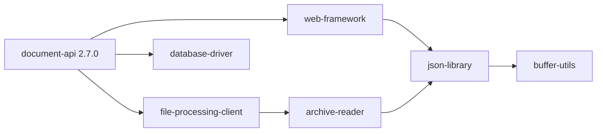
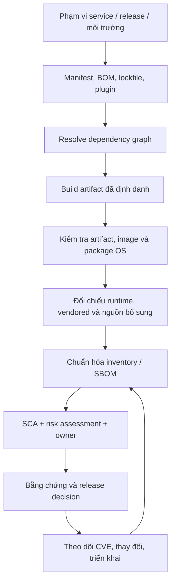
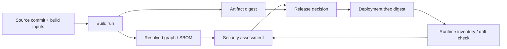
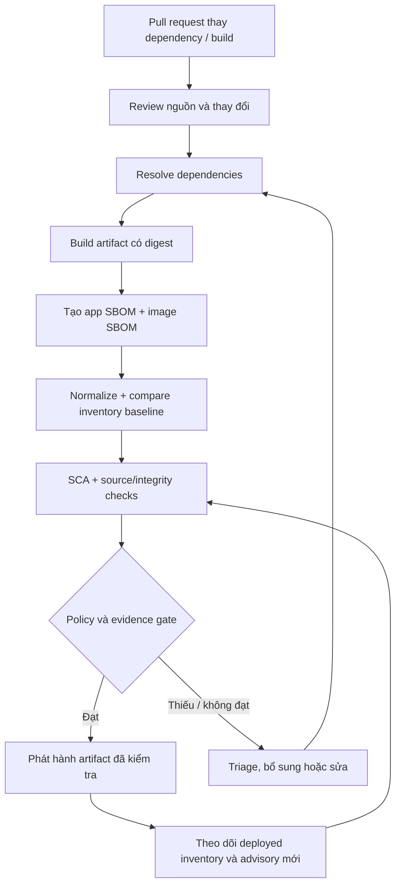

# Dependency inventory

Một nhóm phát triển dịch vụ Java sử dụng Spring Boot, thư viện xử lý JSON, client HTTP, driver cơ sở dữ liệu và một container base image. Trong file build, nhóm chỉ thấy vài dependency được khai báo trực tiếp. Nhưng bản phát hành thực tế có thể chứa hàng chục hoặc hàng trăm thư viện gián tiếp, các thành phần native và package hệ điều hành từ image nền. Nếu ngày mai xuất hiện thông báo lỗ hổng trong một thư viện được kéo vào gián tiếp, nhóm cần trả lời ngay: **dịch vụ nào, bản phát hành nào và môi trường nào đang dùng phiên bản bị ảnh hưởng?**

Nếu không có danh mục dependency đáng tin cậy, nhóm có thể phải tìm thủ công trong nhiều repository, chạy quét lại từng hệ thống, hoặc tệ hơn, đưa ra kết luận “không bị ảnh hưởng” chỉ vì tên thư viện không xuất hiện trong file build. Đây là vấn đề mà **Dependency inventory** giải quyết.

**Dependency inventory** là danh mục có cấu trúc về các thành phần phần mềm mà một sản phẩm, dịch vụ, artifact hoặc quá trình build **phụ thuộc vào**, kèm theo định danh, phiên bản thực tế, mối quan hệ phụ thuộc, nguồn gốc, phạm vi sử dụng, người chịu trách nhiệm và bằng chứng kiểm chứng. Danh mục phải được cập nhật khi code, build, artifact hoặc môi trường triển khai thay đổi.

Trong module **SECURITY_SECURITY_ASSURANCE**, dependency inventory là một hiện vật nền tảng để tổ chức chứng minh rằng các rủi ro từ chuỗi cung ứng phần mềm đã được nhận diện, theo dõi, đánh giá, xử lý và kiểm chứng. Đích đến không phải chỉ là “có danh sách package”, mà là tạo được đường truy vết **thành phần → sản phẩm/artifact → rủi ro → security control → bằng chứng → quyết định phát hành và vận hành**.

## 1. Dependency inventory là gì và cần trả lời những câu hỏi nào?

Một inventory hữu ích có thể trả lời:

- Sản phẩm sử dụng **những thành phần nào**, kể cả dependency không được khai báo trực tiếp?
- **Phiên bản chính xác** nào được resolve hoặc đóng gói trong một bản phát hành?
- Vì sao một thành phần xuất hiện: được khai báo trực tiếp hay được thư viện khác kéo vào?
- Nó tham gia **runtime, build, test, plugin, công cụ đóng gói** hay container?
- Nguồn nào cung cấp package, checksum/digest hoặc bằng chứng nguồn gốc là gì?
- Thành phần đó có **trên đường thực thi** của tính năng quan trọng không, hay chỉ dùng trong kiểm thử?
- Bản release, image và environment nào có liên quan nếu xuất hiện lỗ hổng mới?
- Ai có trách nhiệm đánh giá, nâng cấp, loại bỏ hoặc chấp nhận rủi ro?
- Kết quả quét lỗ hổng, review license, xuất xứ và quyết định xử lý nào gắn với thành phần?
- Bằng chứng có phản ánh **artifact đang triển khai** hay chỉ mô tả kế hoạch trong source code?

### 1.1. Phân biệt inventory, dependency graph và SBOM

| Khái niệm | Trọng tâm | Giới hạn cần nhớ |
| --- | --- | --- |
| **Dependency inventory** | Danh mục được quản lý: thành phần, phiên bản, nguồn, phạm vi sử dụng, owner, release liên quan và trạng thái | Độ tin cậy phụ thuộc vào phương pháp thu thập và cập nhật |
| **Dependency graph** | Quan hệ thành phần nào phụ thuộc vào thành phần nào | Không tự chứng minh artifact đã được build/triển khai đúng như graph |
| **SBOM (Software Bill of Materials)** | Bản kê thành phần phần mềm theo định dạng có cấu trúc, thường dùng để trao đổi và tự động xử lý | SBOM có thể là một ảnh chụp tại thời điểm build; không tự chứng minh an toàn |
| **SCA (Software Composition Analysis)** | Phân tích thành phần, thường đối chiếu lỗ hổng đã biết, license và chính sách | Phát hiện phụ thuộc vào coverage, nguồn dữ liệu, matching và bối cảnh khai thác |
| **Artifact provenance** | Bằng chứng artifact được tạo ra từ nguồn, quy trình, công cụ và môi trường nào | Không tự chứng minh mọi dependency không có lỗ hổng |
| **VEX (Vulnerability Exploitability eXchange)** | Thông tin đánh giá tình trạng ảnh hưởng của một sản phẩm đối với một lỗ hổng xác định | Không thay thế điều tra, dữ liệu kỹ thuật và xác minh mức độ ảnh hưởng |

Inventory có thể được xây dựng từ nhiều nguồn: dependency resolver, lockfile, build log, SBOM, package manifest, container scanner, kiểm tra artifact và dữ liệu vận hành. **SBOM là một cách biểu diễn quan trọng nhưng không phải toàn bộ quy trình quản trị inventory.**

### 1.2. Inventory phải có phạm vi rõ ràng

Không có một “danh sách dependency duy nhất” đúng cho tất cả câu hỏi. Cần xác định inventory đại diện cho:

- Một **repository** tại commit cụ thể?
- Một **module** hay một cấu hình dependency cụ thể?
- Một **artifact** (JAR, WAR, image, binary) đã được build?
- Một **release** gồm nhiều service và artifact?
- Một **deployment** đang chạy tại region/cluster/tenant cụ thể?
- Một **chuỗi build** có compiler, plugin, CI action, runner và công cụ đóng gói?
- Một **dịch vụ bên ngoài** mà ứng dụng cần để hoạt động?

Ví dụ, danh mục ở `testRuntimeClasspath` chứa JUnit và thư viện test, trong khi danh mục runtime của image production có thể không chứa các thành phần đó. Cả hai đều có giá trị, nhưng phục vụ những phân tích rủi ro khác nhau.

## 2. Các loại dependency cần nhận diện

### 2.1. Trực tiếp và gián tiếp

**Direct dependency** là thành phần được khai báo trực tiếp, ví dụ một thư viện HTTP. **Transitive dependency** là thành phần được kéo vào thông qua dependency khác. Một lỗ hổng ở lớp thứ ba của graph vẫn có thể ảnh hưởng ứng dụng.

Ví dụ giả định:



Ở đây `json-library` được kéo vào qua hai đường. Danh mục nên cho biết **một phiên bản cuối cùng đã resolve**, đường dẫn phụ thuộc và nếu có conflict thì quy tắc chọn phiên bản. Không nên liệt kê hai bản copy như hai thành phần độc lập chỉ vì nó có hai parent nếu artifact thực tế chỉ chứa một phiên bản.

### 2.2. Dependency theo thời điểm và mục đích sử dụng

| Phạm vi | Ví dụ | Vấn đề bảo mật cần quan tâm |
| --- | --- | --- |
| **Runtime** | Framework, parser, HTTP client, database driver | Dữ liệu không tin cậy có đi qua thành phần không; mức phơi nhiễm và tác động |
| **Compile / provided** | API, annotation processor, thư viện cần ở thời điểm compile | Thành phần có thật sự xuất hiện trong artifact hoặc do platform cung cấp? |
| **Test** | Test framework, mock server, testcontainers | Có chạy trong CI với secret/credential; có ảnh hưởng chất lượng và tính tin cậy phép kiểm tra? |
| **Build tool/plugin** | Gradle/Maven plugin, code generator, bundler | Có khả năng chạy mã trong pipeline; tiếp cận source, secret và artifact |
| **Container/OS** | Base image, libc, OpenSSL, package OS | Lỗ hổng native và rủi ro từ image nền |
| **Vendored / copied code** | Source hoặc binary sao chép vào repository | Có inventory/version/nguồn rõ không, có bị bỏ sót bởi resolver không? |
| **Downloaded at runtime** | Plugin, model, script hoặc package được tải khi chạy | Có xác minh nguồn và integrity; danh mục build có nhìn thấy không? |
| **External service** | Identity provider, OCR API, message broker được quản lý | Đường dữ liệu, hợp đồng, SLA và trách nhiệm của nhà cung cấp |
| **Infrastructure tool** | Terraform provider, CI action, Helm chart | Có thể thay đổi hạ tầng hoặc quyền truy cập; cần quản trị riêng |

Một dependency không được đóng gói vào ứng dụng vẫn có thể là **rủi ro supply chain**. Plugin build có thể chạy với quyền rộng trên CI runner; một CI action độc hại có thể lấy token triển khai ngay cả khi nó không xuất hiện trong SBOM runtime.

### 2.3. Có những dependency “khó nhìn thấy”

Inventory chỉ dựa vào `pom.xml` hoặc `build.gradle` có thể bỏ sót:

- JAR được copy thủ công vào thư mục `libs/`;
- dependency tải từ URL, Git branch hoặc registry riêng;
- code hoặc thư viện native được nhúng trong JAR/shaded/fat JAR;
- library được nạp bằng reflection, `ServiceLoader` hay plugin mechanism;
- executable hoặc tool được download bằng shell trong Dockerfile;
- thành phần ở container base image và image nhiều giai đoạn;
- các package được cài sau khi ứng dụng khởi chạy;
- package của server/application container bên ngoài artifact;
- script, action và plugin của CI/CD;
- các thành phần transitive bị biến đổi hoặc không giữ metadata trong artifact.

Vì vậy, cần kết hợp các kỹ thuật **phân tích source, build resolution, artifact inspection, container inspection và quan sát môi trường** thay vì dựa vào một công cụ.

## 3. Các trường dữ liệu nên có trong inventory

Một bản ghi thành phần tối thiểu phải giúp xác định **nó là cái gì, có mặt ở đâu, từ đâu đến, ai sở hữu và bằng chứng dựa trên điều gì**.

| Trường | Mục đích | Ví dụ minh họa |
| --- | --- | --- |
| `component_id` | Định danh nội bộ ổn định | `CMP-017` |
| `name` | Tên thành phần | `example-json-parser` |
| `version` | Phiên bản thực tế đã resolve/đóng gói | `4.2.1` |
| `ecosystem` | Cơ chế quản lý thành phần | Maven, npm, PyPI, OCI, OS package |
| `purl` / identifier | Định danh chuẩn hóa khi có thể | `pkg:maven/com.example/example-json-parser@4.2.1` |
| `supplier/source` | Nhà cung cấp/registry/repository | Registry hoặc nguồn đã xác minh |
| `checksum/digest` | Định danh nội dung cụ thể | `sha256:<digest>` |
| `direct_or_transitive` | Cách thành phần xuất hiện | Transitive qua `file-processing-client` |
| `dependency_scope` | Compile, runtime, test, build, container… | Runtime |
| `introduced_by` | Parent/đường dẫn dependency hoặc nguồn copy | `file-processing-client → archive-reader` |
| `artifact_ref` | Release/artifact chứa thành phần | `document-api:2.7.0` và image digest |
| `environment` | Nơi thành phần được sử dụng | Production, cluster/region cụ thể |
| `license` | Thông tin giấy phép cần review | Theo metadata và xác minh khi cần |
| `owner` | Người hoặc nhóm xử lý | Document Platform Team |
| `discovered_by` | Cách và lúc inventory được tạo | Build resolver + container scanner |
| `evidence_ref` | Link tới báo cáo, SBOM hoặc artifact | Build ID, SBOM ID |
| `assessment` | Findings, mức ảnh hưởng và quyết định | Ticket, risk record, VEX khi có |
| `last_verified` | Lần gần nhất đối chiếu trạng thái thực tế | Timestamp |

**Package URL (purl)** hỗ trợ định danh package theo ecosystem. Với những loại thành phần không có purl phù hợp, có thể dùng định danh khác, nhưng phải nêu rõ namespace và cách tránh trùng. **CPE** có thể giúp liên kết với dữ liệu lỗ hổng, song ánh xạ package ↔ CPE không luôn một-một và có nguy cơ nhận nhầm sản phẩm.

### 3.1. Phiên bản khai báo khác phiên bản đã resolve

Một file build có thể khai báo một khoảng version hoặc phụ thuộc vào cơ chế quản lý phiên bản qua BOM/plugin. Vì thế:

- `declared_version`: điều developer hoặc cấu hình mong muốn;
- `resolved_version`: version mà dependency resolver thực sự chọn;
- `packaged_version`: version thực tế trong artifact hoặc image;
- `deployed_version`: artifact đang chạy ở môi trường cụ thể.

Bốn giá trị có thể khác nhau. Khi đánh giá lỗ hổng, chỉ nhìn phiên bản *khai báo* có thể gây kết luận sai. Inventory phục vụ assurance cần ưu tiên phiên bản **thực sự tham gia build và release**, đồng thời lưu nguồn gốc lựa chọn.

### 3.2. Một bản ghi minh họa

```yaml
component:
  id: "CMP-017"
  ecosystem: "maven"
  name: "com.example:example-json-parser"
  purl: "pkg:maven/com.example/example-json-parser@4.2.1"
  declared_version: "<managed-by-bom-or-dependency-rule>"
  resolved_version: "4.2.1"
  scope: "runtime"
  direct: false
  parents:
    - "com.example:file-processing-client@3.0.0"
  source_registry: "<trusted-repository>"
  artifact_checksum: "sha256:<package-digest>"
  artifact_context:
    service: "document-api"
    release: "<release-id>"
    image_digest: "sha256:<image-digest>"
    environment: "production"
  owner: "document-platform-team"
  inventory_evidence:
    - "<dependency-graph-report>"
    - "<sbom-ref>"
    - "<artifact-inspection-report>"
  findings: []
  assessed_at: "<timestamp>"
```

Tên package và version trên là **giả định phục vụ học tập**, không khẳng định một package như vậy tồn tại hay chứa lỗ hổng. Danh mục thực tế cần dựa vào kết quả resolver, artifact và nguồn dữ liệu đáng tin cậy.

## 4. Xây dựng inventory theo quy trình có thể lặp lại

Một quy trình tốt cần trả lời được “dữ liệu đến từ đâu” và “làm sao biết inventory còn đúng với phiên bản đang chạy?”.

### Bước 1: Định nghĩa đối tượng và ranh giới inventory

Ghi rõ service, module, repository, branch/commit, build configuration, platform, OS/architecture, artifact và môi trường đích. Xác định inventory gồm runtime thôi hay cả build/test/CI, container, hạ tầng và external services.

Ví dụ, đối tượng có thể là: `document-api` bản phát hành `2.7.0`, image Linux/amd64 và Linux/arm64, chạy trên production cluster A và B. Nếu image cho hai architecture có thành phần native khác nhau, cần phân biệt inventory theo platform thay vì gộp không giải thích.

### Bước 2: Thu thập dependency được khai báo

Đọc metadata từ công cụ build và package manifest, ví dụ `pom.xml`, cấu hình Gradle, package manifest của các ecosystem khác, các file version catalog/BOM và lockfile nếu có.

Đừng bỏ qua plugin, buildscript dependency, dependency được kéo vào qua template hoặc các file cấu hình phụ. Metadata trong source mô tả **ý định build**, chưa phải artifact cuối cùng.

### Bước 3: Resolve toàn bộ graph theo cấu hình được dùng

Thực hiện dependency resolution phù hợp với module, scope và môi trường build. Thu thập version cuối cùng, đường dependency, lý do conflict resolution và repository nguồn.

Một dependency được dùng ở `runtimeClasspath` có thể không giống `testRuntimeClasspath`. Với JVM, cũng cần phân biệt đường compile, runtime và các thư viện được đóng gói theo từng plugin/packaging model.

### Bước 4: Kiểm tra artifact sau build

Tạo artifact theo pipeline được phê duyệt rồi đối chiếu thư viện được đóng gói, embedded JAR, shaded classes, binary native, resource download và dependency có nguồn bên ngoài.

Nếu artifact được tạo bằng nhiều stage, cần phân biệt dependency chỉ xuất hiện trong builder image với thành phần có mặt ở final image. Cả hai có rủi ro nhưng không cùng mức phơi nhiễm.

### Bước 5: Bổ sung container và hệ điều hành

Nếu chạy bằng OCI/container image, thu thập base image digest, package OS, thư viện runtime, binary phụ và cấu hình image. Không dựa vào tag `latest` hoặc tag có thể thay đổi để định danh nội dung.

Khi ứng dụng chạy trên một nền tảng quản lý, cần xác định ranh giới: thành phần do nhóm sở hữu, thành phần do platform cung cấp và cách theo dõi thông báo bảo mật cho các thành phần ngoài quyền kiểm soát trực tiếp.

### Bước 6: Ghi nhận thành phần ngoài package manager

Bao gồm vendored code, plugin tải động, script, executable, file binary sao chép thủ công, model hoặc thành phần được lấy từ nguồn bên ngoài. Những mục này có thể cần khai báo thủ công có owner và evidence, hoặc dùng phương pháp inventory bổ sung.

### Bước 7: Chuẩn hóa, đối chiếu và phát hiện khoảng trống

Chuẩn hóa định danh (purl, tọa độ package, digest), phân loại scope, loại bỏ trùng hợp lý và ghi đường dẫn parent. Đối chiếu kết quả từ resolver với artifact/container scan.

Nếu resolver báo có thư viện nhưng artifact scanner không thấy, không kết luận một nguồn chắc chắn sai. Cần phân tích: thư viện chỉ dùng khi build? Bị tối ưu loại bỏ? Được shade khiến metadata biến mất? Scanner có bỏ qua định dạng? Ghi rõ nguyên nhân và mức bất định.

### Bước 8: Liên kết owner, rủi ro và quyết định

Mỗi thành phần hoặc nhóm thành phần cần có chủ sở hữu và kế hoạch quản lý cập nhật. Gắn finding vào đúng component/release; khi sửa, ghi version mới, evidence kiểm tra lại và lý do còn giữ dependency cũ ở một release khác.

### Bước 9: Cập nhật liên tục và giữ lịch sử

Inventory cần được tạo lại khi thay đổi dependency, build plugin, base image, artifact hoặc môi trường. Khi có thông báo lỗ hổng mới, inventory không thay đổi nhưng **đánh giá rủi ro của thành phần có thể thay đổi**. Vì vậy vừa cần snapshot theo release vừa cần khả năng đối chiếu tình trạng hiện tại.



## 5. Ví dụ Java: inventory của một dịch vụ quản lý tài liệu

Giả sử `document-api` dùng Spring Boot, một thư viện xử lý tài liệu, database driver và công cụ build. Trong cấu hình Gradle minh họa:

```groovy
// Ví dụ minh họa ý tưởng, chưa phải cấu hình đầy đủ để chạy.
plugins {
    id 'java'
    id 'org.springframework.boot' version '<approved-plugin-version>'
}

dependencies {
    implementation 'org.springframework.boot:spring-boot-starter-web'
    implementation 'com.example:document-parser:3.0.0'
    runtimeOnly 'org.postgresql:postgresql'
    testImplementation 'org.junit.jupiter:junit-jupiter'
}
```

Danh sách này **không** cho biết toàn bộ version đã resolve. Một số version có thể được quản lý bởi BOM/plugin; thư viện `document-parser` có thể kéo thêm thư viện ZIP, XML và mã hóa. Khi phân tích một thông báo lỗ hổng, phải truy đúng version thực tế.

### 5.1. Các lệnh dùng để điều tra dependency

Các lệnh dưới đây chỉ là ví dụ tham khảo khi làm việc trong một dự án Java phù hợp; tên task, plugin, cấu hình và kết quả có thể khác nhau. Chúng **không được chạy** để tạo bài học này.

**Gradle:**

```bash
# Liệt kê graph runtime cho cấu hình tồn tại trong dự án Java.
./gradlew dependencies --configuration runtimeClasspath

# Kiểm tra vì sao một dependency xuất hiện và version được chọn.
./gradlew dependencyInsight \
  --configuration runtimeClasspath \
  --dependency example-json-parser
```

**Maven:**

```bash
# Dependency tree của Maven project có plugin tương ứng.
mvn dependency:tree

# Giới hạn theo một nhóm artifact cần điều tra (ví dụ minh họa).
mvn dependency:tree -Dincludes=com.example:example-json-parser
```

Một kết quả dependency tree giúp biết graph resolution nhưng chưa chắc phản ánh mọi thành phần trong final container hoặc những thư viện được tải động. Cần kiểm tra artifact và image; không dùng một lệnh đơn lẻ làm bằng chứng inventory đầy đủ.

### 5.2. Ví dụ thành phần trực tiếp và gián tiếp

| Thành phần giả định | Nguồn xuất hiện | Scope | Điểm cần review |
| --- | --- | --- | --- |
| `spring-boot-starter-web` | Khai báo trực tiếp | Runtime | Framework và version được quản lý bởi build |
| `document-parser` | Khai báo trực tiếp | Runtime | Xử lý tệp không tin cậy |
| `example-json-parser` | Transitive qua `document-parser` | Runtime | Version resolved, bề mặt parse dữ liệu |
| `postgresql driver` | Khai báo trực tiếp | Runtime | Phạm vi credential và driver version |
| `junit-jupiter` | Khai báo trực tiếp | Test | Không kết luận nó có mặt trong image production |
| `Gradle plugin` | Cấu hình build | Build | Chạy mã trong CI, có thể truy cập artifact và credential |
| `base-image OS library` | Container image | Runtime native | Lỗ hổng hệ điều hành, architecture và digest |
| `CI action` | Pipeline configuration | Build / supply chain | Quyền token, pin version, trusted source |

Bảng trên chỉ mô tả quan hệ mẫu, không phải kết quả dependency resolution thực tế của Spring Boot hoặc Gradle. Khi triển khai thật, ghi version, checksum và nguồn theo kết quả build của dự án.

### 5.3. Tình huống bị bỏ sót vì chỉ kiểm tra direct dependency

Giả sử `document-parser 3.0.0` phụ thuộc `archive-reader 2.5.0` và `archive-reader` kéo vào `example-json-parser 4.2.1`. Một advisory mới ảnh hưởng tới bản parser này.

Nếu chỉ tìm `example-json-parser` trong `build.gradle`, nhóm có thể không thấy. Inventory có dependency graph giúp truy:

`document-api → document-parser → archive-reader → example-json-parser`.

Sau đó phải xác minh version packaged, code path thực tế, nguồn dữ liệu đi vào parser và control. Nếu cần cập nhật, có thể nâng cấp dependency cấp trên hoặc dùng cơ chế chọn version được hỗ trợ, nhưng phải kiểm tra compatibility và chạy lại security/regression tests. Không nên ép version mới chỉ để “xóa cảnh báo” mà không hiểu tương thích hay nguyên nhân.

## 6. SBOM: bản kê có cấu trúc cho sản phẩm và artifact

**Software Bill of Materials (SBOM)** mô tả thành phần và một số quan hệ giữa chúng, hỗ trợ chia sẻ dữ liệu inventory, phân tích lỗ hổng và truy vết chuỗi cung ứng.

Các định dạng thường dùng gồm **CycloneDX** và **SPDX**. Lựa chọn cần dựa trên yêu cầu tương thích công cụ, khách hàng và độ đầy đủ của thông tin có thể thu thập. SBOM được tạo trong CI ở thời điểm build giúp liên kết với một release cụ thể; SBOM cho image giúp quan sát thêm các package OS và thành phần nằm trong artifact.

### 6.1. Phân biệt nguồn sinh SBOM

| Nguồn | Điểm mạnh | Giới hạn điển hình |
| --- | --- | --- |
| **Manifest / lockfile** | Có thông tin khai báo, version và quan hệ resolver | Không thấy hoàn toàn binary vendored hoặc package OS |
| **Dependency resolution của build** | Thấy graph và version được chọn theo cấu hình | Có thể chưa phản ánh packaging cuối cùng |
| **Scan JAR/WAR/binary** | Gần với thành phần được đóng gói thực tế | Thư viện shaded/minified có thể mất metadata |
| **Scan OCI/container image** | Thấy package OS và nhiều thành phần runtime | Không tự biết mọi thành phần tải động sau khi chạy |
| **Runtime observation** | Có thể thấy thư viện/phiên bản được nạp thực tế | Chỉ thấy hành vi và thời điểm quan sát; có thể bỏ sót đường ít chạy |
| **Thông tin nhà cung cấp** | Bổ sung thành phần black-box hoặc do bên thứ ba quản lý | Độ chi tiết và khả năng xác minh khác nhau |

Trong nhiều trường hợp cần **nhiều SBOM ở các tầng khác nhau**, ví dụ application SBOM, image SBOM và thông tin build dependencies. Cần chỉ rõ thành phần nào thuộc phạm vi runtime, build hoặc dịch vụ bên ngoài để tránh hiểu nhầm.

### 6.2. Mẫu dữ liệu SBOM ở dạng giản lược

Ví dụ JSON dưới đây **chỉ là minh họa cấu trúc khái niệm, không phải tệp CycloneDX/SPDX hoàn chỉnh hoặc hợp lệ theo schema**:

```json
{
  "subject": {
    "service": "document-api",
    "release": "<release-id>",
    "artifactDigest": "sha256:<image-digest>"
  },
  "generatedAt": "<timestamp>",
  "components": [
    {
      "name": "com.example:document-parser",
      "version": "3.0.0",
      "purl": "pkg:maven/com.example/document-parser@3.0.0",
      "scope": "runtime"
    },
    {
      "name": "com.example:example-json-parser",
      "version": "4.2.1",
      "purl": "pkg:maven/com.example/example-json-parser@4.2.1",
      "scope": "runtime"
    }
  ],
  "relationships": [
    {
      "from": "com.example:document-parser@3.0.0",
      "to": "com.example:example-json-parser@4.2.1",
      "type": "depends_on"
    }
  ]
}
```

Với hệ thống thực, cần tuân thủ schema và cơ chế reference đúng của định dạng được chọn; lưu ID, thông tin công cụ tạo, thời điểm, digest và liên kết đến artifact. Không lấy việc một tệp JSON được gắn nhãn “SBOM” làm bằng chứng rằng nó đáp ứng chuẩn.

### 6.3. SBOM không tự chứng minh tính an toàn

Một SBOM có thể **đầy đủ nhưng chứa dependency dễ bị khai thác**. Ngược lại, SBOM được tạo bởi scanner có thể không thấy một thành phần khó nhận dạng và báo thiếu. SBOM chỉ là nguồn bằng chứng về cấu phần; assurance cần thêm kiểm tra nguồn gốc, risk assessment, verification, configuration, khả năng khai thác và kết quả xử lý.

Không nên khẳng định “SBOM sạch” chỉ vì kết quả khớp dữ liệu CVE là rỗng. Có thể có lỗ hổng chưa được công bố, sai matching, thành phần không có dữ liệu hoặc lỗ hổng logic của ứng dụng.

## 7. Liên kết dependency với artifact đang triển khai

Một trong những câu hỏi khó nhất của inventory là: “Đây có phải những dependency của **bản đang chạy** không?”

### 7.1. Bốn bước truy vết

1. **Source baseline:** commit và cấu hình build được dùng.
2. **Build evidence:** build ID, graph resolution, SBOM, kết quả kiểm tra và artifact digest.
3. **Release metadata:** artifact nào được phê duyệt, policy nào áp dụng và quyết định của ai.
4. **Deployment record:** environment, cluster, image digest/binary checksum và thời điểm triển khai.



Nếu pipeline quét image `sha256:A` nhưng production chạy `sha256:B`, bằng chứng quét A **không tự động áp dụng** cho B. Cần đối chiếu sự khác biệt hoặc kiểm chứng lại. Tương tự, tag `v2.7` có thể bị ghi đè ở một registry thiếu kiểm soát; digest là định danh nội dung phù hợp hơn cho việc xác minh.

### 7.2. Phiên bản image và platform

Một manifest OCI có thể trỏ đến nhiều image theo OS/architecture. Trường hợp cần phân tích lỗ hổng native, inventory phải biết platform và image digest thực sự đang sử dụng, không chỉ manifest tag cấp cao.

### 7.3. Drift và thay đổi sau triển khai

Nếu container tải plugin khi chạy hoặc server cài package ngoài pipeline, inventory tạo lúc build có thể không còn phản ánh thực tế. Cần quyết định những thay đổi runtime nào được phép, kiểm tra integrity và có cơ chế phát hiện drift. Trong hệ thống immutable deployment, ưu tiên rebuild/redeploy có kiểm soát thay vì sửa thủ công trong production.

## 8. Dùng inventory để quản lý lỗ hổng dependency

Dependency inventory tạo cơ sở để trả lời nhanh các thông báo lỗ hổng, nhưng cần kết hợp **Software Composition Analysis (SCA)** và đánh giá ngữ cảnh khai thác.

### 8.1. Từ advisory đến phạm vi ảnh hưởng

Một quy trình xử lý có thể là:

1. Tiếp nhận advisory, CVE, GHSA, OSV hoặc thông báo đáng tin cậy từ nhà cung cấp.
2. Chuẩn hóa định danh thành phần, hệ sinh thái và khoảng version bị ảnh hưởng.
3. Đối chiếu với inventory và SBOM theo **resolved/packaged version**.
4. Tìm những artifact, release và deployment còn sử dụng thành phần.
5. Xem xét code path, input, quyền, exposure, cấu hình và control bù để đánh giá rủi ro thực tế.
6. Ưu tiên khắc phục, cập nhật, giảm thiểu hoặc loại bỏ.
7. Rebuild, chạy kiểm thử, kiểm tra lại SBOM và kết quả SCA.
8. Xác nhận artifact mới được triển khai, theo dõi bản cũ còn chạy.
9. Ghi finding, evidence, người xử lý, quyết định rủi ro còn lại và thời hạn xem lại.

**CVE không đồng nghĩa với khẳng định mọi sản phẩm dùng cùng tên thư viện đều khai thác được.** Khả năng ảnh hưởng phụ thuộc chính xác version, cơ chế build, code path, đặc tính lỗi và cấu hình runtime. Nhưng cũng không được tự kết luận “không bị ảnh hưởng” chỉ vì chưa thấy bằng chứng khai thác.

### 8.2. Điểm severity và tính khẩn cấp

CVSS cung cấp thông tin mức nghiêm trọng kỹ thuật trong bối cảnh đã được đánh giá; nó không thay thế phân tích tài sản, mức phơi nhiễm và rủi ro cụ thể. Các tín hiệu như tình trạng khai thác ngoài thực tế, độ tin cậy advisory và mức độ hiện diện trong deployment có thể giúp ưu tiên.

Một dependency lộ mặt qua endpoint parse file không tin cậy có thể được ưu tiên khác với package chỉ chạy trong một job test cô lập. Tuy nhiên, build dependency có quyền truy cập token triển khai vẫn có thể là rủi ro rất cao dù không nằm trong runtime.

### 8.3. Phân biệt kết quả matching

| Trạng thái | Ý nghĩa | Hành động |
| --- | --- | --- |
| **Confirmed affected** | Bằng chứng cho thấy version/scope chịu ảnh hưởng | Khắc phục hoặc giảm thiểu theo policy |
| **Potentially affected** | Thông tin matching hoặc điều kiện khai thác chưa đủ | Điều tra và giữ đánh giá tạm thời |
| **Not affected with justification** | Có căn cứ kỹ thuật cụ thể để kết luận không chịu ảnh hưởng | Lưu phân tích, giới hạn và trigger xem lại |
| **Fixed** | Phiên bản/kiểm soát đã được cập nhật và xác minh trong artifact | Lưu retest và deployment evidence |
| **Unknown / insufficient data** | Thiếu version, nguồn hoặc bằng chứng | Bổ sung inventory/verification; không tự coi là an toàn |

Một tài liệu **VEX** có thể trao đổi trạng thái ảnh hưởng của một lỗ hổng đối với sản phẩm, nhưng giá trị của nó phụ thuộc căn cứ kỹ thuật, mức chi tiết và mức tin cậy của nguồn. VEX không thay thế kiểm chứng sản phẩm hoặc trách nhiệm của risk owner.

## 9. Ví dụ xử lý một lỗ hổng transitive

Giả sử advisory cho biết thư viện giả định `example-json-parser` có vấn đề khi parse input không tin cậy ở các phiên bản nhất định. Tổ chức muốn xác định impact đối với `document-api`.

**Đầu vào từ inventory:**

- `document-api` chạy trong production với image digest `sha256:A`.
- `document-parser 3.0.0` là direct dependency.
- `archive-reader 2.5.0` là transitive dependency.
- `example-json-parser 4.2.1` là transitive dependency ở runtime.
- Dịch vụ nhận file không tin cậy qua API upload và chuyển nội dung sang worker.

**Cách xử lý:**

1. Đối chiếu advisory với version `4.2.1`, xác minh package identity và điều kiện lỗi.
2. Xác định đường sử dụng parser từ thành phần xử lý file; kiểm tra có code path thực thi với input người dùng hay không.
3. Xác định production release nào chứa image digest `sha256:A`, kể cả các cluster/region.
4. Kiểm tra control hiện có như giới hạn loại file, giới hạn kích thước, sandbox và quyền của worker; không mặc định chúng loại bỏ rủi ro.
5. Đánh giá phương án nâng `document-parser` hoặc version transitive tương thích, thay thế thư viện, hoặc giảm thiểu tạm thời.
6. Rebuild artifact; so sánh inventory trước/sau để xác minh version chịu ảnh hưởng đã không còn trong artifact mới.
7. Chạy regression tests cho upload, parse, quyền tenant, xử lý lỗi và hiệu năng; chạy security test phù hợp.
8. Triển khai bản được phê duyệt; kiểm tra không còn deployment dùng artifact cũ trong phạm vi phải khắc phục.
9. Ghi ticket, evidence, thời điểm và quyết định xử lý rủi ro còn lại.

**Điều quan trọng:** nếu bản vá đã vào branch chính nhưng một số pod production vẫn chạy image cũ, trạng thái “đã sửa” trong repository chưa phải là trạng thái “đã khắc phục hết phạm vi triển khai”. Inventory cần theo dõi cả **released** và **deployed**.

## 10. Bảo đảm nguồn gốc và tính toàn vẹn của dependency

Inventory cho biết thành phần nào xuất hiện, còn supply chain security phải quan tâm **ai cung cấp thành phần, thành phần có thể bị thay thế không và pipeline có thực thi mã không tin cậy không**.

### 10.1. Những mối đe dọa điển hình

- **Dependency confusion:** tên package nội bộ bị lấy từ registry công khai do cấu hình hoặc ưu tiên nguồn không đúng.
- **Typosquatting:** package có tên gần giống thư viện phổ biến được đưa vào do nhầm lẫn.
- **Maintainer/repository compromise:** người tấn công chiếm quyền phát hành một package đáng tin.
- **Malicious update:** phiên bản mới thêm hành vi không mong muốn dù không có CVE.
- **Build/plugin compromise:** plugin, action hoặc script chạy trong CI với quyền rộng.
- **Artifact substitution:** binary download hoặc image tag bị thay sau khi kiểm tra.
- **Compromised mirror/registry:** nguồn cung cấp trả về nội dung không như kỳ vọng.

### 10.2. Các control có thể áp dụng

1. Dùng repository/registry được cho phép, cấu hình rõ ưu tiên nguồn.
2. Hạn chế quyền thêm dependency hoặc thay đổi registry cho code nhạy cảm.
3. Review package mới theo rủi ro, đặc biệt package ít được duy trì hoặc thay maintainer bất thường.
4. Pin version phù hợp; dùng locking/verification khi hệ sinh thái và công cụ hỗ trợ.
5. Xác minh checksum, digest, chữ ký hoặc provenance theo cơ chế đáng tin.
6. Hạn chế quyền CI runner, credential và secret có thể bị dependency/plugin đọc.
7. Tách quyền build với quyền triển khai khi có thể.
8. Lưu artifact bất biến; xác minh artifact triển khai đúng artifact đã được phê duyệt.
9. Theo dõi hành vi bất thường và thông báo bảo mật từ nguồn tin cậy.
10. Có quy trình thu hồi hoặc cách ly dependency khi bị phát hiện độc hại.

**Pinning không tự động đảm bảo an toàn:** một version bị pin vẫn có thể tồn tại lỗ hổng hoặc đã độc hại. **Hash không chứng minh nguồn đáng tin nếu hash được lấy từ cùng nguồn bị xâm phạm mà không có kênh tin cậy**. Cần kết hợp chính sách nguồn, provenance và kiểm tra theo rủi ro.

## 11. Tự động hóa inventory trong CI/CD

Inventory nên được tạo như một phần của luồng build phát hành, thay vì nhập thủ công sau khi deploy.

Một pipeline ở mức khái niệm:



### 11.1. Chính sách inventory tối thiểu

Ví dụ YAML dưới đây **mô tả chính sách**, không phải cú pháp chạy trực tiếp của một công cụ CI:

```yaml
policy:
  id: "DEPENDENCY-INVENTORY-PRODUCTION"
  version: "1.0"
  scope:
    environment: "production"
    artifacts: ["application", "container-image"]
  required:
    - subject_artifact_digest_present
    - source_commit_and_build_id_present
    - resolved_runtime_dependency_inventory_present
    - container_package_inventory_present
    - inventory_timestamp_and_generator_present
    - critical_components_have_owner
    - known_critical_findings_triaged
  decisions:
    on_missing_inventory: "BLOCK"
    on_mismatched_artifact: "BLOCK"
    on_unassessed_critical_finding: "NEEDS_REVIEW"
    on_inventory_parse_error: "BLOCK"
  exceptions:
    require_authorized_approver: true
    require_expiration: true
    require_scope_and_mitigation: true
```

Phải kiểm tra những trường này từ nguồn đáng tin, không chỉ nhận JSON do người tạo PR tự khai. Một gate chỉ hiển thị cảnh báo nhưng không chặn quyền triển khai chưa phải cơ chế thực thi hiệu quả.

### 11.2. So sánh baseline và phát hiện thay đổi

Khi pull request bổ sung dependency, pipeline có thể báo:

- Thành phần **new**: mới xuất hiện trong graph/artifact.
- Thành phần **removed**: không còn xuất hiện.
- Thành phần **updated**: version/nguồn/digest thay đổi.
- Quan hệ **changed**: parent/scope khác trước.
- Thành phần **unresolved** hoặc không có định danh đáng tin.
- Thành phần **disallowed** hoặc cần review theo policy.

Lưu ý: thay đổi file build không phải lúc nào cũng làm đổi artifact; ngược lại, base image tag hoặc dependency động có thể đổi thành phần khi source code không đổi. So sánh inventory và artifact thực tế giúp phát hiện cả hai loại tình huống.

### 11.3. Bảo vệ evidence

Báo cáo inventory và SBOM cần có timestamp, build ID, công cụ và phiên bản tạo, nguồn dữ liệu, artifact digest, policy version và nơi lưu đáng tin cậy. Nên bảo vệ tránh sửa/xóa trái phép, giữ lịch sử để truy vết các release cũ.

Danh mục có thể tiết lộ kiến trúc và thành phần chưa được vá. Vì thế cần phân loại, kiểm soát truy cập và chỉ chia sẻ theo nghĩa vụ/mục đích; không mặc định công bố toàn bộ inventory production.

## 12. Traceability: từ dependency tới claim bảo mật

Một hồ sơ assurance nên thể hiện **Claim – Argument – Evidence**.

**Claim minh họa:**

> **CLM-SC-02:** Trong phạm vi release và môi trường được đánh giá, các dependency runtime và package container quan trọng của `document-api` đã được nhận diện, gắn với artifact triển khai, kiểm tra thông tin lỗ hổng đã biết và xử lý các phát hiện theo chính sách rủi ro.

Đây là một claim có phạm vi, **không** phải lời khẳng định “sản phẩm không có lỗ hổng”.

**Argument:**

- Build sử dụng nguồn và công cụ có kiểm soát.
- Dependency resolution và artifact/container inventory đã được thu thập và đối chiếu.
- Các thành phần được định danh và liên kết với release, environment.
- SCA/advisory review thực hiện trên inventory còn hiệu lực.
- Finding vượt ngưỡng có chủ sở hữu, trạng thái khắc phục hoặc ngoại lệ hợp lệ.
- Bản deploy được kiểm tra khớp artifact đã đánh giá.

**Evidence:**

| Evidence ID mẫu | Hiện vật | Hỗ trợ điều gì? | Giới hạn |
| --- | --- | --- | --- |
| `EV-SC-01` | Dependency tree và resolver metadata | Version và quan hệ graph theo cấu hình | Có thể không thấy vendored/native |
| `EV-SC-02` | Application SBOM | Thành phần ứng dụng tại build | Phụ thuộc cách generate |
| `EV-SC-03` | OCI image SBOM | Package OS và nhiều thành phần đóng gói | Không nhất thiết thấy plugin tải động |
| `EV-SC-04` | Build ID, source commit, image digest | Liên hệ evidence với artifact | Không tự chứng minh absence of vulnerabilities |
| `EV-SC-05` | SCA report và risk triage | Các advisory đã được xem xét | Có thể thiếu CVE chưa được biết hoặc matching sai |
| `EV-SC-06` | Finding/retest/approval | Cách xử lý rủi ro cụ thể | Chỉ có hiệu lực cho phạm vi/quyết định ghi nhận |
| `EV-SC-07` | Deployment inventory | Artifact được đánh giá đang ở đâu | Cần cập nhật khi rollout/drift |

### 12.1. Ma trận truy vết yêu cầu – control – bằng chứng

| Requirement | Control | Verification | Evidence | Trạng thái minh họa |
| --- | --- | --- | --- | --- |
| `SR-SC-01`: các dependency runtime được nhận diện | Resolver + SBOM + artifact scan | Đối chiếu graph và artifact | `EV-SC-01..03` | Chờ kiểm tra vendored JAR |
| `SR-SC-02`: artifact có nguồn gốc và định danh | Build provenance, checksum, registry policy | Kiểm tra digest và pipeline | `EV-SC-04` | Đã kiểm tra trong phạm vi |
| `SR-SC-03`: lỗ hổng đã biết được đánh giá | SCA, triage, patch workflow | Scan và risk review | `EV-SC-05, EV-SC-06` | Còn finding cần đánh giá |
| `SR-SC-04`: release triển khai đúng artifact đã kiểm chứng | Deployment verification | So sánh digest | `EV-SC-07` | Chờ xác nhận cluster B |
| `SR-SC-05`: dependency mới cần review | PR ownership, policy-as-code | Kiểm tra PR và gate | PR/review log | Đang áp dụng |

Đây là trạng thái giả định để minh họa. Một ô “đã kiểm tra” phải có evidence cụ thể cho bản phát hành tương ứng. Nếu thiếu inventory của base image, không nên tuyên bố đã bao phủ toàn bộ runtime.

### 12.2. Mẫu bản ghi assurance

```yaml
assurance_record:
  claim_id: "CLM-SC-02"
  service: "document-api"
  release_id: "<release-id>"
  source_commit: "<commit-sha>"
  artifact_digest: "sha256:<digest>"
  deployment_scope:
    environments: ["production"]
    platforms: ["linux-amd64", "linux-arm64"]
  inventory:
    application_sbom: "<app-sbom-ref>"
    image_sbom: "<image-sbom-ref>"
    dependency_graph: "<resolver-report-ref>"
    generated_at: "<timestamp>"
    methodology: "<tools-and-configurations>"
    known_exclusions: ["<not-inspected-components>"]
  assessments:
    sca_report: "<sca-report-id>"
    findings: ["<finding-id-if-any>"]
    exceptions: ["<exception-id-if-approved>"]
  evidence:
    build_provenance: "<provenance-ref>"
    deployment_verification: "<deploy-digest-ref>"
  reviewer: "<authorized-reviewer>"
  reviewed_at: "<timestamp>"
  decision: "<accepted|conditional|incomplete|rejected>"
  residual_risk: "<scope-and-risk-description>"
  review_triggers:
    - "dependency-version-change"
    - "base-image-change"
    - "new-relevant-advisory"
    - "runtime-drift"
```

Bản ghi này chỉ là **mẫu cấu trúc**. Không được điền `accepted` theo mặc định khi không có evidence. Quyết định cần phản ánh findings, giới hạn và mức rủi ro còn lại thật sự.

## 13. Vai trò và quản trị Dependency inventory

| Vai trò | Trách nhiệm | Bằng chứng thường sở hữu |
| --- | --- | --- |
| **Developer / repository owner** | Chọn dependency, giải thích nhu cầu, giảm dependency không cần | Manifest, PR, review, dependency update |
| **Build/platform team** | Quản lý resolver, registry, runner, image và SBOM generation | Build configuration, artifact digest, provenance |
| **Security engineer / champion** | Định nghĩa policy, review rủi ro và hỗ trợ triage | SCA findings, risk assessment, control reviews |
| **Product/security risk owner** | Định mức ưu tiên và chấp nhận rủi ro còn lại theo thẩm quyền | Phê duyệt, ngoại lệ, hạn và biện pháp bù |
| **SRE/Operations** | Theo dõi artifact đang chạy, áp dụng bản vá và kiểm tra drift | Deployment state, rollout/rollback evidence |
| **Procurement/vendor management** | Quản trị nhà cung cấp không có package rõ ràng | Điều khoản, báo cáo phạm vi, thay đổi bên cung cấp |
| **Assurance/audit reviewer** | Đánh giá khả năng truy vết, độ đầy đủ và bằng chứng | Assurance case, review record, gap findings |

Một tổ chức nhỏ có thể gộp vai trò, nhưng việc cho phép người thêm dependency tùy ý tự sửa policy, bỏ kiểm tra và tự phê duyệt mọi rủi ro thường làm giảm độ tin cậy của kết luận. Với chuỗi cung ứng có tác động cao, nên có review độc lập phù hợp.

### 13.1. Chính sách cập nhật dependency

Quy trình nên quy định:

1. Ai được đề xuất thêm dependency hoặc thay repository nguồn;
2. Mức review khác nhau cho runtime, build, test và CI plugin;
3. Cách xác minh license, bảo trì, nguồn gốc, lỗ hổng và tính cần thiết;
4. Cách nâng cấp và kiểm thử tương thích;
5. Thời hạn và cơ chế xử lý thông báo lỗ hổng;
6. Quy trình ngoại lệ có phạm vi, owner, approver và thời hạn;
7. Cách duy trì SBOM/inventory cho release đang hỗ trợ;
8. Cách xử lý component hết vòng đời hoặc không còn maintainer;
9. Cách rút dependency đã bị xác định độc hại khỏi pipeline và production.

## 14. Metrics đánh giá hiệu quả inventory

Chỉ số phải dựa trên định nghĩa và mẫu số, không chỉ đếm số package.

| Chỉ số | Cách hiểu | Cảnh báo khi diễn giải |
| --- | --- | --- |
| **Inventory coverage** | Tỷ lệ artifact/release production có inventory hợp lệ | Inventory có thể tồn tại nhưng thiếu component |
| **Component identification rate** | Tỷ lệ thành phần được xác định đúng identity/version | Mẫu số phụ thuộc phương pháp phát hiện |
| **Dependency owner coverage** | Tỷ lệ dependency quan trọng có owner | Có owner chưa chứng minh đã đánh giá |
| **SBOM freshness** | Thời gian/phiên bản của SBOM so với artifact đang chạy | Snapshot cũ có thể không còn phù hợp |
| **Untriaged vulnerability age** | Thời gian phát hiện vẫn chưa có đánh giá rủi ro | Phải phân loại theo mức tác động và phạm vi |
| **Time to identify exposure** | Thời gian từ advisory đến danh sách release/deployment bị ảnh hưởng | Cần quy tắc bắt đầu/kết thúc thống nhất |
| **Patch deployment completion** | Tỷ lệ deployment bị ảnh hưởng đã chạy bản khắc phục | Merge code không tương đương khắc phục production |
| **Unresolved component ratio** | Thành phần thiếu version/nguồn/phương pháp định danh | Có thể chỉ ra lỗ hổng coverage của công cụ |
| **Inventory drift incidents** | Số lần phát hiện artifact/runtime khác baseline | Cần phân biệt drift được phép với thay đổi trái chính sách |

“100% SBOM generated” chỉ nói pipeline có sinh tệp. Nó không cho biết tệp đầy đủ, chứa đúng version, có được đối chiếu với artifact hoặc có finding chưa xử lý không. Định kỳ review mẫu các đường transitive, shaded code và container OS để kiểm tra chất lượng.

## 15. Những sai lầm thường gặp

| Sai lầm | Hậu quả | Cách cải thiện |
| --- | --- | --- |
| Chỉ liệt kê direct dependencies | Bỏ qua các thư viện gián tiếp dễ bị ảnh hưởng | Resolve đầy đủ graph và parent paths |
| Dùng declared version thay vì resolved version | Đánh giá sai phiên bản chứa trong build | Đọc kết quả resolver và artifact |
| Chỉ scan repository | Không nhìn thấy package OS, vendored binary và image nền | Kết hợp source/build/artifact/image scan |
| Coi test dependency là runtime dependency | Ưu tiên sai rủi ro hoặc báo cáo sai thành phần production | Phân loại scope và artifact |
| Bỏ qua build plugin và CI action | Pipeline bị tấn công dù runtime SBOM sạch | Quản trị inventory cho build supply chain |
| Dùng image tag thay digest | Artifact bị thay nhưng evidence vẫn xanh | Truy vết bằng digest bất biến |
| Tạo SBOM một lần rồi không cập nhật | Inventory cũ không phản ánh release mới | Tích hợp build/deploy và monitor thay đổi |
| Đồng nhất “không có CVE” với “an toàn” | Bỏ sót lỗ hổng chưa được biết, mismatch và supply chain compromise | Kết hợp provenance, review, testing và threat modeling |
| Ép version mới để xóa cảnh báo nhưng không test | Có thể gây lỗi tương thích hoặc ảnh hưởng control khác | Regression/security test, kiểm tra artifact mới |
| Chỉ cập nhật main branch mà không kiểm tra production | Một số deployment vẫn dùng thành phần cũ | Theo dõi release và deployed digest |
| Một component thiếu định danh bị bỏ qua | Có điểm mù trong coverage | Ghi unknown và kế hoạch điều tra |
| Lấy hash từ nguồn không đáng tin rồi coi là kiểm chứng tuyệt đối | Có thể xác nhận chính nội dung giả mạo | Thiết lập nguồn/hash/provenance đáng tin |
| Ghi trạng thái finding nhưng không giữ evidence | Không thể giải thích quyết định rủi ro | Lưu nguồn, triage, owner, retest và timestamp |
| Công bố inventory nội bộ không kiểm soát | Lộ thông tin kiến trúc và thành phần nhạy cảm | Phân quyền, phân loại và chia sẻ theo nhu cầu |

## 16. Tình huống thực hành

### Tình huống A: không thấy package trong file build

Một advisory ảnh hưởng `example-json-parser`. File `build.gradle` không khai báo thư viện này. Đã đủ cơ sở kết luận không bị ảnh hưởng chưa?

**Chưa.** Nó có thể là transitive dependency hoặc được nhúng trong thư viện khác. Cần kiểm tra graph resolution, artifact/image và các nguồn nhúng ngoài resolver trước khi kết luận.

### Tình huống B: SCA pass nhưng production khác artifact

SCA kiểm tra image digest `sha256:A` và không báo finding. Deployment chạy `sha256:B`. Có thể dùng báo cáo của A để xác nhận B không có rủi ro không?

**Không tự động.** Cần biết B khác A ở thành phần nào và kiểm tra lại hoặc có bằng chứng tương đương được chấp nhận. Mối liên kết giữa inventory và deployed artifact bị thiếu.

### Tình huống C: lỗ hổng nằm trong dependency test

Một lỗ hổng nghiêm trọng xuất hiện trong framework test không được đóng gói vào runtime image. Có thể bỏ qua hoàn toàn không?

**Không.** Mức phơi nhiễm runtime có thể khác, nhưng dependency test có thể chạy trong CI, xử lý đầu vào không tin cậy hoặc có quyền đối với source/secret. Phải đánh giá risk scenario của môi trường test/build thay vì dùng một nhãn severity cho mọi nơi.

### Tình huống D: dependency đã được nâng nhưng container base image vẫn cũ

Nhóm nâng các JAR và báo “đã xử lý lỗ hổng OpenSSL” trong khi image nền chưa được cập nhật. Điều gì thiếu?

**Sai phạm vi control.** OpenSSL có thể thuộc OS package của image hoặc môi trường ngoài JAR. Cần inventory container/OS, xác định version bị ảnh hưởng, build lại image và xác minh artifact/deployment.

### Tình huống E: package mới từ registry không quen thuộc

Developer thêm package có tên gần giống một thư viện quen dùng và muốn merge nhanh vì test vẫn xanh. Nên kiểm tra điều gì?

Cần xác minh tên/namespace, maintainer, nguồn tải, phiên bản, checksum/digest, lịch sử phát hành, khả năng thay thế bằng dependency đã được duyệt và quyền mà package có khi build/chạy. Test pass không chứng minh package không có hành vi độc hại.

### Tình huống F: SBOM đầy đủ nhưng vẫn còn finding

Một release có SBOM, danh sách owner và kết quả quét cho đúng image. Tuy nhiên, có finding trọng yếu chưa đánh giá. Có thể đánh dấu claim “supply chain security achieved” không?

**Không đủ cơ sở.** Inventory chứng minh một phần khả năng nhận diện thành phần. Claim về xử lý rủi ro cần quyết định với finding, mức ảnh hưởng, kế hoạch khắc phục/giảm thiểu và evidence tương ứng; không thể bỏ qua chỉ vì đã có SBOM.

## 17. Checklist triển khai Dependency inventory

- [ ] Xác định rõ service, release, artifact, environment, scope và platform cần kiểm kê.
- [ ] Inventory phân biệt direct/transitive và runtime/build/test/container dependencies.
- [ ] Đã xem xét cả vendored libraries, plugin tải động, native binary và CI actions theo phạm vi.
- [ ] Có định danh package, version thực tế, nguồn và checksum/digest khi phù hợp.
- [ ] Có quan hệ dependency graph hoặc parent path cho thành phần gián tiếp.
- [ ] Có bản inventory/SBOM gắn với build ID, commit và artifact digest.
- [ ] Có cơ chế đối chiếu inventory của source, build, artifact, image và deployment.
- [ ] Các thành phần không nhận diện được được đánh dấu rõ, không tự loại khỏi mẫu số.
- [ ] Có owner và quy trình đánh giá dependency mới hoặc update có rủi ro.
- [ ] SCA/advisory review được thực hiện với nguồn dữ liệu và thời điểm xác định.
- [ ] Findings có phạm vi ảnh hưởng, triage, quyết định, người xử lý và evidence retest.
- [ ] Thay đổi base image, plugin, registry hoặc dependency kích hoạt cập nhật inventory.
- [ ] Có cơ chế xác minh deployed artifact khớp artifact đã được đánh giá.
- [ ] Release gate xử lý thiếu inventory, report lỗi và evidence không khớp theo policy.
- [ ] Ngoại lệ có lý do, control bù, người phê duyệt, thời hạn và trigger xem lại.
- [ ] SBOM/inventory và evidence được lưu, phân quyền và bảo vệ tính toàn vẹn phù hợp.
- [ ] Có thể trả lời nhanh “thư viện X phiên bản Y đang tồn tại ở release/deployment nào?”.
- [ ] Các tuyên bố assurance công khai phạm vi, phương pháp, điểm mù và rủi ro còn lại.

## 18. Kết luận

**Dependency inventory** là nền tảng giúp tổ chức biết phần mềm thực sự phụ thuộc vào những thành phần nào, qua đường trực tiếp hay gián tiếp, trong build, runtime, container và môi trường triển khai. Một inventory đáng tin cần định danh version thực tế, nguồn, quan hệ phụ thuộc, artifact, owner và bằng chứng đã kiểm tra; nó phải được cập nhật theo thay đổi và giữ lại lịch sử của những release còn được hỗ trợ.

Trong **security assurance**, inventory là điểm xuất phát để đối chiếu advisory, phân tích tác động, ưu tiên bản vá, kiểm tra supply chain controls và ra quyết định release có căn cứ. SBOM, SCA, provenance, policy-as-code, test và deployment evidence bổ sung cho nhau; không thành phần nào trong số đó tự chứng minh rằng hệ thống hoàn toàn không có lỗ hổng.

**Giá trị của Dependency inventory không nằm ở số lượng package được đếm, mà ở khả năng xác định đúng thành phần đang được dùng, giải thích rủi ro của nó và chứng minh rằng các quyết định bảo vệ được áp dụng cho đúng artifact, đúng phiên bản và đúng môi trường.**
