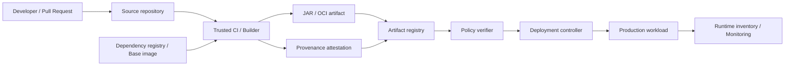
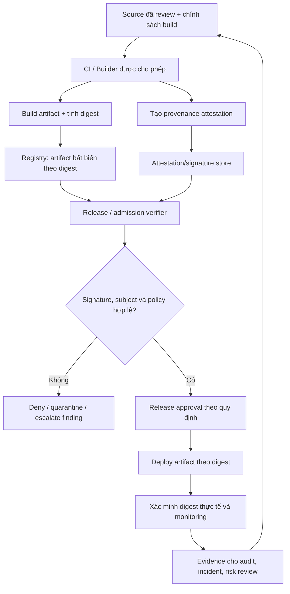

# Artifact provenance: truy xuất nguồn gốc và kiểm chứng bản phát hành phần mềm

## 1. Vì sao biết artifact đến từ đâu lại quan trọng?

Nhóm phát triển một nền tảng học tập Java hoàn thành kiểm thử bảo mật cho commit `a1b2c3` và duyệt phát hành container image chứa dịch vụ chấm điểm. Sau đó, production triển khai một image có cùng tên `learning/grade-service:1.4.0`. Có thể kết luận image đang chạy chính là phần mềm đã được review hay không?

**Chưa thể.** Tag image là một nhãn có thể bị thay đổi hoặc trỏ tới nội dung khác. Ngay cả khi image có tên đúng, vẫn cần biết ai đã tạo nó, mã nguồn nào được sử dụng, pipeline nào thực thi build, artifact nào được tạo và liệu artifact đã bị thay thế trước khi deploy hay không.

Giả sử một tài khoản có quyền push registry bị xâm nhập và đẩy image độc hại dưới tag quen thuộc. Nếu hệ thống triển khai chỉ kiểm tra tên/tag, các kết quả test của commit hợp lệ có thể bị gán sai cho image độc hại. **Artifact provenance** giúp xây dựng và kiểm chứng chuỗi liên kết giữa nguồn mã, quá trình build, artifact đầu ra và bản được triển khai.

**Artifact provenance (thông tin nguồn gốc artifact)** là tập hợp dữ kiện có thể xác minh về **một artifact được tạo ra từ những đầu vào nào, bằng quy trình/build system nào, tại thời điểm và bối cảnh nào**. Provenance thường được cung cấp dưới dạng metadata hoặc attestation gắn với digest của artifact, để bên tiêu thụ có thể đưa ra quyết định tin cậy dựa trên chính sách.

Trong chương **Supply chain security** thuộc module **SECURITY_SECURITY_ASSURANCE**, provenance không chỉ là một trường metadata. Nó là **bằng chứng phục vụ security assurance**: từ phân tích rủi ro, xác định security controls cho CI/CD và kho artifact đến kiểm thử, audit, xử lý finding và giám sát nguồn gốc các bản phát hành đang vận hành.

### Mục tiêu học tập

Sau bài này, bạn có thể:

1. Giải thích artifact provenance và phân biệt nó với checksum, chữ ký, SBOM và kết quả quét lỗ hổng.
2. Nhận diện các tác nhân, trust boundaries và rủi ro làm đứt chuỗi tin cậy source → build → artifact → deployment.
3. Mô tả các thành phần thường có trong provenance/attestation và cách gắn chúng với artifact.
4. Thiết kế quy trình tạo, lưu, xác minh provenance và chính sách cho phép phát hành.
5. Đề xuất assurance claims, bằng chứng và negative tests để kiểm chứng nguồn gốc artifact.
6. Phân tích tình huống Java/Maven, container registry và môi trường production nhiều tenant.

## 2. Artifact nào cần provenance?

**Artifact** là sản phẩm đầu ra được tạo, đóng gói, lưu trữ, phân phối hoặc tiêu thụ bởi một quy trình. Không phải artifact nào cũng là container image.

| Loại artifact | Ví dụ | Vì sao cần truy xuất nguồn gốc? |
|---|---|---|
| **Application binary** | JAR, WAR, native executable | Xác minh binary được tạo từ source, dependency và build process nào |
| **Container image** | OCI image của Spring Boot service | Chặn image bị thay thế, không đúng pipeline hoặc ngoài danh mục được duyệt |
| **Library/package** | Maven package công bố nội bộ | Chứng minh package do quy trình phát hành đã kiểm soát tạo ra |
| **Frontend bundle** | JavaScript/CSS bundle | Liên kết bundle tải về với source, dependency và CI của frontend |
| **Infrastructure artifact** | Helm chart, Terraform module, Kubernetes manifest | Kiểm chứng thay đổi cấu hình và nguồn phát hành tài nguyên |
| **Build tooling** | Maven plugin, compiler wrapper, CI action | Nhận biết công cụ thực thi trong build đến từ đâu |
| **ML/model artifact** | Model file, preprocessing bundle | Truy xuất dữ liệu/recipe/model pipeline theo phạm vi có thể ghi nhận |
| **Deployment package** | Release bundle gồm image digest và config | Đảm bảo môi trường nhận đúng các thành phần đã được chấp thuận |

Mỗi tổ chức cần xác định những artifact nào nằm trong phạm vi đảm bảo. Với nền tảng học tập, có thể ưu tiên backend phục vụ dữ liệu cá nhân, hệ thống quản trị danh tính, dịch vụ thi trực tuyến, thư viện dùng chung và các container chạy production.

### Sản phẩm build và những thứ không được nhầm lẫn

- **Source revision:** commit hoặc phiên bản mã nguồn dùng để build.
- **Build inputs/materials:** các dependency, base image, công cụ và đầu vào liên quan mà build sử dụng hoặc phụ thuộc.
- **Build process:** workflow, builder, tham số và các bước tạo artifact.
- **Output artifact:** JAR, image, package hoặc bundle cuối cùng.
- **Artifact identity:** digest nội dung hoặc định danh khác đủ để đối chiếu chính xác.
- **Deployment:** bản nào thực sự chạy ở môi trường nào, do quyết định nào cho phép.

**Provenance của JAR và provenance của container image không mặc nhiên là một.** Image có thể dùng JAR đã build ở bước trước, thêm base image, cấu hình runtime và package hệ điều hành. Muốn xác minh toàn bộ image, cần ghi nhận các bước hoặc quan hệ đầu vào/đầu ra phù hợp.

## 3. Phân biệt provenance, digest, chữ ký, attestation và SBOM

| Khái niệm | Trả lời câu hỏi | Không tự chứng minh điều gì? |
|---|---|---|
| **Digest/hash** | Nội dung artifact có khớp dữ liệu được định danh không? | Ai tạo artifact, có đáng tin hoặc không có mã độc |
| **Digital signature** | Nội dung hoặc thông điệp có được ký bằng khóa/danh tính được xác minh? | Người ký có làm đúng quy trình, nội dung có an toàn |
| **Attestation** | Một bên đưa ra tuyên bố có cấu trúc gì về đối tượng và ký/xác nhận tuyên bố đó? | Mệnh đề có đúng nếu nguồn tạo attestation không đáng tin |
| **Provenance** | Artifact được tạo như thế nào, từ source/materials và builder nào? | Không có lỗ hổng hoặc hành vi độc hại trong source |
| **SBOM** | Artifact gồm những thành phần và quan hệ dependency nào trong phạm vi? | Quy trình build đáng tin hoặc mọi dependency an toàn |
| **SCA report** | Thành phần nào khớp với thông tin lỗ hổng đã biết? | Không có lỗ hổng chưa công bố, provenance có tính xác thực |
| **Build/test report** | Các bài test/scan nào chạy trên revision/artifact nào, kết quả ra sao? | Artifact production nhất thiết chính là artifact đã được kiểm tra |
| **Release approval** | Ai hoặc cơ chế nào chấp thuận release theo chính sách? | Bản deploy có đúng artifact và không bị thay thế |

Các bằng chứng bổ sung cho nhau. Một chính sách release có thể yêu cầu:

1. Digest artifact khớp với bản được duyệt.
2. Provenance có thể xác thực và subject trỏ đúng digest.
3. Builder, source repository và workflow thuộc danh sách được phép.
4. Các gate test/scan gắn với đúng commit và output.
5. Quyết định risk và release approval còn hiệu lực.

Một phần bằng chứng hợp lệ không cho phép suy luận phần còn lại là đúng.

### Ví dụ hai image có cùng tag

```text
registry.example/learning/grade-service:1.4.0
    |
    +-- Ngày 1: sha256:AAA...  <- đã được test và duyệt
    |
    +-- Ngày 2: sha256:BBB...  <- một actor có quyền push thay tag
```

Một hệ thống chỉ kiểm tra tag sẽ không biết thay đổi. Một hệ thống kiểm tra digest và provenance có thể phát hiện image đang đề nghị deploy không trùng artifact đã duyệt; khi đó phải đánh giá lại thay vì tin vào nhãn.

## 4. Threat model: provenance bảo vệ chống lại điều gì?

Để thiết kế assurance, cần phân biệt các điểm mà kẻ tấn công có thể can thiệp vào chuỗi phần mềm.

| Kịch bản | Ranh giới bị tác động | Vai trò của provenance và controls khác |
|---|---|---|
| **Artifact substitution** | Registry → deployment | Đối chiếu digest, attestation subject và chính sách deploy |
| **Unapproved build** | Source/workflow → builder | Ràng buộc builder identity, workflow và source được chấp thuận |
| **Compromised CI runner** | Build environment | Provenance chỉ đáng tin nếu builder/runner và cơ chế ký được bảo vệ |
| **Source tampering** | Repository → build | Xác minh commit, repo, quyền thay đổi, review và branch protection |
| **Dependency substitution** | Registry/mirror → build | Ghi và xác minh resolved materials khi khả thi; quản lý dependency, khóa version |
| **Malicious plugin/action** | Build tooling → CI execution | Review công cụ, pin phiên bản, hạn chế secret/permission, bảo vệ runner |
| **Attestation forgery** | Producer → metadata store | Chữ ký, chứng thư/danh tính, trust root và policy validation |
| **Replay of valid attestation** | Metadata reuse cho artifact khác | Ràng buộc subject digest và context; không chỉ kiểm tra “có chữ ký” |
| **Compromised signer** | Khóa/danh tính phát hành | Credential rotation, isolation, issuer verification, phát hiện bất thường |
| **Unauthorized deployment** | Registry → production | Admission/release policy, deploy digest đã duyệt, kiểm tra trạng thái đang chạy |
| **Missing provenance** | Bất kỳ đoạn nào không có evidence | Xác định phạm vi chưa biết; yêu cầu review hoặc exception đúng thẩm quyền |

**Provenance không ngăn tất cả cuộc tấn công chuỗi cung ứng.** Nếu source đã chứa mã độc trước khi build và builder trung thực ghi lại nguồn đó, provenance có thể hoàn toàn đúng nhưng artifact vẫn nguy hiểm. Cần phối hợp với code review, threat modeling, SCA, kiểm thử và kiểm soát source.

### Các trust boundaries quan trọng



Mỗi mũi tên cần một câu hỏi bảo mật: **dữ liệu đi qua ai, ai được sửa, danh tính được xác minh bằng gì và kết quả được đối chiếu thế nào?** Những trust boundaries nhạy cảm thường nằm ở source repository, runner, nguồn dependency, hệ thống ký, registry, deployment controller và workload runtime.

## 5. Provenance nên chứa những thông tin gì?

Không có một tập trường phù hợp mọi loại artifact, nhưng bộ dữ kiện thường được quan tâm gồm:

| Nhóm | Thông tin tiêu biểu | Tác dụng |
|---|---|---|
| **Subject** | Tên artifact và digest nội dung | Ràng buộc attestation với output cụ thể |
| **Source** | Repository URI, commit, tag/ref và thông tin thay đổi nếu phù hợp | Truy nguồn mã đầu vào |
| **Build definition** | Loại build, workflow/recipe, tham số ảnh hưởng output | Hiểu build đã được yêu cầu thực hiện thế nào |
| **Builder identity** | Định danh hệ thống build, loại runner hoặc builder được cấp phép | Kiểm tra có phải builder đáng tin |
| **Invocation/run** | Run ID, thời gian, metadata thực thi | Truy cứu phiên build cụ thể |
| **Materials/resolved dependencies** | Dependency, base image, toolchain hoặc các artifact đầu vào được ghi nhận | Xem build dựa trên dữ liệu nào |
| **Outputs** | JAR/image/package digest, có thể gồm nhiều subject | Kết nối với artifact được phân phối |
| **Attestation metadata** | Kiểu predicate, schema, danh tính signer và bằng chứng xác minh | Diễn giải và kiểm tra xuất xứ tuyên bố |
| **Limitations** | Phạm vi ghi nhận, nguồn không quan sát được, runner tự quản | Tránh suy luận vượt mức bằng chứng |

**Thông tin “source commit” cần phản ánh thực tế build dùng gì**, không chỉ nhãn branch được khai báo. Nhánh `main` có thể thay đổi; commit hash cho phép tham chiếu đến phiên bản cụ thể. Với repository con, submodule, generated code hoặc dependency tải động, cần xem provenance có ghi nhận chúng hay không.

### 5.1. Declared inputs khác resolved inputs

Một file `pom.xml` có thể khai báo dependency qua BOM và version range. Thời điểm build, Maven resolve một tập version cụ thể, có thể chịu ảnh hưởng mirror, profile và cấu hình. Provenance hữu ích khi phân biệt:

- **Declared inputs:** build recipe, manifest, tham số được khai báo.
- **Resolved inputs:** thành phần/commit/digest thực sự được chọn, trong phạm vi có khả năng ghi nhận.

Nếu chỉ ghi tên repository và tên workflow nhưng không biết dependency hoặc image nền nào được dùng, khả năng điều tra sự cố build bị giới hạn. Tuy nhiên, không nên khẳng định provenance nào cũng tự động ghi nhận đầy đủ mọi dependency; phải xem schema, builder và phương thức tạo.

### 5.2. Metadata phải có ngữ nghĩa và phiên bản

Một file JSON chứa các trường `repository`, `commit` và `builder` có thể giúp theo dõi, nhưng chưa chắc đạt yêu cầu của một provenance attestation tiêu chuẩn. Cần xác định:

- Schema và phiên bản được sử dụng.
- Chủ thể tạo ra metadata và mức tin cậy.
- Cách ràng buộc metadata với artifact.
- Cơ chế ký/xác minh, trust root và identity policy.
- Các trường nào là dữ liệu khẳng định, trường nào được đo/thu thập độc lập.

Chỉ khi những điểm này rõ, provenance mới có thể hỗ trợ một quyết định tự động thay vì đơn thuần là ghi chú vận hành.

## 6. In-toto statement và SLSA provenance

Các hệ sinh thái phổ biến sử dụng **in-toto** để biểu diễn attestations có cấu trúc. Một in-toto Statement có:

- `_type`: loại statement/schema.
- `subject`: artifact được đưa ra tuyên bố, thường gồm tên và digest.
- `predicateType`: loại thông tin được khẳng định.
- `predicate`: nội dung claim theo schema tương ứng.

**SLSA provenance** là một dạng predicate mô tả nguồn gốc xây dựng artifact. Trong schema provenance v1, nội dung có thể gồm `buildDefinition` (loại build, tham số, dependency được resolve) và `runDetails` (builder, thông tin lần thực thi).

### 6.1. Ví dụ cấu trúc statement rút gọn

```json
{
  "_type": "https://in-toto.io/Statement/v1",
  "subject": [
    {
      "name": "registry.example/learning/grade-service",
      "digest": {
        "sha256": "1111111111111111111111111111111111111111111111111111111111111111"
      }
    }
  ],
  "predicateType": "https://slsa.dev/provenance/v1",
  "predicate": {
    "buildDefinition": {
      "buildType": "https://build.example.org/types/oci-image/v1",
      "externalParameters": {
        "source": "https://git.example.org/learning/grade-service",
        "ref": "refs/heads/main"
      },
      "internalParameters": {},
      "resolvedDependencies": [
        {
          "uri": "git+https://git.example.org/learning/grade-service@refs/heads/main",
          "digest": {
            "gitCommit": "aaaaaaaaaaaaaaaaaaaaaaaaaaaaaaaaaaaaaaaa"
          }
        }
      ]
    },
    "runDetails": {
      "builder": {
        "id": "https://ci.example.org/builders/isolated-linux"
      },
      "metadata": {
        "invocationId": "build-demo-4821"
      }
    }
  }
}
```

**Lưu ý về ví dụ:** mọi tên miền, định danh, digest và build ID đều là dữ liệu giả định. Đây là **minh họa hình dạng metadata**, không phải một attestation đã được ký, không chứng minh có build thật và không tự đủ để xác minh danh tính builder. Các implementation có thể biểu diễn nguồn và metadata khác nhau theo profile/schema; khi triển khai cần dùng bản schema chính thức được công cụ hỗ trợ.

### 6.2. Statement khác envelope và chữ ký

Statement là nội dung dữ kiện. Một hệ thống có thể phân phối nó trong **DSSE (Dead Simple Signing Envelope)** hoặc cơ chế attestation có chữ ký tương đương. Để kết luận nguồn gốc, verifier phải:

1. Đọc định dạng và loại statement/predicate mà chính sách cho phép.
2. Xác minh chữ ký và đường tin cậy/danh tính của bên ký theo cơ chế thực tế.
3. So khớp subject digest với artifact sẽ sử dụng.
4. Xác minh builder identity, nguồn mã, workflow, tham số và các ràng buộc policy.
5. Kiểm tra trạng thái thu hồi, trust root, bằng chứng log minh bạch và thời hạn khi cơ chế áp dụng yêu cầu.
6. Ghi lại kết quả xác minh, lý do và bằng chứng để audit.

**Chỉ đọc JSON không phải là xác minh attestation.** Kẻ tấn công có thể tự viết JSON với tên repository và builder hợp lệ; hệ thống chỉ có cơ sở tin cậy khi bảo vệ được nguồn tạo assertion và thực hiện xác minh đúng.

### 6.3. SLSA giúp diễn đạt mức tin cậy như thế nào?

**SLSA (Supply-chain Levels for Software Artifacts)** là khung các thực hành và yêu cầu nhằm giảm nguy cơ bị can thiệp vào chuỗi xây dựng/phân phối phần mềm. Khi xem provenance, một số điểm cần quan tâm:

- Provenance được tạo bằng cơ chế nào: thủ công, tự động hay do hệ thống build kiểm soát?
- Build có dùng nền tảng được quản lý và cô lập đủ mức theo yêu cầu không?
- Có hạn chế khả năng một bên sửa input/output hoặc tự tạo chứng cứ giả không?
- Có thể xác minh nguồn source và builder từ bên tiêu thụ độc lập không?
- Quy trình và policy có tương ứng với mục tiêu assurance của artifact không?

Không nên tuyên bố một artifact “đạt SLSA” chỉ vì tồn tại file JSON hoặc chữ ký. Mức bảo đảm còn phụ thuộc yêu cầu cụ thể của profile/track, cách hệ thống build vận hành và bằng chứng rằng các điều kiện đó được đáp ứng. Khi viện dẫn level, cần ghi chính xác phiên bản đặc tả, track, phạm vi và kết quả kiểm chứng.

## 7. Vòng đời tạo và sử dụng artifact provenance

Một chu trình end-to-end gồm:

1. **Xác định policy:** artifact nào bắt buộc provenance, builder/source nào được phép, yêu cầu kiểm chứng ở mốc nào.
2. **Chuẩn bị nguồn:** repository, review, quyền sửa workflow và thông tin source revision rõ ràng.
3. **Build trong môi trường được kiểm soát:** giới hạn quyền, secret, network và input ngoài ý muốn.
4. **Tạo artifact:** định danh output bằng digest; bảo vệ không cho thay đổi sau build.
5. **Tạo provenance:** builder hoặc quy trình tin cậy ghi đúng source/materials/build/run details theo phạm vi.
6. **Attest/sign:** liên kết statement với identity theo phương án trust được thiết kế.
7. **Publish:** lưu artifact và attestation trong registry hoặc metadata store có truy xuất và retention.
8. **Verify:** người tiêu thụ kiểm tra signature/identity, subject digest và policy constraints.
9. **Authorize release/deploy:** chỉ phát hành khi những yêu cầu của pipeline/release gate đã được chứng minh hoặc có ngoại lệ đúng thẩm quyền.
10. **Monitor:** đối chiếu digest đang chạy, theo dõi thay đổi source/builder/trust roots và tái đánh giá khi có finding.



Quy trình cần có giải pháp khi registry mất kết nối, attestation chưa được publish, khóa ký bị thu hồi hoặc builder bị nghi ngờ xâm nhập. Những failure modes này không nên được giải quyết bằng cách vô điều kiện tắt verification.

## 8. Thiết kế các trust controls quan trọng

### 8.1. Bảo vệ source repository

- Giới hạn người có quyền push, sửa branch protection hoặc đổi workflow CI.
- Yêu cầu review phù hợp đối với source, dependency manifest và pipeline definitions.
- Ghi commit/revision bất biến để liên kết với build.
- Kiểm soát token, deploy key, webhook và access của automation.
- Kiểm tra khi build từ fork, pull request không tin cậy hoặc source branch chưa được phê duyệt.

Provenance trỏ đúng commit nhưng commit đó có thể đã được thêm bằng quy trình không phù hợp. Vì vậy source control và approval vẫn là phần bổ sung cần thiết.

### 8.2. Bảo vệ build environment

Build có thể thực thi mã từ source, plugin và dependency. Reviewer nên hỏi:

- Runner dùng chung hay cô lập? Có giữ trạng thái từ build khác không?
- Build không tin cậy có quyền đọc signing key, registry token, secret hoặc artifact của build đáng tin không?
- Builder identity được xác minh ra sao và do ai cấp?
- Build recipe có thể bị thay đổi sau phê duyệt không?
- Có pin toolchain, dependency sources và base image digest cho các thành phần trọng yếu?
- Có kiểm soát truy cập mạng, sandbox, cache và nơi xuất artifact?
- Metadata provenance do **builder đáng tin** tạo hay do script trong source có thể tự khai báo tùy ý?

Chỉ gắn chữ ký cho output của một runner có thể bị mã trong pull request chiếm quyền sẽ không đem lại mức bảo đảm mong muốn. Chất lượng provenance bị giới hạn bởi **trustworthiness của producer**.

### 8.3. Bảo vệ registry và phân phối

- Dùng digest thay vì chỉ tag để xác định artifact sẽ deploy.
- Kiểm soát quyền push, xóa, overwrite và chính sách lưu giữ.
- Rà soát cấu hình immutable tags nếu dùng, nhưng vẫn nên dựa trên digest.
- Liên kết attestation và artifact theo subject digest; hỗ trợ tìm/thu hồi metadata đúng phạm vi.
- Tách quyền publish artifact khỏi quyền chấp nhận exception/override verification.
- Giám sát hoạt động push trái kỳ vọng, thay tag và deploy từ nguồn không được phép.

Ngay cả khi registry có kiểm soát, việc kiểm tra artifact ở **consumer side** vẫn quan trọng: bên tiêu thụ không nên tự động tin mọi thứ xuất hiện trong registry.

### 8.4. Bảo vệ danh tính ký và trust root

Khi dùng chữ ký truyền thống, cần quản lý vòng đời khóa: tạo, lưu, phân quyền, rotation, revoke và audit. Khi dùng mô hình ký dựa trên workload identity hoặc chứng thư ngắn hạn, cần xác minh:

- Identity nào được cấp chứng thư hoặc phép ký?
- Issuer có nằm trong trust root được duyệt không?
- Identity đó có bị giới hạn đúng repository/workflow/build context?
- Bằng chứng thời điểm ký và tính minh bạch có cần được kiểm tra theo policy không?
- Nếu issuer, chứng thư hoặc khóa bị mất tin cậy, consumer sẽ phản ứng thế nào?

**Signature verification thành công chỉ là một điều kiện.** Một khóa hợp lệ nhưng được cấp cho builder không được phép không đủ để cho phép production deploy.

## 9. Policy xác minh provenance ở phía tiêu thụ

Phần lớn giá trị bảo vệ xuất hiện khi **consumer thực sự kiểm chứng** metadata trước khi sử dụng artifact. Nếu pipeline tạo attestation nhưng deployment controller bỏ qua, chỉ có khả năng điều tra hậu kiểm chứ chưa có kiểm soát ngăn chặn.

### 9.1. Những kiểm tra tối thiểu

| Kiểm tra | Câu hỏi cần trả lời | Kết quả nếu sai |
|---|---|---|
| **Subject digest** | Artifact đang deploy có digest đúng với subject trong attestation? | Từ chối vì không khớp |
| **Signature/trust chain** | Có xác minh được chữ ký và trust root phù hợp? | Từ chối attestation không đáng tin |
| **Signer identity** | Bên tạo/được cấp quyền ký có thuộc danh sách cho phép không? | Không được xem là provenance hợp lệ |
| **Builder identity** | Artifact được tạo bởi builder/pipeline đã được duyệt? | Từ chối hoặc chuyển review |
| **Source repository** | Đúng repository/owner được chấp thuận? | Từ chối image từ nguồn lạ |
| **Source revision/ref** | Commit/ref có phù hợp release và quy tắc bảo vệ nhánh? | Từ chối hoặc yêu cầu review thêm |
| **Build type/workflow** | Kiểu build và workflow có nằm trong chính sách? | Ngăn build thủ công không được phép |
| **Artifact scope** | Attestation áp dụng cho JAR, image hay từng component? | Không suy diễn sang artifact khác |
| **Required evidence** | Các gate và release approvals khác có đầy đủ và liên kết đúng output? | Giữ release chưa được duyệt |
| **Failure behavior** | Khi không tra được metadata hoặc verifier lỗi, hành vi đã được định nghĩa? | Không được mặc nhiên coi là pass |

Chính sách phải ghi rõ các trường nào là bắt buộc, cách so sánh và xử lý ngoại lệ. Một quy tắc “có ít nhất một attestation” quá yếu: kẻ tấn công có thể cung cấp một attestation hợp lệ cho một artifact hoặc builder khác.

### 9.2. Mẫu policy dạng pseudocode

```text
function verifyRelease(candidate, attestations, releasePolicy):
    digest = calculateDigest(candidate.artifact)
    provenance = findMatchingProvenance(attestations, digest)

    if provenance is missing:
        return DENY("provenance_missing")

    if not verifySignatureAndTrustChain(provenance):
        return DENY("attestation_untrusted")

    if not provenance.subject.containsDigest(digest):
        return DENY("subject_mismatch")

    if not releasePolicy.allowsSigner(provenance.verifiedSignerIdentity):
        return DENY("signer_not_allowed")

    if not releasePolicy.allowsBuilder(provenance.builderIdentity):
        return DENY("builder_not_allowed")

    if not releasePolicy.allowsSource(provenance.sourceRepository,
                                      provenance.sourceRevision):
        return DENY("source_not_allowed")

    if not releasePolicy.allowsBuildType(provenance.buildType):
        return DENY("workflow_not_allowed")

    if not releasePolicy.requiredChecksPass(candidate, provenance):
        return DENY("release_evidence_incomplete")

    return ALLOW("artifact_verified_for_scope")
```

Đây là **pseudocode minh họa**, không phải policy engine hoàn chỉnh. Việc trích xuất source/builder identity phải tuân theo schema và trust model cụ thể; không nên lấy giá trị do người dùng tùy ý nhập rồi coi là danh tính đã được xác minh.

### 9.3. Fail-closed, quarantine và exception

Nếu thiếu provenance, chữ ký sai hoặc digest không khớp, hệ thống nên có trạng thái rõ như `NOT_VERIFIED`, `DENIED` hoặc `QUARANTINED` theo policy. Trong trường hợp khẩn cấp có cơ chế ngoại lệ, cần:

- Xác định artifact digest và phạm vi hệ thống chịu ảnh hưởng.
- Ghi lý do thiếu evidence, thời hạn và mức rủi ro.
- Có biện pháp bù đắp và kiểm chứng độc lập phù hợp.
- Phê duyệt bởi **risk owner/người có thẩm quyền**, không phải bất kỳ người vận hành nào.
- Giới hạn quyền override, lưu audit và trigger review lại.

Không nên tắt verifier toàn hệ thống để vượt qua một lỗi liên quan một artifact đơn lẻ. Cần giảm phạm vi và thời gian tác động của ngoại lệ.

## 10. Ví dụ thực hành: Java/Maven → JAR → container image

Giả sử một nền tảng học tập phát hành dịch vụ `grade-service` viết bằng Java/Spring Boot. Dịch vụ xử lý kết quả thi và truy cập dữ liệu của nhiều tenant, nên bản phát hành phải có khả năng truy vết và chỉ được deploy khi vượt qua security release gate.

### 10.1. Các lớp và đầu vào

```text
Source repository
  |
  +-- pom.xml / Maven BOM / source revision
  +-- CI workflow được review
  |
  v
Java build
  |
  +-- JAR digest
  +-- Unit / integration / authorization test report
  +-- Dependency graph / SCA / JAR SBOM
  |
  v
OCI image build
  |
  +-- Base image digest
  +-- JAR từ build đã định danh
  +-- Image digest
  +-- Image SBOM / image scan
  +-- Provenance / attestation
  |
  v
Registry
  |
  v
Verifier + release policy
  |
  v
Deployment bằng image digest
  |
  v
Runtime inventory + audit log
```

Nếu JAR được build một lần rồi đưa vào image build khác, provenance của image cần cho phép nhận biết JAR nào đã được sử dụng. Một image scan thành công không thay thế việc xác minh JAR và source revision nếu mục tiêu assurance yêu cầu chuỗi này.

### 10.2. Maven build và artifact identity

Các lệnh dưới đây là ví dụ cho người học nhận diện artifact, **không phải một pipeline phát hành đầy đủ hoặc bằng chứng build đã được bảo vệ**:

```bash
# Build Java project và chạy test do dự án cấu hình.
mvn -B --no-transfer-progress clean verify

# Quan sát dependency graph để đối chiếu các bản được resolve.
mvn -B --no-transfer-progress dependency:tree

# Đọc hash của artifact JAR sau khi build (Linux/macOS minh họa).
sha256sum target/grade-service.jar
```

Tên JAR ở trên là giả định; Maven có thể sinh tên và vị trí khác theo cấu hình. Hash cục bộ giúp định danh byte của JAR nhưng **không cung cấp provenance** nếu thiếu nguồn, builder identity và metadata được tạo/xác thực đáng tin.

### 10.3. Container image: tag và digest

Trong OCI/container registry, image có thể được tham chiếu bởi tag hoặc digest:

```text
# Nhãn do con người đặt, có thể thay đổi theo chính sách registry:
registry.example.org/learning/grade-service:release-1.4

# Tham chiếu bằng digest nội dung (giá trị chỉ minh họa):
registry.example.org/learning/grade-service@sha256:2222222222222222222222222222222222222222222222222222222222222222
```

Trong hệ thống thực tế, cần lấy digest chính xác của artifact được push và của đối tượng triển khai, đặc biệt khi làm việc với multi-platform manifests và per-platform images. Cần xác định policy áp dụng cho digest của **image index/manifest** hay từng platform image, tránh so khớp nhầm cấp artifact.

### 10.4. Pipeline minh họa

```yaml
# Pseudocode YAML của pipeline, không dành để chạy nguyên văn.
pipeline: secure-grade-service-release
inputs:
  repository: "git.example.org/learning/grade-service"
  source_commit: "<verified-full-commit>"
  build_recipe_revision: "<reviewed-workflow-revision>"
steps:
  - checkout_verified_source
  - resolve_pinned_dependencies
  - run_unit_and_security_tests
  - build_maven_jar
  - calculate_jar_digest
  - build_oci_image_using_jar_and_pinned_base
  - calculate_image_digest
  - create_sbom_for_jar_and_image
  - scan_final_artifacts
  - generate_provenance_from_trusted_builder
  - sign_or_attest_with_approved_identity
  - publish_artifact_and_attestation
  - verify_subject_signature_builder_source_and_policy
  - approve_and_deploy_exact_digest
outputs:
  - jar_digest
  - image_digest
  - sbom
  - provenance_attestation
  - test_and_scan_reports
  - release_decision_record
```

Trong triển khai thật, từng bước phải có cấu hình riêng, quyền tối thiểu, lỗi phải được xử lý đúng, và output gắn với cùng release. Quan trọng nhất: **provenance do builder/đường tin cậy phát hành**, không để mã trong repository tự ý ghi một file “provenance” rồi ký bằng khóa có sẵn cho mọi pull request.

### 10.5. Kiểm chứng trước deploy

Một deploy controller hoặc release verifier cần:

1. Nhận image digest dự kiến triển khai.
2. Tìm attestation liên kết đúng digest trong registry hoặc metadata store.
3. Kiểm tra signature, trust root và danh tính được phép.
4. Kiểm tra source commit thuộc repository đã duyệt và workflow/build type hợp lệ.
5. Kiểm tra report bảo mật và quyết định phát hành có liên kết đúng build/digest.
6. Ghi pass/fail và lý do; chỉ deploy khi đạt policy hoặc có exception hợp lệ.
7. Sau deploy, đối chiếu image digest thực tế và phát hiện drift.

Không nên kết luận “deploy được xác minh” chỉ vì pipeline đã chạy một câu lệnh verify nhưng không kiểm tra exit code hoặc cho phép bỏ qua lỗi.

## 11. Các mô hình ký và xác minh attestation

### 11.1. Ký bằng khóa do tổ chức quản lý

Một cách tiếp cận là dùng khóa ký hoặc chứng thư được kiểm soát trong hệ thống tổ chức. Ưu điểm là chủ động quản lý trust anchor; đổi lại cần bảo vệ khóa, phân quyền ký, vòng đời rotate/revoke và log các lần sử dụng.

Một lỗi nguy hiểm là đưa private key vào biến môi trường của tất cả CI jobs, kể cả jobs chạy mã từ pull request không tin cậy. Khi đó mã tùy ý có thể lấy khóa hoặc tạo attestation giả. Cần kiểm soát **ai có thể gọi dịch vụ ký**, chứ không chỉ nơi lưu khóa.

### 11.2. Ký dựa trên workload identity và chứng thư ngắn hạn

Một số hệ sinh thái (ví dụ Sigstore/Cosign) hỗ trợ mô hình ký hoặc attestation dựa trên danh tính workload ngắn hạn, thường thông qua OIDC và cơ chế chứng thực tương ứng. Khi sử dụng:

- Xác minh issuer và subject identity thực tế của workload ký.
- Ràng buộc identity với repository, workflow và context được phép.
- Kiểm tra chứng cứ ký, trust root và transparency information theo chính sách.
- Đảm bảo build từ fork/untrusted PR không được dùng context của release để ký.
- Xác định cách xác minh offline, khi mạng gián đoạn hoặc khi trust root được cập nhật.

**Không nên chọn lệnh verify chỉ dựa vào tên công cụ**; phải xác định phiên bản, loại artifact, attestation format, identity constraints và chính sách đủ chặt. Lệnh “verify chữ ký hợp lệ” mà không kiểm tra *đúng ai đã ký* có thể cho phép artifact từ một builder khác.

### 11.3. Transparency log và audit trail

Transparency log có thể hỗ trợ phát hiện, đối chiếu và điều tra việc ký/phát hành, tùy cơ chế. Nó không biến một signer xâm nhập thành đáng tin, và không thể thay thế policy builder/source/subject. Tổ chức cần biết có yêu cầu xác minh bằng chứng log, khả năng truy xuất và cách phản ứng khi không có log hay không.

## 12. Provenance và reproducible builds

**Reproducible build** hướng tới việc cùng đầu vào và điều kiện được xác định có thể tạo output giống nhau ở mức byte theo phương pháp đã thiết kế. Điều này hỗ trợ việc kiểm tra độc lập xem artifact có tương ứng với nguồn đã khai báo.

Tuy nhiên:

- Provenance hợp lệ **không đòi hỏi** mọi build tự động tái lập từng byte, trừ khi chính sách đặt yêu cầu đó.
- Reproducible build không chứng minh source không có hành vi nguy hiểm.
- Build trông giống nhau chưa đủ nếu người kiểm tra không tin cậy nguồn và môi trường.
- Các yếu tố như timestamp, thứ tự file trong archive, compiler/toolchain và dependency thay đổi có thể làm kết quả khác nhau.

Nên xem reproducibility là **bằng chứng bổ sung** tăng khả năng phát hiện sai lệch. Khi sử dụng làm control, cần xác định cách tái build độc lập, đầu vào cố định, tiêu chí so sánh và cách xử lý khác biệt.

## 13. Artifact provenance và SBOM: hai câu hỏi khác nhau

Một provenance statement cho biết *artifact được tạo ra như thế nào*; SBOM cho biết *artifact chứa những thành phần gì* trong phạm vi inventory.

| Câu hỏi | Provenance | SBOM |
|---|---|---|
| Artifact do builder nào tạo? | Thường là trọng tâm | Không phải mục đích chính |
| Source revision/recipe nào được dùng? | Có thể mô tả | Không mặc định chứa đủ |
| Artifact gồm những thư viện nào? | Có thể ghi một phần inputs | Là trọng tâm |
| Component nào có advisory mới? | Dùng để kết nối nguồn và build | Hỗ trợ truy tìm thành phần bị ảnh hưởng |
| Image có đúng artifact được ký/duyệt? | Cần subject digest và verification | Chỉ SBOM không đủ |
| Dependency bị thay thế trong build? | Có thể hỗ trợ phát hiện nếu materials đủ chi tiết | Có thể cho thấy khác biệt thành phần |
| Build có chạy đúng pipeline tin cậy? | Có nếu builder và source được xác thực | Không chứng minh |

Ví dụ, khi xuất hiện advisory cho một thư viện Java, SBOM giúp tìm những image/JAR liên quan. Provenance giúp xác định commit, builder và pipeline tạo các image đó, rồi đối chiếu với phiên bản đang deploy để lên kế hoạch remediation.

Hai dữ liệu có thể được gắn theo digest artifact trong registry để phục vụ kiểm tra và điều tra. Cần quan tâm độ đầy đủ của từng tài liệu: SBOM do Maven tạo có thể bỏ sót package của base image; provenance của image có thể không ghi chi tiết Java transitive dependencies.

## 14. Mục tiêu assurance và các claim cần chứng minh

Một lời khẳng định “chuỗi cung ứng an toàn” quá rộng để kiểm thử. Cần chia thành những claim cụ thể theo phạm vi.

| Claim | Tiêu chí kiểm chứng | Evidence |
|---|---|---|
| **CLM-01: Artifact được định danh chính xác** | Mỗi release có digest; deployment dùng digest đã duyệt | Registry manifest, release record, deployed digest |
| **CLM-02: Provenance liên kết đúng artifact** | Subject digest khớp output được kiểm chứng | Attestation, digest check, verification report |
| **CLM-03: Provenance được phát hành bởi identity được phép** | Signature và trust chain hợp lệ, signer identity đúng policy | Certificate/identity verification, verifier logs |
| **CLM-04: Build dùng source và workflow hợp lệ** | Source repository, commit và builder/build type thỏa chính sách | Parsed provenance, source approval, CI run |
| **CLM-05: Build inputs trọng yếu được kiểm soát** | Các input bắt buộc có version/digest; nguồn bất thường bị từ chối | Dependency graph, base image digest, resolved materials |
| **CLM-06: Artifact đã qua security gates tương ứng** | Scan/test thuộc đúng commit/build/artifact, finding có quyết định | CI reports, SBOM, SCA, test results, release approval |
| **CLM-07: Consumer chặn artifact không được xác minh** | Policy verifier fail đúng khi thiếu/sai attestation | Admission/release negative tests, decision logs |
| **CLM-08: Runtime chạy đúng artifact được phép** | Deployed digest khớp digest đã duyệt, drift được phát hiện | Runtime inventory, deployment audit, alert |
| **CLM-09: Có khả năng thu hồi và phản ứng** | Khi signer/builder bị mất tin cậy, artifact chịu ảnh hưởng được xác định và xử lý | Incident drill, registry inventory, revocation records |

**Thiết kế assurance không nên chỉ đếm chữ ký.** Cần chứng minh verifier thật sự bác bỏ dữ liệu sai và người vận hành không thể bỏ qua kết quả mà không để lại quyết định có thẩm quyền.

### 14.1. Assurance case rút gọn

```text
GOAL: Production chạy đúng artifact đã tạo và duyệt bằng build được kiểm soát
  |
  +-- CLAIM A: Artifact hiện tại có identity bất biến
  |     +-- EVIDENCE: Deployed digest, registry digest
  |
  +-- CLAIM B: Provenance của chính digest này được xác thực
  |     +-- EVIDENCE: Signature/identity verification result
  |     +-- EVIDENCE: Attestation subject matches digest
  |
  +-- CLAIM C: Source và builder thỏa release policy
  |     +-- EVIDENCE: Provenance source/builder, CI run, approved workflow
  |
  +-- CLAIM D: Artifact có kiểm tra bảo mật cần thiết
  |     +-- EVIDENCE: Test/SCA/SBOM linked to commit/build/digest
  |
  +-- CLAIM E: Consumer chỉ triển khai bản được phép
  |     +-- EVIDENCE: Admission policy, negative tests, deployment log
  |
  +-- ASSUMPTIONS: Trust roots và CI identity chưa bị xâm nhập
  +-- LIMITATIONS: Một số dependency tải động chưa nằm trong materials
```

Nếu giả định về CI identity hoặc trusted builder không được bảo đảm, kết luận phải giảm mức chắc chắn. Cần giải thích giới hạn chứ không “bù” bằng việc thêm nhiều báo cáo quét.

## 15. Negative tests cho bộ kiểm chứng provenance

Một verifier chỉ được test với artifact hợp lệ chưa chứng minh khả năng phòng vệ. Cần chủ động tạo trường hợp sai trong môi trường test và kiểm tra **fail behavior**.

| Test case | Thao tác | Kết quả mong đợi |
|---|---|---|
| Attestation bị thiếu | Deploy artifact không có provenance theo policy bắt buộc | Từ chối hoặc quarantine; log lý do |
| Subject digest sai | Attestation được ký hợp lệ nhưng subject là artifact khác | Từ chối vì mismatch |
| Chữ ký không hợp lệ | Sửa statement sau khi ký hoặc dùng signature hỏng | Từ chối |
| Signer không được phép | Attestation ký bởi identity ngoài allowlist | Từ chối dù chữ ký hợp lệ về mặt mật mã |
| Builder không được phép | Provenance khai builder khác policy | Từ chối |
| Source repository sai | Image được build từ repo không thuộc dự án | Từ chối |
| Workflow không được duyệt | Build bằng quy trình tạm, không qua release workflow | Từ chối hoặc yêu cầu approval |
| Commit chưa được duyệt | Source revision không đáp ứng branch/review rules | Từ chối theo policy |
| Artifact bị thay sau approval | Tag trỏ sang digest khác | Không deploy digest mới nếu chưa verify/approve |
| Provenance sai schema | Thiếu `subject` hoặc predicate không được hỗ trợ | Từ chối hoặc ghi unsupported |
| Verifier service timeout | Không thể xác minh trust chain/metadata | Hành vi fail-safe theo policy, không tự động pass |
| Admission bypass | Thử deploy trực tiếp qua đường không đi qua gate | Không thể vượt control hoặc có detection |
| Revoked identity | Dùng signer/builder đã bị đánh dấu không tin cậy | Từ chối theo policy và thời điểm áp dụng |
| Metadata replay | Tái sử dụng attestation của release cũ cho digest mới | Từ chối |

### 15.1. Kiểm chứng cả kết quả và side effect

Nếu verifier trả “DENY” nhưng deployment vẫn tạo Pod trước rồi tiếp tục chạy, test chưa đạt. Cần kiểm tra:

- Artifact không được đưa vào môi trường cấm.
- Không có cơ chế fallback sang tag mutable không được kiểm chứng.
- Kết quả deny có thể truy xuất theo request/release ID.
- Không có quyền override mặc định hoặc chế độ “audit only” bị hiểu nhầm là chặn.
- Trường hợp ngoại lệ có thời hạn và phê duyệt đã được lưu chính xác.

### 15.2. Kiểm tra chất lượng kiểm chứng

Một hệ thống có thể dùng cùng một library để **tạo** và **xác minh** attestation. Nếu cùng tồn tại lỗi logic, test happy-path có thể không phát hiện. Với artifact rủi ro cao, nên có kiểm tra độc lập phù hợp: thử dữ liệu sai/giả, so sánh digest bằng công cụ khác, review policy hoặc audit quy trình ký/đặt quyền.

## 16. Những sai lầm thường gặp

| Sai lầm | Hệ quả | Cách sửa |
|---|---|---|
| Tin vào image tag là identity bất biến | Bản deploy khác bản đã test | Pin và đối chiếu digest |
| Chỉ lưu `commit` trong file JSON tự tạo | Metadata có thể bị giả hoặc ghi sai | Provenance có nguồn tạo tin cậy và xác minh |
| Kiểm tra “có chữ ký” mà không kiểm tra identity | Signer bất kỳ có thể được chấp nhận | Xác minh issuer, signer/workflow và trust policy |
| Ký bằng khóa có sẵn cho mọi PR | Untrusted build có thể ký output độc hại | Bảo vệ signing context, quyền tối thiểu, cô lập release job |
| Build runner không được bảo vệ | Có thể sửa output và provenance | Harden/isolate runner, kiểm soát source, cache, secret |
| Provenance chỉ mô tả JAR nhưng kết luận cho image | Bỏ qua thay đổi base image và đóng gói | Xác định artifact scope và liên kết multi-stage builds |
| Không verify ở consumer | Metadata chỉ dùng để audit hậu kiểm | Đưa verification vào release/admission gate |
| Chỉ verify signature, không so subject digest | Reuse attestation cho artifact khác | Bắt buộc digest match |
| Không lưu phiên bản schema/policy | Khó kiểm toán hoặc tái xác minh | Version hóa verifier, policy và provenance schema |
| Không xem build materials | Bỏ sót dependency/base image bị thay đổi | Ghi resolved inputs theo phạm vi, kết hợp SBOM |
| Nghĩ provenance chứng minh không có CVE | Hiểu sai assurance | Kết hợp SCA, security tests và risk assessment |
| Không có cơ chế thu hồi trust | Tiếp tục tin vào builder/khóa bị xâm nhập | Incident plan, blocklist, revoke, re-build và re-verify |
| Cho phép bypass không ghi audit | Bản không đáng tin xuất hiện production | Exception có owner, expiry và kiểm soát riêng |

## 17. Phản ứng khi provenance hoặc trust root bị nghi ngờ xâm nhập

Giả sử phát hiện một release runner có thể đã bị kẻ tấn công kiểm soát trong khoảng thời gian nhất định. Một phương án ứng phó cần:

1. Xác định **builder identity, thời kỳ ảnh hưởng, workflow và phạm vi artifact**.
2. Dùng registry, attestation và release inventory tìm các digest được builder đó tạo.
3. Đối chiếu artifact nào đang chạy production, staging hoặc đã phát hành cho khách hàng.
4. Đánh giá rủi ro theo tài sản, ảnh hưởng và tính đáng tin của bằng chứng còn lại.
5. Thu hồi/giới hạn identity, credential hoặc quyền liên quan; bảo vệ evidence điều tra.
6. Chặn deploy mới từ nguồn bị ảnh hưởng theo policy, tránh làm mất khả năng khôi phục không cần thiết.
7. Xem xét rebuild qua builder sạch và verify bằng nguồn độc lập khi phù hợp.
8. Chạy lại test/scan và phát hành artifact mới có provenance hợp lệ nếu cần.
9. Theo dõi tác động, ghi quyết định và cập nhật threat model/controls.

Provenance giúp **thu hẹp tập artifact cần điều tra**, nhưng nếu chính hệ thống ghi metadata đã bị chiếm quyền, mức tin cậy của provenance trong giai đoạn bị ảnh hưởng phải được xem xét lại. Không nên dựa hoàn toàn vào bằng chứng do thành phần nghi ngờ xâm nhập tự tạo.

### 17.1. Chữ ký đã hợp lệ từ trước có còn đáng tin?

Khi một khóa/signing identity bị xâm nhập, câu trả lời phụ thuộc thời điểm, cơ chế ký, cách xác minh, log, khả năng xác định thời điểm xâm nhập và chính sách của tổ chức. Không thể kết luận mọi chữ ký đều sai hoặc mọi chữ ký trước thời điểm phát hiện đều an toàn. Cần phân tích thời kỳ ảnh hưởng và bằng chứng độc lập.

## 18. Quản trị provenance và lựa chọn mức độ bảo đảm

Không phải mọi package đều cần quy trình assurance cùng độ sâu. Có thể phân loại:

| Nhóm artifact | Mức độ cần quan tâm | Ví dụ chính sách |
|---|---|---|
| **Rủi ro thấp, dùng nội bộ ngắn hạn** | Cần traceability và inventory cơ bản | Commit + CI run + artifact digest; kiểm tra phạm vi sử dụng |
| **Dịch vụ production thông thường** | Cần builder/source được duyệt và gate rõ | Provenance + verify trước deploy; test/scan gắn artifact |
| **Dịch vụ xử lý dữ liệu cá nhân/điểm thi** | Tác động cao khi artifact bị thay | Bảo vệ builder, ký/attest, verify digest/identity, kiểm soát exception |
| **Thư viện dùng chung toàn tổ chức** | Blast radius lớn, nhiều bên tiêu thụ | Provenance phát hành, tiêu chí source/publisher, theo dõi consumers |
| **Image hoặc công cụ đặc quyền** | Quyền cao trên hệ thống | Kiểm tra nguồn/công cụ, policy chặt, logging và khả năng revoke |

Đây là ví dụ về phân tầng theo rủi ro, không phải một chuẩn bắt buộc. Tổ chức cần xác định **risk appetite**, owner, release policy, thời gian lưu evidence và vai trò kiểm tra độc lập phù hợp.

### 18.1. Phân định trách nhiệm

| Vai trò | Trách nhiệm điển hình |
|---|---|
| **Engineering/service owner** | Xác định artifact scope, source và release; bảo đảm build đúng quy trình |
| **Platform/CI owner** | Hardening builder, quyền CI, pipeline, signing mechanism và artifact store |
| **Security/AppSec** | Xây policy, đánh giá trust assumptions, threat model và kiểm thử verifier |
| **Release/deployment owner** | Kiểm tra digest/attestation/approvals trước deploy và giám sát drift |
| **Risk owner** | Đánh giá residual risk, quyết định xử lý/acceptance trong thẩm quyền |
| **Audit/assurance độc lập** | Kiểm tra mẫu evidence, khả năng tái xác minh và mức tuân thủ chính sách |

Nhóm security không mặc nhiên là chủ sở hữu mọi rủi ro artifact. Ownership phải gắn với tài sản, dịch vụ và quyền quyết định thực tế.

### 18.2. Exception và waiver

Nếu một artifact legacy chưa có provenance theo policy, cần tránh việc gắn nhãn “trusted” mà không có evidence. Ngoại lệ có thể yêu cầu:

- Artifact digest, source nếu xác định được và môi trường được phép dùng.
- Lý do provenance thiếu, mức độ tác động và những điểm chưa biết.
- Biện pháp bù đắp: scan, review nguồn, sandbox, hạn chế quyền và quan sát vận hành.
- Thời hạn và kế hoạch chuyển sang build có provenance đạt yêu cầu.
- Phê duyệt đúng thẩm quyền, lịch tái đánh giá và log việc override.

Ngoại lệ chỉ là **quyết định chấp nhận residual risk có điều kiện**, không biến evidence thiếu thành evidence hợp lệ.

## 19. Các chỉ số vận hành và assurance

| Chỉ số | Câu hỏi trả lời | Giới hạn diễn giải |
|---|---|---|
| **Provenance coverage** | Bao nhiêu artifact trong phạm vi có attestation có thể truy xuất? | Có attestation chưa chứng minh đáng tin |
| **Verified provenance coverage** | Bao nhiêu artifact đã pass signature, identity và policy checks? | Cần rõ policy version và phạm vi |
| **Deploy-by-digest rate** | Bao nhiêu workload triển khai bằng digest xác định? | Digest đúng chưa chứng minh builder được duyệt |
| **Subject mismatch count** | Có phát hiện artifact-attestation mismatch? | Một finding có thể nghiêm trọng dù hiếm |
| **Unapproved builder/source attempts** | Có bao nhiêu deploy bị chặn từ nguồn lạ? | Phân loại lỗi cấu hình với hành vi nguy hiểm |
| **Admission gate bypass count** | Có thao tác nào đi ngoài verifier? | Cần audit cả người có quyền override |
| **Attestation freshness/retrievability** | Metadata có còn truy xuất và phù hợp với artifact? | Tính cập nhật không thay chất lượng nguồn |
| **Builder hardening compliance** | Build jobs quan trọng có dùng môi trường/điều kiện đã duyệt? | Checklist cần được kiểm chứng qua config và hoạt động |
| **Trust-root incident response time** | Mất bao lâu để chặn một identity/builder bị mất tin cậy? | Cần diễn tập và xác minh ở consumers |
| **Runtime digest drift** | Có workload chạy digest không trùng release record? | Phải xét rollouts và multi-platform images |
| **Exception age/expiry** | Có provenance waiver tồn tại quá thời hạn? | Cần kiểm tra điều kiện bù đắp |
| **Evidence traceability** | Có thể lần từ release đến source, builder, attestation, test và deploy? | Đường dẫn đầy đủ chưa chứng minh claim đúng |

Không nên thưởng cho nhóm chỉ vì tăng số lượng chữ ký. Mục tiêu là **đúng artifact được tạo qua quy trình tin cậy, được xác minh trước sử dụng, có thể truy xuất và phản ứng khi trust bị phá vỡ**.

## 20. Checklist kiểm tra một chương trình artifact provenance

### Phạm vi và nguồn đầu vào

- [ ] Có inventory các artifact quan trọng: JAR, image, package, chart và build tooling?
- [ ] Đã xác định release artifact và digest ở đúng cấp (JAR, image index/manifest, platform image)?
- [ ] Source repository, commit và workflow được bảo vệ bằng quyền/review phù hợp?
- [ ] Dependency, plugin, base image và toolchain quan trọng được kiểm soát nguồn/phiên bản?
- [ ] Các phần ngoài phạm vi provenance được liệt kê rõ?

### Tạo provenance và bảo vệ builder

- [ ] Provenance được tạo bởi hệ thống/đường tin cậy thay vì dữ liệu tự khai không kiểm chứng?
- [ ] Metadata gắn subject digest và có schema/phiên bản rõ?
- [ ] Builder identity, build type, source revision và run information đủ theo policy?
- [ ] CI runner/secret/signing context được cô lập, giới hạn quyền?
- [ ] Có cơ chế ký/attest và quản lý trust root, identity, revoke và audit?
- [ ] Có liên kết JAR → image → release khi build gồm nhiều giai đoạn?

### Xác minh và phát hành

- [ ] Verifier thực sự xác minh chữ ký/trust chain và signer identity?
- [ ] Subject digest được so với artifact được đề nghị deploy?
- [ ] Builder, source repository, workflow và tham số trọng yếu được kiểm tra theo policy?
- [ ] Chạy negative tests với thiếu/sai attestation, signature, subject, builder và source?
- [ ] Deployment gate không thể bị bypass theo đường thực thi thông thường?
- [ ] Test/scan/SBOM/release approval gắn đúng commit, build và artifact?
- [ ] Production được triển khai theo digest đã duyệt và có monitoring drift?

### Vận hành và assurance

- [ ] Evidence có nguồn, timestamp, policy version và khả năng truy xuất khi audit?
- [ ] Có owner, risk decision, expiry và giám sát cho các provenance exceptions?
- [ ] Có playbook khi khóa ký, CI runner hoặc repository bị xâm nhập?
- [ ] Có cách xác định các artifact và workload đang sử dụng identity/builder bị ảnh hưởng?
- [ ] Chỉ số coverage, mismatch, bypass, trust incidents được xem xét định kỳ?
- [ ] Khi build hoặc source thay đổi, có trigger xác minh lại những claim liên quan?

Checklist hỗ trợ đánh giá mức độ bao phủ; kết luận security assurance cần dựa trên **thực thi verifier, chất lượng trust chain, evidence gắn artifact và các thử nghiệm thất bại có kiểm soát**.

## 21. Bài tập tình huống

Một nhóm phát hành phiên bản mới của `grade-service`. Pipeline ghi “build PASS” và tạo file `provenance.json` chứa tên repository, commit và build ID. Một kỹ sư dùng lệnh build thủ công từ máy cá nhân, push image lên registry dưới tag `release-2.0` rồi yêu cầu deploy. Trên cluster, admission policy chỉ kiểm tra image có tag bắt đầu bằng `release-` và chữ ký được tạo bằng một private key dùng chung cho cả release job lẫn các job pull request.

**Yêu cầu:**

1. Xác định ít nhất năm rủi ro hoặc khoảng trống trong chuỗi source → build → registry → production.
2. Giải thích vì sao `provenance.json` tự khai không đủ chứng minh image được tạo bằng builder tin cậy.
3. Phân biệt một chữ ký hợp lệ về mặt mật mã với một chữ ký được chấp nhận theo chính sách identity/build.
4. Đề xuất chính sách verification cho digest, signer identity, builder, source và workflow.
5. Viết ba negative tests để kiểm tra khả năng chặn image/tag/attestation không hợp lệ.
6. Thiết kế hồ sơ release evidence nối JAR, image digest, build, SBOM, security scans và approval.
7. Nếu đã có một image không rõ nguồn chạy production, hãy lập kế hoạch cô lập rủi ro và điều tra dựa trên bằng chứng.

**Gợi ý tự đánh giá:** Một file provenance có nội dung đẹp vẫn có thể giả mạo; ký một output do runner không được tin cậy không giải quyết được trust problem. Consumer phải xác minh đúng artifact digest và danh tính/quy trình được phép, đồng thời kiểm tra nguồn mã và các gate bảo mật liên quan.

## 22. Câu hỏi tự ôn tập

1. Artifact provenance và SBOM trả lời những câu hỏi khác nhau như thế nào?
2. Vì sao tag image không phải định danh bất biến? Digest có thể và không thể chứng minh điều gì?
3. Một attestation có chữ ký hợp lệ nhưng subject digest khác artifact đang deploy cần bị xử lý ra sao?
4. Vì sao thông tin builder identity là quan trọng, và builder tự khai không được bảo vệ có thể gây rủi ro gì?
5. Khi dùng ký dựa trên OIDC/workload identity, những ràng buộc nào cần kiểm tra ngoài chữ ký?
6. Provenance có thể hoàn toàn chính xác nhưng artifact vẫn chứa mã độc trong những trường hợp nào?
7. Trong build Java → JAR → OCI image, làm sao bảo đảm claim provenance gắn với đúng artifact cuối?
8. Vì sao cần test kiểm chứng attestation thiếu, sai subject, sai signer và sai source?
9. Khi CI runner bị nghi ngờ xâm nhập, làm thế nào tìm các release và workload có liên quan?
10. Nếu provenance thiếu cho một artifact legacy, cần quyết định exception như thế nào để không tạo niềm tin giả?

## 23. Ghi nhớ

- **Artifact provenance** là bằng chứng về nguồn và quy trình tạo artifact, giúp liên kết source, builder, input, output và release trong một phạm vi xác định.
- **Digest** định danh nội dung; **signature/attestation** hỗ trợ xác minh tuyên bố và danh tính; **SBOM** mô tả thành phần. Chúng bổ sung nhưng không thay thế nhau.
- Chữ ký hợp lệ không đủ: consumer cần so khớp **subject digest, signer identity, builder, source repository, workflow và release policy**.
- Độ tin cậy của provenance phụ thuộc vào **producer/build environment và trust roots**. Builder bị xâm nhập có thể tạo dữ kiện không đáng tin dù định dạng attestation đúng.
- Đặt **verification ở consumer/release/admission gate** mới tạo ra cơ chế ngăn artifact không được phép đi vào production.
- Assurance nên truy vết **risk → control → claim → artifact identity → attestation verification → release decision → deployed digest**.
- Provenance là một control quan trọng của **security assurance liên tục**, nhưng cần phối hợp với bảo vệ source, kiểm thử, dependency review, SBOM, audit, incident response và xử lý residual risk.

### Tài liệu tham khảo định hướng

- **SLSA (Supply-chain Levels for Software Artifacts):** mô hình yêu cầu và thực hành bảo đảm chuỗi xây dựng phần mềm; tham khảo provenance schema phù hợp với phiên bản triển khai.
- **in-toto:** mô hình attestations và xác minh các bước/metadata của chuỗi cung ứng phần mềm.
- **Sigstore / Cosign:** phương án ký và xác minh artifact/attestation cùng danh tính và cơ chế tin cậy liên quan.
- **NIST SP 800-218 — Secure Software Development Framework (SSDF):** thực hành phát triển phần mềm an toàn và bảo vệ artifact, quy trình phát hành.
- **NIST SP 800-161 — Cybersecurity Supply Chain Risk Management Practices:** tham khảo quản lý rủi ro chuỗi cung ứng an ninh mạng.
- **CycloneDX / SPDX:** định dạng SBOM cho kiểm kê thành phần và hỗ trợ quản lý lỗ hổng.
- **OCI Image Specification / OCI Distribution Specification:** tham khảo mô hình artifact, manifest và phân phối container images.

Các tài liệu trên định hướng nguyên tắc và khả năng tích hợp; khi áp dụng cần kiểm tra phiên bản tiêu chuẩn, schema, CLI, issuer/trust root và chính sách tổ chức. **Một kết luận bảo đảm chỉ hợp lệ cho artifact, phạm vi, thời điểm và bằng chứng đã được xác minh thực tế.**
