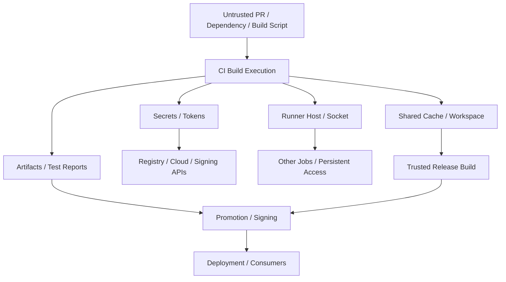

# Build isolation: Cô lập môi trường build để bảo đảm an ninh chuỗi cung ứng phần mềm

## 1. Mục tiêu học tập

Sau bài học, người học có thể:

1. Giải thích **build isolation** là gì, mục tiêu bảo mật nào được phục vụ và vì sao pipeline CI/CD cũng là một **trust boundary** trong software supply chain.
2. Phân biệt **isolated build**, **hermetic build**, **reproducible build**, **ephemeral runner**, **sandbox** và **provenance**; không đánh đồng một khái niệm với bằng chứng cho khái niệm khác.
3. Nhận diện các nguồn đầu vào có thể bị điều khiển: source, pull request, build scripts, dependency, plugin, base image, environment variables, network, cache và workflow configuration.
4. Phân tích threat scenarios như **credential exfiltration, malicious dependency execution, cache poisoning, artifact substitution, runner persistence, confused deputy** và vượt ranh giới từ PR chưa được tin cậy sang release pipeline.
5. Thiết kế isolation theo **execution, identity, filesystem, network, secret, cache, artifact, environment và lifecycle** cho hosted hoặc self-hosted runner.
6. Chọn cơ chế giảm rủi ro phù hợp cho untrusted contributions, trusted builds, release signing và production deployment mà không cấp đặc quyền quá mức.
7. Xây dựng yêu cầu kiểm soát đối với **artifact provenance, build identity, dependency resolution, promotion, signing và verification** theo chuỗi có thể truy vết.
8. Thiết kế build pipeline cho ứng dụng **Java/Gradle/Spring Boot** với runner tạm thời, least privilege, dependency pinning và bước promotion tách biệt.
9. Đề xuất kiểm thử positive, negative, adversarial và failure-injection cho các đường vượt boundary trong hệ thống build.
10. Lập **risk–control–evidence mapping**, đánh giá design effectiveness/operating effectiveness, phát hiện giới hạn của logs/attestations và duy trì assurance theo từng build/release.

Bài thuộc chương **Supply chain security** của module **SECURITY_SECURITY_ASSURANCE**. Module xây dựng cách đánh giá **có bằng chứng** rằng hệ thống đáp ứng mục tiêu bảo mật từ phân tích rủi ro, yêu cầu, security controls đến kiểm thử, audit, khắc phục finding và thực hiện assurance liên tục trong phát triển/vận hành. Với **build isolation**, câu hỏi quan trọng không đơn thuần là “CI đã chạy thành công chưa?” mà là:

> **Một thay đổi mã, dependency hoặc tiến trình build chưa được tin cậy có thể tác động tới runner, bí mật, cache, artifact phát hành hay môi trường khác tới mức nào — và bằng chứng nào xác nhận giới hạn đó được thực thi?**

## 2. Build isolation là gì?

**Build isolation** là tập hợp các ranh giới và kiểm soát hạn chế quyền, thông tin và tác động của tiến trình build, để một build — đặc biệt khi chạy mã không đáng tin — không thể tự ý truy cập hoặc thay đổi **tài nguyên ngoài phạm vi được phép**.

Build không chỉ biên dịch `.java`. Quá trình này có thể chạy:

- Gradle/Maven plugins và custom build tasks.
- Unit/integration tests do người đóng góp viết.
- Annotation processors, code generators, formatters và linters.
- Shell/PowerShell scripts, hooks và workflow steps.
- npm/node, Python hoặc native helper tools trong dự án Java.
- Docker/container image build instructions.
- Dependency installation/resolution và package-manager hooks.
- Compiler/toolchain và native executables.
- SBOM generator, SAST/SCA, signing/provenance tools.

Do đó, mã nguồn hoặc dependency chưa được tin cậy có thể trở thành **mã thực thi trên runner**. Runner còn có thể sở hữu network, tokens, cache, registry access và quyền ghi artifacts. Nếu thiếu isolation, một thay đổi nhỏ có thể đi xa hơn một lỗi ứng dụng thông thường và ảnh hưởng cả **chuỗi phát hành**.

### 2.1. Bảo vệ những gì?

Các assets thường cần bảo vệ:

- **Secrets:** repository/CI tokens, registry credentials, cloud credentials, signing keys, deployment credentials.
- **Build control plane:** workflow definitions, runner registration, policy, approvals, branch protection, job dispatch.
- **Source và dependency integrity:** commit, lockfiles, plugins, downloaded archives, toolchain/base images.
- **Build output:** JAR, container image, SBOM, signatures, attestations và test results.
- **Cache và workspace:** dependency caches, remote build caches, volumes, temp files.
- **Runners và hosts:** kernel, hypervisor, VM, container runtime, Docker socket, network namespace.
- **Artifact repositories/registries:** quyền push, overwrite, delete, promote hoặc republish.
- **Downstream environments:** staging, production, KMS, cloud accounts và customer data.

### 2.2. Mục tiêu bảo mật chính

| Mục tiêu | Cần bảo đảm |
| --- | --- |
| **Confidentiality** | Job không đọc secrets hoặc dữ liệu của build/tenant khác |
| **Integrity** | Job chưa được tin cậy không sửa artifact phát hành hoặc provenance |
| **Least privilege** | Build chỉ có quyền, tài nguyên và network cần thiết |
| **Boundary separation** | PR/test không tự thăng cấp thành publish/sign/deploy |
| **Non-persistence** | Trạng thái nguy hiểm không còn sống qua những build không có quyền chia sẻ |
| **Provenance** | Artifact có thể liên kết với source, builder và quy trình xây dựng được kiểm soát |
| **Auditability** | Có evidence về quyền, policy, runner, input/output và kết quả enforcement |
| **Availability** | Một build không làm cạn tài nguyên hoặc làm gián đoạn build quan trọng khác quá mức chấp nhận |

Không có cơ chế đơn lẻ đảm bảo tất cả mục tiêu. Cần **defense in depth** và kiểm tra theo threat model thực tế.

## 3. Vì sao build là vùng rủi ro cao?

Một developer mở PR sửa test. CI chạy test trong môi trường có token quyền ghi package registry. Test có thể thực thi lệnh đọc environment variables hoặc file credentials rồi gửi ra network. Nếu runner còn giữ workspace/cache từ job trước, mã cũng có thể đọc dữ liệu chưa được xóa.

Kịch bản khác: một dependency transitive có lifecycle script độc hại. CI không chạy source malicious do người đóng góp trực tiếp viết, nhưng script cài package vẫn có thể thực thi bằng quyền của job. Hay một workflow từ fork không có deployment secret, nhưng cho phép ghi vào shared cache mà release build về sau tin dùng: attacker có thể thử **cache poisoning** thay cho secret theft trực tiếp.

### 3.1. Attack paths thường gặp



Đây là **sơ đồ mối đe dọa giả định**, không khẳng định mọi build đều có các đường trên. Review cần đánh dấu cạnh nào thật sự tồn tại, cạnh nào đã bị chặn, và evidence nào chứng minh.

### 3.2. “CI xanh” không phải security evidence đủ

Một test runner có thể chạy thành công dù script đã đọc secrets hoặc sửa artifact. Kết quả `SUCCESS` chứng minh command kết thúc theo logic CI, **không chứng minh** isolation, network restrictions, source integrity hay quyền publish không bị lạm dụng.

## 4. Phân biệt các thuật ngữ dễ nhầm

| Thuật ngữ | Ý nghĩa | Không tự chứng minh |
| --- | --- | --- |
| **Build isolation** | Ngăn tác động trái quyền giữa build và môi trường/tài nguyên | Output tái tạo y hệt, không còn vulnerability |
| **Sandbox** | Hạn chế hành vi process bằng một hoặc nhiều security boundaries | Luôn chống được kernel/container escape |
| **Ephemeral runner** | Runner/VM/job environment bị loại bỏ sau khi sử dụng | Host ngoài runner không bị compromise; cache vẫn sạch |
| **Hermetic build** | Các đầu vào/phụ thuộc build được kiểm soát, không dùng nguồn bất ngờ từ môi trường/network | Runner không thể đọc credentials khác, source không malicious |
| **Reproducible build** | Từ input được quy định, có thể tạo output tương đương/bit-for-bit theo tiêu chí | Input hợp pháp, pipeline được cấp quyền đúng |
| **Deterministic build** | Cùng điều kiện/input dẫn tới cùng kết quả theo mô hình xác định | Build được cô lập khỏi secrets và cache poisoning |
| **Artifact integrity** | Phát hiện output bị sửa sau khi tạo | Builder hoặc source ban đầu đáng tin |
| **Provenance/attestation** | Statement về nguồn, quy trình và identity tạo output | Statement đủ chính xác hoặc signer đáng tin nếu không verify |
| **SLSA build controls** | Hướng dẫn và mức đảm bảo cho build provenance và các rủi ro chuỗi cung ứng | Một nhãn duy nhất thay thế threat model và kiểm thử |
| **Release promotion** | Chuyển một artifact đã kiểm tra sang môi trường/phân phối tin cậy | Artifact được promote chắc chắn không có bug |

Một build có thể hermetic nhưng không isolated: toolchain chỉ dùng dependency cố định nhưng process vẫn có quyền đọc signing key. Một build có thể chạy trong VM riêng nhưng không hermetic: process vẫn tải dependency từ mạng ở phiên bản mới nhất. **Hai thuộc tính giải quyết hai loại rủi ro khác nhau**.

## 5. Mô hình tin cậy và các cấp nguồn đầu vào

Cần phân biệt ít nhất:

1. **Untrusted source contribution:** PR từ fork, nhánh chưa được review, patch hoặc event từ bên ngoài.
2. **Reviewed source:** đã qua code review/merge rules theo chính sách; vẫn có thể chứa lỗi hoặc mã độc bị bỏ sót.
3. **Trusted build definition:** workflow, builder image và build scripts có provenance, owner và review.
4. **Trusted release identity:** workflow/job được cấp permission publish, sign, deploy theo điều kiện được phê duyệt.
5. **Artifact consumer:** registry, deployment controller, software updater và runtime environment.

### 5.1. “Trusted” là quan hệ, không phải nhãn tuyệt đối

Một repository thuộc tổ chức có thể chứa dependency độc hại; một maintainer account có thể bị chiếm; workflow trên protected branch vẫn có thể gọi tới code thay đổi gần đây. Vì vậy quyền được cấp phải dựa **đúng stage, commit, environment, approval và policy**.

### 5.2. Quy tắc boundary cơ bản

> **Mã chưa được tin cậy có thể được biên dịch và kiểm thử, nhưng không được tự nhận quyền publish, sign, deploy, truy cập cloud production hoặc đọc các bí mật của trusted stages.**

Trường hợp phải chạy integration test cần secrets, nên dùng **test-specific credentials với scope hẹp**, môi trường sandbox, data giả và short-lived identity; không cho PR code tùy ý chạy trong môi trường chứa production secrets.

### 5.3. Threat actors

- External contributor gửi PR.
- Maintainer hoặc CI identity bị compromise.
- Malicious upstream package/plugin.
- Attacker có quyền push vào dependency registry hoặc cache.
- Insider dùng runner/admin permission ngoài mục đích.
- Compromised build host hoặc plugin của CI service.
- Man-in-the-middle hoặc compromised mirror/proxy nếu integrity control yếu.

Review không giả định mọi actor có cùng capabilities. Ghi rõ **preconditions và trust assumptions**.

## 6. Các chiều cô lập cần thiết kế

| Chiều | Ranh giới cần bảo vệ | Ví dụ kiểm soát |
| --- | --- | --- |
| **Compute/process** | Một job không can thiệp process/job khác | VM/microVM, sandbox, namespaces, cgroups |
| **Filesystem** | Không đọc workspace, cache, mount ngoài scope | Fresh workspace, restricted mounts, cleanup |
| **Identity** | PR không lấy quyền release | Separate service principals, token scopes |
| **Secrets** | Credential chỉ tồn tại ở job cần thiết | Job-scoped secret injection, short-lived tokens |
| **Network** | Job không tự do exfiltrate/đụng prod | Egress allowlists/proxy, network segmentation |
| **Dependency input** | Không dùng package/toolchain bất ngờ | Pinning, lockfiles, verified sources |
| **Cache** | Untrusted cache không ảnh hưởng trusted release | Cache separation, verified restore, restricted writes |
| **Artifact** | Build output không bị đổi/thay thế | Digest, immutable storage, signed attestations |
| **Time/lifecycle** | State không kéo dài qua job khác | Single-use runners, teardown, token expiry |
| **Control plane** | Job code không sửa policy/runner registration | Restricted CI API permissions, audit |
| **Logging/telemetry** | Không lộ secret, vẫn phát hiện bypass | Protected logs, redaction, monitoring |
| **Tenant/organization** | Không vượt boundary của project/team khác | Separate runner pools/accounts/trust domains |

Một “container hóa build” chỉ giải quyết **một phần** về process/filesystem. Nếu container chạy privileged hoặc mount host Docker socket, isolation có thể suy yếu đáng kể.

## 7. Runner: hosted, self-hosted, shared và ephemeral

### 7.1. Hosted runners

Một CI platform có thể cung cấp runner được tạo mới theo job. Giá trị cần kiểm tra:

- Isolation model của provider: VM, container, host sharing và lifecycle.
- Không lộ workspace của job trước.
- Token mặc định và permissions.
- Network egress và khả năng kết nối internal services.
- Khả năng inject secrets theo job/environment.
- Artifacts và cache storage có isolation/access policy riêng.
- Controls của provider và trách nhiệm khách hàng.

Không mặc định mọi hosted runner đều có cùng security boundary hoặc cùng guarantee.

### 7.2. Self-hosted runners

Rủi ro thường tăng khi một runner cố định:

- Có truy cập mạng nội bộ/production.
- Giữ disk state, credentials hoặc workspace qua jobs.
- Mount Docker socket hoặc chạy root/administrator.
- Có outbound internet mà không kiểm soát.
- Được dùng chung cho fork PR và release workflows.
- Không cập nhật OS/runner agent/hardening.
- Có cloud metadata credentials hoặc IAM role gắn host.

Self-hosted runner có thể hữu ích khi cần phần cứng chuyên dụng, kiểm soát data locality hoặc network isolation, nhưng cần **threat model, hardening và runtime monitoring** phù hợp.

### 7.3. Ephemeral runner

Với workload không tin cậy, thường ưu tiên **mỗi job một runner instance rồi huỷ**, hoặc cơ chế cô lập tương đương đã được đánh giá. Cần đảm bảo:

1. Runner identity/registration token bị thu hồi.
2. Workspace/volumes không tồn tại ngoài scope.
3. VM/disk/image snapshot không chứa secrets.
4. Không có persistent host daemon, container layer hoặc cache bị dùng lại ngoài policy.
5. Runner không thể tự ghi lại bootstrap image hoặc runner template.
6. Logs/evidence được bảo toàn trong kho được bảo vệ trước khi teardown.

Ephemeral runner **không tự đảm bảo** host/hypervisor không bị tấn công, hay artifact/cache đã được trust. Phải phân biệt những phần lifecycle thuộc provider và những phần do team quản lý.

### 7.4. Runner pools tách theo trust

Thay vì một pool chung:

- **Untrusted PR pool:** không production secrets, không quyền publish/deploy, network hạn chế.
- **Mainline verification pool:** nguồn đã được review, vẫn least privilege.
- **Release build pool:** builder identity được bảo vệ, input/provenance và môi trường được kiểm soát.
- **Signing/promotion stage:** identity và quyền riêng, chỉ tiếp nhận artifact qua verified handoff.
- **Deployment stage:** môi trường và approval riêng; không chạy tùy ý script từ PR.

Một số tổ chức có thể gộp pool khi controls đủ, nhưng phải chứng minh risk parity; không gộp chỉ vì tiết kiệm runner.

## 8. Threat boundaries của CI events và pull requests

Pipeline events có thể làm code từ nguồn ít tin cậy được thực thi trong context quyền cao hơn.

### 8.1. Quy tắc PR từ fork

- Không đưa production secret, signing key hoặc write-capable cloud credential vào job chạy mã PR chưa review.
- Token CI cho job PR nên có permissions tối thiểu, thường chỉ cần read cho source checkout.
- Không build PR với quyền push package/container/branch hay ghi config.
- Không cho PR workflow sửa protected workflow templates hoặc release policy qua shared state.
- Nếu cần bot comment vào PR, dùng **stage tách biệt** nhận dữ liệu đầu ra đã validate và có quyền tối thiểu; không chạy script PR trong stage đặc quyền.
- Tránh dùng checkout của head untrusted trong privileged event context, vì build scripts có thể chạy tự động khi dependency/test tasks được gọi.

### 8.2. Privileged event patterns

Trong một số CI hệ sinh thái, có events chạy theo context của nhánh đích hoặc workflow khác với permissions/secrets khác. Thiết kế sai khi event đặc quyền checkout và **thực thi nội dung từ PR chưa tin cậy** hoặc tin artifact từ workflow untrusted.

Không chỉ đọc tên event để kết luận an toàn. Phải truy vết **source revision được checkout, code nào được execute, secrets nào available và permission nào đang active**.

### 8.3. Hệ thống cho phép commenter-triggered jobs

Comment `/test` hoặc command tương tự có thể kích hoạt pipeline. Requirement cần xác định:

- Ai được kích hoạt?
- Job dùng branch/commit nào?
- Credentials và network nào available?
- Bot có xác minh người gửi và quyền không?
- Input parsing/canonicalization có chống injection?
- Có audit/abuse rate limiting?
- Job có tự “promote” artifact không?

Comment là **external input**, không phải authorization.

## 9. Container isolation: lợi ích và giới hạn

Container giúp đóng gói toolchain và cô lập filesystem/process ở mức nhất định, nhưng chia sẻ host kernel trong mô hình thông thường. Khi đối mặt mã chủ động đối kháng, cần đánh giá có cần **VM/microVM boundary** thay vì container đơn thuần.

### 9.1. Những cấu hình đặc biệt nguy hiểm

- `--privileged` hoặc capabilities quá rộng.
- Mount `/var/run/docker.sock` từ host.
- Bind mount sensitive host paths, home directory hoặc cloud credentials.
- Chạy root với quyền host-like mà không hạn chế.
- Host networking khi không cần thiết.
- Cho phép truy cập cloud instance metadata endpoint.
- Container runtime có vulnerability/chưa vá.
- Reuse writable volumes từ untrusted sang trusted builds.

Mount Docker socket thường có thể cho process trong container tác động tới Docker daemon trên host, phá nhiều giả định “container sandbox”. Không dùng nó như bằng chứng build untrusted đã được cô lập.

### 9.2. Defense in depth

Có thể kết hợp:

- Rootless container/build tools khi hỗ trợ và phù hợp.
- User namespaces và non-root UID/GID.
- Read-only root filesystem với writable scratch cần thiết.
- Drop Linux capabilities, seccomp/AppArmor/SELinux tùy nền tảng.
- Cgroups/CPU/memory/pid/time limits.
- Hạn chế devices, mounts và host access.
- Network namespace và explicit egress.
- Isolated VM per job đối với untrusted build scripts.
- Scan/harden builder images, cập nhật runtime/host.

Không có checklist chung tự chứng minh anti-escape: phải dựa vào **threat model, platform guarantee và tests**.

### 9.3. Multi-stage container build không đồng nghĩa isolated builder

Dockerfile multi-stage giúp tách build dependencies khỏi runtime image. Nhưng tiến trình `RUN` ở build stage có thể truy cập network/secrets theo quyền của builder. Cần kiểm soát builder identity, secrets mounting, cache và output provenance.

## 10. Filesystem, workspace và cleanup

Cấu hình workspace cần đảm bảo:

- Chỉ checkout đúng source revision được phép.
- Không sử dụng symlink/relative path để đọc ngoài allowed workspace.
- Không cho untrusted test sửa checkout/caches/volumes của trusted jobs.
- Temporary files, SSH credentials, cloud configuration không còn sau job.
- Generated artifacts không bị ghi đè vào shared directory ngoài policy.
- Artifacts/logs được thu qua cơ chế riêng thay vì đọc tùy tiện từ host.
- Workspace cleanup có cơ chế **verify**, không chỉ lệnh xóa thành công.
- Backup/snapshot hoặc artifact stores không giữ secrets ngoài retention.
- Không giả định clean workspace khi runner có persistent agents và tool caches.

### 10.1. Symlink và path traversal trong artifact collection

Nếu CI upload mọi file theo glob do PR điều khiển, artifact có thể chứa private files ngoài scope qua symlink hoặc đường dẫn bất thường. Nên dùng allowlisted outputs, tool policy và negative tests để kiểm tra artifact collector. Việc sandbox có chặn được đọc host path hay không cũng cần verification riêng.

### 10.2. Runner reuse

Một runner sau job untrusted có thể bị cài persistence qua startup scripts, PATH modification, local daemons hoặc modified tool binaries. Vì vậy xóa source folder không đủ nếu cùng OS/runner sẽ tiếp tục trusted job. Single-use runner hoặc reimaging đáng tin thường là control mạnh hơn.

## 11. Network isolation và egress policy

Một build có thể thực thi malicious code và gửi credential/proprietary source ra Internet qua HTTPS, DNS hoặc các protocol khác.

### 11.1. Yêu cầu mạng theo công đoạn

| Stage | Nhu cầu mạng hợp lệ | Điều thường không nên có |
| --- | --- | --- |
| Fork PR/test | Download dependencies qua proxy được kiểm soát | Production network và secret stores |
| Mainline build | Verified registries, internal test services | Arbitrary cloud admin access |
| Release build | Approved source/dependency mirrors và provenance endpoint | Unrestricted external destinations |
| Signing | Chỉ kết nối signing service/attestation store được duyệt | Arbitrary script execution và Internet |
| Deployment | Deployment API/target environment được duyệt | Tự động chạy untrusted PR artifacts |

### 11.2. Egress controls

Có thể áp dụng network firewall, proxy allowlist, DNS policy, registry mirror, isolated network namespace và deny-by-default egress. Tuy vậy cần xem:

- DNS tunneling/alternate protocol possibilities.
- HTTP proxy configuration có thể bị process ghi đè không?
- Cloud metadata service có bị truy cập không?
- Internal VPC/cluster routes có mở rộng hơn nhu cầu?
- URL redirects hoặc alternative IP có vượt policy?
- Có thể gọi tới package registry để upload artifact trái phép?
- Service-specific egress được ghi nhận trong logs không?

Cấm mọi network có thể phù hợp **hermetic builds**, nhưng nếu pipeline cần tải dependencies thì phải giải quyết input control, cache/mirror và tính khả thi. Egress allowlist giảm attack surface, **không bảo đảm không có exfiltration** nếu một destination hợp lệ có kênh upload do attacker điều khiển.

### 11.3. Dependencies vs network

Nếu build cần download package ở runtime, isolation không mặc nhiên đảm bảo dependency là đúng package. Network policy và dependency integrity phải được kết hợp.

## 12. Secrets và CI identity boundary

**Nguyên tắc:** job không nhận credential nào mà bản thân source code được thực thi trong job không đáng được dùng.

### 12.1. Các secret sources

- Repository-level secret variables.
- Organization/workspace secrets.
- Cloud instance role/metadata service.
- Kubernetes service-account token.
- CI-issued job token.
- Container registry password.
- Signing key/KMS access.
- Deployment SSH key.
- Long-lived Personal Access Token.
- Local configuration file của self-hosted runner.

Một secret không hiển thị ở UI nhưng inject vào environment thì test/build script có thể đọc nó. Masking logs **không ngăn** secret bị gửi qua network, mã hóa hoặc biến đổi.

### 12.2. Job-scoped credentials

- Cấp identity riêng theo stage và environment.
- Token có expiry ngắn, audience/resource restrictions.
- Hạn chế quyền read/write theo action cần thiết.
- Không dùng cùng một credential cho test PR và release.
- Tách quyền build với sign/push/deploy.
- KMS/hardware-backed signing khi phù hợp, hạn chế export private keys.
- Theo dõi và revoke identity sau job.
- Không để credential lọt vào artifact, Gradle cache, test snapshots, process args hoặc logs.

### 12.3. Federated short-lived identity

CI có thể dùng **OIDC/federated workload identity** để xin token cloud ngắn hạn theo repository/workflow/ref/environment/identity claims được tin cậy. Đây là một lựa chọn tốt hơn nhiều long-lived secrets khi cấu hình đúng.

Nhưng trust policy quá rộng, như chấp nhận mọi workflow/ref, có thể cho PR hoặc untrusted workflow xin quyền production. Cần kiểm tra **issuer, audience, subject, workflow identity, protected branch/environment, approval và token lifetime** theo platform hiện dùng.

### 12.4. Không ký trong build không tin cậy

Nếu builder PR có quyền gọi signing service để ký artifact với release identity, attacker có thể tạo artifact độc hại được ký hợp lệ. Release signing cần được điều khiển bởi **policy độc lập và verified inputs**, không đơn thuần bởi request “hãy ký file này” từ một job bất kỳ.

## 13. Dependency, plugin và toolchain trust

Build trong môi trường cô lập vẫn có thể thực thi malicious dependency. Cần phối hợp:

- Pin toolchain, JDK, Gradle wrapper/plugin versions theo policy.
- Có dependency lockfiles/version catalogs và integrity verification khi phù hợp.
- Ưu tiên trusted repositories/mirrors và hạn chế repository substitution.
- Kiểm tra namespace/package provenance để giảm dependency confusion.
- Review repository ordering, fallback và plugin resolution.
- Không cho PR tùy ý thay proxy/mirror hoặc dependency verification policy rồi dùng kết quả để release.
- Scan/SCA và SBOM với kết quả gắn build revision.
- Theo dõi advisory/update và xử lý rủi ro theo exposure.
- Không lấy “latest” image/toolchain không được pin làm bằng chứng reproducibility.
- Kiểm soát compiler plugins, annotation processors và generated code; chúng là **mã thực thi**, không phải chỉ dữ liệu.

### 13.1. Java/Gradle: những điểm cần review

- `gradlew` và Gradle Wrapper JAR/distribution URL/validation.
- `settings.gradle`, `build.gradle` và init scripts.
- Plugin repositories và dependency repositories.
- Dependency locks, verification metadata và transitive versions.
- Gradle build cache local/remote.
- Gradle daemon reuse giữa builds với quyền khác nhau.
- `test` tasks chạy code chưa trusted.
- Build scans/log uploads có thể mang metadata nội bộ.
- JDK toolchain và generated class/resources.
- Tests dùng Testcontainers/Docker socket có mở quyền host không.

### 13.2. Dependency verification không phải end-to-end provenance

Checksum của artifact tải về giúp xác nhận bytes khớp giá trị kỳ vọng; nếu chính lock/checksum được attacker thay đổi cùng PR hoặc source registry bị xâm nhập trước khi pin, checksum không tự chứng minh package đáng tin. Cần review trust anchors, update process và provenance.

## 14. Cache isolation và cache poisoning

Build cache giúp tăng tốc, nhưng cũng là một **đường mang dữ liệu và trạng thái giữa executions**.

### 14.1. Rủi ro

- Job untrusted có quyền ghi cache mà trusted release về sau khôi phục.
- Cache key quá rộng: chỉ dùng project name hoặc branch chung.
- Cache chứa output compiled độc hại thay vì được build lại.
- Cache chứa secrets/token/test data từ job trước.
- Remote cache backend bị dùng chung giữa tenants.
- Cache server cho phép overwrite artifact theo key.
- Cache TTL/retention không được quản lý.
- Build dựa cache nhưng provenance không nêu rõ inputs hoặc không kiểm tra digest.

### 14.2. Thiết kế key và quyền

- Tách namespace/cache pools theo **trust class**, organization, repo và environment.
- Untrusted PR không ghi cache mà release pipeline coi là authoritative.
- Nếu cho phép restore từ cache không đáng tin, phải xác minh content integrity/trust hoặc coi cache như dữ liệu đầu vào chưa trusted.
- Có immutable or content-addressed storage khi phù hợp.
- Restrict cache writers/readers và overwrite/delete permissions.
- Không lưu secret-bearing files trong caches.
- Có eviction/rotation và incident cleanup process.
- Cần phân biệt performance cache với **canonical artifact repository**.

### 14.3. Một cache “đúng key” vẫn chưa đủ

Key được tính từ branch+hash có thể chống collision vô tình nhưng không chống attacker có quyền viết key hoặc poisoning bằng input được kiểm soát. Rủi ro phụ thuộc **writer trust, namespace boundary, content verification và consumers**.

## 15. Build output và artifact integrity

Artifact là kết quả đã tạo từ inputs, có thể là JAR, WAR, OCI image, ZIP, binary, SBOM, test report hay manifest.

Các yêu cầu:

- Artifact có **digest** (ví dụ SHA-256) được tính trên bytes cụ thể.
- Artifact storage dùng access control, write-once/immutable promotion khi phù hợp.
- Không cho untrusted build thay artifact release bằng cùng tag mutable.
- Artifact không chứa secrets hoặc debug data vượt policy.
- Metadata nguồn: repo/commit, builder, build recipe, dependencies, toolchain và environment.
- Đầu ra được lấy từ **job đã được phép** và gắn identity đúng.
- Registry/promotion policy xác minh digest/trust, không chỉ file name/tag.
- Release deploy dùng **đúng digest đã xét**, không kéo một tag có thể thay đổi sau review.

### 15.1. Tag và digest

Một container tag như `latest` hoặc `release` có thể trỏ đến digest khác theo thời điểm. Nếu deployment chỉ dùng tag không có cơ chế chống thay thế, source và artifact đã review có thể không phải artifact đang chạy.

Trong assurance, traceability thường cần:

```text
Approved source revision
  -> Controlled builder/run identity
  -> Build inputs + recipe + dependency resolution
  -> Output artifact digest
  -> Verified provenance / integrity
  -> Promotion approval
  -> Deployed artifact digest
```

### 15.2. Artifact substitution

Nếu test job tạo `app.jar`, rồi release job tải artifact từ một URL do PR kiểm soát, release có thể sign/ship bytes khác mà không biết. Handoff cần **protected storage, trusted source/run references, digest verification và explicit policy**.

### 15.3. SBOM không phải bằng chứng cô lập

SBOM liệt kê các thành phần/phụ thuộc đã được thu thập theo phương pháp/tool; nó hỗ trợ quản lý dependency nhưng không tự chứng minh:

- Runner không có secret.
- Build không truy cập Internet.
- Artifact đúng source revision.
- PR không sửa shared cache.
- Publish stage không chấp nhận artifact giả.

Cần các artifacts khác hỗ trợ claims về isolation và provenance.

## 16. Hermeticity và reproducibility: bổ sung, không thay thế

### 16.1. Hermetic build

Thiết kế hermetic cố gắng làm cho build chỉ phụ thuộc các declared inputs/toolchains, giảm sự khác biệt do ambient environment hoặc network fetching ngoài kế hoạch. Điều này giúp giảm dependency confusion, non-deterministic inputs và khó tái tạo.

Dù vậy một declared input vẫn có thể malicious; hermetic build có thể chạy bằng quyền quá rộng. Nên dùng **hermeticity kết hợp isolation và nguồn đầu vào được xác minh**.

### 16.2. Reproducible build

Nếu hai môi trường độc lập với input, toolchain và điều kiện được định nghĩa tạo output tương đương/giống nhau theo tiêu chuẩn đã công bố, khả năng tái tạo giúp phát hiện những thay đổi ngoài ý muốn trong builder. Cần xử lý:

- Timestamp, locale, timezone, file ordering.
- Random seeds, archive metadata và compiler flags.
- Absolute paths/hostnames trong output.
- Dependency/toolchain pinning.
- Source/generated metadata.
- Cách so sánh binary hay semantic output và ngoại lệ được ghi.

Không nên tuyên bố reproducible nếu mới chạy hai lần trên **cùng compromised runner hoặc shared cache**; đó là evidence yếu về độc lập.

### 16.3. Đánh giá các thuộc tính riêng

| Claim | Evidence phù hợp | Điều chưa được chứng minh |
| --- | --- | --- |
| Isolated | Runner boundary config, credentials/network tests, lifecycle evidence | Input không malicious |
| Hermetic | Declared inputs, blocked network, dependency manifest, repeatability | Output không có bug |
| Reproducible | Independent rebuild + digest comparison + declared conditions | KMS keys/secret chưa từng lộ |
| Authentic provenance | Verified statement signature/identity và digest | Builder không bị compromise nếu trust model yếu |
| Secure release | Controls và tests xuyên source–build–sign–deploy | Không tồn tại rủi ro còn lại |

## 17. Provenance, attestations và SLSA

**Provenance** là metadata có thể xác minh về quá trình tạo artifact: artifact nào, builder nào, source/materials nào và build recipe/parameters nào đã được sử dụng. Attestation là một statement có cấu trúc, có thể được bảo vệ integrity và gắn identity.

### 17.1. Các thông tin thường cần

- Subject artifact digest.
- Source repository và revision (commit digest).
- Build type/workflow reference và parameters phù hợp.
- Builder identity/trust domain.
- Materials/dependency references theo phạm vi hỗ trợ.
- Invocation/run ID, thời gian và môi trường.
- Chữ ký/identity evidence và trust root để verify.
- Verification result và policy của bên tiêu thụ.

Không tất cả build systems cung cấp đầy đủ thông tin này. Tổ chức cần ghi rõ **claim nào được chứng minh, claim nào thiếu**.

### 17.2. SLSA và các giới hạn của “mức độ”

SLSA cung cấp các thực hành và yêu cầu để cải thiện software supply chain, bao gồm build track và provenance. Khi áp dụng, cần chỉ rõ **phiên bản specification, track, yêu cầu và evidence** đang sử dụng; không suy từ nhãn “SLSA-compliant” thành một chứng chỉ bảo đảm toàn diện.

Một provenance attestation chỉ có giá trị khi được **xác minh** (signature/identity/trust root, subject digest, source/build policy). Nếu signer là một job untrusted có quyền tự khai mọi trường, statement “đã build từ main” có thể không đáng tin.

### 17.3. Builder-controlled vs caller-controlled fields

- Builder identity và subject digest cần được ràng buộc bởi hạ tầng tin cậy.
- Source revision/workflow identity phải được lấy từ context đã xác minh, không chỉ từ chuỗi do script supply.
- Materials do build tool thu thập có thể chưa đầy đủ, cần ghi limitations.
- Attestation ký bởi key bị lộ hoặc issuer policy quá rộng không chứng minh origin đáng tin.

### 17.4. Promotion phải verify, không chỉ tạo attestation

Release stage cần:

1. Nhận artifact digest từ trusted handoff.
2. Kiểm tra provenance signature/identity và policy.
3. Kiểm tra source revision thuộc protected release scope.
4. Đối chiếu build workflow/builder identity được duyệt.
5. Kiểm tra required tests/scans/approvals gắn cùng digest.
6. Không cho artifact chứa từ untrusted job thay thế bytes sau verify.
7. Ghi decision và output digest được promote.

## 18. Signing, key isolation và release promotion

### 18.1. Tách build khỏi ký

Một pipeline có thể tạo artifact trong builder, sau đó stage có quyền cao hơn kiểm chứng artifact trước khi ký. Việc ký nên gắn **artifact digest và chính sách release**, không cho caller cung cấp tên bất kỳ rồi dùng signing key.

Key có thể được bảo vệ bởi KMS/HSM hoặc cơ chế keyless phù hợp threat model; các chọn lựa vẫn cần reviewer, lifecycle, access restrictions và verification của consumer.

### 18.2. Điều gì làm signing nguy hiểm?

- Release key tồn tại trong environment của PR runner.
- Signing service chấp nhận mọi request từ network nội bộ.
- Workflow cho phép attacker tự chọn artifact digest được ký.
- CI identity được cấp quyền ký và deploy nhiều environment không cần thiết.
- Signatures tồn tại nhưng deployment controller không verify.
- Artifact có tag mutable nên bytes thay đổi sau signature validation.
- Signature key rotation/revocation không có policy.
- Build report pass nhưng source revision/approval không gắn với signed digest.

### 18.3. Handoff giữa stages

```mermaid
flowchart LR
    PR["Untrusted PR Checks"] -->|"Logs + test results only"| REVIEW["Review / Protected Merge"]
    REVIEW --> BUILD["Controlled Release Builder"]
    BUILD --> ART["Immutable Digest Artifact"]
    ART --> VERIFY["Verifier + Policy Gate"]
    VERIFY --> SIGN["Restricted Signing Identity"]
    SIGN --> PROMOTE["Approved Registry Promotion"]
    PROMOTE --> DEPLOY["Deployment Controller verifies digest and policy"]
    PR -. "No signing/deploy permissions" .-> SIGN
```



Đường nét đứt cuối thể hiện **ràng buộc thiết kế phải có**, không biểu diễn một kết nối cho phép. Hệ thống thực cần đảm bảo event/workflow permissions không tạo đường đi khác để PR tự ký/promote.

## 19. Java/Gradle/Spring Boot: kiến trúc build isolation minh họa

### 19.1. Kiến trúc đề xuất

Một nhóm phát triển Spring Boot có:

- Public Git repository nhận pull requests từ forks.
- Gradle wrapper, plugin và dependency resolution.
- Unit tests, integration tests và SCA/SBOM.
- Trusted release builder tạo JAR và container image.
- Registry nội bộ, signing/provenance service và Kubernetes deploy.

Mô hình trust:

| Stage | Source trust | Credentials | Network | Output |
| --- | --- | --- | --- | --- |
| PR lint/test | Unreviewed | Read-only source access | Restricted dependencies/test services | Logs/test result; no release artifact authority |
| Mainline test | Protected merged source | Minimal read identities | Approved mirrors/services | Verified test result |
| Release build | Protected source/locked inputs | Dedicated build identity | Controlled dependency sources | Digest-addressed JAR/image, SBOM/provenance |
| Promotion/sign | Does not execute PR build scripts | Scoped signing/registry identity | Signing/registry only | Verified digest and signature |
| Deployment | Approved artifact only | Environment-specific deploy identity | Deployment API | Running digest + deployment evidence |

### 19.2. Đường sai thường gặp

Một self-hosted runner cố định dùng chung cho fork PR và release build. Gradle test process có thể đọc `~/.gradle`, host Docker socket và cloud credentials. Build cache cùng namespace được release restore. Người điều khiển PR có thể thực hiện mã test có quyền tương đương runner. Branch protection không giải quyết triệt để khi job PR đã có **runner host privileges**.

### 19.3. Phương án kiểm soát

- PR job chạy trên fresh, low-trust runner không truy cập production network.
- Không inject release secrets hoặc build signing credentials.
- Chạy Gradle từ source dưới tài khoản least privilege, giới hạn CPU/memory/time.
- Dependency và plugin sources được quản trị, Gradle wrapper/distribution được kiểm tra theo policy.
- Cache PR tách biệt, không cho PR ghi vào authoritative release cache.
- Main/release jobs dùng protected events và release builder được kiểm soát.
- Artifacts chuyển theo digest; provenance từ builder đáng tin.
- Signing và deployment tách với identity/time-bound grants.
- Tests ở mọi stage được gắn commit, build digest và môi trường.
- Có giám sát runner lifecycle, outbound network, secret access và policy bypass.

### 19.4. Không đồng nhất “quét CVE” với isolation

SCA/SBOM hỗ trợ nhận diện package rủi ro; secret scan hỗ trợ phát hiện credential đã lộ; SAST hỗ trợ đánh giá code. Các hoạt động này không chứng minh runner/workspace/cache/identity được cô lập. Review phải có **nhóm security requirements riêng cho build isolation**.

## 20. GitHub Actions: ví dụ PR build không có quyền release

Đây là **mẫu cấu hình giảng dạy** thể hiện ranh giới, không phải workflow hoàn chỉnh chạy được ngay: các action refs dạng `<PINNED_ACTION_COMMIT>` phải được thay bằng commit digest hợp lệ và policy của tổ chức cần review trước khi sử dụng. Khả năng cô lập thực tế còn phụ thuộc runner provider, permissions, dependencies, network và cache.

```yaml
name: untrusted-pr-checks

on:
  pull_request:

permissions:
  contents: read

jobs:
  verify:
    runs-on: ubuntu-latest
    timeout-minutes: 25
    steps:
      - name: Checkout pull request revision
        uses: actions/checkout@<PINNED_ACTION_COMMIT>
        with:
          persist-credentials: false

      - name: Set up JDK
        uses: actions/setup-java@<PINNED_ACTION_COMMIT>
        with:
          distribution: temurin
          java-version: "21"

      - name: Run tests in non-release context
        shell: bash
        run: |
          ./gradlew --no-daemon --offline test
```

### 20.1. Điều được minh họa

- Event `pull_request` cho kiểm tra thay đổi, không dùng release credential.
- `permissions: contents: read` giảm quyền GitHub token đối với trường hợp điển hình; các quyền thực tế phải được xác minh theo repository/organization settings.
- `persist-credentials: false` giảm nguy cơ checkout lưu token vào Git credential context.
- Chưa có step ký, publish package, deploy hoặc gọi cloud production.
- Build dùng `--offline` nhằm nhấn mạnh dependency provisioning được chuẩn bị và kiểm soát riêng.

### 20.2. Điều chưa được giải quyết trong ví dụ

- `--offline` sẽ lỗi khi chưa có dependencies đã được phê duyệt; phải có **controlled dependency mirror/pre-provisioning** và kiểm tra integrity.
- Cache và working directory isolation còn phụ thuộc runner provider, configuration và pipeline khác.
- `runs-on: ubuntu-latest` không pin OS image/toolchain nên **không chứng minh reproducibility**; một pipeline release chặt hơn cần xác định base runner/build environment phù hợp.
- `setup-java` và checkout actions phải pin phiên bản, owner/trust và được cập nhật theo chính sách.
- Network egress chưa bị giới hạn trong ví dụ; cần controls ngoài job tùy CI environment.
- Tests/Gradle plugins vẫn có thể thực thi mã chưa tin cậy.
- Không có chứng cứ secret isolation ngoài policy design; cần negative tests, actual token scopes và runner lifecycle evidence.

**Không nên copy nguyên ví dụ vào production.** Mục tiêu là minh họa phân tách quyền PR và release; không khẳng định platform mặc định đã đáp ứng mọi yêu cầu.

### 20.3. Mẫu anti-pattern cần tránh

Một workflow đặc quyền có secrets viết package registry, sau đó checkout PR head và chạy Gradle build/test do PR thay đổi. Hệ thống đã cho **mã chưa được tin cậy thực thi trong context có quyền publish**. Chỉ đổi tên job hoặc đặt label “review” không sửa trust boundary.

## 21. Tách trusted release build khỏi promotion

Một luồng phát hành nên có các policy gates độc lập:

1. Xác nhận source revision thuộc protected release ref và đã qua review.
2. Checkout immutable commit SHA; không tin branch name mutable tại thời điểm kiểm tra sau.
3. Chạy release builder có identity và environment được kiểm soát.
4. Resolve dependencies/toolchains từ declared và được xác minh inputs.
5. Tạo artifact digest cùng provenance bằng trusted builder.
6. Chạy tests/scans theo policy, gắn kết quả với source revision/build digest.
7. Verify provenance, requirements và phê duyệt ở **promotion gate độc lập**.
8. Gọi signing service với quyền tối thiểu, gắn chữ ký vào subject digest.
9. Publish/promote digest vào repository/registry được bảo vệ.
10. Deployment controller chỉ triển khai đúng digest được phép và kiểm tra policy nếu có.
11. Lưu evidence và kiểm tra runtime artifact/configuration.
12. Reassess khi code, workflow, trust root, signing policy hoặc dependencies thay đổi.

### 21.1. Minh họa chính sách promotion

```yaml
release_promotion_policy:
  allowed_source:
    repository: "example-org/transfer-service"
    protected_ref: "refs/heads/main"
  expected_builder_identity: "<trusted-builder-identity>"
  expected_build_type: "<approved-build-recipe>"
  require:
    - "signed_provenance_valid"
    - "artifact_digest_matches_attestation_subject"
    - "source_revision_matches_reviewed_commit"
    - "builder_identity_matches_policy"
    - "tests_pass_for_same_artifact"
    - "release_approval_present"
    - "no_open_blocking_security_finding"
  deny_if:
    - "unsigned_or_unverifiable_artifact"
    - "untrusted_source_or_builder"
    - "mutable_tag_without_resolved_digest"
    - "untrusted_build_can_request_signing"
```

Đây là **policy YAML mang tính khái niệm**, không phải cú pháp của GitHub Actions, Sigstore, OPA hay admission controller cụ thể. Trong triển khai thực tế cần ánh xạ sang policy engine/verifier có kiểm thử.

### 21.2. Không rebuild âm thầm ở stage đặc quyền

Một promotion job đáng tin không nên lấy artifact đã test rồi vô tình chạy lại **build scripts từ một untrusted branch** khi cần ký. Nếu chủ đích rebuild ở trusted builder, phải coi đó là **new build** với digest, provenance, tests và approval thích hợp; không dùng test report của artifact khác làm bằng chứng trực tiếp.

## 22. Kubernetes và self-hosted build runners

Một số tổ chức dùng Kubernetes Jobs để chạy build. Đây là cơ chế orchestration, **không tự bảo đảm mức cô lập phù hợp cho mã đối kháng**.

### 22.1. Pod security baseline minh họa

```yaml
apiVersion: batch/v1
kind: Job
metadata:
  name: isolated-build-example
spec:
  backoffLimit: 0
  ttlSecondsAfterFinished: 3600
  template:
    spec:
      restartPolicy: Never
      automountServiceAccountToken: false
      securityContext:
        runAsNonRoot: true
        seccompProfile:
          type: RuntimeDefault
      containers:
        - name: builder
          image: registry.example.invalid/build/jdk@sha256:<PINNED_IMAGE_DIGEST>
          command: ["/bin/sh", "-c"]
          args: ["./gradlew --no-daemon test"]
          securityContext:
            allowPrivilegeEscalation: false
            privileged: false
            readOnlyRootFilesystem: true
            capabilities:
              drop: ["ALL"]
          resources:
            limits:
              cpu: "2"
              memory: "2Gi"
              ephemeral-storage: "4Gi"
            requests:
              cpu: "500m"
              memory: "1Gi"
          volumeMounts:
            - name: scratch
              mountPath: /tmp
      volumes:
        - name: scratch
          emptyDir:
            sizeLimit: "2Gi"
```

Mẫu này là **cấu hình cần điều chỉnh**, không phải manifest đầy đủ cho Gradle: project source, writable Gradle home, network policy, storage, toolchain, workload identity, runner provisioning và image digest thật chưa được cung cấp. Một container với read-only root filesystem có thể cần writable mounts bổ sung mới chạy đúng.

### 22.2. Những quyết định nằm ngoài Pod spec

- Runner pod có được chạy trên nodes phục vụ workloads sản xuất không?
- Có dùng sandboxed runtime/VM isolation cho untrusted code không?
- Node IAM credentials hoặc metadata endpoint có lộ không?
- Pod/service account token và Kubernetes API access có bị chặn thật không?
- NetworkPolicies/egress proxy có deny outbound Internet/internal services không?
- Build cần Docker-in-Docker, BuildKit hoặc image builder nào; có dùng host socket?
- Shared volumes, cache server và artifact store có phân quyền thế nào?
- Pod bị xóa có còn retained host state, snapshots hoặc logs chứa secrets không?
- Admission policy có chặn `privileged`, hostPath, hostNetwork và risky capabilities không?
- Có giám sát drift/tự động thay đổi runner template không?

### 22.3. Ephemeral pod khác ephemeral host

Xóa pod làm sạch một phần Kubernetes object/lifecycle, nhưng node, runtime layer, image cache và volumes bên ngoài có thể tồn tại. Với threat model coi contributor là adversarial, cần xem **stronger VM isolation, dedicated nodes hoặc per-job reimaging** và provider-specific guarantees.

## 23. Gradle: build logic và trusted toolchain

Gradle scripts thực thi mã, do đó cần review cả:

- `gradlew`/wrapper scripts và wrapper JAR/distribution checksum.
- `settings.gradle(.kts)`, `build.gradle(.kts)`, `buildSrc` và included builds.
- Plugins (version, source, permissions, lifecycle code).
- Annotation processors và code generators.
- Dependency resolution, repositories, lockfiles, verification metadata.
- Test configurations, environment variables và temp directories.
- Local/remote build cache access.
- Container image build tasks, publish tasks và deploy plugins.
- Gradle daemon/parallel workers ảnh hưởng reuse, resource limits.
- Native libraries và external tools trong pipeline Java.

### 23.1. Tách verification khỏi publish

Không chạy `publish` hoặc `deploy` trong job PR. Có thể cấu hình release task chỉ ở protected release workflow, với credential/job identity riêng. Nhưng security assurance phải kiểm chứng **actual permission boundary**, không chỉ tin task name trong Gradle.

### 23.2. Ví dụ Gradle configuration (minh họa)

```kotlin
// build.gradle.kts: dependency resolution/verification
// phải được cấu hình ở các file và quy trình phù hợp khác.
plugins {
    java
    id("org.springframework.boot") version "<approved-version>"
}

java {
    toolchain {
        languageVersion.set(JavaLanguageVersion.of(21))
    }
}

tasks.test {
    useJUnitPlatform()
    maxParallelForks = 2
}
```

Ví dụ chỉ cho thấy phiên bản toolchain và plugin được khai báo ở mức cấu hình; `<approved-version>` là placeholder, **chưa chạy được**. Chưa bao gồm lockfiles, verified distribution, dependency verification, controlled repositories, immutable builder image hoặc provenance.

### 23.3. Build flags không thay ranh giới

`--no-daemon` có thể hạn chế reuse daemon cho invocation, `--offline` hạn chế network dependency fetching của Gradle, nhưng **không ngăn scripts/plugins/test code tự mở network connections**. Network isolation phải enforced ở runner/network layer.

### 23.4. Testcontainers và Docker socket

Một integration test Java dùng Testcontainers có thể yêu cầu Docker daemon. Nếu để untrusted PR job mount host Docker socket, mục đích isolation có thể bị phá. Nên chọn một trong các hướng phù hợp threat model:

- Testcontainers chạy trong VM được cô lập per job.
- Disposable isolated daemon với quyền hạn thấp và kiểm soát network.
- Managed ephemeral test environment.
- Integration tests có privileged infrastructure chạy ở stage được phê duyệt hơn, trên source đã review, với dữ liệu/identity riêng.

Không bỏ qua test quan trọng chỉ để “giữ an toàn”, nhưng cũng không nâng PR job thành quyền root/host để chạy test thuận tiện.

## 24. Security requirements có thể kiểm chứng cho Build isolation

Một yêu cầu tốt mô tả outcome, scope và behavior khi thất bại.

| ID | Requirement mẫu | Tiêu chí kiểm chứng |
| --- | --- | --- |
| BISO-001 | Untrusted build không được đọc production secrets | Secret access negative test và runner policy |
| BISO-002 | PR jobs không được publish/sign/deploy release artifacts | Token scopes, denied API call, CI policy |
| BISO-003 | Untrusted job không ghi cache được trusted release dùng như authoritative | Cache ACL/namespace test |
| BISO-004 | Build workspace không chứa dữ liệu job khác | Fresh runner and isolation test |
| BISO-005 | Build processes không được có host Docker socket/privileged mounts ngoài exception | Runner config/admission inspection |
| BISO-006 | Network egress tuân allowlisted destinations theo class | Denied outbound probes, flow logs |
| BISO-007 | Build inputs, tools, artifacts được gắn immutable revisions/digests | Manifest, lock/verification evidence |
| BISO-008 | Release artifact có provenance từ approved builder | Signed provenance + verification report |
| BISO-009 | Signer chỉ nhận digest/artifact đáp ứng release policy | Signing authorization negative test |
| BISO-010 | Build identities có scope và expiry theo job/stage | IAM token inspection, expiry test |
| BISO-011 | Self-hosted runner không giữ trust state qua unrelated jobs | Teardown/reimage/attestation evidence |
| BISO-012 | Artifact consumer verify subject digest/identity trước deploy | Verification gate và reject test |
| BISO-013 | PR triggers không thể kích hoạt privileged workflow bằng input/artefact chưa trusted | Workflow graph, event simulation |
| BISO-014 | Revoked CI credential không thể tiếp tục phát hành sau bound được duyệt | Revocation test |
| BISO-015 | Build policies có owner/version/approval và monitor drift | Git/ruleset/config/readback logs |
| BISO-016 | Runner/resource exhaustion có quota/time limit phù hợp | Concurrency/resource limit tests |

### 24.1. Requirement nên phân loại trust classes

Không nên viết “mọi build không được network” nếu dự án cần dependency fetching. Nên xác định stage/class, source trust, allowed actions, network/resources, fallback và evidence. Mức isolation phải theo **impact và exposure**.

### 24.2. Deny trước side effect

Nếu signing service từ chối request nhưng trước đó đã ghi artifact vào release registry hoặc tải key vào untrusted environment, control vẫn có gap. Negative tests phải kiểm tra **không có publish/sign/deploy side effects**, không chỉ HTTP deny.

## 25. Ma trận risk–control–evidence cho Build isolation

| Risk | Control objective | Control | Evidence |
| --- | --- | --- | --- |
| SC-R01: Malicious PR đọc secret | Không có secret trong low-trust context | Separate jobs, secret scopes, no prod IAM | Event policy, denied secret access test |
| SC-R02: PR tự publish artifact | Chặn privilege escalation | Read-only PR token, separate release identity | Token claims/permissions, publish reject |
| SC-R03: PR cache poisoning | Trusted release không tin cache PR | Cache namespace/writer restrictions, verifier | Cache ACL, poisoning simulation |
| SC-R04: Persistent runner compromise | Không reuse compromised state | Ephemeral VM/reimage, no shared volumes | Runner lifecycle, cleanup/recreation records |
| SC-R05: Host socket escape | Build không quản lý host runtime | No host socket/privileged, VM boundary | Mount/pod spec, admission negatives |
| SC-R06: Exfiltration via network | Giới hạn outbound | Egress policy/proxy and deny rules | Flow records, blocked destination tests |
| SC-R07: Dependency confusion | Resolve đúng nguồn/package | Verified repos, pinning, lockfile | Dependency manifest, registry policy |
| SC-R08: Malicious build plugin | Giới hạn plugin execution impact | Isolated builder, toolchain review | Plugin inventory, sandbox evidence |
| SC-R09: Artifact substitution | Release đúng digest được test | Immutable digest, guarded handoff | SHA/digest match, registry audit |
| SC-R10: Forged provenance | Only trusted builder assertions | Builder-issued signed attestations | Signature/identity verification |
| SC-R11: Signing key abuse | Ký chỉ approved release | Scoped signer identity, policy gate | KMS audit, reject signing test |
| SC-R12: Drift in runner configs | Isolation liên tục có hiệu lực | Templates as code, change review, detection | Revisioned policy, runtime comparison |
| SC-R13: Pipeline denial of service | Untrusted job không chiếm toàn bộ capacity | Quota, timeout, cgroup/runner pools | Limit tests, SLO metrics |
| SC-R14: Secrets leak in artifacts/logs | Không xuất credential | Scan/redaction + no-secret injection | Artifact inspection, secret canary |
| SC-R15: Unsafe promotion via tag | Deploy đúng reviewed artifact | Digest-pinned deployment/verification | Provenance chain to running digest |
| SC-R16: Privileged event misuse | Không execute untrusted head in trusted context | Event/checkout separation | Workflow review, adversarial simulation |
| SC-R17: Compromised CI control plane | Hạn chế quyền quản trị | IAM, approval, audit, emergency response | Admin access review, audit logs |
| SC-R18: Runner cross-tenant access | Không đọc dữ liệu project khác | Separate trust domains, storage/network ACL | Cross-project isolation tests |

Một control có thể giảm nhiều risks, nhưng không nên cộng nhiều lần một evidence. Cần ghi **scope, assumptions, cách kiểm chứng, kết quả và phần chưa thử**.

## 26. Kiểm thử isolation: positive, negative, failure và adversarial

Các bài test nên dùng **sandbox, fake credentials, canary data và isolated test environments**, không đem production secrets vào môi trường adversarial.

| Test ID | Kịch bản | Kết quả mong muốn |
| --- | --- | --- |
| BI-T01 | PR hợp lệ chạy unit tests với read-only source | Test pass trong low-trust runner |
| BI-T02 | Job PR thử đọc protected secret variable | Secret không được cung cấp/không truy cập được |
| BI-T03 | Job PR thử gọi API publish với job token | Từ chối, registry không thay đổi |
| BI-T04 | PR sửa workflow để xin deployment credentials | Policy/approval chặn |
| BI-T05 | Privileged workflow checkout PR head rồi chạy script | Lỗi thiết kế bị phát hiện/chặn trước rollout |
| BI-T06 | PR ghi cache với key mà release dự định restore | Release không tin hoặc không restore untrusted cache |
| BI-T07 | Job đọc workspace/secret sentinel từ job trước | Không thể đọc |
| BI-T08 | Job cố truy cập host Docker socket | Socket không hiện diện/không có quyền |
| BI-T09 | Job thử mount host path hoặc chạy privileged | Admission/runtime policy từ chối |
| BI-T10 | Outbound request tới forbidden destination | Bị network control chặn, có evidence |
| BI-T11 | Allowed dependency mirror download | Đúng package/lock/checksum, không mở egress tùy ý |
| BI-T12 | Dependency URL/version bất ngờ | Build reject hoặc require approval |
| BI-T13 | Remote cache trả output sai digest | Rejected/invalidate |
| BI-T14 | Artifact bị thay bytes sau build | Digest/provenance verification fail |
| BI-T15 | Provenance signer identity không đúng builder | Promotion reject |
| BI-T16 | Source revision trong attestation khác reviewed SHA | Promotion reject |
| BI-T17 | Signature hợp lệ nhưng artifact digest khác | Deployment reject |
| BI-T18 | Signing request từ PR identity | Denied; key không lộ |
| BI-T19 | Signing service unavailable | Không tự dùng fallback plaintext key |
| BI-T20 | Self-hosted runner chạy xong job | Runner revoked/destroyed/reimaged theo policy |
| BI-T21 | Job timeout/resource exhaustion | Quota/timeout enforced |
| BI-T22 | Network isolation policy cập nhật | Runtime enforcement phù hợp approved version |
| BI-T23 | Build needs missing approved dependency | Fail rõ, không tự tải mirror bất ngờ |
| BI-T24 | Test log chứa secret-shaped sentinel | Redaction/scan phát hiện theo policy |
| BI-T25 | Deploy image theo mutable tag đã thay đổi | Digest verification chặn substitution |
| BI-T26 | Cloud OIDC trust policy nhận ref untrusted | Không cấp production role |
| BI-T27 | Cache backend unavailable | Build fail/rebuild an toàn, không bỏ policy |
| BI-T28 | Runner credential bị revoke giữa job | Không dùng quyền ngoài revocation bound |
| BI-T29 | Job từ org/repo khác thử truy cập artifact | ACL từ chối |
| BI-T30 | Audit collector lỗi | Alert/gap record, không xóa dấu vết |
| BI-T31 | Rebuild trong môi trường độc lập | So sánh output theo tiêu chí reproducibility |
| BI-T32 | Incident giả lập: compromised runner | Thu hồi, cô lập, xác định blast radius và retest |

### 26.1. Test oracle: bằng chứng ở đâu?

Không chỉ assert CI có status đỏ/xanh. Nên đối chiếu:

- Quyền token/identity thực tế và lời gọi API có bị chặn.
- Registry/release artifact không bị thay đổi.
- KMS signing service không cấp chữ ký.
- Runner không thấy secret sentinel hay persistent mount.
- Network flow logs ghi denied egress.
- Cache access logs/namespace chứng minh restricted writes.
- Source/attestation/digest đúng subject.
- Environment và test runner có cấu hình giống claim.

### 26.2. Những điều không nên làm trong test

- Không thử lấy credential thật để chứng minh leak.
- Không triển khai mã tự tái tạo/persistence lên shared production runner.
- Không dùng command exfiltrate dữ liệu nhạy cảm hoặc exploit host thật.
- Không mở network tới target nội bộ không được phép.
- Không thử đảo ngược release policy bằng cách trực tiếp sign artifact ngoài staging.

**Dùng canary/fake data và môi trường kiểm thử được cấp phép**, kết quả đủ để đánh giá control mà không tạo incident thật.

### 26.3. Lỗi của test setup

Nếu test dùng một PR runner vốn không có cloud account, kết quả “cloud publish denied” có thể do DNS hoặc endpoint không tồn tại, **không chứng minh IAM policy từ chối**. Để đánh giá isolation, test phải đi qua đường quyết định đúng, dùng fake registry/test role đủ thật để đo permission outcomes nhưng an toàn.

## 27. Evidences: design vs operating effectiveness

### 27.1. Design effectiveness

Câu hỏi: **nếu hệ thống chạy đúng như thiết kế, các threat paths còn có thể vượt từ low-trust code sang protected assets không?**

Artifacts cần review:

- Build architecture/DFD và trust-domain matrix.
- CI event/checkout/run graph.
- Runner pool design, VM/container boundary và lifecycle.
- IAM/secret injection/federation policies.
- Network egress, storage/cache ACLs và artifact handoff.
- Approved toolchain/dependency sources.
- Provenance/signing/verifier trust anchors.
- Threat scenarios, control objectives, test plans.
- Separation of duties, exceptions và emergency runbook.

### 27.2. Operating effectiveness

Câu hỏi: controls có **thực sự có hiệu lực** trong kỳ/runner/build được đánh giá?

Evidence có thể gồm:

- CI configuration revision và actual run ID/event/ref.
- Runner instance/template/image ID và isolation settings.
- IAM token permissions và credential issuance/access audit.
- Cache read/write ACL tests, actual namespace config.
- Denied network probes hoặc flow logs.
- Pod/VM lifecycle/teardown records.
- Source commit, dependency inputs, build recipe, builder identity.
- Artifact digest, provenance statement, signature verification.
- Promotion approval/registry write audit.
- Deployed digest và runtime mapping.
- Findings, retests và incident lessons learned.

### 27.3. Evidence quality dimensions

| Dimension | Câu hỏi |
| --- | --- |
| **Relevance** | Evidence có hỗ trợ đúng claim về isolation không? |
| **Scope** | Repo, environment, runner pool, project, event, build nào? |
| **Freshness** | Có còn đúng sau policy/runner/dependency thay đổi không? |
| **Provenance** | Nguồn/collector và identity có xác minh được? |
| **Integrity** | Artifact/log/attestation có bị sửa trái phép không? |
| **Coverage** | Bao phủ các đường secrets, cache, signing, network, artifact? |
| **Independence** | Evidence có kiểm tra giả định từ nguồn khác không? |
| **Reproducibility** | Test và conditions có thể lặp lại an toàn không? |
| **Confidentiality** | Evidence có làm lộ secrets hoặc mã nguồn không? |
| **Limitations** | Còn đường, môi trường, thời điểm nào chưa xác minh? |

Một screenshot “runner ephemeral” không chứng minh storage cache được phân tách; một token access report không chứng minh signing path không có bypass. Kết luận cần nhiều nguồn phù hợp.

## 28. Claim–Argument–Evidence về Build isolation

### 28.1. Claim minh họa

> **CLAIM-BISO-001:** Pull requests chưa được phê duyệt của transfer-service không thể dùng CI để đọc production secrets, ghi release artifacts, sử dụng signing authority hoặc làm thay đổi trusted release cache trong môi trường và kỳ đánh giá đã nêu.

### 28.2. Argument

1. PR events chạy trong trust class low và không có quyền release.
2. Untrusted code chỉ chạy trên runner pool tách biệt, không có production network/credentials.
3. PR token có scope tối thiểu; workflow không checkout untrusted head trong privileged job.
4. PR artifacts/cache không được promote vào trusted release mà không verification.
5. Signing/publishing dùng identity riêng trong protected release stage.
6. Run policy và IAM không bị PR thay đổi hoặc tác động qua artifact/event mà không kiểm tra.
7. Negative tests thử các đường đọc token/publish/cache/sign cho kết quả bị chặn.
8. Evidence thu từ CI/IAM/registry/cache/KMS và runner lifecycle có version và timestamps.

### 28.3. Evidence bundle

- Repository/CI ruleset revision và event graph.
- Policy PR token và secret availability.
- Runner instance/trust pool config.
- Kết quả denied tests (canary credentials).
- Cache ACL/namespace và poisoning simulation.
- Signing/promotion policy và denied test.
- Artifact digest/source provenance/deploy link.
- Reviewer/owner approval và known limitations.

### 28.4. Hạn chế cần ghi rõ

Nếu chỉ kiểm thử GitHub-hosted PR runner, không được tự suy kết luận sang self-hosted integration runner có quyền truy cập VPC. Nếu không có evidence về nested virtualization/host boundary, phải nêu là **provider-assumed control** hoặc unverified. Không ghi “zero-risk supply chain” chỉ vì các tests này pass.

### 28.5. Trạng thái kết luận

- **Designed:** có architecture và policies được review.
- **Implemented:** có runner/pipeline settings, chưa có đủ test/runtime.
- **Verified in scope:** controls được test và có evidence phù hợp.
- **Partial:** một số paths/stages/regions chưa được kiểm tra.
- **Failed:** path vượt boundary/secret access/release write được chứng minh.
- **Insufficient evidence:** không xác định được run identities hoặc coverage.
- **Accepted exception:** gap có owner/scope/expiry, không đồng nghĩa passed.

## 29. Mẫu YAML: Build isolation assurance record

Mẫu **minh họa** nhằm tổ chức evidence; không phải cấu hình runner thật hay chứng cứ đã đạt.

```yaml
build_isolation_assurance:
  assessment_id: "BISO-DEMO-007"
  service: "transfer-service"
  module: "SECURITY_SECURITY_ASSURANCE"
  assessment_scope:
    repository: "<repository-reference>"
    ci_platform: "<ci-platform>"
    environments: ["<environment>"]
    runner_pools:
      - "untrusted-pr"
      - "protected-release"
    time_window: "<assessment-window>"
    excluded_paths:
      - "<known-legacy-runner-path>"
  objectives:
    - id: "BISO-001"
      claim: "Untrusted PR jobs cannot access release secrets"
      owner: "<security-owner>"
    - id: "BISO-003"
      claim: "Untrusted PR caches cannot influence release"
      owner: "<build-owner>"
    - id: "BISO-008"
      claim: "Release artifacts carry verified provenance"
      owner: "<release-owner>"
  design:
    trust_boundary_diagram: "<protected-diagram-ref>"
    source_policy_version: "<reviewed-policy-revision>"
    pr_event_policy: "<ci-ruleset-reference>"
    runner_isolation: "<vm-or-sandbox-design-reference>"
    network_policy_version: "<egress-policy-ref>"
    secrets_policy_version: "<iam-policy-ref>"
    cache_namespaces:
      low_trust: "<pr-cache-namespace>"
      high_trust: "<release-cache-namespace>"
    signing_policy: "<signing-policy-ref>"
  sample_build:
    run_id: "<ci-run-id>"
    event: "<trigger-event>"
    source_commit: "<commit-sha>"
    builder_identity: "<builder-id>"
    runner_image_digest: "<runner-image-sha>"
    artifact_digest: "<sha256-digest>"
    provenance_ref: "<attestation-ref>"
    verification_result_ref: "<provenance-verification>"
  verification:
    - test_id: "BI-T02"
      method: "fake-secret-negative-test"
      result: "pending"
      evidence: "<test-run-reference>"
    - test_id: "BI-T06"
      method: "cache-poisoning-simulation"
      result: "pending"
      evidence: "<test-run-reference>"
    - test_id: "BI-T18"
      method: "signing-denied-test"
      result: "pending"
      evidence: "<test-run-reference>"
  findings:
    - id: "BISO-FIND-001"
      title: "Shared runner storage between PR and release"
      severity: "high"
      status: "open"
      owner: "<remediation-owner>"
      retest_ref: null
  evidence_provenance:
    collected_at: "<UTC-timestamp>"
    collector: "<authorized-collector>"
    source: "<ci-iam-kms-registry-audit-exports>"
    integrity_ref: "<managed-evidence-digest>"
    retention: "<policy-reference>"
  assessment:
    design_effectiveness: "not_assessed"
    operating_effectiveness: "not_assessed"
    conclusion: "insufficient_evidence"
    limitations:
      - "<provider-host-isolation-assumed>"
    residual_risk_owner: "<risk-owner>"
    exceptions: []
  recheck_triggers:
    - "Runner or build image change"
    - "CI event/permission/secret policy change"
    - "Dependency/cache/signing/provenance change"
    - "Security incident or new untrusted contribution path"
```

### 29.1. Không ghi nhận pass khi thiếu evidence

Các placeholder và `result: pending` cố ý nhắc rằng **sample YAML không phải verification result**. Chỉ đổi status khi test/evidence đã được thu, kiểm chứng và reviewer phê duyệt theo quy trình.

### 29.2. Bảo vệ evidence

CI logs, workflow source, IAM policy và attestation có thể tiết lộ cấu trúc nội bộ hoặc secret references. Evidence store nên có access control, retention, integrity và redaction; không lưu actual tokens trong hồ sơ.

## 30. Incident case: cache poisoning giữa PR và release

### 30.1. Bối cảnh

Một đội Java dùng remote Gradle build cache cho cả PR checks và protected main/release build. Cache writer permissions dựa vào cùng một CI token không tách trust class. PR pipeline có thể gửi entries tới cache mà release job về sau đọc.

### 30.2. Chuỗi giả định

1. Attacker mở PR có thể thay build logic và output.
2. PR job ghi một cache entry có key mà trusted release sử dụng.
3. Release job restore output thay vì tái biên dịch phần quan trọng.
4. Release pipeline ký/publish artifact có chứa output không phản ánh source đã được review.
5. Release provenance có thể gắn source revision hợp lệ nhưng phụ thuộc cache không đáng tin.
6. Deployment dựa vào signature/digest mà không kiểm tra input trust.

Đây là **case study giả định**; các bước có khả thi hay không phụ thuộc key construction, cache integrity, write scopes, dependency verification và behavior của build tool.

### 30.3. Root causes

- Cache được coi là performance-only, không được xem là cross-trust input.
- PR và release dùng cùng cache namespace/writer permission.
- Không có policy verify source/output provenance theo cache use.
- Chữ ký chỉ xác nhận bytes được promote, không xác nhận nguồn cache.
- Test chưa bao gồm giả lập malicious cache writer.

### 30.4. Remediation

1. Disable cross-trust cache restore/ingest ngay nếu xác định gap.
2. Rotate/revoke exposed CI credentials và cache tokens nếu cần.
3. Purge/quarantine suspect cache entries và kiểm tra prior releases.
4. Tách cache namespaces và write/read policies theo trust classes.
5. Dùng immutable/content-addressed or verified caches khi phù hợp.
6. Rebuild release artifact từ trusted declared inputs.
7. Verify provenance/artifact digest và deploy approved new digest.
8. Bổ sung BI-T06/BI-T13/BI-T14 và cache inventory.
9. Review runner registration, workspace và plugin distribution.
10. Ghi incident evidence, blast radius, affected builds, notifications/risks và residual gaps.

### 30.5. Retest để đóng finding

- PR writer không thể ghi release cache namespace.
- Release pipeline không thể đọc unverified PR cache entries.
- Cache miss/poisoned entry có safe fallback theo policy.
- Artifact cuối khớp reviewed source và builder provenance.
- Regression tests trên protected release builder pass.
- Affected previous releases đã được triage.
- Runtime config và credentials đã được cập nhật.

Không đóng finding chỉ vì “xóa cache hôm nay”; nếu writer ACL không đổi, rủi ro sẽ quay lại.

## 31. Incident case: lộ CI credential và ranh giới signing

### 31.1. Tình huống

Một build stage chạy tests có thể truy cập long-lived registry token và KMS signing endpoint. Một plugin build bị compromise ghi token vào log output và gọi signing service. Đây là hai impacts: **confidentiality của token** và **integrity của release authority**.

### 31.2. Hướng xử lý

- Cô lập runner/job và bảo toàn audit evidence.
- Thu hồi/rotate affected credentials, kiểm tra usage/registry/KMS logs.
- Kiểm tra có artifact lạ, unauthorized signatures hoặc deploys.
- Xác định exact source/plugin versions và affected builds.
- Tách PR/test runner khỏi release signer, chuyển sang short-lived scoped identity.
- Thiết kế signer chỉ chấp nhận approved artifact digests và trust policy.
- Verify downstream consumers không chấp nhận signatures từ policy sai.
- Retest policy-denial, no-secret exposure và promotion gate.
- Cập nhật threat model, risk register và lessons learned.

Không gửi raw credential vào issue hoặc report; dùng opaque IDs, secure evidence store và quy trình incident response.

## 32. Monitoring và metrics có ý nghĩa

| Metric | Điều muốn quan sát | Giới hạn |
| --- | --- | --- |
| Tỷ lệ PR builds trên low-trust runner pool | Isolation coverage | Pool name không chứng minh VM boundary |
| Tỷ lệ release builds trên approved builder identity | Provenance governance | Phải verify claim và outputs |
| Số privileged jobs chạy untrusted code | Event-boundary risk | Cần định nghĩa “untrusted” rõ |
| Số shared cache write paths giữa trust classes | Cache contamination exposure | Đếm endpoints chưa đo correctness |
| Số long-lived CI credentials | Secret exposure footprint | Lifetime ngắn vẫn có thể scope quá rộng |
| Số runners có Docker socket/privileged mounts | Host breakout exposure | Cần inventory đủ |
| Tỷ lệ release artifacts có verified provenance | Artifact traceability | Attestation không tự đảm bảo code an toàn |
| Tỷ lệ deploys theo immutable digest | Substitution resistance | Digest chưa gắn đúng source vẫn thiếu |
| Số denied publish/signing attempts từ PR | Enforcement observation | Zero không chứng minh control |
| Secret scanning findings trong artifacts/logs | Leakage detection | Scanner có false negatives |
| Failed network egress tests | Network isolation | Need correctness of test targets |
| Runner lifecycle cleanup pass rate | Non-persistence | Cleanup không chứng minh host uncompromised |
| Time-to-revoke compromised CI identity | Response capability | Phải thử thực tế trong scope |
| Policy drift between runner pools | Config integrity | Không đo tất cả provider controls |
| Findings past remediation deadline | Residual supply chain risk | Accepted exceptions khác pass |
| Independent rebuild match ratio | Reproducibility | Cần independent environments và specified inputs |

### 32.1. Mẫu số phải đúng

```text
Verified Low-Trust Build Isolation Coverage =
  Untrusted build executions with validated
  runner, credential, cache and network boundaries
  -------------------------------------------------
  All inventoried untrusted build executions
```

Nếu thiếu fork events, scheduled jobs, self-hosted integration runners hoặc workflows của bot, tỷ lệ sẽ cao giả tạo.

### 32.2. Không tối ưu chỉ số “0 findings”

Zero incidents hoặc zero blocked network connections không có nghĩa isolation tốt; có thể do không test, logging thiếu hoặc adversarial paths chưa được nhận diện. Kết hợp evidence quality, tests, coverage và incident feedback.

## 33. Vai trò và trách nhiệm

| Vai trò | Trách nhiệm |
| --- | --- |
| **Security Architect** | Trust domains, isolation assumptions, threat scenarios, assurance claims |
| **Build/CI Platform Owner** | Runner pools, workflow policies, ephemeral lifecycle, maintenance |
| **Dev/Repository Owner** | Source controls, build scripts, dependency policy, PR event semantics |
| **Identity/IAM Owner** | CI identities, federation, job token permissions, revocation |
| **Cloud/Network Team** | Network egress, account boundaries, metadata access, host hardening |
| **Supply Chain Security/AppSec** | SLSA/provenance goals, risk evaluation, review/checklists |
| **Release Engineering** | Artifact promotion, signing, digest verification, release gates |
| **QA/Security Testing** | Negative/failure isolation tests, cache and event-boundary verification |
| **SecOps/SOC** | Monitoring, anomaly triage, credential/runner incident response |
| **Risk Owner** | Time-bound acceptance of exceptions và residual risk |
| **Internal Audit/Assessor** | Independent evaluation of design/operating evidence |
| **Supplier/Provider Owner** | Hosted CI/cloud shared responsibility và provider guarantees |

Không để một principal có thể sửa workflow policy, tạo artifact, bỏ qua approval, ký và deploy mà không có independent controls khi risk yêu cầu.

## 34. Common pitfalls và hiểu lầm

| Nhầm lẫn | Rủi ro | Cách khắc phục |
| --- | --- | --- |
| “Có container là isolated” | Kernel/host socket/privileged breakout | Evaluate true sandbox/VM boundary |
| “Pod xóa là host sạch” | Persistent node/cache/image layers | Per-job host isolation/reimaging evidence |
| “GitHub-hosted luôn an toàn tuyệt đối” | Provider assumptions và config gaps | Verify scope/provider controls |
| “Private repo nên code trusted” | Compromised account/dependency | Least privilege ở mọi stage |
| “PR token read-only là đủ” | Secrets, cache, network và host vẫn rủi ro | Multi-dimensional controls |
| “Không inject secret là không exfiltrate” | Source/IP/test data vẫn bị gửi | Network/data boundaries |
| “Log masking bảo vệ secret” | Network exfiltration/encoding bypass | No secret injection vào untrusted code |
| “Build offline là hermetic” | Script/test có thể tự gọi network; ambient deps | Enforced network + declared inputs |
| “Gradle --no-daemon là sandbox” | Process có toàn bộ job privileges | Runner isolation |
| “Không cache là tất cả an toàn” | Artifact/signing/runner privileges còn | Defense in depth |
| “Cache key có SHA là chống poisoning” | Writer vẫn có thể thay content | ACL + integrity/trust separation |
| “Có SBOM là supply chain secure” | Không chứng minh builder identity | Provenance + isolation |
| “Có chữ ký là artifact đáng tin” | Signer/policy có thể bị lạm dụng | Trusted promotion/verification |
| “Có provenance text là đủ” | Statement có thể giả | Verify identity, signature, digest |
| “Latest images tự động tốt hơn” | Supply chain drift và khó tái tạo | Controlled updates/pinning |
| “SAST xanh là builder an toàn” | Runner permissions không nằm trong source scan | CI control assessment |
| “Merge approval tự mang quyền sign” | Untrusted artifact substitution | Gate source/build/artifact identity |
| “Network nội bộ không cần auth” | Lateral movement | Workload identity và access policies |
| “Release dùng tag nên tiện” | Mutable tag substitution | Deploy by verified digest |
| “Test failure là đã chặn exfiltration” | Có thể fail vì DNS/test setup sai | Correct negative test oracle |
| “Emergency có thể tắt isolation không ghi nhận” | Bypass tồn tại lâu dài | Exception owner/expiry/monitoring |
| “Đóng finding khi cấu hình commit” | Runtime drift hoặc chưa deploy | Readback/live tests/provenance |
| “Một build pass áp dụng mọi workflow” | Other pools/events không được kiểm tra | Population and scope tracking |

## 35. Checklist Build isolation cho security assurance

### 35.1. Trust boundaries và intake

- [ ] Các entry points (PR, fork, push, schedule, dispatch, bots) đã inventory?
- [ ] Nguồn code/dependencies/build scripts được phân loại trust?
- [ ] Runner pools có owner và phân tách PR/main/release/sign/deploy?
- [ ] Threat model bao phủ secrets, cache, artifact, host và control plane?
- [ ] Có DFD/architecture và bảng allowed actions per trust class?
- [ ] Có risk owner, requirements, versions và exceptions?

### 35.2. Compute, filesystem và network

- [ ] Runner isolation model được hiểu và có evidence phù hợp?
- [ ] Untrusted jobs dùng disposable environment hoặc isolation tương đương?
- [ ] Không mount host Docker socket/privileged resources khi không được phê duyệt?
- [ ] Filesystem/workspace/temp mounts không shared trái policy?
- [ ] Runner identities/registration credentials hết hạn/thu hồi sau lifecycle?
- [ ] Egress vào production/internal/metadata endpoints được kiểm soát?
- [ ] Dependency mirrors và network allowlist có policy/monitoring?
- [ ] CPU/memory/time/concurrency/resource limits được enforce?
- [ ] CI host/runtime/container versions được bảo trì và monitor drift?

### 35.3. Identity, secrets và policy

- [ ] PR jobs không có production/release secrets, registry write hoặc deploy permissions?
- [ ] Token scopes được đo thực tế, không chỉ đọc default docs?
- [ ] Cloud OIDC trust policy giới hạn issuer/audience/subject/ref/workflow?
- [ ] Signing key/service hoàn toàn tách khỏi untrusted code?
- [ ] Không có shared PAT/credentials tồn tại lâu không cần thiết?
- [ ] Environment approval và branch protection được enforce?
- [ ] Workflow/events không tạo đường privileged checkout untrusted code?
- [ ] Key/token rotation, revocation và incident plan được kiểm thử?
- [ ] Logs/artifacts không chứa secrets hoặc raw sensitive data?

### 35.4. Dependencies, cache và artifacts

- [ ] Toolchain/JDK/Gradle plugins/base images có nguồn, version/digest được quản lý?
- [ ] Lockfiles và dependency verification áp dụng nơi thích hợp?
- [ ] Repo mirror/proxy và package identity chống dependency confusion?
- [ ] Build cache có namespace/writer/reader đúng trust class?
- [ ] PR không thể poison authoritative release cache?
- [ ] Artifact build gắn source revision, builder/run identity và digest?
- [ ] Provenance/attestation signatures được verifier và trust policy kiểm tra?
- [ ] Signing/promotion chỉ chấp nhận artifacts đã qua gate?
- [ ] Deploy dùng digest được phê duyệt và có evidence runtime?
- [ ] Hermeticity/reproducibility được đánh giá riêng nếu có claim?

### 35.5. Tests, evidence và governance

- [ ] Positive/negative/failure tests có preconditions và oracle đúng?
- [ ] Có canary secret/registry/network/cache tests mà không dùng dữ liệu thật?
- [ ] Test kiểm tra denied publish/sign/cache side effects?
- [ ] Tests bao phủ forks, bots, privileged event/checkout và alternative workflows?
- [ ] Evidence có source, timestamp, build/workflow/runner/policy version?
- [ ] Có kiểm tra runtime runner configuration, không chỉ IaC YAML?
- [ ] Findings có severity, owner, remediation và retest?
- [ ] Accepted exceptions có scope, expiry, compensating controls và risk owner?
- [ ] Coverage denominator gồm tất cả untrusted build paths?
- [ ] Kết luận phân biệt designed, implemented, verified, partial và accepted risk?
- [ ] Reassessment triggers bao gồm runner, workflow, secret, cache, signing và incident?

Checklist giúp review có hệ thống; **không phải bằng chứng controls đạt** nếu chưa có kiểm thử/quan sát đáng tin.

## 36. Bài tập vận dụng

**Bài 1 — Khái niệm.** Phân biệt isolated, hermetic, reproducible và ephemeral build; cho một ví dụ mỗi khái niệm và nêu điều không được phép suy luận.

**Bài 2 — Threat model.** Vẽ ranh giới giữa fork PR, self-hosted runner, shared cache, signing service và registry; xác định ít nhất năm attack paths.

**Bài 3 — Secrets.** Một job PR có environment variable chứa registry token quyền ghi. Viết BISO requirement, cách cấp quyền thay thế và negative test với fake registry.

**Bài 4 — CI events.** Một workflow chạy trong privileged context và checkout PR head trước `./gradlew test`. Phân tích source trust, permissions, secret exposure và redesign.

**Bài 5 — Cache.** PR và release dùng cùng remote Gradle cache namespace. Đề xuất ACL, namespaces, integrity checks và test mô phỏng poisoning.

**Bài 6 — Docker socket.** Self-hosted runner mount `/var/run/docker.sock` cho container chạy tests. Giải thích vì sao isolation có thể bị phá và đề xuất sandboxed test builder.

**Bài 7 — Kubernetes runner.** Review Pod manifest chứa `privileged: true` và hostPath mount; viết design finding có scenario, remediation, evidence.

**Bài 8 — Network.** Build cần tải dependencies từ public registry. Thiết kế controlled mirror, egress policy, checksum/lockfile và rule xử lý mirror outage.

**Bài 9 — Gradle.** PR đổi plugin repository và dependency verification metadata. Phân tích attacker control, reviewer, tests và release gate.

**Bài 10 — Signing.** Untrusted build có thể gọi KMS `Sign`. Thiết kế signer identity, artifact digest policy, promotion và test từ chối unauthorized subject.

**Bài 11 — Provenance.** Có statement với đúng repo name nhưng sai signer identity và source revision không đúng SHA được review. Nêu verification steps và decision.

**Bài 12 — Artifacts.** CI publish image với tag `latest`; cluster deploy theo tag. Đề xuất digest pinning, provenance, rollout evidence và kiểm tra tag substitution.

**Bài 13 — Ephemeral.** Pod CI bị xóa sau mỗi job nhưng nodes/volumes được reuse. Phân biệt cleanup evidence với host isolation và residual risks.

**Bài 14 — OIDC.** Cloud role trust policy chấp nhận mọi workflow trên một repo. Đặc tả boundary theo ref/environment/subject và negative tests với untrusted branch.

**Bài 15 — Hermeticity.** Build dùng Gradle `--offline` nhưng một test script vẫn gọi Internet. Viết requirement/test chứng minh network layer chặn outbound.

**Bài 16 — Reproducibility.** Hai rebuild trên cùng runner tạo cùng hash. Đánh giá giá trị evidence và cách kiểm tra trên independent environments.

**Bài 17 — Claim–Argument–Evidence.** Lập claim “PR untrusted không thể publish artifact vào registry production”, gồm CI permissions, IAM, tests, audit và limitations.

**Bài 18 — Incident.** Cache poisoning đã nghi ngờ xảy ra nhưng release artifacts được ký. Đề xuất containment, phân tích prior builds, purge, rebuild, revocation và retest.

**Bài 19 — Provider assurance.** Hosted CI provider có báo cáo compliance. Lập trách nhiệm provider/customer đối với job tokens, secrets, workflow policy, self-hosted runners và artifact trust.

**Bài 20 — Metrics.** Báo cáo 100% builds chạy container. Thiết kế metrics thực tế cho trusted isolation coverage, runner hosts, network, credentials, caches và signing boundaries.

**Bài 21 — Emergency release.** Một hotfix cần phát hành gấp khi runner chuẩn không hoạt động. Thiết kế emergency path có owner, scope, substitute controls, evidence và hậu kiểm mà không đưa signing key vào PR job.

**Bài 22 — Assurance conclusion.** Có source review, SBOM và signature; chưa có evidence PR runner secret isolation hoặc cache separation. Viết kết luận design/operating status, gaps, risk acceptance và điều kiện release rõ ràng.

## 37. Kết luận

**Build isolation** bảo vệ ranh giới giữa mã được thực thi trong build và những tài nguyên mà mã đó không được phép tác động tới: **runner host, filesystem, network, secrets, credentials, caches, artifact stores, signing authority, release promotion và deployment**. Một container, một runner ephemeral hoặc một pipeline “CI xanh” không tự chứng minh đủ isolation. Cần kết hợp **trust-class separation, least-privilege identities, isolated execution, controlled inputs/egress, cache boundaries, digest-based artifacts, verified provenance và independent signing/promotion gates**.

Trong **SECURITY_SECURITY_ASSURANCE**, kết luận đáng tin phải truy vết **supply-chain risk → build isolation objective → threat boundary → technical/organizational controls → positive/negative/failure tests → CI/IAM/cache/KMS/registry evidence → findings, remediation và residual risk**. Mỗi claim phải chỉ rõ **repo, event, runner pool, source revision, builder identity, artifact digest, policy version, environment và time window**. Không nâng design approval hoặc signed artifact thành “toàn bộ supply chain an toàn” khi chưa có bằng chứng về runner/cache/identity. Khi workflow, dependency, build toolchain, provider, signing hoặc trust root thay đổi, evidence cần được đánh giá lại để duy trì security assurance liên tục trong phát triển và vận hành.
