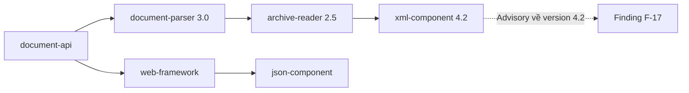
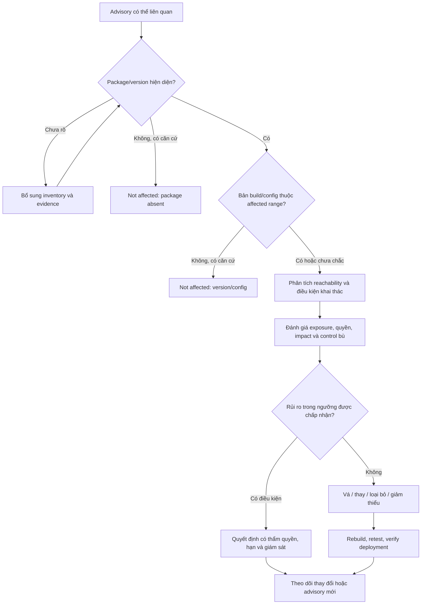
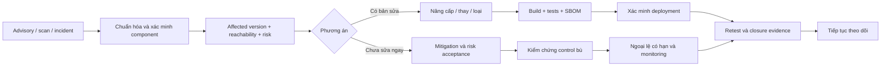
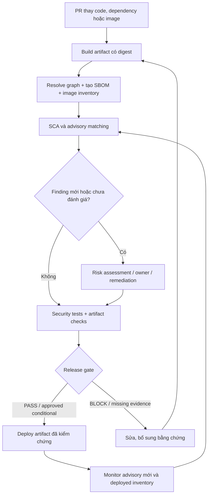

# Vulnerability trong dependency

Một ứng dụng Java có thể vượt qua mọi unit test và code review, nhưng vẫn sử dụng một thư viện xử lý tệp tồn tại lỗ hổng cho phép kẻ tấn công gây gián đoạn dịch vụ khi gửi dữ liệu được tạo đặc biệt. Thư viện đó có thể không xuất hiện trực tiếp trong `build.gradle` hoặc `pom.xml`: nó được kéo vào qua một dependency khác. Nếu nhóm chỉ kiểm tra mã tự viết hoặc chỉ nhìn các dependency trực tiếp, rủi ro dễ bị bỏ sót.

**Vulnerability trong dependency** là **điểm yếu có thể bị khai thác trong một thành phần mà phần mềm hoặc quá trình xây dựng/vận hành phần mềm phụ thuộc vào**. Dependency có thể là thư viện ứng dụng, package gián tiếp, framework, driver, thành phần native, thư viện hệ điều hành trong container, công cụ build, plugin hoặc CI action. Ảnh hưởng có thể liên quan đến tính bí mật, tính toàn vẹn, tính sẵn sàng hoặc khả năng kiểm soát chuỗi cung ứng.

Trong **security assurance** của module **SECURITY_SECURITY_ASSURANCE**, điều quan trọng không chỉ là chạy công cụ quét và liệt kê mã CVE. Nhóm phải xây dựng căn cứ để trả lời: *thành phần nào thực sự đang được sử dụng, lỗ hổng có thể ảnh hưởng sản phẩm trong điều kiện nào, control nào đang bảo vệ, cần hành động gì, bằng chứng nào chứng minh rủi ro đã được xử lý và bản phát hành nào còn chịu ảnh hưởng?*

## 1. Hiểu đúng lỗ hổng dependency

Một dependency chứa lỗ hổng không đồng nghĩa hệ thống đã bị tấn công. Ngược lại, việc chưa thấy CVE cũng không chứng minh dependency an toàn. Cần phân biệt:

- **Vulnerability (lỗ hổng):** điểm yếu về thiết kế, triển khai hoặc cấu hình có thể tạo ra tác động bảo mật trong điều kiện thích hợp.
- **Affected version (phiên bản bị ảnh hưởng):** phiên bản nằm trong phạm vi mà advisory hoặc đánh giá kỹ thuật xác định có điểm yếu.
- **Exposure (mức phơi nhiễm):** mức độ thành phần, chức năng hoặc dữ liệu liên quan có thể bị tiếp cận.
- **Reachability (khả năng đi tới đường mã lỗi):** liệu một đầu vào/hành động có thể kích hoạt đường thực thi chứa điểm yếu hay không.
- **Exploitability (khả năng khai thác):** liệu điều kiện cần thiết có thể được đáp ứng để gây tác động trong bối cảnh cụ thể.
- **Impact (tác động):** hậu quả đối với dữ liệu, hoạt động, danh tính và nghĩa vụ của tổ chức.
- **Residual risk (rủi ro còn lại):** rủi ro chưa được loại bỏ sau khi áp dụng biện pháp kiểm soát và giảm thiểu.

Cùng một thư viện có thể nằm trong hai hệ thống nhưng có mức rủi ro khác nhau: một hệ thống nhận dữ liệu không tin cậy từ Internet, hệ thống kia chỉ xử lý dữ liệu nội bộ đã xác minh; một hệ thống chạy với quyền cao, hệ thống còn lại cô lập trong sandbox. **Không đánh đồng độ nghiêm trọng của lỗ hổng với mức rủi ro cuối cùng của mọi sản phẩm sử dụng nó.**

Tuy nhiên, “chưa xác minh được khả năng khai thác” cũng không có nghĩa “không thể khai thác”. Phải ghi rõ giả định, phần chưa kiểm tra và độ tin cậy của căn cứ.

### 1.1. Lỗ hổng dependency khác lỗi trong mã ứng dụng ở đâu?

| Tình huống | Nguồn điểm yếu | Nhóm phát triển có thể làm gì? |
| --- | --- | --- |
| API không kiểm tra quyền theo đối tượng | Mã/thiết kế ứng dụng | Sửa logic phân quyền, thêm test |
| Thư viện parse tệp xử lý sai cấu trúc đầu vào | Dependency trực tiếp hoặc gián tiếp | Nâng phiên bản, thay thư viện, giới hạn đường xử lý và kiểm thử lại |
| Package OS trong image có lỗi thư viện native | Container/base image | Chọn image đã vá, rebuild, triển khai và kiểm tra lại |
| Build plugin có lỗ hổng khi xử lý nội dung repository | Toolchain/plugin | Nâng plugin, hạn chế quyền CI, kiểm soát nguồn |
| Dependency bị chiếm tài khoản phát hành và đưa mã độc | Xâm phạm chuỗi cung ứng, có thể không có CVE | Cách ly nguồn, xác minh provenance/integrity, điều tra artifact và thu hồi credential |

Đối với dependency, nhóm có thể không sửa được mã nguồn thư viện ngay lập tức. Vì thế cần quản lý version, nhà cung cấp, thời điểm ra bản vá, đường sử dụng, control bù và quyết định chấp nhận rủi ro theo thẩm quyền.

## 2. Những lớp dependency có thể chứa lỗ hổng

### 2.1. Dependency trực tiếp và gián tiếp

**Direct dependency** được dự án khai báo trực tiếp. **Transitive dependency** được kéo vào từ một package khác. Cả hai có thể tham gia runtime hoặc build.

Giả sử dependency graph minh họa:



Nếu chỉ tìm `xml-component` trong phần `dependencies` của dự án, nhóm có thể không thấy. Graph resolution và SBOM giúp giải thích **vì sao thành phần hiện diện**, version cuối cùng được chọn và bản phát hành nào mang nó.

Trong graph thực tế, một package có thể được kéo vào qua nhiều nhánh, dependency management/BOM có thể thay đổi version và một số package được loại khỏi artifact. **Version khai báo không nhất thiết là version được resolve hoặc đóng gói.**

### 2.2. Runtime, build, test và container

| Loại dependency | Ví dụ | Bề mặt rủi ro |
| --- | --- | --- |
| **Application runtime** | JSON parser, file converter, HTTP client, database driver | Xử lý dữ liệu không tin cậy, quyền của ứng dụng, tài nguyên production |
| **Transitive runtime** | Parser, decoder, thư viện native do framework kéo vào | Khó nhận diện nếu chỉ kiểm tra dependency trực tiếp |
| **Build dependency / plugin** | Gradle/Maven plugin, code generator, bundler | Chạy trong CI; có thể đọc source, token và tạo/sửa artifact |
| **Test dependency** | Testing framework, mock server, test runner | Quyền CI, dữ liệu test, môi trường chạy; thường không nằm trong production artifact |
| **Container/base image** | OS package, OpenSSL, libc, công cụ shell | Lỗ hổng native và khả năng tương tác với hệ điều hành |
| **CI/CD action/tool** | Action tải từ registry, script build từ bên thứ ba | Supply chain compromise, quyền triển khai và secrets |
| **Vendored/embedded library** | JAR/binary copy thủ công, shaded library | Có thể bị bỏ sót bởi trình quản lý package |
| **Runtime-loaded component** | Plugin hoặc binary tải khi chạy | Inventory lúc build có thể không bao phủ |

Một lỗ hổng trong dependency test không nhất thiết làm API production dễ bị khai thác, nhưng vẫn có thể gây rủi ro cho CI/CD nếu test job xử lý đầu vào không tin cậy hoặc chạy với credential nhạy cảm. Cần đánh giá **theo môi trường và quyền thực tế**, không chỉ theo nhãn “test”.

### 2.3. Vulnerable package và malicious package

Cần phân biệt hai nhóm rủi ro liên quan nhưng khác nhau:

- **Package có lỗ hổng:** có một lỗi bảo mật có thể bị khai thác, dù maintainer không cố ý.
- **Package độc hại hoặc bản cập nhật bị cài mã độc:** chứa hành vi gây hại có chủ đích hoặc được phát hành sau khi tài khoản/nguồn bị chiếm. Không nhất thiết xuất hiện trong cơ sở dữ liệu CVE.

Phân tích CVE/SCA giúp xử lý nhiều lỗ hổng đã biết; các rủi ro như dependency confusion, typosquatting và artifact substitution còn đòi hỏi kiểm tra nguồn, quyền, checksum, provenance và hành vi bất thường.

## 3. Dữ liệu về lỗ hổng: hiểu CVE và advisory

### 3.1. Những loại định danh thường gặp

| Dữ liệu | Chức năng | Cách dùng đúng |
| --- | --- | --- |
| **CVE** | Định danh công khai cho một lỗ hổng cụ thể | Dùng để liên kết thông báo, kết quả scan và finding; không đồng nghĩa đã đánh giá mức ảnh hưởng của ứng dụng |
| **CWE** | Phân loại kiểu điểm yếu | Hỗ trợ hiểu nguyên nhân, kiểm soát và kiểm thử; không phải một lỗ hổng cụ thể |
| **GHSA / vendor advisory / OSV record** | Thông báo lỗ hổng, package và phạm vi version từ nguồn tương ứng | Đối chiếu ecosystem, package, affected range, bản sửa và điều kiện khai thác |
| **CVSS** | Thang đo mức nghiêm trọng kỹ thuật theo một bộ tiêu chí | Hỗ trợ ưu tiên; không thay thế risk assessment của hệ thống |
| **EPSS** | Mô hình ước lượng xác suất khai thác trong thời gian dự báo xác định | Là tín hiệu ưu tiên có bất định; không chứng minh một hệ thống cụ thể đã bị khai thác |
| **CISA KEV** | Danh mục lỗ hổng đã có bằng chứng khai thác được cơ quan quản lý ghi nhận | Tăng mức chú ý và ưu tiên trong phạm vi áp dụng, không tự xác nhận thành phần có mặt |
| **VEX** | Tuyên bố tình trạng ảnh hưởng của sản phẩm đối với lỗ hổng cụ thể | Cần lý do, phạm vi và độ tin cậy; không thay thế kiểm tra kỹ thuật |

Danh mục trên mô tả **khái niệm**, không đưa ra điểm số hoặc tình trạng khai thác của một CVE thực tế tại thời điểm cụ thể. Khi vận hành, cần sử dụng thông báo và metadata mới nhất từ các nguồn được tổ chức phê duyệt, lưu timestamp và phiên bản đánh giá.

### 3.2. Các câu hỏi khi đọc một advisory

Đừng chỉ đọc tên CVE và điểm số. Cần xác định:

1. **Package identity:** advisory chỉ đúng ecosystem, group/artifact hoặc package name nào? Có nhầm package cùng tên ở ecosystem khác không?
2. **Affected versions:** khoảng version bị ảnh hưởng, pre-release, vendor fork hoặc bản vá riêng có được xét không?
3. **Điều kiện kích hoạt:** input, API, cấu hình, quyền hay hệ điều hành nào cần có?
4. **Hậu quả:** lộ thông tin, thực thi mã, tăng quyền, từ chối dịch vụ, sửa dữ liệu hoặc loại khác?
5. **Bản sửa:** phiên bản vá, thay đổi cách sử dụng hoặc cấu hình được khuyến cáo là gì?
6. **Bằng chứng khai thác:** có mô tả điều kiện hoặc báo cáo đáng tin về khai thác hay không?
7. **Độ tin cậy và lịch sử:** thông báo đã được chỉnh sửa, rút lại, hợp nhất hoặc bổ sung thông tin chưa?
8. **Ứng dụng của mình:** thành phần nằm trong artifact nào và chức năng nào đưa dữ liệu tới nó?

Một advisory có thể gắn nhiều CVE hoặc cùng CVE được nhiều nguồn mô tả khác nhau. Tổ chức cần tránh tính một vấn đề thành nhiều rủi ro độc lập chỉ vì có nhiều feed, đồng thời không gộp những điểm yếu khác nhau thành một finding thiếu rõ ràng.

### 3.3. Package URL (purl) và CPE

**purl** thường giúp định danh package theo ecosystem, namespace, tên và version, ví dụ mẫu `pkg:maven/com.example/example-parser@4.2.1`. **CPE** thường được sử dụng để mô tả sản phẩm/nền tảng trong một số nguồn dữ liệu về lỗ hổng. Ánh xạ giữa chúng có thể không một-một.

Nếu scanner ghép sai CPE, kết quả có thể là **false positive**; nếu package được đóng gói không giữ metadata hoặc được fork, scanner có thể bỏ sót. Đừng loại finding chỉ vì tên hiển thị không khớp 100%; cần đối chiếu hash, metadata package, code hoặc thông tin nhà cung cấp.

## 4. Từ “có package” đến “có rủi ro khai thác được”

Đánh giá tác động cần phân tầng. Một cách tư duy hữu ích:

1. **Present:** package hoặc code liên quan có thực sự hiện diện trong artifact/môi trường?
2. **Affected:** version và cấu hình thuộc phạm vi bị ảnh hưởng theo advisory?
3. **Reachable:** đường mã lỗi có thể được gọi từ chức năng đang sử dụng?
4. **Triggerable:** đầu vào, trạng thái hoặc quyền cần thiết có thể xảy ra?
5. **Exploitable:** điều kiện có thể dẫn tới hậu quả bảo mật trong ngữ cảnh triển khai?
6. **Impactful:** hậu quả đối với tài sản, khách hàng và nghĩa vụ tổ chức lớn đến đâu?
7. **Mitigated:** control nào làm giảm xác suất hoặc tác động, hiệu lực được kiểm chứng ra sao?



Đây là mô hình phân tích, **không phải cơ chế tự động tuyên bố vô hại**. Đặc biệt, việc không tìm thấy đường gọi trong một lần static analysis không chứng minh tuyệt đối rằng không có đường động qua reflection, serialization, plugin, callback hoặc cấu hình đặc biệt.

### 4.1. Các mức bằng chứng về reachability

| Quan sát | Có thể kết luận gì? | Giới hạn |
| --- | --- | --- |
| Package nằm trong dependency graph | Thành phần đã được resolver chọn cho một scope | Có thể không nằm trong artifact production |
| Package được đóng gói trong image | Thành phần có mặt trong image | Không chứng minh code lỗi được gọi |
| Static call graph chỉ ra đường gọi | Có căn cứ rằng code có thể đi tới API liên quan | Có thể bỏ sót đường gọi động hoặc điều kiện dữ liệu |
| Runtime tracing thấy code được gọi | Đã quan sát đường gọi ở một số tình huống | Không đại diện cho mọi input và thời điểm |
| Positive/negative test trên luồng tấn công | Hành vi được kiểm tra theo kịch bản xác định | Không chứng minh mọi cách khai thác bị loại bỏ |
| Cấu hình vô hiệu hóa chức năng bị ảnh hưởng | Có thể giảm bề mặt tấn công | Phải chứng minh không còn đường kích hoạt và config không bị thay |
| Sandbox/quyền tối thiểu | Giảm blast radius nếu bị khai thác | Không tự xóa lỗ hổng trong package |

Nếu lỗ hổng bị kích hoạt bởi parser xử lý tệp người dùng, việc API gọi parser khi nhận tệp là tín hiệu rủi ro đáng chú ý. Nếu parser chỉ xuất hiện trong test build mà không được đóng gói production, phân tích phải chuyển sang quyền và khả năng tấn công vào CI/test environment.

### 4.2. Ngữ cảnh quan trọng hơn một điểm severity

Một số yếu tố cần ghi nhận:

- Ứng dụng có tiếp xúc Internet, file upload, webhook hoặc dữ liệu do đối tác cung cấp không?
- Package được gọi trong luồng nào? Có xác thực hoặc phân quyền trước điểm gọi không?
- Input có bị giới hạn kích thước/định dạng? Control đó có thể bị vượt qua không?
- Quyền của process/workload là gì? Nó có thể đọc secret, database hoặc gọi cloud API không?
- Có phân đoạn mạng, rate limit, sandbox, seccomp hoặc control bù phù hợp không?
- Có log/alert và khả năng cô lập nếu khai thác xảy ra không?
- Lỗ hổng tác động dữ liệu của một tenant, nhiều tenant hay toàn bộ hệ thống?
- Nếu không vá ngay, thời gian phơi nhiễm và khả năng phục hồi là gì?

Một CVSS cao có thể có rủi ro thấp hơn trong một cấu hình thật sự không sử dụng chức năng bị ảnh hưởng, nhưng **điều đó phải được chứng minh**; ngược lại một lỗi từ chối dịch vụ có điểm thấp hơn vẫn có thể không chấp nhận được ở dịch vụ rất quan trọng.

## 5. Nguồn phát hiện vulnerability trong dependency

Không nên phụ thuộc một nguồn duy nhất. Các nguồn bổ sung có thể gồm:

- **SCA** trên manifest, lockfile hoặc resolved dependency graph.
- **SBOM-based vulnerability matching** theo package identity và version.
- **Container/image scanning** cho package OS và binary được đóng gói.
- **Build/artifact inspection** cho JAR, shaded code, native library và vendored binary.
- **Vendor/security advisory**, bản tin từ maintainer hoặc cơ quan chuyên trách.
- **Runtime inventory và deployment registry** cho artifact đang chạy.
- **Threat modeling, code review hoặc pentest** phát hiện cách dùng một thư viện không an toàn.
- **Incident response và thông tin khai thác** cho thấy một đường tấn công ngoài giả định trước đó.

### 5.1. SCA làm được gì, chưa làm được gì?

SCA thường có thể:

1. Phát hiện package, version và một phần quan hệ phụ thuộc.
2. Đối chiếu package/version với advisory đã biết.
3. Hiển thị affected range, fixed version và thông tin ưu tiên nếu nguồn dữ liệu hỗ trợ.
4. Hỗ trợ tự động tạo ticket, policy gate và báo cáo theo release.

Nhưng SCA có thể bỏ sót metadata của code nhúng, tính sai version của package được fork, không biết điều kiện runtime hoặc không nhìn thấy plugin tải động. Nó cũng không tìm đầy đủ các lỗi logic ứng dụng như phân quyền sai theo tenant.

**Kết quả “zero findings” chỉ có ý nghĩa trong phạm vi inventory và cơ sở dữ liệu mà công cụ đã xét tại thời điểm chạy.**

### 5.2. Tính hiện hành của dữ liệu phát hiện

Quy trình quét cần lưu thời điểm tạo inventory, thời điểm tra cứu advisory và thời điểm ra quyết định. Một release không đổi code vẫn có thể được đánh giá lại khi có CVE mới hoặc khi bản advisory chỉnh sửa affected range.

Các bước phát hiện mới có thể kích hoạt **vulnerability monitoring** sau phát hành; không nhất thiết đợi tới lần build tiếp theo mới quét lại.

## 6. Quy trình xử lý vulnerability theo vòng đời

Một quy trình có thể áp dụng cho team phát triển và security assurance:

### Bước 1: Tiếp nhận, chuẩn hóa và loại trùng

Ghi nguồn phát hiện, CVE/advisory ID, package identity, affected versions, timestamp, phương pháp scan và phạm vi release. Nếu nhiều scanner báo cùng một lỗ hổng trên cùng artifact, cần liên kết các nguồn mà không mất bằng chứng ban đầu.

### Bước 2: Xác minh dependency có thật trong bản đánh giá

Truy version đã resolve, artifact đóng gói và deployment thực tế. Đối chiếu direct/transitive, parent path, container OS, plugin build hoặc thư viện nhúng. Nếu version không rõ, phân loại **insufficient evidence**, không tự kết luận an toàn.

### Bước 3: Xác minh tính áp dụng của advisory

Xem affected range, ecosystem, platform, cấu hình, tính năng và điều kiện kích hoạt. Tài liệu từ nhà cung cấp, mã nguồn hoặc kết quả kiểm chứng độc lập có thể giúp phân biệt affected/not affected.

### Bước 4: Đánh giá rủi ro trong bối cảnh

Kết hợp mức nghiêm trọng kỹ thuật, khả năng khai thác, mức phơi nhiễm, đường code, quyền, dữ liệu, giá trị tài sản, control bù, khả năng phát hiện và mức độ khẩn cấp.

### Bước 5: Chọn phương án xử lý

Có thể nâng version, loại bỏ dependency, thay thế thư viện, sửa cấu hình, tắt chức năng bị ảnh hưởng, áp dụng virtual patch/bộ lọc, cô lập workload hoặc giảm quyền. Phương án cần có tiêu chí xác minh hiệu lực.

### Bước 6: Triển khai và kiểm tra hồi quy

Build artifact mới, kiểm tra dependency graph/SBOM và image, chạy security/regression tests phù hợp. Kiểm tra tương thích API, behavior change, transitive dependency drift và bề mặt tấn công mới.

### Bước 7: Kiểm tra artifact đã deploy

Chứng minh các môi trường trong phạm vi đã chuyển sang artifact đã xử lý. Tìm pod, instance, job hoặc region vẫn chạy version cũ. “Đã merge PR” không đồng nghĩa “đã giảm rủi ro ở production”.

### Bước 8: Đóng finding hoặc ghi rủi ro còn lại

Lưu evidence về version, scan, retest, deployment và phê duyệt. Nếu chưa thể sửa, cần ngoại lệ theo chính sách với người chịu trách nhiệm, biện pháp bù, thời hạn, điều kiện review.

### Bước 9: Theo dõi thông tin mới và các phiên bản còn hỗ trợ

Một advisory có thể bổ sung thông tin khai thác hoặc mở rộng affected range; phiên bản cũ có thể còn ở một khách hàng hoặc môi trường không được cập nhật. Inventory theo release hỗ trợ điều tra và hành động sau này.



## 7. Ví dụ Java: dependency gián tiếp có lỗ hổng

Giả sử một hệ thống xử lý tài liệu khai báo trong Gradle:

```groovy
// Ví dụ hư cấu; tên package và version không đại diện lỗ hổng có thật.
dependencies {
    implementation 'com.example:document-parser:3.0.0'
    implementation 'org.springframework.boot:spring-boot-starter-web'
    runtimeOnly 'org.postgresql:postgresql'
    testImplementation 'org.junit.jupiter:junit-jupiter'
}
```

Một advisory cảnh báo thành phần hư cấu `com.example:xml-component` ở một dải version cụ thể có lỗi khi xử lý một định dạng đầu vào không tin cậy. `xml-component` không được khai báo trực tiếp; nó được kéo vào bởi `document-parser → archive-reader`.

### 7.1. Truy tìm phiên bản và đường phụ thuộc

Các lệnh dưới đây **chỉ để minh họa cách điều tra trên dự án phù hợp; không được chạy trong quá trình viết bài này**.

**Gradle:**

```bash
# Graph của cấu hình runtime; tên cấu hình phụ thuộc dự án/plugin.
./gradlew dependencies --configuration runtimeClasspath

# Vì sao một package có mặt và version nào được chọn?
./gradlew dependencyInsight \
  --configuration runtimeClasspath \
  --dependency xml-component
```

**Maven:**

```bash
# Xem graph dependency của Maven project.
mvn dependency:tree

# Lọc dependency theo tọa độ package trong ví dụ.
mvn dependency:tree -Dincludes=com.example:xml-component
```

Đầu ra cần được liên kết tới commit, cấu hình build và kết quả artifact. Một lệnh liệt kê dependency **không** kiểm tra mọi thành phần của image và cũng không chứng minh mã lỗi được thực thi.

### 7.2. Dựng attack scenario phù hợp

Bối cảnh: `document-api` nhận file từ người dùng thuộc nhiều tenant, đưa vào queue; worker đọc nội dung và dùng thư viện parse. Kịch bản đáng xét:

1. Người dùng tải một tệp thuộc định dạng hỗ trợ lên.
2. Tệp được chuyển tới worker và parser gián tiếp được gọi.
3. Nếu đường code lỗi có thể được kích hoạt, worker có thể bị gián đoạn hoặc chịu tác động khác theo advisory.
4. Nếu worker có quyền quá rộng, tác động tiềm năng có thể lan tới nhiều tenant hoặc secret.

Cần xác minh liệu parser có thực sự gọi đường mã lỗi, cơ chế giới hạn input và sandbox có hiệu lực không, các quyền của worker là gì, rủi ro nào xảy ra nếu process thất bại. **Không cần thực hiện khai thác trên dữ liệu thật hoặc production để lập giả thuyết và thiết kế kiểm thử an toàn.**

### 7.3. Các phương án xử lý

| Phương án | Ưu điểm | Điều cần xác minh |
| --- | --- | --- |
| Nâng `document-parser` lên phiên bản mang dependency đã sửa | Giảm phụ thuộc vào override | Compatibility, graph resolved, parser behavior và regression |
| Override/constraint version gián tiếp được nhà cung cấp hỗ trợ | Có thể xử lý nhanh khi parent chưa cập nhật | Không gây xung đột API/ABI, final artifact thật dùng version mới |
| Thay thế thư viện hoặc tạm tắt chức năng xử lý định dạng rủi ro | Thu hẹp đường khai thác | Mọi đường vào đã bị giới hạn và người dùng hiểu tác động |
| Giới hạn input, sandbox, giảm quyền của worker | Giảm khả năng khai thác hoặc hậu quả | Control bù có hiệu lực; vẫn ghi finding và kế hoạch vá |
| Chấp nhận rủi ro có thời hạn | Có thể phù hợp khi rủi ro còn lại trong ngưỡng | Phê duyệt đúng thẩm quyền, biện pháp bù, monitoring, review trigger |

Không nên ép nâng một transitive package chỉ để scanner chuyển sang xanh nếu gây lỗi tương thích hoặc mở thêm lỗ hổng. Cũng không nên chọn “tắt cảnh báo” như một biện pháp xử lý kỹ thuật.

### 7.4. Evidence sau khi sửa

Một hồ sơ khắc phục mẫu có thể chứa:

- `FIND-XML-017`: mô tả, nguồn advisory và phiên bản bị ảnh hưởng.
- `RISK-INPUT-09`: kịch bản input không tin cậy và hậu quả.
- `PR-182`: cập nhật dependency hoặc cấu hình.
- `EV-GRAPH-01`: kết quả dependency graph với version đã sửa.
- `EV-IMG-01`: artifact/image digest và SBOM.
- `EV-TEST-01`: regression test các định dạng xử lý file và lỗi input.
- `EV-DEPLOY-01`: trạng thái triển khai bản mới ở các cluster.
- `DEC-RISK-01`: kết luận hoặc ngoại lệ được phê duyệt.

Chỉ khi kết quả kiểm chứng hỗ trợ kết luận về phạm vi bị ảnh hưởng, finding mới có thể được đóng hoặc ghi đã giảm thiểu theo policy.

## 8. Đánh giá lỗ hổng ở build plugin và CI/CD

Không nên chỉ chăm chú vào runtime artifact. Một build plugin bị khai thác có thể sửa artifact hoặc lấy credential dù production JAR không chứa plugin đó.

### 8.1. Những câu hỏi cần review

- Plugin/action được tải từ đâu? Có pin version hoặc định danh bất biến phù hợp không?
- Ai được quyền sửa `build.gradle`, `pom.xml`, workflow và repository config?
- CI runner có access token, cloud credential, key ký artifact hoặc secret production không?
- Pipeline có chạy code từ fork/untrusted PR trên runner có đặc quyền không?
- Build script có download/exe file qua Internet ngoài registry đã phê duyệt không?
- Có separation of duties giữa build, phê duyệt và deploy không?
- Nếu plugin có advisory, những pipeline nào và artifact nào được tạo trong khoảng ảnh hưởng?

Một trường hợp cần điều tra sâu hơn là **nguy cơ artifact đã được build bằng toolchain bị xâm phạm**. Ngay cả sau khi cập nhật plugin, cần cân nhắc đối chiếu provenance, rebuild từ nguồn đáng tin và xử lý các credential có thể đã bị lộ.

### 8.2. Khác biệt giữa vulnerability và compromise

Một CVE về cách plugin xử lý file có thể chỉ bị kích hoạt với cấu hình nhất định. Một vụ chiếm tài khoản maintainer có thể khiến bản cập nhật chứa mã độc dù không có CVE công khai. Cơ chế theo dõi cần bao phủ cả advisory và tín hiệu bất thường về nguồn gốc, quyền, checksum, hành vi build và package.

## 9. Chiến lược khắc phục: update, replace, remove, mitigate

Lựa chọn ưu tiên thường là **loại bỏ nguồn lỗ hổng** bằng bản vá hoặc bỏ thành phần không cần. Nhưng cần hiểu trade-off và thời gian triển khai.

### 9.1. Update và pin version

Nâng phiên bản direct/transitive dependency hoặc base image cần:

1. Xác minh fixed version theo thông báo đáng tin.
2. Kiểm tra compatibility API/ABI, hành vi mặc định và cấu hình.
3. Resolve graph và xác nhận package bị ảnh hưởng không còn ở artifact.
4. Chạy test chức năng, bảo mật, hồi quy và khả năng vận hành.
5. Kiểm tra artifact provenance/digest.
6. Triển khai, xác minh các instance cũ đã được thay và theo dõi.

Pinning giúp kiểm soát tính lặp lại, nhưng một version bị pin vẫn có thể bị phát hiện lỗ hổng sau này. Việc tự động cập nhật nên có review và test tương ứng với mức rủi ro.

### 9.2. Thay thế hoặc loại bỏ

Dependency không được dùng nữa nên được xóa khỏi source, graph và artifact. Nếu thư viện không được duy trì hoặc không có đường vá tin cậy, có thể thay bằng thư viện khác. Tuy nhiên, thư viện thay thế cũng tạo dependency, license và attack surface mới; cần đánh giá trước khi chuyển.

### 9.3. Compensating controls

Control bù có thể gồm:

- Giới hạn chức năng dễ bị kích hoạt.
- Xác thực, phân quyền và giới hạn đầu vào trước khi gọi parser.
- Phân đoạn mạng và quyền tối thiểu cho workload.
- Sandbox hoặc cô lập process để giảm blast radius.
- Giới hạn kích thước, timeout, rate limit và quota.
- Monitoring, alert và phản ứng nếu phát hiện hành vi bất thường.
- Chặn đường truy cập cụ thể bằng cấu hình gateway/proxy, khi có cơ sở chứng minh hiệu lực.

Control bù **không làm biến mất mã lỗi**. Cần xác minh rằng nó thực sự ngăn được điều kiện khai thác hoặc giảm tác động trong phạm vi được mô tả, và tiếp tục theo dõi đến khi có bản sửa phù hợp.

### 9.4. Những cách xử lý không đủ

- Chỉ đổi nhãn severity trong dashboard.
- Thêm exclude để không còn nhìn thấy dependency nhưng artifact vẫn chứa.
- Đóng finding vì test chức năng pass.
- Giả định firewall luôn ngăn mọi tình huống lỗ hổng.
- Ghi “not exploitable” mà không có nguồn, phân tích điều kiện và giới hạn.
- Cập nhật nhánh chính nhưng quên release cũ còn chạy.
- Giả định không có patch nghĩa là có thể chấp nhận rủi ro vô thời hạn.

## 10. VEX và kết luận affected/not affected

**VEX** giúp trao đổi trạng thái ảnh hưởng của một lỗ hổng đối với sản phẩm, dựa trên phạm vi và lý do. Một số trạng thái thường gặp trong cách biểu diễn VEX là `affected`, `not_affected`, `fixed` và `under_investigation`; tên trường và cấu trúc phụ thuộc định dạng cụ thể được sử dụng.

| Trạng thái | Nghĩa trong đánh giá | Yêu cầu bằng chứng |
| --- | --- | --- |
| **Affected** | Sản phẩm thuộc phạm vi bị ảnh hưởng theo căn cứ đang có | Package/version, điều kiện, kịch bản rủi ro |
| **Not affected** | Có căn cứ cụ thể rằng sản phẩm không chịu ảnh hưởng trong phạm vi xét | Lý do như component absent, code not reachable hoặc cấu hình không có điều kiện lỗi, kèm giới hạn |
| **Fixed** | Bản sửa/giảm thiểu đáp ứng tiêu chí đã xác minh theo định nghĩa áp dụng | Artifact, version, kiểm thử, deployment |
| **Under investigation** | Chưa đủ thông tin kết luận | Owner, kế hoạch và thời hạn đánh giá lại |

Ví dụ, một báo cáo “not affected – vulnerable code not in execute path” cần nêu phương pháp xác minh đường gọi, phiên bản, chức năng, cấu hình và giả định; không chỉ có một dropdown trong dashboard.

**Not affected không phải bảo hành vĩnh viễn.** Nếu ứng dụng bật tính năng mới gọi tới API lỗi, hoặc package update làm thay đổi code path, phải xem xét lại.

## 11. Release gate và ngoại lệ

Security release gate cần kết hợp kết quả dependency assessment với các yêu cầu bảo mật khác. Một gate chỉ chặn theo `CVSS >= ngưỡng` dễ sinh false positives, nhưng bỏ hẳn việc đánh giá dependency cũng nguy hiểm.

### 11.1. Gate theo chính sách rủi ro

Ví dụ chính sách minh họa cho một service production có dữ liệu nhạy cảm:

| Điều kiện | Quyết định thường phù hợp | Giải thích |
| --- | --- | --- |
| Artifact không có SBOM/inventory hợp lệ theo yêu cầu | **BLOCK** hoặc giữ để bổ sung | Không biết bản build chứa gì |
| Kết quả SCA bắt buộc bị skip hoặc lỗi | **BLOCK / NEEDS_REVIEW** | Không được xem thiếu dữ liệu là đạt |
| Lỗ hổng có rủi ro vượt ngưỡng, chưa có phương án xử lý | **BLOCK** | Chưa đáp ứng chính sách phát hành |
| Finding đã vá, test đạt và artifact khớp | **PASS** cho tiêu chí liên quan | Có bằng chứng kiểm chứng trong phạm vi |
| Finding cần ngoại lệ, đã review và phê duyệt hợp lệ | **CONDITIONAL_APPROVAL** nếu policy cho phép | Vẫn phải công khai rủi ro còn lại |
| VEX “not affected” có căn cứ và phù hợp bản release | Đánh giá theo policy, có thể **PASS** | Phải theo dõi trigger làm giả định thay đổi |
| Artifact deploy khác digest được kiểm tra | **BLOCK** | Bằng chứng không áp dụng trực tiếp |

Các giá trị không phải quy định chung cho mọi ngành. Điều kiện bắt buộc, ngưỡng rủi ro và quy trình ngoại lệ cần do tổ chức quy định theo tài sản, nghĩa vụ và quyền phê duyệt.

### 11.2. Ngoại lệ có thời hạn và có owner

Một bản ghi ngoại lệ phù hợp nên gồm:

- Finding/advisory ID, dependency, version, affected artifact/release/environment.
- Mô tả kịch bản khai thác và căn cứ đánh giá.
- Lý do chưa thể khắc phục ngay.
- Control bù đã kiểm chứng và rủi ro còn lại.
- Người chịu trách nhiệm remediation và người có quyền chấp nhận rủi ro.
- Hạn hiệu lực, kế hoạch sửa, trigger đánh giá lại.
- Bằng chứng review, test và giám sát.
- Quy tắc khi ngoại lệ hết hạn hoặc điều kiện thay đổi.

Không nên xóa finding để làm pipeline xanh. Quyết định có điều kiện phải ghi rõ “control chưa đạt” hoặc “còn rủi ro được chấp nhận”, thay vì chuyển thành tuyên bố không tồn tại lỗ hổng.

## 12. Tích hợp xử lý vulnerability vào CI/CD

Một luồng tự động hóa ở mức khái niệm:



### 12.1. Mẫu chính sách ở mức logic

Đây là **pseudocode YAML mô tả yêu cầu**, không phải cấu hình chạy trực tiếp của một sản phẩm CI:

```yaml
policy:
  name: "dependency-vulnerability-gate"
  version: "1"
  scope:
    environments: ["production"]
    artifacts: ["application", "container"]
  required:
    - id: "artifact-identity"
      condition: "tested_digest_equals_deployed_digest"
      on_missing: "BLOCK"
    - id: "inventory"
      condition: "resolved_dependencies_and_image_components_identified"
      on_missing: "BLOCK"
    - id: "sca"
      condition: "scan_completed_for_target_artifact"
      on_error: "BLOCK"
    - id: "risk-assessment"
      condition: "all_in_scope_high_priority_findings_triaged"
      on_missing: "NEEDS_REVIEW"
  decisions:
    unaccepted_risk_above_threshold: "BLOCK"
    approved_exception_within_scope: "CONDITIONAL_APPROVAL"
  exception_requirements:
    - "authorized_approver"
    - "expiry"
    - "remediation_owner"
    - "mitigation_and_evidence"
    - "release_and_environment_scope"
```

Một triển khai đúng phải xác định nguồn dữ liệu cho từng `condition` và bảo vệ chúng trước thay đổi trái phép. Nếu scanner không chạy, hoặc SBOM không khớp digest, không nên mặc định số finding bằng 0. Phải kiểm thử cả tính hiệu lực của gate: có quyền deploy trực tiếp đi vòng kiểm soát không?

### 12.2. Phát hiện sau phát hành vẫn phải quay lại Secure SDLC

CI chỉ kiểm tra tại một thời điểm. Advisory mới, dependency bị rút bản vá hoặc thông tin khai thác mới có thể thay đổi trạng thái rủi ro mà không có commit nào được tạo. Cần liên kết inventory, deployed artifact, cơ chế theo dõi advisory và quy trình incident/vulnerability response.

Không nên có chính sách chỉ quét khi merge PR nếu tổ chức muốn phát hiện những lỗ hổng công khai sau thời điểm build.

## 13. Bằng chứng security assurance cho vulnerability trong dependency

Một security assurance case tốt cần **Claim – Argument – Evidence**.

### 13.1. Claim có phạm vi cụ thể

Ví dụ:

> **CLM-SC-VULN-01:** Trong release và môi trường được đánh giá, các dependency thuộc phạm vi runtime và container đã được nhận diện, đối chiếu với dữ liệu lỗ hổng đã biết tại thời điểm kiểm tra; các finding vượt ngưỡng chính sách đã được xử lý hoặc có quyết định rủi ro hợp lệ.

Claim này **không có nghĩa** hệ thống không có lỗ hổng chưa biết, và cũng không tự bao gồm CI plugins nếu chúng nằm ngoài scope.

### 13.2. Argument: vì sao bằng chứng có liên quan?

- Inventory được tạo từ dependency resolution và kiểm tra artifact/image.
- Component được định danh và liên kết với release, commit, digest và environment.
- Advisory matching sử dụng nguồn dữ liệu đã xác định và kết quả có timestamp.
- Các finding quan trọng được xác minh package/version và phân tích khả năng khai thác.
- Biện pháp sửa/giảm thiểu có kiểm tra trên artifact mới hoặc cấu hình liên quan.
- Deployment được đối chiếu với artifact đã đánh giá.
- Phần chưa kiểm tra, ngoại lệ và rủi ro còn lại được công khai.

### 13.3. Evidence matrix minh họa

| Evidence ID | Nội dung | Kết luận được hỗ trợ | Giới hạn |
| --- | --- | --- | --- |
| `EV-VULN-01` | Dependency graph + scope | Version và quan hệ transitive theo cấu hình build | Không bao phủ mọi vendored/runtime-loaded component |
| `EV-VULN-02` | SBOM ứng dụng và image | Component đóng gói theo phương pháp thu thập | Phụ thuộc metadata và scanner coverage |
| `EV-VULN-03` | SCA run với timestamp và advisory sources | Finding đã biết trong phạm vi được đối chiếu | Không thấy mọi lỗ hổng chưa công bố |
| `EV-VULN-04` | Reachability review / code paths | Căn cứ đánh giá tính áp dụng của advisory | Còn giả định về đường động và input |
| `EV-VULN-05` | PR, version update, test và retest | Biện pháp sửa hoặc mitigation có hiệu lực trong thử nghiệm | Phải kiểm tra artifact và config production |
| `EV-VULN-06` | Artifact digest và deployment inventory | Version được đánh giá có thực sự triển khai | Phải theo dõi instance cũ, region khác và drift |
| `EV-VULN-07` | Risk acceptance / VEX justification | Cách xử lý rủi ro còn lại | Có phạm vi, người phê duyệt và hạn hiệu lực |
| `EV-VULN-08` | Monitoring / incident runbook | Khả năng theo dõi thay đổi và phản ứng | Không chứng minh phát hiện mọi khai thác |

### 13.4. Mẫu hồ sơ truy vết một finding

```yaml
vulnerability_assurance_record:
  finding_id: "FIND-<id>"
  advisory_ids: ["<CVE-or-vendor-advisory-id>"]
  component:
    ecosystem: "maven"
    purl: "pkg:maven/com.example/xml-component@4.2.1"
    scope: "runtime"
    direct: false
    introduced_by:
      - "document-parser"
      - "archive-reader"
  affected_artifacts:
    - service: "document-api"
      release: "<release-id>"
      image_digest: "sha256:<digest>"
      environment: "production"
  assessment:
    source: "<advisory-and-sca-reports>"
    assessed_at: "<timestamp>"
    affected_range_verified: "<yes|no|unknown>"
    reachable_code_path: "<confirmed|not-observed|unknown>"
    exposure: "<description>"
    impact: "<description>"
    assumptions: ["<assumption>"]
    risk_decision: "<remediate|mitigate|accept|investigate>"
  remediation:
    owner: "<team>"
    action: "<updated-version-or-control>"
    test_evidence: "<ci-run-id>"
    artifact_evidence: "<sbom-or-digest-ref>"
    deployment_evidence: "<deployment-ref>"
  residual_risk:
    description: "<remaining-risk>"
    exception_id: "<if-applicable>"
    approved_by: "<authorized-risk-owner>"
    expires_at: "<timestamp-if-applicable>"
  status: "<open|in-progress|mitigated|verified-fixed|accepted>"
```

Giá trị trong ngoặc nhọn là **placeholders**; không phải dữ liệu kiểm chứng đã có. Những trạng thái như `verified-fixed` chỉ được ghi sau khi kết quả test và deployment evidence thực tế hỗ trợ kết luận.

### 13.5. Truy vết từ advisory đến hệ thống

```mermaid
flowchart LR
    ADV["Advisory / CVE"] --> PKG["Package + affected version"]
    PKG --> SBOM["SBOM / dependency graph"]
    SBOM --> ART["Artifact + release + digest"]
    ART --> ENV["Deployed environment"]
    ADV --> RISK["Threat scenario + risk assessment"]
    ENV --> RISK
    RISK --> CTRL["Upgrade / removal / mitigation"]
    CTRL --> TEST["Retest + scan + deployment evidence"]
    TEST --> DEC["Closure / residual-risk decision"]
```



Đường truy vết này giúp trả lời câu hỏi của audit, security team và đội vận hành: *vì sao bản phát hành X được xem là đã xử lý advisory Y, và những deployment nào chưa thuộc kết luận đó?*

## 14. Khi nào được đóng finding?

Không nên nhầm ba trạng thái:

- **Code fix merged:** PR sửa version/code đã được merge vào source.
- **Fix verified:** control được kiểm tra có hiệu lực trên artifact/build phù hợp.
- **Risk remediated across scope:** các deployment thuộc phạm vi đã được nâng cấp hoặc xử lý và xác minh.

Ví dụ: một thư viện đã được vá ở `main` nhưng cluster B vẫn chạy image cũ. Nếu yêu cầu là khắc phục toàn production, finding chưa thể được đánh dấu đã khắc phục đầy đủ.

### 14.1. Tiêu chí closure mẫu

1. Thành phần/version bị ảnh hưởng đã được xác định.
2. Phương án khắc phục hoặc giảm thiểu được ghi rõ.
3. Graph/SBOM mới cho thấy trạng thái thành phần sau thay đổi.
4. Security/regression tests liên quan đã đạt.
5. Artifact digest được ghi và đúng artifact đã triển khai.
6. Các deployment trong phạm vi đã được kiểm tra không còn chạy bản bị ảnh hưởng, hoặc có ngoại lệ hợp lệ.
7. Rủi ro còn lại và điều kiện giám sát đã được xử lý theo policy.
8. Bằng chứng, owner, thời điểm và người xác nhận closure được lưu.

Nếu một điều kiện chưa đáp ứng, dùng trạng thái chính xác như `mitigated` hoặc `pending-deployment` thay vì ghi `fixed everywhere`.

## 15. Quản trị, phân vai và thời hạn xử lý

Một vulnerability management program cần phân định trách nhiệm:

| Vai trò | Trách nhiệm chính | Bằng chứng thường sở hữu |
| --- | --- | --- |
| **Developer / dependency owner** | Hiểu đường sử dụng, cập nhật hoặc thay thư viện, sửa lỗi tương thích | PR, dependency tree, regression test |
| **Build/Platform team** | Quản lý registry, plugin, base image, CI và artifact | Build log, SBOM, provenance, image digest |
| **Security engineer** | Review advisory, triage, đánh giá kịch bản tấn công và control bù | Risk assessment, finding, review notes |
| **SRE/Operations** | Xác minh rollout và version đang chạy, giám sát khai thác | Deployment evidence, telemetry, incident records |
| **Product/Risk owner** | Xác định tác động nghiệp vụ và quyết định rủi ro trong thẩm quyền | Approval, exception, remediation priority |
| **Assurance/Audit reviewer** | Kiểm tra khả năng truy vết từ mục tiêu đến evidence | Assurance case, gap findings, release decision |

### 15.1. Thời hạn khắc phục không có một con số chung

Tổ chức nên đặt mục tiêu xử lý theo mức phơi nhiễm, khả năng khai thác, tác động, nghĩa vụ và khả năng giảm thiểu. Ví dụ, lỗ hổng đang bị khai thác trên dịch vụ Internet-facing xử lý dữ liệu nhạy cảm có thể đòi hỏi ứng cứu khẩn cấp, trong khi một dependency test cô lập có thể được xử lý theo chu kỳ đã duyệt.

Không nên áp dụng SLA chỉ theo điểm CVSS rồi bỏ qua sự tồn tại của exploit thực tế, nguồn tín hiệu, quyền của process hoặc phạm vi production. Cần có cơ chế điều chỉnh mức ưu tiên khi xuất hiện thông tin mới.

### 15.2. Quy trình khi chưa có bản vá

Nếu upstream chưa có fixed version:

1. Kiểm tra có chức năng bị ảnh hưởng nào có thể tắt an toàn không.
2. Đánh giá control bù và kiểm chứng hiệu quả.
3. Hạn chế exposure, quyền và luồng dữ liệu nếu phù hợp.
4. Liên hệ nhà cung cấp hoặc theo dõi nguồn khắc phục đáng tin.
5. Quy định thời gian xem xét lại và người chịu trách nhiệm.
6. Giám sát dấu hiệu khai thác và đánh giá khả năng phục hồi.
7. Nếu rủi ro vượt ngưỡng, giới hạn phạm vi, tạm ngừng chức năng hoặc ngăn phát hành.

“Chưa có patch” là bối cảnh ra quyết định, không tự động là lý do hợp lệ để bỏ qua một rủi ro không thể chấp nhận.

## 16. Metrics và giám sát hiệu quả

| Chỉ số | Câu hỏi trả lời | Giới hạn cần nhớ |
| --- | --- | --- |
| **Dependency inventory coverage** | Bao nhiêu artifact/deployment có inventory còn hiệu lực? | Có inventory không bảo đảm mọi component đã được nhận diện |
| **Finding triage coverage** | Bao nhiêu finding quan trọng có kết quả assessment? | Cần đánh giá chất lượng lý do, không chỉ số ticket |
| **Time to identify affected deployments** | Mất bao lâu từ advisory đến danh sách deployment chịu ảnh hưởng? | Phụ thuộc timestamp và độ đầy đủ của deployed inventory |
| **Time to verified remediation** | Bao lâu tới khi bản sửa đã được kiểm chứng ở môi trường thuộc phạm vi? | Không nên tính thời điểm merge PR là closure |
| **Open risk by exposure** | Những lỗ hổng đang mở nằm trên tài sản nào, mức phơi nhiễm ra sao? | Số lượng CVE không đo trực tiếp mức rủi ro |
| **Exception age / overdue rate** | Bao nhiêu ngoại lệ sắp/quá hạn? | Ngoại lệ cần scope và owner |
| **Reintroduced vulnerability rate** | Có bao nhiêu lỗ hổng cũ quay lại qua dependency/image? | Cần phân biệt version drift và advisory thay đổi |
| **Build-supply-chain coverage** | Plugin/action và CI tool có được inventory và kiểm soát không? | Runtime SBOM không đại diện mọi build dependency |

Một dashboard cho thấy “số CVE mở giảm” có thể vì đã vá, nhưng cũng có thể do scanner bị lỗi hoặc inventory thiếu. Chỉ số cần được đọc cùng **coverage, freshness, exception và kết quả kiểm chứng**.

## 17. Những sai lầm phổ biến

| Sai lầm | Vì sao nguy hiểm | Cách cải thiện |
| --- | --- | --- |
| Chỉ kiểm tra direct dependencies | Không thấy lỗi trong transitive package | Resolve graph, kiểm tra artifact, SBOM |
| Dùng version khai báo thay version đang đóng gói | Sai đối tượng assessment | Ghi resolved/packaged/deployed version |
| Coi mọi CVE nghiêm trọng đều khai thác được như nhau | Ưu tiên sai và làm tăng nhiễu | Phân tích reachability, exposure và tác động |
| Coi “không thấy mã lỗi chạy” là bằng chứng tuyệt đối | Có thể bỏ sót đường động hoặc cấu hình ít dùng | Ghi giới hạn và kiểm chứng bổ sung |
| Chỉ có báo cáo scan mà không có risk owner | Finding không được xử lý/ưu tiên | Giao owner, SLA theo rủi ro và theo dõi |
| Xóa finding hoặc chỉnh severity để qua gate | Mất audit trail và che rủi ro | Triage minh bạch, ngoại lệ có hạn |
| Pin version và không cập nhật | Version bị pin có thể xuất hiện CVE sau này | Monitor advisory, chu kỳ update an toàn |
| Override transitive version mà không test | Gãy tương thích hoặc tạo rủi ro mới | Kiểm tra graph, test, rollback |
| Chỉ vá code mà không kiểm tra image OS | Lỗ hổng native/container vẫn tồn tại | Inventory và quét image |
| Bỏ qua CI plugin | Pipeline có thể bị khai thác trước khi tạo artifact | Kiểm soát toolchain và quyền CI |
| Dùng SBOM cũ cho image mới | Bằng chứng không còn áp dụng | Gắn SBOM với artifact digest |
| Xem “scan xanh” là an toàn tuyệt đối | Scanner có giới hạn và dữ liệu luôn thay đổi | CAE, multiple methods, transparency |
| Quên deployment đang chạy phiên bản cũ | Phạm vi production chưa khắc phục | Theo dõi deployment và runtime inventory |
| Gọi “not affected” không có căn cứ | False negative có thể nghiêm trọng | VEX/justification, review và trigger đánh giá lại |
| Không xử lý tình huống chưa có patch | Rủi ro duy trì vô hạn | Mitigation, giới hạn phạm vi, owner, thời hạn |
| Không kiểm chứng hậu khắc phục | Có thể sửa sai hoặc bỏ sót đường liên quan | Retest, regression, audit evidence |

## 18. Checklist đánh giá một vulnerability trong dependency

- [ ] Đã xác định rõ component ID, ecosystem, source và advisory ID.
- [ ] Đã đối chiếu đúng affected version, không chỉ dựa vào tên package.
- [ ] Đã xác minh direct/transitive relationship và scope (runtime/build/test/container).
- [ ] Đã biết version **resolved, packaged và deployed** trong phạm vi liên quan.
- [ ] Inventory/SBOM được gắn với commit, build, artifact digest và environment.
- [ ] Có phân tích exposure, reachability, preconditions và impact phù hợp.
- [ ] Có căn cứ về control bù và giới hạn của các phương pháp đánh giá.
- [ ] Finding có owner, ưu tiên xử lý và mốc review.
- [ ] Đã xem các lựa chọn update, replace, remove, disable hoặc mitigate.
- [ ] Nếu sửa, có evidence graph/SBOM mới cùng security/regression tests.
- [ ] Đã xác minh artifact mới triển khai đúng nơi cần thiết, kiểm tra instance cũ.
- [ ] Nếu chấp nhận rủi ro, có phạm vi, control bù, approver và ngày hết hiệu lực.
- [ ] “Not affected” hoặc VEX có căn cứ và trigger đánh giá lại khi giả định thay đổi.
- [ ] Release gate không biến thiếu scan/bằng chứng thành `PASS`.
- [ ] Bằng chứng và quyết định có thể truy vết đến đúng release và môi trường.
- [ ] Có theo dõi advisory mới, thông tin khai thác và các bản phát hành còn hỗ trợ.
- [ ] Các phát hiện từ build plugin, container OS hoặc source compromise đã được xét theo phạm vi.

## 19. Câu hỏi tình huống

### Tình huống A: dependency không khai báo trực tiếp

Một advisory liên quan tới thư viện `xml-component`. `build.gradle` không có dòng khai báo package này, nhưng `dependencyInsight` cho thấy nó là transitive runtime dependency. Có thể đóng finding vì không phải dependency trực tiếp?

**Không.** Nếu được đóng gói và đường mã lỗi có thể được kích hoạt, rủi ro vẫn tồn tại. Cần xác định version, affected range, đường gọi, artifact và remediation phù hợp.

### Tình huống B: scanner báo Critical nhưng không có đường chạy quan sát được

Security team không thấy ứng dụng gọi API lỗi trong các test. Có thể ghi `not_affected` ngay?

**Chưa đủ.** Cần xem khả năng gọi động, cấu hình, chức năng ít chạy và bằng chứng từ source/binary. Nếu đủ căn cứ kỹ thuật trong phạm vi, có thể ghi quyết định not affected kèm justification và trigger đánh giá lại; nếu chưa đủ, giữ under investigation.

### Tình huống C: patch đã merge, production còn pod cũ

Team nâng thư viện lên version đã sửa và merge PR. Một cluster production vẫn chạy image cũ. Finding có thể đóng trên toàn production?

**Không.** Cần phân biệt code fix với verified remediation và trạng thái deployed. Phải cập nhật hoặc có ngoại lệ hợp lệ cho các deployment còn bị ảnh hưởng.

### Tình huống D: lỗ hổng chỉ ở build plugin

Plugin build được cập nhật, nhưng CI trước đó có quyền đọc token ký artifact. Có cần xem lại những bản đã build không?

**Có thể cần.** Phân tích điều kiện khai thác và phạm vi thời gian; nếu có nguy cơ toolchain bị lạm dụng, cần đánh giá provenance của artifact, runner, log, credential và quy trình rebuild/thu hồi phù hợp. Việc nâng plugin chỉ xử lý rủi ro tiếp diễn, không tự chứng minh quá khứ không bị ảnh hưởng.

### Tình huống E: không có patch từ upstream

Một thư viện xử lý định dạng file đang có advisory, chưa có fixed version và dịch vụ đang mở chức năng upload cho khách hàng. Có thể cứ tiếp tục vì không có giải pháp nâng cấp?

**Không tự động.** Nhóm cần đánh giá tác động, tìm biện pháp giảm thiểu hoặc giới hạn chức năng, xác minh hiệu lực và xin quyết định từ risk owner theo ngưỡng; nếu không đáp ứng yêu cầu bắt buộc phải hoãn release hoặc vô hiệu hóa đường rủi ro.

### Tình huống F: SCA không phát hiện CVE

Một package bị nhúng dạng shaded JAR và công cụ SCA không nhận diện được. “0 findings” có chứng minh package không có vulnerability?

**Không.** Inventory chưa đủ coverage. Cần kiểm tra artifact/binary bằng phương pháp bổ sung, xác minh thành phần được nhúng và ghi giới hạn của công cụ.

### Tình huống G: CVE đã được nhà cung cấp đánh dấu fixed

Một advisory cập nhật trạng thái `fixed` cho package mới, nhưng ứng dụng vẫn dùng version cũ. Có thể báo sản phẩm đã fixed vì nhà cung cấp có bản sửa?

**Không.** Có fixed version từ upstream chỉ là cơ hội khắc phục. Cần đưa version đó vào artifact, test và xác minh deployment trong phạm vi mới có thể kết luận sản phẩm đã được sửa.

## 20. Kết luận

**Vulnerability trong dependency** là rủi ro xuất phát từ những thành phần mà phần mềm hoặc chuỗi build/vận hành dựa vào, kể cả dependency gián tiếp, thư viện native, container OS và công cụ CI. Phát hiện đúng đòi hỏi inventory đầy đủ và thông tin advisory đáng tin; đánh giá đúng đòi hỏi kiểm tra affected version, exposure, reachability, điều kiện khai thác, tác động và control bù.

Trong **security assurance**, mỗi kết luận xử lý lỗ hổng cần có phạm vi rõ: package nào, version nào, artifact nào, môi trường nào, bằng chứng kiểm thử và triển khai nào, những rủi ro nào còn lại và ai có thẩm quyền chấp nhận. SBOM, SCA, risk assessment, release gate, evidence manifest và giám sát sau phát hành bổ sung cho nhau để tạo niềm tin có căn cứ.

**Mục tiêu không phải làm dashboard hết cảnh báo bằng mọi giá, mà là xác định chính xác hệ thống đang chịu rủi ro gì, giảm rủi ro đó bằng biện pháp được kiểm chứng và duy trì bằng chứng đúng với bản phần mềm thực sự đang chạy.**
