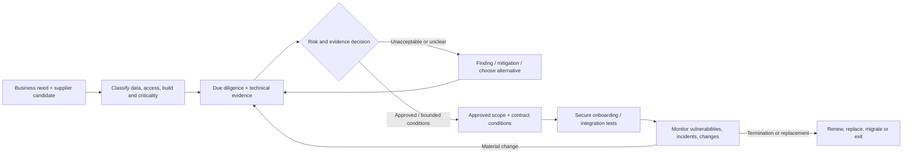
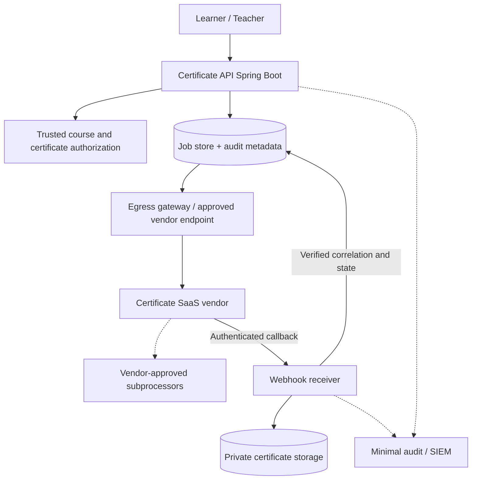

# Đánh giá nhà cung cấp phần mềm

## Mục tiêu học tập

Sau bài học này, bạn có thể:

- Giải thích **đánh giá nhà cung cấp phần mềm (software supplier assessment)** là gì, khác gì với việc chỉ scan dependency hoặc kiểm chứng nhà cung cấp có chứng chỉ bảo mật.
- Phân loại nhà cung cấp theo **sản phẩm, quyền truy cập, dữ liệu xử lý, vai trò trong build/release, phụ thuộc trực tiếp/gián tiếp và mức ảnh hưởng nếu bị xâm nhập**.
- Lập quy trình đánh giá theo rủi ro từ **lựa chọn → thẩm định → ký hợp đồng → tích hợp → giám sát liên tục → đổi/thoát nhà cung cấp**.
- Sử dụng đúng phạm vi các bằng chứng như **SBOM, VEX, software provenance, artifact signatures, attestations, báo cáo kiểm thử, audit, chính sách phát triển an toàn, lịch sử xử lý lỗ hổng và diễn tập sự cố**.
- Phân biệt **tính hiện diện, tính hợp lệ, nguồn gốc, tính liên quan và độ mới của bằng chứng**; nhận diện trường hợp cần `INSUFFICIENT_EVIDENCE` thay vì tự đánh dấu PASS.
- Đánh giá **security controls, data protection/privacy, nhà thầu phụ, tài khoản đặc quyền, supply-chain build integrity, vulnerability response, incident notification, availability, recovery và exit plan**.
- Thiết kế một trường hợp tích hợp nhà cung cấp cho hệ thống **Java/Spring Boot** với dữ liệu học viên, API/webhook, secret, egress, authorization và yêu cầu kiểm thử có thể xác minh.
- Xây dựng **Claim – Argument – Evidence**, supplier risk register, review record và chỉ số **continuous assurance** để theo dõi rủi ro trong toàn bộ thời gian sử dụng.

## 1. Nhà cung cấp phần mềm là ai và vì sao phải đánh giá?

Một **nhà cung cấp phần mềm** là cá nhân/tổ chức cung cấp sản phẩm, thư viện, dịch vụ, bản cập nhật, hạ tầng phát triển hoặc năng lực kỹ thuật mà hệ thống dựa vào. Nhà cung cấp có thể không trực tiếp đọc dữ liệu production nhưng vẫn ảnh hưởng lớn đến bảo mật khi **đưa mã vào build, giữ quyền phát hành, ký artifact hoặc vận hành service được tin cậy**.

Trong nền tảng học tập, các ví dụ gồm:

- **Nhà cung cấp thư viện/SDK:** PDF renderer, JWT library, database driver, HTTP client.
- **Nhà cung cấp SaaS/API:** email, xác minh chứng chỉ, báo cáo analytics, observability, identity provider.
- **Nhà cung cấp hạ tầng/cloud:** managed database, object storage, container registry, KMS, CI/CD platform.
- **Bên phát triển hoặc vận hành thuê ngoài:** agency xây module, contractor sửa code, vendor hỗ trợ có quyền truy cập môi trường.
- **Nhà cung cấp công cụ build/release:** artifact repository, package registry, plugin build, signing service, scanner và deployment automation.

Đặc điểm quan trọng: **đường cung ứng không dừng ở nhà cung cấp ký hợp đồng trực tiếp**. Một dịch vụ phát hành chứng chỉ có thể dùng cloud, KMS, observability, SDK xử lý PDF và đơn vị support khác. Đây là **phụ thuộc bậc hai/bên thứ tư (fourth party)** cần xác định ở mức rủi ro thích hợp.

### 1.1. Mục tiêu của đánh giá

Đánh giá nhà cung cấp nhằm xác định, với bằng chứng thích hợp:

1. **Phụ thuộc vào điều gì?** Component, dữ liệu, service, tài khoản, đường mạng, cập nhật và hợp đồng.
2. **Rủi ro đến từ đâu?** Mã độc trong dependency, bản cập nhật bị chiếm quyền, truy cập dữ liệu, sự cố vendor, mất availability hoặc sự phụ thuộc không thể thay thế.
3. **Nhà cung cấp có những controls nào?** Secure SDLC, vulnerability handling, IAM, signing, build isolation, audit, data handling, backup/DR và notification.
4. **Controls áp dụng cho đúng sản phẩm/dịch vụ nào?** Evidence của công ty mẹ không mặc nhiên bao phủ một SDK, một cloud region hoặc một subprocessor riêng.
5. **Bên sử dụng còn trách nhiệm gì?** Cấu hình, least privilege, secrets, API authorization, kiểm thử tích hợp, monitoring, incident và thay nhà cung cấp.
6. **Có thể ra quyết định nào?** Chấp nhận tích hợp, có điều kiện, yêu cầu khắc phục, từ chối, thay thế hoặc yêu cầu thêm evidence.

Trong module **SECURITY_SECURITY_ASSURANCE**, supplier assessment không phải một bảng hỏi để “tick cho đủ”. Mỗi kết luận phải có **asset/risk context, assessment scope, tiêu chí, evidence, độ tin cậy, findings, risk owner và trigger xem lại**.

### 1.2. Khác biệt giữa product risk và supplier risk

| Góc nhìn | Câu hỏi | Ví dụ |
| --- | --- | --- |
| **Product/component risk** | Phiên bản/thành phần này có lỗ hổng, cấu hình hoặc behavior nguy hiểm nào? | SDK PDF có lỗ hổng xử lý file hoặc kéo dependency độc hại. |
| **Supplier security capability** | Nhà cung cấp có quy trình thiết kế, build, kiểm thử, response và release đáng tin không? | Có policy phát hành, vulnerability disclosure và update controls. |
| **Service/operational risk** | Dịch vụ đang chạy bảo vệ dữ liệu/availability và xử lý sự cố thế nào? | SaaS có API audit, incident playbook và restore practice. |
| **Contract/governance risk** | Quyền, trách nhiệm, dữ liệu, thông báo, exit và audit được ràng buộc thế nào? | Thiếu điều khoản subprocessor notification hoặc data deletion. |
| **Customer implementation risk** | Cách chúng ta tích hợp vendor có tạo rủi ro mới không? | Gửi bảng điểm thô vào analytics dù vendor có security review tốt. |

Không nên kết luận nhà cung cấp “an toàn” chỉ vì chưa thấy CVE trên một package. Ngược lại, một CVE ảnh hưởng version cụ thể không tự chứng minh toàn bộ tổ chức vendor không có controls; phải đánh giá **khả năng bị ảnh hưởng và cách xử lý thực tế**.

## 2. Vòng đời đánh giá nhà cung cấp

Đánh giá phải theo vòng đời; hợp đồng ký xong không làm rủi ro tự biến mất.



### 2.1. Các thời điểm quyết định

| Giai đoạn | Điều cần làm | Đầu ra |
| --- | --- | --- |
| **Khởi tạo nhu cầu** | Xác định business owner, mục đích, alternative, tài sản và dữ liệu. | Supplier request, scope sơ bộ. |
| **Phân loại mức rủi ro** | Xét access, data sensitivity, build/deployment privileges, availability và fourth parties. | Inherent risk tier, review depth. |
| **Thẩm định trước hợp đồng/tích hợp** | Hỏi controls, xem evidence, kiểm sản phẩm/version và đánh giá khoảng trống. | Findings, supplier assessment, risk treatment. |
| **Điều khoản và quyết định** | Chốt nghĩa vụ, quyền audit, notification, data/subprocessor handling, exit, security addendum. | Contract và approved decision/conditions. |
| **Onboarding/technical integration** | Cấu hình tối thiểu quyền, endpoint, identity, encryption, logs; test positive/negative. | Effective controls, integration evidence, deployment gate. |
| **Giám sát vận hành** | Theo dõi CVE/advisory, updates, attestations, findings, incident, subprocessor/access changes. | Continuous review, risk register. |
| **Renewal/major change** | Đánh giá lại khi thay sản phẩm, data flow, scope, hợp đồng, provider hoặc risk. | Revised approval, new conditions hoặc replacement. |
| **Offboarding/exit** | Thu hồi tokens, truy cập vendor, export/delete data, chuyển dịch vụ, lưu evidence. | Exit verification, residual risk closure. |

**Điểm kiểm soát:** kết quả due diligence `APPROVED_FOR_EVALUATION` khác với `APPROVED_FOR_PRODUCTION`. Một vendor có thể được thử trong sandbox nhưng chưa được tiếp nhận dữ liệu học viên thật.

## 3. Phân loại nhà cung cấp theo rủi ro

### 3.1. Đánh giá inherent risk trước khi xét controls

**Inherent risk** là mức rủi ro xuất phát từ đặc điểm sử dụng nếu chưa xét đầy đủ các controls giảm thiểu. Các yếu tố:

- **Data:** dữ liệu công khai hay PII, bảng điểm, hồ sơ identity, token, secrets, signing keys?
- **Access:** có truy cập production, control plane, source repo, CI/CD, KMS, database hoặc support account?
- **Software execution:** code chạy trong process với quyền lớn, plugin build hoặc script release có thể chạy tùy ý?
- **Exposure:** API public, webhook internet-facing, third-party egress, remote support?
- **Impact:** ảnh hưởng bao nhiêu người học/tenant, tính toàn vẹn chứng chỉ và hoạt động học tập?
- **Dependency criticality:** mất vendor có làm ngừng đăng nhập, xác minh danh tính, ký chứng chỉ hoặc khôi phục dữ liệu?
- **Subprocessors:** các bên xử lý dữ liệu/host/build, region và mức kiểm soát chuỗi phụ thuộc?
- **Change rate:** bản cập nhật tự động, SDK phụ thuộc transitive, vendor thay cloud hoặc release pipeline?

### 3.2. Bảng phân loại minh họa

| Tier | Dấu hiệu điển hình | Mức thẩm định gợi ý |
| --- | --- | --- |
| **Tier 1 – Critical** | Có quyền source/build signing/deploy hoặc xử lý dữ liệu nhạy cảm quy mô lớn; IdP/KMS/critical production dependency. | Review sâu technical + operational + privacy/legal, independent challenge, continuity/exit, evidence có hiệu lực và monitoring liên tục theo risk. |
| **Tier 2 – High** | SaaS xử lý PII, thư viện chạy trong API trọng yếu, vendor support có quyền hạn chế nhưng nhạy cảm. | Control questionnaire, product/SDK evidence, contract/security terms, secure integration tests và review theo trigger. |
| **Tier 3 – Moderate** | Dependency không có quyền dữ liệu nhạy cảm nhưng tham gia chức năng có ảnh hưởng nhất định. | SCA, provenance/maintainer review, update policy, kỹ thuật tích hợp và owner. |
| **Tier 4 – Low** | Tool tài liệu biệt lập, không nhận dữ liệu nhạy cảm/secret, không chạy code trong build hoặc production. | Inventory, basic reputation/integrity/usage controls và review khi scope thay đổi. |

Các tier và ví dụ là **gợi ý quản trị**, không phải phân cấp chuẩn bắt buộc. Một thư viện “nhỏ” nhưng chạy trong build với token xuất bản có thể là critical dù package chỉ vài dòng. Ngược lại, vendor lớn không tự thuộc tier thấp vì có tên tuổi.

### 3.3. Không nhầm inherent risk với residual risk

- **Inherent risk:** điều gì có thể xảy ra dựa trên quyền/luồng/impact.
- **Control effectiveness:** evidence nào cho thấy nhà cung cấp và bên sử dụng đã giảm các đường rủi ro.
- **Residual risk:** rủi ro còn lại sau controls được chứng minh trong scope.
- **Risk decision:** owner có thẩm quyền chấp nhận hoặc yêu cầu hành động theo policy.

Không tự giảm risk chỉ vì vendor nộp bảng câu hỏi “Yes” nhưng không có evidence hoặc evidence không áp dụng cho dịch vụ đang mua.

## 4. Xác định chính xác phạm vi supply chain

### 4.1. Mapping các lớp phụ thuộc

Với một API Spring Boot, chuỗi có thể gồm:

```text
Application source and direct dependencies
   ├─ Transitive Maven dependencies
   ├─ Spring/JDK/container base image
   ├─ Build plugins + CI runner + artifact repository
   ├─ Container registry + image/signature/provenance
   ├─ Cloud IAM/KMS/database/observability dependencies
   └─ SaaS APIs + SDKs + their subprocessors
```

“Không thêm thư viện trực tiếp” không có nghĩa supply chain không đổi: một dependency transitive, base image tag hoặc CI plugin update vẫn có thể đưa mã mới hoặc capability mới vào quá trình build.

### 4.2. Supplier inventory cần có gì?

| Thuộc tính | Ghi thế nào? |
| --- | --- |
| Supplier identity | Tên pháp nhân/vendor, product/service ID, contact, owner, contract/reference. |
| Product scope | Tên sản phẩm, package coordinates, version/digest, SaaS plan, region hoặc tenant. |
| Dependency path | Direct/transitive, runtime/build/test-only, service nào dùng, đường gọi hoặc dữ liệu xử lý. |
| Access scope | Repo/CI/admin/service token, production role, support session, data endpoints. |
| Data | Classification, field, purpose, storage, transfer, retention, subprocessor. |
| Criticality | Chức năng nghiệp vụ và ảnh hưởng của downtime/tampering. |
| Evidence | SBOM, attestations, audit report, review dates, vulnerability advisories và scope. |
| Decisions | Inherent/residual risk, findings, conditional approval, owner, expiry. |
| Review triggers | Update, new subprocessor, region, outage, CVE, acquisition, changed privileges. |

Khó khăn thường gặp là **inventory chỉ có danh sách hợp đồng**: thiếu package mở nguồn, build plugins hoặc bên thứ tư không trực tiếp ký hợp đồng. Cần đối chiếu procurement inventory với **SBOM, repos/build artifacts, service catalog, cloud logs, egress và IAM** trong phạm vi được quyền truy cập.

### 4.3. Supply chain build khác supply chain dữ liệu

- **Build chain:** ai có thể đưa code/artifact vào pipeline, ký, phát hành hoặc cập nhật version.
- **Runtime/service chain:** hệ thống gọi API nào và dependency đó ảnh hưởng availability/integrity ra sao.
- **Data processing chain:** dữ liệu cá nhân/nhạy cảm đi tới vendor và subprocessors nào.

Một assessment tốt xem cả ba theo risk. **SBOM chủ yếu giúp biết thành phần phần mềm**, không tự là sơ đồ xử lý dữ liệu, hợp đồng, permissions hoặc threat model.

## 5. Các nhóm tiêu chí đánh giá nhà cung cấp

### 5.1. Security governance và secure development

- Có security owner, trách nhiệm và cơ chế nhận/ưu tiên findings không?
- Có Secure SDLC, security requirements, threat modeling, design review và coding standards phù hợp sản phẩm không?
- Có review code, test bảo mật, quyền merge/release được kiểm soát và segregation of duties khi cần không?
- Có chính sách khai báo/xử lý lỗ hổng, kênh security contact, thời gian phản hồi và thông báo advisory không?
- Có bảo vệ source repository, artifact registry, build runner, signing keys và release credentials?
- Có evidence đào tạo developer cho roles rủi ro cao, và evidence ấy áp dụng cho product team không?

**Một policy cấp công ty không chứng minh mọi release đều tuân thủ**. Review phải hỏi implementation và operating evidence gắn với **sản phẩm và giai đoạn** tương ứng.

### 5.2. Access control và segregation

- Cấu trúc IAM, RBAC/ABAC, privileged access, MFA/JIT, service identity và break-glass?
- Customer tenant data isolation được bảo đảm ở application, storage và support path ra sao?
- Quyền người hỗ trợ vendor có được phê duyệt theo ticket, giám sát session và thu hồi sau phiên?
- Credentials, API tokens, signing keys và secrets được cấp/rotate/revoke thế nào?
- Có cách xác nhận user/vendor không đọc dữ liệu ngoài contract/purpose?

Một nhà cung cấp có MFA cho nhân viên nhưng support account vẫn dùng credential chung có quyền rộng là **góc rủi ro riêng** cần đánh giá.

### 5.3. Data protection, privacy và processing

- Dữ liệu nào được thu, mục đích, vùng xử lý/lưu, retention và quyền xóa/xuất?
- Có encryption at rest/in transit, KMS/key lifecycle, backup encryption, log redaction?
- Có subprocessor list, notification về thay đổi và ràng buộc onward transfer?
- Cách xử lý data breach, data subject requests, export/delete sau hợp đồng?
- Có yêu cầu/responsibility phân chia giữa controller và processor theo pháp lý áp dụng không?
- Có dữ liệu bị dùng để huấn luyện mô hình, phân tích hoặc mục đích khác ngoài hợp đồng không? Nếu có, cần decision rõ.

**Encryption không giải quyết sai mục đích hoặc quyền người nhận.** Khi dữ liệu học viên/PII được đưa tới vendor, cần **data owner/Privacy/Legal** xem các nghĩa vụ hiện hành theo phạm vi; bài học không thay tư vấn pháp lý.

### 5.4. Secure operations, incident và continuity

- Monitoring/audit log có phát hiện misuse, xâm nhập và thay đổi không?
- Incident response: escalation, contact, timeline/notification trong contract, evidence cooperation và root cause?
- Backup/restore, RTO/RPO, region failover, DR drills, dependency/key restoration?
- Change/release management, vulnerability patch/mitigation và rollback?
- SLA/SLO, dependency concentration, rate limits và capacity planning?
- Kế hoạch **exit, data portability, credential revocation, deletion confirmation**?

Không chấp nhận “có backup hằng ngày” như bằng chứng khôi phục. Cần biết **restore drill có chạy không**, có khôi phục key/dependencies và đo mục tiêu được phê duyệt không.

### 5.5. Build/release integrity và khả năng cập nhật

- Code source/commit được quản lý và review thế nào?
- Build runners được cô lập, quyền token CI có scope và retention?
- Artifacts có build provenance, digest, signature/attestation và quá trình verification?
- Có reproducible/hermetic build, pipeline hardening hoặc kiểm soát tương đương **theo yêu cầu rủi ro**?
- Có SBOM theo phiên bản, xử lý dependencies, vulnerability disclosure/patch policy?
- Bản cập nhật có rollback, staged rollout, thông báo breaking changes/security advisory và incident containment?

**Không ép mọi vendor đạt một mức SLSA nhất định** nếu tổ chức chưa định nghĩa áp dụng. Thay vì “có logo chương trình”, cần đánh giá control assertions và bằng chứng kiểm chứng tương ứng.

## 6. Đánh giá tính đáng tin của bằng chứng

Một nhà cung cấp có thể gửi nhiều file PDF, chứng chỉ và trang quảng cáo. Số lượng tài liệu **không phải** chất lượng assurance.

### 6.1. Sáu thuộc tính của evidence

| Thuộc tính | Câu hỏi kiểm tra | Ví dụ evidence yếu |
| --- | --- | --- |
| **Authenticity/provenance** | Artifact do ai tạo, có xác thực nguồn phát hành, chữ ký hoặc reference đáng tin? | Ảnh screenshot không nguồn, không ngày. |
| **Scope relevance** | Áp dụng cho đúng legal entity, product, service, cloud region, version, subprocessor? | Audit của hệ thống khác cùng công ty. |
| **Freshness** | Có còn đúng với release, quy trình và môi trường hiện hành không? | Pen test đã cũ trước khi kiến trúc đổi. |
| **Completeness** | Có bao phủ components, operations, controls và population được đánh giá? | Chỉ danh sách top-level package, bỏ transitive deps. |
| **Testability/independence** | Có thể kiểm tra thực tế? Ai thực hiện? Có conflict of interest? | Vendor tự trả lời “Yes” cho toàn bộ questions. |
| **Limitations/qualifications** | Có exception, exclusions, unresolved findings hoặc compensating controls? | Chỉ lấy trang kết luận, bỏ phần scope/exceptions. |

**Chứng nhận và báo cáo audit** có thể là evidence hữu ích nếu có scope, kỳ đánh giá, criteria và kết quả phù hợp. Chúng **không tự chứng minh** rằng một SDK cụ thể không có lỗ hổng hoặc một tích hợp sai cách vẫn an toàn.

### 6.2. Nhìn theo ba mức hiệu lực control

- **Design effectiveness:** chương trình/vendor policy được thiết kế có giải quyết threat/risk không?
- **Implementation effectiveness:** controls được triển khai trong CI, SaaS product, IAM và build process ra sao?
- **Operating effectiveness:** controls đã hoạt động trong kỳ quan sát, phát hiện/khắc phục incidents, rotate/revoke và recovery như thế nào?

Một bản trình bày “chúng tôi sẽ dùng artifact signing” là **planned design**, chưa phải evidence release artifacts đã được ký đúng và verified trên consumer side.

### 6.3. Nguồn evidence điển hình

| Nguồn | Chứng minh được điều gì khi được kiểm đúng | Không tự chứng minh |
| --- | --- | --- |
| Supplier security questionnaire | Nhà cung cấp khai báo cấu trúc, contacts, responsibilities, controls. | Controls chạy hiệu quả mà không có minh chứng. |
| Independent audit/assurance report | Controls trong scope, kỳ và tiêu chí đã được reviewer đánh giá. | Mọi product, subprocessor, version ngoài scope cũng đạt. |
| Penetration test summary | Các attack paths được thử trên target/timeline cụ thể. | Không tồn tại lỗ hổng chưa thử. |
| SBOM | Thành phần/package/version được liệt kê trong artifact/system scope. | Component không có lỗ hổng hoặc build trusted. |
| VEX | Vendor/issuer khẳng định trạng thái ảnh hưởng của một vulnerability đối với product scope. | Tuyên bố luôn chính xác hoặc áp dụng cho mọi consumer deployment. |
| Signed provenance/attestation | Một claim về nguồn, builder, material/build steps có thể xác minh theo trust policy. | Artifact an toàn hoặc signer đáng tin nếu không validate identity/policy. |
| Vulnerability/incident response records | Nhà cung cấp thực sự phân loại, thông báo, giảm rủi ro/khắc phục. | Mọi vấn đề tương lai đều được xử lý đúng hạn. |
| Restore/DR reports | Hệ thống/service được diễn tập và đo theo một scenario. | Mọi kịch bản outage/compromise đã được bao phủ. |
| Contract/DPA/security addendum | Nghĩa vụ được ràng buộc giữa các bên trong phạm vi hiệu lực. | Controls kỹ thuật đã được thực thi hoàn hảo. |

### 6.4. Khi nào kết luận thiếu bằng chứng?

Nếu vendor không cung cấp artifact phù hợp hoặc không cho review chi tiết do bí mật thương mại, không tự kết luận FAIL hoặc PASS. Ghi:

- **Chưa thể xác minh claim nào**, ảnh hưởng tới asset/risk nào.
- Evidence nào bị hạn chế, có biện pháp thay thế nào như independent report/controlled review?
- Phần nào có thể tiếp tục sandbox, phần nào **chặn production/onboarding** theo policy?
- Owner và thời hạn thu evidence hoặc quyết định risk khác.

Trạng thái `INSUFFICIENT_EVIDENCE` giúp **không biến sự im lặng hoặc marketing thành đảm bảo bảo mật**.

## 7. SBOM, VEX và software provenance trong supplier assessment

### 7.1. Software Bill of Materials (SBOM)

**SBOM** là bản mô tả cấu phần phần mềm trong một scope nhất định, thường chứa package/component, version, dependency relationships, identifiers và metadata. Các định dạng phổ biến như **CycloneDX** hoặc **SPDX** có thể được sử dụng theo hệ sinh thái.

Khi yêu cầu SBOM:

1. Xác định **artifact/product/version/build** liên quan.
2. Kiểm **top-level và transitive dependencies**, cùng các phần code tĩnh/dynamic, native hoặc container nếu ảnh hưởng scope.
3. Đối chiếu package coordinates và versions với dependency resolver, lockfiles/artifacts hoặc scanner của bên sử dụng khi khả thi.
4. Xem freshness khi vendor cập nhật release, base image hoặc plugin.
5. Dùng SBOM hỗ trợ vulnerability impact và asset inventory, **không đánh đồng danh sách thành phần với security attestation**.

Một SBOM “đầy đủ” đối với một package có thể vẫn **không bao phủ SaaS backend, build-time scripts, proprietary components hoặc runtime-loaded plugins**. Phải nêu rõ loại SBOM và giới hạn.

### 7.2. Vulnerability Exploitability eXchange (VEX)

**VEX** truyền đạt nhận định về một lỗ hổng đối với một sản phẩm/version có thể ở trạng thái như **affected/not affected/fixed/under investigation** tùy định dạng. Nó giúp ưu tiên xử lý khi package chứa thành phần có CVE nhưng code path bị ảnh hưởng không dùng được trong deployment.

Kiểm tra VEX:

- Product/version/component/CVE có khớp artifact thực không?
- Issuer và provenance có đáng tin không?
- Lý do “not affected” là gì? Có dependency/configuration cụ thể?
- Tuyên bố có còn đúng sau version/config change?
- Có test, code analysis hoặc bằng chứng bù trừ nào hỗ trợ?

**VEX không phải giấy miễn kiểm lỗ hổng**. Một câu `not affected` không nguồn hoặc không đúng product scope không đủ để đóng finding. Khi uncertainty cao, có thể giữ `UNDER_INVESTIGATION` và áp dụng mitigations thích hợp.

### 7.3. Provenance, digest và signature

Một digest giúp kiểm byte integrity nếu đối chiếu với **digest nguồn tin cậy**; một checksum lấy từ cùng trang bị attacker chiếm không tự chứng minh authenticity. Một chữ ký artifact hoặc signed attestation giúp xác minh người/định danh phát hành nếu **trust root, signer identity, validity và artifact binding** được xác thực.

```text
Trusted source / release policy
   → Expected publisher and builder identity
   → Attestation or artifact signature
   → Digest matches downloaded artifact
   → Provenance subject/material/build claims verified
   → Only then decide whether release meets admission policy
```

Khi kiểm software provenance, không chỉ hỏi “có chữ ký không?” mà cần xác định:

- Ai được quyền xuất bản và ký? Có gắn với vendor và repository/release đúng không?
- Build thực hiện trong pipeline nào, với commit/materials nào?
- Attestation có gắn digest của **artifact đang deploy** không?
- Consumer thực sự **verify và enforce** chính sách hay chỉ lưu chữ ký trong kho?
- Key/signing identity compromise được xử lý thế nào? Có rotation/revocation?

**Signed artifact không có nghĩa không có malware**, và reproducible build cũng không thay threat modeling hoặc review behavior. Chúng giúp tăng confidence vào **nguồn gốc và tính toàn vẹn của quá trình tạo ra artifact**, trong phạm vi chứng cứ.

### 7.4. SLSA và secure development frameworks

- **SLSA** cung cấp cách suy nghĩ về các biện pháp và mức độ bảo đảm đối với build/source provenance; áp dụng theo **phiên bản và capability được kiểm**, không chỉ dựa badge.
- **NIST SSDF** giúp tổ chức trao đổi về các thực hành phát triển phần mềm an toàn, bảo vệ môi trường phát triển, tạo bản phát hành an toàn và ứng phó lỗ hổng.
- **OWASP/OpenSSF resources** có thể hỗ trợ threat/test/maintainer hygiene; không biến các công cụ/score thành phê duyệt tự động.

Điều quan trọng là hỏi **control nào đang được yêu cầu bởi risk của sản phẩm** và **evidence nào chứng minh control đó**, không dùng tên framework như kết luận.

## 8. Lỗ hổng, dependency và chính sách cập nhật

### 8.1. Đánh giá không chỉ dựa điểm CVSS

Với một vulnerability trong component, cần xem:

- Version thực được sử dụng, phạm vi **runtime/build/test** và dependency path.
- Có code path/configuration bị ảnh hưởng trong deployment không?
- Tài sản, quyền, attack surface và điều kiện khai thác là gì?
- Có exploit activity/advisory đáng tin, workaround hoặc patch không?
- Mitigation nào hiệu quả trong thực tế, đã được test chưa?
- Vendor có phản hồi/patch plan, security advisory, release deadline và contact không?
- Có alternative/version nâng cấp và regression risk như thế nào?

Một CVSS cao có thể không reachable trong một cấu hình cụ thể, nhưng một issue severity thấp hơn có thể tác động mạnh tới build runner đặc quyền. **Ưu tiên theo exposure, exploitability và impact** chứ không chỉ sắp xếp điểm.

### 8.2. Threat thường gặp trong software supply chain

| Threat | Tình huống | Control/assurance cần kiểm |
| --- | --- | --- |
| **Compromised maintainer account** | Attacker phát hành update bằng tài khoản publisher thật. | MFA, publisher controls, signed provenance, release review, incident response. |
| **Dependency confusion / typosquatting** | Build kéo package từ registry không mong muốn. | Namespace/registry policy, allowlist, deterministic resolution, repository controls. |
| **Malicious transitive dependency** | Package trực tiếp cập nhật và kéo component độc hại. | Full dependency inventory, SCA, SBOM diff, update review. |
| **Compromised build runner** | Attacker chỉnh artifact hoặc lấy signing/deploy secrets. | CI isolation, least privilege, secret controls, provenance verification. |
| **Compromised signing identity** | Artifact độc hại vẫn được ký hợp lệ với credential bị lộ. | Key security, identity revocation, anomaly monitoring và trusted builder policy. |
| **Unpatched vulnerable component** | Lỗ hổng tồn tại lâu vì vendor thiếu response. | Advisory monitoring, SLAs, patch/mitigation tests, replacement plan. |
| **Unsafe auto-update** | Bản cập nhật mới thay behavior hoặc API auth path. | Staging, version pinning theo policy, rollout/rollback, attestations. |
| **SaaS subprocessor change** | Dữ liệu được chuyển tới bên thứ tư/region chưa đánh giá. | Contract/notification, data flow review và reassessment trigger. |
| **Malicious webhook/integration** | Callback giả mạo hoặc replay khiến hệ thống ghi nhận sai. | Authentication/signature, raw payload verification, replay defense, idempotency. |
| **Vendor support compromise** | Support account truy cập data/production ngoài scope. | JIT access, MFA, approval, audit session và revoke. |

### 8.3. Phản hồi theo trạng thái lỗ hổng

| Trạng thái | Hành động |
| --- | --- |
| **Suspected affected** | Kiểm package/version, data path, permissions, vendor advisory và environment. |
| **Confirmed affected** | Đánh giá impact, giảm exposure, patch/mitigate, phối hợp incident nếu cần. |
| **Not affected (verified scope)** | Lưu lý do kỹ thuật và evidence/issuer, monitor changes. |
| **Unknown / insufficient evidence** | Yêu cầu thêm dữ kiện, có thể tạm hạn chế deploy theo risk. |
| **Mitigated temporarily** | Ghi compensating control, owner, expiry, re-test và update plan. |
| **Fixed and verified** | Kiểm artifact/build/deployment version, regression, impact và closure. |

Một finding không biến thành `CLOSED_VERIFIED` khi vendor gửi email “fix released” nhưng bên sử dụng chưa triển khai và kiểm đúng version.

## 9. Điều khoản hợp đồng và trách nhiệm hai bên

Phần pháp lý, bảo mật và vận hành phải được xử lý theo **nghĩa vụ thực sự áp dụng**, cùng chuyên gia phụ trách. Không có mẫu hợp đồng duy nhất áp dụng cho mọi nhà cung cấp/country/loại dữ liệu.

### 9.1. Các nội dung nên xem xét

| Nhóm điều khoản | Nội dung cần xác định |
| --- | --- |
| **Phạm vi dịch vụ/dữ liệu** | Dịch vụ nào, data categories, purpose, owner, region và intended recipients. |
| **Security requirements** | Secure development, access, logging, encryption, vulnerability handling, security updates, evidence. |
| **Privacy/Data Processing** | Vai trò các bên, data use, retention, deletion, data subject processes, subprocessors, transfer conditions. |
| **Incident response** | Contact, notification/escalation, scope of incident information, cooperation, evidence preservation. |
| **Availability/recovery** | Service objectives, DR/backup expectations, failure handling, dependencies. |
| **Right to assess/audit** | Khả năng nhận report, bằng chứng, reassessment khi major change, bảo mật tài liệu của vendor. |
| **Change control** | Thay subprocessor, region, architecture, ownership, release/SDK, privileged access. |
| **Liability/responsibility** | Ai khắc phục, ai chịu trách nhiệm config và controls theo hợp đồng/pháp lý. |
| **Exit/termination** | Data export/return, deletion confirmation, token/identity revocation, transition hỗ trợ. |

**Contractual compliance không tự bằng technical control effectiveness**. Ví dụ, DPA có thể quy định xóa dữ liệu sau chấm dứt; cần quy trình và evidence khả thi rằng dữ liệu active/backup/subprocessor sẽ được xử lý theo điều khoản phù hợp.

### 9.2. Shared-responsibility matrix

| Control | Nhà cung cấp | Bên sử dụng |
| --- | --- | --- |
| SaaS tenant isolation | Thiết kế và thực thi isolation của nền tảng. | Dùng tenant/role/access settings đúng phạm vi. |
| API authentication | Cung cấp auth scheme, token validation và revocation semantics. | Bảo vệ client credential, scope, rotation, gọi từ identity được phép. |
| Data minimization | Cung cấp schemas/config và cam kết xử lý. | Chỉ gửi fields cần thiết, review purpose/recipient. |
| Vulnerability management | Công bố advisory, fix/mitigation, hỗ trợ incident. | Kiểm inventory/version, patch/mitigate, test và monitor. |
| Build integrity | Bảo vệ build/publisher, phát hành provenance/signature khi áp dụng. | Verify artifact/attestations và enforce admission policy. |
| Logging/incident | Theo dõi nền tảng và cung cấp thông tin trong scope. | Log hành động tích hợp, kiểm transfer, alert và phối hợp response. |
| Backup/exit | Thực hiện phần đã cam kết cho dữ liệu/service vendor lưu. | Chịu trách nhiệm recovery/portability phụ thuộc và revoke identities. |

Chỉ khi cả hai bên **có owner và evidence**, shared responsibility mới tránh được khoảng trống “tưởng bên kia đã làm”.

## 10. Tích hợp nhà cung cấp: các điểm kiểm soát kỹ thuật

### 10.1. Nguyên tắc tích hợp

- Không gửi dữ liệu học viên sang vendor trước khi xác định **purpose, fields, destination, retention và approval**.
- Tạo service identity/API credential **riêng cho service và môi trường**, giới hạn scope và quyền rotate/revoke.
- Dùng **server-controlled destination allowlist**, không lấy URL đích từ request người dùng hoặc message không tin cậy.
- Áp dụng TLS và kiểm danh tính endpoint theo client/library phù hợp; không disable certificate validation để debug.
- Kiểm input/output và response status; tránh tin dữ liệu từ vendor là đúng mọi trường.
- Với webhook, xác thực nguồn theo cơ chế vendor và **kiểm chữ ký trên raw body** khi scheme yêu cầu; kiểm timestamp/replay/idempotency.
- Giới hạn queue, retry, timeout, circuit breaker, failure behavior và backpressure.
- Không log bearer token, API key, raw PII, bảng điểm hoặc chứng chỉ trong error path.
- Đánh giá egress/proxy/DNS/metadata paths, service account IAM, observability và backup.
- Cần contingency khi vendor outage hoặc integration bị ngừng vì phát hiện rủi ro.

### 10.2. Ví dụ DFD cho vendor phát hành chứng chỉ

Giả sử nền tảng học tập thuê SaaS tạo PDF chứng chỉ. Mục tiêu là chỉ gửi dữ liệu tối thiểu đã được phê duyệt, không gửi bảng điểm thô nếu vendor không cần.



Những đường quan trọng:

1. **API → vendor:** chỉ gửi fields cần thiết, đúng chủ thể/tenant/mục đích, qua endpoint được duyệt.
2. **Vendor → webhook:** sự kiện chưa tin cậy cho tới khi xác thực/correlation/replay policy được kiểm.
3. **Vendor → subprocessors:** data flow và controls phải thuộc scope review/hợp đồng.
4. **Webhook → job/store:** không cho callback mạo danh cập nhật chứng chỉ hoặc cross-tenant state.
5. **Monitoring:** đủ audit điều tra mà không tạo data leak qua logs.
6. **Vendor outage/termination:** có fallback, requeue/hold, reconciliation và exit path.

### 10.3. Điều gì cần xem trước production?

| Câu hỏi | Bằng chứng |
| --- | --- |
| Vendor nhận dữ liệu nào? | Approved payload schema, field-level mapping, sample synthetic requests. |
| Client credential được bảo vệ? | Secret manager, runtime identity, rotation policy, least privilege. |
| Destination có thể bị đổi từ bên ngoài? | Code/config review, egress allowlist, SSRF/redirect tests. |
| Callback có thể bị giả/replay? | Signature/auth scheme review, positive/negative integration tests, nonce/timestamp/idempotency. |
| Có lộ dữ liệu qua lỗi/logs? | Error-path logs và log-to-sink test, retention/access review. |
| Khi vendor không khả dụng thì sao? | Timeout/retry/backpressure/queue/DR tests, runbook. |
| Có thay đổi subprocessor/region? | Contract, verified inventory, notification/change-review workflow. |
| Có thể thay vendor không? | Portability/export contract, interface abstraction, exit drill khi phù hợp. |

Các điểm trên là **customer-side controls**. Dù vendor được cấp chứng chỉ hoặc có báo cáo audit tốt, những lỗi tích hợp như **API key lộ, gửi dữ liệu quá mức, webhook không verify** vẫn thuộc trách nhiệm của nhóm sử dụng.

## 11. Ví dụ Java/Spring Boot: kiểm soát tích hợp certificate vendor

### 11.1. Mô hình quyền trước khi gửi dữ liệu

Giả sử chỉ user hoặc worker có quyền phát hành chứng chỉ mới được tạo request tới nhà cung cấp. Hệ thống cần **xác minh điều kiện nghiệp vụ bằng nguồn tin cậy trước khi gửi PII**; API vendor không thay cho quyền giáo viên/học viên trong hệ thống.

```java
@Configuration
@EnableMethodSecurity
class MethodSecurityConfiguration {}

@Service
class CertificateIssueService {
    private final CertificateDataCatalog catalog;
    private final CertificateJobRepository jobs;

    CertificateIssueService(
            CertificateDataCatalog catalog,
            CertificateJobRepository jobs
    ) {
        this.catalog = catalog;
        this.jobs = jobs;
    }

    @PreAuthorize(
        "@certificatePolicy.canIssue(authentication, #learnerId, #courseId)"
    )
    public CertificateJobId requestIssue(long learnerId, long courseId) {
        ApprovedCertificateData data =
                catalog.readApprovedFields(learnerId, courseId);

        // Chỉ metadata được server xác định đi vào job store.
        return jobs.createWithTrustedScope(data);
    }
}
```

Các kiểu `CertificateDataCatalog`, `ApprovedCertificateData`, `CertificateJobRepository` và `CertificateJobId` là **thành phần ứng dụng giả định**. `certificatePolicy` phải kiểm identity, tenant, quyền và trạng thái nghiệp vụ từ nguồn tin cậy; không dùng `tenantId` do client tự gửi. Cần xác minh Spring Security Method Security đã được bật và lời gọi đi qua proxy thực; self-invocation/worker/direct DB path có thể bypass annotation.

### 11.2. Giới hạn payload trước khi gọi vendor

Không gửi nguyên entity `Learner`, `GradeRecord` hoặc raw transcript nếu vendor chỉ cần tên, khóa học và mã chứng chỉ. Dùng **DTO cho phép các trường được phê duyệt**:

```java
public record CertificateVendorRequest(
        String certificateId,
        String recipientDisplayName,
        String courseTitle,
        String templateCode
) {}

interface CertificateVendorPort {
    VendorRequestRef submit(CertificateVendorRequest approvedRequest);
}

public record VendorRequestRef(String externalId) {}
```

DTO này giúp lập contract test với **field allowlist**. Nó không tự bảo đảm dữ liệu đã được phép gửi: caller vẫn phải kiểm **purpose, recipient, data classification, retention, identity/authorization và approval** trước khi tạo đối tượng.

### 11.3. Địa chỉ đích là cấu hình tin cậy, không phải client input

```java
@Configuration
class CertificateVendorHttpConfiguration {

    @Bean("certificateVendorWebClient")
    WebClient certificateVendorWebClient(
            WebClient.Builder builder,
            CertificateVendorSettings settings
    ) {
        // approvedBaseUrl do hệ thống cấu hình và review,
        // không lấy từ query string, job payload hay request body.
        return builder
                .baseUrl(settings.approvedBaseUrl())
                .build();
    }
}
```

`CertificateVendorSettings` là lớp cấu hình giả định. Trong thực tế cần **kiểm giá trị cấu hình ở deployment**, enforce HTTPS/TLS validation đúng profile, giới hạn outbound DNS/IP/proxy theo threat model, kiểm redirect behavior, quy định timeout/retry và bảo vệ API credential qua secret manager/workload identity. Không dùng `baseUrl` từ client vì có thể tạo đường **SSRF/exfiltration**.

### 11.4. Xác thực webhook không chỉ dựa trên tên endpoint

Một webhook giả mạo có thể thông báo “certificate issued” và ghi sai dữ liệu. Tiêu chí thiết kế cần:

1. Xác định **cơ chế xác thực callback thực tế của vendor** (ví dụ signed request hoặc mTLS theo hợp đồng/API spec).
2. Nếu vendor dùng HMAC, xác minh signature trên **exact raw bytes được quy định** và key từ nguồn bí mật tin cậy; dùng comparison an toàn, đúng algorithm và canonicalization của protocol.
3. Kiểm timestamp/nonce/replay window theo scheme của vendor; không tạo một format tự chế và coi là tương thích.
4. Correlate event với **job ID + vendor request ID + tenant + expected state** đã ghi tin cậy; từ chối event không khớp.
5. Idempotency với callback lặp, concurrent delivery và event đến sai thứ tự.
6. Không lấy URL download tùy ý từ webhook rồi để server fetch mà không kiểm destination/SSRF.
7. Audit kết quả xác thực, trạng thái xử lý và anomalies, không log raw tokens/PII.

Đây là **checklist giao thức**, không phải hướng dẫn tự triển khai cryptography. Cần dùng SDK/cơ chế verify chính thức được đánh giá nếu có; một chuỗi header chứa `signature` chưa chứng minh danh tính gửi.

### 11.5. Kiểm thử authorization với MockMvc

Giả sử fixture thiết lập giáo viên A có quyền cấp chứng chỉ cho learner 10/course 42 ở tenant A; giáo viên B có cùng role nhưng không có quyền, course 99 thuộc tenant B.

```java
@SpringBootTest
@AutoConfigureMockMvc
class CertificateVendorAccessIT {
    @Autowired
    MockMvc mockMvc;

    @Test
    @WithMockUser(username = "teacher-a", roles = "TEACHER")
    void assignedTeacherMayRequestCertificate() throws Exception {
        mockMvc.perform(post("/api/learners/10/courses/42/certificates")
                .with(csrf()))
            .andExpect(status().isAccepted());
    }

    @Test
    @WithMockUser(username = "teacher-b", roles = "TEACHER")
    void sameRoleWithoutAssignmentMustBeDenied() throws Exception {
        mockMvc.perform(post("/api/learners/10/courses/42/certificates")
                .with(csrf()))
            .andExpect(status().isForbidden());
    }

    @Test
    @WithMockUser(username = "teacher-a", roles = "TEACHER")
    void crossTenantIssueMustBeDenied() throws Exception {
        mockMvc.perform(post("/api/learners/10/courses/99/certificates")
                .with(csrf()))
            .andExpect(status().isForbidden());
    }
}
```

Đây là **mẫu kiểm thử giảng dạy**, cần controller, fixtures, Spring Security Test và imports phù hợp. Test denied phải xác minh **không tạo job/không gửi payload tới vendor**; mã `403` có thể đến từ route/CSRF/config sai, nên cần positive control để xác nhận đường request hợp lệ hoạt động.

MockMvc **không chứng minh** vendor thực sự có secure SDLC, egress policy trên production, webhook signature verification, retention hoặc subprocessor controls. Những yêu cầu đó cần bằng chứng và tests khác.

### 11.6. Integration/system tests bắt buộc cho luồng vendor

| Test ID | Kịch bản | Expected result và evidence |
| --- | --- | --- |
| `T-VEND-AUTH-01` | User đúng quyền tạo chứng chỉ. | Tạo job đúng tenant; chỉ field allowlist được gửi. |
| `T-VEND-AUTH-02` | User cùng role nhưng sai course/tenant. | Deny, không tạo job, không có outbound request. |
| `T-VEND-DTO-03` | Entity nguồn có thêm grade/email/secret không được phép. | Outbound DTO không tự mở rộng field. |
| `T-VEND-DEST-04` | Client/job yêu cầu gọi một URL ngoài allowlist. | Không có outbound tới URL đó; ghi security event thích hợp. |
| `T-VEND-WEB-05` | Callback sai signature, replay, stale/cross-tenant ID. | Deny/no state mutation; audit phù hợp. |
| `T-VEND-JOB-06` | Callback trùng hoặc đến sai thứ tự. | Idempotent state transition, không tạo chứng chỉ trùng. |
| `T-VEND-FAIL-07` | Vendor timeout, 429/5xx, partial success. | Backoff/queue/circuit behavior theo thiết kế, không lộ dữ liệu hoặc ghi trạng thái sai. |
| `T-VEND-LOG-08` | Exception xảy ra với data/token trong request. | Không có raw PII/secret ở logs và APM sink ngoài policy. |
| `T-VEND-EXIT-09` | Thu hồi API key hoặc ngừng hợp đồng. | Không còn kết nối; data export/deletion theo plan và evidence. |

Với các test có tương tác nhà cung cấp, nên dùng **sandbox/synthetic data** và chỉ chạy trong phạm vi cho phép. Test production phải được lên kế hoạch để tránh tạo chứng chỉ thật ngoài ý muốn hoặc gửi dữ liệu học viên cho endpoint thử nghiệm.

## 12. Bảng câu hỏi thẩm định nhà cung cấp

Một questionnaire tốt **gắn câu hỏi với control, evidence và khả năng follow-up**, không chỉ hỏi “Có bảo mật không?”.

| ID | Câu hỏi thẩm định | Evidence hoặc follow-up mong đợi |
| --- | --- | --- |
| `SUP-ORG-01` | Ai chịu trách nhiệm security sản phẩm và báo cáo lỗ hổng? | Security contact, disclosure channel, governance evidence. |
| `SUP-DEV-02` | Secure SDLC có code review, threat modeling, testing ở những điểm nào? | Policy + product-relevant review/test artifacts. |
| `SUP-BLD-03` | Ai có thể sửa source/build pipeline và xuất bản release? | Access model, separation/approval, CI hardening evidence. |
| `SUP-ART-04` | Artifact có provenance/signature? Consumer verify qua trust policy nào? | Sample signed artifact/attestation, trusted issuer/builder identity. |
| `SUP-SBOM-05` | Có SBOM cho artifact/version và transitive dependencies? | Machine-readable SBOM với scope/revision và update process. |
| `SUP-VULN-06` | Vulnerability intake/triage, advisories, mitigation và patch lifecycle thế nào? | Procedure + recent anonymized response records. |
| `SUP-ACC-07` | Human/service/support access có MFA, least privilege, JIT và audit không? | IAM review scope, support access policy, audit samples. |
| `SUP-DATA-08` | Dữ liệu nào được xử lý, ở đâu, purpose, retention, deletion? | Data flow, DPA/contract, retention/deletion controls. |
| `SUP-SUB-09` | Bên thứ tư/subprocessor nào có access, có notification khi đổi không? | Subprocessor inventory, contractual flow-down và change process. |
| `SUP-LOG-10` | Logging và telemetry có ngăn PII/token exposure không? | Logging rules, sample event schema, access/retention review. |
| `SUP-INC-11` | Incident notification, cooperation, evidence và timeline ra sao? | Response plan, contacts, contract terms và exercise records. |
| `SUP-DR-12` | RTO/RPO, backup/restore và region failover đã thử chưa? | DR plan + drill results theo service scope. |
| `SUP-EXIT-13` | Khi exit có data export, token revoke, deletion và transition không? | Exit runbook, contract, evidence requirements. |
| `SUP-CHG-14` | Major changes về vendor ownership, region, product/security architecture được báo thế nào? | Notification and reassessment process. |
| `SUP-VER-15` | Những claims nào được independent review? Scope, kỳ, exceptions? | Assurance reports/certification scope và remediation evidence. |

Không bắt mọi nhà cung cấp gửi full source code hoặc mọi báo cáo nhạy cảm. Có thể chọn **independent report, controlled evidence viewing hoặc attestation phù hợp**; nếu vẫn không đủ để xác minh một claim trọng yếu, ghi rõ limitation và quyết định theo risk, không tự PASS.

### 12.1. Cách follow-up câu trả lời “Yes”

Ví dụ vendor trả lời: “Yes, all builds are signed.”

Reviewer nên hỏi:

1. Ký **artifact nào**? Backend container, SDK, installer hay metadata?
2. Ký bởi **identity/key** nào và người dùng kiểm ra sao?
3. Có signed provenance gắn **artifact digest** với builder/source?
4. Khóa ký/identity được bảo vệ và rotate/revoke thế nào?
5. Evidence nào cho release phiên bản chúng ta đang deploy?
6. Nếu ký sai, signer bị lộ hoặc build runner bị chiếm, vendor thông báo/thu hồi bằng cách nào?

Đó là cách chuyển **self-attestation** thành evidence có thể đánh giá.

## 13. Ma trận rủi ro, kết luận và quyết định

### 13.1. Đánh giá theo control thay vì một điểm số tổng mơ hồ

Có thể dùng các trạng thái:

| Trạng thái control | Khi dùng | Ý nghĩa đối với quyết định |
| --- | --- | --- |
| **`PASS_IN_SCOPE`** | Evidence hợp lệ, đủ và đúng thời điểm hỗ trợ control claim đã định. | Control được xác minh trong scope, tiếp tục monitoring. |
| **`FAIL`** | Có evidence control thiếu hoặc không đáp ứng requirement. | Finding và remediation/mitigation; có thể chặn onboarding. |
| **`INSUFFICIENT_EVIDENCE`** | Chưa rõ scope, chưa có artifact hoặc chưa xác minh được claim. | Thu thêm evidence, không tự pass; có thể giới hạn sandbox. |
| **`NOT_APPLICABLE`** | Control thật sự không áp dụng với scope theo decision có căn cứ. | Ghi rationale/approver, xem lại khi scope thay đổi. |
| **`EXCEPTION_APPLIED`** | Có sai khác được chấp nhận theo thẩm quyền và policy. | Risk record riêng, không đổi technical FAIL thành PASS. |

Một supplier decision có thể là:

- **`APPROVED_FOR_SANDBOX`:** chỉ dùng dữ liệu giả, credentials thử và không có production access.
- **`APPROVED_WITH_CONDITIONS`:** stage giới hạn, condition có owner/due date/verification; không tự bypass production gates.
- **`APPROVED_FOR_PRODUCTION`:** critical controls, contract và integration evidence đáp ứng scope; có owner/monitoring.
- **`CHANGES_REQUIRED`:** cần vendor/customer remediation hoặc alternative trước quyết định.
- **`REJECTED`:** rủi ro không chấp nhận được hoặc không thể đáp ứng yêu cầu bắt buộc.
- **`INSUFFICIENT_EVIDENCE`:** chưa đủ căn cứ xác minh để đưa ra approval.

### 13.2. Không để điểm tổng che control bắt buộc

Giả sử bảng đánh giá có 40 câu hỏi; vendor đạt 38 câu nhưng **không xác minh webhook signature và không có quyền thu hồi API token**, rủi ro có thể vẫn nghiêm trọng. Một tỷ lệ “95% passed” **không chứng minh** tích hợp đạt. Những requirements có **blocking severity** cần được đánh giá riêng trước khi ra decision.

Nếu dùng scoring model, cần xác định trọng số, risk rationale, xử lý missing evidence và ngưỡng theo governance. Không trình bày điểm số như độ đo khách quan tuyệt đối; một thay đổi nhỏ về exposure có thể làm hậu quả khác hoàn toàn.

### 13.3. Ví dụ risk treatment

| Vấn đề | Nhận định | Quyết định/biện pháp phù hợp |
| --- | --- | --- |
| SDK PDF có transitive CVE confirmed reachable. | `FAIL` trong product scope. | Patch/upgrade/mitigate có test, hoặc dùng alternative; review before release. |
| SaaS chưa cung cấp region/subprocessor evidence. | `INSUFFICIENT_EVIDENCE` về data transfer. | Hạn chế PII/prod, yêu cầu Privacy/Legal review và evidence. |
| Build signing có nhưng client không verify. | Customer-side control gap. | CI admission verification theo trusted publisher/builder policy. |
| Vendor support account có quyền production rộng. | Risk/control issue. | JIT, MFA, session approval/log, revoke và re-test. |
| Vendor không đáp ứng retention hợp đồng. | Control/contract mismatch. | Negotiation, change architecture, alternative hoặc rejection. |
| Vendor critical service outage thường xuyên. | Availability/dependency risk. | Resilience/circuit-breaker, backup provider, DR/exit plan, SLA review. |

### 13.4. Risk acceptance không phải tự chấp nhận

Chấp nhận rủi ro còn lại phải:

- Thuộc **thẩm quyền của risk owner** và đúng risk appetite/policy.
- Dựa trên asset/impact/likelihood, các controls đang hoạt động và phần chưa đạt.
- Có scope, business reason, compensating controls, monitoring, expiry và trigger review.
- Không phủ nhận mandatory legal/contractual requirement.
- Được truyền đến service owner, security assurance, procurement và release authority.

**Technical FAIL vẫn là FAIL** ngay cả khi có risk decision chấp nhận vận hành tạm trong phạm vi được phép.

## 14. Claim – Argument – Evidence trong đánh giá nhà cung cấp

### 14.1. Claim có phạm vi cụ thể

**Claim A – supplier:** “Nhà cung cấp SaaS chứng chỉ V, dịch vụ S, điều kiện xử lý dữ liệu PII đã xác định, tại kỳ đánh giá T, có các controls và khả năng phản hồi rủi ro phù hợp với security requirements được lựa chọn trong phạm vi assessment.”

**Argument A:**

1. Asset/data flow inventory xác định chính xác dữ liệu, quyền, dịch vụ, region và dependencies.
2. Inherent risk tier và supplier control requirements phù hợp impact/threat.
3. Controls về SDLC/build, access, data processing, incident/DR, vulnerability response và exit có evidence liên quan.
4. Evidence được xác minh về **scope, provenance, freshness, completeness và exceptions**.
5. Findings và unknowns có owner, risk treatment, contract/verification conditions và reassessment triggers.

**Evidence A:** supplier questionnaire + phản hồi, scoped audit report, applicable SBOM/VEX/provenance, incident/patch records, data-flow/subprocessor list, contract/security addendum, DR exercises và decision record.

### 14.2. Claim khác về tích hợp của chính hệ thống

**Claim B – customer integration:** “Trong build R và môi trường X, việc nền tảng học tập tích hợp vendor V đáp ứng các yêu cầu hạn chế dữ liệu, định danh, webhook integrity, egress và failure handling đã được phê duyệt trong scope.”

**Argument B:**

1. App authorization kiểm principal/course/tenant trước khi tạo job.
2. Payload DTO giới hạn trường được gửi; schema tests không cho thêm dữ liệu tự phát.
3. Credentials được quản lý với scope, không nằm trong source/log; endpoint allowlist được enforce.
4. Webhook có sender authentication/signature/replay/correlation/idempotency theo scheme vendor.
5. Error paths, timeout/retry và vendor outage không làm lộ dữ liệu hoặc đổi state trái phép.
6. Runtime/network/IAM/log evidence chứng minh deployment tương ứng.

**Evidence B:** DFD, approved payload schema, code review, CI tests, effective credentials/IAM/egress config, webhook negative tests, logs/audit, deployment version và incident runbook.

**Không suy Claim B từ Claim A.** Vendor có báo cáo audit tốt vẫn có thể bị tích hợp sai. **Không suy Claim A từ Claim B**: API integration tests xanh không chứng minh nhà cung cấp có bảo vệ build pipeline hoặc subprocessors.

### 14.3. Ma trận CAE

| Claim con | Evidence cần có | Giới hạn/rủi ro suy luận |
| --- | --- | --- |
| Product release có nguồn gốc tin cậy | Artifact identity, digest, signature/provenance verification, trusted builder policy. | Chữ ký không chứng minh không có mã độc. |
| Dependencies được inventory | SBOM/version reconciliation và dependency scanner results. | Không bao phủ mọi runtime service hoặc hidden build tool. |
| Lỗ hổng được quản trị | Advisories, VEX có scope, patch records, vulnerability triage evidence. | Chưa biết lỗ hổng không đồng nghĩa không có. |
| PII được xử lý đúng | Data mapping, contract/DPA, region/subprocessor evidence, verified retention. | Contract không tự chứng minh không có data leakage. |
| Vendor support được kiểm soát | IAM/JIT/MFA/session audit và access review. | Policy chưa chứng minh hoạt động thực trong kỳ. |
| Integration được bảo vệ | Authz, outbound schema, webhook validation, runtime egress/IAM tests. | Không thay thế supplier-side operations. |
| Sự cố/outage có thể xử lý | Response/DR tests, contacts, escalation, exit plan evidence. | Drill có scope giới hạn, không bảo đảm mọi failure. |

### 14.4. Evidence acceptance tiêu chuẩn

Một evidence record có thể nêu:

```text
Evidence ID:
Supplier / product / version / environment:
Control claim / requirement ID:
Source / issuer / reviewer:
Issued / observed at:
Cryptographic or provenance validation (if applicable):
Scope and excluded systems:
Testing method and result:
Exceptions / unresolved gaps:
Retention and access policy:
Next review trigger:
```

Nếu thiếu thông tin nền quan trọng, ghi `INSUFFICIENT_EVIDENCE` hoặc thu hẹp claim; không dùng câu “vendor nói đã có” để đạt một control quan trọng.

## 15. Mẫu supplier assessment record

Đây là **YAML minh họa**, không phải đánh giá nhà cung cấp thực tế. Các references là placeholders, trạng thái chờ giữ nguyên cho đến khi có evidence và approval thật.

```yaml
assessment_id: "SUP-ASSESS-EXAMPLE-010"
assessment_type: "SOFTWARE_SUPPLIER"
service: "SECURITY_SECURITY_ASSURANCE"
supplier:
  legal_entity_ref: "<verified-supplier-entity>"
  product: "certificate-rendering-saas"
  product_version_or_plan: "<actual-version-or-plan>"
  contract_ref: "<signed-contract>"
  security_contact_ref: "<verified-security-contact>"
scope:
  customer_service: "learning-platform"
  environment: "production-target"
  target_regions: ["<verified-target-region>"]
  data_categories: ["learner-display-name", "course-title", "certificate-id"]
  excluded_data: ["raw-grades", "access-tokens", "identity-proofing-raw-records"]
  trust_boundaries:
    - "certificate-api-to-supplier"
    - "supplier-webhook-to-customer"
  subprocessors_ref: "<verified-subprocessor-list>"
  customer_workload_identities: ["certificate-service"]
risk:
  inherent_tier: "HIGH"
  critical_assets: ["certificate-integrity", "learner-data"]
  threat_scenarios:
    - "callback-spoofing-and-replay"
    - "PII-exfiltration-via-logs-or-unapproved-region"
    - "supplier-outage-or-account-compromise"
  risk_owner_role: "certificate-product-risk-owner"
supplier_evidence:
  security_practices_ref: "<current-supplier-review>"
  third_party_report_ref: "<scope-matched-report-if-available>"
  data_processing_ref: "<verified-DPA-and-data-flow>"
  sbom_ref: "<product-SBOM-if-applicable>"
  vulnerability_response_ref: "<advisory-and-patch-evidence>"
  artifact_provenance_ref: "<signed-evidence-if-applicable>"
  incident_dr_ref: "<incident-and-restore-evidence>"
customer_integration_evidence:
  outbound_schema_test_ref: "<actual-contract-test>"
  authz_test_ref: "<actual-object-tenant-test>"
  webhook_verification_ref: "<actual-positive-negative-test>"
  runtime_iam_egress_ref: "<actual-effective-config>"
  log_to_sink_ref: "<actual-error-path-test>"
results:
  supplier_secure_development: "INSUFFICIENT_EVIDENCE"
  data_processing_and_subprocessors: "INSUFFICIENT_EVIDENCE"
  webhook_integrity: "NOT_VERIFIED"
  vulnerability_response: "NOT_ASSESSED"
  continuity_and_exit: "NOT_ASSESSED"
  overall_assessment: "INSUFFICIENT_EVIDENCE"
findings:
  - id: "SUP-F-001"
    control: "webhook-authentication"
    finding_type: "VERIFICATION_GAP"
    owner_role: "integration-engineering-lead"
    due_before: "PRODUCTION_GO_LIVE"
    closure_evidence_ref: "<pending-test-run>"
conditions:
  - "Do not send learner PII until data-flow and contract review"
  - "Verify webhook identity and replay protection"
  - "Prove effective production egress and credential scope"
decision:
  state: "INSUFFICIENT_EVIDENCE"
  approved_stage: "SANDBOX_WITH_SYNTHETIC_DATA"
  production_approval: false
  decision_authority_role: "authorized-supplier-risk-approver"
  approval_ref: null
  decided_at: null
monitoring:
  owner_role: "supplier-security-owner"
  review_window: "<risk-based-review-cadence>"
  triggers:
    - "Critical vulnerability or incident"
    - "New subprocessor or data region"
    - "Product/build/security-control changes"
    - "Contract renewal, outage or access expansion"
exit:
  token_revoke_plan_ref: "<reviewed-plan>"
  data_export_delete_plan_ref: "<reviewed-plan>"
  exit_drill_ref: "<pending-or-not-applicable>"
```

Trong một hồ sơ thực, cần phân biệt **vendor evidence** với **customer integration evidence**, lưu kiểm soát integrity của quyết định và **không sửa giả trạng thái PASS**. Không cần lưu raw PII, API keys hoặc vendor secrets trong assessment record.

## 16. Vận hành giám sát và đánh giá lại sau onboarding

### 16.1. Continuous monitoring theo risk

Một chương trình giám sát có thể bao gồm:

- **Vulnerability/advisory watch** cho package/version, container image, SaaS security notices và build tools.
- **SBOM/dependency diff** khi update; phát hiện component mới, registry mới và transitive dependency thay đổi.
- **Artifact/provenance verification** tại build admission, deploy và update khi policy yêu cầu.
- **Service/API monitoring:** authentication failures, webhook anomalies, error rates, unexpected egress/destinations, rate limits.
- **Supplier security updates:** incident notices, status pages, process changes, audit report revision, changes in ownership hoặc operations.
- **Contract and privacy monitoring:** expiry, new subprocessor/region, data retention/deletion và rights of audit.
- **Access review:** vendor support sessions, service account scopes, shared credentials, permissions không còn dùng.
- **Continuity tests:** backup/restore, vendor outage tabletop và exit/migration rehearsal theo criticality.
- **Findings/conditions:** overdue remediation, risk exception expiry, evidence freshness và review decisions.

Không thể gọi “monitoring liên tục” nếu chỉ lên lịch questionnaire một lần mỗi năm và bỏ qua incident/vendor change xảy ra giữa hai kỳ.

### 16.2. Các trigger review ngoài lịch

| Trigger | Hành động |
| --- | --- |
| CVE/advisory hoặc exploit activity ảnh hưởng product scope. | Impact assessment, patch/mitigation, new evidence và risk decision. |
| Vendor thông báo incident hoặc dữ liệu có nguy cơ bị lộ. | Kích hoạt incident process, bảo toàn evidence, phối hợp notification theo nghĩa vụ. |
| Thay owner, acquisition, build infrastructure hoặc CI signer. | Re-review publisher trust, access, provenance và operational controls. |
| SDK/SaaS đổi version/major functionality. | SBOM/diff, behavior/API changes, regression và security tests. |
| Thêm subprocessor, cloud region hoặc dữ liệu mới. | Data/Privacy/Legal/contract review, data-flow update. |
| Thêm vendor support/production access. | Least privilege, JIT/MFA, session audit và approval trước khi mở. |
| Outage, DR test fail hoặc SLA issue lặp lại. | Continuity risk, failover, exit options và remediation. |
| Hợp đồng gần hết hạn hoặc vendor ngừng sản phẩm. | Renewal assessment hoặc exit/migration. |
| Owner/policy thay đổi và assessment evidence cũ không còn đúng. | Rebaseline scope/claims và reassess. |

### 16.3. Quy trình xử lý supplier finding

1. Ghi issue, supplier/product/version, environment, data/assets và evidence.
2. Xác định **affected/not affected/unknown** theo điều kiện thực tế; tránh kết luận chỉ dựa tên CVE.
3. Phân loại mức rủi ro, ảnh hưởng tới customer và critical business path.
4. Liên hệ vendor security contact, yêu cầu remediation/patch/mitigation và mốc cập nhật.
5. Giảm scope hoặc cô lập tích hợp khi cần; phối hợp incident response nếu có dấu hiệu compromise.
6. Cập nhật contract/risk register/exception và owners.
7. Kiểm artifact/version, tests, runtime config và downstream effects sau fix.
8. Chỉ đóng `CLOSED_VERIFIED` khi evidence phù hợp chứng minh vấn đề được xử lý trong scope.

Một patch được vendor phát hành nhưng customer chưa triển khai **không phải** bằng chứng hệ thống đang dùng đã hết lỗ hổng.

## 17. Bảo đảm tính liên tục và kế hoạch rời nhà cung cấp

### 17.1. Vì sao exit plan là security control?

Nhà cung cấp có thể bị mua lại, đóng dịch vụ, tăng phạm vi xử lý dữ liệu, xảy ra breach, không vá được vulnerability hoặc ngừng hỗ trợ version. Không có kế hoạch rời đi khiến tổ chức **bị khóa trong rủi ro**.

Đối với hệ thống học tập, mất vendor chứng chỉ có thể làm gián đoạn cấp và xác minh chứng chỉ, còn đổi vendor có thể gây rủi ro **mất lịch sử, sai chữ ký hoặc mất khả năng xác minh chứng chỉ đã phát hành**.

### 17.2. Các câu hỏi khi lập exit plan

- Có thể xuất dữ liệu và metadata qua định dạng nào? Có giới hạn, phí và thời gian không?
- Có tách được business data khỏi proprietary vendor format?
- Khi ngừng dịch vụ, ai chịu trách nhiệm các URL, callback, API keys, signing identities và DNS?
- Vendor còn lưu dữ liệu ở active storage, backup, logs và subprocessor bao lâu theo contract?
- Có thể xác minh deletion/return như thế nào? Những bản sao thuộc retention pháp lý cần xử lý ra sao?
- Có thể chuyển sang vendor thay thế hoặc chạy internal fallback mà không làm lộ secret hoặc sai data integrity?
- Ai duy trì chứng chỉ đã phát hành và public verification keys khi đổi hệ thống?
- Có kế hoạch rollback khi migration thất bại?

### 17.3. Exit verification checklist

| Control | Evidence cần thiết |
| --- | --- |
| API keys, OAuth clients, support accounts bị thu hồi. | Credential revoke logs, effective access test. |
| Webhook và egress path vendor cũ đã ngừng. | Firewall/proxy/DNS/config audit, negative connectivity test. |
| Dữ liệu được chuyển/hoàn trả chính xác. | Export inventory, integrity verification, reconciliation. |
| Data deletion/retention xử lý đúng cam kết. | Vendor confirmation, contract-based exceptions và timeline. |
| Monitoring/backup/subprocessor paths được đóng hoặc chuyển. | Data-flow inventory update, log/backup mapping. |
| Dịch vụ mới/alternate duy trì security properties. | New supplier assessment, integration tests, operational drill. |
| Findings và residual risk còn lại được theo dõi. | Exit decision record và risk owner approval. |

**Văn bản “đã xóa dữ liệu” không tự bảo đảm mọi bản sao không tồn tại**; cần hiểu phạm vi tuyên bố, backup schedules, subprocessor handling và nghĩa vụ retention.

## 18. Chỉ số chương trình supplier assurance

| KPI/KRI | Câu hỏi quản trị | Hạn chế cần nêu |
| --- | --- | --- |
| Tỷ lệ critical suppliers được inventory và có owner | Có biết ai ảnh hưởng hệ thống quan trọng? | Mẫu số phải bao gồm library/build plugins và fourth parties theo risk. |
| Tỷ lệ critical supplier có assessment còn hiệu lực | Thẩm định có bao phủ thời điểm hiện tại? | “Có báo cáo” không chứng minh scope/current product phù hợp. |
| Tỷ lệ artifact release cần provenance được verify | Admission policy có hoạt động? | Có signature nhưng không verify không tính đạt. |
| Tỷ lệ product/version có SBOM phù hợp | Visibility đối với dependencies tới đâu? | SBOM thiếu transitive/build/runtime cần ghi gaps. |
| Số `INSUFFICIENT_EVIDENCE` quá hạn | Khoảng trống assurance có bị bỏ quên? | Không giảm chỉ số bằng cách đổi unknown thành PASS. |
| Số high/critical vendor findings chưa được xử lý | Rủi ro nào đang mở? | Phân biệt CVE affected với chưa kiểm được. |
| Thời gian từ advisory tới mitigation/verified patch | Response của vendor và customer nhanh không? | Email patch có sẵn chưa bằng deployed verification. |
| Tỷ lệ vendor incidents được phát hiện/escalate đúng policy | Incident handling có hoạt động? | Số incident 0 có thể do thiếu visibility. |
| Số changes subprocessor/region chưa được review | Data flow/obligations có drift? | Dựa trên notification + independent discovery phù hợp. |
| Tỷ lệ critical integrations có exit/DR exercise | Khả năng thoát khi vendor fail? | Tài liệu plan không phải kết quả diễn tập. |
| Số exceptions hết hạn hoặc thiếu risk owner | Residual risk có kiểm soát? | Exception không thay technical remediation. |

### 18.1. Cẩn trọng với tỷ lệ “100% vendors approved”

Một dashboard có thể báo 100% vì mẫu số chỉ gồm vendors có hợp đồng do procurement ghi nhận, bỏ:

- Open-source packages và transitive dependencies.
- Build plugins, CI runner images, artifact registries.
- Vendor/subprocessor mới tích hợp qua self-service signup.
- SaaS telemetry đang nhận dữ liệu mà team không khai báo.
- Nhà thầu phụ có temporary support credential.

Cần **reconcile population** từ procurement, repos/SBOM, cloud IAM, egress/logs, data processing inventory và release pipelines. Chỉ khi mẫu số đáng tin, tỷ lệ coverage mới có ý nghĩa.

### 18.2. Báo cáo cho governance

Thay vì trình bày vendor “được phê duyệt” bằng một badge, báo cáo nên nêu:

- Critical vendors nào, services nào và dữ liệu/quyền nào liên quan.
- Inherent/residual risk, những control nào đã verified và chưa verified.
- Findings/conditions/exception, owner và due date.
- Supplier changes/incidents và hành động ảnh hưởng production.
- Quyết định cần management/risk owner xử lý.
- Exit readiness và dependency concentration.

Mục tiêu đo lường là **giúp quyết định giảm rủi ro**, không gây áp lực phê duyệt hình thức.

## 19. Những sai lầm thường gặp khi đánh giá nhà cung cấp

| Sai lầm | Hậu quả | Cách làm đúng |
| --- | --- | --- |
| “Vendor nổi tiếng nên không cần assessment.” | Bỏ qua product-specific risk và cách tích hợp. | Classify product/data/access và kiểm evidence đúng scope. |
| “Có chứng chỉ audit nghĩa SDK không có lỗ hổng.” | Nhầm organizational control với product security. | Xem audit scope + package/version advisories và tests. |
| “SBOM chứng minh phần mềm sạch.” | Không phân biệt inventory với vulnerability/behavior. | Dùng SBOM kết hợp SCA, provenance, design/testing và updates. |
| “Chữ ký đủ vì artifact đã signed.” | Không verify signer/builder/digest và key compromise. | Verify trusted identity/provenance/artifact binding. |
| “VEX not affected là miễn kiểm.” | Có thể sai scope/issuer/config hoặc thay version. | Đánh giá reasoning và evidence, monitor changes. |
| “Không thấy CVE nghĩa an toàn.” | Zero-day, malicious behavior và logic flaws vẫn tồn tại. | Risk/threat review, update strategy và controls. |
| “Chỉ đánh giá vendor ký hợp đồng.” | Bỏ transitive packages và fourth-party dependencies. | Inventory từ build, runtime, data flows và subprocessors. |
| “SaaS có TLS nên gửi mọi dữ liệu đều được.” | Data overcollection, wrong purpose/recipient, privacy risk. | Minimize fields, approved purpose, vendor/data owner review. |
| “Webhook từ vendor thì trusted.” | Forged/replayed callback sửa job/certificate state. | Auth scheme, signature/replay checks và job correlation. |
| “Lưu token trong CI variable nghĩa an toàn tuyệt đối.” | Credential có thể bị runner/PR/deploy job lạm dụng. | Least privilege, secret scope, runner isolation và rotation. |
| “Bật scanner rồi không cần xử lý finding.” | CVE ảnh hưởng vẫn hiện diện. | Impact, remediation, patch verification, owner/deadline. |
| “Vendor release fix là chúng ta đã hết lỗi.” | Customer còn deploy version cũ. | Kiểm deployed digest/version và regression test. |
| “Questionnaire Yes/No là bằng chứng đủ.” | Self-attestation không có provenance/implementation. | Evidence sâu theo risk, independent assurance khi cần. |
| “Vendor có backup nên DR được đảm bảo.” | Key dependencies, restore paths hoặc RTO/RPO chưa kiểm. | Xem drill results và customer integration recovery. |
| “Đã approved một lần thì mãi được dùng.” | Risk/data/access/region thay đổi. | Monitoring, expiry, triggers và reassessment. |
| “Risk accepted biến FAIL thành PASS.” | Che control deficiency và residual risk. | Giữ trạng thái technical, risk record riêng. |
| “Exit plan chỉ là thủ tục thương mại.” | Không revoke secrets, data copies tiếp tục tồn tại. | Technical offboarding, data mapping, delete/revoke evidence. |
| “100% vendors assessed nghĩa hoàn toàn an toàn.” | Mẫu số thiếu và evidence stale. | Coverage reconciliation và scoped conclusions. |

## 20. Bài tập tình huống: chọn vendor tạo và xác minh chứng chỉ

**Bối cảnh:** một nền tảng học tập sử dụng Spring Boot, PostgreSQL, Kubernetes và cloud object storage chuẩn bị ra mắt tính năng cấp chứng chỉ điện tử. Ban sản phẩm muốn chọn nhanh một nhà cung cấp PDF/certificate SaaS. Hai ứng viên:

**Vendor A**

- Có báo cáo audit độc lập gần đây nhưng phạm vi hiện chưa rõ có bao gồm service tạo chứng chỉ hay không.
- Hỗ trợ webhook có chữ ký, nhưng nhóm chưa xác định key rotation/replay semantics.
- Dùng một số subprocessors cho storage/observability, chưa rõ region.
- Có API tạo PDF nhận một object JSON bất kỳ; API client có thể gửi cả bảng điểm.
- Có hướng dẫn export data nhưng chưa có deletion/exit evidence.
- SLA tương đối tốt theo marketing, nhưng team chưa xem restore drills.

**Vendor B**

- Cung cấp SDK Java để render PDF ngay trong backend; không cần gửi PII tới SaaS.
- SDK kéo nhiều dependencies transitive, SBOM chỉ liệt kê top-level packages.
- Maintainer mới chuyển build pipeline và registry, nhưng chưa cung cấp provenance cho bản release.
- Có một advisory chưa rõ code path sử dụng trong ứng dụng có bị ảnh hưởng.
- License/maintenance policy chưa được legal/procurement phê duyệt.
- Không có ràng buộc SLA SaaS, nhưng ứng dụng chịu trách nhiệm vận hành và vá dependency.

**Tình trạng hệ thống:**

1. API cấp chứng chỉ chỉ kiểm `hasRole('TEACHER')`, chưa kiểm giáo viên–học viên–course/tenant.
2. Service account có quyền dùng nhiều KMS signing keys ngoài scope.
3. Log lỗi có thể chứa JSON gửi sang vendor; monitoring dùng một SaaS khác.
4. CI có SCA scanner, nhưng bản release có thể được deploy khi scanner fail.
5. Security team chỉ nhận được bảng câu hỏi “Yes/No”, chưa có traceability tới security requirements.
6. Procurement muốn ký hợp đồng ngay; engineering nói cả hai vendor “đều an toàn” vì A có audit và B chạy local.

### 20.1. Nhiệm vụ

1. Xác định **assets, data flows, trust boundaries và quyền truy cập** của từng phương án. Vẽ một DFD cho SaaS và một sơ đồ cho SDK local.
2. Phân loại **inherent risk** của A/B theo data sensitivity, code execution, release/build control, availability, dependencies và exit.
3. Lập supplier inventory, bao gồm vendor, sản phẩm/version, direct/transitive libraries, subprocessors, CI plugins, cloud/observability dependencies.
4. Viết **tối thiểu tám security requirements/control statements** chia supplier-side, customer-side và shared responsibility.
5. Đặt các câu hỏi follow-up cho Vendor A về audit scope, DPA/retention, region/subprocessors, webhook authentication và DR/exit.
6. Với Vendor B, yêu cầu những evidence nào để đánh giá SBOM/transitive dependencies, provenance, publisher identity, advisory reachability, update strategy và build permissions?
7. Thiết kế **positive/negative integration tests** cho Spring Boot: object-level authz, tenant isolation, payload minimization, wrong destination, forged/replayed webhook, log leakage và vendor outage.
8. Xác định **findings đã có bằng chứng**, **unknowns** và **những điểm chỉ được kiểm ở runtime**. Không đồng nhất `FAIL` với `INSUFFICIENT_EVIDENCE`.
9. Đề xuất quyết định thận trọng cho A và B: có thể thử sandbox? Có đủ căn cứ production approval không? Điều kiện gì phải hoàn tất trước gate?
10. Viết **Claim – Argument – Evidence** riêng cho vendor security capability và customer integration effectiveness.
11. Đề xuất xử lý advisory/CVE của Vendor B: cách xác minh affected version/code path, mitigation, upgrade và evidence đóng finding.
12. Thiết kế một **exit plan** nếu Vendor A rò dữ liệu hoặc chấm dứt dịch vụ, và một update/rollback plan nếu SDK của B bị chiếm release credentials.
13. Đề xuất KPI/KRI và trigger đánh giá lại: security incident, registry/signing change, new subprocessor, thêm data field, changed KMS scope hoặc vendor acquisition.
14. Viết đoạn kết luận có scope/rationale/authority và phân biệt **supplier acceptance** với **release approval**.

### 20.2. Gợi ý tự đối chiếu

- **Vendor A:** báo cáo audit chỉ có giá trị khi scope và kỳ đánh giá phù hợp; cần data flow/subprocessor review, webhook authentication, retention/DR và customer integration tests. Không tự kết luận an toàn vì có audit.
- **Vendor B:** chạy local giảm luồng PII ra SaaS nhưng tăng trách nhiệm customer đối với **SDK/build/transitive dependencies, resource use, update và runtime security**. Không tự kết luận an toàn vì không gửi dữ liệu ra ngoài.
- Một CVE có thể `NOT_AFFECTED` theo code path đã chứng minh, nhưng cần product/version/config evidence; một advisory chưa rõ thì ghi `INSUFFICIENT_EVIDENCE`/under investigation, không tự phủ nhận.
- Cả hai phương án đều chưa giải quyết **BOLA trong API** hoặc KMS key overprivilege; supplier controls không sửa lỗi customer-side authorization.
- Webhook hợp lệ về cú pháp JSON chưa chắc gửi bởi vendor; cần signature/authentication, replay/idempotency và trusted correlation.
- SCA scan xanh không chứng minh artifact download có nguồn gốc tin cậy nếu registry/builder bị chiếm; provenance/signature verification là lớp riêng.
- Supplier evaluation và runtime integration evaluation là **hai claims khác nhau**; chưa có production evidence thì không tự đánh dấu `APPROVED_FOR_PRODUCTION`.
- Bằng chứng thiếu ở audit scope, subprocessor region, SBOM completeness hoặc provenance cần được theo dõi với owner/decision rõ; nghiêm trọng hay không tùy risk context và nghĩa vụ.
- Mọi quyết định có điều kiện phải nói **stage được phép đi tiếp**, điều kiện nào chặn production, người xác minh và trigger hết hiệu lực.

### 20.3. Checklist kết luận một supplier assessment

Trước khi đề xuất nhà cung cấp, kiểm lại:

- **Đúng product, version/plan, môi trường, dữ liệu và mục đích**?
- **Đã xác định cả build chain, runtime chain và data processing chain**?
- **Evidence có issuer, scope, freshness, provenance và exceptions**?
- **Đã tách supplier-side controls khỏi customer integration controls**?
- **CVE/advisories được đánh giá về ảnh hưởng thực tế, không chỉ điểm số**?
- **Contract, Privacy/Data, incident, support access, BCP/DR và exit được xử lý theo risk**?
- **Decision state không che `FAIL` hoặc `INSUFFICIENT_EVIDENCE`**?
- **Có owner, thời hạn, conditions, approval và monitoring/review triggers**?
- **Không dùng supplier approval thay cho release/integration verification**?

## Tổng kết

**Đánh giá nhà cung cấp phần mềm** là quá trình quản trị rủi ro chuỗi cung ứng dựa trên **sản phẩm và phụ thuộc thực tế, dữ liệu, quyền truy cập, năng lực phát triển/phát hành an toàn, lỗ hổng, vận hành, hợp đồng và khả năng rời nhà cung cấp**. SBOM, VEX, provenance, chữ ký artifact, báo cáo audit và questionnaires là những **loại bằng chứng bổ trợ**, không phải bảo đảm tuyệt đối khi đứng riêng lẻ.

Trong **security assurance**, cần nối được **business dependency và threat/risk → supplier/product scope → requirements và controls → evidence có provenance và giới hạn → findings/decision theo thẩm quyền → secure integration tests và runtime verification → continuous monitoring, incident response và exit**. Nếu control sai thì ghi `FAIL`; nếu chưa xác minh được thì ghi `INSUFFICIENT_EVIDENCE`; nếu có risk acceptance hợp lệ thì lưu riêng residual risk thay vì biến thành technical PASS. Chỉ khi **nhà cung cấp và bên sử dụng đều có trách nhiệm, bằng chứng và vòng review rõ**, quyết định lựa chọn hay tiếp tục sử dụng nhà cung cấp mới có cơ sở bảo mật đáng tin cậy.

