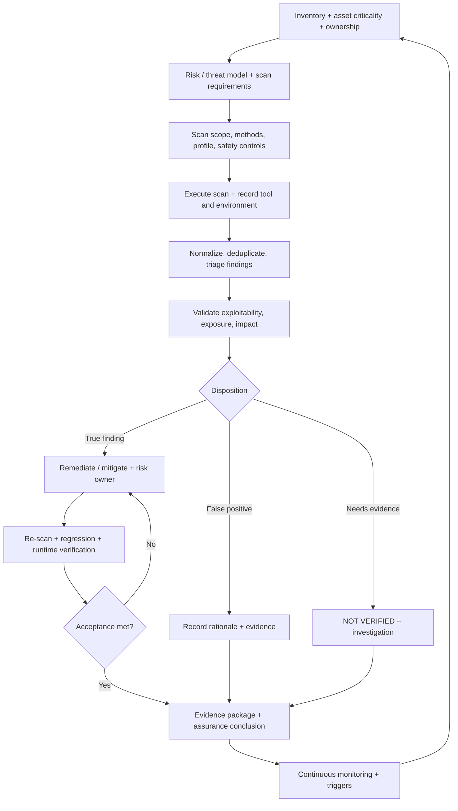
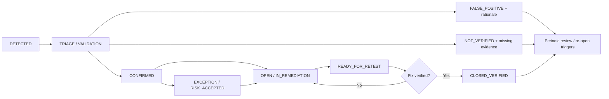

# Vulnerability scan: thiết kế, thực thi và kiểm chứng quét lỗ hổng trong Security Assurance

## 1. Vulnerability scan là gì?

**Vulnerability scanning (quét lỗ hổng)** là quá trình dùng công cụ và quy tắc kiểm tra để **nhận diện dấu hiệu, cấu hình, thành phần hoặc hành vi có khả năng dẫn tới điểm yếu bảo mật** trong một phạm vi hệ thống xác định. Đối tượng có thể là source code, thư viện phần mềm, API, website, container image, máy chủ, thiết bị mạng, hạ tầng cloud hoặc tài nguyên Infrastructure as Code (IaC).

Quét có thể dựa trên **mã nguồn, metadata/phiên bản, kiểm tra cấu hình, quan sát mạng, phản hồi ứng dụng hoặc kiểm tra trạng thái tài nguyên**. Công cụ tạo ra *candidate findings*; người và quy trình quản lý lỗ hổng phải xác minh, đánh giá tác động, ưu tiên, xử lý và kiểm chứng lại.

Trong module **SECURITY_SECURITY_ASSURANCE**, đây không chỉ là bài giới thiệu scanner. Mục tiêu là hiểu cách tạo **bằng chứng đáng tin** rằng một phạm vi đã được kiểm soát trước các nhóm rủi ro phù hợp:

**Asset và trust boundary → threat/risk → scan requirement → scanner/method → output → triage → remediation → retest → assurance conclusion → monitoring.**

Ví dụ, nền tảng học tập viết bằng Java/Spring Boot có:

- `identity-api` phục vụ đăng nhập và phát token;
- `submission-api` nhận bài nộp trước hạn;
- `grade-service` lưu điểm, có phân quyền theo lớp/tenant;
- PostgreSQL, Redis, object storage, ingress, Kubernetes;
- các dependencies của Maven/Gradle, JDK, container base image, CI/CD và cloud account.

Một lần quét thành công trên URL của `submission-api` **không chứng minh** dependencies, database, image, IAM hoặc authorization giữa các tenant đều an toàn. Ngược lại, dependency scanner tìm được một CVE **không tự chứng minh** ứng dụng khai thác được qua đường production. Phải phân biệt **scanner evidence** với **conclusion được hỗ trợ bởi bằng chứng đó**.

### Mục tiêu học tập

Sau bài này, người học có thể:

1. Xây dựng **scope, inventory, scan profile và acceptance criteria** cho chương trình vulnerability scanning.
2. Phân biệt SAST, DAST, SCA, secret scanning, container, host/network, IaC và cloud posture scanning.
3. Chọn authenticated/unauthenticated scanning và đánh giá lợi ích, giới hạn, rủi ro vận hành.
4. Đọc đúng CVE, CWE, CVSS, các tín hiệu exploitability, context và asset criticality.
5. Phân biệt **finding, confirmed vulnerability, false positive, false negative, exception và NOT VERIFIED**.
6. Đưa scan vào vòng đời phát triển và vận hành mà không gây DoS ngoài ý muốn hoặc lộ secrets.
7. Thiết lập quy trình **triage → owner → fix/mitigate → retest → close** có evidence.
8. Chứng minh coverage và operating effectiveness bằng ma trận control/test, audit trail và KPI.

> **Nguyên tắc:** “Không có findings” không đồng nghĩa “không có lỗ hổng”. Chỉ được kết luận trong **đúng tập tài sản, loại kiểm tra, quyền truy cập, thời gian, tool/rule versions và giới hạn bao phủ**.

## 2. Scanning khác vulnerability assessment và penetration testing

| Hoạt động | Câu hỏi chính | Kết quả kỳ vọng | Giới hạn |
| --- | --- | --- | --- |
| **Asset discovery** | Những tài sản nào thực sự tồn tại và ai sở hữu? | Inventory, endpoints, phiên bản, owner. | Chưa đánh giá lỗ hổng. |
| **Vulnerability scan** | Dấu hiệu điểm yếu nào được scanner nhận diện? | Candidate findings với rule, asset, evidence. | Có false positive/false negative; độ sâu phụ thuộc method. |
| **Vulnerability assessment** | Findings nào có thật, tác động thế nào, ưu tiên gì? | Validated risk, severity/context, remediation decisions. | Không nhất thiết kiểm được toàn bộ exploit chains. |
| **Penetration test** | Một người kiểm thử được ủy quyền có thể khai thác/ghép điểm yếu thế nào? | Paths và tác động thực nghiệm trong scope. | Theo thời gian, phương pháp và quyền hạn có giới hạn. |
| **Configuration/compliance assessment** | Cấu hình và control có đáp ứng baseline hay không? | PASS/FAIL cho requirement được xác định. | PASS cấu hình không chứng minh không có vulnerability khác. |
| **Continuous monitoring** | Trạng thái rủi ro có thay đổi sau build/deploy không? | New/recurring vulnerabilities, drift, SLA/exception alerts. | Chất lượng phụ thuộc sensor coverage và dữ liệu. |

Scanner là **sensor**, không phải người ra quyết định rủi ro. Quét DAST tìm phản hồi nghi ngờ SQL injection có thể cần review và test an toàn để xác nhận; quét SCA dựa trên package version có thể báo CVE mà code path liên quan không được đóng gói hay không thể kích hoạt, song cũng có thể bỏ sót malicious package không có CVE.

**Pentest và scan không thay nhau.** Automation rất hữu ích cho lặp lại, so sánh và cảnh báo, nhưng khó bao phủ logic nghiệp vụ phức tạp như “giáo viên A sửa điểm lớp B bằng API hợp lệ”. Cần thêm abuse-case testing, access-control tests và manual review theo rủi ro.

## 3. Vị trí của vulnerability scan trong vòng đời assurance

Một chương trình hiệu quả bao gồm các vòng phản hồi:



Không chuyển finding thẳng từ `OPEN` sang `CLOSED` vì PR đã merge; cần kiểm **đúng artifact hoặc tài sản đang vận hành đã thay đổi** và test mới xác minh điều kiện gây lỗ hổng không còn.

## 4. Asset inventory và phạm vi quét

Trước khi scan, phải trả lời **đang kiểm cái gì** và **có bỏ sót gì không**. Đặc biệt ở cloud/container, một IP hôm nay có thể thuộc instance khác ngày mai.

| Asset group | Ví dụ trong nền tảng học tập | Asset identity cần lưu |
| --- | --- | --- |
| **Source repository** | Java backend và frontend. | Repo, branch/commit, owner, build ID. |
| **Dependencies** | Maven artifacts, Gradle plugins, npm libraries. | Package name, resolved version, ecosystem, SBOM/lock. |
| **Build artifact** | JAR, container image. | Cryptographic digest, release ID, provenance. |
| **Web/API** | Login, submission, grade REST endpoints. | Host/route, environment, API spec, auth profile. |
| **Compute/host** | Nodes, VMs, ephemeral build workers. | Instance/resource ID, OS image, owner, lifecycle. |
| **Container/runtime** | Running Pods, sidecars, init containers. | Image digest, cluster/namespace/workload. |
| **Database/storage** | PostgreSQL, Redis, object buckets. | Service instance, version, network boundary, policy. |
| **Cloud/IaC** | Terraform modules, IAM, load balancer, security groups. | Account/project/region/resource/plan version. |
| **External provider** | SSO, mail, CDN, package registry. | Contract/owner, responsibility, available evidence. |
| **End-user clients** | Web/mobile clients, local agents. | Version, platform, update mechanism, release cohort. |

### Scope statement mẫu

> **SCAN-SCOPE-01:** Đánh giá source commit R và container image digest D của `submission-api` cùng các endpoints API ở môi trường staging phản ánh production; SAST, SCA, secret/config scan và authenticated DAST sử dụng test users thuộc ba role và hai tenants. Hệ thống production được đánh giá thông qua non-intrusive inventory/config checks và production telemetry; active testing vào production phải có authorization riêng. Coverage và exclusions được liệt kê theo asset ID.

Một scope tốt có **danh sách bao gồm**, **danh sách không bao gồm và lý do**, **quyền thử**, **network boundaries**, **data constraints**, **kiểu kiểm thử** và **owner**.

### Asset criticality quyết định độ ưu tiên

Một cổng API internet-facing có dữ liệu điểm/PII cần scan profile và triage khác một service thống kê offline. Dù vậy, tài sản ít quan trọng nhưng có quyền pipeline/cluster-admin vẫn có thể tạo rủi ro lan truyền lớn: **đánh giá privilege và blast radius, không chỉ nhãn dữ liệu**.

## 5. Inventory coverage và scan coverage không giống nhau

| Chỉ số | Mẫu số / câu hỏi | Cạm bẫy |
| --- | --- | --- |
| **Inventory coverage** | Tài sản được phát hiện và có owner trên tổng tài sản trong phạm vi. | “100%” thiếu shadow IT/ephemeral workloads. |
| **Scan execution coverage** | Bao nhiêu assets đã được quét bằng scanner phù hợp. | Scan container registry không bằng scan running workloads. |
| **Authenticated coverage** | Bao nhiêu endpoints/code paths được quan sát khi có role/tenant phù hợp. | Scanner login thành công không có nghĩa đã đi qua mọi API. |
| **Rule/technology coverage** | Scanner có signature/rule cho stack, versions và vulnerability classes cần kiểm? | Một Java scanner không đánh giá cấu hình cloud bên ngoài. |
| **Evidence coverage** | Findings và kết luận có kết quả, tool version, timestamp, target ID, logs. | Job “green” nhưng scan skipped hoặc output không lưu. |
| **Remediation/retest coverage** | Findings đã sửa có verified fix trên target version đang dùng. | Đóng issue trên repository nhưng production vẫn ở image cũ. |

**Coverage phải là đối tượng đánh giá riêng.** Nếu danh sách tài sản chưa đầy đủ, không được lấy 100% các asset đã quét làm 100% tổng exposure.

## 6. Phân loại scanners theo đối tượng và phương pháp

| Loại | Đầu vào và phạm vi | Loại finding điển hình | Không tự chứng minh |
| --- | --- | --- | --- |
| **SAST** | Source code, bytecode hoặc intermediate representation. | Injection patterns, unsafe APIs, hard-coded secrets, tainted flows. | Vulnerability có khai thác được qua production path hay không. |
| **DAST** | Ứng dụng/API đang chạy qua HTTP/giao thức. | Security headers, injection behavior, misconfig, error leakage. | Mọi code path và permission state. |
| **SCA** | Dependency graph/SBOM, package metadata. | Known CVEs/advisories, EOL, license issues. | Malicious behavior không có advisory. |
| **Secret scanning** | Git history, source, artifacts, image layers, logs. | Keys/tokens/passwords bị lộ. | Secret còn hiệu lực hay mọi nguồn phơi lộ. |
| **Host/network scanner** | Hosts, ports, services, OS/package inventory. | Exposed services, out-of-date packages, weak configs. | Business logic và code-level authorization. |
| **Container image scanner** | Image digest, filesystem/layers/packages. | OS/JRE/app dependencies, config/file secrets. | Image đã triển khai và workload runtime policy. |
| **IaC scanner** | Terraform, Kubernetes YAML, Helm, cloud templates. | Public bucket, privileged container, permissive IAM. | Resource deployed giống hệt plan. |
| **Cloud posture scanner** | Cloud control plane/configuration state. | Open security group, public storage, weak identity policies. | Exploitability, app-level security. |
| **API schema/contract scanner** | OpenAPI/GraphQL schema và actual endpoints. | Missing auth scheme, exposed operations, schema deviations. | Truy cập đúng object-level authorization. |
| **Database/config scanner** | DB version, permissions, TLS, service settings. | Unsupported versions, excessive privileges, exposed listeners. | Data access business rules đều đúng. |

### Nên phối hợp nhiều sensor

- **Shift-left** ở code/build: SAST, SCA, secret scanning, IaC.
- **Pre-release/staging:** authenticated DAST, API tests, container image scanning, config reviews.
- **Production/operations:** asset discovery, authenticated host/config scanning có kiểm soát, cloud posture, runtime inventories, external exposure monitoring.
- **Risk-based manual verification:** kiểm logic nghiệp vụ, permission chains, cryptographic use, race conditions và attack paths khó nhận diện tự động.

Không coi một công cụ **all-in-one** bao phủ sâu tất cả loại vulnerabilities. Dùng tool matrix với **độ sâu, technology support và giới hạn**.

## 7. Threat modeling quyết định quét gì

| Threat | Boundary | Scan method | Kiểm chứng ngoài scan |
| --- | --- | --- | --- |
| **SQL injection** trên `submission-api`. | Client → application → DB. | SAST taint flow, DAST payload an toàn. | Parameterized query tests, DB privilege review. |
| **Broken object authorization** ở `grade-service`. | Teacher → tenant/class records. | Authenticated DAST theo roles có thể gợi ý. | Dedicated cross-tenant negative authorization tests. |
| **Known vulnerable dependency** trong Java artifact. | Upstream package → build/runtime. | SCA, SBOM/image scan. | Reachability, patch/rebuild/runtime verification. |
| **Exposed Redis/DB**. | Internet/VPC → datastore. | Approved network/config scan. | Network policies, authentication, firewall validation. |
| **Over-permissive IAM**. | Workload identity → cloud resource. | IaC/cloud posture scan. | Effective permissions, role-assumption negative tests. |
| **Hard-coded credentials**. | Source/CI/artifact → external service. | Secret scanning. | Revoke/rotate, access logs, blast-radius review. |
| **Outdated TLS config**. | Client → edge/ingress/service. | TLS/protocol scan. | Actual handshake and certificate validation on every hop. |
| **Unsafe upload processing**. | User file → parser/worker. | SAST/DAST and dependency scan. | File policy, parser sandboxing, malware handling, resource limits. |
| **Supply chain substitution**. | CI → image registry → deploy. | Image/SBOM/release checks. | Signed provenance, digest admission and runtime reconciliation. |
| **Excessive retries/resource exhaustion**. | Client/queue → backend. | Config/SAST may flag patterns. | Load/stress/failure tests under authorization. |

**Risk alignment:** Nếu threat model coi credential theft hoặc cross-tenant abuse là ưu tiên cao nhưng scan chỉ kiểm HTTP headers, chương trình scan chưa phù hợp dù có nhiều findings mức “LOW”.

## 8. Kế hoạch quét: frequency, triggers và ownership

Scan cadence phải dựa trên **tần suất thay đổi, exposure, data classification, threat intelligence, mức rủi ro và khả năng chịu tác động**. Không có một lịch quét duy nhất phù hợp mọi loại tài sản.

| Trigger | Loại quét cần xem xét | Lưu ý |
| --- | --- | --- |
| **Pull request** | Incremental SAST/secret/IaC, dependency diff. | Tập trung code thay đổi nhưng vẫn giữ baseline của toàn hệ thống. |
| **Build/release** | Full/relevant SAST, SCA, image/SBOM, policy gates. | Gắn scan evidence với build/artifact digest. |
| **Staging deployment** | Authenticated DAST/API/security regression. | Dùng test data và accounts; tránh phá môi trường chia sẻ. |
| **Production deploy** | Approved config/exposure checks, runtime digest/canary evidence. | Active intrusive scans cần authorization riêng. |
| **New CVE/advisory** | Targeted rescans/reachability trên affected packages. | Code không đổi vẫn phát sinh known vulnerability mới. |
| **Change cloud/IAM/network** | IaC + cloud posture + effective-permissions tests. | Review drift ngoài code. |
| **New service/asset** | Baseline scan trước khi exposure. | Chưa có owner/scope → NOT VERIFIED. |
| **Periodic operations** | Network/host/cloud config, dependencies, external surface. | Cân bằng resource/availability và thời điểm kiểm. |
| **Incident/recovery** | Targeted scope and validation scans. | Bảo toàn forensic evidence và tránh làm tăng tác động. |
| **Exception expiry/patch applied** | Retest đúng finding và asset hiện hành. | Không chỉ rerun scanner nếu cần xác minh manual. |

Các mốc thời gian cụ thể (ví dụ hằng ngày/hằng tuần/hằng tháng) cần được **security policy và risk owner xác nhận**, không sao chép SLA mẫu như cam kết bắt buộc. Scan bắt buộc phải có cơ chế **phát hiện job skipped, failed hoặc stale result**.

## 9. Authorization và an toàn vận hành quét

Quét lỗ hổng là hoạt động có thể sinh nhiều requests, làm tăng CPU/I/O, kích hoạt WAF hoặc gây thay đổi state khi dùng các payload/active checks. Chỉ kiểm trong **phạm vi được phép**.

### Scan charter tối thiểu

1. Target IDs, hostname/IP/range/API endpoints, environment và **ownership**.
2. Quyền thử, liên hệ on-call, change/ticket và người phê duyệt.
3. Allowed methods: passive checks, authenticated discovery, active tests, fuzzing/stress có được phép không?
4. Thời gian, rate/concurrency/request budgets và **stop conditions**.
5. Credentials/test accounts với role/tenant cụ thể, hạn dùng và quyền tối thiểu.
6. Thỏa thuận tránh tạo side effects: không gửi email thật, không đặt hàng, không xóa bài/điểm.
7. Test data/PII protection, log redaction, retention và quyền truy cập kết quả.
8. Network controls, allowlisting scanner IP nếu cần nhưng không bỏ controls khác.
9. Restore/rollback plan và owner liên hệ khi hệ thống bất thường.
10. Exception process nếu phát hiện critical issue cần escalations.

### Tại sao “có quyền đọc” chưa đồng nghĩa “có quyền scan”?

Một account người dùng thường có thể gọi API, nhưng không tự được phép gửi traffic đột biến, probe mọi endpoint hoặc khai thác lỗi. Authorization phải bao gồm **mục đích, kỹ thuật, tải, môi trường và dữ liệu**.

**Không scan các hệ thống bên thứ ba không thuộc scope**, kể cả nếu endpoint public. Với production, ưu tiên non-intrusive discovery/configuration checks trừ khi active scan được phép, có giám sát và safety guards.

## 10. Authenticated và unauthenticated scanning

| Phương pháp | Khả năng phát hiện | Giới hạn và rủi ro |
| --- | --- | --- |
| **Unauthenticated web scan** | Surface public, headers, TLS, error leaks, exposed endpoints. | Bỏ qua routes và hành vi sau login. |
| **Authenticated web/API scan** | Protected endpoints, role-specific flow, session behaviors. | Login/token hết hạn; có thể bỏ sót object authorization nếu không test nhiều users. |
| **Authenticated host scan** | Packages, configuration, patch levels, local service state. | Cần credentials/agents; quyền quá cao gây rủi ro, result phụ thuộc host posture. |
| **Agentless network scan** | Open ports, service fingerprints, một số dấu hiệu version/misconfig. | Fingerprint có thể sai; không thấy packages không expose. |
| **Cloud API posture scan** | Resources/IAM/policies qua read APIs. | Role permissions, resource coverage, regions và eventual consistency. |

### Authenticated scan role matrix

| Persona | Tenant | Đối tượng kiểm | Negative case |
| --- | --- | --- | --- |
| Student A | Tenant X | Own submissions. | Không đọc/sửa submission của student B. |
| Student B | Tenant X | Own course data. | Không truy cập private grade của A. |
| Teacher X | Tenant X | Assigned classes. | Không sửa điểm lớp không phụ trách. |
| Teacher Y | Tenant Y | Assigned classes khác. | Không đọc lớp/điểm Tenant X. |
| Admin scope-limited | Tenant X | Admin functions trong tenant. | Không truy cập global admin hoặc tenant Y. |
| Unauthenticated | Không có | Public routes. | Protected APIs phải reject. |

Một scanner duy nhất đăng nhập bằng admin dễ tạo **coverage giả**: nó thấy nhiều route nhưng không chứng minh enforcement cho roles ít quyền. Nên bổ sung **negative access tests** với nhiều identities, không chỉ crawler “đã authenticate”.

### Credential hygiene

Lưu token qua secret manager hoặc cơ chế ngắn hạn, không nhúng vào scan file/report; hạn chế scope, rotate/revoke sau kiểm nếu policy yêu cầu. Tắt việc tự động xuất raw HTTP bodies chứa passwords, tokens, PII vào ticket.

## 11. Passive scanning, active scanning và mức độ xâm lấn

- **Passive:** quan sát traffic/headers/config/logs hoặc request/response sẵn có; thường ít gây tác động hơn nhưng không hoàn toàn “không có rủi ro” nếu thu dữ liệu nhạy cảm.
- **Active non-destructive:** gửi requests kiểm cấu hình, xác thực có lỗi theo các phép thử được thiết kế giảm side effects; vẫn có thể gây tải.
- **Active state-changing:** kiểm workflows có thể tạo, sửa, xóa hoặc đặt trạng thái; phải dùng dataset riêng, cleanup và quyền rõ.
- **Fuzzing/stress/destructive:** tạo payload/tải có khả năng làm cạn tài nguyên hoặc thay đổi state; chỉ trong lab/scope được ủy quyền với controls chặt.

**Risk-based scan profile:** Web public production có thể chỉ phù hợp passive và limited active checks; staging với test data cho phép kiểm sâu hơn. Không biến yêu cầu coverage cao thành quyền tấn công production.

## 12. Scan profiles và chuẩn cấu hình công cụ

Một **scan profile** giúp tái lập kết quả và biết khi nào đã thay đổi cách đo:

| Trường | Ví dụ | Vì sao cần |
| --- | --- | --- |
| Profile ID/version | `SCAN-WEB-AUTH-v2` | So sánh giữa các đợt. |
| Scanner engine/version | Tool X build Y. | Rule/behavior thay đổi theo version. |
| Rule set/signature database | Release date/version của rules. | Findings mới có thể do feed mới, không phải code mới. |
| Target selector | Service/tenant/region/asset tags, image digest. | Ngăn scan nhầm target. |
| Mode | Passive/active, authenticated/unauthenticated. | Phạm vi thực nghiệm. |
| Auth profile | Persona, token TTL, login steps. | Tìm routes protected và giới hạn false-negative. |
| Execution limits | Requests/sec, concurrency, timeout, scope routes. | Tránh làm hỏng service. |
| Exclusions | Endpoints, payloads, environments không scan và lý do. | Minh bạch coverage gaps. |
| Output format | SARIF, JSON, CycloneDX reports, vendor format. | Giúp normalize và audit. |
| Finding policy | Severity mapping, triage, exception, gate rules. | Scanner severity không là risk decision. |
| Owner/approval | Scan operator, app owner, security approver. | Trách nhiệm và phạm vi quyền. |

**Lock scanner profile có version** không có nghĩa đứng yên vĩnh viễn; khi cập nhật signature/tool/rules phải xem impact đến baseline, false positives và các test gates.

## 13. SAST: tìm dấu hiệu điểm yếu trong code

**Static Application Security Testing (SAST)** phân tích code/bytecode mà không cần một web server đang phục vụ. Nó phù hợp để phát hiện một số patterns như unsafe deserialization, injection, hard-coded secrets, crypto API misuse và không kiểm input/output đúng.

### SAST thuận lợi ở đâu?

- Chạy sớm trong pull request, feedback gần vị trí code.
- Gắn finding với file, line, data flow và developer ownership.
- Có thể phân tích đường dữ liệu từ **source → sink** trong phạm vi ngôn ngữ/framework được hỗ trợ.
- Hữu ích với Java/Spring Boot nếu scanner hiểu controller, services, JPA/JDBC, templating và serialization.

### SAST dễ bỏ sót gì?

- Runtime feature flags, cloud IAM, WAF/ingress hoặc third-party behavior.
- Reflection/dynamic class loading và generated code ngoài scope.
- Authorization logic dựa trên trạng thái dữ liệu, tenant/class relationships.
- Việc một vulnerable path có reachable từ production ingress không.
- Config/secrets được inject ở runtime và các runtime-specific hazards.

### Ví dụ SQL injection pattern (minh họa điểm kiểm)

```java
// Anti-pattern: concatenation of untrusted input into SQL.
String sql = "SELECT * FROM submissions WHERE student_id = '"
    + studentId + "'";
return jdbcTemplate.queryForList(sql);
```

Scanner có thể báo dấu hiệu injection nếu `studentId` không được bảo vệ. Remediation nên dùng **parameterized queries** và permission checks:

```java
String sql = """
    SELECT id, student_id, assignment_id
    FROM submissions
    WHERE student_id = ? AND tenant_id = ?
    """;
return jdbcTemplate.queryForList(sql, studentId, tenantId);
```

Ví dụ giả định những biến và bean đã được định nghĩa. Parameter binding giúp tránh SQL injection nhưng **không chứng minh user có quyền xem studentId/tenantId**: cần server-side identity, row-level authorization và negative tests.

### SAST finding không tự là production exploit

Đánh giá source of input, sanitizer thực sự phù hợp, data path, sink, config, caller privilege và runtime exposure. Nếu scanner không hỗ trợ loại flow nào, phải ghi rõ **coverage limitation** và bổ sung code review/tests.

## 14. SCA: dependencies, SBOM và vulnerability intelligence

**Software Composition Analysis (SCA)** đối chiếu danh mục thư viện/phần mềm và phiên bản với các advisory/vulnerability databases, kết hợp metadata để tìm known risks. Với Java, cần phân biệt:

1. Dependencies được **declare** trong `pom.xml` hoặc `build.gradle(.kts)`.
2. Dependencies thực sự được **resolve** cùng transitive graph.
3. Dependencies được **packaged** vào JAR/WAR/container.
4. Components **đang chạy** trong một release image/digest cụ thể.
5. Build/test-only dependencies và build plugins có exposure khác runtime dependencies.

### Các tình huống false sense of security

- Scan file POM nhưng production dùng binary được build lại với một BOM/plugin khác.
- Chỉ scan app JAR, bỏ qua base OS/JRE và native libraries.
- Thấy advisory `not affected` do VEX nhưng chưa xem product/version/rationale.
- Scanner chưa cập nhật database, báo không có CVE cho package có advisory mới.
- Sử dụng `LATEST` hoặc dynamic ranges khiến graph thay đổi giữa scans/builds.
- Đóng CVE vì đã bump version ở repository, trong khi runtime còn image cũ.

### Một finding SCA cần có

Package identity/ecosystem, version, dependency path, location in artifact, advisory ID, affected range, fixed version nếu có, CVE/CWE/CVSS/EPSS và source/timestamp khi phù hợp, app/image digest, reachability/exposure analysis, reviewer và disposition.

**SBOM là danh mục thành phần, không phải bằng chứng không có lỗ hổng.** Gắn SBOM với immutable artifact digest, reconcile phạm vi Java/OS/container và theo dõi các bản cập nhật vulnerability feeds.

## 15. DAST: quét ứng dụng đang chạy

**Dynamic Application Security Testing (DAST)** gửi/quan sát requests tới ứng dụng đang chạy để phát hiện một số phản hồi bất thường. Nó có lợi thế nhìn thấy **behavior thực tế** của route và cấu hình môi trường, nhưng mức phát hiện phụ thuộc login, discovery, state, API schema và permissions.

### Những loại checks thường gặp

| Nhóm | Ví dụ | Giới hạn |
| --- | --- | --- |
| **Security headers/TLS** | CSP, HSTS, cookie flags, certificate configuration. | Mỗi header có use case; không thay risk-based review. |
| **Input handling** | Reflected content, error handling, injection signs. | Không tự chứng minh SQL sink hoặc exploitability. |
| **Session/auth** | Session fixation clues, cookie settings, unauthenticated routes. | Không thay full auth protocol/logic assessment. |
| **Exposure** | Debug endpoint, backup files, stack traces. | Cần phân biệt test/staging vs production. |
| **API contract** | Missing auth on endpoints, unexpected status codes. | Có thể bỏ qua object-level authorization. |
| **Configuration** | Known defaults/unsafe server options. | CDN/WAF có thể làm response khác origin server. |

### Thiết kế scan cho môi trường staging

1. Tạo dedicated test tenants, users và datasets không chứa production PII.
2. Dùng URL/API spec đúng build và config profile cần kiểm.
3. Xác định app login/token refresh, anti-CSRF và authorization boundaries.
4. Exclude endpoints gây billing, email thật, mass deletion hoặc privileged side effects.
5. Rate-limit và concurrency theo load budget được owner phê duyệt.
6. Thu scan results **cùng target image digest, environment, run ID, ruleset**.
7. Sau scan, đối soát state changes và dọn test data.
8. Triage, manual validate các finding rủi ro cao và retest sau fix.

### Ví dụ scan chưa bao phủ business logic

Scanner đăng nhập bằng Teacher A và gọi `GET /grades/123`, nhận HTTP 200. Đó là phản hồi bình thường nếu 123 thuộc lớp của A. Muốn kiểm **broken object-level authorization**, cần Teacher A truy vấn record của Teacher B/Tenant Y và phải nhận deny **ở object/service layer**. Đây là test bổ sung có ngữ cảnh, không thể suy từ một phản hồi 200.

## 16. API scanning và GraphQL/gRPC/WebSocket

Không phải mọi ứng dụng chỉ là trang web với HTML crawler:

- **REST/OpenAPI:** kiểm declared routes, methods, content types, auth schemes, error codes và schema validation.
- **GraphQL:** operation auth, field-level access, depth/complexity/rate limits và introspection policy.
- **gRPC:** protobuf schemas, transport authn/authz, reflection exposure và method permissions.
- **WebSocket:** handshake security, message validation, per-message authorization, origin/token lifecycle.
- **Async APIs/queues:** producer/consumer auth, schema validation, replay/idempotency, poison messages, DLQ.

**API inventory nên xuất phát từ cả specification và runtime discovery.** Không phải mọi endpoint đều có trong OpenAPI; ngược lại, spec có thể ghi route không còn triển khai. Kiểm **coverage gap** bằng so sánh route inventory, gateway logs, service ownership và scan results.

### Negative API tests không thể bỏ

Kiểm missing/expired token, wrong audience/issuer, revoked session, wrong tenant, wrong role, wrong object, mass assignment, request size/rate abuse và error handling. Các tests này cần **test users/data được ủy quyền**, không dùng dữ liệu/hồ sơ của người dùng thật.

## 17. Network và host scanning

Quét hạ tầng/mạng thường kiểm **dịch vụ đang lắng nghe, service banner, giao thức, versions, trạng thái bản vá và một số cấu hình yếu**. Đây là nguồn tín hiệu quan trọng cho asset exposure, nhưng cần phân biệt **kết quả suy đoán từ xa** với **trạng thái được xác minh tại host**.

| Cách quét | Ưu điểm | Hạn chế |
| --- | --- | --- |
| **External perimeter discovery** | Thấy bề mặt exposed từ bên ngoài. | Có thể nhìn CDN/WAF/load balancer thay vì origin. |
| **Internal authenticated host scan** | Quan sát package/patch/config từ hệ điều hành với quyền được cấp. | Agent/credential và privilege có thể gây risk; không phải mọi host đều cùng OS. |
| **Agentless service fingerprint** | Ít phụ thuộc cài agent trên host, khám phá ports/services. | Banner có thể không phản ánh bản vá backport hoặc package thực tế. |
| **Agent-based telemetry** | Có thể theo dõi thường xuyên patch/inventory. | Agent health/coverage, supply chain và access cần kiểm. |
| **Configuration audit** | So sánh TLS, SSH, OS, DB, network policy với baseline. | Cấu hình đúng chưa chứng minh ứng dụng không có logic flaw. |

### Những vấn đề dễ bị hiểu sai

- Bản phân phối Linux có thể **backport bản vá** mà không đổi major/minor upstream version; banner matching có thể báo nhầm.
- Nhiều dịch vụ chỉ mở trong VPC/cluster, external scan sẽ không thấy. Internal scan phải theo **network boundaries và approvals**.
- Một port mở không tự là vulnerability; đánh giá cần biết **được phép mở cho ai, theo policy nào và có auth/TLS/segmentation không**.
- Máy chủ autoscale có thể bị terminate trước khi scan; cần **ephemeral inventory, golden image scanning và runtime agents**.
- Network scan không chứng minh một API đã kiểm resource-level authorization.

**An toàn:** Không dùng aggressive discovery, credential spraying hoặc các probes có khả năng gây restart thiết bị trong production nếu chưa được owner phê duyệt. Đặc biệt cẩn trọng với OT/legacy/medical network devices khi có trong scope.

## 18. Container image và runtime scanning

Container scanning thường bao gồm **OS packages, JRE/runtime libraries, Java dependencies, executable files, permissions, secrets và cấu hình image**. Cần kiểm **image theo immutable digest**.

### Những lớp cần kiểm

1. **Base image:** distro packages, libc, OpenSSL, JRE, CA bundle, root certificate updates.
2. **Application layers:** JARs, third-party components, native binaries.
3. **Image metadata/config:** user, entrypoint, exposed ports, environment values, labels.
4. **Build stage:** build tools, plugins và secrets có được xóa trước final runtime image?
5. **Provenance:** image có phải từ source/build được chấp thuận hay không?
6. **Deployment posture:** Kubernetes securityContext, RBAC, network policies, secrets, admission.
7. **Runtime state:** image digest đang chạy, vulnerabilities mới, unauthorized sidecars hoặc drift.

### Phân biệt các đối tượng

| Scan target | Điều được quan sát | Cần bổ sung |
| --- | --- | --- |
| Dockerfile | Intended build instructions và config patterns. | Actual final image digest và runtime metadata. |
| Image trong CI | Packages/layers tại build time. | Release/gate và registry artifact integrity. |
| Image trong registry | Bytes của image digest đã lưu. | Workload nào thực sự chạy image đó? |
| Running workload | Image ID/digest, node, namespace, some runtime details. | Authorized release và source/provenance checks. |
| Base image hiện hành | Những advisories mới trong nền OS/JRE. | Rebuild application image; deploy và verify runtime. |

**Không coi CVE đã sửa khi base image `latest` được cập nhật tại registry nhưng production vẫn dùng digest cũ.** Phải rebuild, scan, promote và verify deployment.

## 19. IaC scanning và Cloud Security Posture Management

**IaC scanner** phân tích định nghĩa dự kiến, còn **cloud posture scanner** quan sát trạng thái resource đã tạo qua control plane/API. Hai phương pháp bổ sung nhau.

| Ví dụ | Kiểm trong IaC | Kiểm ở cloud runtime |
| --- | --- | --- |
| Object storage bucket | `public_access_block` và policy template. | Effective ACL/policy và đường truy cập thực tế. |
| Database security group | Ingress rules, subnets, allowed CIDRs. | Effective network reachability và route. |
| IAM roles | Declared privileges/trust policy. | Effective permissions, attached policies, inherited grants. |
| Kubernetes workload | `securityContext`, image policy, service account. | Running pod, RBAC bindings, admission status. |
| Encryption | KMS key alias/setting trong template. | Actual key/policy, rotation, access/secret lifecycle. |
| Logging | Defined audit/logging resources. | Event delivery, retention, missed log periods. |

### False sense of security với IaC

- Source template an toàn nhưng resource được sửa thủ công ngoài luồng.
- Terraform plan chưa áp dụng hoặc apply lỗi một phần.
- Cloud control plane có defaults khác khi module version đổi.
- API permissions của scanner thiếu access một số accounts/regions; dashboard ghi “không có issues”.
- Data plane vẫn public qua CDN/alternate endpoint dù policy tại bucket có vẻ chặt.

Ghi rõ **declared-state PASS** hay **observed-state PASS**. Khi có drift phải liên kết findings với **resource ID, owner, environment, IaC revision và cloud provider timestamp**.

## 20. Secret scanning: phát hiện chưa đồng nghĩa đã xử lý

Secret scanner tìm dấu hiệu khóa, token, password, private key hoặc credential patterns trong source, Git history, logs và artifacts. Phát hiện có thể là false positive (test fixture), nhưng một credential thật **không hết rủi ro chỉ vì đã xóa khỏi commit mới**.

### Quy trình khi phát hiện nghi vấn

1. **Contain:** không paste raw token vào ticket, chat hoặc scan report; bảo vệ log evidence.
2. **Verify safely:** xác nhận type, context, owner và khả năng còn hiệu lực **mà không thử sử dụng ngoài quyền**.
3. **Revoke/rotate:** theo incident/security procedure, nhất là khi token có quyền quan trọng.
4. **Investigate exposure window:** Git history, forks, CI logs, image layers, backups, mirrors.
5. **Assess usage:** access logs, abnormal calls, downstream secrets và blast radius.
6. **Fix injection process:** workload identity/secret manager, least privilege, protected variables.
7. **Retest:** scanner không còn thấy credential mới, token cũ không dùng được, deployment chạy bằng credential mới.
8. **Record:** reference/fingerprint đã redacted, case owner, timelines, controls và limitations.

### Secret scanning và privacy

Một tool có thể xuất file chứa **dữ liệu cá nhân hoặc credential** nguyên vẹn để chứng minh finding; đây là rủi ro mới. Thiết kế report với hash/fingerprint an toàn, truncated path, secret type và internal reference; giới hạn quyền/retention và không nhập secrets vào third-party scanner nếu policy không cho phép.

## 21. Chuẩn hóa findings: từ output nhiều tool tới một mô hình

Các scanners thường dùng schema, severity và taxonomy khác nhau. Muốn triage liên tục phải **normalize nhưng không xóa thông tin nguồn**.

### Finding record mẫu

```yaml
finding:
  id: "FIND-VM-0042"
  source:
    scanner: "approved-sca-tool"
    scanner_version: "VERSION_REVIEWED"
    rule_db_version: "FEED_AT_SCAN_TIME"
    scan_run_id: "scan-2026-11-28-001"
    scanned_at: "2026-11-28T02:00:00Z"
  target:
    service: "grade-service"
    environment: "production"
    artifact_digest: "sha256:REPLACE_WITH_DIGEST"
    component_purl: "pkg:maven/org.example/example-library@1.0.0"
  issue:
    advisory_id: "CVE-EXAMPLE-PLACEHOLDER"
    weakness_class: "CWE-EXAMPLE"
    scanner_severity: "HIGH"
    evidence_ref: "evidence/scan-run-001/finding-42"
  triage:
    status: "NEEDS_VALIDATION"
    asset_owner: "grade-service-owner"
    reviewer: "security-assessor"
    exploitability: "NOT_ASSESSED"
    risk_decision_ref: null
```

**Các ID/CVE/versions/digest trong block là placeholder**, không phải báo cáo scanner thật hoặc advisory có thật. Chính sách lưu JSON/YAML/SARIF tùy tool; không mặc định đây là input schema của bất kỳ scanner.

### Trường bắt buộc để giữ evidence

- Target identity: **asset ID**, hostname/region, repo commit hoặc image digest, runtime deployment.
- Finding identity: source tool, rule ID, CVE/CWE nếu có, file/line/package/config/resource.
- Scan identity: time, scan mode/auth profile, rule/signature versions và coverage.
- Raw evidence reference: request/response đã scrub, query, dependency path hoặc config fragment.
- Severity từ scanner **và** severity/risk đã được triage bởi tổ chức.
- Status, owner, SLA/due date, actions, exception và retest reference.
- Không lưu raw secrets/PII/credential trong finding metadata.

## 22. Deduplication và finding lifecycle

Một CVE có thể xuất hiện ở SCA source, container scanner và cloud runtime inventory. Không nên tạo ba remediation tickets độc lập nếu chúng cùng chỉ tới **một component trong một deployment**, nhưng cũng không được xóa khác biệt giữa môi trường.

### Dedup key nên dựa trên ngữ cảnh

Một cách thường dùng là kết hợp **asset/release identity + vulnerability/advisory identity + affected component/location + environment**. Với SAST, cần thêm rule ID, code path và source revision; với network finding cần asset/resource ID và port/protocol nếu ảnh hưởng.

### Lifecycle minh họa



### Reopening và regression

- New scan trên cùng artifact không phải finding mới nếu đã biết; update observation/evidence.
- New release có cùng weakness có thể là **regression** hoặc finding mới theo tracking policy.
- Exception hết hạn phải trở lại xử lý, không auto-extend.
- False positive có thể cần đánh giá lại khi code path/config/rule version thay đổi.
- Finding không tìm thấy trong một lần scan có thể do **scan coverage giảm**, không phải bug đã sửa.

## 23. CVE, CWE và CPE/PURL: định danh khác nhau

| Định danh | Mục đích | Lưu ý |
| --- | --- | --- |
| **CVE** | Định danh một vulnerability được công bố theo chương trình CVE. | CVE ID không tự cho biết mức nghiêm trọng hay sản phẩm thực tế có bị ảnh hưởng. |
| **CWE** | Phân loại kiểu điểm yếu (ví dụ injection, incorrect authorization). | Một finding có thể map nhiều CWE hoặc không có CVE. |
| **CPE** | Mô tả nền tảng/sản phẩm để matching advisories. | Dễ mapping không chính xác với packaging/backports. |
| **PURL** | Định danh package theo ecosystem/name/version. | Không tự nói package có chạy ở production hay bị khai thác. |
| **GHSA/vendor advisory** | Định danh và diễn giải security issue từ một nguồn advisory. | Có thể liên kết CVE nhưng không phải lúc nào cũng một-một. |
| **SBOM component** | Kết nối product artifact với danh sách thành phần. | Độ đầy đủ/nguồn dữ liệu phụ thuộc generator và scope. |
| **Rule ID** | Quy tắc scanner áp dụng. | Có thể thay theo tool/version; lưu raw mapping. |

**Không nhầm “vulnerability có mã CVE” với “lỗ hổng chỉ tồn tại nếu có CVE”.** Logic bugs, unsafe custom code, credential exposure và misconfig có thể không có CVE riêng.

## 24. CVSS, EPSS, KEV và risk context

Một số nguồn ưu tiên rủi ro thường gặp:

- **CVSS:** hệ thống chấm điểm đặc tính mức độ nghiêm trọng của vulnerability theo phiên bản/metrics; **base score không đồng nghĩa risk của một tổ chức**. Cần lưu phiên bản CVSS và vector/nguồn, tránh so sánh điểm không cùng nghĩa.
- **EPSS:** ước lượng xác suất một CVE bị khai thác trong khoảng thời gian/model xác định theo feed; thay đổi theo thời gian, không là bằng chứng exploit đã xảy ra trong hệ thống.
- **KEV (Known Exploited Vulnerabilities):** catalog các vulnerability đã được ghi nhận có bằng chứng khai thác trong thực tế theo tiêu chí của nguồn duy trì (ví dụ catalog của CISA). Không phải mọi CVE chưa nằm trong KEV đều an toàn.
- **Exploit/attack intelligence:** thông tin về exploitation, exploit code, threat campaigns, internet exposure; phải đánh giá độ tin cậy và độ mới.
- **Asset context:** internet-facing, privileges, data class, tenant scope, trust boundaries, business impact, compensation controls.
- **Reachability:** code path vulnerable có thể được gọi trong build/runtime đã đánh giá hay không. Không thể xác định reachability đồng nghĩa “NOT VERIFIED”, không được tự chấm “not affected”.

### Một ma trận định hướng

| Vulnerability | Scanner severity | Context | Hành động ưu tiên |
| --- | --- | --- | --- |
| Lỗi RCE ở service internet-facing, có tín hiệu active exploitation. | HIGH/CRITICAL tùy nguồn. | Dữ liệu nhạy cảm, privileged workload, exposure lớn. | Incident/urgent containment và patch theo risk policy. |
| CVE ở test-only library không được đóng gói runtime. | HIGH. | Rủi ro build/CI vẫn có thể tồn tại. | Xác minh graph, build-time permissions và disposition; không bỏ qua tự động. |
| HTTP header thiếu trên endpoint nội bộ không dùng browser. | MEDIUM theo scanner. | Có thể không áp dụng theo context. | Review use case, xác minh và ghi rationale. |
| Open storage bucket chứa dữ liệu người học. | MEDIUM/HIGH tùy rule. | Confidentiality impact rất cao. | Ưu tiên khắc phục ngay theo exposure, không bị phụ thuộc severity tool. |
| Vulnerable transitive dependency nhưng runtime có layer khác liên quan. | HIGH. | Version mapping chưa rõ. | Verify packaged bytes, patch/backport, affected paths, retest. |

### Quy trình risk triage

1. **Confirm target và finding identity**: đúng asset/version/environment chưa?
2. **Check evidence and false-positive conditions**: scanner chứng minh được điều gì?
3. **Assess exposure and attack prerequisites**: ai có thể chạm tới code/resource?
4. **Analyze exploitability signals**: advisory, known exploited, reachability, required privileges.
5. **Assess business impact**: dữ liệu, tenant, confidentiality/integrity/availability, lateral movement.
6. **Check compensating controls**: IAM, network, WAF, sandbox, rate limits; đã test hay chỉ mô tả?
7. **Assign organizational risk/severity** theo policy và gắn response SLA/due date.
8. **Determine treatment**: fix, mitigate, accept risk trong thẩm quyền, hoặc investigate.

### Không tự đặt công thức risk chung cho mọi hệ thống

Một phép tính `Risk = CVSS × EPSS` có thể trông tiện nhưng bỏ qua data sensitivity, exposure, criticality, threat actor, privilege, control effectiveness và measurement uncertainty. Các mô hình chấm điểm tùy tổ chức có thể hữu ích nếu đã review, nhưng phải **giải thích nguồn/thang đo và tránh độ chính xác giả**.

## 25. False positive: xử lý đúng, không tắt rules tùy tiện

**False positive** là finding scanner báo có vấn đề nhưng sau khi xác minh, dấu hiệu không đại diện cho vulnerability được mô tả trong bối cảnh cụ thể.

Ví dụ:

- Scanner suy version từ banner, trong khi distro đã backport patch và có signed package changelog.
- SAST báo SQL injection nhưng giá trị đầu vào luôn được bind như parameter trong function thật.
- DAST báo missing header trong một endpoint API machine-to-machine không render browser content và requirement cụ thể không áp dụng.
- SCA map tên package nhầm ecosystem hoặc release artifact không chứa component bị báo.

### Hồ sơ disposition tối thiểu

| Trường | Nội dung |
| --- | --- |
| Finding ID | Quy tắc và target version chính xác. |
| Evidence gốc | Scanner output, file/line/response/config. |
| Lý do | Tại sao vulnerability condition không có hoặc finding không áp dụng. |
| Chứng minh | Version/backport patch reference, code path, config, negative tests. |
| Reviewer | Người đủ chuyên môn, độc lập tương đối với người sửa. |
| Scope | Chỉ release/asset/environment nào được miễn. |
| Review trigger | New code/version, new advisory, rule engine update, change exposure. |
| Expiry nếu policy yêu cầu | Không suppress vô thời hạn ngoài phạm vi. |

**Không xóa rule toàn cục** chỉ vì một false positive ở một service. Suppression phải hẹp, có approval, rationale và kiểm soát drift. Nếu thiếu thông tin, dùng **NOT VERIFIED**, không tự gắn false positive.

## 26. False negative và giới hạn nhận diện

**False negative** xảy ra khi vulnerability thực tế tồn tại nhưng scan không phát hiện. Nó có thể xuất phát từ:

- Không có tài sản trong inventory hoặc target ngoài scan scope.
- Auth token hết hạn, scanner chỉ vào landing page.
- API route/GraphQL operation không được crawler khám phá.
- Scanner không hỗ trợ framework hoặc thiếu custom rule.
- Component được shade/relocate, đóng gói native hoặc tải động.
- Phiên bản/advisory database chưa cập nhật, CPE/PURL matching sai.
- WAF/rate limit chặn scan, nhưng tool vẫn ghi completed.
- Runtime config/feature flag khác staging.
- Logic bug/business abuse không nằm trong signature của scanner.
- Sandbox/test network khác production hoặc privacy restrictions làm mất phần cần kiểm.

### Giảm false negatives theo cách có kiểm soát

1. Đối soát assets từ nhiều nguồn: CMDB, cloud inventory, orchestrator, gateway, DNS, CI/registry.
2. Dùng nhiều loại scanner với các **coverage assumptions** khác nhau.
3. Authenticated scanning theo nhiều personas; tạo negative authz tests ngoài scanner.
4. Reconcile OpenAPI/GraphQL schema với runtime routes và ingress.
5. Bổ sung targeted code review, threat modeling và pen test khi risk cao.
6. Kiểm scan report có **coverage, skipped targets, auth failures, scanner health**.
7. Chạy control effectiveness tests để đánh giá scanner phát hiện một **synthetic known weakness** trong môi trường lab.

**Không “trồng lỗ hổng thật” vào production để kiểm scanner.** Dùng fixture/benchmark app có thể cô lập và dọn được; bảo đảm quyền và hạn chế side effects.

## 27. Tích hợp scanning vào Java/Spring Boot SDLC

Một mô hình hữu ích là **layered security gates** thay vì dồn mọi kiểm tra vào một lần trước release:

| Stage | Checks | Gate behavior |
| --- | --- | --- |
| **Developer IDE/local** | Fast SAST, secret checks, dependency update insights. | Feedback nhanh; không thay gate trung tâm. |
| **Pull request** | Incremental/full relevant SAST, SCA diff, secret/IaC, unit security tests. | Block những rule/risks đã được quy định, tạo review tasks. |
| **Trusted release build** | Full relevant scans, SBOM, image scan, provenance, quality tests. | Bind output với image/JAR digest; release gate có quyền. |
| **Staging** | Authenticated DAST/API scan theo profile, integration negative tests. | Triage findings, check coverage/credentials/side effects. |
| **Pre-production approval** | Risk acceptance, high-risk unresolved findings, exception expiry, evidence completeness. | Không promote artifact không đủ policy hoặc evidence. |
| **Production runtime** | Cloud/network posture, inventory, exposed services, dependency/advisory rescan, drift. | Monitor/alert, patch plan, incident response. |

### Ví dụ workflow cấu hình khái niệm

```yaml
# Example policy description, NOT a runnable GitHub/GitLab CI schema.
security_scan_profile:
  id: "java-service-release-v1"
  target:
    service: "submission-api"
    source_commit: "APPROVED_COMMIT"
    image_digest: "sha256:REPLACE_WITH_REAL_DIGEST"
  checks:
    - type: sast
      scope: "java-source-and-bytecode"
      mode: "read-only"
    - type: sca
      scope: "resolved-dependencies-and-runtime-image"
    - type: secret
      scope: "source-and-artifact-layers"
    - type: iac
      scope: "deployment-manifests"
    - type: dast
      scope: "authorized-staging-endpoints"
      active_tests: "owner-approved-only"
  gate:
    require_scans_completed: true
    fail_on_untriaged_policy_critical_findings: true
    require_artifact_digest_binding: true
    require_explicit_exception_with_expiry: true
  evidence:
    redact_credentials: true
    attach_scan_profile_version: true
```

Lưu ý: Đây là **mẫu cấu trúc tư duy**, không phải file config để chạy trực tiếp. Mỗi tool có schema, flags, output/exit codes và giới hạn khác nhau; cần đọc tài liệu chính thức đúng phiên bản trước khi tích hợp.

### Bảo vệ CI scan jobs

- Không cấp production secrets cho code của untrusted PR.
- Scan artifacts từ đúng trusted build, không dùng unverified binary downloaded từ PR.
- Scanner container/CLI cũng là software dependency cần pin/source review.
- Không dùng credentials admin chung cho DAST khi chỉ cần read/restricted test account.
- Không xuất raw sensitive findings ra public build logs; kiểm report retention/access.
- Nếu tool/license/service mất kết nối, không tự coi `no report` là `scan PASS`.

## 28. Maven/Gradle dependency verification và scan evidence

Đối với service Java, scanner cần **resolved graph** đúng build configuration, không chỉ các `implementation` dependencies nhìn từ manifest.

### Các điểm kiểm với Gradle

1. Chọn Gradle wrapper version/distribution và plugin versions đã review.
2. Kiểm `dependencies` theo compile/runtime/test classpaths; phân biệt không gian ảnh hưởng.
3. Xem `dependencyInsight` hoặc report tương đương để tìm đường transitive dependency.
4. Dùng dependency lock/verification khi được chấp thuận; kiểm thay đổi lockfiles và repository mapping.
5. Scan packaged runtime artifact/container base image sau build; generated code và native libraries cần scope riêng.
6. Gắn CVE/advisory report với **commit, build ID, image digest và feed version**.
7. Khi fix dependency, rebuild và xác minh runtime digest, không chỉ thay lockfile.

### Các điểm kiểm với Maven

- Parent/BOM/dependencyManagement và pluginManagement có thể điều khiển versions ngoài dependency declaration.
- `mvn dependency:tree` có thể giúp xem resolved graph; scope và Maven version cần được ghi.
- Build plugins có thể thực thi code có quyền CI, phải review độc lập với runtime libraries.
- Snapshot/changing dependencies cần controls theo repository policy.
- Managed artifact repository/mirror/credentials phải có nguồn tin cậy và least privilege.

### Một ví dụ tư duy về phạm vi khác nhau

Một thư viện dễ bị khai thác nằm trong `testImplementation` có thể **không được đưa vào production image**, nhưng có thể chạy trong CI với quyền build secrets nếu pipeline cấu hình sai. Không kết luận “không ảnh hưởng” nếu chưa kiểm **build-time permissions và packaging**.

## 29. Scanner gating: fail, warn hay cho phép ngoại lệ?

Không nên để mọi scanner finding tự chặn production một cách không phân biệt, cũng không nên để mọi lỗi scanner chỉ tạo cảnh báo không ai xử lý. Dùng **risk-based gate policy**:

| Điều kiện | Ví dụ cách xử lý | Lưu ý assurance |
| --- | --- | --- |
| Scanner thất bại hoặc output không đầy đủ. | Không mark PASS; block release nếu đây là control bắt buộc hoặc escalate theo fail policy. | Đừng coi exit code 0 của wrapper là scan success khi tool không chạy. |
| Known critical exploitable issue trong reachable production path. | Chặn promotion hoặc yêu cầu xử lý khẩn theo policy. | Context/exploitability cần xác minh nhanh. |
| Finding medium chưa triage, asset nhạy cảm. | Tạo owner/due date; gate theo risk profile. | Không chỉ nhìn severity của tool. |
| Accepted false positive có bằng chứng đúng release. | Suppress hẹp theo rule/asset/expiry. | Revalidate khi code/rule thay đổi. |
| Exception đã duyệt, chưa hết hạn. | Cho qua trong scope và compensating controls đã xác minh, nếu quy định cho phép. | Exception không chuyển weakness thành fixed. |
| Unknown severity hoặc advisory mapping lỗi. | Triage và báo NOT VERIFIED. | Không mặc định low risk. |
| Đã fix trong main nhưng prod còn image cũ. | Không đóng production finding. | Bắt buộc evidence về deploy mới. |

### Tại sao gate nên versioned?

Một thay đổi policy có thể làm build hàng loạt chuyển từ PASS sang FAIL mà code không đổi. Cần ghi **scan engine, rule feed, gate version, approver, effective date và migration/exception plan**.

### Minh họa decision logic (pseudocode)

```text
IF target not in approved scope OR scan permission invalid:
    result = NOT_PERFORMED
ELSE IF scanner failed OR required scan evidence missing:
    result = NOT_VERIFIED
ELSE:
    normalize findings
    validate coverage and authentication
    triage risks against approved policy
    IF unaccepted blocking risk:
        decision = DENY_RELEASE
    ELSE IF required reviewer/exception evidence absent:
        decision = HOLD_FOR_REVIEW
    ELSE:
        decision = ALLOW_WITH_TRACEABLE_EVIDENCE
```

Một gate không thể tự tin mọi `scan completed` là đủ. Ví dụ scanner chạy thành công nhưng chỉ quan sát login page vì auth hết hạn thì **coverage không đạt** dù exit code bằng 0.

## 30. Từ scan output đến testable security requirement

Nên tách **yêu cầu scanning program** và **yêu cầu sửa từng vulnerability**.

| Loại | Ví dụ yêu cầu | Bằng chứng |
| --- | --- | --- |
| **Program coverage** | Mọi production assets trong inventory có owner và scan profile được áp dụng theo risk tier. | Inventory–scan reconciliation, skipped assets report. |
| **Execution quality** | Required scans hoàn thành trên đúng release với rule/tool versions được ghi. | Job/run ID, full results và evidence retention. |
| **Auth quality** | Authenticated DAST đi qua routes của role/tenant được chỉ định, token hợp lệ. | Test accounts, route coverage, auth state logs. |
| **Detection** | Scanner phát hiện synthetic benchmark issues đã được dựng trong lab. | Positive/negative control tests. |
| **Triage** | Findings critical trong scope có owner, risk assessment và response plan theo policy. | Finding register, approvals, timestamps. |
| **Remediation** | Lỗ hổng đã xác nhận được xử lý trong hạn theo risk profile hoặc có quyết định treatment hợp lệ. | Patch/mitigation records, change history. |
| **Retest** | Closure chỉ sau scan/manual test xác minh target hiện hành không còn condition. | Retest result, deployment digest, runtime check. |
| **Continuous** | New advisories, exposed assets, scan failures và expired exceptions tạo reassessment. | Feed ingestion, alerts, on-call, trend review. |

### Requirement viết theo Given–When–Then

> **VM-REQ-03:** **Given** một release image digest đã được approved cho `grade-service`, **When** pipeline phát hành chạy, **Then** SCA và image scans phải hoàn tất trên chính digest đó, lưu tool/rule versions, SBOM/scan reports có liên kết, và không được promote nếu còn policy-blocking findings chưa có disposition hợp lệ.

> **VM-REQ-08:** **Given** một finding đã được khắc phục trong source, **When** image mới được triển khai, **Then** assessor phải có bằng chứng retest trên release digest mới và đối soát runtime instance, trước khi ghi `CLOSED_VERIFIED` cho production.

## 31. Những điểm phải phân biệt khi đọc HTTP và scanner errors

| Tín hiệu | Cách hiểu thận trọng |
| --- | --- |
| **HTTP 200** | Endpoint trả response; không đồng nghĩa authorization đúng hoặc dữ liệu không nhạy cảm. |
| **HTTP 401** | Thiếu/không hợp lệ authentication; có thể làm scan thiếu coverage nếu token hết hạn. |
| **HTTP 403** | Có policy deny; cần kiểm đúng object/tenant/role, không tự chứng minh tất cả quyền được kiểm. |
| **HTTP 404** | Có thể endpoint không tồn tại hoặc server che tài nguyên trái quyền; kiểm context. |
| **HTTP 429** | Rate limiting; có thể ngăn scanner khám phá đủ routes và gây false-negative. |
| **HTTP 5xx** | Server error/cấu hình hoặc tải do scan; cần điều tra, dừng nếu vượt stop conditions. |
| **Timeout** | Network/availability/ratelimit/tool issue; không tự là vulnerability. |
| **Scanner exit code 0** | Tool process hoàn tất theo nghĩa của tool, chưa chắc auth/target/coverage/pass. |
| **Empty result set** | Có thể không tìm thấy trong scope, cũng có thể scan bị skip/tool feed cũ. |
| **Unrecognized component** | Cần kiểm identifiers, packaging, tool ecosystem support; không tự chấm safe. |

**Scan observability phải ghi đủ** HTTP error distribution, authentication failures, excluded URLs, job skips và attempted routes để người đánh giá hiểu tool đã thực sự kiểm gì.

## 32. Bộ security controls mẫu cho vulnerability scanning

Các mã `VM-CTRL-01` đến `VM-CTRL-18` là **mẫu dành cho học tập**, không phải mã điều khoản chính thức của NIST/ISO/OWASP.

| Control ID | Yêu cầu kiểm soát | Bằng chứng tối thiểu |
| --- | --- | --- |
| **VM-CTRL-01** | Inventory assets trong scope có owner, data class, environment và criticality. | Asset inventory đối soát cloud/CI/runtime, exclusions. |
| **VM-CTRL-02** | Scan policy và profile được phê duyệt theo risk tier/technology. | Policy version, scope, methods, cadence, approvals. |
| **VM-CTRL-03** | Scanner hoạt động với quyền và safety budget phù hợp. | Authorization, scan charter, traffic/stop logs. |
| **VM-CTRL-04** | Source SAST và secret scans chạy cho code thuộc scope. | Run reports, rule/version, coverage, findings. |
| **VM-CTRL-05** | SCA nhận diện runtime/build components và known advisories theo scope. | Resolved graph/SBOM, advisory feed, artifact digest. |
| **VM-CTRL-06** | Container/base images được scan và findings gắn image digest. | Image scan, inventory, base OS/JRE scope. |
| **VM-CTRL-07** | IaC và cloud runtime posture được đối chiếu để phát hiện drift. | IaC report, cloud resource scan, effective config review. |
| **VM-CTRL-08** | DAST/API scans có authenticated coverage và negative roles. | Test personas, route coverage, auth failure logs. |
| **VM-CTRL-09** | Host/network scans theo approved exposure/asset list. | Network scan reports, host patch/config evidence. |
| **VM-CTRL-10** | Scan status và missing-data được giám sát; không ghi PASS nếu scan không chạy. | Job health, skipped/failed targets, alert tests. |
| **VM-CTRL-11** | Findings có identity, dedup, validation, risk priority, owner và due dates. | Finding register, triage decisions, source reports. |
| **VM-CTRL-12** | False positives được review theo asset/version, không tắt rule vô thời hạn. | FP evidence, approval, expiry/review trigger. |
| **VM-CTRL-13** | High-risk issues được xử lý theo policy; mitigating controls phải được test. | Fix/mitigation records, timestamps, negative tests. |
| **VM-CTRL-14** | Retest/closure gắn current production artifact/resource. | Re-scan, code/runtime verification, closure approval. |
| **VM-CTRL-15** | Exceptions có risk owner, scope, expiry và periodic review. | Exception register, compensating control evidence. |
| **VM-CTRL-16** | Third-party/managed-service gaps có owner và evidence riêng. | Shared responsibility mapping, supplier reports. |
| **VM-CTRL-17** | Vulnerability intelligence/advisory changes kích hoạt impact assessments. | Feed event, affected asset lookup, new triage/re-scan. |
| **VM-CTRL-18** | Continuous monitoring kiểm scan coverage, fix SLAs và recurrence. | KPI trends, review notes, incident/release linkages. |

### Mỗi control phải có assessment method

Không thể đánh giá mọi control bằng screenshot. Dùng phối hợp:

- **Examine:** xem policy, tool profiles, config, SBOM, ticket, logs, scan results.
- **Interview:** hỏi owners cách xử lý cảnh báo, credentials, false positives và exceptions.
- **Test:** cố tình mô phỏng scan failure, CVE feed update, unauthorized scanner scope, auth expiry và retest trên môi trường được phép.

Đối tượng, phương pháp, sample size, reviewer và thời điểm phải được ghi để kết luận **có thể tái kiểm**.

## 33. Test matrix: chứng minh scanning control hoạt động

| Test ID | Tình huống | Expected result / evidence |
| --- | --- | --- |
| **TC-VM-01** | Có production workload mới nhưng chưa gắn asset owner. | Inventory–scan reconciliation phát hiện thiếu và báo owner. |
| **TC-VM-02** | Một region/cloud account không cấp scanner permission. | Báo coverage gap/NOT VERIFIED, không ghi 100%. |
| **TC-VM-03** | Scan request target ngoài approved scope. | Job validation từ chối và log audit. |
| **TC-VM-04** | DAST đang quét vượt rate/request budget. | Throttle/stop condition kích hoạt, owner được báo. |
| **TC-VM-05** | Token scan user hết hạn giữa phiên. | Scan báo auth/coverage failure thay vì completed full. |
| **TC-VM-06** | Unauthenticated scanner thử protected API. | App reject; report không tự đánh dấu “đã kiểm role business”. |
| **TC-VM-07** | Student A tìm đọc record của Student B trong lab. | Negative authz test deny, có scope và evidence. |
| **TC-VM-08** | Teacher X thử cập nhật điểm lớp Tenant Y. | Server-side deny theo resource policy, không chỉ UI ẩn nút. |
| **TC-VM-09** | SAST chạy trên synthetic unsafe SQL concatenation fixture. | Rule phát hiện theo scanner capability, fixture không deploy production. |
| **TC-VM-10** | Code sửa sang parameterized query và authz check. | SAST findings reviewed, unit/integration negative tests PASS. |
| **TC-VM-11** | SCA gặp dependency có advisory giả lập trong test feed. | Scanner detect và tạo finding đúng package/version/build. |
| **TC-VM-12** | Dependency chỉ xuất hiện transitive. | Resolved graph và report có relationship, scope. |
| **TC-VM-13** | SCA result gắn source commit khác production image. | Evidence mismatch, không đóng production finding. |
| **TC-VM-14** | Container image có outdated base package trong test image. | Image scan phát hiện package/layer và digest. |
| **TC-VM-15** | Chỉ scan Dockerfile mà không scan final image. | Gate báo thiếu required image coverage. |
| **TC-VM-16** | IaC có bucket public theo synthetic config. | IaC policy phát hiện và ghi resource/path. |
| **TC-VM-17** | Runtime cloud bucket policy drift khỏi approved IaC. | Posture scan phát hiện observed-state gap. |
| **TC-VM-18** | Host banner gợi vulnerable version nhưng distro có patch backport. | Triage có patch evidence, không tự kết luận CVE thực. |
| **TC-VM-19** | Secret canary giả được đặt trong test repo. | Scanner phát hiện, report redact, không truyền secret thật. |
| **TC-VM-20** | Một token đã rò rỉ được xóa khỏi latest commit. | Review phát hiện cần revoke/rotate và xem Git history. |
| **TC-VM-21** | Scanner process thoát thành công nhưng bỏ qua targets. | Scan health/coverage gate không ghi PASS. |
| **TC-VM-22** | Rule DB feed cũ hơn chính sách freshness. | Job/monitor báo stale feed, investigation/re-run. |
| **TC-VM-23** | CVE mới xuất hiện cho dependency đang chạy, code không đổi. | Advisory feed trigger impact/triage và scan lại. |
| **TC-VM-24** | Scanner finding được suppress toàn organization mà không approval. | Governance review reject và giới hạn suppression. |
| **TC-VM-25** | High CVSS nhưng library chỉ dùng build/test trong isolated CI. | Reviewer phân biệt runtime/build risk và ghi evidence. |
| **TC-VM-26** | VEX không có product/version/rationale rõ. | Không tự coi vulnerability `not affected`; NOT VERIFIED. |
| **TC-VM-27** | Vulnerability fix được merge nhưng image prod còn digest cũ. | Finding vẫn open cho production cho tới khi deploy/retest. |
| **TC-VM-28** | Patch deploy nhưng affected code path vẫn còn qua alternate route. | Retest/negative test fail; không đóng finding. |
| **TC-VM-29** | Exception cho vulnerability hết hạn. | Policy mở lại finding/escalation, không auto-extend. |
| **TC-VM-30** | Scanner reports chứa HTTP body/token/PII. | Redaction/access checks phát hiện và xử lý evidence exposure. |
| **TC-VM-31** | Scan phụ thuộc bên thứ ba bị lỗi/outage. | Missing evidence được ghi và xử lý theo fail policy. |
| **TC-VM-32** | Một finding được báo ở SAST và DAST. | Dedup có linkage, giữ nguồn evidence và asset context. |
| **TC-VM-33** | Một rule mới làm tăng số findings dù code không đổi. | Trend/report phân biệt tool/rule-version change với regression. |
| **TC-VM-34** | Scanner nói “no findings” trên benchmark có known issue. | Control effectiveness test phát hiện false-negative/coverage gap. |
| **TC-VM-35** | Rerun scanner trong staging nhưng target khác release prod. | Release-scoped conclusion giới hạn, không suy PASS production. |
| **TC-VM-36** | Retest đã PASS nhưng runtime config bị đổi sau đó. | Drift/reassessment trigger tạo scan/review mới. |

### Phân nhóm test

**Positive tests** xác minh scanner chạy, nhận diện đúng target và evidence. **Negative tests** kiểm out-of-scope, auth failure, missing feed, suppression/bypass. **Failure tests** kiểm tool/vendor outage và dữ liệu thiếu. **Effectiveness tests** dùng fixtures được phép để chứng minh scanner có khả năng tìm đúng weakness; **closure tests** chứng minh remediation đã hiện diện tại target dùng thực tế.

Không đánh giá chất lượng scanning bằng **số findings càng nhiều càng tốt**: scanner có false positives cao có thể làm ngập triage; scanner không phát hiện gì có thể do coverage thấp. Cần kết hợp **precision, recall estimates trên test fixtures, asset coverage, remediation outcomes và reviewer confidence**.

## 34. Evidence package: thế nào là quét có thể audit?

Một vulnerability scan chỉ hữu ích cho assurance khi **người kiểm tra độc lập có thể hiểu tool đã làm gì, thấy gì và không thấy gì**.

| Artifact | Điều chứng minh | Giới hạn |
| --- | --- | --- |
| **Asset inventory** | Tập tài sản dự kiến thuộc scope, ownership và criticality. | Có thể thiếu shadow/ephemeral assets. |
| **Scan authorization** | Có quyền thực hiện loại scan, target, thời gian và safety limits. | Không chứng minh scanner hoạt động đúng. |
| **Scan profile/config** | Rules/method/auth scope, exclusions, frequency và version. | Declared config có thể khác runtime arguments. |
| **Run logs** | Start/stop, targets, credentials state, errors, skipped resources. | Có thể bị truncate hoặc chứa sensitive data. |
| **Raw tool reports** | Findings, evidence, tool/rule versions và timestamps. | Tool kết luận sơ bộ, không tự được validate. |
| **Coverage report** | Assets/routes/components scanned và missing items. | Không bảo đảm mọi vulnerability class được nhận diện. |
| **Finding register** | Dedup, asset owner, risk, disposition, due date, status. | Ticket không thay manual/technical verification. |
| **Patch/mitigation evidence** | Source/config change, change approval và production deploy. | Merge thành công không chứng minh runtime fix. |
| **Retest evidence** | Vulnerability condition không còn trong scope được đánh giá. | Test coverage/target version vẫn có giới hạn. |
| **Exception/risk decision** | Ai chấp nhận residual risk, trong thời hạn/phạm vi nào. | Không chuyển finding thành PASS. |
| **Operational metrics** | Scan/coverage health, SLA trends, new advisory triggers. | Missing telemetry có thể che gap. |

### Evidence quality dimensions

1. **Relevance:** đúng asset, release, role, threat model và requirement.
2. **Integrity:** chống sửa trái phép, có checksum/signature hoặc storage controls phù hợp.
3. **Provenance:** scanner, operator, tool/rule version và execution identity.
4. **Freshness:** feed, timestamp, production artifact và current deployment phù hợp.
5. **Completeness:** cả passed, failed, skipped và excluded targets.
6. **Repeatability:** đủ config/run commands/fixture để tái kiểm trong quyền hợp lệ.
7. **Validity:** findings đã xác minh, severity/risk quyết định hợp lý.
8. **Confidentiality:** redact tokens, PII, stack traces và proof-of-concept secrets.
9. **Traceability:** finding → asset → owner → treatment → retest → closure.
10. **Limitations:** chỉ ra không được scan và các assumptions/scanner blind spots.

### “Ảnh dashboard màu xanh” chưa đủ

Một screenshot với dòng `0 Critical` không chứng minh:

- Scan đúng production artifact hoặc environment.
- Scanner có role/permission/coverage phù hợp.
- Signature database đã cập nhật.
- Tool đã nhận diện hết transitive/base image components.
- Các findings medium/high có risk cao đã được đánh giá.
- Có đủ evidence để kiểm lại sau vài tháng.

Phải lưu **data/query/config và phiên bản** của dashboard hoặc export, không chỉ số tổng.

## 35. Remediation: sửa đúng nguyên nhân, không “dập cảnh báo”

Các phương án xử lý finding có thể bao gồm:

| Treatment | Ví dụ | Evidence và giới hạn |
| --- | --- | --- |
| **Patch/upgrade** | Nâng version thư viện/JDK/OS hoặc sửa code. | Rebuild/scan/retest image đang chạy; regression tests. |
| **Remove/replace** | Gỡ dependency không dùng, thay plugin EOL. | Resolved graph/compiled artifact, behavior tests. |
| **Configuration correction** | Đóng public bucket, hạn quyền, tắt debug endpoint. | Observed-state scan, effective permissions/negative tests. |
| **Architectural mitigation** | Segment network, sandbox vulnerable parser. | Tests cho isolation, residual exposure analysis. |
| **Compensating control** | WAF rule, temporary access restriction, alerting. | Đo effectiveness; không thay root fix khi có thể. |
| **Risk acceptance** | Thời gian migration cho legacy component. | Approver, expiry, scope, monitoring, review trigger. |
| **False-positive disposition** | Scanner matching sai distro backport. | Evidence, reviewer, rule/asset scope, expiry. |
| **Decommission** | Tắt service/resource không còn cần thiết. | Runtime/network verification và inventory removal. |

### Nguyên tắc fix

- Sửa **root cause**, ví dụ parameterize query thay vì chỉ lọc một chuỗi input cụ thể.
- Kiểm **regression và security invariants** (authentication, authorization, integrity, availability).
- Patch dependency cần đối soát **transitive graph và binary thực tế**.
- Rebuild và release artifact mới từ nguồn/toolchain được duyệt.
- Mitigation phải được test; “đã có WAF” không chứng minh vulnerability không thể bị khai thác.
- Nếu lỗi bị phát hiện qua production scanning nhưng fix chỉ có ở staging, không đóng production finding.
- Nếu fix bị rollback, finding phải được mở lại hoặc đánh giá điều kiện còn hiệu lực.

### Release verification mẫu

```text
Finding: FIND-VM-0042
Affected target: grade-service production image D_old
Cause: vulnerable dependency version / endpoint configuration
Fix: source change commit C + dependency/config update
Build: release R_new -> image digest D_new
Verification: SCA/SAST/DAST test report references for D_new
Deployment: cluster/namespace workload running D_new
Assessment: reviewer confirms negative test + no affected old workload
Decision: CLOSED_VERIFIED for reviewed production scope
Remaining exposure: legacy image in DR region -> separate finding
```

## 36. Retest: xác minh đã sửa chứ không chỉ “không còn cảnh báo”

### Các bước kiểm chứng

1. **Xác định finding gốc:** rule/advisory, asset, code path, affected config, thời điểm, nguy cơ.
2. **Đọc fix intent:** developer đã sửa gì, có đổi API/data semantics không?
3. **Xác định target mới:** commit/image digest/resource ID và environment thực sự áp dụng.
4. **Chạy scanner phù hợp:** đúng profile và feed, so sánh findings trước/sau.
5. **Bổ sung manual/negative tests:** đặc biệt business logic, authorization, false-positive disputes.
6. **Kiểm mitigation:** quyền truy cập, WAF, network segment, isolation hoạt động với threat model.
7. **Đối soát runtime:** deployed digest và config thật đã đổi; không còn legacy paths ở các region.
8. **Ghi evidence:** test ID, tool version, observed result, scanner limitations và reviewer.
9. **Quyết định:** PASS cho requirement cụ thể, CLOSED_VERIFIED cho finding, hoặc FAIL/NOT VERIFIED.
10. **Theo dõi recurrence:** new advisories, rollback, drift, code refactoring và backup/DR images.

### Phân biệt test types

- **Rescan**: chạy lại tool/rules nhằm quan sát dấu hiệu cũ.
- **Regression test**: xác minh chức năng nghiệp vụ không bị hỏng bởi fix.
- **Security negative test**: chứng minh hành vi vốn không được phép vẫn bị deny.
- **Runtime verification**: chứng minh deployment đã dùng chính build/config được test.
- **Independent review**: assessor xem target, assumptions và evidence thay vì tự chấp nhận lời khai của người sửa.

### Khi kết quả scanner không còn nhưng vẫn chưa đủ

Nếu scanner rule bị tắt, endpoint bị loại scope hoặc token hết hạn, finding “biến mất” không chứng minh remediation. Phải kiểm **rule/config/coverage equivalence** giữa trước và sau, hoặc giải thích rõ lý do khác biệt.

## 37. Risk acceptance, exception và thẩm quyền quyết định

Một số vulnerabilities không thể xử lý ngay do tính tương thích, vendor chưa có patch hoặc thay đổi gây rủi ro vận hành lớn. Exception cần **có thời hạn và không đánh tráo kết quả đánh giá**.

| Trường | Nội dung |
| --- | --- |
| Exception ID | Định danh, trạng thái và liên kết finding/control. |
| Affected scope | Service/asset, environment, region, build/image digest, data class. |
| Vulnerability context | CVE/CWE/rule, technical condition và exposure. |
| Business risk | CIA impact, exploitability, privilege, users affected. |
| Reason | Tại sao chưa thể fix trong policy window. |
| Compensating controls | Restrictions/monitoring, test evidence và giới hạn hiệu lực. |
| Decision authority | Người đủ quyền, có approval đúng luật/contract. |
| Expiry | Deadline, review cadence, migration milestone. |
| Reassessment triggers | New exploit, network exposure, provider advisory, incident. |
| Closure | Patch/decommission/mitigation retest và independent verification. |

### Quy tắc

- Accepted risk **không** làm vulnerability biến mất.
- Một exception cho image `D_old` **không tự** mở rộng tới image mới hoặc service khác.
- Nếu có regulatory/contractual requirement bắt buộc, tổ chức không thể tự dùng exception để bỏ qua.
- Scan failures hoặc missing evidence không nên bị biến thành false positive.
- Findings có dấu hiệu active exploitation cần đánh giá incident response và containment, không chỉ cập nhật lịch patch.

## 38. Vulnerability disclosure và nguồn thông tin mới

Scanning không tách rời **vulnerability intelligence và phối hợp xử lý với người phát hiện**.

### Nguồn tín hiệu

- Vendor security advisories và patch bulletins.
- Public vulnerability databases và mã CVE/CWE.
- Known exploited vulnerability catalogs và exploit intelligence.
- Maintainer announcements, package registry advisories, SBOM/VEX statements.
- Bug bounty/coordinated vulnerability disclosure (CVD) trong phạm vi tổ chức.
- Findings từ pentest, security review, incident response, SAST/DAST/SCA.
- Threat intelligence cho environment hoặc industry cụ thể.

### Response khi có advisory mới

1. Xác minh nguồn, sản phẩm/phiên bản/affected ranges.
2. Tìm affected assets từ inventory, SBOM, image digests và cloud resources.
3. Kiểm exposure/reachability, criticality, active exploitation và mitigations.
4. Quyết định urgency và patch/containment theo authority.
5. Cập nhật scanner feed/rules và targeted rescan khi cần.
6. Gắn tickets/communications vào release/incident.
7. Rebuild, deploy, retest và verify runtime.
8. Cập nhật risk register, exceptions và monitoring.

**Không đợi kỳ scan định kỳ** nếu có advisory mức rủi ro khẩn. Ngược lại, đừng vội công bố “toàn bộ hệ thống bị CVE” chỉ vì package name khớp: cần kiểm phiên bản, configuration và phạm vi.

## 39. Case study: “scan xanh” nhưng `grade-service` vẫn có rủi ro

### Bối cảnh

Nền tảng học tập triển khai `grade-service` để giáo viên xem/sửa điểm trong lớp họ phụ trách. Đội phát triển có pipeline CI với SAST và SCA, một công cụ DAST quét staging, và image scan trước release.

Một ngày, tổ chức nhận advisory mới cho thư viện xử lý file bảng điểm. Pipeline CI báo **0 Critical** vì code không đổi. Trong khi đó:

- `grade-service` production vẫn chạy container image `D_old`.
- Dependency trong source manifest đã được cập nhật, nhưng image `D_old` chứa version cũ.
- DAST trên staging chỉ đăng nhập thành công với một account có quyền admin, thiếu Teacher/Student personas.
- DAST token hết hạn sau vài phút, nhưng pipeline không xem `401` là coverage failure.
- Cloud inventory thiếu một background worker xử lý import điểm, cũng dùng dependency cũ.
- Một finding SAST cảnh báo SQL injection bị suppress toàn repository mà không có rationale.

### Tách các giả định khỏi bằng chứng

| Quan sát | Có thể kết luận | Không thể kết luận |
| --- | --- | --- |
| CI báo “0 Critical”. | Scanner/pipeline đã trả kết quả theo rules và input của run đó. | Không còn high-risk vulnerability trong production. |
| Manifest nâng dependency. | Source/dependency declaration đã thay. | Production artifact đã dùng package patched. |
| Image `D_old` có component nằm trong affected range. | Có dependency exposure cần triage trong artifact. | Đã bị khai thác trong production, nếu chưa có bằng chứng. |
| DAST có nhiều HTTP 401 sau vài phút. | Auth profile/crawl coverage có vấn đề. | Các protected endpoints an toàn. |
| Worker không có trong inventory. | Có coverage gap. | Worker tự động an toàn vì không có findings. |
| SAST suppression toàn repo. | Một rule không được đánh giá trên nhiều paths. | Mọi occurrences đều false positive. |

### Phân tích threat/risk

Thư viện import điểm có thể xử lý file do người dùng upload. Nếu có lỗ hổng parsing và input đến từ nguồn không tin, **exposure có thể cao** dù API không internet-facing trực tiếp; actor có quyền nộp/import vẫn có thể là threat source. Cần xem:

1. Build image `D_old` có thực sự đóng gói phiên bản affected?
2. Code path parse file có thể gọi được từ authenticated user nào? Có isolation?
3. Worker chạy với quyền gì, có secrets hoặc DB write access không?
4. Scan results có đồng nhất với runtime deployment digest, vendor advisory và package identifiers?
5. Có known exploitation hay exploit prerequisites nào thay đổi prioritization?
6. Có compensating controls đang hoạt động và được test không?

### Phương án remediation

1. Ghi **FIND-VM-EXAMPLE-01** cho production image và worker bị ảnh hưởng; owner và due date theo risk.
2. Cập nhật inventory, bổ sung worker và đúng image digests/regions.
3. Xác minh advisory/affected version và threat model; **không cần công khai exploit details** để làm triage.
4. Nếu risk khẩn, áp dụng containment có quyền: hạn chế loại file/operation, cô lập worker hoặc tạm ngừng import theo business authority.
5. Patch/replace parser dependency và rebuild image từ nguồn đã duyệt.
6. Scan **new image digest** bằng SCA/image scanner, chạy SAST/negative tests tương ứng.
7. Thiết kế test import file an toàn trong lab và kiểm job retries, data integrity, authz.
8. Deploy new image, đối soát runtime digests của API và worker; kiểm cả DR image.
9. Sửa DAST authentication/role matrix và bắt `401` bất thường thành scan coverage failure.
10. Thu hẹp hoặc xóa SAST suppression khi có code review/evidence, retest rule.
11. Lưu **before/after evidence** và independent review; chỉ close findings khi đạt.
12. Cập nhật tool profiles, runtime inventory controls và advisory-trigger process.

### Assurance claim sau xử lý

> “Đối với production artifacts `D_new_api` và `D_new_worker`, dependency được xác minh không còn ở affected range theo advisory đã kiểm; SCA/image scan và targeted regression tests đạt, runtime inventory xác nhận hai workloads đã dùng new digests; DAST có role coverage và scan health phù hợp trong scope. Các code paths chưa được manual review hoặc providers chưa có evidence được giữ riêng ở NOT VERIFIED.”

Không nói “không còn vulnerability” nếu chỉ đã xử lý một advisory và một nhóm assets.

## 40. KPI/KRI và cách đo hiệu quả chương trình

Số lượng findings là một chỉ số **không đủ**. Chương trình cần đánh giá cả **coverage, detection quality, triage, remediation, recurrence và evidence freshness**.

| Chỉ số | Cách định nghĩa | Cần cẩn trọng |
| --- | --- | --- |
| **Asset inventory coverage** | Tài sản thuộc scope có owner/criticality trên tổng assets được phát hiện bằng reconciliation. | Shadow/ephemeral assets chưa thấy làm mẫu số thiếu. |
| **Scan coverage by tier** | Tỷ lệ assets có scan profile phù hợp, trong measurement window. | Không gộp passive scans với authenticated deep scans như nhau. |
| **Authenticated route coverage** | Routes/roles hợp lệ đã được kiểm theo route inventory. | Route visited không bằng permission semantics tested. |
| **Scan execution success** | Jobs completed với valid target/auth/coverage. | Exit code 0 chưa chắc là scan success. |
| **Feed freshness** | Tuổi rule/advisory DB và data ingestion health. | Feed mới không đảm bảo coverage mọi zero-day. |
| **Time to triage** | Từ detection đến verified disposition/risk assignment. | Không trộn auto ticket creation với human validation. |
| **MTTR / time to verified remediation** | Từ detection/validation tới deployed verified fix. | Merge time không phải time to fix production. |
| **Open critical exposure** | Số vulnerabilities rủi ro cao còn hiện diện theo asset criticality. | Số finding không phản ánh blast radius. |
| **Overdue remediation** | Findings quá SLA theo risk tier, owner và reason. | Exceptions cần hiển thị riêng, không xóa khỏi denominator. |
| **False positive rate** | Tỷ lệ findings được reviewer xác nhận FP trong sample/period. | Dùng suppression hàng loạt làm metric đẹp giả. |
| **Recurrence/regression** | Finding type đã fix tái xuất hiện sau change. | Cần correlate rule changes và asset identity. |
| **Missing evidence rate** | Scans/fixes không đủ logs/profile/target evidence. | “No data” không chuyển thành PASS. |
| **Exception aging** | Tuổi và tỉ lệ exceptions sắp/quá hạn. | Risk acceptance không tự giảm exposure. |
| **Third-party exposure** | Components/vendors không có patch/evidence theo priority. | Vendor reports có scope và kỳ khác app. |

### Ví dụ diễn giải metric đúng

Nếu hệ thống có 100 assets được biết và 90 asset được quét, không nên tuyên bố **coverage 90% của toàn hệ thống** nếu discovery còn thiếu assets và 20 trong số 90 chỉ chạy scan superficial. Có thể nói:

> “Trong 100 assets hiện có trong inventory tại thời điểm T, 90 assets có scan execution evidence; 64 đáp ứng required profile cho tier đã phân loại, 26 có gap về loại quét/auth/coverage. Asset discovery completeness chưa được chứng minh.”

Đây là cách kết luận có ích hơn con số tổng “scan success 90%”.

## 41. RACI và trách nhiệm trong vulnerability scanning

| Vai trò | Trách nhiệm |
| --- | --- |
| **Security governance owner** | Chính sách scanning, risk tiers, severity mapping, SLA, exceptions và reporting. |
| **Asset/service owner** | Khai báo assets, dữ liệu/privileges, chấp thuận safe scope, ưu tiên sửa và triển khai. |
| **AppSec engineer** | SAST/DAST/SCA configurations, scan profiles, triage/validation, guidance. |
| **Vulnerability management team** | Tổng hợp findings, dedup, owner assignment, SLA tracking, metrics và escalation. |
| **SRE/operations** | Host/network scanning, runtime inventory, change windows, scan safety/on-call. |
| **Platform/cloud team** | Container/IaC/cloud posture scanning, effective IAM và infrastructure remediation. |
| **Developer/maintainer** | Sửa source/dependency/config, unit/regression/negative tests, release. |
| **Security assessor/auditor** | Independent coverage/evidence assessment, finding validation và closure verification. |
| **Threat intelligence/IR** | New advisory/known exploitation assessment, containment và incident coordination. |
| **Vendor/third-party owner** | Vulnerability disclosure/patch status, shared responsibility và evidence. |
| **Business/risk owner** | Chấp nhận residual risk/exception theo thẩm quyền, đồng ý business impact/timeline. |

### RACI minh họa

R = Responsible; A = Accountable; C = Consulted; I = Informed.

| Hoạt động | Security/AppSec | Service owner | Platform/Operations | Assessor | Risk owner |
| --- | :---: | :---: | :---: | :---: | :---: |
| Ban hành scan baseline và risk policy | **A/R** | C | C | C | I |
| Lập asset inventory và scope | C | **A/R** | R | C | I |
| Thực hiện scans được phép | **A/R** | C | R | I | I |
| Triage và severity/context | **A/R** | C | C | C | I |
| Source/dependency/app remediation | C | **A/R** | R | C | I |
| Infra/cloud/config remediation | C | **A** | **R** | C | I |
| Independent retest/closure review | C | C | C | **A/R** | I |
| Risk acceptance/exception decision | C | C | C | C | **A/R** |
| Incident response / urgent containment | **A/R** | R | R | C | C |
| Continuous coverage, overdue review | **A** | R | R | C | I |

RACI mẫu cần điều chỉnh theo quyền thật. Đặc biệt, **người phát hiện, người sửa và người xác minh đóng finding** nên được tách phù hợp mức rủi ro để tránh thiên lệch hoặc tự chấp nhận ngoại lệ.

## 42. Những nhầm lẫn và anti-patterns thường gặp

| Nhầm lẫn | Vì sao sai | Điều nên làm |
| --- | --- | --- |
| “Scan xong, không có findings nghĩa an toàn.” | Scanner có blind spots, scope/feeds có thể thiếu. | Đánh giá coverage/assumptions và targeted tests. |
| “Có CVE là chắc chắn bị khai thác.” | Affected version/context và exploit prerequisites cần xác minh. | Risk triage với asset/build/runtime evidence. |
| “CVSS cao luôn sửa trước mọi thứ.” | Không xét exposure, KEV, dữ liệu, privileges và active exploit. | Contextual prioritization và risk authority. |
| “Đã sửa source thì issue đóng.” | Production có thể còn artifact cũ. | Rebuild, deploy, runtime digest và retest. |
| “SAST không báo là không có SQLi.” | Data flow/frame/reflection có thể ngoài khả năng scanner. | Manual review và negative tests. |
| “DAST đã login admin là đã kiểm authz.” | Admin thấy nhiều routes nhưng không test deny cho users khác. | Role/tenant matrix và abuse tests. |
| “Quét một IP là kiểm được toàn bộ service.” | CDN/load balancer và elastic instances che dependencies. | Service inventory, region/route coverage. |
| “Quét IaC là đủ cho cloud.” | Drift/permission runtime có thể khác declared config. | Cloud control-plane verification. |
| “Scan image tag `latest` rồi deploy tag `latest`.” | Tag có thể đổi bytes sau scan. | Immutable digest binding và admission. |
| “Scanner exit code 0 = PASS.” | Job có thể skip targets/rules/auth. | Scan health, coverage và required reports. |
| “Không thấy advisory nghĩa không có malicious package.” | Zero-day/malicious behavior có thể không có CVE. | Supply chain trust/provenance, behavior and risk review. |
| “Suppress rule để build xanh.” | Không chứng minh false positive hay khắc phục. | Narrow disposition, approval, expiry. |
| “Có backup nghĩa credential leak đã được sửa.” | Token vẫn có thể hoạt động và logs/history còn lộ. | Revoke, rotate, exposure/usage assessment. |
| “Quét sản xuất càng mạnh càng tốt.” | Có thể gây outage/state changes, vượt authorization. | Scan charter, safety limits, staging tests. |
| “Report càng nhiều raw HTTP bodies càng tốt.” | Có thể lộ PII/token/secrets. | Redaction, access/retention policy. |
| “Vendor đã scan thì ứng dụng chắc được bao phủ.” | Vendor reports không thay customer configs/app/business logic. | Shared responsibility and scope mapping. |
| “Chấp nhận rủi ro là xóa finding.” | Technical weakness vẫn còn. | Exception riêng với deadline/reassessment. |

## 43. Bài tập tình huống và đáp án định hướng

### A. Scan không có critical nhưng production đang chạy image cũ

Một PR sửa dependency có CVE đã merge. Pipeline trên main không báo lỗ hổng, nhưng deployment image vẫn ở digest cũ.

**Hỏi:** Có thể đóng finding không?

**Định hướng:** Không. Cần xác minh production digest, affected components, build/release scan mới và retest trên target hiện hành.

### B. DAST token hết hạn

Scanner thông báo hoàn tất, nhưng 90% requests sau login trả 401.

**Hỏi:** Có được ghi PASS không?

**Định hướng:** Không. Scan có coverage failure; ghi NOT VERIFIED, sửa token/session profile, re-run theo approved scope và đo route/auth coverage.

### C. CVSS 9.x ở dependency test-only

Một thư viện có severity cao nhưng chỉ dùng ở test scope.

**Hỏi:** Có thể tự dismiss?

**Định hướng:** Cần xác minh packaging/runtime, CI privilege, vulnerable code reachability, plugin/test execution và attack preconditions; đưa ra risk disposition có evidence.

### D. Bucket public phát hiện qua IaC scanner

Terraform template trong Git cho thấy bucket private, nhưng cloud posture tool thấy bucket public.

**Hỏi:** Đánh giá kết quả nào?

**Định hướng:** Observed-state có exposure thật trong thời điểm quét; cần IAM/resource policy review, drift investigation, khắc phục và retest. IaC chỉ phản ánh desired state.

### E. Scanner báo SHA-1 certificate từ service banner

Operator cung cấp evidence certificate chain/host config mới và cho rằng banner fingerprint lỗi.

**Hỏi:** Có phải false positive?

**Định hướng:** Chỉ sau khi xác minh runtime handshake từ vantage point phù hợp, certificate details, target hostname/SNI và version. Không tự suppress chỉ bằng lời giải thích.

### F. DAST tìm thấy endpoint thay đổi điểm

Teacher A có thể gọi endpoint thay đổi điểm của học viên ở Tenant B; scanner đã đăng nhập và báo HTTP 200.

**Hỏi:** Làm gì tiếp?

**Định hướng:** Có thể là broken object-level authorization; xác minh bằng test accounts/data hợp lệ, mapping class ownership, audit effects; hạn chế side effects, triage risk và sửa server-side policy.

### G. Production scanner làm tăng 5xx

Scan sau giờ làm việc khiến DB connection pool cạn và API nộp bài bị timeout.

**Hỏi:** Lỗi thuộc scanner hay hệ thống?

**Định hướng:** Có thể cả scan-safety control và service resilience. Dừng theo stop condition, điều tra request budget, auth, backend saturation; cập nhật safe charter và capacity/backpressure controls. Không tiếp tục active scan thiếu quyền.

### H. Gặp advisory mới không có CVE

Một vendor cảnh báo lỗi RCE trong plugin nhưng chưa gán CVE.

**Hỏi:** Có cần xử lý?

**Định hướng:** Có; CVE ID không là điều kiện để một vulnerability tồn tại. Tạo finding theo vendor advisory, đối soát affected versions, exposure và risk, áp patch/mitigation.

### I. Secret đã xóa khỏi mã nguồn

Developer xóa token bị lộ khỏi commit mới và yêu cầu đóng ticket.

**Hỏi:** Thiếu gì?

**Định hướng:** Rotate/revoke, kiểm Git history/build artifacts/logs/forks, xác định mức quyền và usage, retest token cũ không còn hiệu lực, quản lý credentials đúng.

### J. Hai scanner báo một vấn đề với severity khác nhau

SAST đánh MEDIUM, DAST đánh HIGH cho dấu hiệu XSS trên cùng route.

**Hỏi:** Nên chọn severity nào?

**Định hướng:** Không lấy max/min máy móc. Validate evidence/source/sink, exploitability, audience, auth requirement, CSP/encoding và business impact; assign risk theo policy, giữ cả source findings.

### K. Một cluster chưa triển khai scanner agent

Cloud inventory có 3 clusters; 2 clusters có agent scan, 1 cluster chưa được onboard.

**Hỏi:** Có thể báo “100% host coverage” vì 2 agents đều chạy?

**Định hướng:** Không. Phải tính asset inventory đầy đủ và chỉ ra missing cluster; trong scope chưa kiểm, ghi NOT VERIFIED/coverage gap.

### L. Exception đến hạn nhưng không ai theo dõi

Một vulnerability legacy được chấp thuận 60 ngày nhưng tới ngày 61 vẫn chưa có fix/retest.

**Hỏi:** Xử lý?

**Định hướng:** Expiry trigger/escalation, risk reassessment, owner, containment hoặc change plan, approval mới nếu được phép; không auto-extend, không đánh PASS.

## 44. Checklist triển khai Vulnerability Scan có thể kiểm chứng

Trước khi tuyên bố chương trình vulnerability scan đủ điều kiện hỗ trợ **security assurance**, hãy xác minh:

1. **Inventory:** Các assets, repos, dependencies, images, endpoints, regions, cloud accounts, owners đã rõ?
2. **Risk-based scope:** Data sensitivity, privilege, exposure và threat model được liên kết với scan profiles?
3. **Authorization:** Có quyền cho mục đích, target, phương pháp, tải và thời gian?
4. **Safety:** Rate, concurrency, stop conditions, cleanup, rollback/on-call, test data được quy định?
5. **Tool coverage:** SAST/DAST/SCA/container/IaC/cloud/host/secrets có tương ứng requirements?
6. **Scanner versions:** Tool, rule DB, feed freshness và profile version được lưu?
7. **Auth coverage:** Personas/tenant/role/token state, protected routes và negative tests đủ?
8. **Component scope:** Direct/transitive, build/test/runtime, OS/JRE/native/image layers được phân biệt?
9. **Asset binding:** Source commit, build ID, artifact digest, runtime workload có được đối chiếu?
10. **Scan health:** Skipped targets, failed scanners, 401/429/timeouts, blind spots được report?
11. **Report security:** Secrets/PII được redact, evidence access và retention có policy?
12. **Finding normalization:** CVE/CWE/CPE/PURL/rule ID, affected asset/version, evidence gốc được giữ?
13. **Risk prioritization:** Scanner score khác business risk, EPSS/KEV/exploit signals được kiểm nguồn và độ mới?
14. **Validation:** False positives có rationale; unknown dùng NOT VERIFIED; false negatives được chủ động giảm?
15. **Remediation:** Owner, due date, treatment, dependencies, change approval và regression tests rõ?
16. **Release gates:** Không promote artifact có blocking risks hoặc missing required evidence trái policy?
17. **Retest:** Scan/manual negative tests, current runtime digest/config và closure evidence đã đầy đủ?
18. **Exceptions:** Scope, risk owner, compensating controls, expiry và reassessment triggers?
19. **Continuous:** New advisories, new assets, asset drift, scanner health và regression alerts?
20. **Auditability:** Có thể lần từ asset → control → scan run → finding → disposition → fix → retest → conclusion?
21. **Independent review:** Assessor có thể xem/kiểm chứng claims mà không chỉ tin screenshot?
22. **Limitations:** Những gì scanner không thể kiểm đã được ghi và có phương pháp bù phù hợp?

**Ghi nhớ:** Vulnerability scan là **một lớp phát hiện có giới hạn**, không phải chứng chỉ rằng hệ thống đã an toàn. Giá trị security assurance xuất hiện khi tổ chức biết **quét đúng tài sản, bằng phương pháp và quyền phù hợp, hiểu dữ liệu đo, xử lý findings theo rủi ro, xác minh fix trên production artifact và duy trì bằng chứng theo thời gian**.

## 45. Tài liệu tham khảo và hướng học tiếp

Các nguồn dưới đây giúp xây dựng chương trình phù hợp; khi áp dụng phải kiểm **phiên bản, scope, pháp lý/hợp đồng và yêu cầu cụ thể** của tổ chức:

- **NIST SP 800-40** – Enterprise Patch Management Planning: quản lý bản vá theo rủi ro và quy trình vận hành.
- **NIST SP 800-53 / NIST SP 800-53A** – security controls và phương pháp đánh giá, gồm các kiểm soát phát hiện lỗ hổng, quét và xử lý.
- **NIST SP 800-115** – Technical Guide to Information Security Testing and Assessment: lập kế hoạch và kỹ thuật kiểm thử/đánh giá trong phạm vi được phép.
- **NIST SP 800-218 (SSDF)** – secure software development practices, vulnerability response và bảo vệ phần mềm.
- **NIST Cybersecurity Framework** – governance, identify, protect, detect, respond và recover để kết nối chương trình scanning với quản trị rủi ro.
- **OWASP Web Security Testing Guide (WSTG)** – kỹ thuật kiểm thử ứng dụng web, lập scope và báo cáo.
- **OWASP Application Security Verification Standard (ASVS)** – security requirements và verification methods cho ứng dụng.
- **OWASP API Security Top 10** – các nhóm rủi ro API, đặc biệt object-level authorization và resource consumption.
- **OWASP Dependency-Check/Dependency-Track, OWASP ZAP** – ví dụ công cụ SCA/DAST; tool outputs phải được xác minh theo phiên bản và sử dụng có quyền.
- **CWE / CVE / NVD / CVSS** – taxonomy điểm yếu, định danh vulnerability, dữ liệu advisory và thang đo severity; xem nguồn/phiên bản.
- **FIRST EPSS** – tín hiệu mô hình xác suất khai thác, dùng kết hợp asset/attack context.
- **CISA Known Exploited Vulnerabilities Catalog** – nguồn tín hiệu về các lỗ hổng đã có bằng chứng bị khai thác theo tiêu chí catalog; kiểm freshness và nghĩa vụ áp dụng.
- **CycloneDX / SPDX / VEX** – thành phần, dependency, advisory disposition và trao đổi đánh giá ảnh hưởng theo sản phẩm.
- **Spring Boot / Spring Security / Maven / Gradle documentation** – cấu hình/thư viện Java phù hợp từng phiên bản, security tests, dependency graph và build evidence.
- **Kubernetes / cloud provider security documentation** – container, cloud/IAM/network posture, policy-as-code và runtime drift.

**Lưu ý học thuật:** Tên scanner, ví dụ Java/YAML, mã control/test, tình huống và số liệu minh họa trong bài **không chứng nhận môi trường thật đạt chuẩn**. Một assessment thực tế phải gắn evidence tới **asset identity, environment, scan permission, tool/ruleset version, measurement window, current deployed artifact và independent validation**.
