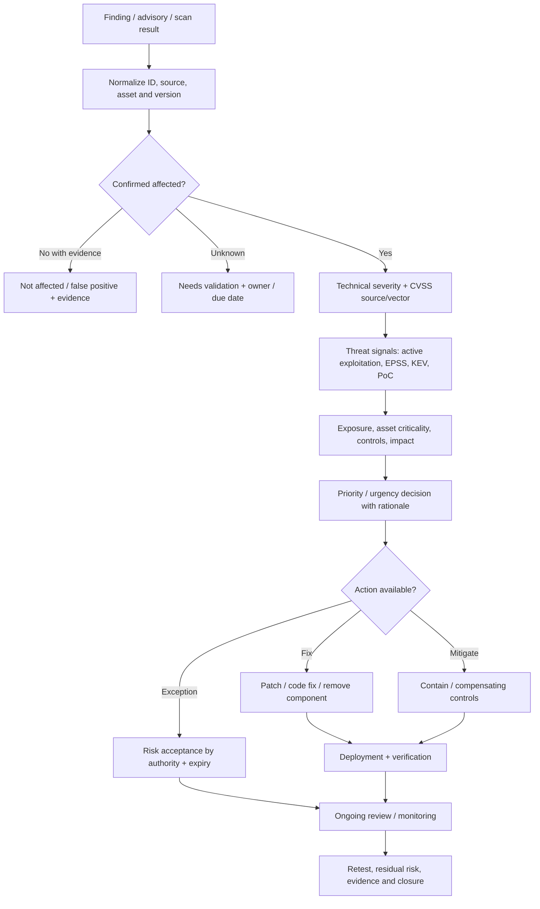
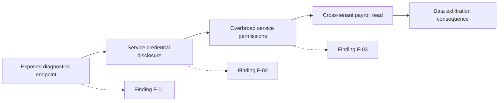

# Severity trong Vulnerability Management: đánh giá mức nghiêm trọng có bằng chứng

## 1. Vì sao phải hiểu đúng Severity?

Một hệ thống HR SaaS xuất hiện hai phát hiện bảo mật. Phát hiện thứ nhất là lỗ hổng thực thi mã từ xa trên một thành phần có điểm CVSS rất cao, nhưng thành phần này chỉ tồn tại trong môi trường thử nghiệm đã tách biệt và chưa chứng minh có đường khai thác thực tế. Phát hiện thứ hai có điểm kỹ thuật thấp hơn, nhưng xảy ra ở API production cho phép một nhân viên đọc dữ liệu lương của tenant khác khi thay ID trong request.

Nếu đội bảo mật chỉ sắp xếp theo **điểm CVSS** rồi xử lý tuần tự, họ có thể trì hoãn một vấn đề đang trực tiếp đe dọa dữ liệu khách hàng. Ngược lại, nếu mọi lỗi được tự ý gắn nhãn “Critical” để yêu cầu sửa ngay, chương trình sẽ quá tải, mất tính nhất quán và khó giải trình vì sao một việc được ưu tiên hơn việc khác.

**Severity** là **mức độ nghiêm trọng của một lỗ hổng hoặc phát hiện trong phạm vi đánh giá đã xác định**, thường phản ánh đặc tính kỹ thuật và hậu quả có thể có nếu điều kiện khai thác được thỏa mãn. Severity cung cấp một đầu vào quan trọng để quyết định thứ tự và thời hạn xử lý, **nhưng không đồng nghĩa hoàn toàn với xác suất bị khai thác, rủi ro nghiệp vụ hay remediation priority**.

Trong chương **Vulnerability management** thuộc module **SECURITY_SECURITY_ASSURANCE**, chúng ta không chỉ gán nhãn High/Medium/Low. Chúng ta cần **chứng minh bằng nguồn, dữ liệu, phương pháp, kiểm thử và quyết định có thẩm quyền** vì sao một phát hiện được xếp mức đó; kết nối phân tích rủi ro, yêu cầu và security controls với kiểm thử, audit, khắc phục, xác minh lại và vận hành chương trình assurance liên tục.

### Mục tiêu học tập

Sau bài học này, bạn có thể:

1. Phân biệt **technical severity, exploitability, likelihood, exposure, business impact, risk và remediation priority**.
2. Hiểu cách đọc severity theo **CVSS v3.1, CVSS v4.0** và giới hạn của từng thành phần đánh giá.
3. Dùng các tín hiệu như **EPSS, bằng chứng khai thác thực tế, thông tin advisory, cấu hình và mức phơi nhiễm** đúng vai trò.
4. Xây dựng rubric đánh giá nhất quán, có lý do override và phân biệt Unknown với Low.
5. Xác minh lỗ hổng có thực, phạm vi tài sản bị ảnh hưởng và biện pháp bù đắp đang hiệu lực.
6. Chuyển kết quả triage thành quyết định có owner, thời hạn, kế hoạch sửa, retest và residual-risk assessment.
7. Thiết kế evidence package và metrics để người đánh giá độc lập có thể kiểm tra lại quyết định.

> **Lưu ý:** các ngưỡng ví dụ trong bài là minh họa cho phương pháp xây dựng chính sách. Severity labels, thời hạn xử lý và thẩm quyền chấp nhận rủi ro phải dựa trên policy, hợp đồng, yêu cầu pháp lý và bối cảnh đã được tổ chức phê duyệt. Không tự áp dụng một SLA hoặc công thức điểm chung cho mọi hệ thống.

## 2. Bộ thuật ngữ phải tách bạch

| Khái niệm | Câu hỏi trả lời | Ví dụ |
| --- | --- | --- |
| **Vulnerability** | Điểm yếu nào có thể bị khai thác? | API không kiểm tra quyền trên đối tượng được yêu cầu. |
| **Finding** | Phát hiện cụ thể ở đâu, bằng phương pháp nào? | Test cross-tenant trên endpoint `/payroll/{id}` trả record sai tenant. |
| **Technical severity** | Nếu bị khai thác trong điều kiện xác định, hậu quả kỹ thuật lớn đến đâu? | Mất bí mật dữ liệu, có thể đọc hàng loạt bản ghi. |
| **Exploitability** | Khai thác đòi hỏi điều kiện/phức tạp/quyền gì? | Attacker cần đăng nhập hợp lệ nhưng không cần quyền payroll của tenant đích. |
| **Likelihood** | Khả năng bị khai thác trong bối cảnh/thời gian nhất định? | Phụ thuộc mức phơi nhiễm, hoạt động attacker, controls và tín hiệu đe dọa. |
| **Exposure/reachability** | Đường khai thác có tới được thành phần yếu không? | API public Internet hoặc service chỉ cho phép qua một gateway. |
| **Asset criticality** | Tài sản và dữ liệu quan trọng với nghiệp vụ đến đâu? | Payroll production chứa dữ liệu nhân viên nhạy cảm. |
| **Impact** | Hậu quả đối với bảo mật, vận hành, khách hàng và nghĩa vụ là gì? | Lộ dữ liệu tiền lương của nhiều tenant và gián đoạn xử lý. |
| **Risk** | Tổ hợp bất định về sự kiện xảy ra và hậu quả trong bối cảnh tổ chức. | Khả năng lộ dữ liệu và mức thiệt hại còn lại sau controls. |
| **Remediation priority** | Việc nào cần làm trước và theo thời hạn nào? | Chặn đường đọc sai tenant ngay, song song điều tra phạm vi. |
| **Residual risk** | Rủi ro còn lại sau controls đang có hiệu lực. | Đã chặn API qua gateway nhưng đường gọi nội bộ chưa test. |
| **Confidence** | Bằng chứng của kết luận đáng tin đến mức nào? | Đã tái hiện trong staging, chưa xác minh mọi production entry points. |

**Từ khóa quan trọng:** một lỗ hổng có thể có **technical severity High** nhưng **priority thấp hơn** khi thực sự không hiện diện trong production; một lỗi có severity Medium theo một hệ quy chiếu kỹ thuật nhưng **priority khẩn** nếu đang bị khai thác vào tài sản cực kỳ quan trọng. Khi thay mức phân loại, phải ghi rõ **đang đổi severity, context-specific risk hay remediation priority**, không ghi một nhãn chung rồi xóa mất lý do.

### 2.1. Severity của lỗ hổng khác severity của incident

**Vulnerability severity** nói về điểm yếu tiềm tàng và điều kiện khai thác. **Incident severity** thường phản ánh mức độ sự cố đã xảy ra, phạm vi và hậu quả thực tế đối với tổ chức. Một lỗ hổng Medium có thể tham gia vào một sự cố Critical nếu bị dùng để đánh cắp dữ liệu lớn. Không lấy nhãn lỗ hổng để tự động gán mức sự cố, và không kết luận “đã bị khai thác” chỉ vì có PoC.

### 2.2. Severity cũng khác mức độ ưu tiên theo ticket

Issue tracker có thể dùng `P0`, `P1`, `P2` cho tính cấp bách vận hành. Đây không nhất thiết là thang technical severity. Tổ chức cần bảng ánh xạ và định nghĩa rõ để một ticket `P1` không bị hiểu nhầm là điểm CVSS cao hay bằng chứng khai thác.

## 3. Severity được gán cho đối tượng nào?

Một số đối tượng dễ bị trộn:

- **Vulnerability definition:** điểm yếu độc lập với từng bản cài đặt, ví dụ một CVE của thư viện.
- **Affected asset instance:** một deployment, container image, server, package hoặc API thực sự tồn tại trong phạm vi.
- **Finding:** sự kết hợp giữa điểm yếu, tài sản, điều kiện, evidence và thời điểm xác minh.
- **Risk scenario:** chuỗi từ threat actor, điều kiện khai thác, bypass control đến hậu quả nghiệp vụ.
- **Remediation action:** nâng version, thay code, thay policy, cô lập hoặc loại bỏ tính năng.

Ví dụ cùng một CVE xuất hiện trong 50 images nhưng chỉ 3 services chạy package đó ở production. CVSS Base có thể **giống nhau** theo định nghĩa lỗ hổng; asset exposure, risk và remediation urgency có thể **khác nhau**. Nếu scanner tạo 50 findings, quản lý dedup theo vulnerability/resource/service cần tránh vừa đếm sai, vừa bỏ sót tài sản thật.

### 3.1. Scope cần được công bố

Một severity assessment phải nêu:

- Tên tài sản và version/build/digest hoặc API endpoint.
- Environment: production, staging, dev, CI/CD, backup, vendor.
- Data classification, tenant/region, asset owner và business service.
- Access path: Internet, authenticated, internal service, local/physical.
- Điều kiện cần thiết: role, configuration flag, reachable code path, affected library function.
- Controls giả định: WAF, IAM, network policies, sandbox, egress restriction, segmentation, monitoring.
- Bằng chứng tại thời điểm đánh giá và điều chưa biết.

Không suy ra một library vulnerable có nghĩa mọi phiên bản sản phẩm dùng thư viện đều khai thác được; nhưng cũng không hạ mức chỉ vì “chưa thấy tấn công” khi chưa kiểm tra reachability.

## 4. Thang Severity và ngưỡng điểm: nhất quán nhưng không máy móc

Nhiều tổ chức dùng năm mức **None, Low, Medium, High, Critical** hoặc bốn mức Low–Critical. Mỗi mức phải có định nghĩa, owner và hành động, không chỉ là màu trên dashboard.

### 4.1. Thang định tính minh họa

| Nhãn | Hậu quả kỹ thuật có thể có | Lưu ý khi đánh giá |
| --- | --- | --- |
| **Critical** | Khả năng thỏa điều kiện khai thác dẫn tới mất kiểm soát hệ thống, hoặc phá vỡ nghiêm trọng bí mật/toàn vẹn/sẵn sàng trên phạm vi lớn. | Cần phân tích điều kiện khai thác thật, không suy từ tên loại lỗi. |
| **High** | Có thể gây tổn hại đáng kể đến quyền, dữ liệu hoặc dịch vụ trong scope. | Kiểm tra reachable path, blast radius và controls. |
| **Medium** | Hậu quả hoặc điều kiện khai thác ở mức trung bình theo rubric đã duyệt. | Không có nghĩa có thể trì hoãn khi đang bị khai thác. |
| **Low** | Hậu quả kỹ thuật hạn chế trong điều kiện đã biết. | Cần có evidence và không che lỗ hổng ngoài scope. |
| **None / Not vulnerable** | Không có tác động trong mô hình điểm cụ thể, hoặc xác minh không bị ảnh hưởng (phải phân biệt). | CVSS None khác trạng thái finding False positive. |

Một rubric nên có **điều kiện ưu tiên theo rủi ro** khi có exploit thực tế, tài sản quan trọng hoặc quy định bắt buộc; điều này không phải lý do tự ý thay điểm CVSS Base.

### 4.2. Các dải qualitative severity thường dùng cho CVSS

| CVSS numerical score | Qualitative rating |
| --- | --- |
| **0.0** | None |
| **0.1 – 3.9** | Low |
| **4.0 – 6.9** | Medium |
| **7.0 – 8.9** | High |
| **9.0 – 10.0** | Critical |

Đây là các dải nhãn thường dùng của CVSS, **không phải cam kết SLA**, cũng không tự nói lỗ hổng có tồn tại trên asset đang xét. Báo cáo phải ghi **phiên bản CVSS và loại score** để tránh so sánh không tương đương. CVSS 3.1 và 4.0 có mô hình metric khác nhau; không coi một con số từ phiên bản này là phép quy đổi chính xác sang phiên bản kia.

### 4.3. Trạng thái finding khác nhãn severity

| Status | Ý nghĩa |
| --- | --- |
| **Open/Confirmed** | Có bằng chứng affected asset và điều kiện yếu tồn tại. |
| **Needs validation** | Dữ liệu chưa đủ hoặc phụ thuộc giả định; không mặc định Low. |
| **False positive** | Có chứng cứ công cụ báo sai/không có weakness theo kết quả kiểm chứng. |
| **Not affected** | Component có liên quan nhưng phiên bản/cấu hình/code path không bị ảnh hưởng theo căn cứ. |
| **Mitigated** | Có control giảm rủi ro hiệu lực, weakness có thể còn. |
| **Remediated** | Biện pháp sửa đã triển khai và kiểm chứng trong scope. |
| **Accepted risk** | Có quyết định chấp nhận residual risk đúng thẩm quyền, không làm weakness biến mất. |

Đặt `severity=Low` cho finding thiếu dữ liệu chỉ để dashboard đẹp là sai nguyên tắc assurance. Hãy để trạng thái **Unverified** và bổ sung owner/next action.

## 5. CVSS giúp giải quyết phần nào của Severity?

**Common Vulnerability Scoring System (CVSS)** cung cấp cách mô tả/định lượng đặc tính lỗ hổng kỹ thuật bằng bộ metrics có định nghĩa. Nó giúp so sánh và truyền thông một phần mức nghiêm trọng theo phương pháp tương đối chuẩn hóa.

Nhưng CVSS **không thay** việc:

- Xác minh product/version hoặc API cụ thể có bị ảnh hưởng không.
- Đánh giá exploit traffic, reachability, exposure và threat actor.
- Xác định dữ liệu/tenant, business impact và nghĩa vụ.
- Kiểm tra mitigating controls hiệu lực trong môi trường thật.
- Quyết định quyền, hành động, deadline, exception và acceptance.

Một báo cáo chỉ ghi “CVSS 9.8, Critical, must patch” có thể chưa đủ cho chương trình vulnerability management, nhất là khi nguồn score thiếu vector, nhầm phiên bản hoặc component không được triển khai.

### 5.1. Điểm và vector phải đi cùng nhau

CVSS numerical score làm mất chi tiết về **attack vector, complexity, privileges, user interaction và impact**. Một vector chứa thông tin vì sao điểm được tính ra; người review có thể đối chiếu với điều kiện khai thác thực. Nếu chỉ sao chép score mà không giữ nguồn/vector và metric version, rất khó audit quyết định sau này.

### 5.2. Vendor score và đánh giá nội bộ có thể khác nhau

Nhiều nguồn công bố có thể gán vector/score khác nhau do thông tin, assumption, phân tích phạm vi hoặc thời điểm cập nhật khác nhau. Khi có chênh lệch:

1. Ghi **cả nguồn, thời điểm, phiên bản và vector**.
2. Xác định metric/assumption gây khác biệt.
3. Review advisory, exploit preconditions và affected configuration.
4. Đề xuất điểm/đánh giá dùng trong nội bộ với lý do, reviewer và giới hạn.
5. Không ghi đè score gốc như thể vendor đã công bố giá trị nội bộ.

## 6. CVSS v3.1: Base, Temporal và Environmental

CVSS v3.1 gồm các nhóm metrics:

- **Base:** tính chất khai thác và tác động vốn có của lỗ hổng theo giả định của CVSS.
- **Temporal:** một số yếu tố thay đổi theo thời gian, ví dụ mức trưởng thành của mã khai thác, mức khắc phục và độ tin cậy báo cáo.
- **Environmental:** điều chỉnh đánh giá cho môi trường cụ thể, bao gồm yêu cầu về C/I/A và ảnh hưởng của môi trường đến các metrics thích hợp.

### 6.1. Base metrics thường thấy trong CVSS v3.1

| Nhóm | Metrics | Câu hỏi |
| --- | --- | --- |
| Exploitability | **AV — Attack Vector** | Cần tiếp cận qua network, adjacent, local hay physical? |
| Exploitability | **AC — Attack Complexity** | Điều kiện khai thác phức tạp đến đâu? |
| Exploitability | **PR — Privileges Required** | Attacker cần quyền gì trước khi khai thác? |
| Exploitability | **UI — User Interaction** | Cần thao tác của người khác để thành công không? |
| Impact | **S — Scope** | Hậu quả có vượt ranh giới quyền hạn theo định nghĩa v3.1 không? |
| Impact | **C — Confidentiality** | Bí mật dữ liệu/hệ thống bị tổn hại tới mức nào? |
| Impact | **I — Integrity** | Dữ liệu/trạng thái có thể bị sửa trái phép tới mức nào? |
| Impact | **A — Availability** | Mức gián đoạn hoặc mất khả dụng có thể có? |

### 6.2. Ví dụ đọc vector mà không tự tạo score

Giả sử một advisory có vector CVSS v3.1 được nguồn đáng tin công bố. Reviewer phải đọc ý nghĩa từng metric, sau đó xác minh **đúng sản phẩm, cách cấu hình, quyền cần có, user interaction và tác động**. Không được tự lấy vector từ một finding BOLA rồi tự suy ra numerical score mà không áp dụng công thức/specification tương ứng.

**Quan trọng:** `Scope` là metric của mô hình CVSS v3.1, **không dùng như một trường tương ứng trực tiếp trong CVSS v4.0**. Khi chuyển phương pháp scoring phải thay đổi cách diễn giải impact theo phiên bản.

## 7. CVSS v4.0: mô hình cập nhật và cách dùng đúng

CVSS v4.0 phân biệt các nhóm **Base, Threat, Environmental, Supplemental**. Việc ghi rõ v4.0 trong evidence giúp tránh trộn các fields và score từ phiên bản trước.

### 7.1. Base metrics của v4.0

| Nhóm | Metrics | Ý nghĩa khi triage |
| --- | --- | --- |
| Exploitability | **AV — Attack Vector** | Đường tiếp cận khai thác. |
| Exploitability | **AC — Attack Complexity** | Điều kiện/độ phức tạp thuộc vulnerability. |
| Exploitability | **AT — Attack Requirements** | Điều kiện tiền đề bên ngoài kiểm soát attacker phải có. |
| Exploitability | **PR — Privileges Required** | Quyền trước khi khai thác. |
| Exploitability | **UI — User Interaction** | Yêu cầu tương tác từ người dùng khác. |
| Vulnerable-system impact | **VC / VI / VA** | Confidentiality / Integrity / Availability của hệ thống chứa điểm yếu. |
| Subsequent-system impact | **SC / SI / SA** | Tác động C/I/A đối với hệ thống tiếp theo chịu hậu quả, nếu có. |

V4.0 tách **vulnerable system** và **subsequent system** để mô tả tác động vượt thành phần bị lỗi; không đơn giản thay Scope v3.1 bằng một boolean. Ví dụ một service có thể chỉ có đặc quyền hẹp, nhưng một lỗ hổng khiến nó thao tác trái phép trên hệ thống mà nó kết nối. Reviewer phải đọc định nghĩa metric theo chuẩn và mô hình kiến trúc thực.

### 7.2. Threat, Environmental và Supplemental

- **Threat metrics:** mô tả đặc điểm đe dọa biến đổi theo thời gian, nhất là bằng chứng/mức trưởng thành khai thác theo mô hình v4.0.
- **Environmental metrics:** điều chỉnh cho môi trường triển khai và tính quan trọng của các tác động tới tài sản.
- **Supplemental metrics:** cung cấp ngữ cảnh bổ sung, không được tùy ý coi là thành phần cộng vào numerical base score.

Các loại score v4.0 có ký hiệu phản ánh tổ hợp nhóm sử dụng; khi báo cáo cần ghi rõ **Base (B)**, **Base + Threat (BT)**, **Base + Environmental (BE)** hay **Base + Threat + Environmental (BTE)** nếu áp dụng theo cách mô hình quy định. Không gọi mọi giá trị là “CVSS Base”.

### 7.3. Không dùng CVSS v4.0 và v3.1 như thể cùng một rubric

| Câu hỏi | CVSS v3.1 | CVSS v4.0 |
| --- | --- | --- |
| Trọng tâm Base | Exploitability + impact với Scope. | Exploitability + tác động vulnerable/subsequent systems. |
| Điều kiện khai thác | AV, AC, PR, UI. | AV, AC, AT, PR, UI. |
| Phân loại tác động | C, I, A và Scope. | VC/VI/VA và SC/SI/SA. |
| Thành phần biến đổi | Temporal, Environmental. | Threat, Environmental, Supplemental. |
| So sánh trực tiếp score | Không chuyển đổi tự động. | Ghi vector/version/scope rõ ràng. |

Một số lỗ hổng chưa có vector v4.0 hoặc có score từ nhiều bên; điều đó không làm chúng tự động ít nghiêm trọng hơn. Tổ chức nên có baseline về phiên bản scoring sử dụng và lộ trình áp dụng theo dữ liệu thực tế.

## 8. EPSS, KEV và tín hiệu khai thác: bổ sung chứ không thay Severity

Từ điểm kỹ thuật đến hành động ưu tiên, cần hiểu **mối đe dọa có đang diễn ra và khả năng khai thác thay đổi thế nào**. Những tín hiệu này không cùng một loại và không được xem như xác nhận thay thế nhau.

### 8.1. EPSS là gì?

**Exploit Prediction Scoring System (EPSS)** cung cấp ước lượng xác suất một CVE được khai thác ngoài thực tế trong **30 ngày tiếp theo** dựa trên mô hình thống kê và dữ liệu mà hệ thống sử dụng. Nó hỗ trợ lập thứ tự triage theo tín hiệu đe dọa, không mô tả trực tiếp hậu quả kỹ thuật của lỗ hổng.

Khi đọc EPSS cần lưu:

- CVE được đánh giá, ngày chụp dữ liệu, xác suất ước lượng và percentile nếu có.
- Mô hình/nguồn dữ liệu và khả năng cập nhật theo ngày.
- Cách hiểu percentile: vị trí tương đối giữa các CVE được chấm, **không phải xác suất khai thác**.
- Giới hạn: kết quả là dự báo xác suất, không là xác nhận lỗ hổng có trên asset, code path reachable, hay attacker sẽ nhắm chính hệ thống của bạn.

**Ví dụ giả định:** EPSS probability 0.08 được diễn giải theo mô hình là khoảng 8% khả năng CVE được quan sát khai thác trong khung thời gian dự báo được quy định, **không phải “8% tài sản của doanh nghiệp sẽ bị hack”**. Khi dùng cho chính sách tự động, cần kiểm tra cách lấy dữ liệu, thời điểm và độ mới của nguồn.

### 8.2. KEV là gì?

**Known Exploited Vulnerabilities (KEV)** là danh mục lỗ hổng có bằng chứng về khai thác thực tế theo tiêu chí của đơn vị duy trì danh mục, ví dụ catalog của CISA. **Có tên trong KEV** là tín hiệu mạnh để triage khẩn và đánh giá asset exposure; **không có tên trong KEV** không chứng minh lỗ hổng không bị khai thác.

Lưu ý:

- KEV entry là tín hiệu về lỗ hổng đã được khai thác, không tự chứng minh attacker đã xâm nhập asset của tổ chức.
- Cần đối chiếu CVE với product/version, business service và môi trường đang có.
- Nghĩa vụ và deadline gắn với catalog, khi có, **không tự áp dụng cho mọi tổ chức**; review đối tượng chịu ràng buộc và chính sách thực tế.
- Nếu có nguồn evidence incident, exploitation telemetry hoặc threat intelligence khác phù hợp, ghi riêng nguồn và mức tin cậy.

### 8.3. Exploit code, PoC và exploitation in the wild

| Tín hiệu | Chứng minh được | Chưa chứng minh |
| --- | --- | --- |
| Có advisory và CVE | Có mô tả weakness và các sản phẩm/phiên bản liên quan. | Asset nội bộ vulnerable hoặc đang bị tấn công. |
| Có PoC công khai | Có cách minh họa/hỗ trợ kiểm chứng điều kiện nhất định. | Có khai thác quy mô lớn hoặc thành công trên hệ thống của bạn. |
| Có exploit code được dùng rộng | Khả năng triển khai tấn công có thể dễ hơn. | Mọi cấu hình sản phẩm đều bị ảnh hưởng. |
| Có KEV/evidence exploitation | Có bằng chứng về khai thác thực tế theo nguồn. | Mọi deployment đã bị compromise. |
| Có WAF/IDS alert | Có tín hiệu một pattern bị phát hiện. | Payload chắc chắn khai thác thành công; cần đối chiếu context. |
| Có IoC và forensic evidence nội bộ | Có dấu hiệu đáng điều tra trên asset cụ thể. | Không thay quy trình incident triage và xác nhận. |

### 8.4. Không nhân CVSS × EPSS để tạo “risk score” mặc định

CVSS và EPSS phản ánh **đại lượng và assumptions khác nhau**. Nhân chúng rồi gán một threshold tùy ý dễ tạo cảm giác chính xác giả, che assets quan trọng hoặc vulnerability không có CVE/EPSS. Nếu tổ chức xây mô hình định lượng riêng, phải mô tả giả định, kiểm định dữ liệu, quản lý version, hiệu chỉnh và kiểm soát ngoại lệ. Với chương trình assurance, cách an toàn hơn thường là **decision rubric rõ ràng dựa trên nhiều tín hiệu, có quyền phê duyệt và audit trail**.

## 9. Dữ liệu đầu vào của một severity assessment đáng tin

Một phiếu đánh giá nên giữ **nguồn gốc, thời điểm và giới hạn** của từng input, thay vì copy điểm từ scanner vào ô Severity rồi coi là sự thật.

| Đầu vào | Ví dụ nguồn | Câu hỏi kiểm chứng |
| --- | --- | --- |
| Vulnerability ID/type | CVE, CWE, advisory, test finding riêng. | Định danh có đúng weakness, không nhầm product/issue? |
| Affected range | Vendor advisory, package manifest, product config. | Installed version/digest/config có nằm trong affected scope? |
| Vulnerability description | Research/advisory/threat model. | Điều kiện khai thác và hậu quả có được diễn giải chính xác? |
| CVSS score/vector/version | Nguồn công bố hoặc scoring nội bộ. | Có đầy đủ vector, version, source, time và metric type? |
| Exploit intelligence | EPSS, KEV, credible exploitation reports. | Dữ liệu còn mới, chứng minh loại điều gì? |
| Asset inventory | CMDB, SBOM, deployment manifests, cloud inventory. | Asset có chạy ở production, public, customer-facing? |
| Runtime configuration | Flags, bindings, IAM, network/routes, WAF, service mesh. | Đường yếu có reachable không, config thực tế khác IaC không? |
| Business/data context | Data owner, classification, architecture, BIA. | Ai và tài sản nào chịu tác động? Scope nhiều tenant? |
| Mitigating controls | Verified IAM, segmentation, RASP/WAF, validation, egress. | Có test chứng minh hiệu lực, coverage và bypass không? |
| Attack preconditions | Privileges, user interaction, required state, timing. | Có khả thi trong môi trường hoặc chỉ là giả định chưa kiểm? |
| Business constraints | Patch downtime, provider dependencies, legal obligations. | Hành động sửa nào khả thi, risk acceptance authority là ai? |
| Verification | Scanner evidence, safe repro, config inspection, negative tests. | Finding confirmed, false positive hay unverified? |

### 9.1. Cần ghi cả evidence ngược chiều

Nếu scanner nói “CVE present” nhưng vendor advisory nêu tính năng dễ tổn thương không được build vào binary, ghi cả hai: scanner source và **bằng chứng loại trừ** như build manifest, symbol/path validation hoặc attestation phù hợp. Không xóa finding chỉ bằng câu “team nghĩ là không dùng”.

Ngược lại, nếu thư viện có trong SBOM nhưng không biết nó có reachable không, trạng thái là **needs validation**, không phải “not affected”.

### 9.2. Khả năng truy vết theo phiên bản và thời gian

Sự thật có thể thay đổi sau deploy. Một vulnerability được xác minh ở image digest A không tự tồn tại ở image digest B. EPSS và exploit evidence cũng có thể đổi theo ngày; asset được chuyển từ Internet-facing sang private hoặc ngược lại. Cần lưu **assessment timestamp, source snapshot, build/version, target asset và review trigger**.

## 10. Bối cảnh môi trường: severity không sống trong chân không

### 10.1. Reachability và attack surface

Đánh giá cần biết:

1. Thành phần vulnerable có cài đặt, được nạp hoặc tham gia luồng request không?
2. Attacker có thể tới endpoint hay code path đó từ vị trí nào?
3. Có cần credential, role, feature flag, input đặc biệt hoặc người dùng khác thao tác không?
4. API gateway, IAM, network segmentation, egress policy, sandbox hoặc policy khác có chặn đường không?
5. Có đường bypass qua nội bộ, maintenance port, batch job, control plane hoặc plugin không?

**Internet-facing** thường làm tăng cơ hội tiếp xúc attacker, nhưng “internal-only” không có nghĩa an toàn: compromised host, contractor, service identity hoặc sai policy có thể tạo đường khai thác. Trình bày **trust boundary, principal và preconditions** thay vì kết luận từ một IP private.

### 10.2. Exposure không đồng nghĩa tổn hại

Một port Internet-facing không nhất thiết exploitable bởi CVE nếu affected function không reachable. Một library vulnerable được scan trong container có thể không được gọi bởi application, nhưng **chứng minh không reachable** thường khó và có thể thay đổi sau feature flag hoặc release. Dùng mức **confidence**, test và lịch xem lại, tránh lập luận tuyệt đối.

### 10.3. Compensating controls phải có effective evidence

WAF, input validation, authz, segmentation và isolation có thể giảm khả năng khai thác một số đường. Để ghi nhận tác dụng cần:

- Định nghĩa attack path được control bảo vệ.
- Runtime policy/route/source version và owner.
- Positive/negative test hoặc telemetry đủ chứng minh trong scope.
- Phân tích bypass, alternative entry point và tình trạng fail-open.
- Trigger đánh giá lại khi policy, version, exposure hoặc threat thay đổi.

“Đã bật WAF” không tự có nghĩa một lỗi memory corruption hay broken access control được bảo vệ. Một rule chặn signature có thể không bao phủ biến thể, đường API khác hoặc request từ nguồn nội bộ.

### 10.4. Blast radius và multi-tenancy

Một lỗ hổng chỉ lộ một non-sensitive record khác một lỗ hổng có thể đọc toàn bộ payroll của nhiều tenant. Review **tenant isolation, role boundaries, privilege chain, downstream systems và dữ liệu lưu trong cache/export/backup**.

Đừng giả định ảnh hưởng toàn bộ khách hàng nếu weakness chỉ xảy ra ở một tenant đã bật feature, nhưng cũng đừng đánh giá chỉ một tài khoản thử nếu exploit có khả năng lặp qua hàng triệu resources.

## 11. Impact: ảnh hưởng C/I/A và hậu quả nghiệp vụ

### 11.1. Tác động kỹ thuật

- **Confidentiality:** truy cập dữ liệu, secrets hoặc metadata không được phép.
- **Integrity:** sửa hồ sơ, cấu hình, giao dịch hoặc quyền trái phép.
- **Availability:** làm gián đoạn dịch vụ, tiêu thụ tài nguyên, phá khóa hoặc xóa dữ liệu.

Cần nêu **phạm vi tối đa có căn cứ** theo assumptions của vector và architecture: một record, một tenant, một workload, nhiều service, admin plane hay toàn hệ thống. Không suy từ tên lỗ hổng như XSS, SQL injection, DoS hoặc RCE mà bỏ qua điều kiện khai thác và phạm vi thật.

### 11.2. Business impact cần phân biệt khỏi CVSS

| Business dimension | Câu hỏi |
| --- | --- |
| Khách hàng và dữ liệu | Có dữ liệu cá nhân, payroll, thanh toán hoặc tài sản trọng yếu? |
| Quy mô | Bao nhiêu tenant, business units, workloads hoặc users có thể chịu tác động? |
| Gián đoạn | Có ảnh hưởng dịch vụ quan trọng, thời gian xử lý, SLA hay nghĩa vụ phục vụ? |
| Gian lận và tài chính | Có thể thay giao dịch, phê duyệt hoặc tạo khoản chi sai không? |
| Trust/reputation | Hậu quả với đối tác, khách hàng hoặc khả năng cung cấp bằng chứng? |
| Compliance/contract | Có nghĩa vụ báo cáo, xử lý hoặc thời hạn theo phạm vi áp dụng? |
| Khả năng phát hiện/phục hồi | Có telemetry, backup, rollback và response đủ phù hợp không? |

Một business owner nên xác nhận hậu quả, thay vì đội scanner tự quyết định tất cả giá trị. Không gộp ngay chi phí khắc phục vào **mức hậu quả bảo mật**: patch tốn nhiều công sức không làm weakness bớt nghiêm trọng.

### 11.3. Hậu quả thực tế khác hậu quả tiềm năng

Một lỗ hổng có khả năng cho attacker sửa dữ liệu nhưng chưa có bằng chứng dữ liệu đã bị sửa. Severity đánh giá **tiềm năng và điều kiện**; forensic investigation đánh giá **sự kiện đã xảy ra**. Cần phân biệt và có thể mở incident nếu có dấu hiệu khai thác, nhưng không coi “không thấy compromise” là “impact zero”.

## 12. Quy trình triage Severity có thể audit

Một chương trình vulnerability management nên vận hành theo **quy trình có bước, điểm quyết định và evidence**, thay vì đánh dấu thủ công trên bảng tính không có lịch sử.



### 12.1. Triage theo các bước

1. **Intake:** nhận scanner/advisory/pentest/bug report, chuẩn hóa nguồn, CVE/CWE, asset và owner.
2. **Deduplicate:** tránh nhiều tickets cho cùng một instance mà vẫn giữ các affected deployments và đường khai thác riêng.
3. **Validate:** kiểm tra affected version, code path, config và preconditions; phân biệt confirmed/unknown/false positive.
4. **Assign technical severity:** giữ source vector/score/version và lý do giải thích impact; tự chấm khi không có score phù hợp theo phương pháp đã duyệt.
5. **Evaluate threat:** KEV/EPSS, exploitation evidence, attack automation và tín hiệu nội bộ.
6. **Evaluate context:** exposure, asset classification, business impact, mitigating controls và blast radius.
7. **Set remediation priority/target:** lập quyết định urgency, deadline, owner, hướng xử lý và phê duyệt.
8. **Implement and verify:** patch, thay cấu hình, block path, cô lập hoặc loại bỏ, sau đó kiểm thử lại.
9. **Review residual risk:** đối chiếu remaining assets, bypass và controls hiện hành; không tự giảm khi ticket chuyển Done.
10. **Monitor/reassess:** khi exploit phát triển, component mới deploy, scope thay đổi hoặc SLA đến hạn.

### 12.2. Luồng không nên dùng

Không nên: scanner → copy score → gán Critical → tạo deadline cố định → tick Fixed khi PR merge. Luồng đó bỏ qua affected deployment, nguồn, preconditions, exploit intelligence, business ownership và runtime verification.

## 13. Xây rubric quyết định: severity, priority và urgency tách nhau

Một rubric nhất quán là bảng/logic quyết định có **input, đầu ra, người phê duyệt và ngoại lệ**. Nó không nhất thiết là một công thức số duy nhất.

### 13.1. Bảng triage định tính minh họa

| Technical severity | Threat/exposure | Business context | Quyết định triage minh họa |
| --- | --- | --- | --- |
| Critical/High | Có bằng chứng khai thác thực tế, reachable production. | Tài sản nhạy cảm hoặc nhiều tenant. | Escalate khẩn, cân nhắc incident response/containment; đặt action theo policy. |
| High | Public reachable, PoC khả thi, chưa xác minh bị tấn công. | Production quan trọng. | Ưu tiên cao, xác minh nhanh và triển khai mitigation/fix. |
| High | Component không deployed trong scope với evidence rõ. | Không có impacted assets trong kỳ. | Ghi not affected cho scope, theo dõi thay đổi build. |
| Medium | Có active exploitation evidence phù hợp use case. | API nhạy cảm và reachable. | Có thể ưu tiên khẩn hơn High chưa reachable; ghi rationale. |
| Low | Exposed service, nhưng impact hạn chế. | Không có dữ liệu nhạy cảm theo evidence. | Theo backlog/chu kỳ đã duyệt; review khi exposure thay đổi. |
| Unknown | Chưa xác định affected version/reachability. | Tài sản critical, thông tin threat chưa đủ. | Không hạ Low; mở validation với owner/hạn và precaution nếu cần. |

### 13.2. Chọn cách đặt priority phù hợp tổ chức

Có thể dùng labels `P0–P3` hoặc `Urgent / High / Normal / Planned` nhưng phải giải thích **ai được cấp nhãn, thời điểm đánh giá, điều kiện trigger, timeline và thẩm quyền**. Priority có thể đổi khi:

- Xuất hiện evidence active exploitation, KEV, exploitation nội bộ.
- Phát hiện endpoint thực ra đang public hoặc WAF rule bị tắt.
- Asset được nâng data classification hay mở rộng số tenant.
- Có patch/fix khả dụng, remediation window thay đổi hoặc provider phát advisory mới.
- Finding đã được xác minh false positive/not affected trên deployment cụ thể.

Priority không được giảm chỉ vì người phụ trách sửa đang bận. Capacity ảnh hưởng **kế hoạch thực thi và escalation**, không thay hậu quả/security context đã xác minh.

### 13.3. Người ra quyết định có thể khác người chấm CVSS

Security engineer có thể phân tích kỹ thuật; asset owner xác nhận impact; threat intelligence/incident responder cung cấp threat evidence; program owner quyết định lịch xử lý trong thẩm quyền; risk owner mới có quyền chấp nhận residual risk theo policy. Không cho phép một người tự chấm mức thấp, tự xác nhận controls và tự phê duyệt ngoại lệ rủi ro cao nếu điều đó vượt giới hạn phân nhiệm.

## 14. Khi thiếu dữ liệu: uncertainty, confidence và escalation

Severity không nên giả vờ chắc chắn khi chưa đủ evidence. Ghi rõ **điều biết, chưa biết, giả định, cách kiểm tra tiếp theo và thời hạn**.

| Confidence | Tình huống minh họa | Hành động |
| --- | --- | --- |
| **High** | Vendor advisory khớp asset/version, config và test safe repro thành công. | Confirmed, action và deadline rõ. |
| **Moderate** | Match version, path có thể reachable nhưng chưa test an toàn. | Triage theo risk, thêm validation/test, không đợi vô hạn. |
| **Low** | Scanner chỉ dựa banner cũ; không biết binary runtime. | Needs validation, thu build/digest/config evidence. |
| **Unknown** | Không có access hoặc hệ thống do vendor quản lý, chưa có báo cáo. | Ghi blocker, yêu cầu owner/vendor evidence, biện pháp tạm. |

### 14.1. False positive và false negative

- **False positive:** scanner báo lỗ hổng không thực sự tồn tại/áp dụng trong deployment cụ thể. Cần chứng cứ loại trừ.
- **False negative:** scanner không phát hiện weakness vẫn tồn tại, ví dụ do thiếu quyền scan, hidden endpoint, không có CVE, sai agent hoặc environment không được scan.

Không thể chứng minh “không có lỗ hổng” chỉ từ một lần scan trả về 0 findings. Coverage và scanner limitations phải được công bố.

### 14.2. Confidence không phải một loại severity mới

Một phát hiện có technical severity Critical nhưng confidence Moderate. Không có nghĩa chuyển thành Medium. Báo cáo hai chiều: **Severity: Critical (source X), Confirmation: Needs validation (reason Y), Priority: urgent validation/containment theo policy**. Nếu kết quả kiểm chứng thay đổi, lưu version assessment, rationale và người review.

## 15. Severity theo loại lỗ hổng: không chỉ có CVE và package scan

Nhiều phát hiện vulnerability management có CVE, nhưng không phải mọi yếu điểm đều có CVE hoặc điểm CVSS công khai. **Business logic flaws, broken object-level authorization, insecure defaults, misconfigured IAM, secret leakage, data isolation, rate-control failures** có thể xuất hiện qua design review, pentest, code review hoặc incident investigation.

### 15.1. Phân biệt cách đánh giá

| Loại finding | Evidence quan trọng | Lỗi suy luận thường gặp |
| --- | --- | --- |
| Third-party package vulnerability | Affected version, manifest/SBOM, usage, advisory, available fix. | Package tồn tại nghĩa là mọi function khai thác được. |
| API object authorization | Actor, tenant, resource, expected vs actual permission, safe repro. | Chỉ là “Medium vì cần login”, bỏ blast radius nhiều tenant. |
| Cloud IAM misconfiguration | Effective grants, principal, resource, public/cross-account exposure. | Cấu hình IaC đã sửa nên production an toàn. |
| Secrets exposed | Loại credential, scope, thời gian tồn tại, usage, revoke evidence. | Xóa secret khỏi Git nghĩa là không còn khả năng lạm dụng. |
| Cryptographic weakness | Key/material exposure, algorithm/mode, relevant data flow và preconditions. | “Dùng thuật toán cũ” tự đồng nghĩa khai thác mọi dữ liệu. |
| Weak authentication/session | MFA/session flow, token audience/scope, lifecycle và bypass. | User login thành công nghĩa là mọi access hợp lệ. |
| Availability/resource exhaustion | Reachable input, quotas, retries, downstream dependencies và recovery. | Gán Critical chỉ vì có thể gây nhiều request lỗi trong test. |
| Insecure design/business logic | Threat scenario, trust boundary, action/resource/business consequences. | Không có CVE nên không cần severity. |
| Logging/audit weaknesses | Event omission, tamper access, secrets in log, investigation impact. | Không phát hiện incident nghĩa là log đủ. |

### 15.2. CWE và CVE không giống nhau

**CWE** mô tả kiểu điểm yếu, ví dụ thiếu authorization hoặc xử lý dữ liệu đầu vào không an toàn. **CVE** định danh một lỗ hổng được công bố theo quy trình và phạm vi cụ thể. Không thể lấy severity mặc định từ tên CWE; nhiều weakness cùng loại có thể có exploit conditions và impacts khác nhau.

### 15.3. Không có CVSS không có nghĩa không có Severity

Một finding nội bộ không có CVE vẫn có thể được review theo **rubric kỹ thuật**: attacker capability, preconditions, privilege, user interaction, confidentiality/integrity/availability và affected scope. Nếu tự áp dụng CVSS cho finding nội bộ, phải ghi **assessor, metric definitions, version, vector và calculation method**; nếu chỉ dùng rubric khác, không gắn nhãn “CVSS 9.0” mà không thực sự tính theo specification.

## 16. Severity của thành phần và Severity của deployment

Một package có lỗ hổng theo advisory không có nghĩa mọi deployment chứa nó có cùng mức risk. Cần giữ hai cấp:

1. **Vulnerability-level technical severity:** thông tin từ advisory/vector/analysis cho weakness.
2. **Instance/deployment context:** điều kiện của asset thật: version, feature, reachability, trust boundary, dữ liệu, mitigating controls và impact.

### 16.1. Ví dụ cùng lỗ hổng ở ba môi trường

| Deployment | Technical severity gốc | Deployment context | Triage |
| --- | --- | --- | --- |
| **Prod API Internet-facing** | High theo advisory giả định. | Vulnerable path reachable, dữ liệu nhạy cảm; chưa có mitigation. | Ưu tiên cao, xác minh và khắc phục theo policy. |
| **Staging tách biệt** | High theo cùng advisory. | Chỉ dữ liệu giả, không Internet, nhưng có shared secrets cần xem. | Xác minh isolation; risk có thể thấp hơn production nhưng không auto N/A. |
| **Binary build không bao gồm affected feature** | High theo advisory gốc. | Có evidence build/config rằng code path không tồn tại. | Ghi Not affected cho build cụ thể, review khi rebuild. |

Không sửa score gốc thành Low trong dòng thứ hai chỉ vì deployment staging. Ghi **technical severity và environment-specific risk/priority riêng**, hoặc dùng Environmental metrics theo quy trình đã duyệt khi cần.

### 16.2. Một component nhiều sản phẩm

Nếu một vulnerable image base được dùng bởi 20 services, cần xác định số **unique affected deployments** và owners để lập kế hoạch sửa chung, nhưng vẫn giữ mapping từ artifact digest đến từng service/environment. Một patch ở base image chưa có nghĩa tất cả instances đã redeploy.

### 16.3. Thời gian tồn tại ảnh hưởng risk

Một workload ephemeral chạy 10 phút không tự là vô hại nếu nó mang privileged credentials, truy cập secrets hoặc artifact build. Cần biết **cửa sổ chạy, lịch lặp, quyền, reachability và hậu quả nếu compromise**. Không dùng uptime ngắn làm biện pháp bù đắp mặc định.

## 17. Ví dụ so sánh bốn findings theo context

Bảng này dùng tình huống giả định, **không gán numerical CVSS cho một CVE thực**:

| Finding | Technical severity ban đầu | Context đáng chú ý | Ưu tiên tham khảo |
| --- | --- | --- | --- |
| **F-A**: RCE ở thư viện backend | Critical theo advisory giả định | Chỉ trong job không triển khai production; cần chứng minh artifact scope. | Xác minh gấp có bị deploy không; nếu Not affected có evidence thì không khắc phục asset không tồn tại. |
| **F-B**: BOLA ở payroll export | High theo rubric nội bộ | API public, cần account hợp lệ; có thể đọc record tenant khác. | Khẩn theo impact/cross-tenant exposure, containment song song fix. |
| **F-C**: Misconfiguration logging | Medium theo rubric | Một service lưu token nhạy cảm trong log có người đọc rộng. | Ưu tiên nâng tùy scope credential và evidence lộ; rotate/revoke khi phù hợp. |
| **F-D**: Lỗi thông tin phiên bản trong header | Low theo rubric | Không có exploit chain/hậu quả lớn được chứng minh. | Theo backlog chuẩn, recheck khi threat model thay đổi. |

**Điều cần học:** không thể xếp F-A đến F-D một cách có trách nhiệm chỉ bằng nhãn điểm. F-B có thể cần trước F-A nếu F-A không hiện diện production; F-C có thể nghiêm trọng hơn nếu token bị lộ có quyền KMS hoặc admin; F-D có thể thành một mắt xích trong exploit chain nhưng điều đó phải có bằng chứng/logic rõ.

### 17.1. So sánh với score giả định

Nếu tổ chức lưu CVSS Base 9.8 và 6.5 cho hai vulnerabilities, các số này **chỉ là dữ kiện severity kỹ thuật**. Bên quản lý vẫn cần:

- Vulnerability confirmation và affected deployment.
- Threat signals hiện hành.
- Attack reachability và preconditions.
- Business impact và security controls hiệu lực.
- Action available, owner, deadline và decision.

Không nên viết “6.5 thấp hơn 9.8 nên không cần xem ngay” nếu có evidence exploitation hoặc dữ liệu rủi ro cao.

## 18. Exploit chain và nhiều điểm yếu kết hợp

Đôi khi một finding riêng lẻ có impact hạn chế nhưng có thể là bước đầu của **chuỗi khai thác**: disclosure endpoint → lấy service identity → gọi API nội bộ → đọc dữ liệu nhiều tenant. Severity theo một lỗi riêng có thể chưa phản ánh đầy đủ **combined scenario**.

### 18.1. Ví dụ chuỗi đa thành phần



Mỗi finding vẫn cần đánh giá riêng theo tính chất và impact trực tiếp. Bên cạnh đó, risk register có thể lập **exploit chain risk scenario** với chủ thể, điều kiện, dependency, probability/impact theo phương pháp tổ chức. Không tùy ý cộng điểm CVSS để cho ra “CVSS tổng”; mô hình CVSS không dùng như vậy.

### 18.2. Đánh giá controls theo cả chuỗi

Đóng diagnostics endpoint có thể chặn một đường vào. Thu hồi credential và thu hẹp service permissions có thể giảm blast radius ngay cả khi endpoint chưa được sửa triệt để. Nhưng cần test **các đường khác** tạo credential, các token còn hạn và principal có quyền tương đương.

### 18.3. Mối liên hệ với threat modeling

Severity assessment nên tham chiếu:

- Trust boundaries và attacker starting point.
- Entry points và privileges trước/sau bước khai thác.
- Tài sản đích, tenant/resource scope, data classification.
- Controls và cách chúng có thể bị bypass.
- Chuỗi hành vi có khả thi, có giả định nào chưa được xác minh.

Một sơ đồ chỉ minh họa lý thuyết là **design evidence**, không chứng minh attacker đã thực hiện chuỗi đó trên hệ thống thật.

## 19. Định nghĩa thời hạn xử lý và nguyên tắc escalation

Severity thường ảnh hưởng đến **remediation SLA**, nhưng một ma trận deadline cần phân biệt severity, priority, asset criticality, threat evidence và các điều kiện đặc biệt. Không tự tuyên bố một mốc ngày cố định là bắt buộc theo CVSS.

### 19.1. Mẫu chính sách deadline có tham chiếu

| Điều kiện | Hành động thiết kế | Deadline |
| --- | --- | --- |
| Active exploitation, affected reachable critical asset | Escalate ngay cho security/incident owner; containment và fix plan. | Theo SLA khẩn đã duyệt hoặc obligation áp dụng. |
| High/Critical, public reachable production | Validation và fix/mitigation ưu tiên. | Theo severity/priority policy đã duyệt. |
| Medium, không có exploit evidence, asset ít critical | Remediation theo kỳ phù hợp; giám sát thay đổi. | Theo backlog/SLA được phê duyệt. |
| Unknown affected asset có consequence cao | Validation có owner, thời hạn; precaution khi cần. | Không chờ tới deadline patch mới xác minh. |
| Vendor chưa có fix | Mitigations, monitoring, escalation/vendor tracking, risk review. | Review trigger và ngoại lệ có hạn. |
| Evidence Not affected | Giữ chứng cứ và điều kiện tái đánh giá. | Không đặt deadline sửa một deployment không bị ảnh hưởng. |

### 19.2. Các mốc cần theo dõi

Không chỉ ghi một ngày cuối. Theo dõi:

1. First observed/publication time.
2. Time notified asset owner.
3. Time acknowledged và validated.
4. Severity/threat/context assessment time.
5. Deadline theo policy/contract/regulation phù hợp.
6. Mitigation applied và deployment time.
7. Verification/retest time.
8. Closure/risk acceptance date, review/expiry date.

Điều này cho phép đo **triage latency, remediation cycle time, time-at-risk, overdue status và reopen rate**. Một lỗ hổng không biến mất khi quá hạn; need escalation phù hợp.

### 19.3. Escalation và exceptions

Khi deadline có nguy cơ trễ hoặc có dấu hiệu khai thác đang diễn ra, thông báo tới đúng security/risk owner, phân tích control bù đắp và business impact, quyết định containment. Tổ chức cần phân biệt **chuyển deadline kế hoạch** với **phê duyệt chấp nhận residual risk**; người sở hữu ticket không tự có quyền thực hiện cả hai.

## 20. Fix, mitigate, contain, accept: không phải cùng một trạng thái

| Hành động | Ý nghĩa | Điều kiện evidence |
| --- | --- | --- |
| **Patch/upgrade** | Cập nhật code/package sang bản khắc phục. | Version/digest, deployment coverage và negative regression tests. |
| **Code fix/config fix** | Sửa authorization, validation, IAM hoặc logic dễ tổn thương. | Code/config diff và runtime tests đúng affected path. |
| **Remove feature/component** | Loại bỏ đường yếu hoặc sản phẩm không cần thiết. | Inventory, deployment/route verification, không có alternative path. |
| **Mitigate** | Giảm khả năng khai thác/hậu quả qua controls bù đắp. | Effective config, bypass analysis, detection và tests. |
| **Contain** | Hạn chế phơi nhiễm khẩn, ví dụ tạm khóa endpoint/role. | Phạm vi, tác động, rollback, approval và runtime verification. |
| **Accept risk** | Cấp có thẩm quyền chấp nhận phần rủi ro còn lại. | Rationale, controls, scope, expiry, review trigger và formal approval. |
| **False positive / Not affected** | Finding không áp dụng hoặc không có weakness theo evidence. | Validation đủ, không chỉ tự tuyên bố. |

### 20.1. Fix deployed không đồng nghĩa fix effective

Một API đã thêm tenant check nhưng còn endpoint export trực tiếp có thể vẫn bị BOLA. Một package đã cập nhật trong source lockfile nhưng container chạy digest cũ có thể vẫn vulnerable. Một WAF rule đã deploy nhưng không chặn đường nội bộ có thể chỉ giảm một phần rủi ro.

**Closure evidence** nên gồm: inventory đúng assets, actual runtime version/config, positive/negative tests, scanner rerun có scope, regression tests, verification owner và ghi nhận các paths chưa thử.

### 20.2. Mitigation không phải lúc nào cũng giảm technical severity

Một CVSS Base của vulnerability không tự thay đổi vì WAF được bật trên hệ thống cụ thể. Có thể giữ **technical severity gốc**, ghi **control hiệu lực và environment-specific residual risk/priority**; nếu policy dùng CVSS Environmental, tính theo specification với evidence và giữ vector/scope riêng.

### 20.3. Không đóng finding khi đang accepted risk

Nếu tổ chức chấp nhận một risk trong thời hạn, có thể đổi workflow state theo policy (ví dụ Accepted with review date), nhưng **không được biểu diễn weakness đã remediated**. Phải kiểm tra lại khi threat signals, asset use, exposure hoặc control trạng thái đổi.

## 21. Hệ thống bên thứ ba và Software Supply Chain

### 21.1. Từ advisory tới affected deployment

Với các dependencies, container images, OS packages và SDKs, reviewer cần đối chiếu:

- Product/package **identity** và ecosystem.
- Version/range và **artifact hash/digest** của build đang chạy.
- Direct vs transitive dependency, shaded/vendored code và bản sao.
- Runtime use và exploit preconditions, không chỉ dependency tree.
- Vendor fixes, backports hoặc support statements.
- Các môi trường/regions/tenants thực tế dùng artifact.
- Alternative mitigation, compatibility và regression risk.

**SBOM** hỗ trợ liệt kê thành phần và version nhưng không tự chứng minh exploitable code path. VEX hoặc thông tin “not affected” có thể hữu ích khi có nguồn, căn cứ và phạm vi xác minh; không tin tuyệt đối một assertion thiếu evidence.

### 21.2. Backport và version matching

Một bản hệ điều hành/vendor có thể backport fix mà không đổi major upstream version giống advisory. Scanner dựa trên version string có thể báo sai nếu không hiểu package epoch/revision/vendor advisory. Ngược lại, package được đổi tên nhưng vẫn chứa vulnerable code. Cần lưu **vendor package ID, advisory và build evidence**, không chỉ so một chuỗi version.

### 21.3. Supply chain blast radius

Một package bị ảnh hưởng trong nhiều build có thể gây rủi ro lan rộng; nhưng cấp độ impact phụ thuộc role và runtime của từng service. Tổ chức có thể tạo một remediation epic sửa dependency chung với nhiều affected asset records, mỗi record có **deployment verification**, không đánh dấu tất cả Fixed vì một pull request được merge.

## 22. Severity trong CI/CD và release gates

Security scanning tự động rất hữu ích nhưng dễ gây **quá tải cảnh báo** hoặc bypass nếu pipeline chỉ dùng ngưỡng score mà không có asset context và suppression governance.

### 22.1. Design gate theo nhiều lớp

Một release gate có thể kiểm tra:

- Có finding mới với severity theo baseline và asset scope.
- Có KEV/exploitation evidence cần xử lý theo policy.
- Mức exposure/data classification của service.
- Có policy-approved mitigation/exception còn hạn không.
- Có security reviewer cho override và runtime verification không.
- Artifact build có đầy đủ SBOM, scan coverage và provenance cần thiết không.
- Scanner failure có được xử lý, hay pipeline coi “không có kết quả” thành pass?

### 22.2. Đừng hardcode công thức duy nhất

Ví dụ một gate thuần `if cvss >= 9 then fail` có thể:

- Chặn bản sửa bảo mật khác vì vulnerability không affected runtime.
- Bỏ lọt BOLA nội bộ không có CVSS.
- Bỏ lọt CVE bị khai thác thực tế nhưng score thấp hơn ngưỡng.
- Chấp nhận scanner outage như “không có findings”.
- Không phân biệt patch đã triển khai với ticket đóng.

Thay vì thế, gate nên tham chiếu **policy version, finding state, affected artifact, priority decision và exception validity**, rồi log quyết định và reviewer. Với trường hợp triage chưa đủ dữ liệu, có thể yêu cầu validation hoặc approval tạm theo mức rủi ro, không mặc định Pass.

### 22.3. Sự khác biệt giữa cảnh báo và ngăn phát hành

Không phải mọi finding phải chặn mọi release. Gate cần được hiệu chỉnh theo production exposure, severity/urgency, loại artifact, rủi ro từ trì hoãn sửa và phạm vi ảnh hưởng. Việc cho phép deploy có điều kiện khi cần remediation production khẩn cũng phải có owner, thời hạn, controls và evidence, tránh “bypass vĩnh viễn”.

## 23. Review và re-assess Severity: khi nào cần tính lại?

Một phân loại có thể đúng tại thời điểm T nhưng không còn phù hợp khi threat intelligence, asset, policy hoặc business impact đổi. Vulnerability management phải có **review triggers**, không chỉ điểm lúc tạo ticket.

### 23.1. Triggers điển hình

- Xuất hiện lỗ hổng trong danh mục khai thác đã biết, hoặc bằng chứng exploitation mới.
- Phát hiện exploitation attempts hoặc dấu compromise trên tài sản của tổ chức.
- Có advisory mới bổ sung affected versions, impact hoặc mitigations.
- Scanner/researcher xác nhận một finding trước đây không rõ là affected.
- Deployment chuyển từ private sang public hoặc thêm API entry point.
- Thay data classification, business owner, số tenant hoặc quyền của workload.
- WAF/segmentation/authorization control bị bypass, tắt hoặc drift.
- Patch release, backport, provider notification, component end-of-life.
- SLA quá hạn, exception hết hiệu lực, hoặc action không đạt retest.
- Incident chỉ ra exploit chain hoặc blast radius lớn hơn phân tích ban đầu.

### 23.2. Reassessment phải có lịch sử

| Assessment revision | Technical severity | Priority | Lý do và evidence |
| --- | --- | --- | --- |
| **v1 — intake** | High theo vendor advisory giả định. | Validation required. | Version match, reachability Unknown. |
| **v2 — validated** | High, giữ nguyên. | High priority. | Production route reachable, sensitive data. |
| **v3 — new threat signal** | High, giữ nguyên. | Emergency handling. | Evidence active exploitation và affected service. |
| **v4 — mitigation verified** | High, giữ nguyên. | Adjust per policy. | Access path blocked, bypass review; weakness vẫn tồn tại. |
| **v5 — remediation retested** | High historical rating. | Closed/monitor. | Fixed runtime artifact, negative tests pass, risk review. |

Không xóa v1–v4 rồi chỉ giữ nhãn cuối. Audit trail cần cho phép người xem hiểu **vì sao ưu tiên thay đổi** và tình trạng risk thực tại mỗi mốc.

### 23.3. Tranh luận giữa các reviewers

Khi có disagreement:

1. Ghi metric/assumption gây chênh lệch (ví dụ privilege, user interaction, reachable path).
2. Đối chiếu nguồn advisory/vector/version và test evidence.
3. Tách severity kỹ thuật khỏi risk context, không ép hai người tranh luận một “số tổng”.
4. Lấy ý kiến asset owner và người hiểu architecture nếu impact chưa rõ.
5. Đưa ra quyết định có lý do, reviewer, người phê duyệt và trigger xem lại.

Không lấy “trung bình cộng của hai reviewer” làm cách giải quyết mặc định: một người có bằng chứng đường khai thác thực tế cần được xem xét, không bị pha loãng bởi cảm nhận cá nhân.

## 24. Evidence package: chứng minh Severity và quyết định có căn cứ

### 24.1. Từ finding tới quyết định

**Vulnerability source → affected asset evidence → exploit preconditions & vector → technical severity → threat evidence → environment/business context → effective controls → priority/risk decision → remediation/mitigation → retest → residual risk & closure.**

### 24.2. Evidence matrix

| Evidence layer | Tài liệu/quan sát | Chứng minh gì? | Giới hạn |
| --- | --- | --- | --- |
| **Source** | Advisory/CVE/CWE, scan result, issue report, score/vector/version. | Điểm yếu được mô tả và nguồn báo. | Không chứng minh asset deployed affected. |
| **Asset/version** | Inventory, SBOM, image digest, package metadata, environment. | Component ở đâu, trong build nào. | Chưa chứng minh reachable code path. |
| **Exploit preconditions** | Threat model, configuration, route/role map, safe validation. | Điều kiện khai thác và ranh giới. | Có thể thay sau deploy. |
| **Threat** | KEV/EPSS snapshot, credible exploitation reports, security telemetry. | Tín hiệu threat theo thời điểm/phạm vi. | Không tự chứng minh attack thành công tại tổ chức. |
| **Business** | Asset classification, owner, BIA, tenant/data impact. | Tại sao hậu quả quan trọng. | Chưa là numerical CVSS metric mặc định. |
| **Controls** | Effective IAM/network/WAF configs, bypass tests và monitoring. | Giảm khả năng/hậu quả trên paths đã kiểm. | Có thể có alternative path. |
| **Decision** | Severity source/rubric, priority, reviewer, risk owner, deadline. | Ai chọn và vì sao. | Quyết định không thay runtime behavior. |
| **Remediation** | Patch/code/config, deployment artifact, version, rollout. | Biện pháp đã được triển khai. | Chưa chứng minh lỗ hổng hết. |
| **Retest** | Negative tests, scanner/config checks, original-case reproduction. | Fix hiệu lực cho scope đã thử. | Không đảm bảo mọi hệ thống ngoài scope. |
| **Closure/monitor** | Residual risk, exceptions, reopen triggers, health signals. | Điều kiện duy trì kết luận. | Cần refresh khi inputs thay đổi. |

### 24.3. Metadata tối thiểu

Mỗi artifact nên có:

- **Evidence ID** và finding/risk/asset/reference.
- **Source system**, collector/tester và phương pháp.
- **Thời điểm**, timezone, phiên bản dữ liệu và độ mới.
- **Environment, component version/build/digest, tenant và region**.
- **Expected/actual** và pass/fail/unverified.
- **Assumptions, limitations, confidence** và tài liệu bổ sung cần có.
- **Owner/verifier**, approval và change/exception refs.
- **Protection/provenance** của bằng chứng, không đính secrets/PII thực.

Một screenshot scanner chỉ đủ chứng minh scanner **đã báo** ở một thời điểm. Kết luận remediation cần evidence từ bản chạy thực, fix verification và nếu thích hợp, kiểm chứng exploit preconditions đã bị loại bỏ.

### 24.4. Evidence phải được bảo vệ

Báo cáo vulnerability có thể chứa endpoint nội bộ, kiến trúc, build digest, findings chưa sửa và quyền truy cập. Chúng cần phân quyền và retention theo classification. Không đưa payload khai thác chi tiết, credentials thật, dữ liệu khách hàng hoặc tokens vào ticket/repo chỉ để tạo minh chứng. Dùng synthetic test fixture hoặc secure reference được phép.

## 25. Test matrix: xác minh đầu vào và quyết định Severity

Một bài đánh giá tốt phải kiểm tra cả **classification logic** lẫn **đường sửa và hiệu lực controls**. Mẫu test sau dùng tài sản, CVE/advisory và dữ liệu **giả định**; không phải hướng dẫn khai thác hệ thống không được phép.

| Test ID | Điều kiện | Kết quả mong đợi | Evidence |
| --- | --- | --- | --- |
| **SEV-T01** | Scanner báo CVE ở package, nhưng build không chứa vulnerable component. | Ghi Not affected kèm build/advisory evidence; không tự đổi Base score. | Package inventory, build digest, vendor advisory. |
| **SEV-T02** | Affected package thực sự deploy production. | Confirmed affected, asset owner, version, scope; không kết luận exploitability chỉ từ package name. | Runtime artifact và package proof. |
| **SEV-T03** | Score CVSS v3.1 bị nhập như v4.0. | Validator/reviewer phát hiện sai version/metric names. | Input vector, schema validation, correction. |
| **SEV-T04** | Hai nguồn CVSS khác nhau. | Lưu cả source/vector/điểm, ghi rationale chọn assessment. | Source snapshot và review decision. |
| **SEV-T05** | EPSS percentile bị hiểu là exploit probability. | Reviewer phân biệt hai đại lượng và sửa diễn giải. | EPSS snapshot, review note. |
| **SEV-T06** | CVE xuất hiện KEV trong khi asset reachable. | Trigger reassessment/escalation theo policy. | Time-stamped threat signal và priority history. |
| **SEV-T07** | CVE không nằm trong KEV. | Không tự gán Low hoặc Not exploitable. | Other threat/context sources và decision. |
| **SEV-T08** | Internet-facing route bị chặn qua WAF giả định. | Control chỉ được credit khi runtime test và bypass analysis phù hợp. | WAF effective policy, test results và caveats. |
| **SEV-T09** | Scanner báo reachable nhưng service version khác. | Triage reconciliation, tránh false positive và bỏ sót asset. | Runtime version/config, source comparison. |
| **SEV-T10** | Finding BOLA không có CVE. | Có technical severity theo rubric nội bộ và tenant scope. | Authorized test fixture, permission logs. |
| **SEV-T11** | Service role có quyền nhiều tenant. | Blast radius được ghi, không chỉ dựa một object thử. | Effective permission map, controlled tests. |
| **SEV-T12** | Một component dùng ở prod/staging/dev. | Severity gốc được giữ, risk/priority và evidence theo asset khác nhau. | Per-deployment scope record. |
| **SEV-T13** | Scanner không chạy hoặc thiếu quyền. | State Unknown/scan failed, không tính là no findings. | Pipeline error, scan coverage, blocker. |
| **SEV-T14** | Finding đã có patch PR nhưng chưa deploy. | Current residual risk và status chưa coi Remediated. | PR/build vs runtime version. |
| **SEV-T15** | Patch đã triển khai nhưng endpoint bypass còn. | Finding Failed/Partial, root cause/alternative path vẫn mở. | Original and bypass negative tests. |
| **SEV-T16** | Mitigation WAF hiệu lực một đường, chưa kiểm nội bộ. | Ghi Partial, không tự hạ technical Base severity. | Route inventory, negative tests. |
| **SEV-T17** | Critical signal mới sau đánh giá ban đầu. | Re-triage và cập nhật priority/owner/deadline theo policy. | Revision history, alert/decision timestamps. |
| **SEV-T18** | Exception đã hết hạn hoặc mất control bù đắp. | Reopen/escalate và risk review. | Approval expiry, control status và action. |
| **SEV-T19** | Fix một shared dependency trong base image. | Tất cả affected services phải có deployment/retest riêng. | Artifact digests, service inventory, coverage. |
| **SEV-T20** | Phát hiện có dấu khai thác nội bộ. | Triage vulnerability và incident investigation phù hợp, không chỉ thay severity ticket. | Security telemetry, case linkage, escalation. |
| **SEV-T21** | Một assessor ghi Severity High nhưng không có vector/rubric. | Needs information, yêu cầu nguồn/method, không chấp nhận nhãn vô căn cứ. | Assessment record validation. |
| **SEV-T22** | Vulnerability được mark false positive. | Có evidence loại trừ theo version/config, reviewer và review trigger. | Affected-range comparison và approval. |
| **SEV-T23** | Backend policy thay đổi sau mitigated finding. | Trigger retest/reassessment cho affected path. | Config diff, test, finding history. |
| **SEV-T24** | Risk owner ký acceptance cho một component, component khác vẫn affected. | Decision chỉ áp dụng scope được duyệt. | Exception scope, inventory reconciliation. |

### 25.1. Phân biệt verification và exploitation

Không nhất thiết dùng exploit code để xác minh một finding. Có thể dùng advisory, version/config, safe test, differential behavior, vendor evidence hoặc controlled scanner phù hợp. Với sản phẩm production hoặc tài sản nhạy cảm, **không tự ý chạy destructive PoC, scan gây gián đoạn hoặc kiểm tra vượt phạm vi được cấp phép**. Nếu thấy dấu hiệu đang bị khai thác, cân nhắc incident response, bảo toàn bằng chứng và containment theo quy trình.

### 25.2. Test dữ liệu đầu vào của triage cũng quan trọng

Nếu hệ thống nội bộ tự động gán priority từ KEV/EPSS/advisory, test:

- CVE mapping sai hoặc duplicated aliases.
- Source cập nhật chậm, timestamp/mô hình EPSS stale.
- Không có EPSS/KEV cho finding nội bộ hoặc non-CVE.
- CVSS vector/version parse sai.
- Status scan failed bị hiểu thành pass.
- Affected asset đã retire nhưng vẫn tính trong denominator.
- Exception hết hạn mà pipeline vẫn bỏ qua finding.

Không tạo mô hình “chỉ có CVE mới được xử lý”. Những điểm yếu application logic hay IAM vẫn phải vào cùng chương trình risk/assurance.

## 26. Mẫu YAML finding record: giữ kỹ thuật, risk và priority riêng

YAML dưới đây là **hồ sơ học tập**, không phải output CVSS calculator hoặc bản ghi về CVE có thật. Những giá trị score được ký hiệu là nguồn giả định để tránh tự khẳng định điểm từ một vector không tính toán:

```yaml
finding_id: "VULN-HR-2026-004"
service: "SECURITY_SECURITY_ASSURANCE"
chapter: "Vulnerability management"
topic: "Severity"
assessment:
  revision: 3
  assessed_at: "2026-11-28T09:00:00+07:00"
  assessor_role: "Application security engineer"
  reviewer_role: "Security assurance reviewer"
asset:
  asset_id: "ASSET-HR-API-01"
  service_name: "Payroll API"
  environment: "production"
  tenant_scope: "multi-tenant"
  classification: "restricted"
  asset_owner_role: "HR platform owner"
  build_ref: "HR-API-BUILD-124"
vulnerability:
  vulnerability_type: "broken_object_level_authorization"
  external_cve: null
  source_ref: "PENTEST-REPORT-2026-042"
  affected_path_ref: "API-PAYROLL-EXPORT-01"
  confirmed_state: "confirmed"
  safe_reproduction_ref: "EV-SEV-REPRO-04"
technical_severity:
  rating: "high"
  scoring_method: "organization_approved_application_rubric"
  cvss:
    score: null
    vector: null
    version: null
  rationale: "Authenticated actor can access another tenant's record"
  confidence: "high_in_staging"
threat_assessment:
  known_exploited_catalog: "not_applicable_without_cve"
  epss: "not_applicable_without_cve"
  exploitation_in_environment: "unknown"
  threat_sources: ["EV-SEV-THREAT-01"]
context:
  internet_exposed: true
  preconditions: ["valid_low_privilege_account"]
  access_path: "customer-facing API"
  business_impact: "Restricted payroll data across tenant boundary"
  verified_controls:
    - control_id: "CTRL-GW-AUTH"
      effective_for_path: false
      evidence_ref: "EV-SEV-CTRL-02"
risk_decision:
  current_residual_risk: "high"
  remediation_priority: "urgent"
  priority_policy_ref: "POL-VM-TRIAGE-01"
  decision_owner_role: "Security vulnerability manager"
  business_risk_owner_role: "HR product risk owner"
  decision_ref: "DEC-SEV-04"
remediation:
  owner_role: "Payroll engineering lead"
  action: "Enforce authoritative tenant ownership and test alternate routes"
  mitigation_ref: "MIT-SEV-04"
  target_date_ref: "VM-SLA-URGENT"
  status: "in_progress"
verification:
  tests: ["SEV-T10", "SEV-T11", "SEV-T15"]
  retest_status: "pending"
  verifier_role: "Security QA"
evidence_manifest:
  - id: "EV-SEV-REPRO-04"
    type: "authorized_negative_api_test"
    environment: "staging"
    result: "failed_authorization"
    storage_ref: "protected-evidence-store:EV-SEV-REPRO-04"
  - id: "EV-SEV-CTRL-02"
    type: "effective_gateway_and_backend_permission_review"
    environment: "staging"
    result: "partial_enforcement"
    storage_ref: "protected-evidence-store:EV-SEV-CTRL-02"
review_triggers:
  - "New exploit evidence"
  - "Authorization or entry-point change"
  - "Patch/mitigation deployed"
  - "Risk acceptance expiry"
```

**Điểm quan trọng:** các trường `technical_severity.rating`, `risk_decision.current_residual_risk` và `risk_decision.remediation_priority` **là ba quyết định khác nhau**, dù đôi khi đều có nhãn High. Không ghi `cvss.score` giả để hợp thức hóa một rubric nội bộ.

### 26.1. Khi có CVE/CVSS thực

Thay các trường null bằng nguồn, CVSS version, full vector, score type, numerical score và thời điểm có thể kiểm tra lại. Nếu có hai nguồn khác nhau, lưu assessment references và lý do chọn, không xóa nguồn còn lại. EPSS/KEV chỉ ghi khi có mapping/nguồn và ngày snapshot; không dùng `not_applicable_without_cve` để suy đoán loại weakness vô hại.

### 26.2. Mẫu evidence không chứa dữ liệu khách hàng

Thay vì đính payload payroll thật, dùng hai test tenants và employee IDs giả, recorded test expected/actual, HTTP status, redacted object references, trace IDs và reviewer. Báo cáo security finding cũng là tài sản nhạy cảm nên cần access control, provenance và retention theo policy.

## 27. Ví dụ Java: tạo tín hiệu escalation, không tự tính CVSS

Đoạn code minh họa cách một service nội bộ **đánh dấu finding cần ưu tiên review** khi có tín hiệu ảnh hưởng rõ, trong khi vẫn giữ người có thẩm quyền quyết định severity/risk/priority. Nó không phải CVSS calculator và không tạo numerical risk score.

```java
import java.util.EnumSet;
import java.util.Set;

enum Signal {
    KNOWN_EXPLOITATION,
    INTERNET_EXPOSED,
    CRITICAL_ASSET,
    CROSS_TENANT_IMPACT,
    UNVERIFIED_MITIGATION,
    MISSING_ASSET_EVIDENCE
}

record VulnerabilityContext(
    boolean affectedAssetConfirmed,
    boolean knownExploitationEvidence,
    boolean internetExposed,
    boolean criticalAsset,
    boolean crossTenantImpact,
    boolean mitigationVerified,
    boolean assetEvidenceMissing
) {}

final class TriageSignals {
    static Set<Signal> gather(VulnerabilityContext c) {
        EnumSet<Signal> signals = EnumSet.noneOf(Signal.class);

        if (c.knownExploitationEvidence()) {
            signals.add(Signal.KNOWN_EXPLOITATION);
        }
        if (c.internetExposed()) {
            signals.add(Signal.INTERNET_EXPOSED);
        }
        if (c.criticalAsset()) {
            signals.add(Signal.CRITICAL_ASSET);
        }
        if (c.crossTenantImpact()) {
            signals.add(Signal.CROSS_TENANT_IMPACT);
        }
        if (!c.mitigationVerified()) {
            signals.add(Signal.UNVERIFIED_MITIGATION);
        }
        if (c.assetEvidenceMissing() || !c.affectedAssetConfirmed()) {
            signals.add(Signal.MISSING_ASSET_EVIDENCE);
        }

        return Set.copyOf(signals);
    }
}
```

**Giới hạn và diễn giải:** output là **tập tín hiệu cần reviewer kiểm tra**, không kết luận severity và không có phép tính Priority tự động. `affectedAssetConfirmed=false` có thể là Unknown hoặc Not affected, cần trạng thái riêng; `MISSING_ASSET_EVIDENCE` trong ví dụ chỉ là dấu yêu cầu làm rõ chứ không đồng nghĩa vulnerable. Production phải có nguồn tín hiệu, thời điểm, confidence, validation và policy evaluation được review; không cho phép caller tự gửi `knownExploitationEvidence=true` rồi điều khiển gate.

### 27.1. Tại sao không viết một hàm “if CVSS >= 9 then P0”?

Vì điều đó có thể bỏ qua asset không bị ảnh hưởng, một finding đang bị khai thác với score thấp hơn, context nhiều tenant, hoặc scanner thất bại. Java/application code nên **thu thập và chuẩn hóa facts**, còn logic phân loại theo chính sách phải có version, test cases, nguồn và quy trình kiểm soát thay đổi.

## 28. Case study: triage Severity cho HR SaaS đa tenant

### 28.1. Bối cảnh

Một SaaS quản lý nhân sự lưu bảng lương, hồ sơ nhân viên, export CSV và audit logs. Kiến trúc có:

- API public sau identity-aware gateway.
- Service backend cho payroll và các microservices nội bộ.
- Managed database, object storage, queue, KMS và backup.
- Authentication theo IdP; workload identity cho các job.
- CI/CD build và scanners cho source, container, dependencies.
- Nhiều tenant với đội vận hành và nhà cung cấp tích hợp.

Một đợt vulnerability assessment trả về các findings giả định:

| Finding | Nguồn và weakness | Context ban đầu | Thông tin thiếu |
| --- | --- | --- | --- |
| **HR-V01** | Advisory nói một thư viện có RCE, CVSS Base Critical theo nguồn giả định. | Scanner thấy package ở một image build, không rõ image đã deploy production. | Digest production, feature/reachability và patch status. |
| **HR-V02** | Penetration test thấy API export đọc record tenant khác. | User tenant A truy cập dữ liệu tenant B với account hợp lệ. | Mức lan rộng trên các endpoint và dữ liệu đã truy cập thật. |
| **HR-V03** | IAM review thấy payroll worker role có quyền đọc mọi bucket. | Worker chỉ cần một prefix, role có wildcard. | Effective permissions và những job/keys dùng role. |
| **HR-V04** | Code review thấy logger in một bearer token trong exception path. | Token dùng cho service-to-service theo một workflow. | Token scope, time-to-live, đã vào sink nào và ai đọc được. |
| **HR-V05** | Scanner báo outdated package ở staging. | Không có dữ liệu thật, nhưng staging có access tới shared secrets chưa review. | Isolation/secret boundaries và build lineage. |
| **HR-V06** | Thông tin threat intelligence cho CVE khác có evidence khai thác. | Một service dùng vulnerable version, nằm sau private network. | Reachability từ compromised workloads và mitigating controls. |

### 28.2. Các quyết định triage mẫu

**HR-V01 — chưa thể xác nhận affected production:** giữ technical severity gốc như đã công bố, nhưng trạng thái asset là **Needs validation**. Ngay lập tức đối chiếu production deployment digests, SBOM và feature flags; không đóng Not affected chỉ vì scanner chạy ở build. Nếu component thực sự deployed và reachable, cập nhật priority theo policy/threat context.

**HR-V02 — BOLA cross-tenant:** đây là lỗ hổng business/API authorization không cần có CVE mới được phân loại. Safe repro cho thấy một account tenant A truy cập resource B. Cần xác nhận scope endpoint, dữ liệu, logs và blast radius; trong lúc chờ fix có thể cô lập/disable chức năng export nhạy cảm theo quyết định có thẩm quyền. Đánh giá **incident signal** riêng nếu telemetry cho thấy exploitation ngoài test.

**HR-V03 — overly broad IAM:** xác minh effective grants, paths/resource và khả năng attacker dùng service identity. Thu hẹp scope role, test negative access, kiểm tra các role tương tự. Nếu role có thể trực tiếp đọc payroll của mọi tenant, business impact có thể đáng kể; không tự gọi Low chỉ vì không phải vulnerability CVE.

**HR-V04 — token leakage:** severity và priority phụ thuộc loại credential, scope và thời gian hiện diện, nhưng cần đánh giá containment và rotate/revoke theo policy. Quét bằng marker giả để tìm đường phát sinh; kiểm kê sink/retention/quyền đọc; không đưa token thật vào ticket hay báo cáo.

**HR-V05 — staging only nhưng có shared secret:** cần xác minh boundaries. Nếu staging truy cập resource production hoặc KMS secrets, rủi ro có thể vượt đánh giá “non-prod”. Không mặc định staging là low priority.

**HR-V06 — threat signal và private service:** private network không chứng minh không reachable. Review attack path từ compromised workload, identity/policy, exploit preconditions, controls và telemetry. Active exploitation evidence là lý do escalation, không phải bằng chứng chính asset đã bị compromise.

### 28.3. Tình trạng đánh giá minh họa

| Finding | Technical severity | Confirmation | Priority/risk decision | Next evidence |
| --- | --- | --- | --- | --- |
| HR-V01 | Critical theo advisory giả định | Unknown in prod | Urgent validation; quyết định xử lý sau inventory. | Runtime digest + affected function map. |
| HR-V02 | High theo rubric nội bộ giả định | Confirmed in staging | Khẩn cho production-equivalent validation, containment/fix. | Safe cross-tenant tests, logs và API inventory. |
| HR-V03 | Chưa chấm đủ | IAM policy observed, reachability pending | Review khẩn quyền high-impact. | Effective grants, role usage, unauthorized access tests. |
| HR-V04 | Tùy credential impact | Code path observed | Credential safety triage, kiểm kê exposure, cân nhắc revoke. | Sink coverage, token scope/expiry, access logs. |
| HR-V05 | Theo advisory giả định | Staging affected | Context review; không auto Low/Not affected. | Shared secrets/paths, runtime isolation tests. |
| HR-V06 | Theo vector của nguồn | Package affected, exploit path uncertain | Escalation vì credible exploitation signal. | Reachability, controls, incident telemetry. |

Lưu ý bảng cố ý giữ **Unknown/Chưa chấm đủ** nơi thiếu dữ liệu. Hành động kiểm chứng và containment vẫn có thể cấp bách; một phiếu severity chưa hoàn chỉnh không có nghĩa được bỏ qua rủi ro.

### 28.4. Remediation và retest chi tiết cho HR-V02

1. **Tái hiện được phép** với user A và record B giả; ghi expected deny vs actual allow, build/API/tenant/role.
2. **Xác định nguyên nhân:** backend dùng resource ID do client gửi nhưng không ràng tenant từ nguồn authoritative.
3. **Containment:** giới hạn đường export nhạy cảm theo phê duyệt và đo tác động nghiệp vụ, không mở rộng quyền tạm.
4. **Fix:** kiểm tra resource ownership và authorization tại backend/service, kể cả batch/queue/direct storage paths.
5. **Regression tests:** positive user A–record A, negative user A–record B, alternate endpoints, forged tenant header, old session/token.
6. **Deploy verification:** đúng build/digest và effective policy ở production thuộc scope.
7. **Audit/response review:** kiểm tra logs và potential incident evidence theo quy trình, không khẳng định exfiltration khi chưa có dấu chứng minh.
8. **Reassess:** owner xác nhận residual risk/remaining paths và chỉ đóng finding sau retest phù hợp.

### 28.5. Kết luận assurance mẫu

> Dữ liệu đánh giá hiện tại xác nhận một lỗi object-level authorization trong môi trường kiểm thử và quyền IAM rộng trên payroll worker. Lỗ hổng thư viện có technical severity cao nhưng chưa đủ chứng cứ về production deployment/reachability; một CVE khác có tín hiệu khai thác đã biết, cần xác minh attack path trên private services. Không thể kết luận toàn bộ hệ thống “High severity” từ một nhãn chung, cũng không thể coi các Unknown là Low. Chương trình triage cần xử lý các đường dữ liệu nhạy cảm đã xác minh, làm rõ các assets chưa xác minh và chỉ hạ residual risk sau khi controls/fixes được kiểm thử lại.

## 29. Governance và RACI cho quyết định Severity

Một bài toán quản lý lỗ hổng cần phối hợp security assessor, engineering, asset owner, incident response, threat intelligence, operations và risk decision authority. Một người có thể giữ nhiều vai trò trong tổ chức nhỏ, nhưng phải kiểm soát xung đột lợi ích đối với rủi ro cao và quyết định chấp nhận.

**R = Responsible, A = Accountable, C = Consulted, I = Informed.** Bảng minh họa mỗi hoạt động có một A:

| Hoạt động | Leadership (LD) | Asset/Product owner (PO) | Vulnerability team (VM) | Engineering (ENG) | Platform/Operations (OPS) | SOC/Threat Intel (SOC) | QA/Assessor (QA) |
| --- | :---: | :---: | :---: | :---: | :---: | :---: | :---: |
| Xác định assets và business criticality | I | **A/R** | C | C | R | I | C |
| Tiếp nhận/dedup finding và map affected assets | I | C | **A/R** | R | R | C | C |
| Ghi technical severity/vector/rubric | I | C | **A/R** | C | C | C | R |
| Xác minh affected version và exploit preconditions | I | C | **A** | R | R | C | R |
| Cập nhật KEV/EPSS và threat signals | I | I | C | I | C | **A/R** | C |
| Đánh giá impact/risk theo business context | I | **A** | R | C | C | R | C |
| Quyết định remediation priority và escalation | I | C | **A** | R | R | R | C |
| Lập và thực hiện fix/mitigation | I | C | C | **A/R** | R | C | R |
| Tổ chức patch rollout/DR khi cần | I | C | C | R | **A/R** | C | R |
| Kiểm thử lại và xác minh hiệu lực | I | C | C | R | R | C | **A/R** |
| Xem findings/evidence và cập nhật risk register | I | C | **A** | R | R | R | **R** |
| Chấp nhận residual risk trong thẩm quyền | I | **A** | R | C | C | C | C |
| Chấp nhận rủi ro vượt thẩm quyền | **A** | R | R | C | C | C | C |
| Đánh giá chương trình định kỳ | **A** | R | R | C | R | R | R |

### 29.1. Reviewer cần quyền chất vấn

Nếu security engineer cho rằng một component không reachable nhưng asset owner biết có một maintenance endpoint chưa đưa vào diagram, cần rà soát lại. Nếu engineering dự tính không sửa một lỗ hổng đang bị khai thác vì release quá bận, phải trình đúng risk/escalation authority, không tự hạ severity để né gate.

### 29.2. Risk acceptance có thời hạn

Một hồ sơ ngoại lệ nên ghi:

- Asset và vulnerability/finding scope, source và technical severity.
- Current threat context, attack preconditions, effective controls và residual risk.
- Business reason và lý do không thể fix ngay.
- Owner, approver, independence và phạm vi thẩm quyền.
- Expiry, review cadence, triggers khi exploit/threat/exposure thay đổi.
- Compensating controls có test/evidence và escalation/incident path.
- Kế hoạch sửa hoặc retire nếu có, deadline và tiêu chí kết thúc ngoại lệ.

Không xem người quản lý ticket và người có thẩm quyền chấp nhận risk là một mặc định. Ngoại lệ cũng không được miễn trừ nghĩa vụ bắt buộc nếu luật/hợp đồng không cho phép.

### 29.3. Các quyết định cần audit trail

Ghi lịch sử: ai thay severity, đổi priority, tạm đóng false positive, tăng deadline, chấp nhận risk, triển khai mitigation, xác minh fix; thời điểm, lý do và evidence refs. Không cho phép sửa score trong dashboard mà không còn dấu vết reviewer.

## 30. Metrics: đo chất lượng severity assessment và giảm risk

Chỉ số phải có **mẫu số, thời gian, scope và giới hạn**. Một chương trình không khỏe chỉ vì số Critical giảm do bị hạ nhãn hoặc scanner không chạy.

| KPI/KRI | Cách đo | Diễn giải đúng |
| --- | --- | --- |
| **Assessment coverage** | Findings/assets có technical severity và context assessment hợp lệ / tổng findings/assets trong scope. | Không tính Unknown như Low. |
| **Asset mapping completeness** | CVEs/findings map được tới build/digest/deployment/owner / tổng cần đánh giá. | Inventory còn thiếu gây kết luận sai. |
| **Time to validate** | Thời gian từ intake tới affected/not affected/unknown decision. | Tách triage nhanh khỏi sửa lỗi. |
| **Threat signal freshness** | CVE findings có KEV/EPSS/advisory snapshot còn mới / tổng có mapping. | Không áp cho non-CVE một cách giả tạo. |
| **Confirmed high-priority exposure** | Assets đang reachable với priority khẩn, theo tuổi và criticality. | Không chỉ đếm ticket. |
| **Remediation SLA performance** | Findings xử lý/retest đúng deadline / tổng due trong kỳ, phân theo priority. | Không coi accepted risk như fixed. |
| **Time at risk** | Khoảng thời gian từ phát hiện/confirmed exposure tới effective mitigation/fix. | Cần biết thời điểm từ đâu và sự thay đổi exposure. |
| **Mitigation validation** | Mitigations có effective tests/bypass review / tổng mitigations đang được credit. | Cấu hình tồn tại chưa chứng minh hiệu lực. |
| **Reopen rate** | Findings reopen sau remediation / tổng đã đóng và có cơ hội kiểm chứng. | Có thể phản ánh test thiếu hoặc drift. |
| **False positive validation quality** | False positive/not affected decisions có evidence và reviewer / tổng decisions loại trừ. | Không thưởng chỉ số false positive cao/thấp. |
| **Exception aging** | Accepted risks hết hạn/chưa review, theo mức hậu quả. | Exception hết hạn phải trigger reassessment. |
| **Scanner/source health** | Assets có scan đúng scope và thời điểm / tổng assets cần scan. | Scan failed là coverage gap, không phải zero findings. |
| **Active exploitation response** | Từ threat trigger tới triage/escalation/containment trên affected assets. | Không suy rằng KEV đồng nghĩa local exploitation. |
| **Residual risk evidence freshness** | Findings có risk decision dựa trên deployed/verified controls hiện hành. | PR merged không phải operating evidence. |
| **Unknown severity backlog** | Findings thiếu version/path/threat/owner, theo tuổi và impact tiềm năng. | Không ẩn Unknown khỏi dashboard. |

### 30.1. Cẩn trọng với dashboard “severity distribution”

Nếu scanner dừng hoạt động, số Critical/High có thể giảm vì **không còn phát hiện mới**. Nếu severity bị hạ để đáp ứng SLA, tỷ lệ Critical cũng giảm trên giấy. Do đó hiển thị thêm **asset coverage, scan failures, open Unknown, aging, remediation verification và release/exception triggers**.

### 30.2. Tránh một điểm tổng “rủi ro = 76”

Một chỉ số composite có thể hữu ích cho một số chương trình có mô hình được hiệu chỉnh và kiểm định, nhưng không nên che evidence. Báo cáo tới risk owner cần nêu **top affected assets, exploit signals, current controls, impact, deadlines, findings chưa xác minh và quyết định có thẩm quyền**. Nếu dùng điểm tổng, phải giữ input và khả năng giải thích, tránh coi nó là xác suất mất tiền hoặc kết quả CVSS chính thức.

## 31. Sai lầm thường gặp khi phân loại Severity

| Sai lầm | Vì sao có vấn đề? | Cách làm đúng hơn |
| --- | --- | --- |
| **Severity = CVSS = Priority = Risk**. | Các đại lượng có ý nghĩa và input khác nhau. | Lưu các trường riêng, liên kết bằng rationale và policy. |
| Bỏ qua CVSS version/vector. | Không biết metric assumption và khó audit nguồn. | Lưu score type, version, vector, source và timestamp. |
| Quy đổi score v3.1 sang v4.0 bằng đổi nhãn. | Các phiên bản khác metrics và cách tính. | Dùng đúng specification/phương pháp, giữ nguyên nguồn. |
| Dùng EPSS percentile làm phần trăm bị tấn công. | Percentile là xếp hạng tương đối, không phải probability. | Phân biệt probability/percentile và thời gian dự báo. |
| Không có KEV = không có exploit. | Catalog không bao phủ mọi vulnerability. | Xem thêm credible intel, exposure và affected assets. |
| Có PoC = hệ thống đã bị compromise. | PoC không chứng minh local exploitation. | Tách threat signals và forensic/incident evidence. |
| Có CVE = mọi instance đều exploitable. | Version/config/reachability khác nhau. | Xác minh affected range, runtime artifact, use path. |
| Không có CVE = không cần severity. | BOLA/IAM/business logic flaws có thể ảnh hưởng lớn. | Dùng approved rubric cho findings nội bộ. |
| Hạ severity vì WAF đã bật. | WAF có thể bị bypass, không đổi Base technical severity. | Giữ technical score, ghi mitigation/effective risk riêng. |
| Gán Unknown thành Low. | Thiếu dữ liệu không chứng minh hậu quả thấp. | Needs validation, owner và deadline. |
| Dùng version string duy nhất để loại false positive. | Vendor backport, shaded code hoặc build khác có thể gây sai. | Vendor advisory + build/digest/config evidence. |
| Đánh giá chỉ một môi trường rồi suy ra mọi production. | Regions/tenants/builds/roles có thể khác. | Per-deployment scope và coverage reconciliation. |
| Không nhìn exploit chain. | Điểm yếu nhẹ có thể kết hợp thành rủi ro lớn. | Threat modeling liên kết các finding và controls. |
| Scanner có zero findings = hệ thống an toàn. | Scanner có thể lỗi, thiếu quyền, thiếu coverage. | Scanner health, inventory, đa nguồn và Unknown management. |
| CVSS cao thì nhất thiết dừng mọi release. | Có thể không affected, hoặc đang cần deploy fix quan trọng khác. | Gate dựa trên verified affected scope và risk policy. |
| Không sửa được ngay thì tự hạ priority. | Năng lực team không làm threat/impact giảm. | Escalation, mitigation, risk acceptance đúng thẩm quyền. |
| Coi mitigation là remediation hoàn toàn. | Weakness có thể còn và control hết hiệu lực. | Trạng thái Mitigated, bypass tests và review triggers. |
| Đóng ticket sau PR merge. | Runtime image/route có thể chưa đổi hoặc bypass còn. | Deployment proof + retest và reviewer. |
| Chấp nhận risk vĩnh viễn không điều kiện. | Threat, asset và controls thay đổi. | Time-bound exception, expiry và reassessment. |
| Đếm ticket thay vì affected assets. | Một CVE có thể xuất hiện nhiều deployments, hoặc ticket trùng. | Mapping unique weakness → artifact → asset → owner. |
| Chỉ đo số Critical đã đóng. | Severity có thể bị sửa hoặc source ngừng scan. | Coverage, time-at-risk, findings reopen và evidence freshness. |

### 31.1. Điều gì làm một kết luận Severity có thể bảo vệ được?

Một reviewer độc lập phải trả lời được:

1. **Điểm yếu nào?** CVE/CWE/advisory hoặc finding nội bộ có nguồn.
2. **Tài sản nào?** Version/digest, môi trường, tenant, owner và đường có thể truy cập.
3. **Hậu quả nào?** C/I/A và scope, không chỉ loại lỗi.
4. **Điều kiện khai thác nào?** Quyền, interaction, complexity, required states và controls.
5. **Threat nào hiện hành?** EPSS/KEV/other intel với nguồn, thời gian và giới hạn.
6. **Severity nào?** Score/vector/version hoặc rubric, assessor và confidence.
7. **Priority/risk nào?** Business impact, thời hạn và người ra quyết định.
8. **Bằng chứng gì?** Dữ liệu nguồn, tests, current configs, và điều chưa biết.
9. **Làm gì tiếp?** Fix/mitigation/accept/validate, owner, deadline, retest.
10. **Bao giờ đánh giá lại?** Expiry, release, exploit signal, incident và control drift.

## 32. Bài tập thực hành: đánh giá Severity cho nền tảng thanh toán

**Bối cảnh:** một công ty vận hành nền tảng thanh toán nhiều tenant. Ứng dụng gồm API gateway, payment service, beneficiary service, message queue, fraud engine, database, object storage cho chứng từ, KMS, CI/CD, cloud IAM và tích hợp nhà cung cấp. Production phục vụ khách hàng thật; staging dùng dữ liệu giả nhưng có một số shared services cần xác minh.

Đầu vào giả định từ một vòng review:

- **Finding A:** scanner báo CVE có điểm Critical trong một dependency của payment service; runtime digest chưa được map và chưa biết affected function có được dùng hay không.
- **Finding B:** API đổi beneficiary không kiểm tra đúng quyền trên record khi user có một role nhất định; test controlled chỉ dùng tài khoản giả nhưng đường production tương tự.
- **Finding C:** một cloud role cho phép key operation rộng hơn nhu cầu của payment job.
- **Finding D:** thư viện trên staging bị báo High; staging có thể gọi production notification service.
- **Finding E:** vendor advisory cho một CVE đã có evidence active exploitation; component được phát hiện ở internal fraud engine nhưng chưa biết attack path.
- **Finding F:** debug log có thể in API tokens của provider trong một exception handler.
- **Finding G:** security scan job bị fail 4 lần liên tiếp nhưng dashboard hiện số High/Critical giảm.
- **Finding H:** một weakness đã được fix trong source, nhưng production vẫn chạy image digest cũ.
- **Finding I:** WAF rule được bật cho endpoint public, nhưng direct internal route chưa có negative test.

### Nhiệm vụ

1. **Inventory:** lập mapping unique finding → asset → build/digest/version → tenant/region/environment/owner, đánh dấu Unknown rõ ràng.
2. **Technical severity:** mô tả phương pháp CVSS cho finding có CVE, hoặc rubric cho business logic/role flaws; nêu source/vector/version khi có.
3. **Threat intelligence:** ghi tín hiệu EPSS, KEV và exploitation evidence theo mốc, phân biệt chúng với bằng chứng local compromise.
4. **Attack path:** vẽ trust boundaries và exploit preconditions cho B, C, E, I; đánh giá blast radius, không cần triển khai exploit phá hoại.
5. **Business impact:** đánh giá hậu quả với thanh toán, dữ liệu khách hàng, quyền ký/mã hóa, khả năng dừng dịch vụ và nghĩa vụ.
6. **Context assessment:** phân biệt technical severity với environment-specific risk và remediation priority cho production/staging.
7. **Decision rubric:** đề xuất priority theo policy được giả định rõ, bao gồm active exploitation, reachability, asset criticality, controls và Unknown.
8. **False positive:** định nghĩa evidence cần để kết luận A hoặc D Not affected, tránh dùng mỗi version string.
9. **Mitigation:** so sánh fix code, patch, revoke IAM, WAF, isolation, shutdown và exception, nêu biện pháp nào cần retest.
10. **Test plan:** chọn ít nhất 15 test từ SEV-T01–SEV-T24; có scanner failure, threat trigger, patch deployment, IAM negative test và exception expiry.
11. **Evidence manifest:** ghi scope, source, time, build, expected/actual, confidence, limitation, owner, decision/ref và protected storage.
12. **Reassessment:** giả định finding E được bổ sung confirmed reachable production path sau 48 giờ; ghi lịch sử thay priority và escalation, không xóa severity gốc.
13. **Risk governance:** lập RACI, chỉ rõ risk owner, security assessor, verifier, change approver và incident responder.
14. **Dashboard:** trình bày priority backlog theo asset risk, Unknown, scanner health, time-at-risk, retest, exceptions và overdue, không chỉ phân phối CVSS.
15. **Handoff:** viết kết luận ngắn cho ban vận hành nêu điều đã chứng minh, rủi ro còn lại, việc cần làm ngay và thông tin còn thiếu.

**Tiêu chí đạt:** reviewer khác có thể lần theo **finding/source → affected instance → exploit conditions/threat → technical severity → business/environment context → priority/risk decision → fix/mitigation → retest evidence → residual risk/reassessment** mà không dựa vào lời khẳng định chủ quan. Không sử dụng tài khoản, dữ liệu giao dịch, keys, tokens hoặc hệ thống production thật ngoài phạm vi thử nghiệm được phép.

## 33. Câu hỏi tự kiểm tra

**1. Severity có đồng nghĩa CVSS không?**  
Không. CVSS là một hệ thống đánh giá kỹ thuật có định nghĩa; severity có thể dựa trên nó hoặc rubric được duyệt. Context-specific risk và remediation priority là các quyết định liên quan nhưng khác.

**2. CVSS Base score cao có nghĩa lỗ hổng đã bị khai thác?**  
Không. Base score mô tả đặc tính kỹ thuật; khai thác thực tế cần evidence riêng.

**3. CVSS v3.1 và v4.0 có chuyển đổi điểm trực tiếp không?**  
Không. Hai mô hình khác metrics; phải giữ version/vector/score type, không tự đổi nhãn rồi coi tương đương.

**4. EPSS probability và percentile khác nhau thế nào?**  
Probability là ước lượng xác suất khai thác theo mô hình/khung thời gian; percentile phản ánh thứ hạng tương đối, không phải xác suất.

**5. Có tên trong KEV chứng minh asset của tổ chức đã compromise không?**  
Không. Nó là tín hiệu về khai thác thực tế của lỗ hổng theo catalog; phải kiểm tra affected asset và local telemetry riêng.

**6. Không có trong KEV có nghĩa lỗ hổng ít nghiêm trọng?**  
Không. Absence không chứng minh không exploitable; xem advisory, exposure, controls và threat signals khác.

**7. Package vulnerable xuất hiện trong SBOM có nghĩa reachable code path không?**  
Không. Cần kiểm tra affected version/function, build/config và runtime use; thiếu evidence thì Unknown/Needs validation.

**8. “Internal only” có đủ hạ priority không?**  
Không tự động. Phải đánh giá trust boundaries, service identities, compromised-host paths và effective controls.

**9. Bật WAF có làm giảm CVSS Base gốc không?**  
Không tự động. WAF có thể giảm context-specific risk nếu hiệu lực đã test; Base score gốc vẫn phải giữ nguyên nguồn.

**10. Có thể chấm Severity cho BOLA không có CVE không?**  
Có. Dùng approved security rubric hoặc scoring có phương pháp, ghi actor, preconditions, tenant, impact và evidence.

**11. Nếu scanner fail và báo 0 vulnerabilities thì trạng thái gì?**  
Scanner failure/coverage gap; không được coi là bằng chứng không có điểm yếu.

**12. Khi nào một finding được đóng Not affected?**  
Khi có bằng chứng asset/version/build/config/affected path không áp dụng theo nguồn và reviewer, cùng review triggers.

**13. Technical severity có tự đổi khi evidence khai thác xuất hiện không?**  
Không nhất thiết. Threat signal có thể làm tăng urgency/priority; cần xem loại score và các nhóm metrics tương ứng, giữ lịch sử assessment.

**14. Severity High nhưng confidence thấp thì nên ghi gì?**  
Ghi riêng technical severity nguồn và confirmation/confidence, mở validation có owner/hạn; không hạ Medium vì thiếu evidence.

**15. Patch đã merge có chứng minh lỗ hổng được sửa không?**  
Không. Cần runtime deployment version/digest, test original weakness và các bypass paths.

**16. Vì sao current residual risk khác target residual risk?**  
Current phản ánh controls đã có và verified; target dự kiến sau fix/mitigation tương lai. Không hạ current chỉ vì đã lên kế hoạch.

**17. Tại sao không nhân CVSS với EPSS để gán Risk Score mặc định?**  
Vì chúng đánh giá các khía cạnh khác nhau với assumptions riêng; tích số tùy ý không có hiệu lực kiểm định và dễ che bối cảnh nghiệp vụ.

**18. Có thể đánh giá tổng exploit chain bằng cộng các điểm CVSS không?**  
Không. Phải xây risk scenario và phân tích attack path, dependencies, khả năng/hậu quả theo phương pháp được duyệt.

**19. Ai được chấp nhận rủi ro không sửa lỗ hổng?**  
Người/cấp có thẩm quyền theo risk governance, không mặc định là kỹ sư hoặc ticket owner. Acceptance cần scope, rationale, expiry và controls được kiểm chứng.

**20. Khi nào phải re-triage?**  
Khi thay exploitation evidence, affected asset/version, exposure, business criticality, mitigating controls, patch state hoặc exception deadline, và khi có incident.

**21. “High severity” ở staging có thể liên quan production không?**  
Có thể, nếu staging chứa production credentials, truy cập shared services hoặc build được promote; cần xác minh boundaries.

**22. Điều gì chứng minh severity decision đạt security assurance?**  
Source/vector/rubric, affected asset và scope, exploit preconditions, threat/context evidence, reviewer/risk authority, plan/SLAs, remediation retest và lịch sử reassessment.

## 34. Tổng kết

**Severity giúp mô tả mức nghiêm trọng của một vulnerability, nhưng quyết định sửa cái gì trước phải dựa trên nhiều dữ kiện có thể kiểm chứng.** CVSS cung cấp thông tin kỹ thuật và metrics chuẩn hóa; EPSS, KEV và evidence khai thác bổ sung góc nhìn threat; asset criticality, exposure, preconditions, blast radius và business impact quyết định rủi ro theo môi trường. Chúng không được gộp thành một nhãn mà mất nguồn và assumptions.

Một quy trình tốt **không đánh đồng Unknown với Low, technical score với remediation priority, exploit signal với local compromise, đã deploy patch với đã retest, mitigation với removal of vulnerability hay risk acceptance với closure**. Khi input thay đổi, assessment phải được cập nhật có lịch sử, người ra quyết định và bằng chứng.

Trong **SECURITY_SECURITY_ASSURANCE**, bài học Severity nằm trong chuỗi **inventory → finding validation → technical severity (source/vector/rubric) → threat/context assessment → business risk & priority → remediation/mitigation decision → runtime verification and audit evidence → finding/retest → residual risk/authorized acceptance → continuous reassessment**. Một điểm số chỉ là dữ kiện đầu vào; giá trị assurance nằm ở khả năng giải thích, tái kiểm tra và chịu trách nhiệm với quyết định bảo mật trong phát triển lẫn vận hành.
