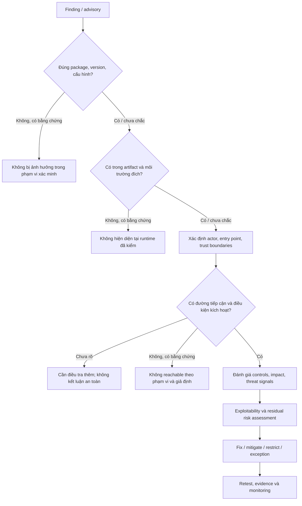
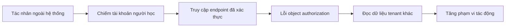
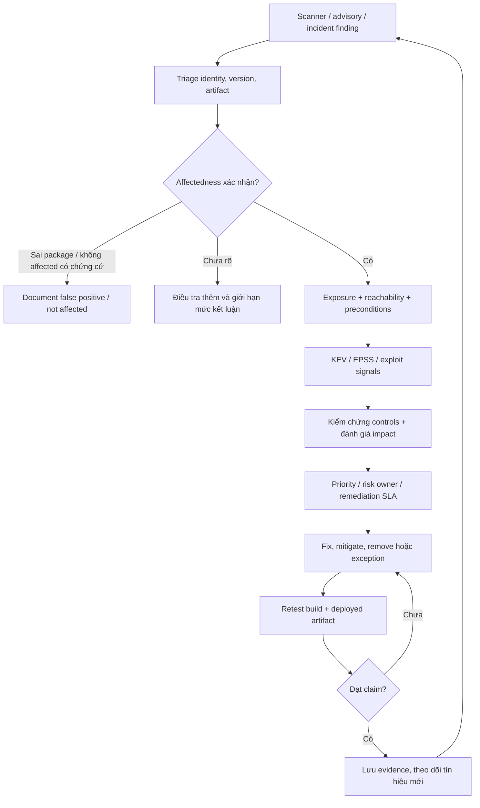
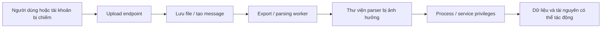

# Exploitability: đánh giá khả năng lỗ hổng bị khai thác trong hệ thống thực tế

## 1. Vì sao cần đánh giá exploitability?

Một công cụ quét thông báo dịch vụ Java có thư viện xử lý tài liệu thuộc phiên bản bị ảnh hưởng bởi một lỗ hổng nghiêm trọng. Báo cáo hiển thị điểm CVSS cao. Nhóm phát triển dự định sửa ngay, nhưng khi kiểm tra thấy thư viện chỉ được sử dụng trong công cụ tạo tài liệu kiểm thử, không đi vào image production. Ở dịch vụ khác, một lỗi kiểm tra quyền có điểm severity thấp hơn lại cho phép người dùng đã đăng nhập truy cập báo cáo của tenant khác qua một endpoint công khai.

Nếu chỉ xếp thứ tự theo điểm CVSS, đội ngũ có thể ưu tiên sai: xử lý ngay một finding không ảnh hưởng runtime nhưng bỏ qua lỗi đang mở đường truy cập vào dữ liệu nhạy cảm. Nếu lại tuyên bố “không thể khai thác” chỉ vì chưa tìm thấy lệnh gọi trong mã nguồn, đội ngũ cũng có thể bỏ sót đường thực thi qua reflection, cấu hình tính năng, thư viện tải động hoặc dịch vụ ngoài phạm vi quét.

**Exploitability (khả năng khai thác)** là đặc tính và mức độ khả thi để một tác nhân có thể kích hoạt, lợi dụng một điểm yếu nhằm đạt tác động bảo mật, xét các điều kiện kỹ thuật, đường truy cập, quyền, cấu hình và rào cản thực tế. Trong quản lý lỗ hổng, đánh giá exploitability giúp trả lời:

> Lỗ hổng này có thực sự áp dụng cho tài sản của chúng ta không? Nếu có, một tác nhân cần đáp ứng những điều kiện gì để khai thác, có đường đi đến điểm yếu không, những controls nào ngăn hoặc giảm tác động, và bằng chứng nào đủ để ra quyết định?

Trong chương **Vulnerability management** của module **SECURITY_SECURITY_ASSURANCE**, exploitability là đầu vào quan trọng của hoạt động **security assurance có bằng chứng**: từ phân tích rủi ro, xác định yêu cầu và security controls, thiết kế kiểm thử, đánh giá phát hiện, audit, remediation và theo dõi liên tục trong phát triển lẫn vận hành.

### Mục tiêu học tập

Sau bài này, bạn có thể:

1. Phân biệt exploitability, severity, exposure, reachability, likelihood và business risk.
2. Nhận diện các điều kiện cần thiết và những điểm chưa chắc chắn khi đánh giá khả năng khai thác.
3. Diễn giải đúng vai trò của CVSS, EPSS, CISA KEV, advisory và thông tin về exploit/PoC.
4. Thiết kế quy trình triage một finding đến mức xác minh được bằng bằng chứng.
5. Đánh giá các kịch bản web API, thư viện Java và hạ tầng đa tenant.
6. Lập assurance claims, test cases và hồ sơ quyết định remediation hoặc risk acceptance.

## 2. Các khái niệm dễ bị nhầm lẫn

| Khái niệm | Câu hỏi trả lời | Điều không nên suy ra |
|---|---|---|
| **Vulnerability** | Điểm yếu có thể ảnh hưởng mục tiêu bảo mật là gì? | Có điểm yếu không đồng nghĩa đã bị khai thác |
| **Exploit** | Cách thức/kỹ thuật lợi dụng điểm yếu là gì? | Có PoC không bảo đảm mọi hệ thống đều dễ bị tấn công |
| **Exploitability** | Việc lợi dụng điểm yếu khả thi đến đâu, cần điều kiện nào? | Không nhất thiết là xác suất bị khai thác ở một tổ chức cụ thể |
| **Technical severity** | Nếu lỗ hổng bị khai thác trong điều kiện đánh giá, hậu quả kỹ thuật nghiêm trọng thế nào? | Điểm severity không phải mức rủi ro kinh doanh hoàn chỉnh |
| **Exposure** | Đối tượng tấn công có thể tiếp cận bề mặt bị ảnh hưởng không? | Không Internet-facing không có nghĩa không có đường tấn công |
| **Reachability** | Dữ liệu/luồng thực thi có đến được chức năng bị lỗi không? | Không tìm thấy call tĩnh không chứng minh hoàn toàn không reachable |
| **Exploit likelihood** | Khả năng xảy ra hành vi khai thác trong một khoảng thời gian và ngữ cảnh? | Không thể suy trực tiếp chỉ từ CVSS |
| **Known exploitation** | Có bằng chứng lỗ hổng đã bị khai thác ngoài thực tế? | Không chứng minh asset của tổ chức đã bị xâm nhập |
| **Impact** | Nếu xảy ra khai thác, hậu quả với tài sản, người dùng, tổ chức là gì? | Impact cao không chứng minh exploit dễ thực hiện |
| **Risk** | Kết hợp khả năng xảy ra, hậu quả, controls, độ bất định và bối cảnh quyết định | Risk không phải một con số scanner có thể quyết định một mình |

**Exploitability và exploitation là khác nhau.** *Exploitability* nói về điều kiện/khả năng có thể khai thác; *exploitation* chỉ sự kiện hoặc hoạt động khai thác thực tế. Một hệ thống có thể chứa lỗ hổng khả thi nhưng chưa có bằng chứng đã bị tấn công. Ngược lại, một CVE được ghi nhận trong danh mục lỗ hổng đã có khai thác không có nghĩa mọi sản phẩm hoặc mọi phiên bản đều chịu ảnh hưởng như nhau.

### Ví dụ ngắn

Giả sử thư viện `document-parser` có lỗi khi xử lý một định dạng đầu vào đặc biệt:

- **Presence:** thư viện có nằm trong artifact được triển khai không?
- **Affectedness:** phiên bản và cấu hình có thuộc phạm vi advisory không?
- **Reachability:** có luồng nào truyền dữ liệu do người dùng kiểm soát đến hàm bị ảnh hưởng?
- **Exposure:** ai có thể kích hoạt luồng đó; từ Internet, mạng nội bộ hay vai trò có quyền?
- **Preconditions:** cần bật feature flag, parser mode hay quyền gì?
- **Impact:** có thể gây crash, rò rỉ, sửa dữ liệu hoặc thực thi mã trong quyền tiến trình?
- **Controls:** giới hạn input, sandbox, authorization, cách ly tiến trình có giảm đường tấn công?

Một câu trả lời đáng tin phải gắn với **phiên bản, môi trường, phạm vi và evidence**, không chỉ với tên gói.

## 3. Các điều kiện để một lỗ hổng có thể bị khai thác

Có thể hình dung một đường khai thác cần các mắt xích:

1. **Thành phần hoặc hành vi bị ảnh hưởng tồn tại.** Phiên bản, chức năng và cấu hình phải phù hợp với điều kiện lỗ hổng.
2. **Tác nhân có một điểm bắt đầu.** Ví dụ client Internet, người dùng đã đăng nhập, tài khoản nội bộ, workload khác hoặc kẻ đã xâm nhập một lớp trước đó.
3. **Có đường đến điểm yếu.** Request, file, message, API call hoặc hành động đủ quyền phải đi tới chức năng bị ảnh hưởng.
4. **Các điều kiện khai thác thỏa mãn.** Định dạng đầu vào, trạng thái hệ thống, tính năng bật, quyền cần thiết, sự tương tác của nạn nhân hoặc điều kiện chạy đua.
5. **Controls không chặn hoàn toàn đường đi hoặc tác động.** Chúng có thể giảm khả năng, giới hạn hậu quả hoặc phát hiện, nhưng cần kiểm chứng.
6. **Hậu quả bảo mật có thể xảy ra.** Ví dụ truy cập trái phép, lộ dữ liệu, sửa dữ liệu, leo thang quyền hoặc mất khả dụng.



Thực tế đường tấn công có thể gồm nhiều lỗ hổng kết hợp. Không được đánh giá một vấn đề cô lập đến mức bỏ qua khả năng kẻ tấn công đã có foothold, đã sở hữu một tài khoản hoặc có thể khai thác lỗi khác để đạt điều kiện tiên quyết.

## 4. Attack surface và exposure

**Exposure** phản ánh mức độ có thể tiếp cận các điểm vào hoặc tài nguyên liên quan. Một hệ thống không lộ trực tiếp ra Internet vẫn có thể có đường bị khai thác từ tài khoản đối tác, VPN, CI/CD, máy nội bộ, queue hoặc service-to-service.

### Câu hỏi cần đặt ra

- Service có public endpoint, ingress, load balancer hoặc DNS nào cho phép truy cập?
- Endpoint đòi hỏi xác thực, quyền nào, trên tài nguyên nào?
- Tài khoản/đối tác có quyền truy cập có thể bị chiếm đoạt không?
- Có API nội bộ nào bypass gateway nhưng vẫn reachable từ workload khác?
- File upload, webhook, email, message queue hoặc job chạy nền có đưa input không tin cậy đến phần bị lỗi?
- Hệ thống có nhiều môi trường hoặc tenant cùng chạy phiên bản bị ảnh hưởng?
- Các policy network, WAF, IAM và service mesh có được triển khai thực tế không, hay chỉ tồn tại trong tài liệu?

| Bối cảnh | Exposure điển hình | Điều cần cân nhắc |
|---|---|---|
| API công khai, không cần đăng nhập | Rất dễ được truy cập từ xa | Rate limit, input path, ảnh hưởng trên quy mô lớn |
| API có xác thực của học viên | Tiếp cận bởi người có tài khoản hợp lệ hoặc tài khoản bị đánh cắp | Có thể có nhiều tài khoản; không coi “authenticated” là an toàn tuyệt đối |
| Endpoint chỉ dành cho quản trị viên | Yêu cầu quyền đặc biệt | Có thể leo thang từ token bị lộ hoặc role sai |
| Service nội bộ | Không trực tiếp Internet-facing | Cần xem lateral movement, workload identity, đường mạng |
| Job đọc file từ object storage | Đầu vào có thể do người dùng tải lên trước đó | Cần xem nguồn gốc file và xử lý bất đồng bộ |
| Tool test/CI | Không chạy trong production app | Vẫn có thể ảnh hưởng source, secret, artifact và pipeline |
| Feature tắt bằng cấu hình | Đường thực thi có thể bị đóng | Cần xác minh tại môi trường, thời gian và cơ chế ngăn bật lại |

Không nên dùng một nhãn đơn giản “internal only” để đóng finding. Cần xác định ranh giới và điểm vào thực tế, vì một cuộc tấn công có thể đi qua nhiều lớp.

## 5. Reachability: lỗ hổng có đường thực thi không?

**Reachability analysis** tìm hiểu liệu chức năng/hành vi dễ tổn thương có thể được gọi và nhận dữ liệu phù hợp từ một luồng tấn công.

### 5.1. Ba cấp độ bằng chứng

| Cấp độ | Ví dụ bằng chứng | Giới hạn |
|---|---|---|
| **Component presence** | SBOM, dependency graph, quét image cho thấy package tồn tại | Không cho biết hàm dễ tổn thương có được gọi |
| **Static/code-path reachability** | Call graph, phân tích dữ liệu, review mã chứng minh đường gọi | Có thể thiếu reflection, dynamic dispatch, feature flags hoặc generated code |
| **Runtime reachability** | Trace, instrumentation, integration test với luồng hợp lệ đến parser | Chỉ phản ánh kịch bản, môi trường và độ bao phủ được thử |

Một thư viện có trong fat JAR không tự chứng minh lỗ hổng có thể khai thác. Ngược lại, một bài test không kích hoạt hàm bị lỗi cũng không chứng minh hàm đó không reachable trong mọi tình huống.

### 5.2. Ví dụ Java/Spring Boot

Giả sử service khai báo:

```xml
<dependency>
    <groupId>com.example.docs</groupId>
    <artifactId>document-parser</artifactId>
    <version>1.7.0</version>
</dependency>
```

Các tọa độ và số phiên bản `com.example` trong bài này **hoàn toàn giả định**, không tương ứng với advisory thật. Để đánh giá một finding cho parser, reviewer phải xem:

1. Maven resolve đúng phiên bản nào, có BOM, exclusion hoặc override không?
2. Artifact được triển khai có chứa parser đó không?
3. Code ở controller, service, worker, scheduled job hoặc thư viện khác có gọi parser không?
4. Input cho parser đến từ người dùng, đối tác, dữ liệu nội bộ hay tài nguyên tin cậy nào?
5. Format/mode bị ảnh hưởng có bật trong production không?
6. Các control như giới hạn file, xử lý tách tiến trình hoặc sandbox có thực sự áp dụng cho mọi đường gọi?

Ví dụ một đường gọi:

```java
@PostMapping("/api/documents/preview")
public PreviewDto preview(
        @RequestParam("file") MultipartFile file,
        Authentication authentication) {
    permissionService.requirePreviewPermission(authentication);
    return previewService.generate(file);
}
```

Controller có thể chỉ cho biết input từ client đi vào `previewService`. Cần tiếp tục xem việc xử lý file và cách parser được gọi. Một annotation kiểm tra quyền không chứng minh parser an toàn, cũng không chứng minh việc validation đủ để chặn dữ liệu khai thác.

### 5.3. Những tình huống làm phân tích reachability sai

- **Reflection/dynamic loading:** mã gọi qua reflection, plugin hoặc service loader.
- **Conditional configuration:** chức năng chỉ bật ở một tenant, region hoặc feature flag.
- **Asynchronous execution:** controller không gọi trực tiếp nhưng đưa message cho worker.
- **Serialization/deserialization:** framework tự xử lý dữ liệu trước khi mã ứng dụng nhận control.
- **Native libraries:** thành phần qua JNI hoặc thư viện hệ điều hành không hiện rõ trong source.
- **Cached/precomputed inputs:** dữ liệu độc hại được lưu rồi xử lý sau, không nằm trong cùng request.
- **Dependency version mismatch:** scanner phân tích manifest khác artifact đang chạy.
- **Shared components:** lỗ hổng trong thư viện được gọi bởi service khác chứ không phải service được quét.

**Kết luận “not reachable” phải nêu phương pháp và giới hạn kiểm chứng.** Nếu một đường chưa được quan sát, trạng thái phù hợp có thể là `UNDETERMINED` thay vì `NOT_AFFECTED`.

## 6. Điều kiện tiên quyết và độ khó khai thác

Một đường truy cập có tồn tại vẫn chưa đủ: lỗ hổng có thể đòi hỏi quyền, trạng thái hoặc tương tác nhất định.

| Loại điều kiện | Câu hỏi | Ví dụ |
|---|---|---|
| **Attack vector** | Tác nhân phải ở mạng/thiết bị/kênh nào? | Internet, mạng liền kề, local user, physical |
| **Privileges required** | Cần tài khoản hoặc role nào trước khi tấn công? | Người học, giảng viên, quản trị viên |
| **User interaction** | Nạn nhân phải mở file, click link hoặc thực hiện thao tác? | Người vận hành mở tài liệu được gửi |
| **Attack complexity** | Có cần điều kiện ngoài khả năng kẻ tấn công kiểm soát hoặc thao tác phức tạp? | Race condition hoặc trạng thái đặc biệt |
| **Attack requirements** | Cần điều kiện triển khai/thực thi đặc biệt để tấn công thành công? | Cấu hình hoặc trạng thái cần có theo định nghĩa metric |
| **Authentication/session context** | Token cần thuộc ai, scope nào, có đang còn hiệu lực? | Token giảng viên bị lộ, phiên còn hạn |
| **Input control** | Tác nhân kiểm soát định dạng, trường hoặc dữ liệu đưa vào đến mức nào? | Upload PDF hoặc gửi JSON, message, webhook |
| **Chaining** | Cần thêm lỗ hổng hay foothold để đạt precondition? | Từ lỗi xác thực sang lỗi trong parser nội bộ |

Khả năng khai thác có thể tăng khi một tiền điều kiện trở nên dễ thỏa mãn. Ví dụ, API trước đây chỉ admin dùng nay mở cho người học, hoặc tài khoản test dùng chung bị lộ. Đánh giá phải được làm mới khi quyền, exposure hoặc cấu hình thay đổi.

### 6.1. Khai thác theo chuỗi (attack chaining)

Xét kịch bản:



Lỗ hổng yêu cầu đăng nhập không có nghĩa nó khó khai thác trong thực tế: người học hợp lệ, insider hoặc tài khoản bị chiếm có thể đáp ứng điều kiện. Tương tự, một service nội bộ vẫn có thể bị khai thác qua SSRF, workload compromised hoặc sai cấu hình mạng.

Đánh giá exploitability nên phản ánh **đường tấn công hợp lý**, đồng thời phân biệt dữ kiện đã kiểm chứng với giả định.

## 7. CVSS: severity và các yếu tố exploitability kỹ thuật

**Common Vulnerability Scoring System (CVSS)** cung cấp bộ metric chuẩn hóa để mô tả các đặc tính kỹ thuật của lỗ hổng. Các phiên bản có những nhóm và định nghĩa metric khác nhau.

### 7.1. Exploitability metrics trong CVSS

| Metric | Ý nghĩa tổng quát | Điều phải kiểm tra khi áp dụng |
|---|---|---|
| **Attack Vector (AV)** | Phạm vi/kênh mà tác nhân cần để kích hoạt khai thác | Có tương ứng với bề mặt truy cập và sản phẩm bị ảnh hưởng? |
| **Attack Complexity (AC)** | Điều kiện liên quan độ phức tạp của khai thác theo định nghĩa phiên bản CVSS | Không tự suy ra một PoC đã đủ trong hệ thống cụ thể |
| **Privileges Required (PR)** | Mức quyền tác nhân cần trước khai thác | Có tài khoản/role tương ứng và kiểm soát truy cập thực tế? |
| **User Interaction (UI)** | Cần hành động của người dùng khác không? | Điều kiện tương tác có diễn ra trong workflow? |
| **Attack Requirements (AT)** | Trong CVSS v4.0, mô tả các điều kiện tiên quyết về triển khai/thực thi phải có để khai thác thành công | Phân biệt AT với AC, PR, UI; không áp metric này nguyên xi cho CVSS v3.1 |

**CVSS Base Score không phải xác suất tấn công trong tháng tới**, cũng không tự động là thứ tự remediation cho tổ chức. Mức độ phơi lộ, controls, mức nhạy cảm dữ liệu, exploit evidence và business impact cần được phân tích bổ sung.

Khi dùng score và vector, phải ghi **phiên bản CVSS**. Một vector của CVSS v3.1 không nên được diễn giải như v4.0; CVSS v4.0 có cách tổ chức các metric và bổ sung những khái niệm riêng.

### 7.2. Base, Threat và Environmental context

CVSS giúp mô tả severity ở những góc nhìn khác nhau; các nhóm metric liên quan đến bối cảnh và mối đe dọa có thể bổ sung đánh giá khi có dữ liệu. Tuy vậy, một điểm cao/low trong cơ sở advisory thường mang tính **khái quát cho sản phẩm**, không phản ánh đầy đủ deployment riêng.

Ví dụ lỗ hổng trong parser được mô tả là khai thác qua mạng. Trong hệ thống của tổ chức, parser chỉ xử lý tài liệu đã được xác thực và kiểm tra bởi pipeline nội bộ; điều này có thể thay đổi đường tấn công thực tế. Ngược lại, nếu sản phẩm có endpoint public đẩy thẳng file vào parser, exposure có thể cao hơn giả định vận hành ban đầu của nhóm.

**Không tự sửa điểm CVSS bằng cảm tính.** Nếu sử dụng Environmental hoặc Threat metrics, phải tuân theo phương pháp và phiên bản tương ứng, ghi giả định và lý do. Có thể dùng một mô hình ưu tiên rủi ro riêng của tổ chức, nhưng nên tách nó khỏi điểm CVSS tiêu chuẩn.

## 8. EPSS, KEV và bằng chứng khai thác ngoài thực tế

Ba nguồn thông tin thường được dùng chung nhưng mang ý nghĩa khác nhau:

| Nguồn/thông tin | Điều nó cho biết | Điều không cho biết |
|---|---|---|
| **CVSS** | Đặc tính và mức nghiêm trọng kỹ thuật của lỗ hổng theo hệ metric | Xác suất asset của tổ chức bị tấn công trong khoảng thời gian cụ thể |
| **EPSS** | Ước lượng xác suất một CVE bị khai thác ngoài thực tế trong 30 ngày tới theo mô hình thống kê | Không phải xác suất khai thác riêng cho deployment của tổ chức |
| **CISA KEV** | CVE có bằng chứng khai thác thực tế theo tiêu chí đưa vào danh mục | Không xác nhận tổ chức đã bị xâm nhập hoặc mọi sản phẩm/phiên bản đều affected |
| **Vendor advisory** | Phiên bản, cấu hình bị ảnh hưởng, nguyên nhân và bản sửa/mitigation | Không luôn phản ánh chính xác cách hệ thống riêng đang triển khai |
| **Public PoC/exploit code** | Có mô tả hoặc mã minh họa một cách khai thác | Không chứng minh mã hoạt động trên mọi phiên bản hoặc kẻ tấn công đã dùng |
| **Threat intelligence/incident data** | Dấu hiệu chiến dịch, actor, mục tiêu, IoC/TTP liên quan | Không tự chứng minh asset cụ thể an toàn hoặc đã bị tấn công |

### 8.1. Đọc EPSS đúng

EPSS thường cung cấp một **score** thể hiện xác suất ước lượng theo mô hình và một **percentile** cho vị trí tương đối trong tập CVE được chấm. Chúng không cùng ý nghĩa.

- Score là ước lượng xác suất theo định nghĩa mô hình, không phải severity.
- Percentile là thứ hạng tương đối, không phải xác suất tương ứng.
- Dữ liệu và mô hình có thể được cập nhật, cần lưu ngày lấy thông tin.
- Score không tính đủ cách ứng dụng của bạn được cấu hình, lộ ra ngoài hay được bảo vệ bởi controls nào.

Ví dụ minh họa: EPSS score `0.30` có thể được diễn giải là ước lượng 30% theo mô hình trong cửa sổ dự báo áp dụng; không có nghĩa “30% hệ thống của chúng ta sẽ bị hack”. Percentile `0.98` không đồng nghĩa 98% xác suất bị khai thác.

### 8.2. Đọc KEV đúng

Một CVE nằm trong **Known Exploited Vulnerabilities (KEV)** là tín hiệu cần chú ý vì có bằng chứng khai thác thực tế. Tuy nhiên cần tiếp tục xác minh:

1. Sản phẩm và phiên bản của tổ chức có thuộc phạm vi bị ảnh hưởng?
2. Thành phần có đang chạy hoặc được dùng ở những dịch vụ nào?
3. Có đường tấn công tới chức năng bị lỗi?
4. Cần giảm thiểu ngay trong khi chuẩn bị vá không?
5. Có dấu hiệu xâm nhập hoặc hành vi đáng ngờ cần threat hunting?

Những thời hạn hoặc nghĩa vụ xử lý được công bố cùng danh mục có thể áp dụng cho các tổ chức/đối tượng cụ thể theo quy định. Không nên mặc định một thời hạn của một cơ quan là nghĩa vụ pháp lý của mọi tổ chức; tổ chức phải đối chiếu phạm vi áp dụng và policy riêng.

### 8.3. Khi tín hiệu mâu thuẫn

Có thể xảy ra:

- CVSS cao, EPSS thấp, không có PoC công khai.
- CVSS trung bình, EPSS cao và đã được ghi nhận khai thác.
- KEV có mặt nhưng asset không chứa thành phần bị ảnh hưởng.
- Scanner báo finding nhưng vendor khẳng định cấu hình đã vá bằng bản backport.

Không chọn một chỉ số duy nhất để kết luận. Cần phân tích **affectedness, reachability, exposure, exploit signals, controls và impact**, cùng mức tin cậy của từng nguồn.

## 9. Quy trình đánh giá exploitability theo bằng chứng

Quy trình nhất quán giúp kết luận có thể kiểm toán và tránh phụ thuộc hoàn toàn vào trực giác người triage.

### Bước 1 — Xác định finding và tài sản

Ghi ID, sản phẩm, service, environment, owner, artifact digest, deployment, vulnerability identifier/advisory, thời điểm phát hiện và nguồn thông tin.

### Bước 2 — Xác minh affectedness

- Tên package/sản phẩm và phiên bản có đúng không?
- Có bản vá backport khiến version string gây nhầm lẫn?
- Scanner quét manifest, source, SBOM hay binary thực tế?
- Điều kiện cấu hình và tính năng bị ảnh hưởng có xuất hiện?
- Asset được xác định là runtime, build-time, test-only hay container/OS layer?

### Bước 3 — Xác định exposure và entry point

Vẽ luồng actor → entry point → service → function. Kiểm tra ingress, network, authentication, tenant, workload identity, queue và đường bypass.

### Bước 4 — Kiểm tra reachability và preconditions

Kết hợp review source, call graph, configuration, runtime traces, integration tests và vendor analysis khi phù hợp. Ghi riêng điều **đã chứng minh**, **đã bác bỏ** và **chưa biết**.

### Bước 5 — Thu thập threat signals

Đối chiếu advisory, CVSS vector/version, EPSS, KEV, thông tin exploit có xác thực, cảnh báo nội bộ và tình hình tấn công. Nêu rõ ngày lấy thông tin; không coi dữ liệu của hôm trước là vĩnh viễn đúng.

### Bước 6 — Đánh giá controls và impact

Kiểm tra liệu các controls thực sự chặn đường khai thác hoặc giới hạn tác động hay không; đặt tình huống khi tài khoản bị chiếm, WAF bypass, feature bật lại hoặc policy drift. Xem hậu quả với dữ liệu, tính sẵn sàng, tính toàn vẹn, blast radius và nghĩa vụ tổ chức.

### Bước 7 — Kết luận, ưu tiên và quyết định

Đưa ra trạng thái triage có lý do: affected, potentially affected, not affected, false positive, mitigated, fixed và các trạng thái xác minh tương ứng. Giao owner, thời hạn, phương án xử lý và escalation theo risk appetite.

### Bước 8 — Remediation, retest và monitoring

Xác minh phiên bản/config/đường tấn công đã thay đổi đúng; chạy test và quét lại artifact thực tế; theo dõi advisory/EPSS/KEV mới, thay đổi exposure và lỗi trong controls.



Không phải mọi finding đều đòi hỏi thực hiện exploit thử nghiệm. **Phân tích bằng code, cấu hình, phiên bản và bằng chứng từ vendor** thường có thể đủ cho quyết định ban đầu; kiểm thử động nên được thực hiện an toàn trong phạm vi được phép và trên môi trường phù hợp.

## 10. Trạng thái triage và ngôn ngữ kết luận

| Trạng thái | Điều kiện sử dụng | Ví dụ câu kết luận đúng |
|---|---|---|
| **FALSE_POSITIVE** | Lỗi nhận diện package/CVE hoặc finding không áp dụng | “Scanner ghép nhầm package; đã đối chiếu purl và binary” |
| **NOT_AFFECTED_VERIFIED** | Có chứng cứ version/config/đường thực thi không thỏa điều kiện lỗ hổng | “Image digest D không chứa package bị ảnh hưởng, xác minh bằng SBOM và binary scan” |
| **POTENTIALLY_AFFECTED** | Package/cấu hình có thể liên quan nhưng thiếu thông tin | “Đã xác nhận phiên bản; chưa chứng minh reachability của worker” |
| **AFFECTED_REACHABLE** | Có đường hợp lý tới chức năng và điều kiện ảnh hưởng | “Endpoint upload chuyển input tới parser trên runtime bị ảnh hưởng” |
| **EXPLOITABILITY_UNDETERMINED** | Không đủ chứng cứ để đánh giá khả năng khai thác | “Phân tích tĩnh chưa bao phủ dynamic plugin loading” |
| **MITIGATED_PENDING_FIX** | Control tạm được thiết kế/kiểm chứng và còn residual risk | “Đã tắt endpoint tại ingress và xác minh không truy cập được; chưa nâng cấp parser” |
| **FIX_IMPLEMENTED** | Thay đổi đã được thực hiện nhưng chưa xác minh trên artifact mục tiêu | “Đã nâng version trong source; chờ build và retest” |
| **FIXED_VERIFIED** | Artifact và môi trường đã được kiểm chứng không còn điều kiện bị ảnh hưởng theo claim | “Image digest mới dùng bản đã vá, tests và scan đối chiếu đạt” |
| **ACCEPTED_WITH_CONDITIONS** | Residual risk được chấp nhận đúng thẩm quyền, có hạn và controls | “Ngoại lệ chỉ cho tenant thử nghiệm đến ngày đã duyệt, sẽ đánh giá lại khi có patch” |

Tổ chức có thể chọn tên trạng thái khác. Quan trọng là **không nhập nhằng giữa “không khai thác được” và “chưa tìm được bằng chứng”**, hay giữa “có patch trong branch” và “production đã được vá”.

## 11. Cách kết hợp exploitability vào ưu tiên xử lý rủi ro

Quản lý lỗ hổng cần quyết định: **sửa gì trước, trong thời hạn nào, bằng phương án nào**. Exploitability là một trong các đầu vào, không thay thế business impact.

| Thành tố đánh giá | Câu hỏi | Minh họa |
|---|---|---|
| Severity | Nếu khai thác, tác động kỹ thuật là gì? | Lộ dữ liệu, RCE, denial of service |
| Affectedness | Phiên bản/cấu hình thực sự bị ảnh hưởng? | Advisory xác nhận runtime version |
| Exposure | Ai tiếp cận được đường tấn công? | Endpoint công khai hay chỉ worker nội bộ |
| Reachability | Đường thực thi tới chức năng lỗi đã được xác minh? | API upload → parser |
| Exploit maturity/signals | Có PoC, khai thác thực tế, KEV, EPSS cao? | KEV và cảnh báo chiến dịch |
| Required privileges | Tác nhân cần quyền gì? | Không xác thực, learner, admin |
| Compensating controls | Control chặn/giảm rủi ro có hiệu lực? | Tắt feature, cô lập tiến trình |
| Business impact | Dữ liệu, tenant, hoạt động nào bị ảnh hưởng? | Kết quả thi và dữ liệu cá nhân |
| Uncertainty | Những điều kiện nào chưa rõ? | Dynamic path chưa có tracing |
| Remediation feasibility | Có patch, thay thế, tắt tính năng hoặc giảm thiểu? | Nâng framework có regression risk |

### Ma trận ưu tiên minh họa

| Tình huống giả định | Nhận định | Hướng ưu tiên |
|---|---|---|
| Lỗ hổng có khai thác thực tế, endpoint nhận input Internet, runtime affected | Khả năng bị tấn công cần quan tâm cao; có thể có tác động lớn | Phản ứng khẩn theo policy; hạn chế exposure trong khi vá |
| Lỗi phân quyền cho learner đọc dữ liệu tenant khác, có đường test tái hiện | Khai thác không đòi hỏi đặc quyền lớn, dữ liệu nhạy cảm | Ưu tiên cao, kiểm tra toàn bộ endpoint tương tự |
| CVSS rất cao nhưng package chỉ nằm trong test JAR, không xuất hiện production | Không thể dựa vào severity để kết luận production affected | Xử lý rủi ro CI/test riêng; ghi evidence runtime không affected |
| Thư viện có finding nhưng chức năng bị lỗi tắt tại production | Có thể giảm exposure, nhưng cần xác minh cơ chế và trigger bật lại | Ghi giới hạn và kiểm chứng config; vẫn lên kế hoạch patch |
| CVSS trung bình nhưng nằm trong KEV và asset có quyền đặc biệt | Tín hiệu exploit thực tế cùng tác động của asset cần tăng ưu tiên | Điều tra nhanh, giảm thiểu, vá và threat hunting theo phạm vi |
| Không có CVE nhưng log cho thấy lỗi authorization bị lợi dụng | Exploitation và impact thực tế không đợi CVE | Incident response ngay, triage security defect |

Các mức ưu tiên và thời hạn phải được định nghĩa bằng policy của tổ chức theo risk appetite, nghĩa vụ và tài sản. **Không tự động gán “Critical = 24 giờ” cho mọi đơn vị** nếu không có quy định và năng lực thực hiện; cũng không hạ thấp finding chỉ vì không có PoC công khai.

### 11.1. Tránh phép tính rủi ro tùy ý

Một công thức kiểu `risk = CVSS × EPSS × số endpoint` trông có vẻ định lượng nhưng dễ tạo cảm giác chính xác giả nếu các thang đo, giả định và ý nghĩa xác suất không tương thích. Nếu xây mô hình nội bộ, cần:

- Nêu biến và thang đo rõ ràng.
- Tách xác suất theo mô hình với đánh giá bối cảnh riêng.
- Hiệu chỉnh bằng dữ liệu và kiểm tra kết quả phân loại.
- Ghi cách xử lý unknowns, missing values và uncertainty.
- Có review định kỳ khi threat landscape hoặc asset thay đổi.

Đối với nhiều chương trình, một **ma trận có tiêu chí nhất quán và bằng chứng minh bạch** hữu dụng hơn một điểm số tùy ý.

## 12. Controls bù đắp có thể thay đổi exploitability ra sao?

Khi chưa thể vá ngay, tổ chức có thể giảm khả năng khai thác hoặc tác động bằng controls. Nhưng một control chỉ có giá trị trong risk assessment khi **nó được triển khai, bao phủ đường tấn công và đã được kiểm chứng**.

| Control | Có thể giúp giảm | Giới hạn cần xem xét |
|---|---|---|
| Tắt tính năng bị ảnh hưởng | Đóng một hoặc nhiều đường gọi | Cần xác minh mọi tenant, instance, worker đều tắt |
| Giới hạn mạng/ingress | Giảm tập actor có thể truy cập | Lateral movement, SSRF, service-to-service, đường bypass |
| WAF/rule input | Chặn một số mẫu request đã biết | Không đảm bảo chặn mọi biến thể hoặc khai thác không qua HTTP |
| Authentication/authorization | Hạn chế actor có thể tiếp cận | Credential bị đánh cắp, insider, lỗi phân quyền |
| Sandbox/container isolation | Giảm blast radius nếu khai thác thành công | Không khẳng định lỗ hổng không thể kích hoạt |
| Rate limiting | Hạn chế volume và một số kiểu dò tìm | Không chặn một payload khai thác đơn lẻ thành công |
| Input validation | Loại dữ liệu không hợp lệ trong phạm vi đã thiết kế | Parser bug có thể nằm ở input hợp lệ |
| Monitoring/EDR | Phát hiện, hỗ trợ phản ứng | Chủ yếu detective, không tự ngăn khai thác |
| Token/credential rotation | Giảm hiệu lực của credential bị lộ | Không sửa nguyên nhân lỗi phần mềm |
| Giảm quyền tiến trình | Giới hạn hậu quả khi service bị chiếm | Dữ liệu trong scope hiện có vẫn có thể bị tác động |

### Bằng chứng cho một control

Nếu tuyên bố “đã tắt API upload”, evidence nên gồm cấu hình ingress/gateway và feature flag ở môi trường đích, test thử truy cập cả đường công khai và nội bộ, kiểm tra worker/job không còn xử lý loại dữ liệu đó, thời điểm áp dụng và owner. Chỉ có ảnh chụp nút toggle trên giao diện quản trị chưa đủ để khẳng định đường tấn công đã đóng.

**Mitigated không đồng nghĩa fixed.** Finding có thể tiếp tục mở cho đến khi thành phần lỗi được vá, thay thế hoặc loại bỏ; exception phải có hạn và được xem xét lại khi controls thay đổi.

## 13. Exploitability trong ứng dụng Java/Spring Boot đa tenant

### 13.1. Bối cảnh

Giả sử nền tảng học tập có:

- `learning-api`: xác thực người học/giảng viên và quản lý lớp.
- `report-service`: tạo tài liệu báo cáo từ template và dữ liệu điểm thi.
- `document-parser`: đọc tài liệu do giảng viên hoặc đối tác tải lên.
- `export-worker`: xử lý file và công việc bất đồng bộ.
- `object-storage`: lưu file với quyền truy cập có kiểm soát.

Một SCA tool phát hiện `document-parser:1.7.0` có một advisory giả định `DEMO-PARSER-2026-01` về lỗi xử lý file được chế tạo đặc biệt. **Tên gói, phiên bản, ID và tình huống là giả định phục vụ học tập, không phải CVE thật.**

### 13.2. Các giả thuyết ban đầu

| Giả thuyết | Có thể đúng? | Bằng chứng cần tìm |
|---|---|---|
| Thư viện có trong production image | Chưa biết | SBOM/image scan, Maven dependency graph, artifact digest |
| Parser mode bị lỗi được bật | Chưa biết | Cấu hình runtime, flags, vendor advisory |
| Người học gửi được file chứa định dạng tương ứng | Chưa biết | API route, access matrix, upload policy |
| File giảng viên tải lên được worker xử lý | Có thiết kế luồng nhưng cần kiểm tra | Queue contract, worker code, integration trace |
| WAF chặn mọi input gây lỗi | Chưa có bằng chứng | WAF coverage, policy, negative tests |
| Sandbox hạn chế quyền worker | Chưa có bằng chứng | Container/IAM config, privilege test |
| Có bản vá phù hợp | Cần xác minh | Vendor advisory, changelog, compatible version |

Giai đoạn này trạng thái hợp lý là **POTENTIALLY_AFFECTED**. Không được kết luận “không khai thác được” trước khi có evidence.

### 13.3. Đường tấn công giả định



Từ sơ đồ cần kiểm tra ai gửi file, ai đọc file, khi nào parser thực thi, và những tài nguyên mà worker thực sự được truy cập. Nếu worker có quyền đọc dữ liệu của nhiều tenant, blast radius có thể lớn hơn ảnh hưởng của một request riêng lẻ.

### 13.4. Ví dụ thu thập bằng chứng

Các lệnh sau chỉ minh họa cách quan sát dependency trong một dự án Maven. Không phải bằng chứng hoàn chỉnh nếu chưa đối chiếu với artifact đang chạy:

```bash
# Quan sát dependency graph của module/bản build đã chọn.
mvn -B dependency:tree

# Lưu graph gắn với build/release để phục vụ review.
mvn -B dependency:tree -DoutputFile=target/dependency-tree.txt
```

Nhóm tiếp tục:

1. Xác định source commit, image digest, version và scope runtime.
2. Kiểm tra class/call sites sử dụng parser trong controller và worker.
3. Đối chiếu advisory với parser mode, input format và dependency variant.
4. Dùng integration tests không chứa payload khai thác thật để xác minh đường dữ liệu từ upload đến parser và controls liên quan.
5. Kiểm tra network/authorization, file storage và IAM của worker ở môi trường mục tiêu.
6. Phân tích exploit signals, độ nhạy cảm dữ liệu và khả năng giảm thiểu tạm.
7. Chọn remediation, kiểm thử tương thích và scan lại artifact.

### 13.5. Tách hai kết luận độc lập

- **Kết luận A — đường đến parser:** xác minh người dùng có thể gửi file khiến worker gọi parser trong cấu hình sản xuất.
- **Kết luận B — khả năng khai thác chính xác lỗ hổng:** xác minh version, mode, preconditions và advisory; có thể cần nghiên cứu bổ sung để khẳng định hành vi lỗi cụ thể.

**Chứng minh A không tự chứng minh B.** Ngược lại, chứng minh B ở một test harness không tự chứng minh luồng thực tế của sản phẩm đi đến điểm yếu. Assurance cần kết nối hai loại bằng chứng và nêu mức độ chắc chắn.

## 14. Exploitability của lỗi authorization và business logic

Không phải mọi vấn đề có định danh CVE. Lỗi business logic, BOLA/IDOR và sai phân quyền có thể có exploitability cao ngay cả khi SCA không phát hiện gì.

### Ví dụ: người học đọc kết quả của tenant khác

Một API trả kết quả bằng `resultId`. Thiết kế kiểm tra JWT nhưng không kiểm tra đối tượng thuộc user/tenant hiện tại:

```java
@GetMapping("/api/results/{resultId}")
public ResultDto readResult(@PathVariable UUID resultId) {
    return resultService.findById(resultId);
}
```

Đây là mã minh họa rủi ro: bản thân đoạn code controller không thể hiện kiểm tra quyền trên đối tượng. Cần xác minh `resultService` có enforcement ở phía server hay không trước khi kết luận tồn tại lỗ hổng.

Nếu service không kiểm tra quyền, tác nhân chỉ cần tài khoản hợp lệ và `resultId` có thể đoán hoặc thu thập được. Exploitability có thể cao dù không có public PoC/CVE. Đây là lý do chương trình vulnerability management phải kết hợp **kiểm thử ứng dụng, threat modeling và review nghiệp vụ**, không chỉ quét các dependency.

### Phiên bản thiết kế kiểm soát tốt hơn

```java
@GetMapping("/api/results/{resultId}")
public ResultDto readResult(
        @PathVariable UUID resultId,
        Authentication authentication) {
    // Service phải kiểm tra identity, tenant và object-level authorization
    // trước khi trả dữ liệu từ repository.
    return resultService.findAuthorizedResult(authentication, resultId);
}
```

Đoạn code thứ hai vẫn là **đề xuất cần review và test**: tên hàm không chứng minh implementation bên trong chính xác. Evidence phải bao gồm positive và negative integration tests, dữ liệu nhiều tenant và kiểm tra các đường export/batch/cache.

### Câu hỏi về điều kiện khai thác

- Kẻ tấn công cần có tài khoản loại nào?
- ID có thể được đoán, lộ qua URL/log hoặc lấy từ endpoint khác?
- Có rate limit, truy vết và cảnh báo truy cập sai không?
- Có API/worker nào bỏ qua object-level authorization?
- Mọi tenant có chung cơ sở dữ liệu hoặc cùng service identity không?
- Tác động là đọc dữ liệu, thay đổi điểm hay tải hàng loạt?

Đánh giá exploitability cần phản ánh môi trường của ứng dụng, không chỉ dựa trên danh mục lỗ hổng hạ tầng.

## 15. Các phương pháp xác minh exploitability

Không có một công cụ duy nhất chứng minh mọi giả thuyết. Cần kết hợp phương pháp:

| Phương pháp | Giúp làm rõ | Giới hạn/cẩn trọng |
|---|---|---|
| **Vendor advisory review** | Affected versions, preconditions, workaround và fix | Có thể không mô tả mọi deployment variant |
| **Dependency/SBOM inspection** | Thành phần nào tồn tại ở artifact | Không chứng minh code path reachable |
| **Source/code review** | Điểm gọi, validation, quyền và luồng dữ liệu | Dynamic code và cấu hình runtime có thể khác |
| **Static call/data-flow analysis** | Đường tiềm năng từ input tới sink | False positive/negative; phụ thuộc ngôn ngữ/framework |
| **Configuration review** | Feature flags, mode, IAM, network và policy | Config tài liệu có thể khác production |
| **Runtime instrumentation/tracing** | Hàm/luồng được gọi trong điều kiện thử | Coverage có giới hạn, có thể thêm overhead |
| **Integration/security tests** | Behavior ở API và control boundaries | Chỉ kiểm tra test cases và build/môi trường cụ thể |
| **Controlled validation** | Xác minh hành vi lỗi trong môi trường được phép, an toàn | Cần phạm vi, authorization, rollback và tránh gây gián đoạn |
| **Threat intelligence** | Tín hiệu khai thác thực tế ngoài tổ chức | Không trực tiếp chứng minh affectedness của asset |
| **Incident/log analysis** | Hoạt động bất thường liên quan tài sản | Không thấy log không có nghĩa không xảy ra khai thác |

### 15.1. Kiểm thử an toàn theo phạm vi

Một cuộc kiểm chứng có thể dùng test fixtures giả, dependency tracing, cấu hình test hoặc mock của library boundary để khẳng định đường gọi mà không cần phát động một exploit thật. Nếu cần kiểm tra hành vi lỗ hổng bằng payload có rủi ro:

- Phải được cho phép rõ trong phạm vi kiểm thử.
- Ưu tiên môi trường cô lập, dữ liệu giả và quyền tối thiểu.
- Xác định giới hạn ảnh hưởng, điều kiện dừng và kế hoạch khôi phục.
- Không thực hiện thử nghiệm gây phá hoại hoặc ảnh hưởng người dùng sản xuất nếu chưa được cho phép.
- Lưu expected/actual và phạm vi chính xác của điều được chứng minh.

Một kết quả test “không khai thác thành công” chỉ có giá trị **cho phương pháp và điều kiện đã thử**, không phải bằng chứng không tồn tại bất kỳ đường khai thác nào.

## 16. Hồ sơ exploitability assessment

Tài liệu triage nên giúp người khác tái hiện lập luận, không chỉ đọc một nhãn “High/Low”.

```yaml
assessment_id: "EXPL-DEMO-001"
finding_id: "DEMO-PARSER-2026-01"
service: "report-service"
release: "2026.11-demo"
artifact:
  type: "container-image"
  digest: "sha256:<digest-thuc-te>"
component:
  package: "com.example.docs:document-parser"
  detected_version: "1.7.0"
  scope: "runtime"
advisory:
  reference: "vendor-advisory-demo"
  affected_range: "< 1.8.0 (gia-dinh)"
  retrieved_at: "2026-11-28"
affectedness:
  status: "POTENTIALLY_AFFECTED"
  evidence:
    - "Dependency tree của release"
    - "Artifact inventory / image scan"
exposure:
  entry_point: "Authenticated file upload"
  actor: "Teacher account or compromised account"
  tenant_scope: "Multi-tenant service"
reachability:
  status: "UNDER_INVESTIGATION"
  evidence:
    - "Code flow: upload -> queue -> parser worker"
  unresolved:
    - "Parser mode on production"
    - "Alternate dynamic-loading paths"
threat_signals:
  cvss: "Chưa xác minh phiên bản/vector"
  epss: "Chưa tra cứu"
  kev: "Chưa xác minh"
controls:
  - "Authentication and upload size limit"
  - "Worker sandbox: cần kiểm tra triển khai thực tế"
risk:
  impact: "Data confidentiality and service availability"
  status: "PENDING_FINAL_ASSESSMENT"
decision:
  immediate_action: "Review exposure and constrain upload if needed"
  owner: "report-service owner"
  due_date: "<date-theo-policy>"
  remediation: "Evaluate fixed parser version and regression tests"
evidence_requirements:
  - "Verified artifact version and configuration"
  - "Reachability and access-control tests"
  - "Post-fix scan and runtime verification"
status: "OPEN"
```

**Đây là hồ sơ giả định.** Các nguồn advisory, phiên bản, trạng thái, score và ngày cần được điền bằng dữ liệu thật cho một assessment cụ thể. Trường `status: OPEN` phản ánh sự trung thực: chưa thể tuyên bố không bị ảnh hưởng khi reachability và runtime mode còn chưa rõ.

### Metadata tối thiểu để audit

- Finding/CVE/advisory ID, timestamp và nguồn cập nhật.
- Asset/service/tenant scope, owner, build/release, artifact digest, environment.
- Thành phần, phiên bản, cấu hình và đường dependency.
- Điều kiện khai thác và đường tấn công; bằng chứng/giới hạn reachability.
- CVSS version/vector, EPSS score/date, KEV check/date và exploit signals nếu dùng.
- Controls có bằng chứng kiểm chứng và residual risk.
- Quyết định, approver, SLA, ngoại lệ/hạn nếu có.
- Thay đổi xử lý, kết quả test/scan lại và trạng thái production.

Không lưu exploit payload nguy hiểm hoặc secret trong hồ sơ được chia sẻ rộng rãi. Thông tin chi tiết kỹ thuật cần được bảo vệ theo phân loại và nhu cầu điều tra.

## 17. Assurance claims và evidence cho exploitability

Mục tiêu của security assurance là biến các kết luận thành **claim có thể kiểm chứng trong một phạm vi**.

| Claim | Tiêu chí kiểm chứng | Evidence phù hợp |
|---|---|---|
| **CLM-01: Asset được nhận diện đúng** | Artifact/phiên bản/cấu hình gắn với finding | Release digest, SBOM, manifest, binary scan |
| **CLM-02: Affectedness được đánh giá chính xác** | So sánh đúng advisory, backport và phạm vi thành phần | Vendor advisory, version analysis, package identity |
| **CLM-03: Entry points được xác định** | Inventory đủ đường Internet, nội bộ, queue, worker trong scope | Architecture/DFD, API inventory, route/config review |
| **CLM-04: Reachability có bằng chứng** | Đường từ actor/input đến vulnerable behavior được phân tích | Call/data-flow, trace, integration test, review |
| **CLM-05: Preconditions được đánh giá** | Quyền, cấu hình, mode, tương tác và điều kiện đặc biệt được xét | Access matrix, config, test, policy |
| **CLM-06: Controls giảm rủi ro có hiệu lực** | Không bypass trong những kịch bản được định nghĩa | Negative tests, config validation, network/IAM evidence |
| **CLM-07: Priority phản ánh risk thực tế** | Threat signals, impact và uncertainty được ghi | Risk assessment, KEV/EPSS source/time, sign-off |
| **CLM-08: Remediation đã được kiểm chứng** | Artifact mới không còn điều kiện ảnh hưởng theo claim | PR/build, SBOM, post-fix scan, tests, runtime digest |
| **CLM-09: Exceptions có thẩm quyền** | Có owner, approval, scope, hạn, trigger | Exception register, compensating control tests |
| **CLM-10: Đánh giá được duy trì** | Advisory mới/đổi exposure kích hoạt review | Alerts, inventory update, trend report, retest |

### 17.1. Một assurance case rút gọn

```text
GOAL: Release R không còn bị ảnh hưởng bởi lỗ hổng parser đã xác định
  |
  +-- ARGUMENT A: Artifact production đã dùng phiên bản được sửa
  |     +-- EVIDENCE: Image digest, SBOM và binary scan
  |
  +-- ARGUMENT B: Bản sửa được hỗ trợ và tương thích với ứng dụng
  |     +-- EVIDENCE: Advisory, changelog, dependency resolution, tests
  |
  +-- ARGUMENT C: Không còn đường xử lý bằng phiên bản cũ
  |     +-- EVIDENCE: Runtime verification, dependency tree, deployment check
  |
  +-- ARGUMENT D: Các regression controls vẫn hoạt động
  |     +-- EVIDENCE: Authorization tests, upload tests, sandbox config
  |
  +-- ASSUMPTION: Không có thư viện tương đương tải động bị bỏ sót
  +-- LIMITATION: Chưa bao phủ một plugin chỉ chạy tại tenant thử nghiệm
```

Nếu limitation ảnh hưởng đến chính claim, cần **thu hẹp câu kết luận hoặc kiểm tra bổ sung**. Không nên dùng báo cáo SCA “không finding” để suy ra toàn bộ hệ thống không có đường khai thác.

### 17.2. Bằng chứng bác bỏ cũng có giá trị

Trong assurance, test thất bại, trace xác nhận đường khai thác hoặc finding mới không phải “rác cần xóa”. Chúng chỉ ra claim chưa đạt và giúp sửa đúng. Khi remediation hoàn tất, cần giữ dấu vết trước/sau, lý do đóng finding và kết quả retest gắn đúng release.

## 18. Negative tests và kiểm chứng remediation

| Test case | Thiết lập | Kết quả mong đợi |
|---|---|---|
| Wrong package mapping | Dùng package cùng tên nhưng ecosystem khác | Không kết luận affected sai; có phân biệt identity |
| Affected runtime version | Đưa phiên bản bị ảnh hưởng vào artifact test | Scanner/inventory phát hiện và gate hoạt động |
| Fixed version | Build artifact với bản sửa được xác minh | Resolved version và binary không còn bản cũ |
| Unused test-only dependency | Dependency chỉ có ở test scope, không trong runtime | Báo cáo tách risk CI và runtime, không kết luận gộp |
| Feature disabled | Tắt chức năng theo policy tại môi trường test | Không còn đường đến function theo phạm vi; kiểm tra cả worker |
| Policy config drift | Bật lại feature hoặc đổi ingress | Control/monitoring phát hiện, assessment được mở lại |
| Cross-tenant request | User tenant A yêu cầu tài nguyên tenant B | Backend từ chối; không có side effect lộ dữ liệu |
| Alternate entry point | Gọi service nội bộ, export worker hoặc API bypass | Controls giữ đúng policy hoặc phát hiện đường thiếu |
| Compensating control outage | WAF/policy gateway không khả dụng | Hành vi fail-mode phù hợp, không mặc định cấp quyền |
| Patch regression | Nâng parser và xử lý input hợp lệ/bất thường có kiểm soát | Chức năng đúng và security controls không suy giảm |
| Deployment mismatch | Deploy image digest khác bản đã test/duyệt | Gate phát hiện và chặn/escalate theo policy |
| Threat signal update | Finding được thêm KEV hoặc EPSS thay đổi rõ | Risk triage kích hoạt review lại với owner |

Đối với test lỗ hổng thực tế, cần có phạm vi ủy quyền và môi trường thích hợp. Phần lớn kiểm tra trên có thể thực hiện **bằng cấu hình, dữ liệu giả, mock/fault injection và đối chiếu artifact**, không cần tạo điều kiện khai thác gây hại.

### 18.1. Test phải xác minh cái gì?

Với API authorization, một test trả `403` chưa đủ nếu hệ thống đã xuất file qua job bất đồng bộ. Cần kiểm tra response, DB, queue, storage và logs phù hợp.

Với dependency vulnerability, thay version trong `pom.xml` chưa đủ nếu image triển khai vẫn chứa JAR cũ. Cần xác minh dependency resolution, JAR/image cuối, release digest và runtime.

Với WAF mitigation, số lượng request bị chặn chưa đủ nếu đường internal bypass vẫn hoạt động. Cần kiểm tra phạm vi controls trên toàn bộ luồng có thể bị ảnh hưởng.

## 19. Remediation, mitigation và chấp nhận rủi ro

### 19.1. Lựa chọn xử lý

| Phương án | Khi nào cân nhắc | Evidence sau hành động |
|---|---|---|
| **Patch/upgrade** | Có bản đã sửa và phù hợp | Version trong artifact, regression/security tests |
| **Remove/replace component** | Không cần gói hoặc không còn được duy trì | Graph, SBOM, runtime scan không còn thành phần |
| **Disable vulnerable feature** | Có thể ngắt đường khai thác trong lúc chờ vá | Config + negative test tất cả đường sử dụng |
| **Restrict exposure/privileges** | Giảm actor và blast radius | IAM/network policy, runtime checks, log |
| **Isolate execution** | Parser hoặc tool xử lý input rủi ro cao | Sandbox, user privilege, filesystem/network boundaries |
| **Monitor and respond** | Cần giảm thời gian phát hiện/tác động | Alert, event samples, response runbook |
| **Accept residual risk** | Rủi ro còn lại nằm trong thẩm quyền và tiêu chí được duyệt | Rationale, owner, approver, expiry, compensating controls |

### 19.2. Khi chưa có bản vá

Một kế hoạch tạm thời nên nêu:

1. Điều kiện khai thác nào chưa thể loại bỏ?
2. Có thể tắt chức năng, cô lập service hoặc giới hạn actor nào?
3. Control bù đắp được kiểm chứng bằng phương pháp và dữ liệu gì?
4. Có chỉ báo tấn công cần giám sát hoặc threat hunting không?
5. Bao lâu đánh giá lại? Khi advisory/PoC/KEV thay đổi thì sao?
6. Ai là người chấp nhận residual risk và ai chịu trách nhiệm triển khai?

Một ngoại lệ chỉ là **quyết định quản trị có điều kiện**, không chứng minh lỗ hổng đã an toàn. Nếu rủi ro vượt ngưỡng chấp nhận, cần từ chối phát hành hoặc hạn chế tính năng theo policy.

### 19.3. Xác minh đã sửa

Chuỗi bằng chứng nên là:

**Finding → fix commit → build/test → artifact digest → SCA/config verification → deployment → runtime check → finding closure.**

Nếu có backport patch nhưng số phiên bản vẫn thuộc dải cảnh báo, cần lưu chứng cứ vendor/distro cho bản vá đó, cách công cụ scan nhận diện, và kiểm thử phù hợp thay vì chỉ thêm suppression không giải thích.

## 20. Tích hợp vào SDLC và quản lý lỗ hổng liên tục

Exploitability assessment không phải công việc chỉ diễn ra lúc scanner phát hiện lỗi. Những thay đổi có thể khiến kết luận cũ mất hiệu lực:

- Thư viện được nâng cấp/hạ cấp hoặc package được thêm vào build.
- Tính năng mới làm code path từng không reachable trở nên reachable.
- API được mở Internet hoặc thêm một nhóm người dùng.
- Thay đổi tenant model, quyền, workload identity hoặc integration.
- Cấu hình WAF/network/feature flag thay đổi.
- Xuất hiện public exploit, dữ liệu KEV/EPSS mới hoặc chiến dịch tấn công.
- Control bù đắp lỗi hoặc môi trường vận hành drift.
- Có finding khác tạo điều kiện attack chaining.

### Tích hợp theo thời điểm

| Giai đoạn | Hoạt động | Bằng chứng |
|---|---|---|
| Thiết kế | Threat modeling, phân loại dữ liệu, định nghĩa exposure và risk | DFD, asset register, control requirements |
| Phát triển | Review dependency, code path và chức năng xử lý input không tin cậy | PR, dependency graph, security design review |
| CI/CD | SCA/SAST, artifact inventory, security tests, release gate theo risk | Scan/test report gắn commit/build/digest |
| Trước phát hành | Triage findings trọng yếu và risk decisions | Assessment, approval/exception, retest |
| Sau triển khai | Đối chiếu runtime artifact, monitoring, patch cadence | Deployment digest, asset inventory, alerts |
| Khi có advisory/incident | Re-scan asset đang chạy, KEV/EPSS review, triage lại | Updated finding, incident record, remediation |
| Sau khắc phục | Validate controls, test và đóng finding có evidence | Verified build, runtime scan, status review |

**Điểm quan trọng:** một bảng tổng hợp chỉ ghi “0 Critical” không thay thế inventory hoặc xác minh exploitability. Hệ thống có thể chưa được scan đầy đủ, còn false negative, hoặc có lỗi business logic không có CVE.

## 21. Vai trò, thẩm quyền và SLA

| Vai trò | Trách nhiệm |
|---|---|
| **Service/asset owner** | Hiểu tài sản, exposure, ảnh hưởng nghiệp vụ và kế hoạch xử lý |
| **Engineering owner** | Kiểm chứng code/config/dependencies, sửa lỗi và chạy regression |
| **Security/AppSec** | Hướng dẫn triage, threat modeling, exploitability và assurance criteria |
| **Threat intelligence/SOC** | Cung cấp KEV, exploit signals, telemetry, điều tra khi có dấu hiệu tấn công |
| **Platform/Operations** | Asset inventory, deployment, network, runtime controls và monitoring |
| **Risk owner** | Đưa ra hoặc phê duyệt residual risk trong thẩm quyền |
| **Audit/assurance reviewer** | Kiểm tra mẫu evidence, mức nhất quán và lý do kết luận |

### SLA theo rủi ro

Thời hạn khắc phục nên phản ánh **khả năng khai thác, hậu quả, known exploitation và độ quan trọng của tài sản**, cùng nghĩa vụ và nguồn lực. Một ngưỡng thời gian duy nhất cho mọi CVE có thể tạo backlog không phù hợp hoặc bỏ sót lỗ hổng đang bị khai thác.

Một quy trình nên có:

- Trigger xử lý khẩn cho known exploited vulnerabilities ảnh hưởng tài sản quan trọng.
- Đường escalation khi điều kiện khai thác chưa rõ nhưng hậu quả tiềm tàng lớn.
- Owner và thời hạn điều tra cho trạng thái `POTENTIALLY_AFFECTED`, không để chờ vô hạn.
- Exception có điều kiện, hạn, controls và cấp phê duyệt.
- Verification SLA sau khi fix và cập nhật inventory runtime.

## 22. Chỉ số đánh giá hiệu quả chương trình

| Chỉ số | Ý nghĩa | Giới hạn diễn giải |
|---|---|---|
| **Asset coverage** | Tỷ lệ tài sản/artefact quan trọng có inventory và quét hợp lệ | Không có trong inventory có thể bị bỏ sót hoàn toàn |
| **Exploitability triage coverage** | Tỷ lệ finding quan trọng có đánh giá preconditions/exposure/reachability | Có record chưa chứng minh đánh giá đủ sâu |
| **Known exploited exposure** | Số finding KEV thực sự affected, reachable trên tài sản trọng yếu | Cần phân biệt KEV listing với asset affectedness |
| **Time to triage** | Từ phát hiện đến phân loại có owner và bằng chứng | Triaging nhanh không nên đánh đổi chính xác |
| **Time to mitigate/remediate** | Từ phát hiện đến giảm rủi ro hoặc xác minh sửa | “Fix merged” không phải “production verified” |
| **Uncertainty backlog** | Số finding chưa xác định reachability/affectedness | Cần ưu tiên theo impact và tuổi |
| **Compensating control validation** | Tỷ lệ controls bù đắp được test gần đây | Test cũ có thể mất hiệu lực do drift |
| **Exception age/expiry** | Số ngoại lệ chưa đến hạn/quá hạn | Không để ngoại lệ thay patch vô thời hạn |
| **False positive rate** | Tỷ lệ báo sai được xác minh | Phụ thuộc công cụ và cách lấy mẫu |
| **Verified fix rate** | Tỷ lệ finding đóng có artifact và retest phù hợp | Không đồng nhất đóng ticket với fix |
| **Risk exposure window** | Thời gian tài sản tồn tại trong điều kiện rủi ro đã xác định | Cần phân biệt thời điểm tồn tại với thời điểm phát hiện |
| **Reassessment trigger compliance** | Tỷ lệ thay đổi threat/config được đánh giá lại kịp | Cần có nhật ký thay đổi và owner |

Không nên tối ưu số finding bằng cách giảm phạm vi scan, hạ severity không có căn cứ hoặc tạo nhãn “not exploitable” thiếu evidence. Chương trình assurance cần đánh giá **khả năng phát hiện, chất lượng quyết định và hiệu lực khắc phục**.

## 23. Những sai lầm thường gặp

| Sai lầm | Hậu quả | Cách khắc phục |
|---|---|---|
| Coi CVSS là xác suất bị tấn công | Ưu tiên sai theo bối cảnh | Dùng CVSS cho severity; xét exposure/threat/impact riêng |
| Coi EPSS percentile là xác suất | Hiểu sai độ lớn tín hiệu | Phân biệt score và percentile |
| Thấy không có PoC rồi kết luận an toàn | Bỏ sót exploit chưa công khai | Điều tra preconditions, reachability và controls |
| Coi KEV nghĩa là mọi asset đều đã bị hack | Kết luận sự cố không có bằng chứng | Xác minh affectedness và điều tra telemetry riêng |
| “Internal only” nghĩa là không thể bị khai thác | Bỏ qua lateral movement và service-to-service | Threat model các actor và đường nội bộ |
| Library nằm trong dependency graph nên chắc chắn exploitable | Tạo nhiễu, ưu tiên sai | Kiểm tra runtime presence, affected mode, reachability |
| Static scan không tìm được call nên chắc chắn không reachable | Bỏ sót reflection, worker, dynamic paths | Kết hợp config, test, trace và giới hạn |
| WAF có rule nên có thể đóng finding | Vẫn còn bypass hoặc đường khác | Kiểm chứng coverage, để trạng thái mitigated |
| Đổi version trong source và đóng ticket | Artifact production có thể vẫn lỗi | Build, quét artifact, deploy và verify runtime |
| Chấp nhận rủi ro không owner/hạn | Tồn tại finding kéo dài không giải trình | Risk owner, approval, expiry, review trigger |
| Dùng một risk score không minh bạch | Quyết định khó audit và dễ bị thao túng | Ghi criteria, evidence, uncertainty và rationale |
| Quá tập trung vào CVE | Bỏ sót lỗi business logic và cấu hình | Kết hợp threat modeling, security testing và design review |

## 24. Checklist đánh giá exploitability

### Xác minh finding

- [ ] Đã xác định chính xác package/product, phiên bản, ecosystem và advisory?
- [ ] Có kiểm tra artifact digest, runtime environment và source of truth cho version?
- [ ] Đã đối chiếu affected range, cấu hình, backport/patch và điều kiện đặc biệt?
- [ ] Có phân biệt runtime, build-time, test-only và dynamic dependencies?

### Đánh giá đường tấn công

- [ ] Đã liệt kê actor, entry points, network và trust boundaries?
- [ ] Đã xác định privileges, user interaction, attack complexity/requirements?
- [ ] Có kiểm tra reachability qua API, worker, queue, plugin và service-to-service?
- [ ] Đã ghi phương pháp static/dynamic/config analysis cùng giới hạn?
- [ ] Có xem xét thay đổi feature flag, tenant, role hoặc khả năng attack chaining?

### Tín hiệu và risk

- [ ] CVSS version/vector được ghi và diễn giải đúng?
- [ ] EPSS score/percentile/date được phân biệt đúng khi sử dụng?
- [ ] Đã đối chiếu KEV và thông tin exploit với asset thực tế?
- [ ] Business impact, blast radius và độ bất định đã được ghi?
- [ ] Controls bù đắp có evidence test ở môi trường phù hợp?

### Quyết định và assurance

- [ ] Kết luận dùng nhãn rõ: affected, not affected, unknown, mitigated, fixed?
- [ ] Có owner, mức ưu tiên, thời hạn và quyết định theo thẩm quyền?
- [ ] Chưa có patch thì có phương án giảm thiểu, monitoring và thời hạn re-review?
- [ ] Remediation đã được test/quét lại trên artifact cuối và đối chiếu deployment?
- [ ] Finding có claim, evidence, assumptions và limitations có thể kiểm toán?
- [ ] Có trigger đánh giá lại khi advisory/exploit/config/attack surface thay đổi?

Checklist không thay thế phân tích kỹ thuật. Đối với mỗi finding, cần phân biệt **điều đã xác nhận, điều còn suy luận và điều chưa biết**.

## 25. Bài tập tình huống

Một nền tảng Java/Spring Boot triển khai ba service:

- **Service A:** API public cho người học, xử lý upload file bằng `parser-lib` phiên bản thuộc dải advisory giả định có severity cao.
- **Service B:** tool build trong CI dùng cùng parser nhưng không đóng gói vào runtime; runner có quyền truy cập token phát hành artifact.
- **Service C:** API nội bộ có lỗi kiểm tra quyền khi đọc báo cáo, sử dụng cùng danh tính workload trong nhiều tenant.

Đội ngũ có ba thông tin: advisory của parser chưa có public exploit được xác nhận; một threat feed báo một lỗ hổng loại tương tự đang bị khai thác; và scanner hiển thị CVSS của lỗi parser cao hơn mức nhóm tự đánh giá cho lỗi phân quyền của Service C.

**Yêu cầu thực hiện:**

1. Lập bảng affectedness, exposure, reachability, preconditions và potential impact cho cả ba service.
2. Giải thích vì sao thông tin “chưa có public exploit” không thể dùng để đóng finding của Service A.
3. Phân biệt exploitability ở runtime của Service A và rủi ro chuỗi build của Service B.
4. Xác định các điều kiện khiến lỗi authorization ở Service C trở nên có khả năng khai thác dù chỉ nội bộ.
5. Đề xuất thứ tự điều tra hoặc xử lý có lý do, nêu rõ dữ liệu còn thiếu; không chỉ dùng CVSS.
6. Thiết kế một negative test và một evidence record phù hợp cho từng service.
7. Nêu điều kiện để chuyển trạng thái một finding từ `POTENTIALLY_AFFECTED` sang `NOT_AFFECTED_VERIFIED` hoặc `FIXED_VERIFIED`.
8. Chỉ ra khi nào phải escalation hoặc chấp nhận rủi ro có điều kiện theo thẩm quyền.

**Gợi ý tự đánh giá:** Câu trả lời tốt không so sánh ba finding chỉ dựa vào điểm severity. Service A cần làm rõ upload → parser và affected mode; Service B cần xem quyền CI/supply chain dù không có runtime exposure; Service C cần xem lateral movement, quyền workload và tác động xuyên tenant. Các kết luận phải gắn bằng chứng và độ bất định.

## 26. Câu hỏi tự ôn tập

1. Exploitability khác severity và business risk ở những điểm nào?
2. Vì sao package nằm trong SBOM không đủ để khẳng định một CVE có thể khai thác?
3. Khi nào một phân tích reachability bằng mã nguồn có thể bỏ sót đường thực thi?
4. CVSS, EPSS và CISA KEV cung cấp những tín hiệu khác nhau thế nào?
5. EPSS score và percentile khác nhau ra sao? Vì sao không nên diễn giải chúng như cùng một tỷ lệ?
6. “Không có bằng chứng bị khai thác” có tương đương “không thể khai thác” không?
7. Một WAF đã bật rule cho CVE có đủ để đóng finding là fixed không? Cần kiểm chứng gì?
8. Lỗ hổng trong build-only dependency có thể gây hậu quả gì dù không chạy trên production?
9. Để kết luận một CVE không ảnh hưởng production do đã backport patch, cần bằng chứng gì?
10. Khi finding đã được sửa trong branch nhưng image cũ vẫn đang chạy, trạng thái nào chính xác?
11. Khi KEV hoặc exposure thay đổi sau release, cần đánh giá lại những phần nào?
12. Viết một claim và ba loại evidence cho kết luận “đường upload PDF không còn gọi parser phiên bản bị ảnh hưởng”.

## 27. Ghi nhớ

- **Exploitability** mô tả mức độ khả thi và các điều kiện để điểm yếu bị lợi dụng; **severity**, **likelihood**, **exposure** và **business risk** là những khái niệm liên quan nhưng khác nhau.
- Đánh giá có chất lượng cần xác minh **affectedness → exposure → reachability → preconditions → controls → impact → decision**.
- **CVSS** mô tả đặc tính/severity kỹ thuật; **EPSS** là tín hiệu xác suất theo mô hình; **KEV** là bằng chứng khai thác thực tế theo tiêu chí danh mục. Không dùng một tín hiệu để thay thế toàn bộ risk assessment.
- **Không tìm thấy đường khai thác** không đồng nghĩa **đã chứng minh không thể khai thác**. Cần ghi phương pháp, giới hạn và uncertainty.
- **Compensating controls** có thể giảm rủi ro nhưng cần kiểm chứng; `MITIGATED` khác `FIXED_VERIFIED`.
- Risk owner, thẩm quyền, thời hạn, remediation, retest và theo dõi thay đổi là phần bắt buộc của một chương trình vulnerability management trưởng thành.
- Security assurance yêu cầu kết luận rõ phạm vi, evidence và khả năng kiểm toán — không chỉ một điểm score hoặc một trạng thái scanner xanh.

### Tài liệu tham khảo định hướng

- **FIRST — Common Vulnerability Scoring System (CVSS):** đặc tả metric và hướng dẫn tính/diễn giải theo từng phiên bản.
- **FIRST — Exploit Prediction Scoring System (EPSS):** phương pháp và dữ liệu ước lượng xác suất khai thác trong thực tế.
- **CISA — Known Exploited Vulnerabilities (KEV) Catalog:** danh mục các lỗ hổng được biết có khai thác thực tế và thông tin liên quan.
- **CVE Program / NIST NVD:** định danh lỗ hổng và dữ liệu kỹ thuật hỗ trợ tra cứu, đối chiếu.
- **NIST SP 800-40 Rev. 4 — Guide to Enterprise Patch Management Planning:** tham khảo tổ chức chiến lược quản lý bản vá theo rủi ro.
- **NIST SP 800-53 — Security and Privacy Controls for Information Systems and Organizations:** tham chiếu controls quản lý lỗ hổng, cấu hình, truy cập và monitoring.
- **OWASP Application Security Verification Standard (ASVS):** yêu cầu kiểm chứng bảo mật ứng dụng, gồm phân quyền và xử lý dữ liệu.
- **OWASP Software Component Verification Standard (SCVS):** tham khảo quản lý và đánh giá các thành phần phần mềm.

Khi áp dụng vào hệ thống thực tế, cần kiểm tra phiên bản của các tiêu chuẩn, thời điểm cập nhật threat signals, phạm vi sản phẩm bị ảnh hưởng và policy tổ chức. **Exploitability assessment là một kết luận theo bằng chứng tại thời điểm nhất định, cần được đánh giá lại khi code, cấu hình hoặc mối đe dọa thay đổi.**
