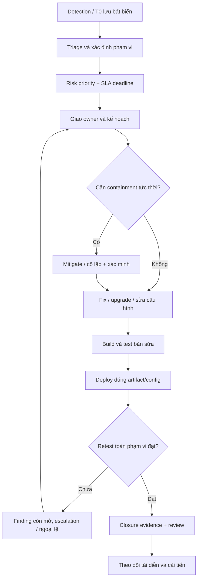
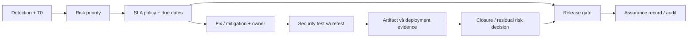

# Remediation SLA

Giả sử nhóm phát triển một ứng dụng SaaS phát hiện lỗ hổng cho phép người dùng thuộc tenant B xem hồ sơ của tenant A. Developer tạo pull request sửa lỗi trong vài giờ, nhưng phiên bản chứa bản vá chưa được triển khai tới một cụm production trong nhiều ngày. Dashboard nội bộ vẫn đánh dấu phát hiện là “đã xử lý” ngay khi mã nguồn được merge. Khi khách hàng hỏi **mất bao lâu từ lúc tổ chức biết lỗ hổng đến khi hệ thống thực sự không còn bị ảnh hưởng**, nhóm không đưa ra được câu trả lời nhất quán.

Vấn đề không đơn giản là thiếu tốc độ sửa lỗi. Đó là thiếu **Remediation SLA** có định nghĩa rõ, tính được thời hạn, gắn người chịu trách nhiệm và yêu cầu bằng chứng xác minh kết quả.

**Remediation SLA** (*Service Level Agreement for vulnerability remediation*) là cam kết về **thời hạn và điều kiện xử lý một lỗ hổng bảo mật** trong phạm vi đã quy định. Tùy tổ chức, SLA có thể là cam kết với khách hàng, đối tác hoặc quy định nội bộ được quản trị như cam kết. Thời hạn thường phụ thuộc vào rủi ro, mức phơi nhiễm, tính khẩn cấp, loại tài sản và nghĩa vụ áp dụng. Một SLA hiệu quả không chỉ đặt con số ngày; nó xác định **đồng hồ bắt đầu khi nào, kết quả nào được coi là hoàn thành, ai kiểm chứng và điều gì xảy ra nếu không đạt**.

Trong chương trình **SECURITY_SECURITY_ASSURANCE**, Remediation SLA hỗ trợ xây dựng bằng chứng rằng các phát hiện được đánh giá, ưu tiên, khắc phục và kiểm chứng trong thời gian chấp nhận được. Chuỗi assurance cần nối được: **phát hiện → tài sản bị ảnh hưởng → đánh giá rủi ro → thời hạn → hành động → kiểm chứng → triển khai → quyết định đóng finding hoặc chấp nhận rủi ro còn lại**.

## 1. Remediation SLA giải quyết vấn đề gì?

Các công cụ SAST, DAST, SCA, scanner hạ tầng, pentest và bug report có thể tạo ra rất nhiều findings. Không phải finding nào cũng giống nhau: một lỗi truy cập chéo tenant đang phơi nhiễm trên Internet có thể cần hành động ngay; một cấu hình sai trong môi trường thử nghiệm cô lập có thể được xử lý trong chu kỳ dài hơn.

Nếu thiếu chính sách thời hạn và quyền sở hữu, tổ chức dễ gặp:

- **Finding tồn đọng vô hạn:** ticket được giao nhưng không có deadline hay escalation.
- **Mức ưu tiên sai:** đội tập trung vào nhiều lỗi dễ sửa thay vì một điểm yếu có tác động lớn.
- **Trạng thái giả:** pull request đã merge nhưng pod, VM hoặc thiết bị đang chạy vẫn chưa được cập nhật.
- **Đồng hồ bị thao túng:** xác nhận finding muộn, tạo lại ticket hoặc đổi mức nghiêm trọng để tránh quá hạn.
- **Không có ngoại lệ minh bạch:** “đang chờ nhà cung cấp” trở thành lý do trì hoãn không giới hạn.
- **Audit không thể truy vết:** không có thời điểm phát hiện, chủ sở hữu, bằng chứng retest hay quyết định rủi ro.
- **Không đo được hiệu lực:** dashboard chỉ đếm số lỗ hổng đã đóng mà không biết phạm vi production đã được khắc phục đến đâu.

SLA giúp hình thành **kỳ vọng rõ ràng** giữa phát triển, bảo mật, vận hành, owner tài sản và người chấp nhận rủi ro. Nó không thay thế đánh giá kỹ thuật hoặc quyết định nghiệp vụ.

### 1.1. Phân biệt SLA, SLO, OLA và remediation policy

| Khái niệm | Bản chất | Ví dụ |
| --- | --- | --- |
| **SLA** | Cam kết mức dịch vụ/điều kiện, thường có bên cam kết và bên thụ hưởng, cách đo và xử lý vi phạm | Lỗ hổng thuộc nhóm rủi ro cao phải được khắc phục và xác minh trong thời hạn đã thỏa thuận |
| **SLO** (*Service Level Objective*) | Mục tiêu đo lường nội bộ để cải thiện hiệu suất | Mục tiêu 95% findings thuộc nhóm ưu tiên cao đạt hạn xử lý |
| **OLA** (*Operational Level Agreement*) | Thỏa thuận hỗ trợ giữa các nhóm nội bộ để đáp ứng SLA | Platform cung cấp cửa sổ triển khai và evidence trong giới hạn thời gian |
| **Remediation policy** | Quy tắc tổ chức về phân loại, ưu tiên, luồng xử lý, ngoại lệ và quyền quyết định | Quy định điều kiện thay đổi priority và yêu cầu phê duyệt ngoại lệ |
| **Patch management plan** | Kế hoạch triển khai bản vá hoặc thay cấu hình | Các đợt nâng cấp image và rolling restart theo dịch vụ |
| **Incident response target** | Mục tiêu ứng cứu một sự cố hoặc cuộc tấn công đang diễn ra | Phát hiện, khoanh vùng và ngăn đường tấn công trong trạng thái khẩn cấp |

Không phải mọi ngưỡng nội bộ đều là SLA hợp đồng. Khi sử dụng thuật ngữ “SLA”, cần chỉ rõ **đây là cam kết nội bộ hay nghĩa vụ với bên ngoài**, phạm vi tài sản, phương pháp đo và cơ chế xử lý khi vi phạm.

### 1.2. Remediation khác triage, mitigation và closure

| Hoạt động | Câu hỏi | Kết quả được mong đợi |
| --- | --- | --- |
| **Detection** | Phát hiện được gì, khi nào, từ nguồn nào? | Sự kiện/finding có nguồn và thời điểm |
| **Triage** | Có thật không, ảnh hưởng những gì, mức rủi ro nào? | Đánh giá và owner |
| **Containment** | Có cần ngăn tác động ngay không? | Đường khai thác hoặc hành vi nguy hiểm được hạn chế |
| **Mitigation** | Có control nào giảm rủi ro trước khi sửa tận gốc? | Biện pháp bù có bằng chứng hiệu lực |
| **Remediation** | Nguyên nhân hoặc điều kiện gây rủi ro đã được xử lý đủ phạm vi chưa? | Bản vá, cấu hình hoặc thay đổi đã áp dụng |
| **Verification / retest** | Việc xử lý có hiệu quả ở phiên bản/môi trường liên quan không? | Kết quả kiểm tra độc lập phù hợp |
| **Closure** | Có thể kết luận finding đã đạt điều kiện đóng hoặc xử lý rủi ro còn lại chưa? | Quyết định, evidence và audit trail |

Một tổ chức có thể thiết lập **nhiều đồng hồ**: thời gian xác nhận, thời gian hạn chế rủi ro ban đầu và thời gian khắc phục được kiểm chứng. Không nên nhầm “đã xác nhận ticket” với “đã khắc phục lỗ hổng”, hoặc “đã áp WAF rule” với “lỗ hổng trong code đã được sửa”.

## 2. Các thành phần không thể thiếu của một Remediation SLA

Một chính sách đủ rõ để thực thi thường xác định:

1. **Đối tượng áp dụng:** loại lỗ hổng, hệ thống, dịch vụ, môi trường, phiên bản, tài sản do ai quản lý.
2. **Phân loại ưu tiên:** rủi ro được đánh giá thế nào, ai được thay đổi mức ưu tiên.
3. **Mốc bắt đầu (T0):** sự kiện nào kích hoạt bộ đếm và nguồn timestamp đáng tin.
4. **Đơn vị thời gian:** giờ/ngày lịch 24×7 hay ngày làm việc, timezone, ngày nghỉ.
5. **Các mốc trung gian:** triage, phân công, containment, plan, remediation, retest.
6. **Định nghĩa hoàn thành:** cần sửa nguyên nhân gốc, xác minh bản vá và bao phủ deployment nào.
7. **Owner và escalation:** nhóm sở hữu, người ra quyết định, cấp nhận cảnh báo trước/quá hạn.
8. **Ngoại lệ:** trường hợp có thể chấp nhận rủi ro, ai duyệt, khi nào hết hiệu lực.
9. **Bằng chứng:** artifact, test run, scanner, cấu hình, trạng thái deploy và người xác nhận.
10. **Giám sát:** KPI, báo cáo quá hạn, audit, đánh giá lại khi có thông tin mới.

Các yếu tố phải đồng bộ. Ví dụ một hạn “7 ngày” thiếu định nghĩa T0 và môi trường không thể đo nhất quán giữa các nhóm.

## 3. Thiết kế SLA theo rủi ro thay vì điểm số đơn lẻ

**Severity** thường mô tả mức nghiêm trọng kỹ thuật của điểm yếu, trong khi **priority** là thứ tự xử lý được quyết định dựa trên mức rủi ro của hệ thống và bối cảnh. Chúng liên quan nhưng không đồng nhất.

### 3.1. Những yếu tố ảnh hưởng thời hạn

| Yếu tố | Câu hỏi cần trả lời | Hệ quả có thể có |
| --- | --- | --- |
| **Mức ảnh hưởng** | Lỗi có thể làm lộ dữ liệu, thay đổi giao dịch, ngừng dịch vụ hoặc chiếm quyền? | Tác động cao có thể rút ngắn hạn |
| **Mức phơi nhiễm** | Internet-facing, nội bộ, staging, tài sản không kết nối mạng? | Điểm vào công khai thường được ưu tiên hơn |
| **Khả năng khai thác** | Điều kiện tấn công có sẵn, có khai thác thực tế, có exploit khả dụng? | Khả năng khai thác cao có thể cần ứng cứu khẩn |
| **Tài sản và dữ liệu** | Dữ liệu khách hàng, khóa, hệ thống danh tính, hạ tầng trọng yếu? | Tài sản quan trọng làm tăng rủi ro |
| **Phạm vi tác động** | Một người dùng, nhiều tenant, nhiều cụm hay toàn bộ hệ thống? | Blast radius lớn đòi hỏi hành động sớm |
| **Quyền cần có** | Kẻ tấn công cần quyền admin hay chỉ một tài khoản thông thường? | Điều kiện truy cập làm thay đổi mức phơi nhiễm |
| **Control hiện hữu** | Authorization, segmentation, sandbox, rate limit có hiệu lực không? | Control có chứng cứ có thể giảm rủi ro còn lại |
| **Tình trạng bị khai thác** | Có thông tin đáng tin rằng lỗi đang bị khai thác trong thực tế? | Có thể kích hoạt incident/expedited path |
| **Nghĩa vụ bắt buộc** | Pháp luật, hợp đồng, tiêu chuẩn hay khách hàng yêu cầu hạn nào? | Phải tuân thủ điều kiện áp dụng, không tự nới |
| **Khả năng phục hồi** | Có rollback, backup, feature flag, cô lập tài nguyên hay không? | Ảnh hưởng cách containment và triển khai |

CVSS hỗ trợ hiểu độ nghiêm trọng kỹ thuật; EPSS, danh mục known exploited vulnerabilities và thông tin từ vendor có thể bổ sung tín hiệu khả năng khai thác. **Không một chỉ số riêng lẻ nào tự quyết định toàn bộ Remediation SLA**.

### 3.2. Phân biệt phát hiện không có bản vá với rủi ro thấp

Việc upstream chưa cung cấp bản sửa là **khó khăn triển khai**, không có nghĩa rủi ro thấp. Nếu một thư viện dễ bị khai thác nằm trên đường parse file upload và xử lý dữ liệu nhạy cảm, có thể phải giới hạn upload, cô lập workload hoặc tạm ngưng chức năng trong lúc chờ bản vá.

Ngược lại, một scanner đánh dấu lỗ hổng mức cao trong package chỉ dùng bởi test runner ở môi trường CI cô lập có thể được ưu tiên khác, **nếu** có căn cứ về phạm vi, quyền và điều kiện khai thác. CI có token hoặc quyền ký artifact thì dù không phải runtime, rủi ro vẫn có thể cao.

### 3.3. Xây priority tier theo rủi ro thực tế

Có thể xây các tier như:

- **P0 – Khẩn cấp:** đang khai thác hoặc rủi ro nghiêm trọng cần containment và điều phối sự cố ngay.
- **P1 – Cao:** lỗ hổng có đường khai thác hợp lý, ảnh hưởng lớn hoặc tài sản nhạy cảm, chưa có control đủ tin cậy.
- **P2 – Trung bình:** có tác động nhưng điều kiện khai thác hạn chế hoặc có control đã kiểm chứng.
- **P3 – Thấp:** ảnh hưởng thấp hoặc mức phơi nhiễm được giới hạn, theo tiêu chí nội bộ.

Tier phải có **định nghĩa, ngưỡng quyết định và ví dụ**, không đơn giản đổi tên Critical/High/Medium/Low từ scanner. Cần lưu kết quả triage vì một finding có thể đổi priority khi có exploit mới, hệ thống mở ra Internet hoặc cấu hình thay đổi.

## 4. Ví dụ bảng SLA: giá trị minh họa, không phải chuẩn chung

Bảng sau chỉ là **chính sách giả định phục vụ học tập** cho một hệ thống SaaS có dữ liệu nhạy cảm. Không được coi các con số này là yêu cầu của NIST, ISO, PCI, pháp luật hay tổ chức cụ thể. Thời hạn thực tế phải được phê duyệt từ risk appetite, nghĩa vụ và năng lực vận hành.

| Priority | Triage ban đầu | Containment/mitigation | Remediation đã kiểm chứng |
| --- | --- | --- | --- |
| **P0 – Khẩn cấp** | Tối đa 4 giờ lịch | Mục tiêu tối đa 24 giờ lịch hoặc nhanh hơn theo incident response | Mục tiêu 72 giờ lịch; nếu không khả thi phải có điều phối và quyết định rủi ro riêng |
| **P1 – Cao** | Tối đa 1 ngày lịch | Đánh giá và áp dụng biện pháp giảm thiểu phù hợp trong 3 ngày lịch | Tối đa 14 ngày lịch |
| **P2 – Trung bình** | Tối đa 5 ngày lịch | Theo đánh giá nguy cơ và kế hoạch đã phê duyệt | Tối đa 30 ngày lịch |
| **P3 – Thấp** | Theo chu kỳ triage quy định | Khi có điều kiện đáng quan ngại | Tối đa 90 ngày lịch |

**Giả định của bảng:** các mốc được đo từ T0, theo đồng hồ 24×7; mục tiêu mitigation không tự thay thế deadline remediation. Nếu policy yêu cầu P0 “khắc phục được kiểm chứng trong 72 giờ”, việc đã cô lập trong 24 giờ không làm SLA remediation tự chuyển thành “đạt”.

Để áp dụng bảng này thực tế, cần làm rõ:

- Có bắt buộc sửa nguyên nhân gốc ở P0 hay cho phép mitigation có thời hạn khi upstream chưa có patch?
- Nếu phát hiện lỗi tại một ngày nghỉ, có trực xử lý không?
- Ai phê duyệt việc thay đổi priority khi exposure thay đổi?
- Một tài sản của nhà cung cấp nằm ngoài quyền cập nhật có SLA riêng thế nào?
- Khi một tài sản bị ảnh hưởng trên nhiều cluster, kết quả hoàn thành được tính ra sao?
- Những nghĩa vụ bên ngoài có deadline khác bảng nội bộ không?

### 4.1. Vì sao không nên dùng “tất cả Critical đều 7 ngày”?

Một lỗi dùng điểm CVSS cao nhưng không thể đi tới code path trong cấu hình đã chứng minh có thể khác với lỗi cho phép chiếm tài khoản từ Internet đang được khai thác. Ngược lại, lỗi điểm thấp hơn nhưng xảy ra ở control plane của hệ thống trọng yếu cũng có thể đòi hỏi hành động trước hạn thông thường.

**Thời hạn theo rủi ro** cần có baseline nhất quán, đồng thời cho phép điều chỉnh có thẩm quyền và để lại lý do. Không được tùy tiện kéo dài hạn chỉ vì nhóm bận hoặc sprint sắp kết thúc.

## 5. Xác định chính xác thời điểm T0 và cách tính deadline

Một SLA không thể audit nếu không biết đồng hồ bắt đầu lúc nào. Trong tổ chức, có thể có các mốc:

- `first_seen_at`: thời điểm đầu tiên nguồn tin đáng tin báo phát hiện liên quan.
- `received_at`: thời điểm hệ thống quản lý vulnerability nhận báo cáo.
- `triaged_at`: thời điểm finding được xác thực và phân loại.
- `assigned_at`: thời điểm owner nhận trách nhiệm.
- `mitigated_at`: thời điểm biện pháp giảm thiểu được áp dụng và kiểm chứng.
- `fixed_at`: thời điểm bản sửa hoàn tất trong source/artifact.
- `deployed_at`: thời điểm bản sửa triển khai tại một môi trường.
- `verified_at`: thời điểm kết quả retest xác nhận tiêu chí đã đạt.
- `closed_at`: thời điểm kết luận đóng finding được phê duyệt.

**Khuyến nghị thiết kế:** lưu tất cả mốc trên, và xác định duy nhất mốc nào là T0 cho từng loại SLA. Nếu chính sách chọn T0 khi có báo cáo đáng tin cậy đầu tiên, không được làm T0 trôi sang lúc triage để che thời gian xác nhận chậm.

Một số tổ chức chọn thời điểm **finding được xác nhận** làm T0 cho remediation, nhưng khi đó nên đo riêng thời gian từ nhận báo cáo tới xác nhận. Nếu không, backlog chưa triage có thể biến mất khỏi thước đo SLA mặc dù rủi ro vẫn tồn tại.

### 5.1. Đơn vị thời gian: ngày lịch hay ngày làm việc?

- **Calendar hours/days (24×7):** 24 giờ nghĩa là một khoảng thời gian thực liên tục, không dừng cuối tuần.
- **Business days/hours:** thời gian chỉ chạy trong lịch làm việc đã định nghĩa, với ngày lễ và timezone xác định.
- **Fixed deadline:** hạn theo một thời điểm UTC cụ thể, ví dụ từ một thông báo khẩn cấp có điều kiện.

Cả ba cách đều hợp lệ khi được chỉ định rõ. Tuy nhiên, với lỗi đang bị khai thác hoặc tài sản Internet-facing, việc dùng lịch chỉ tính giờ hành chính có thể không phù hợp mức khẩn cấp; cần chính sách điều phối sự cố ngoài giờ.

### 5.2. Ví dụ tính hạn minh bạch

Giả sử policy giả định đặt hạn khắc phục P1 bằng **14 ngày lịch kể từ T0**, và T0 là `2026-11-01T08:00:00Z`. Deadline tương ứng là `2026-11-15T08:00:00Z`. Nếu nhóm phát hiện lại cùng lỗ hổng ở bản quét hôm sau, việc tạo ticket mới không đặt lại T0.

Với hạn P0 là 72 giờ lịch, cũng tính theo số giờ từ mốc quy định. Khi trình bày trong giao diện, có thể chuyển sang timezone người dùng, nhưng lưu timestamp UTC để audit và tránh sai khác vì vùng giờ.

Không dùng “+ 14 ngày” để tính ngày làm việc nếu chưa áp dụng lịch ngày nghỉ, giờ làm và nguyên tắc ngày bắt đầu. Với business-day SLA, cần quy định thời điểm tạm ngừng/tiếp tục theo lịch và định nghĩa ngày không làm việc.

### 5.3. Khi priority thay đổi, đồng hồ nào áp dụng?

Ví dụ finding ban đầu được phân loại P2; ba ngày sau có bằng chứng kẻ tấn công đang khai thác và priority chuyển P0. Chính sách phải nói rõ:

1. P0 kích hoạt yêu cầu hành động khẩn **từ thời điểm có thông tin mới hay phải áp từ T0 ban đầu**;
2. Hạn đã phát sinh theo P2 được xử lý thế nào;
3. Người nào phê duyệt và ghi lý do đổi priority;
4. Dashboard báo cáo trường hợp nào là quá hạn.

Một lựa chọn thận trọng là **giữ lịch sử T0 gốc và mọi deadline đã từng áp dụng**, đồng thời tạo deadline khẩn cấp mới theo quy tắc được công bố. Không được xóa lịch sử hoặc tự “reset SLA” mỗi lần đổi priority.

### 5.4. Có được tạm dừng SLA khi chờ nhà cung cấp?

Chỉ khi policy/hợp đồng **quy định rõ điều kiện tạm dừng**, người phê duyệt, bằng chứng, thời điểm bắt đầu/kết thúc và cách báo cáo. Một số cam kết không cho phép pause clock. Việc phụ thuộc vendor chưa có patch thường cần **mitigation, escalation và risk acceptance**, không tự động đóng băng đồng hồ.

Nên báo cáo cả **thời gian thực tế kể từ T0** và **thời gian tính SLA sau các ngoại lệ hợp lệ** nếu có, để tránh che rủi ro tồn đọng.

## 6. Những SLA con trong vòng đời xử lý lỗ hổng

Một tổ chức có thể dùng nhiều mục tiêu bổ trợ:

| Đồng hồ | Mốc bắt đầu | Mốc kết thúc | Câu hỏi assurance |
| --- | --- | --- | --- |
| **Time to acknowledge** | Báo cáo hợp lệ được nhận | Owner hoặc hàng đợi có trách nhiệm tiếp nhận | Có ai chịu trách nhiệm? |
| **Time to triage** | T0 theo policy | Kết luận ban đầu về tính hợp lệ, tài sản và priority | Rủi ro có được nhận diện kịp thời? |
| **Time to contain** | Mốc khẩn cấp hoặc T0 | Hành vi gây hại được hạn chế có kiểm chứng | Có giảm tác động trong thời gian chờ sửa? |
| **Time to plan** | Finding được phân công | Có kế hoạch sửa, người thực hiện, mốc triển khai | Có đường xử lý khả thi? |
| **Time to remediate** | T0 remediation | Rủi ro được khắc phục theo tiêu chí và phạm vi đã xác định | Bản sửa thực sự có hiệu lực? |
| **Time to verify** | Bản sửa sẵn sàng/triển khai | Test/scan/review xác nhận đạt | Có bằng chứng sau sửa? |
| **Time to close** | Verification hoàn tất | Finding được phê duyệt đóng với hồ sơ đủ | Quyết định có thể kiểm tra không? |

Không nhất thiết mọi SLA con đều được ghi thành nghĩa vụ hợp đồng. Nhưng việc tách các mốc tạo khả năng điều hành: nếu khắc phục thường chậm vì chờ cửa sổ triển khai, team có thể cải thiện phối hợp platform thay vì chỉ yêu cầu developer sửa code nhanh hơn.

## 7. Quy trình remediation theo SLA: từ phát hiện đến xác minh

### Bước 1: Tiếp nhận và chuẩn hóa finding

Nhận từ SAST, DAST, SCA, pentest, bug bounty, scan hạ tầng, báo cáo người dùng hoặc incident. Lưu nguồn, timestamp, tài sản, đường tái hiện an toàn và ID. Loại trùng theo **vấn đề – thành phần – phạm vi**, nhưng giữ liên kết đến các nguồn và T0 ban đầu.

Finding mới cần có trạng thái `NEW` hoặc `PENDING_TRIAGE`, không tự động chuyển `PASS` vì chưa được xác minh.

### Bước 2: Xác định phạm vi ảnh hưởng

Liên kết finding với các asset, service, deployment, phiên bản, tenant hoặc dữ liệu liên quan. Với dependency, dùng inventory/SBOM theo artifact; với cấu hình cloud, truy IAM/network/storage policy và tài khoản; với lỗi code, xác định endpoint và nhánh phát hành.

Nếu chưa biết phạm vi, ghi `UNKNOWN` và kế hoạch điều tra. Thiếu inventory không phải bằng chứng không có ảnh hưởng.

### Bước 3: Phân loại rủi ro và tính SLA

Áp policy hiện hành cho tài sản liên quan. Lưu priority, lý do, các ngưỡng T0, due date và người phê duyệt đánh giá. Với lỗi đang được khai thác hoặc ảnh hưởng dữ liệu nhạy cảm, có thể kích hoạt incident response bên cạnh remediation process.

### Bước 4: Giao owner và phối hợp

Chỉ định người hoặc nhóm **accountable** về việc khắc phục. Nếu sửa code thuộc developer nhưng triển khai thuộc SRE và retest thuộc security, phải nêu rõ trách nhiệm của từng bên, không để finding bị đẩy qua lại.

### Bước 5: Containment hoặc mitigation khi cần

Có thể thu hồi credential, tắt endpoint, giới hạn upload, áp cấu hình chặn, giảm quyền, cô lập workload hoặc đưa chức năng vào chế độ hạn chế. Cần kiểm chứng control đã phát huy hiệu lực và đánh giá tác động vận hành. Containment không mặc định làm hoàn thành remediation SLA.

### Bước 6: Sửa nguyên nhân hoặc giảm rủi ro theo kế hoạch

Các phương án có thể là code fix, patch, upgrade dependency, thay library, sửa IAM/config, loại bỏ chức năng rủi ro hoặc thay đổi kiến trúc. Phải ghi commit, thay đổi policy, artifact và điều kiện tương thích.

### Bước 7: Kiểm chứng và triển khai trên đúng phạm vi

Chạy test tái hiện lỗi, negative regression, scan/rescan, review code, cấu hình runtime hoặc kiểm tra bổ sung tùy loại finding. Triển khai artifact/config đã kiểm chứng tới các hệ thống bị ảnh hưởng trong phạm vi SLA. Kiểm tra các instance cũ, cluster dự phòng, region và job batch.

### Bước 8: Đóng hoặc chấp nhận rủi ro còn lại

Khi đã có bằng chứng, reviewer cập nhật `VERIFIED_REMEDIATED` hoặc trạng thái phù hợp. Nếu chưa xử lý hết nhưng policy cho phép, lập ngoại lệ có hạn và chủ sở hữu. Finding có thể được đánh dấu `MITIGATED` chứ không phải `FIXED` để thể hiện sự thật.

### Bước 9: Hậu kiểm và ngăn tái diễn

Nếu lỗi vượt SLA, xác định nguyên nhân: chậm triage, thiếu inventory, thiếu cửa sổ triển khai, kiểm thử yếu, phụ thuộc vendor hay sai quy trình duyệt. Tạo cải tiến, test hồi quy, cập nhật threat model và kiểm soát ở các bản phát hành tiếp theo.



## 8. Định nghĩa “đã khắc phục” phải gắn với thực tế triển khai

Điều kiện đóng một finding nên phản ánh **hành vi đã được sửa trên đúng tài sản**, không chỉ hành động của developer.

### 8.1. Các trạng thái dễ nhầm

| Trạng thái | Điều đã xảy ra | Điều vẫn cần xác minh |
| --- | --- | --- |
| **Fix proposed** | Có phương án hoặc pull request | Chưa biết bản sửa có đúng không |
| **Fix merged** | Mã mới nằm trên nhánh | Chưa biết artifact nào chứa mã và có triển khai không |
| **Artifact built** | Có binary/image mới | Chưa biết security regression test và deployment đạt không |
| **Verified in staging** | Bản sửa được kiểm chứng trong staging | Production có cùng artifact/config và không còn instance cũ không |
| **Deployed to production** | Bản sửa đã rollout | Các asset trong phạm vi đã chuyển hết và hành vi đã đạt chưa |
| **Verified remediated** | Bằng chứng xác nhận yêu cầu trên phạm vi mục tiêu | Có rủi ro còn lại hoặc hệ thống ngoại lệ ngoài phạm vi không |
| **Accepted risk** | Người có quyền chấp nhận một rủi ro với điều kiện | Không đồng nghĩa đã sửa tận gốc |

Một công cụ issue tracker có thể dùng trạng thái khác, nhưng ý nghĩa cần nhất quán. Tổ chức không nên đổi tên `ACCEPTED_RISK` thành `FIXED` chỉ để làm đẹp tỷ lệ hoàn thành.

### 8.2. Một finding trên nhiều asset

Giả sử lỗ hổng ở image dùng trong 12 deployment. Đã cập nhật 11 deployment, còn một deployment dự phòng dùng bản cũ. Nếu yêu cầu là toàn bộ production phải được khắc phục, finding **chưa hoàn thành toàn phạm vi**.

Có thể theo dõi trạng thái **theo asset**:

| Deployment | Trạng thái | Evidence |
| --- | --- | --- |
| Cluster A – API | Đã triển khai và xác minh | Image digest mới, test và policy |
| Cluster B – API | Đã triển khai và xác minh | Image digest mới, test và policy |
| Cluster C – worker | Chưa triển khai | Ticket rollout và phương án hạn chế |
| Staging | Đã xác minh | CI run, không thay cho production evidence |

Nếu hệ thống cần dùng nhiều deadline cho các asset, phải định nghĩa rõ áp dụng theo finding chung hay từng instance, không để việc tách ticket làm mất T0 gốc.

## 9. Ví dụ thực tế: SLA cho lỗ hổng truy cập chéo tenant

Giả sử dịch vụ `document-api` có lỗ hổng authorization: một người dùng của tenant B thay `documentId` để truy cập tài liệu tenant A qua API export.

**Bối cảnh giả định:**

- Hệ thống có dữ liệu khách hàng nhạy cảm và API Internet-facing.
- `FIND-AUTH-032` được phát hiện lúc `T0` qua kiểm thử được phê duyệt.
- Nhóm xác minh khả năng truy cập trái quyền và phân loại `P0` theo policy giả định.
- Môi trường gồm API service, export worker và hai cluster production.

### 9.1. Kế hoạch hành động theo hai đồng hồ

| Mốc | Hoạt động | Bằng chứng mong đợi |
| --- | --- | --- |
| **T0** | Ghi nhận và chuyển xử lý khẩn | Ticket, timestamp, người trực |
| **Triage ≤ 4 giờ** | Xác nhận đường lỗi, tài sản, exposure, người phụ trách | Risk assessment, danh sách endpoint |
| **Containment ≤ 24 giờ** | Tạm khóa export hoặc giới hạn luồng rủi ro đã xác minh | Cấu hình thực tế, negative test, alert |
| **Remediation mục tiêu ≤ 72 giờ** | Sửa authorization trong API/worker, triển khai, kiểm tra lại | PR, CI run, deployment digest, retest |
| **Sau đóng** | Kiểm tra cùng nguyên nhân ở download/search và thêm regression tests | Threat model cập nhật, coverage và review |

Các mốc là ví dụ của chính sách giả định ở mục 4; không phải thời hạn bắt buộc trên thực tế. Nếu một bài kiểm thử xác minh API đã chặn nhưng worker vẫn cho phép truy cập chéo tenant, **không được đóng finding** chỉ vì một đường đã an toàn.

### 9.2. Minh họa một điều kiện phân quyền

Trong ứng dụng Java, một hướng triển khai tại service layer là lọc theo principal đã xác thực:

```java
// Minh họa: không phải một bản vá đầy đủ cho hệ thống thực tế.
public DocumentView readDocument(UUID id, AuthenticatedPrincipal principal) {
    if (!principal.hasPermission("document:read")) {
        throw new AccessDeniedException("Access denied");
    }

    Document doc = repository
            .findByIdAndTenantId(id, principal.tenantId())
            .orElseThrow(DocumentNotFoundException::new);

    return mapper.toView(doc);
}
```

Code này không tự bảo vệ `ExportWorker` nếu worker không dùng cùng control. Phải xét từng luồng, quyền service account, job metadata, đường tải file và khả năng thu hồi phiên.

### 9.3. Checklist xác minh cụ thể

- Tài khoản hợp lệ của tenant A truy cập tài liệu A thành công.
- Tài khoản B bị từ chối khi yêu cầu tài liệu A.
- Người không xác thực bị từ chối theo chính sách.
- Export worker không bỏ qua kiểm tra quyền/tenant.
- Cache, search, download URL không cho phép đường vòng cùng nguyên nhân.
- Audit event được ghi nhận mà không lộ nội dung nhạy cảm.
- Các cluster trong phạm vi đã chạy artifact có bản vá.
- Test tái hiện lỗi gốc pass theo tiêu chí xác nhận không còn hành vi trái phép.

Chỉ khi có evidence phù hợp về phạm vi, reviewer mới xác nhận khắc phục. SLA đo từ T0 tới **mốc hoàn thành đã định nghĩa**, không phải tới lúc developer mở PR.

## 10. Ví dụ thứ hai: dependency có lỗ hổng nhưng chưa có patch

Giả sử SCA cho thấy thư viện xử lý tài liệu là transitive dependency đang dùng ở runtime, có advisory phù hợp với version được đóng gói. Upstream chưa cung cấp fixed version.

Quy trình theo SLA:

1. **Triage:** xác định resolved/packaged version, đường dependency, affected versions và deployment.
2. **Đánh giá:** tìm đường gọi parser từ file upload, quyền worker và khả năng tác động.
3. **Mitigation:** trong thời gian chờ, cân nhắc giới hạn loại file, tắt tính năng, giảm quyền worker, sandbox hoặc cô lập; kiểm chứng control.
4. **Escalation:** nếu deadline không thể đạt, trình risk owner bản phân tích, tác động, phương án và hạn đánh giá lại.
5. **Theo dõi upstream:** kiểm tra advisory, bản vá và lựa chọn thư viện thay thế.
6. **Remediation:** khi có bản sửa phù hợp, rebuild, chạy security/regression tests và xác minh deployment.
7. **Bằng chứng:** SBOM, dependency graph, policy/config, finding ticket, ngoại lệ và kết quả test.

**Không có patch không làm SLA biến mất**. Nếu chính sách cho phép tạm thời chấp nhận rủi ro, phải có hồ sơ riêng và trạng thái rõ. Nếu rủi ro vượt mức có thể chấp nhận, cần hạn chế hoặc dừng chức năng chịu ảnh hưởng thay vì tiếp tục chờ vô thời hạn.

## 11. Vai trò và trách nhiệm: ai chịu trách nhiệm đạt SLA?

SLA sẽ không hiệu quả nếu mọi finding được chuyển vòng quanh các nhóm mà không có người chịu trách nhiệm cuối cùng.

| Vai trò | Trách nhiệm | Bằng chứng thường sở hữu |
| --- | --- | --- |
| **Security / vulnerability management** | Tiếp nhận, triage, thiết lập priority, theo dõi SLA và escalation | Finding record, risk assessment, báo cáo aging |
| **Asset / service owner** | Chịu trách nhiệm xử lý rủi ro trên hệ thống thuộc phạm vi | Asset inventory, kế hoạch và trạng thái remediation |
| **Developer / engineering** | Sửa logic, nâng dependency, bổ sung regression test | PR, code review, test run |
| **Platform / DevOps / SRE** | Patch image/OS, triển khai, giám sát runtime và drift | Build, deployment digest, config evidence |
| **QA / security verifier** | Xác minh hành vi đúng/sai, retest và độ bao phủ | Test results, review log |
| **Incident response team** | Containment khi đang bị khai thác và điều tra phạm vi | Incident timeline, containment evidence |
| **Business / risk owner** | Quyết định ưu tiên nghiệp vụ và chấp nhận rủi ro trong thẩm quyền | Approval, exception, thời hạn |
| **Audit / assurance reviewer** | Kiểm tra tính nhất quán giữa claim, deadline và evidence | Audit trail, assurance case, gap assessment |

Một người có thể kiêm nhiều vai trò trong nhóm nhỏ. Với finding có tác động cao, nên có sự xác minh độc lập phù hợp; người đã sửa không nên là nguồn duy nhất kết luận rằng mọi deployment đều đã an toàn.

### 11.1. Quy tắc xử lý khi nhiều nhóm cùng tham gia

Một finding có thể yêu cầu developer sửa mã, platform cập nhật image, SRE điều phối rollout và security retest. Có thể dùng **một accountable owner** theo dõi kết quả cuối cùng cùng các task con có OLA. Nếu nhóm giao task cho vendor hoặc bên khác, thời hạn SLA với khách hàng không tự động bị vô hiệu.

## 12. Escalation và xử lý vượt hạn

Một SLA cần cơ chế điều hành trước khi deadline bị bỏ lỡ, không chỉ báo cáo “đã quá hạn” sau đó.

### 12.1. Escalation theo mốc

Một tổ chức có thể thiết kế:

- **Lúc phân loại:** thông báo owner và quản lý chịu trách nhiệm.
- **Khi đi qua tỷ lệ thời gian đã định:** nhắc owner xác nhận kế hoạch và khả năng đáp ứng.
- **Khi chưa có bằng chứng tiến triển:** chuyển lên engineering lead hoặc service owner.
- **Gần deadline:** yêu cầu kế hoạch khắc phục có thời gian, kiểm tra phụ thuộc deployment và control bù.
- **Đến hạn nhưng chưa đạt:** phát cảnh báo breach; thực hiện phản ứng theo chính sách, có thể giới hạn dịch vụ hoặc đưa ra quyết định rủi ro.
- **Sau breach:** hậu kiểm nguyên nhân và cải tiến, không chỉ cập nhật lại ngày để bỏ trạng thái quá hạn.

Mốc cụ thể phụ thuộc priority. Với P0 cần trực xử lý và điều phối liên tục khi thích hợp; không nên đợi email nhắc nhở theo chu kỳ.

### 12.2. Trạng thái quá hạn phải minh bạch

Ví dụ:

- `OPEN_ON_TIME`: chưa tới hạn, còn finding chưa đạt.
- `AT_RISK`: có nguy cơ không đạt, cần kế hoạch.
- `OVERDUE`: quá thời điểm deadline mà chưa có outcome đạt theo policy.
- `MITIGATED_OVERDUE`: có control bù nhưng remediation vẫn quá hạn.
- `EXCEPTION_APPROVED`: có quyết định chấp nhận rủi ro hợp lệ, không tương đương “fixed”.
- `VERIFIED_REMEDIATED`: đã kiểm chứng trong phạm vi.
- `CLOSED_AS_FALSE_POSITIVE`: finding không áp dụng, có căn cứ và review.

Nếu tổ chức được phép dùng ngoại lệ, dashboard nên tách **tỷ lệ đúng hạn theo SLA gốc**, **tỷ lệ ngoại lệ đã phê duyệt** và **rủi ro thực tế còn mở**. Không nên làm biến mất số lần breach khỏi lịch sử chỉ vì ngoại lệ được ký sau khi quá hạn.

## 13. Quản lý ngoại lệ và risk acceptance

Ngoại lệ là quyết định quản trị cho một finding cụ thể, không phải cách xóa lỗ hổng khỏi số liệu.

### 13.1. Những trường hợp có thể cần ngoại lệ

- Upstream chưa có bản vá và control bù đã được xác minh.
- Nâng dependency gây gián đoạn hoặc lỗi tương thích cần chuyển đổi kiến trúc.
- Hệ thống legacy cần kế hoạch thay thế có giai đoạn.
- Nhà cung cấp cần thời gian khắc phục theo hợp đồng.
- Một yêu cầu được xác định không áp dụng cho môi trường dựa trên bằng chứng.
- Một deployment không thể cập nhật ngay vì phụ thuộc nghiệp vụ, nhưng có phương án cô lập.

Không phải mọi finding đều có thể được chấp nhận rủi ro. Nghĩa vụ pháp lý, hợp đồng hoặc chính sách có điều kiện không thể bỏ qua phải được tuân thủ theo thẩm quyền tương ứng. Nếu rủi ro vượt ngưỡng, cần dừng/thu hẹp chức năng hoặc thay kiến trúc.

### 13.2. Bản ghi ngoại lệ tối thiểu

```yaml
exception:
  id: "EXC-<id>"
  finding_id: "FIND-<id>"
  affected_assets:
    - "<asset-id-or-service>"
  release_or_config: "<artifact-or-policy-version>"
  original_detected_at: "<timestamp>"
  original_priority: "P1"
  original_due_at: "<timestamp>"
  requested_reason: "<why-remediation-cannot-be-completed-on-time>"
  residual_risk: "<attack-scenario-impact-and-exposure>"
  compensating_controls:
    - control: "<control-id>"
      verification_ref: "<evidence-id>"
  remediation_plan: "<owner-action-and-milestones>"
  remediation_owner: "<team-or-person>"
  approved_by: "<authorized-risk-owner>"
  approved_at: "<timestamp>"
  expires_at: "<timestamp>"
  reevaluation_triggers:
    - "known-exploitation-observed"
    - "control-fails"
    - "service-exposure-changes"
    - "fixed-version-becomes-available"
  status: "conditionally-accepted"
```

Tất cả trường trong ngoặc nhọn là dữ liệu mẫu. Không được coi văn bản này là phê duyệt có thật. Một ngoại lệ nên **gắn đúng finding, asset, release/config và thời hạn**; không tự áp dụng sang hệ thống khác.

### 13.3. Ngoại lệ hết hạn và phê duyệt hồi tố

Khi ngoại lệ hết hạn mà finding chưa được xử lý, hệ thống phải kích hoạt đánh giá lại và escalation. Phê duyệt mới cần căn cứ mới hoặc xác minh lại giả định.

Nếu có phê duyệt sau deadline, vẫn cần giữ audit trail cho biết **đã có khoảng thời gian vượt hạn**, thay vì lùi ngày phê duyệt để tạo cảm giác đạt SLA.

## 14. Dùng policy-as-code và automation để quản lý thời hạn

Có thể tự động tính deadline, nhắc owner, phát hiện quá hạn và xây evidence manifest. Nhưng policy cần được định nghĩa và review trước khi mã hóa.

### 14.1. Policy YAML minh họa

Ví dụ này thể hiện **quy tắc mang tính khái niệm**, không phải schema chuẩn của một sản phẩm vulnerability management:

```yaml
remediation_sla_policy:
  id: "VM-SLA-PRODUCTION"
  version: "1.0"
  scope:
    environments: ["production"]
    asset_classes: ["internet-facing", "sensitive-data"]
  clock:
    timezone: "UTC"
    unit: "calendar-hours"
    start_event: "first-actionable-report-received"
    keep_original_t0: true
    pause_allowed: false
  priorities:
    P0:
      triage_hours: 4
      containment_target_hours: 24
      verified_remediation_hours: 72
    P1:
      triage_hours: 24
      mitigation_target_hours: 72
      verified_remediation_hours: 336
    P2:
      triage_hours: 120
      verified_remediation_hours: 720
    P3:
      verified_remediation_hours: 2160
  closure:
    require_retest: true
    require_deployment_scope_verified: true
    require_evidence_refs: true
    require_authorized_reviewer: true
  exceptions:
    permitted_only_when_policy_allows: true
    require_risk_owner: true
    require_expiration: true
    keep_original_due_date: true
  escalation:
    require_owner_notifications: true
    retain_overdue_history: true
```

Các số giờ trong policy tương đương **bảng ví dụ** ở phần 4 (24×7), không phải tiêu chuẩn áp dụng chung. Nếu dùng business days, cần cấu hình lịch hoạt động và ngày lễ, không chỉ thay tên đơn vị.

### 14.2. Pseudocode đánh giá SLA

```text
function evaluateFinding(finding, policy, now):
    assert finding has immutable original_detected_at
    assert finding has affected_assets and accountable_owner

    priority = approvedRiskPriority(finding)
    deadline = computeDeadline(policy, finding.original_detected_at, priority)

    if validFalsePositiveOrNotApplicableDecision(finding):
        return CLOSED_WITH_JUSTIFICATION

    if verifiedRemediationEvidenceCoversScope(finding):
        completedAt = latestRequiredVerificationOrDeploymentTime(finding)
        return completedAt <= deadline ? REMEDIATED_ON_TIME : REMEDIATED_LATE

    if approvedExceptionApplies(finding, now):
        return OPEN_WITH_APPROVED_EXCEPTION_AND_ORIGINAL_DEADLINE

    if now > deadline:
        return OVERDUE_AND_ESCALATE

    return OPEN_WITH_REMAINING_TIME
```

Đây là minh họa logic. Một hệ thống thật phải xử lý timezone, lịch business day, priority change, nhiều asset có deadline khác nhau, kết quả retest không đầy đủ, data quality và quyền thay đổi dữ liệu. Không dùng dấu `<=` trong pseudocode để suy luận rằng thời điểm đóng ticket tự động là thời điểm được kiểm chứng; phải dùng sự kiện kết thúc đã được policy định nghĩa.

### 14.3. Bảo vệ hệ thống đo SLA

Nếu developer tự chỉnh `detected_at`, `priority` hoặc `fixed_at` mà không có audit, dashboard sẽ mất giá trị. Nên:

- Lấy mốc thời gian từ hệ thống tiếp nhận, CI, ticket hoặc log tin cậy.
- Giữ lịch sử thay đổi priority và người phê duyệt.
- Liên kết evidence tới artifact digest, config version và asset.
- Kiểm soát quyền đóng finding và phê duyệt ngoại lệ.
- Không cho phép xóa lịch sử breach hoặc tạo lại ticket để reset timer.
- Tự động đối chiếu deployment thực tế với bản vá.
- Kiểm tra định kỳ logic tính deadline bằng bộ test edge cases.

### 14.4. Bộ tình huống test cho SLA engine

| Trường hợp | Kết quả cần đạt |
| --- | --- |
| Finding mới có T0 và priority hợp lệ | Deadline được tính theo đúng policy version |
| Scanner phát hiện lại cùng vấn đề | Giữ T0 gốc, ghi nguồn phát hiện bổ sung |
| Priority tăng P2 → P0 | Tạo mốc khẩn phù hợp, không xóa lịch sử |
| Ticket ở trạng thái “Fix merged” nhưng production chưa deploy | Không tự coi remediation hoàn tất |
| Retest thất bại trên một endpoint | Finding vẫn chưa đạt phạm vi |
| Một cluster còn instance cũ | Chưa đóng trên toàn phạm vi cần khắc phục |
| Ngoại lệ đã hết hạn | Không còn được coi là phê duyệt hợp lệ |
| Nhân viên sửa `due_at` trái phép | Bị chặn hoặc có audit/event và phê duyệt theo policy |
| T0 nằm ngoài giờ làm, SLA 24×7 | Đồng hồ tiếp tục chạy |
| SLA business day cắt qua cuối tuần/ngày nghỉ | Deadline tuân theo lịch đã cấu hình |
| Bằng chứng không khớp artifact | Không dùng để đánh dấu verified remediation |

## 15. Metrics: đo đúng kết quả thay vì “đóng nhiều ticket”

Một dashboard tốt cần mô tả rủi ro theo thời gian và phạm vi, không chỉ tốc độ xử lý.

| Chỉ số | Định nghĩa gợi ý | Cần cảnh giác |
| --- | --- | --- |
| **On-time remediation rate** | Tỷ lệ findings đủ điều kiện đã verified remediation trong deadline | Mẫu số phải bao gồm cả findings đang mở đã quá hạn theo cách tính công bố |
| **Overdue open findings** | Số findings còn mở đã vượt deadline | Phân loại theo priority, phơi nhiễm và asset |
| **Exposure-weighted overdue** | Quá hạn được nhóm theo mức rủi ro và tài sản | Không cộng điểm thiếu cơ sở rồi xem như số đo tuyệt đối |
| **Time to triage** | Khoảng từ T0 tới quyết định triage | Không nên chỉ dùng trung bình nếu có outlier nghiêm trọng |
| **Time to verified remediation** | Khoảng từ T0 tới xác nhận khắc phục toàn phạm vi | Khác với time-to-merge |
| **Time to containment** | Khoảng từ sự kiện kích hoạt tới control bù hoạt động | Containment không đồng nghĩa closure |
| **SLA breach count** | Số lần vượt hạn theo policy và kỳ đo | Không xóa breach khi exception được cấp sau đó |
| **Exception debt** | Số rủi ro ngoại lệ, tuổi và mức phơi nhiễm | Không coi ngoại lệ là đã sửa |
| **Reopen rate** | Findings đã đóng phải mở lại do test thất bại hoặc tái diễn | Có thể chỉ ra vấn đề chất lượng fix |
| **Asset coverage** | Tỷ lệ asset trong phạm vi có inventory và scanning phù hợp | Không có finding có thể là thiếu coverage |
| **Deployment completion** | Tỷ lệ affected deployments chạy bản đã kiểm chứng | Phải kiểm tra các cụm dự phòng và phiên bản còn hỗ trợ |

### 15.1. Công thức tỷ lệ đúng hạn

Một cách định nghĩa theo **cohort** (tập finding có deadline đến hạn trong kỳ) là:

\[
\text{On-time rate} =
\frac{\text{số finding được verified remediation trước/đúng hạn}}
{\text{tổng finding có deadline thuộc kỳ đo}}
\times 100\%
\]

Cần thống nhất cách xử lý finding false positive, duplicate, out-of-scope và exception. Nếu tính theo các finding **đã đóng** thay vì theo deadline cohort, số quá hạn đang mở sẽ bị bỏ qua, khiến tỷ lệ có vẻ tốt bất thường.

### 15.2. Tuổi lỗ hổng (aging) không giống tuổi ticket

Ví dụ một lỗ hổng được phát hiện tháng trước nhưng tuần này chuyển ticket từ backlog sang dự án mới. Aging của rủi ro nên vẫn tính từ mốc phát hiện theo policy, không phải từ ngày tạo ticket mới. Nên theo dõi tuổi theo priority, mức phơi nhiễm, tình trạng mitigation và owner.

### 15.3. Mean time và phân phối

Có thể theo dõi trung vị, percentiles (P50/P90/P95), tỷ lệ đúng hạn và các finding rủi ro lớn tồn đọng. Một giá trị trung bình đẹp có thể che một vài finding nghiêm trọng đã tồn tại rất lâu. Cần phân tích theo hệ thống và loại lỗ hổng thay vì gộp mọi finding vào một con số.

## 16. Assurance case cho việc tuân thủ Remediation SLA

Một báo cáo “92% tickets closed on time” chưa đủ để chứng minh remediation thực sự đáp ứng cam kết, nếu ticket được đóng khi chỉ merge PR hoặc dashboard bỏ qua tài sản chưa được quét.

### 16.1. Claim – Argument – Evidence

**Claim ví dụ:**

> **CLM-VM-SLA-01:** Trong kỳ đánh giá và phạm vi dịch vụ đã xác định, các lỗ hổng được tiếp nhận, phân loại, xử lý hoặc chấp nhận rủi ro theo chính sách Remediation SLA hiện hành; thời điểm hoàn thành được dựa trên bằng chứng verified remediation của các tài sản thuộc phạm vi.

**Argument:**

1. Có inventory và các nguồn phát hiện phù hợp với tài sản.
2. T0 và priority được ghi và bảo vệ khỏi thay đổi không hợp lệ.
3. Policy SLA versioned xác định deadline, owner và escalation.
4. Mỗi finding có evidence xử lý, triển khai và retest tương ứng.
5. Các finding vượt hạn, ngoại lệ và rủi ro còn lại không bị che.
6. Có đối chiếu định kỳ giữa ticket, CI, scanner và deployed assets.

**Evidence có thể dùng:**

| Evidence ID | Hiện vật | Kết luận hỗ trợ |
| --- | --- | --- |
| `EV-SLA-01` | Chính sách SLA có version, scope, approval | Thời hạn và tiêu chí được định nghĩa |
| `EV-SLA-02` | Finding register và timestamp history | Phát hiện có T0, priority, owner và trạng thái |
| `EV-SLA-03` | Risk/triage record | Priority được quyết định dựa trên ngữ cảnh |
| `EV-SLA-04` | PR, config diff, dependency update | Có hành động sửa kỹ thuật |
| `EV-SLA-05` | Test/retest và scan results | Có kiểm chứng hành vi sau sửa |
| `EV-SLA-06` | Artifact/config digest và deployment inventory | Bản sửa đã đến môi trường thuộc phạm vi |
| `EV-SLA-07` | Exception approval và hạn hiệu lực | Rủi ro được xử lý theo thẩm quyền |
| `EV-SLA-08` | Escalation/breach log và báo cáo cohort | Kết quả SLA được đo và các vi phạm được ghi nhận |
| `EV-SLA-09` | Audit sampling/reconciliation | Dữ liệu và kết luận được đối chiếu độc lập |

Không thể kết luận “SLA tuân thủ” chỉ dựa vào presence của các trường metadata. Cần kiểm tra **chất lượng và nội dung** của bằng chứng, tính đầy đủ của asset coverage và phạm vi của từng claim.

### 16.2. Mẫu vulnerability record theo SLA

```yaml
finding:
  id: "FIND-<id>"
  source: "<scanner|pentest|incident|report>"
  source_reference: "<source-report-id>"
  first_seen_at: "<immutable-UTC-timestamp>"
  received_at: "<UTC-timestamp>"
  triaged_at: "<UTC-timestamp>"
  priority: "P1"
  priority_reason: "<exposure-impact-exploitability>"
  priority_history: ["<change-records-if-any>"]
  affected_assets:
    - asset_id: "<asset-a>"
      release_or_config: "<version>"
      environment: "production"
      remediation_state: "<state>"
    - asset_id: "<asset-b>"
      release_or_config: "<version>"
      environment: "production"
      remediation_state: "<state>"
  accountable_owner: "<service-owner>"
  remediation_owner: "<implementing-team>"
  sla:
    policy_id: "VM-SLA-PRODUCTION"
    policy_version: "1.0"
    t0: "<UTC-timestamp>"
    time_basis: "calendar-hours"
    original_due_at: "<UTC-timestamp>"
    current_due_at: "<UTC-timestamp>"
    deadline_change_reason: "<if-any>"
    state: "<on-track|at-risk|overdue|verified>"
  mitigation:
    actions: ["<mitigation>"]
    verified_at: "<timestamp-or-null>"
    evidence_refs: ["<evidence-ref>"]
  remediation:
    change_ref: "<PR-or-config-change>"
    tested_artifact: "sha256:<digest>"
    retest_ref: "<security-test-run>"
    deployment_refs: ["<deployment-evidence>"]
    all_scope_verified_at: "<timestamp-or-null>"
  exception:
    id: "<if-approved>"
    approved_by: "<risk-owner>"
    expires_at: "<UTC-timestamp>"
  closure:
    status: "<open|mitigated|verified-remediated|accepted-risk>"
    reviewed_by: "<reviewer>"
    reviewed_at: "<UTC-timestamp>"
    residual_risk: "<remaining-risk>"
```

Bản ghi là **mẫu cấu trúc** cho giảng dạy; mọi ID/thời điểm trong ngoặc nhọn cần được điền từ bằng chứng thật. Không tự tạo một `all_scope_verified_at` nếu một asset còn chưa được kiểm tra.

### 16.3. Truy vết từ SLA tới release gate



Một release gate có thể chặn bản phát hành nếu lỗi rủi ro cao chưa được xử lý, hoặc cho phép theo exception đúng thẩm quyền. **SLA không tự động cho phép phát hành khi thời hạn chưa tới**: nếu control bắt buộc thất bại hôm nay, release gate có thể phải chặn ngay dù deadline xử lý là tuần sau.

## 17. Tình huống khó trong thực tế

### 17.1. Lỗ hổng đã được biết nhưng mới tìm thấy thêm nhiều asset

Một CVE đã được ghi cho 3 server, sau đó inventory cải thiện và phát hiện thêm 20 server cùng phiên bản lỗi. Không nên khởi tạo SLA mới để làm như các server mới tìm thấy chưa từng có nguy cơ. Cần phân biệt **thời điểm xác định từng asset** và **T0 của vấn đề đã biết**, rồi áp quy tắc theo policy. Có thể bổ sung phạm vi, deadline theo asset và ghi rõ ảnh hưởng tới số liệu trước đó.

### 17.2. False positive được xác minh

Nếu review kỹ thuật chứng minh scanner nhận nhầm package/version hoặc lỗ hổng không áp dụng trong phạm vi đã định, có thể đóng theo trạng thái `FALSE_POSITIVE` hoặc `NOT_APPLICABLE` có lý do, reviewer và evidence. Không nên xóa hoàn toàn bản ghi vì sẽ mất khả năng audit và khó điều tra nếu bằng chứng thay đổi.

### 17.3. Lỗ hổng tái xuất hiện sau khi đóng

Dependency cũ được đưa trở lại qua một bản build mới hoặc cấu hình regression mở lại quyền trái phép. Cần tạo finding mới có liên kết với finding gốc hoặc mở lại finding cũ theo quy định, **không dùng cách ghi nhận để che tính tái diễn**. Phân tích nguyên nhân kiểm soát thay đổi hoặc test regression đã thất bại.

### 17.4. Sự cố đang diễn ra và SLA remediation

Khi đã có dấu hiệu bị khai thác, việc điều phối incident response có thể đặt yêu cầu containment nhanh hơn SLA vulnerability thông thường. Phải giữ hai luồng phối hợp: **ứng cứu trước mắt** và **khắc phục nguyên nhân**, không dùng việc đóng incident làm bằng chứng lỗ hổng đã được sửa.

### 17.5. Hệ thống legacy khó vá

Nếu một thiết bị hoặc ứng dụng không thể cập nhật vì rủi ro gián đoạn, cần đánh giá biện pháp cô lập, giảm quyền, giới hạn kết nối, giám sát, thay thế theo lộ trình và risk acceptance có hạn. Việc “đã dùng từ lâu” không tự làm giảm rủi ro; cần kiểm chứng trạng thái của các control và kế hoạch thoát khỏi ngoại lệ.

### 17.6. Thời gian nghiệm thu phụ thuộc khách hàng

Với sản phẩm triển khai tại hạ tầng khách hàng, nhà cung cấp có thể cung cấp bản vá trước nhưng khách hàng quyết định thời điểm cài đặt. Hợp đồng/SLA phải định nghĩa trách nhiệm, mốc bàn giao, thông báo và bằng chứng mỗi bên kiểm soát. Không nên báo đã “fix mọi hệ thống” nếu chỉ có bản vá sẵn sàng tải xuống.

### 17.7. Hệ thống có nghĩa vụ và rủi ro khác nhau

Cùng một CVE có thể cần thời hạn khác nhau giữa dịch vụ Internet-facing xử lý dữ liệu nhạy cảm và hệ thống lab. Policy có thể dùng tier theo asset class. Tuy nhiên, phải tránh việc mỗi nhóm tùy chỉnh deadline mà không có quyền phê duyệt và lý do.

## 18. Anti-patterns và cách cải thiện

| Sai lầm | Vì sao gây vấn đề | Cách cải thiện |
| --- | --- | --- |
| Chỉ dùng CVSS để đặt mọi hạn | Không phản ánh exposure, asset, exploit và control | Risk-based triage với tiêu chí thống nhất |
| T0 bắt đầu khi developer nhận ticket | Che thời gian finding chưa được triage | Lưu first_seen/received/triaged và quy tắc T0 |
| Tạo lại ticket mỗi lần scanner chạy | Reset deadline giả | Deduplicate và giữ T0/historical links |
| Đóng ticket lúc merge PR | Production có thể vẫn bị ảnh hưởng | Verified remediation theo deployment scope |
| Đặt SLA nhưng không có owner | Không ai chịu trách nhiệm kết quả | Accountable owner và OLA rõ |
| Xóa finding khi được exception | Không còn minh bạch về rủi ro | Trạng thái accepted-risk, hạn và audit trail |
| Giảm priority để tránh breach | Làm sai số đo và che tác động | Review đổi priority, ghi lý do và lịch sử |
| Chỉ xử lý theo cửa sổ patch hàng tháng | Lỗi khẩn có thể phải phản ứng ngay | Emergency/expedited path theo rủi ro |
| Coi mitigation là fix tận gốc | Lỗ hổng vẫn tồn tại | Hai mốc riêng; kiểm chứng control bù và kế hoạch sửa |
| Coi scanner xanh là đủ | Coverage có thể thiếu, artifact khác bản deploy | Kết hợp source, test, runtime và deployment evidence |
| Dùng một chỉ số “% closed” | Bỏ qua finding quá hạn đang mở | Theo dõi cohort, aging, overdue và exposure |
| Bỏ qua vendor dependencies | Nghĩa vụ có thể bị bỏ sót dù nhóm không trực tiếp vá | Shared-responsibility và vendor escalation |
| Không lưu timestamp và policy version | Không tái dựng được deadline quá khứ | Immutable history và versioned policy |
| Không đo việc triển khai nhiều cluster | Một cụm cũ có thể giữ rủi ro | Asset-level rollout verification |
| Không review nguyên nhân SLA breach | Quá hạn lặp lại | Hậu kiểm và cải tiến pipeline/owner/process |

## 19. Checklist đánh giá Remediation SLA

- [ ] Xác định SLA là cam kết hợp đồng hay nội bộ, với phạm vi và bên chịu trách nhiệm rõ.
- [ ] Phân biệt triage, containment, mitigation, remediation, verification và closure.
- [ ] Có risk priority theo impact, exposure, exploitability và asset criticality.
- [ ] Có chính sách versioned chỉ rõ T0, timezone, calendar hours/business days.
- [ ] Lưu nguồn timestamp đáng tin, không reset T0 khi trùng finding hoặc đổi ticket.
- [ ] Các ngưỡng thời hạn phù hợp nghĩa vụ bên ngoài và chính sách rủi ro.
- [ ] Mỗi finding có owner, affected assets, deployment, priority và due date.
- [ ] Có kế hoạch khắc phục/giảm thiểu và escalation trước khi quá hạn.
- [ ] Có đường ứng cứu khẩn cấp khi đang bị khai thác.
- [ ] Bằng chứng về code/config fix được liên kết với đúng artifact/version.
- [ ] Test retest phù hợp, bao gồm trường hợp trái quyền hoặc kịch bản lỗi gốc.
- [ ] Trạng thái triển khai trên các asset trong phạm vi được xác minh.
- [ ] Không dùng `FIX_MERGED` làm trạng thái hoàn thành remediation.
- [ ] Ngoại lệ có lý do, control bù, risk owner, phạm vi, hạn và trigger review.
- [ ] Các trường hợp quá hạn vẫn hiển thị trong lịch sử và dashboard.
- [ ] Chỉ số on-time, overdue, aging và time-to-verified-remediation có mẫu số rõ.
- [ ] SLA được đưa vào luồng vận hành, vulnerability management và release gate.
- [ ] Assurance case dẫn đến evidence thực tế, không chỉ một ô “Done”.
- [ ] Có kiểm tra định kỳ những findings đã đóng và tình trạng tái diễn.
- [ ] Có cơ chế học từ breach và cập nhật policy/process khi hệ thống thay đổi.

## 20. Tình huống vận dụng

**Tình huống A.** Scanner phát hiện một vấn đề ngày thứ Hai; team security xác minh vào thứ Năm. Policy chọn T0 khi hệ thống nhận báo cáo hợp lệ, không phải lúc triage. Có được tính SLA từ thứ Năm không?

**Không.** Theo policy đã nêu, đồng hồ phải chạy từ mốc nhận báo cáo hợp lệ. Cần ghi lại thời gian triage để đo độ trễ xử lý ban đầu. Việc xác minh muộn không phải lý do lùi T0.

**Tình huống B.** Một bản vá đã merge vào main branch trước hạn, nhưng production vẫn dùng image cũ và retest chưa chạy. SLA remediation có đạt không?

**Chưa có căn cứ.** Nếu policy yêu cầu verified remediation trên môi trường thuộc phạm vi, mốc merge không phải mốc hoàn thành. Cần deployment evidence và retest phù hợp.

**Tình huống C.** CVE của một parser có mức nghiêm trọng cao, nhưng nhóm xác nhận package chỉ nằm trong test scope, CI runner lại có token triển khai production. Có thể mặc định xử lý theo SLA thấp không?

**Không.** Cần đánh giá threat scenario đối với build/test environment và quyền token. Mức rủi ro có thể vẫn cao dù package không nằm trong runtime image.

**Tình huống D.** Finding được giảm thiểu bằng cách tắt endpoint có rủi ro và test cho thấy endpoint không thể truy cập. Có được đóng như “đã vá nguyên nhân gốc” không?

**Không tự động.** Có thể ghi containment/mitigation đã xác minh. Nếu chính sách cho phép xử lý rủi ro bằng cách loại bỏ đường sử dụng một cách bền vững, cần đánh giá phạm vi và quyết định tương ứng; nếu chức năng sẽ bật lại, phải có kế hoạch sửa và kiểm chứng.

**Tình huống E.** Ngoại lệ được risk owner ký sau deadline ba ngày. Dashboard có thể chuyển finding thành “đúng hạn” không?

**Không nên.** Giữ lịch sử breach; ngoại lệ có thể cho phép tiếp tục vận hành có điều kiện từ thời điểm phê duyệt trong phạm vi được xác định, nhưng không làm thay đổi sự thật về deadline đã qua.

**Tình huống F.** 100 findings mức thấp được đóng đúng hạn; 1 finding P0 quá hạn và đang phơi nhiễm. Chỉ số tổng 99% đúng hạn có đủ để kết luận chương trình tốt không?

**Không.** Cần xem coverage theo priority, exposure, overdue aging và tác động. Một finding P0 có thể quan trọng hơn rất nhiều finding thấp. Báo cáo phân tầng theo rủi ro giúp tránh kết luận sai.

**Tình huống G.** Bản patch đã triển khai trên hầu hết cụm production, nhưng một cụm dự phòng còn version lỗi. Finding đã được khắc phục trên toàn dịch vụ chưa?

**Chưa.** Cần xác minh toàn bộ tài sản thuộc phạm vi hoặc có quyết định ngoại lệ hợp lệ cho phần chưa xử lý. Không gộp “phần lớn đã vá” thành “đã khắc phục hoàn toàn”.

**Tình huống H.** Upstream chưa phát hành patch và tổ chức chưa xác định được control bù. Deadline P1 đang đến gần. Có thể dời hạn chỉ bằng cách thay `due_at` trong ticket?

**Không.** Cần escalation, phân tích rủi ro, phương án giới hạn chức năng hoặc dịch vụ, và quyết định có thẩm quyền nếu policy cho phép ngoại lệ. Giữ hạn gốc và lý do mọi thay đổi để audit.

## 21. Kết luận

**Remediation SLA** chuyển yêu cầu “xử lý lỗ hổng kịp thời” thành các điều kiện có thể đo, điều hành và kiểm chứng: **T0, priority theo rủi ro, deadline, owner, escalation, containment, remediation, retest, deployment verification, exception và audit trail**. Một SLA tốt phải rõ ràng từ lúc phát hiện đến khi toàn bộ phạm vi chịu ảnh hưởng thực sự được xử lý.

Trong **security assurance**, giá trị của SLA nằm ở khả năng chứng minh quyết định và kết quả: finding nào đã được đánh giá, vì sao có priority đó, khi nào phải sửa, bản vá nào được kiểm tra, deployment nào đã cập nhật, rủi ro nào còn lại và ai phê duyệt. Những giới hạn và lần vi phạm SLA phải được ghi nhận minh bạch để tổ chức cải thiện liên tục.

**Một lỗ hổng không hết rủi ro chỉ vì ticket được đóng trước hạn; Remediation SLA có ý nghĩa khi đồng hồ, bằng chứng và trạng thái thực tế của hệ thống cùng phản ánh một kết quả đã được kiểm chứng.**
