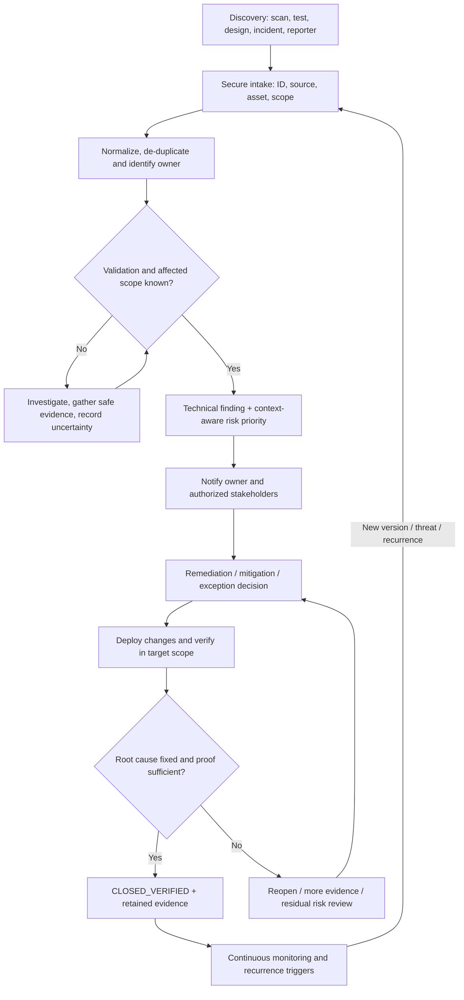

# Báo cáo vulnerability

## Mục tiêu học tập

Sau bài học này, bạn có thể:

- Giải thích **báo cáo lỗ hổng bảo mật (vulnerability reporting)** là gì, phục vụ ai, khác gì với danh sách kết quả scan, ticket sửa lỗi, báo cáo sự cố và công bố lỗ hổng ra công chúng.
- Thiết kế quy trình từ **phát hiện → tiếp nhận → xác thực → phân loại → đánh giá rủi ro → báo cáo → phân công → khắc phục → kiểm chứng → đóng hoặc chấp nhận rủi ro có điều kiện**.
- Viết một **technical vulnerability report** có asset/version/scope, bằng chứng có thể truy vết, điều kiện tái hiện an toàn, impact, mức độ ưu tiên, owner, remediation và verification criteria.
- Sử dụng đúng vai trò của **CVE, CWE, CVSS, EPSS, CISA KEV, SBOM, tình trạng khai thác, exposure, data classification và business impact** mà không đồng nhất các chỉ số này.
- Phân biệt **`CONFIRMED`, `SUSPECTED`, `FALSE_POSITIVE`, `INSUFFICIENT_EVIDENCE`, `NOT_AFFECTED`, `MITIGATED`, `FIXED_PENDING_VERIFICATION`, `CLOSED_VERIFIED`, `RISK_ACCEPTED`** trong hồ sơ có vòng đời rõ.
- Tùy biến báo cáo cho **developer/owner, đội vận hành, security leadership, risk owner, audit, vendor và bên báo cáo lỗ hổng bên ngoài**, bảo vệ bí mật của chứng cứ.
- Áp dụng mẫu báo cáo cho **Java/Spring Boot** với lỗi phân quyền theo đối tượng (BOLA) và cho lỗ hổng dependency, cloud/IAM hoặc cấu hình vận hành.
- Thiết lập **Claim – Argument – Evidence** để phân biệt bằng chứng lỗ hổng tồn tại, remediation đã triển khai và control đã được xác minh thực sự.

## 1. Báo cáo vulnerability là gì?

**Báo cáo vulnerability** là việc ghi nhận, chuẩn hóa, phân tích và truyền đạt một **điểm yếu có thể ảnh hưởng tính bảo mật của hệ thống**, kèm theo dữ kiện để người có trách nhiệm quyết định và kiểm chứng hành động. Báo cáo không chỉ trả lời “scanner phát hiện gì?” mà phải làm rõ:

1. **Điểm yếu là gì và vì sao đáng quan tâm?**
2. **Tài sản, release, môi trường, người dùng hoặc dữ liệu nào có thể bị ảnh hưởng?**
3. **Dựa trên bằng chứng nào để cho rằng điểm yếu tồn tại?** Đã xác nhận hay còn nghi ngờ?
4. **Điều kiện, đường truy cập và ranh giới tin cậy liên quan ra sao?**
5. **Ảnh hưởng thực tế trong bối cảnh hệ thống là gì?** Những giả định nào còn thiếu?
6. **Mức độ ưu tiên khắc phục vì sao được lựa chọn?** Ai có quyền quyết định?
7. **Biện pháp xử lý nào, deadline nào, người nào chịu trách nhiệm?**
8. **Làm sao chứng minh đã sửa hoặc đã giảm rủi ro?**

Ví dụ, hệ thống học tập dùng Spring Boot có API `GET /api/courses/{courseId}/grades`. Một security tester nhận thấy giáo viên có role `TEACHER` nhưng không được phân công lớp vẫn có thể đọc bảng điểm khi thay `courseId`. Báo cáo hữu ích không chỉ nói “Authorization issue - High”; nó cần xác nhận **đường đi, policy expected/actual, course/tenant, dữ liệu bị lộ theo loại chứ không chép dữ liệu thật, phiên bản ứng dụng, ảnh hưởng và test âm cần dùng để kiểm bản sửa**.

Trong module **SECURITY_SECURITY_ASSURANCE**, báo cáo có giá trị khi kết nối được **mục tiêu bảo mật → risk/threat → điểm yếu/control thất bại → bằng chứng → hành động → kiểm chứng sau khắc phục → quyết định quản trị**. Một báo cáo được viết đẹp nhưng không có bằng chứng, chủ sở hữu hoặc cơ chế theo dõi vẫn chưa tạo ra assurance đáng tin.

### 1.1. Phân biệt các thuật ngữ

| Khái niệm | Ý nghĩa | Ví dụ |
| --- | --- | --- |
| **Vulnerability** | Điểm yếu có thể bị khai thác hoặc làm sai mục tiêu bảo mật trong điều kiện cụ thể. | API không kiểm quyền trên course/tenant. |
| **Finding** | Kết quả phát hiện cần đánh giá; có thể đã xác nhận hoặc chưa. | Scanner cảnh báo dependency có CVE. |
| **Observation** | Quan sát hoặc dấu hiệu chưa đủ để kết luận tồn tại lỗ hổng. | Port mở trên host chưa xác định có được phép. |
| **Weakness class / CWE** | Phân loại nhóm nguyên nhân kỹ thuật hoặc dạng yếu điểm. | Thiếu kiểm tra authorization theo resource. |
| **CVE** | Mã định danh lỗ hổng đã được gán trong phạm vi mô tả. | Một CVE của phiên bản thư viện cụ thể. |
| **Exploit** | Cách thức khai thác vulnerability trong các điều kiện nhất định. | Yêu cầu trái quyền bị hệ thống chấp nhận. |
| **Incident** | Sự kiện bảo mật đã hoặc đang ảnh hưởng và phải xử lý theo quy trình sự cố. | Có dấu hiệu dữ liệu bị truy cập trái phép. |
| **Risk** | Khả năng và hậu quả với tài sản/mục tiêu, sau khi xét context và controls. | Rò dữ liệu học viên qua endpoint public. |
| **Remediation** | Sửa nguyên nhân hoặc triển khai xử lý để đưa control đạt yêu cầu. | Bổ sung object authorization và kiểm mọi đường đọc. |
| **Mitigation** | Giảm khả năng/ảnh hưởng khi chưa thể sửa dứt điểm. | Tạm giới hạn endpoint và giám sát truy cập. |
| **Vulnerability report** | Hồ sơ kết luận, truyền đạt và theo dõi điểm yếu cùng bằng chứng. | Finding ID, affected scope, reproduction, risk, owner, re-test. |

**Không phải mọi scanner alert đều là vulnerability đã được xác nhận.** Một CVE trong SBOM có thể không ảnh hưởng configuration hiện tại; ngược lại, một lỗi phân quyền nghiệp vụ có thể tồn tại dù không có CVE.

### 1.2. Báo cáo khác với scan và penetration test

Scan thu tín hiệu từ tool ở thời điểm xác định; pentest có thể bổ sung xác minh lỗ hổng; code/design review có thể chỉ ra sai sót logic; monitoring/incident có thể tạo dấu hiệu khai thác. **Báo cáo** là lớp chuẩn hóa các nguồn đó thành **điều người sở hữu có thể quyết định và kiểm chứng**.

Một file scan raw thường chứa hàng nghìn records trùng, missing context và false positives. Nếu chuyển nguyên file sang developer mà không triage, đội sửa lỗi phải tự xác định scope/risk. Ngược lại, viết bản tóm tắt “không có issue nghiêm trọng” mà không nêu coverage/tool limits có thể tạo assurance sai.

## 2. Mục đích và đối tượng đọc báo cáo

Báo cáo nên **giữ một nguồn sự thật về finding**, sau đó hiển thị chi tiết phù hợp với vai trò và mức truy cập.

| Đối tượng | Cần quyết định gì? | Thông tin trọng tâm | Không cần phổ biến rộng |
| --- | --- | --- | --- |
| **Developer/technical owner** | Sửa ở đâu, test ra sao? | Root cause, affected component, expected/actual behavior, safe reproduction, acceptance tests. | Raw PII, secrets hoặc dữ liệu tenant khác. |
| **Platform/operations** | Cần giảm exposure, thay cấu hình, restart, revoke hay patch? | Environment, service, IAM/network, effective config, rollout/rollback và monitor. | Thông tin không liên quan ngoài phạm vi. |
| **AppSec/assurance reviewer** | Finding có thật và được kiểm chứng đúng không? | Evidence provenance, test coverage, root cause, risk, QA limitations, re-test. | Không cần bí mật người báo cáo nếu chưa được phép chia sẻ. |
| **Service/product owner** | Ưu tiên với backlog, phụ thuộc, tác động người dùng? | Business impact, deadline, action owner, mitigation, availability trade-off. | Bản sao payload có dữ liệu học viên thật. |
| **Risk owner/leadership** | Có chặn release? Chấp nhận residual risk trong thẩm quyền? | Mức phơi bày, hậu quả, xu hướng, options, blockers, exception expiry. | Chi tiết PoC dễ bị lạm dụng không cần cho quyết định. |
| **Auditor/compliance** | Quy trình phát hiện–xử lý–kiểm chứng có hoạt động? | Scope, criteria, timestamp, evidence chain, ownership, decision, closure. | Toàn bộ dữ liệu payload khi metadata đã đủ. |
| **Vendor/external researcher** | Vấn đề liên quan sản phẩm nào; làm sao phối hợp khắc phục? | Affected versions, contact, sanitized evidence, disclosure timeline. | Credential, thông tin khách hàng hoặc hạ tầng ngoài scope. |

**Nguyên tắc tối thiểu hóa dữ liệu áp dụng cho cả báo cáo bảo mật.** Một báo cáo về lộ bảng điểm không nên tái tạo sự cố bằng cách gửi file bảng điểm thật tới email distribution list.

## 3. Nguồn phát hiện và kênh tiếp nhận

### 3.1. Các nguồn thường gặp

- **SAST:** mẫu code có thể gây injection, hardcoded secret, unsafe API use; cần xem thực tế và false positives.
- **DAST/API tests:** hành vi runtime, missing authorization, cấu hình response và abuse paths.
- **SCA/dependency scanner:** CVE/advisory theo package/version/coordinate; cần chứng minh ảnh hưởng.
- **IaC/cloud/container scanning:** lộ public storage, IAM overprivilege, insecure network policy, image configuration.
- **Penetration testing/red team có thẩm quyền:** phát hiện đã xác nhận trong scope/timebox; không tự suy ra toàn hệ thống đã được bao phủ.
- **Code/security design review và threat modeling:** nhận diện điểm yếu logic hoặc trust boundary trước triển khai.
- **Logs/monitoring/incident:** bất thường có thể dẫn tới phát hiện vulnerability; nếu có compromise phải phối hợp incident response.
- **Bug bounty/vulnerability disclosure:** báo cáo của researcher, khách hàng, cộng đồng hoặc nhà cung cấp.
- **Vendor advisory, SBOM/VEX và asset discovery:** ảnh hưởng phiên bản, transitive dependencies hoặc môi trường.
- **Audit/control assessment:** control thiếu, sai hoặc không có operating evidence.

Mỗi nguồn cần metadata: **công cụ/người phát hiện, version phương pháp, thời gian, asset, environment, quyền test, mức tin cậy và giới hạn coverage**. Tránh ghi `CONFIRMED` cho output mà chưa xác minh tác động trong phạm vi.

### 3.2. Kênh báo cáo nội bộ và bên ngoài

Một chương trình có thể dùng ticketing, vulnerability intake API, security mailbox, VDP portal hoặc công cụ quản lý findings. Nên có:

1. Kênh dễ tìm, rõ **phạm vi được phép báo cáo** và đường liên hệ bảo mật.
2. Cơ chế xác nhận đã nhận, gán ID và bảo vệ thông tin nhạy cảm.
3. Chống spam/abuse và phân loại tự động hỗ trợ, nhưng không xóa báo cáo chỉ vì scanner không phát hiện.
4. Triaging bởi người có thẩm quyền, không đẩy báo cáo bí mật vào public issue.
5. Escalation khi có dấu hiệu exploitation/active incident, credential leak hoặc tác động nghiêm trọng.
6. Cách liên lạc an toàn với external reporter và với vendor/subprocessor.
7. Lưu bằng chứng, truy vết tác giả và quyền truy cập phù hợp.

Một **vulnerability disclosure policy (VDP)** nên công bố scope, kênh, loại hoạt động được phép, kỳ vọng phối hợp, giới hạn kiểm thử và chính sách xử lý dữ liệu; điều khoản pháp lý/“safe harbor” nếu có phải do tổ chức có thẩm quyền xác định, không tự hứa trong báo cáo kỹ thuật.

### 3.3. Tách alert mới khỏi bản ghi đang xử lý

Một CVE có thể được ba scanner phát hiện trên nhiều image và host; một logic flaw có thể được nhiều tester báo lại. Cần **deduplicate** theo vulnerability identity và affected assets mà vẫn bảo tồn sự khác biệt quan trọng:

- Cùng CVE nhưng **hai service, hai versions, hai environments** có risk/owner khác nhau.
- Cùng endpoint nhưng **root cause khác** có thể cần remediation riêng.
- Một finding logic có nhiều affected endpoints vẫn cần coverage/path inventory.
- Một finding đã đóng tái xuất hiện trên build mới cần **regression/reopened** chứ không bỏ qua do trùng tiêu đề.

**Không dùng CVE ID làm khóa duy nhất cho mọi loại finding.** BOLA nội bộ, lỗi cấu hình hoặc thiếu controls có thể không có CVE.

## 4. Quy trình báo cáo vulnerability có truy vết



### Bước 1 – Tiếp nhận và bảo vệ evidence

Ghi ticket ID, source, timestamp, asset, requester/reporter, URL/package/host trong phạm vi và mô tả ngắn. Thông tin chứa credentials, session tokens, log raw, user IDs hoặc payload phải được **giữ trong kho hạn chế quyền**, không tự đính kèm vào ticket ai cũng đọc được.

### Bước 2 – Chuẩn hóa và đối chiếu asset inventory

Xác minh sản phẩm, service, owner, môi trường, region, release, package version/digest, data classification và trust boundaries. Asset chưa có owner phải tạo action xác định owner; không coi “unknown owner” là lý do để bỏ qua finding.

### Bước 3 – Validation an toàn và xác định ảnh hưởng

Đánh giá evidence, test giả định/đường đi có **ủy quyền và scope**, ưu tiên sandbox với dữ liệu giả. Với hệ thống production, dùng phương pháp không phá hoại, giới hạn request và phải tuân thủ phê duyệt kiểm thử. Có thể xác nhận finding từ code/config và negative tests mà **không cần trích xuất dữ liệu thật**.

### Bước 4 – Triage và đánh giá ưu tiên

Kết hợp severity kỹ thuật (nếu áp dụng), exploitability, asset exposure, business impact, known exploitation, data sensitivity, compensating controls, blast radius, patch availability và dependency. Ghi rõ **risk rationale**, không chỉ nhập một con số.

### Bước 5 – Tạo bản technical report có thể hành động

Viết expected/actual behavior, scope, reproduction an toàn, impact, remediation options, owner, acceptance tests, references và giả định. Phân biệt **đã khai thác thử thành công trong lab** với **đã có dấu hiệu thực sự bị khai thác ngoài đời**.

### Bước 6 – Thông báo và escalation

Chuyển finding đúng team và decision authority, đặt due date/priority theo policy. Với dấu hiệu active exploitation hoặc rò credentials, phối hợp **incident response** song song, không chờ quy trình vulnerability ticket thông thường.

### Bước 7 – Thực thi mitigation/remediation

Owner lựa chọn patch, code change, config restriction, upgrade, temporary isolation hoặc thay component. Nếu có risk acceptance/exception, đó là **quyết định tách biệt**, có scope, authority, expiry và điều kiện.

### Bước 8 – Re-test, verify và đóng

Kiểm **phiên bản đã triển khai**, cả positive/negative tests, đường bypass, runtime policy và regressions liên quan. Chỉ khi đủ evidence mới ghi `CLOSED_VERIFIED`; ticket `Done` hoặc PR merged không đủ.

### Bước 9 – Báo cáo xu hướng và cải tiến

Theo dõi finding aging, time-to-remediation, known exploited exposure, overdue exceptions, recurring root causes và quality of discovery/coverage. Dùng lessons learned sửa **security requirements, reusable controls, training, CI/CD guardrails và review process**.

## 5. Dữ liệu cốt lõi của một vulnerability report

### 5.1. Các trường quan trọng

| Nhóm | Trường | Vì sao cần? |
| --- | --- | --- |
| **Identification** | Finding ID, title, first seen, last seen, source, reporter channel. | Truy vết, tránh trùng, biết thời điểm phát hiện. |
| **Assets/scope** | Service/product, owner, environment, region, build/digest, URL/route/package. | Tránh báo nhầm đối tượng hoặc version. |
| **Taxonomy** | CWE/CVE/advisory IDs khi có, category và references. | Liên kết tri thức và patch, không tự là bằng chứng ảnh hưởng. |
| **Evidence** | Code/config/test/log/tracing refs, method, timestamp, integrity/provenance, limitations. | Bảo đảm kết luận có thể tái kiểm. |
| **Expected vs. actual** | Requirement/control nào mong đợi, hành vi nào xảy ra. | Cho thấy sai khác thực chất. |
| **Technical details** | Attack surface, prerequisites, trust boundary, non-destructive reproduction, root cause giả định. | Developer xác nhận và sửa đúng nơi. |
| **Impact** | CIA/privacy/availability, asset classification, affected population, blast radius. | Quyết định ưu tiên theo risk. |
| **Severity/priority** | CVSS/source nếu áp dụng, exploit evidence, contextual priority, rationale. | Tránh ưu tiên sai từ điểm kỹ thuật đơn lẻ. |
| **Ownership** | Fix owner, service owner, verification owner, risk authority. | Rõ trách nhiệm xử lý và chấp nhận. |
| **Treatment** | Mitigation, remediation, compensating controls, dependency, due date, release gate. | Có hành động cụ thể thay vì chỉ mô tả lỗi. |
| **Verification/closure** | Acceptance criteria, test IDs, build/env, re-test outcome và reviewer. | Chứng minh đã sửa trong scope. |
| **Decision/history** | Status, exception, approval, timestamps, comments, reassessment trigger. | Audit và liên tục quản trị. |

Không nhất thiết tất cả thông tin phải nằm trong một ticket dài. Có thể liên kết báo cáo kỹ thuật, evidence bundle, risk record và executive summary bằng **ID nhất quán**, có quyền truy cập/retention rõ.

### 5.2. Mẫu báo cáo kỹ thuật

```text
Finding ID / Title:
Detected by / detected at:
Affected system, owner and environment:
Affected build/version/digest and regions:
Entry point / attack surface / trust boundary:
Asset / data classification:
Requirement / control expected:
Observed behavior:
Validation state and evidence references:
Safe reproduction prerequisites and steps:
Potential impact and affected population:
Known exploitation vs proof-of-concept status:
CVSS / CVE / CWE / EPSS / KEV references (if applicable):
Contextual severity, priority and rationale:
Proposed fix and temporary mitigation:
Owner, due date and dependencies:
Positive/negative re-test criteria:
Risk decisions / exceptions:
Current status, reviewer and next action:
Disclosure / confidentiality handling:
```

Một report có thể sử dụng **liên kết hạn chế quyền** tới các bước tái hiện nhạy cảm. Không đưa payload gây hại hoặc bằng chứng lộ dữ liệu thật vào kênh phổ biến rộng chỉ để đạt “đầy đủ nội dung”.

### 5.3. Viết expected vs. actual theo control

**Kém hữu ích:** “BOLA in grades API, High, fix authorization.”

**Tốt hơn:**

> **Expected:** User chỉ có quyền `VIEW_GRADES` trên course được phân công thuộc tenant tương ứng mới nhận bảng điểm; user cùng role nhưng không được phân công phải bị từ chối và không lộ dữ liệu.  
> **Observed in authorized test environment:** Trên build được kiểm, user có role `TEACHER` nhưng không có assignment tới course X vẫn nhận DTO điểm của dữ liệu kiểm thử trong tenant khác.  
> **Cause hypothesis:** Endpoint chỉ kiểm role, chưa thấy resource/tenant policy enforcement trên đường service này.  
> **Impact:** Rủi ro lộ dữ liệu điểm và danh tính người học; mức độ thực tế phụ thuộc exposure/scope được xác minh.  
> **Acceptance:** Bổ sung policy server-side với negative tests cho sai course/tenant; kiểm mọi đường truy cập liên quan và không có side effect khi deny.

Ví dụ chỉ minh họa một finding trong lab. Khi báo cáo thật, phải có **source references/commit, build và timestamp**, và không mô tả giả thuyết là root cause đã chứng minh nếu chưa review code.

## 6. Validation: từ tín hiệu tới finding có căn cứ

### 6.1. Các trạng thái validation

| Trạng thái | Khi dùng | Yêu cầu hành động |
| --- | --- | --- |
| **`NEW`** | Vừa nhận, chưa triage/validate. | Kiểm scope, duplicate, bảo vệ evidence, gán analyst. |
| **`SUSPECTED`** | Có tín hiệu nhưng chưa chứng minh affected behavior. | Thu thêm config/code/reproduction hợp lệ. |
| **`CONFIRMED`** | Evidence đủ cho claim điểm yếu trong scope đã nêu. | Ghi impact, ưu tiên, owner, remediation. |
| **`INSUFFICIENT_EVIDENCE`** | Evidence không có/không đúng version hoặc coverage không đủ để kết luận. | Ghi gap, owner, scope và next verification. |
| **`FALSE_POSITIVE`** | Đã chứng minh tín hiệu không chỉ ra điểm yếu trong scope. | Lưu reasoning/evidence, điều chỉnh rule khi hợp lệ. |
| **`NOT_AFFECTED`** | Thành phần/advisory tồn tại nhưng sản phẩm/cấu hình trong scope không bị ảnh hưởng theo evidence. | Lưu điều kiện, version/config và review triggers. |
| **`CONFIRMED_AFFECTED`** | Sản phẩm/deployment thực sự thỏa điều kiện ảnh hưởng. | Ưu tiên và giảm rủi ro theo context. |

`NOT_AFFECTED` không phải cách đổi tên `FALSE_POSITIVE` tùy tiện: một CVE có thể gắn đúng package nhưng **code path bị ảnh hưởng không tồn tại** trong build; lý do và bằng chứng phải rõ. Mô hình trạng thái có thể thay đổi theo hệ thống ticketing, nhưng **sự khác biệt giữa đã xác nhận, không ảnh hưởng và chưa biết phải được bảo toàn**.

### 6.2. Cách đánh giá false positive

Không nên đóng `FALSE_POSITIVE` chỉ vì “developer không tái hiện được trên máy cá nhân”. Cần kiểm:

- Tool rule đang xét package/code path/version/config nào?
- Asset có đúng owner, environment và deployed digest?
- Reproduction prerequisites đã được thiết lập đúng?
- Permission/role, feature flag, network exposure và policy source có khác?
- Dấu hiệu có bị chặn bởi control hay request chưa vào được endpoint?
- Evidence về tính không thể bị ảnh hưởng còn đúng sau update/migration không?

Nếu thiếu cơ sở, dùng `INSUFFICIENT_EVIDENCE` và request thêm artifact. **False positive được chứng minh cũng là evidence hữu ích** để cải thiện detection quality.

### 6.3. Validation không đồng nghĩa “phải khai thác sâu”

Khi lỗ hổng có thể ảnh hưởng dữ liệu thật hoặc khả năng sẵn sàng, validation nên chọn **cách ít xâm lấn nhất đủ để chứng minh claim**: code path analysis, test trong sandbox, config review, canary, synthetic accounts, authorized negative tests. Không cần truy vấn hàng loạt dữ liệu người dùng để chứng minh một API có thể lộ dữ liệu.

Nếu có dấu hiệu truy cập trái phép đã xảy ra, **chuyển sự kiện cho incident response**; vulnerability ticket vẫn theo dõi remediation của root cause nhưng không thay containment, preservation, legal/privacy notifications theo nghĩa vụ.

## 7. Severity và remediation priority: không chỉ một điểm số

### 7.1. Khác biệt giữa CVSS, EPSS, KEV và business risk

| Khái niệm | Ý nghĩa chính | Không có nghĩa là |
| --- | --- | --- |
| **CVSS** | Mô tả và chấm các đặc tính mức nghiêm trọng kỹ thuật của vulnerability theo phiên bản/phạm vi đã công bố. | Xác suất chính xác sẽ bị khai thác trên hệ thống của bạn. |
| **EPSS** | Ước tính xác suất một CVE sẽ bị khai thác ngoài thực tế trong khoảng dự báo của mô hình, tại thời điểm nhất định. | Tác động nghiệp vụ hoặc chắc chắn attacker nhắm vào asset bạn. |
| **CISA KEV** | Danh mục các lỗ hổng đã biết có khai thác thực tế theo tiêu chí của danh mục. | Mọi hệ thống có CVE đó đều đã bị tấn công, hoặc mọi lỗ hổng nguy hiểm đều có trong KEV. |
| **CVE** | Mã định danh một lỗ hổng công khai được quản lý theo quy trình CVE. | Proof that your deployed version/config is affected. |
| **CWE** | Nhóm kiểu điểm yếu kỹ thuật/thiết kế. | Định danh một lỗ hổng sản phẩm cụ thể hoặc điểm severity. |
| **Environmental/business impact** | Tác động khi asset bị ảnh hưởng theo người dùng, dữ liệu, exposure và criticality. | Có thể suy thẳng từ CVSS Base score. |

**Cần ghi source, version/phương pháp và ngày lấy dữ liệu** nếu sử dụng các tín hiệu thay đổi như EPSS, KEV hoặc vendor advisory. Không suy ra quy định pháp lý hay deadline áp dụng chỉ từ một danh mục; trách nhiệm thực tế tùy tổ chức, sản phẩm và quy định hiện hành.

### 7.2. Những yếu tố để xác định priority

1. **Exploit in the wild/active exploitation:** có dấu hiệu khai thác vào hệ thống hay sản phẩm liên quan không?
2. **Reachability/exposure:** endpoint public, authenticated path, admin plane, internal-only hay dependency unreachable?
3. **Privileges/prerequisites:** attacker cần mức quyền nào, có thể truy cập hợp lệ qua đường phụ không?
4. **Asset/data criticality:** bảng điểm, hồ sơ định danh, signing keys, thanh toán, admin credentials và system availability.
5. **Blast radius:** một learner, một course, một tenant hay nhiều tenants/regions.
6. **Attack complexity và compensating controls:** đã có isolation, WAF, tenant policy, rate limits, monitoring có kiểm chứng?
7. **Patch/remediation availability:** có bản sửa đã thử, mitigation, workaround hoặc alternative không?
8. **Business constraints:** release schedule, downtime, dependency và rủi ro thay đổi; không dùng deadline sản phẩm để phủ nhận technical severity.
9. **Detection confidence/evidence:** confirmed, suspected hoặc missing evidence.

**Priority** là quyết định vận hành theo risk policy; **severity** mô tả tác động kỹ thuật hoặc kinh doanh theo mô hình đánh giá. Hai trường có thể khác nhau và cần ghi lý do.

### 7.3. Ma trận ưu tiên minh họa

| Tình huống | Nhận định | Hành động ưu tiên |
| --- | --- | --- |
| API public cho user sai tenant đọc bảng điểm trong lab, affected path đã xác nhận. | Confidentiality impact cao, exposure thực tế cần đối chiếu. | Escalate ngay cho service/security owner, giới hạn truy cập khi cần, sửa object authz và test. |
| CVE có trên image nhưng module bị ảnh hưởng không cài/chạy trong build. | Chưa kết luận “affected”; cần analysis theo version/config. | Thu SBOM/provenance, kiểm reachable path, ghi `NOT_AFFECTED` nếu đủ bằng chứng. |
| CVE nằm trong KEV và deployed exposed component khớp affected version. | Có bằng chứng khai thác ngoài thực tế và exposure. | Ưu tiên theo policy/incident posture, patch/mitigate, kiểm dấu hiệu compromise. |
| Lỗ hổng trong build plugin dùng token xuất bản artifact. | Blast radius có thể lớn dù không có inbound public endpoint. | Xem CI credentials, publisher rights, provenance, revoke/rotate nếu compromise. |
| Log lỗi chứa access token của user trong môi trường production. | Credential exposure, có thể thành incident. | Triage exposure, incident handling, revoke/rotate theo scope, sửa log path. |
| Cảnh báo TLS từ scan không rõ endpoint/config và không tái hiện trong môi trường tương ứng. | Evidence chưa đủ, không tự FAIL hay dismiss. | Xác minh endpoint, scheme, protocol/config, scan timing và affected population. |

### 7.4. Tránh ngưỡng SLA tự suy đoán

Một tổ chức có thể định nghĩa remediation windows theo severity/risk (ví dụ Critical, High, Medium, Low), nhưng **không có một số ngày duy nhất áp dụng cho mọi hệ thống và yêu cầu**. Báo cáo nên liên kết **policy version, due date và cơ chế escalation**; khi có exploitation đang diễn ra, có thể cần response sớm hơn quy trình SLA thông thường.

Không lấy “CVSS 9.x” làm quyết định tự động buộc release/deploy nếu chưa xác định version affected, nhưng cũng không bỏ qua active threat vì chưa có điểm CVSS.

## 8. Chất lượng và bảo vệ bằng chứng

### 8.1. Provenance của vulnerability evidence

Mỗi evidence item nên ghi:

- **Nguồn:** reporter, scanner/tool version, security tester, CI build hoặc runtime collector.
- **Đối tượng:** product/service, URL/endpoint, package coordinate, artifact digest, commit, environment/region.
- **Thời điểm:** detected at, collected at và observation window.
- **Phương pháp:** scan profile, test case, code/config review, log query, fixture và test prerequisites.
- **Kết quả thực tế:** được quan sát gì, expected vs. actual, pass/fail hoặc phần chưa rõ.
- **Tính toàn vẹn:** artifact reference, checksum/signature khi áp dụng, access/change history.
- **Giới hạn:** path/role/tenant nào chưa thử, mock vs. runtime, sample size và assumptions.
- **Quyền truy cập/retention:** report readers, sensitive data handling, legal hold khi có sự cố.

Một ảnh chụp màn hình có lỗi không có build ID, môi trường, timestamp hoặc reproduction thường là **bằng chứng yếu**. Một test report có thể mạnh hơn khi liên kết fixture, source revision và behavior đã kiểm.

### 8.2. Phân loại dữ liệu trong báo cáo

Vulnerability reports có thể chứa thông tin **rất nhạy cảm**: attack surfaces, endpoint nội bộ, service identity, secrets, data samples và recovery details. Cần:

- Không dán raw token, password, private key, bảng điểm/hồ sơ học viên vào ticket công khai.
- Dùng **synthetic data, redaction và minimal necessary excerpts**.
- Với credential lộ thật, kích hoạt handling/rotation hoặc incident response phù hợp thay vì để credential trong report.
- Dùng access control cho evidence attachments, giới hạn người tải và bật audit.
- Nếu cần chia sẻ vendor/external researcher, cung cấp **sanitized evidence** và channels an toàn.
- Có retention/deletion policy, nhưng bảo toàn legal/audit evidence khi nghĩa vụ yêu cầu.

**Tránh làm tăng mức thiệt hại của vulnerability bằng chính quá trình báo cáo.**

### 8.3. Một bằng chứng có thể hỗ trợ kết luận nào?

| Evidence | Có thể hỗ trợ | Không tự hỗ trợ |
| --- | --- | --- |
| SCA output có CVE | Package có tín hiệu advisory cần triage. | Product deployment đã reachable/affected. |
| Code review chỉ role-only check | Có nguy cơ thiếu object authz trong path đã xem. | Chắc chắn dữ liệu production bị lộ nếu chưa kiểm các lớp khác. |
| Negative integration test tái hiện trái quyền | Behavior bị lỗi trong build/fixture cụ thể. | Mọi tenant/route ở production đều affected. |
| Runtime IAM snapshot | Quyền hiệu lực tại thời điểm/scope snapshot. | Quyền đã đúng liên tục trong quá khứ/tương lai. |
| Vendor patch release note | Bản sửa tồn tại ở upstream. | Service đang deploy bản đã sửa. |
| Re-test pass trên build R | Behavior được kiểm đã đạt trên build R/env X. | Không có regression/bypass trên các path khác. |
| Incident logs có dấu hiệu bất thường | Cần điều tra exploitation/impact theo incident process. | Attribution hoặc toàn bộ phạm vi compromise đã xác định. |

Nếu conclusion vượt evidence, hãy **thu hẹp claim** hoặc yêu cầu thêm verification, không sửa lời văn cho kết luận có vẻ chắc chắn hơn.

## 9. Trình bày báo cáo cho engineering, operations và leadership

### 9.1. Technical finding: đủ để sửa

Một báo cáo cho developer nên có:

1. **Finding title + ID + status**.
2. Affected source/build/endpoint/component và service owner.
3. Requirement/control bị vi phạm.
4. Điều kiện thực hiện an toàn và **expected/actual**.
5. Evidence refs, đoạn config/code ngắn đã loại bỏ thông tin nhạy cảm.
6. Root cause xác định được hay giả định cần xác minh.
7. Severity/priority rationale và immediate mitigation.
8. Hướng sửa cụ thể nhưng không bắt buộc một implementation duy nhất nếu có giải pháp tương đương.
9. **Positive/negative regression tests, acceptance criteria**.
10. Owner, due date, release gate, escalation và re-test reviewer.

### 9.2. Operational report: để giảm exposure

Operations cần biết **tài sản đang chạy**, version/config nào, trust boundary và cách xử lý an toàn:

- Host/workload, namespace/project, region, service account, network interface và dependency.
- Môi trường nào affected, public exposure và traffic path.
- Temporary isolation, credential revoke, disabling risky feature hoặc patch rollout.
- Monitoring alerts và rollback/failover nếu thay đổi gây outage.
- Evidence sau triển khai: effective IAM, policy enforcement, scanner rescan và negative tests.

Không gửi operations một câu “hãy sửa CVE-...” nếu finding nằm trên artifact không thuộc quản lý của họ hoặc vendor mới là owner.

### 9.3. Executive/risk report: để quyết định

Một bản tóm tắt lãnh đạo không cần mọi stack trace; cần trả lời:

> **Điều gì đang có nguy cơ?** Dữ liệu học viên và khả năng kiểm soát tenant.  
> **Mức độ tin cậy?** Lỗi BOLA đã được xác nhận trong môi trường kiểm thử được ủy quyền, phạm vi production chưa xác minh đầy đủ.  
> **Ảnh hưởng tiềm năng?** Truy cập trái phép bảng điểm qua API nếu cùng control path tồn tại trên production.  
> **Hành động hiện tại?** Ưu tiên hạn chế exposure, sửa server-side policy, chạy regression/cross-tenant tests và kiểm runtime.  
> **Quyết định cần có?** Owner và release authority xác nhận có chặn rollout/feature hay không theo policy.  
> **Rủi ro chưa rõ?** Số API/worker paths chịu ảnh hưởng và log history cần kiểm thêm.

Một bản executive summary tốt **thẳng thắn về uncertainty**, không phóng đại một test trong staging thành “toàn bộ dữ liệu production đã bị đánh cắp”.

### 9.4. Truyền đạt bằng mức độ chi tiết phù hợp

| Loại tài liệu | Độ chi tiết | Dùng khi |
| --- | --- | --- |
| **Finding technical record** | Cụ thể tới file/route/config, evidence và test. | Developer, QA, platform, AppSec. |
| **Remediation status report** | Owner, due date, blocker, mitigation, verified closure. | Sprint planning, operations, security lead. |
| **Risk/executive summary** | Exposure, trend, critical decisions, exception/overdue. | Leadership, risk committee. |
| **Audit/assurance dossier** | Scope, criteria, method, provenance, governance và evidence. | Auditor, assurance reviewer. |
| **Supplier disclosure/coordination** | Product version, sanitized reproduction, contact và coordination timeline. | Vendor/maintainer, researcher, disclosure team. |
| **Incident/customer notice** | Phụ thuộc actual incident và obligations, được phê duyệt đúng authority. | Incident/legal/privacy/customer communication. |

**Vulnerability report không tự là breach notification**. Không phát thông báo ảnh hưởng khách hàng nếu incident scope chưa được xác minh và cơ chế phê duyệt/luật áp dụng chưa được đánh giá; đồng thời không trì hoãn quy trình incident/notification bắt buộc chỉ vì technical finding chưa đóng.

## 10. Báo cáo với vendor và coordinated vulnerability disclosure

### 10.1. Khi lỗ hổng thuộc sản phẩm bên thứ ba

Với package, SaaS, CI plugin hoặc firmware do nhà cung cấp quản lý:

1. Xác minh **product/version/config** trong phạm vi; tránh báo nhầm phiên bản.
2. Kiểm security contact/VDP của vendor và kênh gửi bảo mật.
3. Gửi mô tả tối thiểu đủ xác nhận, **không đưa secrets, tenant data hoặc payload nhạy cảm** qua kênh không phù hợp.
4. Giữ thông tin liên hệ và mốc trao đổi; lập hồ sơ trách nhiệm **vendor fix vs customer mitigation**.
5. Nếu có CVE/advisory, theo dõi cách nhà cung cấp mô tả ảnh hưởng, bản sửa, workarounds và tình trạng triển khai.
6. Phối hợp công bố có trách nhiệm theo chính sách và nghĩa vụ thực tế; không tự đặt deadline cố định như luật chung.
7. Sau patch, kiểm **deployed version/artifact digest** và re-test phía customer trước verified closure.

### 10.2. Coordinated disclosure khác incident response

**Coordinated Vulnerability Disclosure (CVD)** hướng tới việc phối hợp giữa người phát hiện và bên chịu trách nhiệm sản phẩm để xác minh, giảm rủi ro và công bố thông tin đúng thời điểm/phạm vi. **Incident response** hướng tới xử lý sự kiện đang hoặc đã gây tác động. Hai quy trình có thể liên hệ nhưng không thay nhau.

Không nên gửi public reproduction chi tiết khi sản phẩm vẫn chưa có bản sửa nếu điều đó tăng rủi ro cho người dùng; nhưng cũng không sử dụng “phối hợp công bố” để giấu rủi ro khỏi người có nghĩa vụ được thông báo theo chính sách/hợp đồng/luật.

### 10.3. Nội dung thông báo vendor

Một report gửi vendor có thể gồm:

- Product/version/platform/feature bị ảnh hưởng.
- Behavior quan sát được và security property kỳ vọng.
- Điều kiện tái hiện an toàn trong test environment.
- Phân loại tài sản, impact theo kỹ thuật (không đính kèm raw production data).
- Evidence rút gọn, reporter contact và kênh trao đổi bảo mật.
- Trạng thái xác minh và các giả định chưa rõ.
- Nguyện vọng coordination, xác nhận nhận báo cáo và phương án cập nhật.

Với lỗ hổng đã bị khai thác hoặc credential compromise, cần kích hoạt **incident response** riêng để bảo toàn evidence và bảo vệ người dùng.

## 11. Báo cáo mẫu 1 – BOLA trên API Spring Boot

### 11.1. Bối cảnh và hành vi sai

Ứng dụng học tập có chức năng giáo viên xem bảng điểm theo course. Quy tắc đúng là chỉ người được **phân công lớp trong tenant tương ứng** mới được xem. Một controller minh họa có lỗi:

```java
@RestController
class GradeController {
    private final GradeRepository repository;

    GradeController(GradeRepository repository) {
        this.repository = repository;
    }

    @GetMapping("/api/courses/{courseId}/grades")
    @PreAuthorize("hasRole('TEACHER')")
    List<GradeView> grades(@PathVariable long courseId) {
        return repository.findViewsByCourseId(courseId);
    }
}
```

Vấn đề: việc có role `TEACHER` không chứng minh quyền trên **courseId**. Nếu repository không áp dụng thêm object authorization, một giáo viên có thể yêu cầu điểm lớp không thuộc phân công. Đây là một ví dụ về **Broken Object Level Authorization (BOLA/IDOR)**. Không cần trích xuất bảng điểm học viên thật để xác nhận; dùng dữ liệu synthetic trong môi trường được ủy quyền.

### 11.2. Finding report minh họa

| Trường | Nội dung mẫu |
| --- | --- |
| **Finding ID** | `VM-API-010` |
| **Title** | Missing course/tenant authorization on grade view endpoint |
| **Discovery** | Authorized integration test + source review |
| **Affected component** | `learning-api`, route `GET /api/courses/{courseId}/grades` |
| **Scope** | Lab/staging build `R-test`, tenant A/B synthetic records; production impact chưa được xác minh. |
| **Expected** | Chỉ principal có `VIEW_GRADES` trên course/tenant thực tế mới được nhận grade DTOs. |
| **Observed** | User cùng role `TEACHER` nhưng không có assignment vẫn nhận grade DTOs synthetic khi thay course ID trong fixture. |
| **Weakness class** | Broken object-level authorization; CWE mapping nếu dùng phải được reviewer kiểm theo root cause. |
| **Preconditions** | Principal có role TEACHER, biết/có thể đoán course reference; affected path được gọi. |
| **Potential impact** | Tiết lộ dữ liệu học viên giữa các lớp/tenant; blast radius cần xác minh qua API inventory. |
| **Validation** | `CONFIRMED` **trong môi trường test và scope mô tả**; production exposure vẫn `INSUFFICIENT_EVIDENCE`. |
| **Risk rationale** | Dữ liệu nhạy cảm, boundary giữa giáo viên và course, có khả năng bị truy cập sai trong test; cần ưu tiên theo risk policy. |
| **Remediation** | Policy server-side theo principal, course, tenant, assignment/state; kiểm cả worker/download/alternate paths. |
| **Verification** | Positive assigned teacher, negative unassigned same-role, cross-tenant, revoked assignment, policy failure; no data/side effect on deny. |
| **Ownership** | Learning API team sửa; AppSec/QA xác minh; risk owner quyết định residual risk. |
| **Evidence refs** | Versioned source/DFD, fixture record, test run và runtime scope references. |

Không dùng một **CVE giả** cho logic flaw nội bộ chỉ để điền đủ biểu mẫu. Tương tự, không tự gán một điểm CVSS chính xác khi chưa đánh giá đúng các tham số và context.

### 11.3. Security control dự kiến

```java
@Configuration
@EnableMethodSecurity
class MethodSecurityConfiguration {}

@Service
class GradeService {
    private final GradeRepository repository;

    GradeService(GradeRepository repository) {
        this.repository = repository;
    }

    @PreAuthorize(
        "@courseAccess.canViewGrades(authentication, #courseId)"
    )
    @Transactional(readOnly = true)
    public List<GradeView> getGrades(long courseId) {
        return repository.findViewsByCourseId(courseId);
    }
}
```

`courseAccess` là bean **giả định**, cần được triển khai với nguồn principal/course/tenant/assignment đáng tin. Có thể dùng Spring Security Method Security, policy service hoặc enforcement khác phù hợp; **chỉ thêm annotation không tự sửa tất cả đường bypass**. Phải kiểm proxy invocation, self-invocation, direct repository, batch worker, admin/download API và dữ liệu trong cache.

### 11.4. Kiểm thử dương/âm cho remediation

Giả định fixtures:

- `teacher-a` và `teacher-b` đều có role TEACHER.
- `teacher-a` được phân công course 42 thuộc tenant A; `teacher-b` không được phân công.
- Course 99 thuộc tenant B; `teacher-a` không được truy cập.

```java
@SpringBootTest
@AutoConfigureMockMvc
class GradeAuthorizationRegressionIT {
    @Autowired
    MockMvc mockMvc;

    @Test
    @WithMockUser(username = "teacher-a", roles = "TEACHER")
    void assignedTeacherCanReadOwnCourse() throws Exception {
        mockMvc.perform(get("/api/courses/42/grades"))
            .andExpect(status().isOk())
            .andExpect(jsonPath("$").isArray());
    }

    @Test
    @WithMockUser(username = "teacher-b", roles = "TEACHER")
    void sameRoleOtherTeacherIsDenied() throws Exception {
        mockMvc.perform(get("/api/courses/42/grades"))
            .andExpect(status().isForbidden());
    }

    @Test
    @WithMockUser(username = "teacher-a", roles = "TEACHER")
    void crossTenantIsDenied() throws Exception {
        mockMvc.perform(get("/api/courses/99/grades"))
            .andExpect(status().isForbidden());
    }
}
```

Đây là **mẫu giảng dạy không chạy độc lập**: cần controller mapping, fixture, bean policy, Spring Security/Test dependency, imports và cấu hình tương ứng. Nếu policy chọn 404 để không xác nhận sự tồn tại của object, tiêu chí test có thể khác, nhưng **không được lộ grade data**.

Phải xác nhận request thật đi qua policy. HTTP `403` đôi khi do cấu hình security/route sai, không chứng minh BOLA được sửa. Test **positive control** loại trừ tình huống “deny all”, và negative tests nên kiểm response body/side effects, logs và cache tương ứng.

### 11.5. Re-test report

Bản re-test của finding cần ghi:

```text
Finding: VM-API-010
Original affected build: R-test
Remediation PR / deployed build: <actual-revision>
Test method: Spring Security integration tests + related path review
Test data: Synthetic tenants A/B, teacher assignments
Expected: Valid user allowed; same-role wrong course/tenant denied
Observed: <actual-verified-test-results>
Runtime path review: <actual-scope-and-evidence>
Regression check: <actual-build-and-coverage>
Residual unknowns: <unverified-worker-or-download-paths>
Decision: CLOSED_VERIFIED only if evidence supports full finding scope
Verifier / date: <authorized-reviewer-and-time>
```

Nếu chỉ kiểm API mà finding ban đầu bao gồm export worker, **không đóng finding cho toàn bộ hệ thống**. Có thể tách các findings nhỏ hơn, đóng phần đã verified và giữ finding riêng cho worker theo đúng scope.

## 12. Báo cáo mẫu 2 – Dependency vulnerability

### 12.1. Tình huống trong Maven/Spring Boot

Một SCA scanner phát hiện dependency `com.example:example-parser` trong `learning-export-worker` thuộc phiên bản bị nêu trong advisory. Tên package trong ví dụ là **giả định, không phải lỗ hổng hay CVE có thật**.

Hồ sơ ban đầu phải có:

| Cần xác minh | Cách làm hợp lý |
| --- | --- |
| Package/version có trong artifact thực? | Maven dependency tree/SBOM, resolved lock/repository, container artifact reconciliation. |
| Direct hay transitive? | Dependency path từ parent/SDK, scope và version được resolve. |
| Runtime hay test/build only? | Xem packaging, classpath, deployed digest và plugin tasks. |
| Advisory áp dụng điều kiện nào? | Affected version ranges, configuration, vulnerable functionality và vendor notes. |
| App có gọi code path ảnh hưởng? | Call graph, feature usage, targeted tests, vendor VEX reasoning. |
| Có exposed entry point? | Upload/API/worker/job queue và identity/trust boundary. |
| Exploit activity? | Verified advisory/KEV/EPSS context nếu CVE có thật, kèm thời điểm lấy. |
| Patch/mitigation? | Fixed version, config restrictions, dependency substitution hoặc safe temporary controls. |
| Bằng chứng khắc phục? | New artifact digest/SBOM, test suite, deployment update và targeted verification. |

### 12.2. Không đánh đồng package present với deployment affected

Kết quả:

```text
Detector finding:
  Component listed in SBOM: YES
  Version matches advisory range: YES
  Vulnerable functionality reachable: NOT YET DETERMINED
  Product/runtime affected: INSUFFICIENT_EVIDENCE
  Risk action: Investigate promptly; reduce exposure if needed
```

Để quyết định `NOT_AFFECTED` cần lý do có thể kiểm chứng về code path, config, version hoặc fixed/backport behavior. Không dùng “chúng tôi nghĩ thư viện không được gọi” làm kết luận cuối khi package vẫn được đóng gói và có thể kích hoạt qua đường không biết.

### 12.3. Khi vendor cung cấp VEX

Vendor có thể công bố sản phẩm **not affected** vì function bị ảnh hưởng không có trong build. Reviewer phải kiểm:

- Product ID/version của VEX trùng artifact mà team đang deploy?
- Claim có issuer đáng tin và còn hiệu lực không?
- Lý do `not affected` có kiểm chứng từ cách build/config hay chỉ là câu khai báo?
- Có thay đổi sau release khiến code path được bật?
- Có affected downstream deployment hoặc third-party plugin không?

Đưa VEX vào evidence bundle, không tự xóa mọi alert cùng CVE. Khi không đủ điều kiện xác minh, trạng thái còn là `INSUFFICIENT_EVIDENCE`.

### 12.4. Bản fix chưa deploy thì chưa đóng

Lifecycle:

```text
Vulnerability announced
  → Affected dependency/version confirmed
  → Fix available upstream
  → Build dependency updated and tests pass
  → Artifact digest produced and approved
  → Target runtime deployed with new version
  → Targeted verification + runtime inventory reconcile
  → CLOSED_VERIFIED for the verified assets
```

Một commit update version chỉ chứng minh **đã đề xuất sửa source**. Một CI run pass chỉ chứng minh **bản build được kiểm hoạt động trong test scope**. Cần kiểm runtime image/service đang dùng version mới và những service khác dùng package cũ có được xử lý không.

## 13. Báo cáo mẫu 3 – Cloud/IAM và operational misconfiguration

### 13.1. Tình huống

Scanner phát hiện storage bucket chứa exports có policy cho phép một workload role đọc rộng hơn nhu cầu. Báo cáo cần xác định:

- Bucket, account, environment, region, object prefixes và classification.
- Principal/role permissions **hiệu lực**, điều kiện IAM và deny policies liên quan.
- Network path/endpoint và workload có khả năng assume role.
- Có cơ chế tải thông qua API riêng hay direct object path?
- Object metadata, encryption và KMS policy; không coi encryption là thay authorization.
- Lịch sử đổi policy/permissions và evidence của exposure theo thời gian nếu có.

### 13.2. Evidence và cách test an toàn

**Đủ để chỉ ra design/control gap:** effective IAM cho phép role quá rộng so với approved access matrix, hoặc policy đặt public read trái yêu cầu. Không cần thực sự tải mọi file đang lưu.

**Để xác minh fix:** so sánh policy có version, identity thực, expected allow/deny; dùng **test object synthetic** và principal được phép/không được phép, kiểm audit logs và khả năng phục hồi khi policy deploy.

| Phát hiện | Evidence cần | Lưu ý |
| --- | --- | --- |
| Rule quá rộng | Effective role permissions, bucket policy, principal list, approved resource scope. | Không suy từ tên role `readonly`. |
| Storage có thể public | Access-control settings, effective policy, safe anonymous negative test khi được phép. | Public ACL disabled chưa chắc mọi đường public đều chặn. |
| KMS key scope lớn | Key policy/grants và workload key access. | TLS/encryption không giảm privilege của key user. |
| Rule đã sửa | Deployed policy, re-test positive/negative và change ID. | IaC PR merged chưa chắc runtime đã apply. |
| History of exposure | Audit/config change logs theo thời gian có đủ coverage. | Không có log event chưa chắc chưa từng có truy cập. |

### 13.3. Findings phải tách kỹ thuật và tác động đã xảy ra

“Bucket policy cho phép principal không được phê duyệt đọc object trong phạm vi” là **lỗ hổng control** khi được xác minh. “Đã bị hacker tải hàng nghìn bảng điểm” là **khẳng định sự cố** đòi bằng chứng điều tra riêng. Không dùng ngôn từ gây hiểu lầm giữa **potential exposure** và **confirmed exfiltration**.

## 14. Remediation lifecycle, SLA và quyết định ngoại lệ

### 14.1. Một mô hình trạng thái khả dụng

| Trạng thái | Ý nghĩa | Điều kiện chuyển |
| --- | --- | --- |
| `NEW` | Đã ghi nhận, chờ triage. | Phân owner, scope, evidence. |
| `IN_TRIAGE` | Đang dedup/validate/assess risk. | Xác nhận ảnh hưởng hoặc ghi uncertainty. |
| `CONFIRMED` | Lỗ hổng được xác minh trong scope. | Assign remediation and due date. |
| `OPEN` | Chưa khắc phục hoặc chưa có verified mitigation. | Owner có hành động, báo cáo trạng thái. |
| `IN_PROGRESS` | Đang sửa/patch/giới hạn. | Review change/test plan. |
| `MITIGATED` | Có biện pháp giảm rủi ro đã kiểm, chưa hẳn sửa nguyên nhân. | Theo dõi effectiveness/expiry/remaining risk. |
| `FIXED_PENDING_VERIFICATION` | Owner báo sửa xong, chờ re-test. | Independent verification theo acceptance criteria. |
| `CLOSED_VERIFIED` | Bằng chứng đủ chứng minh fix trong scope đã định. | Lưu artifacts, xác định recurrence trigger. |
| `RISK_ACCEPTED` | Có residual risk decision hợp lệ trong thời hạn/phạm vi. | Theo dõi expiry; technical weakness có thể vẫn tồn tại. |
| `INSUFFICIENT_EVIDENCE` | Chưa thể kết luận affected hoặc fixed. | Thu bằng chứng bổ sung. |
| `REOPENED` | Regression hoặc evidence mới cho thấy issue tái diễn. | Re-triage, báo cáo impact mới và owner. |

Tên trạng thái có thể khác theo nền tảng. Điều quan trọng là **không biến mitigated/risk accepted/ticket done thành fixed verified**.

### 14.2. SLA và đồng hồ xử lý

Mỗi finding cần các mốc **first detected, validated, assigned, remediation due, mitigated, deployed, verified, closed**; chính sách phải định nghĩa thời điểm bắt đầu tính SLA, loại business days/calendar days, pause rules và khi nào escalation.

Ví dụ, không nên liên tục mở ticket mới cho một CVE cũ để **reset age**; một finding vẫn đang phơi bày rủi ro thì tuổi tồn đọng phải được đánh giá đúng. Một finding gắn vào nhiều assets cần tracking riêng khi patch deployment tiến độ khác nhau.

Một hồ sơ vượt hạn nên ghi:

```text
Finding: VM-SAMPLE-001
Priority: HIGH by approved risk policy
Due date: <approved-policy-derived-date>
Current condition: OPEN / MITIGATED / EXCEPTION
Why overdue: <specific-blocker-and-owner>
Current exposure: <asset-and-version-scope>
Compensating control: <verified-mitigation-if-any>
Next action: <plan-and-date>
Escalation: <risk-owner-and-release-authority>
```

Không tự bịa các mốc “Critical 24h / High 7 days” rồi ghi là chuẩn universal. Tổ chức phải căn cứ **risk appetite, nghĩa vụ và threat context**.

### 14.3. Exception/risk acceptance đúng thẩm quyền

Nếu không thể patch ngay, một số tổ chức cho phép **time-bound exception** theo policy:

1. Nêu lý do, ảnh hưởng và lựa chọn khác.
2. Chứng minh temporary mitigation thực sự được triển khai.
3. Ghi risk owner/approver có thẩm quyền, scope, expiration và monitoring.
4. Không tự miễn yêu cầu luật/hợp đồng bắt buộc.
5. Tái đánh giá khi exploit activity, data classification, affected version, control hoặc business context thay đổi.
6. Đặt plan xử lý nguyên nhân hoặc quyết định loại bỏ sản phẩm nếu cần.

**Risk accepted** là trạng thái quản trị của residual risk; vulnerability kỹ thuật có thể vẫn **OPEN**. Phải giữ cả hai record thay vì trộn thành “closed - accepted”.

### 14.4. Khi nào được xác nhận closure?

Một finding đủ điều kiện `CLOSED_VERIFIED` khi:

- Fix/mitigation mục tiêu đã **được triển khai trên đúng assets/builds/environments**;
- Có **positive và negative verification** tương ứng với root cause;
- Quan sát runtime/config hoặc targeted scan hỗ trợ claim nếu cần;
- Không còn known bypass trong scope đã đánh giá, hoặc các phần chưa bao phủ được tách finding riêng;
- Reviewer xác nhận evidence và decision, gắn timestamp/provenance;
- Các exceptions và residual risks chưa hết hạn vẫn có owner/monitoring.

Đóng finding không có nghĩa “vĩnh viễn không thể tái phát”. Khi có regression, component khác hoặc configuration drift, cần **reopen/reassess**.

## 15. Mẫu YAML hồ sơ vulnerability report

Đây là **mẫu học tập**, sử dụng placeholders và trạng thái chưa hoàn tất để không mô tả nhầm thành finding đã được xác minh ngoài thực tế.

```yaml
finding_id: "VM-REPORT-EXAMPLE-010"
title: "Missing course-level authorization for grade access"
service: "SECURITY_SECURITY_ASSURANCE"
report_kind: "TECHNICAL_VULNERABILITY_FINDING"
discovery:
  source: "AUTHORIZED_INTEGRATION_TEST"
  reporter_channel: "<approved-security-intake>"
  detected_at: "<actual-observation-time>"
  first_seen_at: "<actual-first-observation>"
  source_test_ref: "<actual-test-or-scan-artifact>"
affected_scope:
  system: "learning-platform"
  component: "grade-api"
  endpoint: "GET /api/courses/{courseId}/grades"
  environment: "staging"
  deployed_build: "<verified-build-id>"
  regions: ["<verified-region>"]
  data_categories: ["academic-grades", "learner-identifiers"]
  affected_population_ref: "<validated-asset-and-endpoint-inventory>"
  exclusions:
    - "production paths not yet verified"
root_cause:
  expected_requirement_id: "SR-GRADE-AUTHZ-01"
  weakness_class: "BROKEN_OBJECT_LEVEL_AUTHORIZATION"
  cwe_ref: "<validated-weakness-mapping-if-used>"
  cve_ref: null
  expected: >
    Read is allowed only when the trusted principal has VIEW_GRADES
    on the requested course in the correct tenant.
  observed: >
    In synthetic test data, a user with TEACHER role but no course
    assignment can receive grade records via the assessed API path.
evidence:
  validation_state: "CONFIRMED"
  validation_scope: "staging-synthetic-test-data-only"
  production_impact_status: "INSUFFICIENT_EVIDENCE"
  tested_fixture_ref: "<synthetic-tenant-teacher-fixture>"
  reproduction_ref: "<restricted-safe-test-steps>"
  source_review_ref: "<versioned-code-review>"
  sensitive_data_policy: "NO_RAW_STUDENT_DATA_OR_TOKENS"
  limits:
    - "Production exposure not assessed"
    - "Worker and export/download bypass paths need review"
risk:
  potential_impact: "Cross-course or cross-tenant grade disclosure"
  severity: "PENDING_CONTEXTUAL_REVIEW"
  priority: "PENDING_TRIAGE"
  cvss_score: null
  epss_ref: null
  kev_status: "NOT_APPLICABLE_TO_THIS_INTERNAL_LOGIC_FINDING"
  rationale_ref: "<risk-assessment-evidence>"
ownership:
  service_owner_role: "grade-service-owner"
  remediation_owner_role: "backend-lead"
  verification_owner_role: "security-qa"
  risk_authority_role: "authorized-risk-owner"
remediation:
  approach: "Trusted course/tenant authorization and bypass-path review"
  change_ref: "<pending-code-change>"
  deployment_ref: "<pending-release>"
  due_at: "<approved-risk-policy-derived-date>"
  mitigations: []
verification:
  positive_case_ref: "<assigned-teacher-test>"
  negative_case_refs:
    - "<same-role-other-course>"
    - "<cross-tenant-access>"
    - "<revoked-assignment>"
  runtime_config_ref: "<pending-runtime-evidence>"
  result: "NOT_VERIFIED"
decision:
  finding_state: "OPEN"
  verification_state: "NOT_VERIFIED"
  closure_state: "NOT_CLOSED"
  exception_ref: null
  approved_by_ref: null
tracking:
  related_finding_refs: []
  next_review_trigger:
    - "Code or policy update"
    - "New grade access path or tenant model change"
    - "New exploitation evidence or incident"
  report_distribution: "RESTRICTED_TO_AUTHORIZED_OWNERS"
```

Trong hồ sơ thật, **không để trạng thái mâu thuẫn**: nếu evidence xác nhận lỗ hổng trong staging thì `validation_state` của phạm vi staging là `CONFIRMED`, trong khi **production impact** có thể là `INSUFFICIENT_EVIDENCE` ở trường riêng. Kết quả **verification của bản sửa** vẫn là `NOT_VERIFIED` khi remediation chưa chạy. Một record dùng `INSUFFICIENT_EVIDENCE` tổng thể chỉ đúng khi chưa đủ dữ liệu cho claim mà nó đại diện.

### 15.1. Một số kiểm tra chất lượng hồ sơ

- Có finding ID duy nhất và dedup key phù hợp?
- Có **tài sản, version, môi trường, scope và owner** đầy đủ?
- Có phân biệt evidence `CONFIRMED`, `SUSPECTED`, `NOT_AFFECTED` và `INSUFFICIENT_EVIDENCE` theo từng asset?
- Có giải thích impact tiềm năng mà không tuyên bố breach đã xảy ra?
- Có thể tái kiểm bằng phương pháp an toàn đã được ủy quyền?
- Due date được tính từ policy/risk nào, có escalation?
- Mitigation và remediation được theo dõi riêng, không che technical state?
- Có test plan và artifacts sau deploy, không chỉ PR/ticket Done?
- Evidence chứa PII/secret đã redacted và giới hạn người đọc?
- Có trigger đổi risk, re-open và reevaluation sau release?

### 15.2. Tách fact, inference và unknown

Một báo cáo nên dùng nhãn:

| Nhãn | Ví dụ |
| --- | --- |
| **Observed fact** | Tài khoản kiểm thử cùng role nhưng không có assignment vẫn nhận dữ liệu synthetic trên build R. |
| **Root-cause inference** | Service khả năng cao thiếu policy object-level; đang chờ code path review. |
| **Potential impact** | Có khả năng truy cập bảng điểm không thuộc lớp hoặc tenant nếu production dùng cùng đường. |
| **Unknown** | Chưa xác định số endpoint/worker path và effective production config. |
| **Action** | Review policy, sửa enforcement, re-test với negative fixtures, xác minh runtime. |

Lối viết này giảm **false certainty** và giúp assurance reviewer xác định thiếu evidence ở đâu.

## 16. Báo cáo tổng hợp: KPI/KRI và biểu đồ xu hướng

### 16.1. Những chỉ số hữu ích

| KPI/KRI | Câu hỏi quản trị | Cách tính/đọc đúng |
| --- | --- | --- |
| **Open vulnerabilities by contextual priority** | Còn rủi ro nào trong production? | Theo impacted assets và verified status; không chỉ CVSS. |
| **Aging/overdue by tier** | Finding nào quá hạn theo policy? | Tính từ đúng start time và clock rules; không reset khi đổi ticket. |
| **Time to validate (TTV)** | Mất bao lâu xác định finding có thật? | Từ intake tới validation; phân nhóm theo nguồn/risk. |
| **Time to remediate (TTR)** | Mất bao lâu sửa và triển khai? | Định nghĩa chính xác endpoint: source fix, deployment hay verified closure. |
| **Verified closure rate** | Bao nhiêu finding đã qua re-test? | Mẫu số là findings đủ điều kiện, có evidence; không gộp Risk accepted. |
| **Risk accepted/exception count and age** | Residual risks còn tồn tại/thời hạn? | Scope, expiry, authority, control bù trừ. |
| **Known exploited exposure** | Assets nào chạy version affected có exploit evidence? | KEV/verified source, affected inventory và runtime exposure. |
| **Recurrence/regression rate** | Root causes nào lặp lại sau fix? | Reopened findings và normalized root cause, không chỉ cùng tên CVE. |
| **False positive / unknown share** | Detection quality và evidence gaps? | Phân theo scanner, rule và loại tài sản. |
| **Coverage of assets and routes** | Phạm vi nào chưa được scan/test? | Đối soát asset/API/SBOM inventory; tránh mẫu số thiếu. |
| **Escalation compliance** | Critical risk/active exploitation đã tới owner đúng hạn? | Dựa trên risk policy và incident routing. |
| **Supplier response** | Bản vá/advisory có được theo dõi và triển khai? | Vendor fix khác customer deployed/verified. |

### 16.2. Ví dụ bảng điều hành theo nhóm

| Nhóm (dữ liệu giả định) | Open | Overdue | Verified closed kỳ này | Unknown/evidence gap |
| --- | ---: | ---: | ---: | ---: |
| API authorization | 7 | 2 | 4 | 2 |
| Dependencies/containers | 18 | 5 | 11 | 6 |
| Cloud/IAM | 6 | 1 | 3 | 1 |
| Secrets/logging | 5 | 2 | 2 | 1 |
| Vendor/integrations | 4 | 1 | 1 | 3 |

Đây là **số liệu minh họa**, không phản ánh hệ thống thực. Trước khi trình bày xu hướng, phải định nghĩa **đơn vị đếm**: finding duy nhất, finding×asset hay affected instance? Các chỉ số khác đơn vị không cộng trực tiếp.

### 16.3. Đừng tối ưu dashboard bằng cách che rủi ro

Một đội có thể báo “100% findings closed” do:

- Tự chuyển `MITIGATED` thành `CLOSED_VERIFIED`.
- Xóa false positives mà không lưu lý do.
- Không nhập findings từ vendor hoặc bug bounty.
- Chỉ đo repo đã có scanner mà bỏ asset/tenant mới.
- Đóng ticket lúc PR merged, không đợi deployed re-test.
- Tạo ticket mới cho findings cũ làm reset age.
- Chỉ đo CVEs, không đo BOLA, identity, unsafe logging hoặc cloud policies.

Để tránh, cần **đối chiếu population** từ asset inventory, APIs, SBOM, cloud/IAM, CI pipeline, scanner outputs, vendor advisories, pentest/audit và incidents. Assurance chính là khả năng giải thích **mẫu số và giới hạn coverage**, không chỉ một tỷ lệ đẹp.

### 16.4. Tần suất báo cáo

- **High-urgency operational alert:** khi xuất hiện active exploitation/credential leak/critical exposure; xử lý theo runbook, không chờ report tuần.
- **Team backlog review:** thường xuyên theo cadence sprint/operations; xem priority, remediation blockers, regressions.
- **Risk/management review:** tổng hợp trends, overdue, residual risk, supplier exposure và release decisions theo governance.
- **Audit/assurance review:** theo kỳ và trigger, kiểm evidence quality, traceability, exceptions và process effectiveness.

Không có cadence phổ quát; tổ chức nên xác định theo asset criticality, release speed, risk appetite và nghĩa vụ áp dụng.

## 17. Claim – Argument – Evidence cho báo cáo vulnerability

### 17.1. Claim A: lỗ hổng tồn tại trong phạm vi được kiểm

**Claim A:** “Đối với build R của learning-api trên staging, đường `GET /api/courses/{courseId}/grades` đã cho phép principal có role TEACHER nhưng không được phân công course nhận dữ liệu kiểm thử trái chính sách object authorization.”

**Argument A:**

1. Security requirement yêu cầu kiểm principal, course, tenant và trạng thái phân công trước khi trả grade.
2. Test fixture xác minh user, roles, tenant và course assignment là đúng; không dùng dữ liệu học viên thật.
3. Integration test gọi qua HTTP/security filter path có cả trường hợp user hợp lệ **và** user cùng role nhưng không đủ quyền.
4. Kết quả phản ánh service trả DTO ở case bị cấm, không phải test route/CSRF sai hoặc mock cho kết quả giả.
5. Code review giải thích được enforcement gap; những đường khác và production được ghi **out of scope** khi chưa kiểm.

**Evidence A:** security requirement `SR-GRADE-AUTHZ-01`, versioned controller/service/policy code, fixtures, test run build ID, test response đã redacted, reviewer notes và scope record.

**Giới hạn:** bằng chứng này hỗ trợ kết luận **lỗ hổng trong staging build R**, không tự chứng minh các bản triển khai production đã lộ dữ liệu hay có người khai thác.

### 17.2. Claim B: remediation đã đạt yêu cầu trong phạm vi được xác minh

**Claim B:** “Trong build R2 đã triển khai vào môi trường X, những đường đọc grade thuộc scope kiểm thử từ chối người sai course/tenant và cho phép user đúng quyền; regression test cho finding `VM-API-010` đạt theo acceptance criteria đã phê duyệt.”

**Argument B:**

1. Bản fix bổ sung enforcement theo **principal–resource–tenant–action**, dùng nguồn phân công tin cậy.
2. Review mã/config xác minh control nằm trên các đường được phép truy cập, không bị self-invocation hoặc alternate path bypass trong scope được xét.
3. Positive tests chứng minh người đúng quyền còn hoạt động; negative tests kiểm same-role wrong course, cross-tenant, revoked permission và policy-unavailable.
4. Build/deployment record chứng minh test và runtime đang xét tương ứng với bản sửa.
5. Reviewer xác minh test results và những phát hiện còn mở không bị che bởi closure statement.

**Evidence B:** remediation PR/change ID, deploy manifest/release digest, integration tests, policy review, runtime IAM/config khi cần, re-test report và signed reviewer decision.

**Giới hạn:** nếu worker/download không nằm trong inventory hoặc chưa test, phải **thu hẹp Claim B** hoặc tạo findings/verification tasks cho các paths đó; không viết “toàn hệ thống đã được bảo vệ”.

### 17.3. Claim C: chương trình báo cáo và xử lý hoạt động

**Claim C:** “Các vulnerability findings đối với critical services trong kỳ P được tiếp nhận, triage, giao owner, xử lý và kiểm chứng theo policy với coverage và exceptions được trình bày rõ.”

**Argument C:**

- Có **population** critical services, releases và assets trong kỳ, được đối soát với inventory.
- Các nguồn phát hiện (scanner, manual, external reports, vendor, incident) đưa vào intake có ID và provenance.
- Findings được phân loại `CONFIRMED`, `FALSE_POSITIVE`, `NOT_AFFECTED` hoặc `INSUFFICIENT_EVIDENCE` có căn cứ.
- Priority/due dates nhất quán với risk policy; có escalation cho high-risk/overdue.
- Closure dựa trên re-test và actual deployment; exceptions lưu riêng với owner/expiry.
- Review/metrics nêu những service, tools hoặc thời gian **chưa đủ coverage**.

**Evidence C:** asset/API/SBOM inventories, intake/ticket history, test/scanner run metadata, root-cause categories, remediation PR/deploy records, re-test approvals, risk acceptance records, sampled audit trails và KPI definitions.

### 17.4. Ma trận CAE

| Điều cần chứng minh | Evidence mạnh hơn | Những gì không thể suy ra |
| --- | --- | --- |
| Finding được phát hiện | Artifact scan/test có source, scope, time và method. | Lỗ hổng đã ảnh hưởng mọi environment. |
| Lỗ hổng thật trong scope | Code/config/repro evidence + đối chứng positive/negative. | Attacker đã khai thác ngoài đời. |
| Priority phù hợp | Technical signals + exposure, data classification, asset/risk owner rationale. | CVSS/EPSS tự bằng business risk. |
| Remediation đã thực hiện | Code/config diff, patch/version/digest, deployment evidence. | Control đã được test hiệu lực. |
| Fix đã verified | Re-test đúng root cause, scope/build và reviewer sign-off. | Không còn bất kỳ lỗ hổng nào khác. |
| Có risk accepted hợp lệ | Risk decision, conditions, authority, expiry và monitoring. | Technical vulnerability biến mất. |
| Chương trình assurance hiệu quả | Coverage population, sampled records, timelines, closure evidence và trend. | Mọi finding đều được phát hiện, zero-day không tồn tại. |

**CAE không phải cách “viết lập luận thuyết phục” khi thiếu evidence.** Nếu tests không chạy, cần ghi missing evidence và owner thu thập; nếu finding chưa xác nhận, không thể nâng trạng thái bằng ngôn từ mạnh.

## 18. Quy trình gửi báo cáo và chuyển cấp theo tình huống

### 18.1. Phân loại luồng thông báo

| Trường hợp | Luồng phù hợp | Mục tiêu |
| --- | --- | --- |
| Finding mới chưa xác minh, không có dấu hiệu khai thác | Security intake → triage → asset owner. | Xác định scope và validation. |
| Confirmed vulnerability nghiêm trọng trên public service | Service owner + AppSec + operations + release authority; risk owner khi cần. | Containment/mitigation nhanh, remediation và giao tiếp theo policy. |
| Secret bị lộ hoặc dấu hiệu truy cập trái quyền | Incident response + service/security/data owners, giữ vulnerability finding riêng. | Revoke/rotate, containment, evidence preservation, impact assessment. |
| CVE của dependency từ vendor | SCA triage → component owner → vendor contact nếu cần → release/operations. | Affected analysis, patch/mitigate và deployed verification. |
| External researcher báo lỗi hợp lệ | VDP intake → coordinated validation → product owner → disclosure team. | Xác nhận, bảo mật trao đổi, remediation và phối hợp công bố. |
| Finding vượt SLA/không owner | Escalation theo policy tới security/service/risk governance. | Ra quyết định xử lý, điều phối resources hoặc exception có điều kiện. |
| Kỳ báo cáo lãnh đạo | Aggregated findings, overdues, KEV/exposure, exception/owner. | Quyết định ưu tiên, risk appetite và chất lượng chương trình. |

### 18.2. Phản ứng khi có dấu hiệu khai thác thực tế

Nếu báo cáo đi kèm **log bất thường, nghi credential compromise hoặc dấu vết exfiltration**, không biến mọi việc thành một ticket chờ sprint. Quy trình nên:

1. Escalate theo incident severity/authority ngay khi có tín hiệu đủ cần điều tra.
2. Bảo toàn evidence và hạn chế truy cập/chi tiết công khai.
3. Xác định containment cần làm để giảm ảnh hưởng đang diễn ra.
4. Phối hợp forensic/Privacy/Legal/compliance theo nghĩa vụ.
5. Duy trì finding riêng cho **control/root-cause remediation** và phối hợp trạng thái với incident case.
6. Không kết luận “không có breach” chỉ vì scanner đã không tìm thấy CVE hoặc sau khi patch.

### 18.3. Mẫu thông báo nội bộ ngắn

```text
Subject: [Action required] VM-API-010 – Grade authorization gap
Affected: learning-api, test build R, grade view endpoint
Validation: CONFIRMED in authorized staging test; production UNKNOWN
Risk: Potential cross-course/tenant grade disclosure
Current exposure: <verified-scope-only>
Action owner: <backend-service-owner>
Immediate decision: <temporary restriction or investigation decision>
Remediation: Server-side resource/tenant policy and alternate-path review
Verification: Positive/negative authorization tests + deployed evidence
Due / escalation: <policy-derived-deadline-and-owner>
Evidence link: <restricted-finding-record>
Do not forward raw PII, tokens or exploit artifacts.
```

Bản thông báo nêu **hành động và sự bất định**. Nó không cần chi tiết payload, user thật hoặc tên researcher khi người nhận không có nhu cầu hợp lệ.

## 19. Những sai lầm thường gặp

| Sai lầm | Hậu quả | Cách thực hiện đúng |
| --- | --- | --- |
| Copy raw scanner output rồi gọi đó là báo cáo hoàn chỉnh. | Trùng lặp, false positives, thiếu owner và risk context. | Triage, dedup, affected scope, priority và next actions. |
| Mọi CVE được gắn `CONFIRMED_AFFECTED` khi có trong dependency tree. | Ưu tiên sai vì không kiểm version/config/reachability. | Affected analysis, VEX và runtime scope verification. |
| BOLA không có CVE thì bỏ qua. | Lỗi nghiệp vụ quan trọng không được quản trị. | Ghi finding nội bộ có requirement/threat và evidence. |
| Điểm CVSS được xem là risk/priority tuyệt đối. | Không phản ánh exposure, data sensitivity, exploitation. | Kết hợp signals và contextual risk rationale. |
| Mở scanner alert là khẳng định dữ liệu đã bị đánh cắp. | Truyền đạt sai, có thể gây khủng hoảng không căn cứ. | Phân biệt potential exposure và incident/confirmed impact. |
| Gọi mọi kết quả khó tái hiện là false positive. | Lỗ hổng bị bỏ sót. | Ghi uncertainty, thu đúng config/fixture/path evidence. |
| Báo cáo gửi kèm raw token/PII cho nhiều người. | Tăng hậu quả của chính điểm yếu. | Sanitized evidence, restricted attachments và incident handling. |
| Đổi ticket thành Done ngay khi PR merged. | Chưa deploy hoặc chưa kiểm root cause. | `FIXED_PENDING_VERIFICATION`, deployed re-test rồi `CLOSED_VERIFIED`. |
| Nhận email “vendor đã vá” và đóng. | Customer vẫn có thể dùng affected image/version. | Inventory/digest reconciliation và runtime verification. |
| Dùng “WAF chặn tạm” làm bằng chứng vulnerability không còn. | Root cause vẫn tồn tại và bypass có thể xảy ra. | Tách mitigation khỏi remediation và review expiry. |
| Risk accepted được tính là verified closure. | Dashboard che residual risk. | Hai trạng thái/records riêng có authority. |
| Chỉ scan public API, báo 100% coverage. | Bỏ worker, admin, queue, direct storage và private routes. | Reconcile inventory, data flows và tool scope. |
| Dùng test HTTP 403 đơn lẻ để chứng minh authz. | 403 có thể do CSRF/route sai, deny-all. | Positive control, policy-path evidence, side-effect assertions. |
| Thay due date khi reopen để giảm overdue. | Risk aging không trung thực. | Bảo toàn first seen và history, ghi các milestone đúng. |
| Không đưa vendor/security researcher vào feedback loop. | Chậm phối hợp patch và thiếu dữ liệu affected. | CVD/process contact, sanitized reporting và status updates. |
| “Không có findings” đồng nghĩa hệ thống an toàn. | Có thể do tool, scope, quyền và test quality yếu. | Đánh giá discovery coverage và confidence trong report. |
| Đo số ticket đóng thay cho giảm rủi ro. | Đội có thể chọn việc dễ, bỏ critical issues. | Theo impact, verified closure, overdue, active exposure, root causes. |
| Không ghi trạng thái giả định/unknown. | Lãnh đạo tin vào một kết luận chắc chắn giả. | Fact/inference/unknown và report limitations rõ. |
| Đề xuất exploit sâu trên production để chứng minh issue. | Rủi ro làm gián đoạn/lộ dữ liệu, có thể ngoài quyền. | Validation tối thiểu trong sandbox, theo authorization. |
| Không re-open sau configuration drift. | Một fix đã mất hiệu lực vẫn được hiển thị closed. | Trigger monitoring, regression detection, re-test. |

## 20. Bài tập tình huống: lập báo cáo vulnerability cho nền tảng học tập

**Bối cảnh:** nền tảng học tập chạy Java/Spring Boot, PostgreSQL, object storage và Kubernetes. Trong một đợt kiểm tra bảo mật, nhóm nhận được các dữ kiện:

1. DAST trả cảnh báo API xem bảng điểm có khả năng **BOLA** khi thay `courseId`.
2. Trong staging với dữ liệu giả, `teacher-b` có role TEACHER nhưng không được phân công course 42 vẫn nhận được DTO grade. `teacher-a` được phân công course 42 cũng nhận được dữ liệu như expected.
3. Team không biết có endpoint export worker hoặc download nào bypass API policy hay không.
4. SCA báo một dependency transitive trong PDF worker thuộc affected version range của một vendor advisory, nhưng chưa kiểm code path hoặc deployed digest.
5. Một report khác nói Kubernetes NetworkPolicy đã chặn egress ra internet, nhưng **chưa xác nhận CNI có enforce policy**.
6. Một error log production chứa bearer token và field email của learner, được chuyển sang observability SaaS. Phạm vi người truy cập log chưa rõ.
7. Vendor phát hành bản patch cho dependency; team đã merge PR upgrade nhưng chưa deploy.
8. Một manager đổi trạng thái finding BOLA thành `CLOSED` vì “security test đã chạy” dù chưa có regression test trên bản fix.
9. Một risk owner cho phép tạm giới hạn export qua feature flag, nhưng không ghi expiry hay trigger xem lại.
10. Dashboard báo **98% vulnerabilities closed**, chỉ tính findings từ SCA/DAST, không có pentest, bugs from researcher hoặc cloud/IAM findings.
11. Nhóm vận hành phát hiện service account export worker có quyền đọc một database chứa bảng điểm nhiều tenants; impact và exact effective grants chưa được review.
12. Release tiếp theo thêm một endpoint xác minh chứng chỉ của đối tác ngoài nước và một analytics exporter mới.

### 20.1. Nhiệm vụ thực hành

1. **Phân biệt vulnerabilities, observations và incidents:** dữ kiện nào đã xác nhận, dữ kiện nào chỉ là scanner alert, dữ kiện nào cần incident response?
2. Viết một **technical vulnerability report** cho BOLA trong staging, có affected scope/build/test evidence, expected vs. actual, root-cause hypothesis, data impact và negative tests.
3. Lập bảng **risk-based prioritization** cho BOLA, dependency advisory, egress policy và token logging; không tự suy severity chỉ từ số CVSS.
4. Xác định **CVE/CWE/CVSS/EPSS/KEV** có ý nghĩa hay không cho từng finding. Không tự tạo CVE ID cho BOLA nội bộ.
5. Đề xuất các **safe validation steps** để làm rõ production exposure mà không dùng raw dữ liệu học viên; phân biệt việc kiểm source/config với test runtime.
6. Viết test plan cho Spring Boot `@PreAuthorize`, gồm test assigned teacher, same-role other course, cross-tenant, revoked assignment, no data leakage và side effects.
7. Xác định tối thiểu **sáu evidence references** cần có trong một report đáp ứng assurance, có timestamp/build/provenance và access control.
8. Đề xuất cách gộp các scanner alerts trùng mà không bỏ qua khác biệt owner, environment và version.
9. Lập bảng remediation cho từng finding với owner, technical fix, temporary mitigation, due date theo policy, re-test và gate.
10. Viết một **executive summary ngắn** giải thích risk thật và uncertainty, không khẳng định đã có data breach nếu chưa điều tra.
11. Xử lý trường hợp log chứa token: ai phải được liên hệ, khi nào phát sinh incident workflow, làm sao bảo toàn evidence mà không tiếp tục lộ token?
12. Có thể đóng dependency finding sau vendor patch hoặc PR merge không? Cần evidence nào để đánh dấu `CLOSED_VERIFIED`?
13. Nếu có exception về export, cần bổ sung scope, risk owner authority, expiry, monitoring, điều kiện chấm dứt và đánh giá lại như thế nào?
14. Vì sao dashboard **98% closed** có thể gây hiểu nhầm? Hãy đề xuất population từ API/service inventory, SBOM, cloud IAM, vulnerability intake và vendor advisories.
15. Viết hai **Claim – Argument – Evidence** khác nhau: lỗ hổng BOLA đã được xác minh và control đã được sửa/kiểm chứng sau deploy.
16. Thiết kế trigger re-review khi thêm partner verifier, analytics sink, đổi database role hoặc có finding lặp lại.

### 20.2. Gợi ý tự đối chiếu

- BOLA **đã được xác nhận trong staging với synthetic data**, còn production exposure và alternate paths **chưa đủ bằng chứng**. Báo cáo không được khẳng định đã có người khai thác dữ liệu thật.
- Một report SCA về affected version range chưa chứng minh dependency thực sự reachable trong deployed PDF worker; cần SBOM/digest/version/config/code path analysis.
- NetworkPolicy manifest có tồn tại không chứng minh CNI đang enforce; cần capability review và safe negative connectivity tests.
- Production logs chứa bearer token là một finding có bằng chứng; cần **secret handling/incident response triage** và xác định scope của downstream log storage/access.
- Vendor patch released và PR merged **không chứng minh runtime được vá**; cần deployed artifact và targeted verification.
- BOLA không thể đóng bằng việc có một test đã chạy chung chung. Cần fix, positive/negative regression và phạm vi version thực.
- Feature flag có thể là **mitigation tạm**, không phải technical fix; risk acceptance phải có authority, scope, expiry và monitoring.
- Service account quá rộng cần effective IAM/database privileges và blast-radius review; không tự suy toàn bộ dữ liệu đã bị truy cập.
- Dashboard phải bao gồm **all in-scope assets and intake sources**; tỷ lệ closed theo SCA/DAST-only không đại diện chương trình vulnerability management toàn diện.
- New partner/verifier/analytics sink làm đổi data flow và threat surface; kích hoạt security design review, data protection/Privacy và vulnerability report updates.

### 20.3. Checklist tự rà soát trước khi nộp báo cáo

- Tiêu đề mô tả đúng **điểm yếu và hành vi sai**, không chỉ ghi “security issue”?
- Có phân biệt **test scope, affected population, build và production uncertainty**?
- Có expected/actual và **evidence đã redacted, được bảo vệ**?
- Có tách **observed fact, root-cause inference, potential impact và unknown**?
- Severity/priority có **rationale theo asset/exposure/business impact**, không chỉ CVSS?
- Có **remediation owner, deadline từ policy, mitigation và re-test criteria**?
- Có phân biệt **mitigated, risk accepted, fixed pending verification và closed verified**?
- Có kiểm **same-role cross-resource/tenant**, failure modes và bypass paths?
- Có cách truyền đạt **đúng audience và đúng confidentiality**?
- Có **reopen/reassessment triggers** sau thay đổi hoặc incident?

## Tổng kết

**Báo cáo vulnerability** là cầu nối giữa **tín hiệu kỹ thuật và quyết định giảm rủi ro**. Một báo cáo chất lượng không chỉ ghi CVE, CVSS hay tên scanner; nó phải xác định đúng **asset, scope, điểm yếu, behavior, evidence, độ tin cậy, hậu quả, mức ưu tiên, chủ sở hữu, remediation và điều kiện kiểm chứng**.

Trong **security assurance**, chuỗi trách nhiệm phải có thể truy vết: **phát hiện → validate trong phạm vi được phép → đánh giá rủi ro theo context → truyền đạt đúng người → remediation/mitigation/risk decision → deploy → re-test/verified closure → monitoring và cải tiến**. Một finding được đánh dấu `CLOSED_VERIFIED` chỉ có giá trị khi **bằng chứng mới** hỗ trợ đúng build/môi trường/đường truy cập; một exception không biến control thất bại thành PASS. Khi chứng cứ thiếu, ghi `INSUFFICIENT_EVIDENCE` và bổ sung nhiệm vụ xác minh thay vì tự tạo sự chắc chắn. Báo cáo trung thực, bảo vệ dữ liệu và có khả năng hành động là nền tảng của chương trình quản lý lỗ hổng liên tục.


