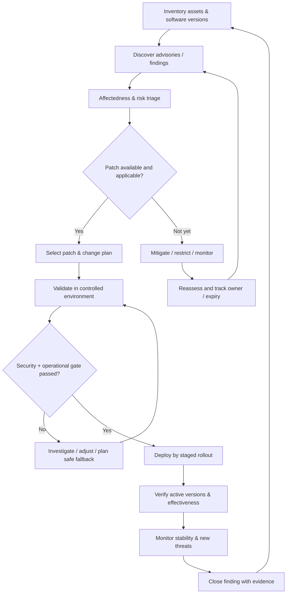
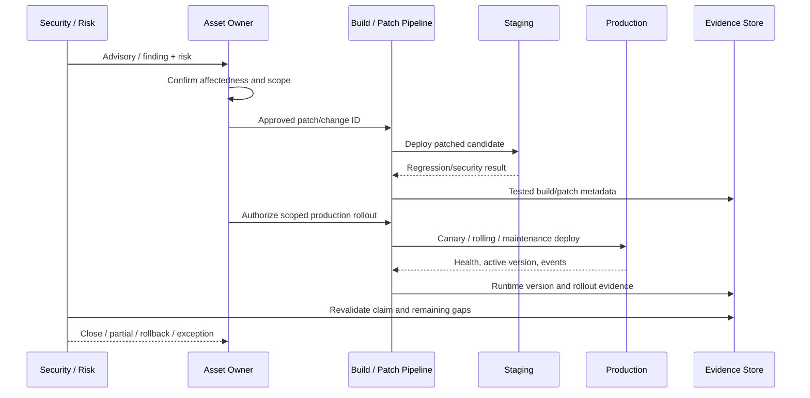
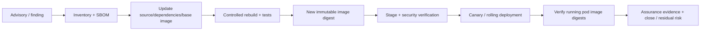

# Patch là gì? Khái niệm, vòng đời và bằng chứng khắc phục rủi ro bảo mật

## 1. Mục tiêu học tập

Sau bài học, người học có thể:

1. Định nghĩa **patch (bản vá)** và giải thích patch giải quyết vấn đề nào trong một hệ thống phần mềm/hạ tầng.
2. Phân biệt patch với **update, upgrade, hotfix, security fix, mitigation, workaround, configuration change** và **virtual patching**.
3. Phân loại các bản vá cho hệ điều hành, ứng dụng, thư viện/phụ thuộc, runtime Java, container image, firmware, thiết bị mạng và dịch vụ cloud.
4. Hiểu vì sao rủi ro không được quyết định chỉ bằng mã CVE hoặc điểm CVSS, mà còn bởi **tài sản bị ảnh hưởng, tính phơi lộ, khả năng khai thác, tác động nghiệp vụ và mức độ kiểm soát hiện có**.
5. Mô tả chu trình **discover → assess → decide → test → deploy → verify → monitor → close** và các vai trò chịu trách nhiệm.
6. Giải thích các khái niệm **affected version, fixed version, backport, patch level, reboot, restart, immutable replacement, rollback** và **residual risk**.
7. Thiết kế yêu cầu/tiêu chí nghiệm thu bảo đảm bản vá được **triển khai đúng tài sản, đúng phiên bản, đúng môi trường** và khắc phục điều kiện dễ bị tấn công.
8. Đánh giá rủi ro khi vá: downtime, tương thích ngược, thay đổi schema, dependency conflict, hiệu năng, bảo vệ dữ liệu và khả năng rollback.
9. Lập **risk–control–evidence mapping** để phân biệt “đã tải patch”, “đã cài”, “đã kích hoạt”, “đã xác minh” và “đã đóng finding”.
10. Áp dụng vào hệ thống Java/Spring Boot đa tenant có Gradle, JDK, container image, Kubernetes, PostgreSQL và thư viện phụ thuộc.
11. Đề xuất kiểm thử positive, negative, regression và failure cho kịch bản triển khai bản vá.
12. Sử dụng checklist, các tình huống và metrics để hỗ trợ chương trình **patch management và continuous security assurance**.

Bài nằm trong chương **Patch management** của module **SECURITY_SECURITY_ASSURANCE**. Module tập trung **đánh giá có bằng chứng** rằng hệ thống đạt mục tiêu bảo mật, từ phân tích rủi ro, yêu cầu, security controls đến kiểm thử, audit, xử lý phát hiện và cải tiến liên tục trong phát triển/vận hành. Với chủ đề “Patch là gì”, chúng ta không chỉ học cách định nghĩa bản vá mà còn học cách trả lời:

> **Một bản vá được cung cấp có thật sự áp dụng cho tài sản đang chạy, giải quyết rủi ro liên quan và đã được kiểm chứng bằng bằng chứng đáng tin hay chưa?**

## 2. Patch (bản vá) là gì?

**Patch** là một thay đổi được phát hành hoặc áp dụng nhằm sửa một hoặc nhiều khiếm khuyết hay cải thiện hành vi cụ thể của phần mềm, firmware hoặc một thành phần hệ thống. Bản vá thường giải quyết:

- **Lỗi bảo mật (security vulnerability):** điều kiện cho phép truy cập trái quyền, thực thi hành vi ngoài ý muốn, tiết lộ dữ liệu, leo thang đặc quyền hoặc từ chối dịch vụ.
- **Lỗi chức năng (functional defect):** tính toán sai, crash, treo, lỗi dữ liệu hoặc xử lý nghiệp vụ không đúng.
- **Lỗi ổn định/khả năng tương thích:** memory leak, race condition, lỗi với phiên bản giao thức, trình điều khiển hoặc hệ điều hành.
- **Vấn đề hiệu năng/vận hành:** tiêu thụ tài nguyên bất thường, retry không đúng, không giải phóng connection hoặc tài nguyên.
- **Điều chỉnh hỗ trợ/tuân thủ:** cập nhật trust store, thay đổi mặc định an toàn hoặc sửa lỗi không đáp ứng một yêu cầu đã xác định.

Một patch có thể xuất hiện dưới dạng một vài dòng mã, bản phát hành thư viện, gói cập nhật OS, phiên bản container image mới, firmware mới hoặc thay đổi được nhà cung cấp triển khai trực tiếp trong dịch vụ managed.

### 2.1. Security patch là gì?

**Security patch** là bản vá có mục tiêu khắc phục một hoặc nhiều rủi ro bảo mật đã nhận diện. Ví dụ giả định:

- Một thư viện xử lý HTTP không giới hạn kích thước một kiểu request, cho phép tiêu thụ quá nhiều bộ nhớ; phiên bản mới bổ sung giới hạn hoặc xử lý an toàn.
- Một hàm upload có thể đi ra ngoài thư mục cho phép; bản vá bổ sung canonicalization và ràng buộc đường dẫn.
- Một phương thức authorization thiếu kiểm tra tenant; bản vá thêm policy check phía server và query theo tenant.
- Một thành phần xác minh chữ ký chấp nhận thuật toán không được phép; bản vá từ chối các lựa chọn không đúng policy.

**Bản vá không nhất thiết chỉ là một file `.patch` hoặc commit.** Trong phát triển hiện đại, nhiều bản vá được phân phối bằng **phiên bản release mới chứa các thay đổi đã sửa**, rồi được tích hợp qua dependency update và build/deploy lại.

### 2.2. Patch có giải quyết mọi thứ không?

Không. Một security patch chỉ có thể làm giảm/loại bỏ rủi ro **trong phạm vi điều kiện lỗi mà nó khắc phục**, nếu được áp dụng đúng. Hệ thống vẫn có thể chứa:

- Lỗ hổng khác chưa phát hiện.
- Cấu hình sai không liên quan bản vá.
- Credentials đã bị lộ hoặc tài khoản đã bị chiếm.
- Backdoor/persistence nếu attacker khai thác trước khi vá.
- Dữ liệu đã bị tiết lộ trước thời điểm remediation.
- Một bản sao cũ chưa được cập nhật ở node, region, image hoặc deployment khác.
- Đường legacy hoặc dependency transitive vẫn có phiên bản dễ bị tấn công.

Do đó, cần **patch + verification + incident/risk assessment khi liên quan**, thay vì “cập nhật xong là hoàn toàn an toàn”.

## 3. Ví dụ gần gũi: bản vá thư viện của ứng dụng Java

Một API Java/Spring Boot dùng một thư viện parsing phiên bản A. Nhóm bảo mật nhận advisory rằng một kiểu request độc hại có thể làm parser sử dụng CPU quá mức. Nhà cung cấp phát hành phiên bản B có sửa lỗi.

Một quy trình hợp lý là:

1. Tìm ứng dụng nào thực sự dùng thư viện, kể cả dependency transitive.
2. Kiểm tra phiên bản/điều kiện chịu ảnh hưởng, có thể gồm cấu hình tính năng.
3. Xác định API có exposed đối với dữ liệu chưa tin cậy hay không.
4. Xem bản sửa được cung cấp ở version nào và có tương thích hay không.
5. Cập nhật bản khai dependency; rebuild ứng dụng và tạo artifact mới.
6. Chạy security/regression tests, kiểm tra điểm input và khả năng bị khai thác.
7. Phát hành artifact vào staging, sau đó production theo rollout được duyệt.
8. Xác minh phiên bản thư viện **bên trong artifact đang chạy** là bản sửa, không chỉ trong source repository.
9. Theo dõi lỗi, tải hệ thống, sự cố và tình trạng còn phiên bản cũ.
10. Đóng finding với evidence, nêu residual risks và exceptions nếu có.

Điểm quan trọng: **thay đổi version trong Gradle chưa đồng nghĩa server production đã chạy phiên bản đã vá**.

## 4. Phân biệt Patch, Update, Upgrade, Hotfix và Mitigation

| Khái niệm | Ý nghĩa phổ biến | Ví dụ | Giới hạn cần lưu ý |
| --- | --- | --- | --- |
| **Patch** | Thay đổi sửa lỗi/vấn đề cụ thể | Sửa kiểm tra quyền ở API | Không bảo đảm các lỗi khác đã hết |
| **Security patch** | Patch hướng tới lỗ hổng/rủi ro bảo mật | Bản phát hành thư viện sửa vấn đề parsing | Phải xác định phạm vi chịu ảnh hưởng |
| **Update** | Cập nhật phiên bản/nội dung; có thể gồm nhiều patches | `1.4.1 → 1.4.2` | Không phải mọi update đều là fix bảo mật |
| **Upgrade** | Nâng lên nhánh/phiên bản có thay đổi lớn hơn | Runtime/JDK hoặc major library upgrade | Có thể gây breaking changes |
| **Hotfix** | Sửa gấp một lỗi cụ thể, thường ngoài chu kỳ thông thường | Vá API đang bị khai thác | Cần kiểm thử tối thiểu, hậu kiểm và evidence |
| **Maintenance release** | Bản phát hành bảo trì gồm các fix | Patch release theo chính sách vendor | Phải đọc notes/affected scope |
| **Backport** | Đưa fix về nhánh phiên bản cũ còn được hỗ trợ | Vendor sửa lỗi trên nhánh LTS | Version nhỏ hơn vẫn có thể đã sửa |
| **Mitigation** | Giảm khả năng/tác động khi chưa sửa gốc | Tắt feature, chặn route, hạn chế egress | Rủi ro thường vẫn còn |
| **Workaround** | Cách vận hành tránh tình huống lỗi | Thay một workflow gây crash | Có thể không giải quyết root cause |
| **Virtual patching** | Rule/kiểm soát bổ sung chặn mẫu khai thác ở boundary | WAF/IPS rule tạm thời | Có thể bị bypass, không sửa binary/source |
| **Configuration change** | Thay tham số/cấu hình thay vì cài bản mới | Tắt endpoint debug | Có thể là remediation nhưng không nhất thiết patch |
| **Replacement** | Thay thành phần bằng sản phẩm/phiên bản khác | Loại bỏ thư viện EOL | Có thể cần migration và risk review |

### 4.1. Tên bản phát hành không nói đầy đủ bản chất

Một vendor có thể gọi `1.2.3` là “maintenance update” nhưng nó chứa security fix. Một lỗ hổng có thể được **backport** vào nhánh LTS nên version number không so sánh tuyến tính giữa các nhánh. Hãy dựa vào **security advisory, release notes, package-specific affected ranges, distro backport status và bằng chứng runtime**.

### 4.2. Mitigation khác remediation hoàn toàn

- **Mitigation:** làm giảm xác suất bị khai thác hoặc tác động, ví dụ network block có hiệu lực trong lúc chờ patch.
- **Remediation:** thực hiện hành động xử lý root cause/risk, có thể là patch, cấu hình, thay thế hoặc loại bỏ chức năng.
- **Risk acceptance:** chủ rủi ro chấp nhận phần còn lại trong phạm vi/thời hạn cho phép.

Không báo “patched” khi mới bật rule trên WAF. Nên ghi **“mitigated pending patch”** và điều kiện cần kiểm chứng.

## 5. Patch áp dụng cho những thành phần nào?

| Lớp | Đối tượng vá | Cách phát hành thường gặp | Vấn đề assurance |
| --- | --- | --- | --- |
| Operating system | Kernel, system packages, libc, libraries | OS package update, image refresh | Kernel có cần reboot? node nào còn cũ? |
| Runtime | JDK/JRE, .NET runtime, Python interpreter | Runtime update/rebuild | Runtime trong process thực tế là bản nào? |
| Application | Business code, HTTP handlers, authz rules | Commit/release/JAR/image | Đúng commit/build đã deploy? |
| Dependency | Direct/transitive libraries, plugins | Dependency version update | Classpath/runtime chứa bản nào? |
| Container | Base image, OS libraries, app layers | Build/push new immutable image | Pod có đang chạy digest mới? |
| Database | DBMS engine, extension, driver | Vendor package/managed maintenance | Schema/query/replica có tương thích? |
| Infrastructure | Hypervisor, router, firewall, load balancer | Vendor patch/firmware | HA, failover, network policy có hoạt động? |
| Firmware/Device | BIOS/UEFI, BMC, NIC, storage firmware | Firmware update | Downtime và recovery khả thi? |
| SaaS/Managed | Provider-operated components | Provider rollout | Evidence scope/shared responsibility? |
| CI/CD tooling | Runner agent, build tools, plugins | Pipeline/toolchain update | Có làm thay đổi trust boundary/provenance? |
| Endpoint | Workstations/mobile/EDR | Managed update rollout | Devices offline có được phát hiện? |
| Embedded/OT | Thiết bị có vòng đời hỗ trợ dài | Vendor-specific update | Safety/availability và kiểm thử chuyên biệt |

### 5.1. Shared responsibility

Với SaaS/managed services, provider có thể vá phần software do họ vận hành; tổ chức khách hàng vẫn có thể phải cập nhật **client SDK, JDBC driver, connector, IAM policy, custom app hoặc cấu hình**. Không suy ra provider đã vá tất cả thành phần trong phạm vi của mình.

### 5.2. Một ứng dụng có nhiều bản sao và lớp phụ thuộc

Một service có thể chạy trên nhiều pods/nodes/regions. Một thư viện lỗi có thể tồn tại trong base image, build-time tool và runtime dependency theo các đường khác nhau. Patch management cần nhận diện **toàn bộ inventory và versioned artifacts**.

## 6. Tại sao patch quan trọng trong bảo mật?

Một lỗ hổng đã được công bố có thể trở nên dễ khai thác hơn khi technical details hoặc exploit code phổ biến. Mức rủi ro tùy **tính khả thi khai thác, exposure, data/asset impact và các controls**.

Không vá có thể dẫn tới:

- Truy cập trái quyền và leo thang đặc quyền.
- Lộ dữ liệu cá nhân, tài chính hoặc secrets.
- Remote code execution hoặc compromise workload.
- Denial of service và gián đoạn nghiệp vụ.
- Lateral movement qua host hoặc service account.
- Ransomware hoặc tampering.
- Mất niềm tin vào build/runtime/artifact.
- Vi phạm các security objectives/contractual duties áp dụng.
- Tốn kém incident response và khôi phục.

### 6.1. Patching là một trong nhiều controls

Các controls thường đi cùng patch:

- Asset inventory và software composition visibility.
- Vulnerability discovery và triage.
- Secure configuration, least privilege và segmentation.
- Monitoring/detection và incident response.
- Data backup/restore và high availability.
- Release controls, canary rollout, rollback.
- SBOM, dependency provenance và supply-chain controls.
- Independent verification và evidence retention.

Patch giúp giảm rủi ro đã biết nhưng không thay thế **secure architecture, secure development, identity/access controls và assurance liên tục**.

## 7. “Vulnerability”, “Defect” và “Patch” khác nhau ra sao?

- **Defect/bug:** khiếm khuyết làm hành vi khác kỳ vọng.
- **Vulnerability:** điểm yếu có thể bị khai thác để ảnh hưởng confidentiality, integrity hoặc availability, hoặc vi phạm mục tiêu bảo mật.
- **Exploit:** phương pháp/hành vi lợi dụng một vulnerability trong điều kiện cụ thể.
- **Patch:** thay đổi nhằm sửa lỗi/điều kiện dễ bị khai thác.
- **Affected asset:** instance/service/package thực tế có điều kiện chịu ảnh hưởng.
- **Exposure:** cách và mức độ asset có thể bị tiếp cận.
- **Finding:** vấn đề được phát hiện trong kiểm tra; cần triage và evidence.
- **Residual risk:** phần rủi ro còn lại sau các controls, kể cả patch.

### 7.1. Không phải mọi bug là security vulnerability

Một lỗi căn lề giao diện có thể không ảnh hưởng mục tiêu bảo mật. Nhưng một lỗi xử lý trạng thái giao dịch có thể vi phạm integrity, dù không có CVE public. Vì vậy patch management trong security assurance phải bao gồm **internal findings** do code review, test và audit phát hiện, không chỉ patch từ vendor advisory.

### 7.2. Không phải mọi advisory đều áp dụng cho hệ thống

Một advisory nói package có lỗi trong một tính năng tùy chọn; nếu deployment không dùng tính năng đó, affectedness cần đánh giá. Tuy nhiên **“chưa thấy sử dụng” không phải bằng chứng đủ**, nhất là với reflection, plugin, dynamic loading hoặc API có thể bị kích hoạt gián tiếp.

## 8. CVE, CWE, CVSS, EPSS và danh mục lỗ hổng đang bị khai thác

Trong thực tế, patch triage dùng nhiều nguồn thông tin:

| Khái niệm | Cho biết gì? | Điều không nên suy luận |
| --- | --- | --- |
| **CVE** | Định danh cho một vulnerability được ghi nhận | Không tự nói hệ thống của bạn bị ảnh hưởng |
| **CWE** | Phân loại loại weakness (ví dụ authorization, injection) | Không chỉ ra phiên bản package đã được vá |
| **CVSS** | Điểm/metric mô tả mức nghiêm trọng theo mô hình | Không là xác suất exploit thực tế hoặc deadline tự động |
| **EPSS** | Ước lượng khả năng một CVE bị khai thác trong một khoảng thời gian theo mô hình dự báo | Không là bảo đảm sẽ/không bị khai thác |
| **Known exploited catalog** | Danh mục vulnerability có bằng chứng bị khai thác, tùy nguồn phát hành | Không bao phủ mọi khai thác thực tế |
| **Vendor advisory** | Affected versions, fix/mitigation, constraints và notes | Có thể thay đổi; cần kiểm tra phiên bản cập nhật |
| **Internal finding** | Vấn đề cụ thể do kiểm thử/review/incident tìm được | Không nhất thiết có CVE hoặc patch vendor |

### 8.1. Không đặt priority chỉ theo một con số

Một CVE điểm cao ở thành phần không reachable có thể có rủi ro khác một lỗi authorization điểm trung bình trên API public giữ dữ liệu rất nhạy cảm. Ngược lại, khai thác đang diễn ra hoặc tài sản critical exposed có thể đòi hỏi xử lý khẩn dù upgrade gây phức tạp.

Một quyết định đáng tin cần ghi **asset criticality, exploitability, exposure, impact, compensating controls, dependencies và evidence**.

### 8.2. Advisory là đầu vào cần xác minh

Advisory có thể được cập nhật affected ranges, backport availability hoặc fix guidance. Record nên lưu nguồn, phiên bản thông tin và thời điểm đánh giá. Tránh bịa ngày phát hành, điểm severity hoặc fixed version khi chưa có xác nhận.

## 9. Affectedness: hệ thống có thật sự cần bản vá này không?

**Affectedness assessment** trả lời “thành phần nào của hệ thống thuộc phạm vi bị ảnh hưởng, với điều kiện cấu hình và cách sử dụng nào?”.

Cần phân biệt:

1. **Package present:** package có xuất hiện trong SBOM/scan?
2. **Affected version:** version/build thuộc khoảng ảnh hưởng?
3. **Vulnerable functionality:** chức năng lỗi có được dùng/có thể kích hoạt?
4. **Reachability/exposure:** attacker hoặc input chưa tin cậy có tiếp cận?
5. **Privilege/context:** process chạy với quyền nào; dữ liệu gì có thể bị ảnh hưởng?
6. **Compensating controls:** network, authz, feature flags, sandbox có làm giảm risk?
7. **Fix availability:** có patch/backport hoặc cách thay thế được hỗ trợ?
8. **Evidence confidence:** đã xem runtime package và các điều kiện hay chỉ dựa report tĩnh?

### 9.1. Ví dụ false positive và false negative

- Scanner thấy package name/version dễ bị ảnh hưởng, nhưng OS distribution đã backport fix dưới version string cũ: cần kiểm tra **vendor package advisory/build metadata**, không chỉ so sánh chuỗi version.
- SBOM không thấy thư viện vì package được shadow/relocate hoặc tải động ở runtime: “not present” chưa chắc đúng.
- Container image đã được rebuild với base mới nhưng pods còn chạy digest cũ: source/image inventory báo patched trong khi runtime chưa patched.
- Library có trong ứng dụng nhưng feature dễ bị khai thác không được dùng: cần ghi điều kiện và evidence, không kết luận “safe tuyệt đối”.

### 9.2. Bảng quyết định affectedness

| Kết quả | Ý nghĩa | Hành động |
| --- | --- | --- |
| **Confirmed affected** | Asset/version/condition thuộc phạm vi ảnh hưởng | Patch/mitigate theo priority |
| **Likely affected** | Có bằng chứng đáng kể nhưng thiếu chi tiết | Ưu tiên kiểm tra và xử lý thận trọng |
| **Not affected — supported evidence** | Có căn cứ rõ về version/backport/config/architecture | Ghi evidence và điều kiện thay đổi |
| **Unknown** | Inventory/telemetry/nguồn không đủ | Không tự coi safe; yêu cầu discovery |
| **Patched but unverified** | Có update/deploy, chưa chứng minh runtime | Chạy readback/verification |
| **Residual risk accepted** | Có exception có owner/scope/expiry | Theo dõi và tái đánh giá |

Trạng thái này là mô hình đánh giá, không phải chuẩn bắt buộc của mọi công cụ.

## 10. Thế nào là một “fixed version”?

**Fixed version** là bản phân phối mà vendor/maintainer xác định đã chứa sửa chữa cho một vấn đề. Không nhất thiết là “version lớn hơn về mặt số học”.

Có thể tồn tại:

- **Upstream patch:** bản phát hành trực tiếp từ maintainers.
- **Distro backport:** vendor đưa fix về package trên branch LTS.
- **Vendor fork:** bản phân phối có patch riêng; cần trust/evidence.
- **Security support branch:** nhánh nhận fix nhưng không nhận tất cả tính năng mới.
- **Patch supersedence:** bản cập nhật sau thay thế bản trước và có thể chứa nhiều fixes.
- **Firmware revision:** version phụ thuộc model/device SKU và điều kiện upgrade.
- **Managed service patch:** provider update có thể không hiển thị package version cho khách hàng.

### 10.1. Không dùng so sánh version kiểu văn bản

Ví dụ chuỗi `"1.10"` và `"1.9"` có thứ tự lexicographic khác semantic version. Với package OS, epoch/release/backport conventions còn phức tạp hơn. Cần dùng **package manager/vendor advisory hoặc version comparison library tương ứng**.

### 10.2. Patch supersedence

Nếu bản update C thay thế B và bao gồm security fix của B, có thể chấp nhận C nhưng phải xác minh theo vendor policy và compatibility. Không mặc định mọi bản mới hơn đều chứa fix nếu dùng fork/branch khác.

## 11. Patch management là gì và patch nằm ở đâu?

**Patch management** là quy trình xác định, đánh giá, lập kế hoạch, triển khai, xác minh và duy trì việc cập nhật các thành phần nhằm sửa lỗi và quản lý rủi ro. Trong Security Assurance, trọng tâm bổ sung là **bằng chứng độc lập và kết luận có phạm vi**.

Một vòng đời tổng quát:



### 11.1. Những trạng thái không được đánh đồng

| Trạng thái | Chứng minh được điều gì? | Chưa chứng minh |
| --- | --- | --- |
| **Patch announced** | Vendor/maintainer đã công bố fix | Asset cần hoặc đã cài |
| **Patch downloaded** | Package/image tồn tại ở kho nào đó | Đã cài trên host/runtime |
| **Patch approved** | Change đã được phê duyệt | Triển khai thành công |
| **Patch installed** | Package hoặc file đã được cập nhật ở scope nhất định | Process/kernel đã dùng code mới |
| **Patch activated** | Thành phần đang chạy hoặc reboot đã nhận version mới | Vulnerability đã được kiểm chứng fix |
| **Patch verified** | Có evidence version và behavior trong scope | Hệ thống không còn lỗ hổng khác |
| **Finding closed** | Có decision dựa trên evidence được xem xét | Không tồn tại residual risk ngoài scope |

### 11.2. Security patching là một hoạt động liên tục

Không chỉ có “thứ ba đầu tháng”. Một số threat cần khẩn cấp; các tài sản offline/legacy cần plan riêng; dependency updates phải đi qua SDLC; vendor advisory mới có thể thay đổi kết luận affectedness. Hệ thống có lifecycle dài cần theo dõi **risk evolution** và sự thay đổi inventory.

## 12. Asset inventory là điều kiện cần trước khi vá

Không thể vá đầy đủ thứ mình không biết tồn tại. Một inventory phục vụ patch management nên có:

- Asset ID, owner, business service và criticality.
- Environment, region, tenant boundary khi liên quan.
- OS/firmware/kernel/runtime/app versions.
- Package, dependency, container image digests, SBOM references.
- Network exposure và attack surface.
- Lifecycle: EOL/EOS, support contract, maintenance windows.
- Deployment type: mutable host, immutable VM/image, container, serverless, SaaS.
- Redundancy: availability zone, cluster replicas, blue/green support.
- Change/rollback/backup constraints.
- Version detection method và timestamp.
- Patch status, exception và risk/finding IDs.

### 12.1. Nhiều nguồn inventory bổ trợ nhau

| Nguồn | Có thể cho biết | Điểm cần cẩn trọng |
| --- | --- | --- |
| CMDB/asset registry | Asset owner, criticality, planned configs | Dữ liệu có thể stale |
| Package manager | OS package đang cài | Kernel/runtime đang chạy có thể khác |
| Container registry | Image layers, manifests và digests | Không chứng minh pods đang dùng digest mới |
| Kubernetes API | Images và workloads tại thời điểm đọc | Có thể thiếu jobs, scaled-to-zero hoặc external nodes |
| SBOM | Thành phần trong một artifact/phase cụ thể | Có thể không đầy đủ/dynamic components |
| SCA/vulnerability scan | Matching advisory với dependencies | False positives/negatives, mapping errors |
| Endpoint/host agent | Installed/running versions, state | Agent offline hoặc không đủ quyền |
| Cloud/provider inventory | Managed services và instance metadata | Managed patch evidence phụ thuộc provider |
| Application telemetry | Build/runtime IDs và behavior | Không thể biết mọi thư viện chỉ từ health endpoint |

### 12.2. Chú ý shadow assets

Legacy API, máy phục vụ tạm, runner CI cũ, containers phát sinh động, thiết bị không kết nối thường xuyên hoặc branches còn release có thể thiếu inventory. Mẫu số sai dẫn tới dashboard “100% patched” giả.

## 13. Tiếp nhận thông tin và phát hiện bản vá

Các kênh:

- Vendor security advisories và product notices.
- Maintainer release notes hoặc security policy.
- OS distribution/security repositories.
- SCA/host/container vulnerability scanners.
- Internal SAST/DAST/penetration test, code review và audit findings.
- Threat intelligence và thông tin khai thác có thể kiểm chứng.
- Incident response/forensic findings.
- Dependency bot/automated update recommendations.
- Cloud provider maintenance and deprecation notices.

### 13.1. Đừng tin trực tiếp patch file hoặc URL trong email

Patch package và update channel cũng là một **supply-chain input**. Cần xác nhận:

- Nguồn phát hành được phê duyệt.
- Package signature/checksum/provenance phù hợp.
- Repository/mirror identity và integrity.
- Version/branch/platform đúng asset.
- Dependency chain và package manager policy.
- Quy trình phê duyệt nguồn third party và emergency download.

Kẻ tấn công có thể lợi dụng tâm lý cần vá gấp để dụ cài “security update” giả. Không biến patch process thành đường cài mã không đáng tin.

### 13.2. Evidence ingestion

Advisory records nên có source, advisory ID, affected range, fixed releases, workaround và thời điểm retrieved/triaged. Không cần sao chép toàn bộ nội dung advisory vào ticket nếu có protected references và metadata đủ audit.

## 14. Triage: ưu tiên vá dựa trên rủi ro

Một quy trình triage cần trả lời:

1. Asset hoặc dependency nào bị ảnh hưởng?
2. Exposure: Internet-facing, partner-only, internal, isolated?
3. Exploit preconditions: authentication, configuration, user interaction?
4. Có bằng chứng exploited in the wild hoặc active targeting không?
5. Criticality: chứa PII, payment, secrets, admin plane hay infra control?
6. Có mitigations đang hoạt động và được xác minh không?
7. Patch có khả dụng, vendor support còn hay đã EOL?
8. Khả năng deploy/rollback và operational risk ra sao?
9. Blast radius nếu chờ patch hoặc nếu patch gây sự cố?
10. Risk owner và decision evidence là gì?

### 14.1. Ma trận ưu tiên minh họa

| Tình huống | Hướng xử lý |
| --- | --- |
| Remote exploitable, exposed, impact cao và exploit đang phổ biến | Khẩn cấp: containment, kiểm tra evidence, vá sớm theo quy trình |
| High-impact internal vulnerability với privilege boundary | Ưu tiên cao; xem khả năng lateral movement |
| Dependency version chịu ảnh hưởng nhưng điều kiện khai thác chưa rõ | Triage nhanh, xác định reachability và mitigations; không tự bỏ qua |
| Patch không khả dụng | Tắt chức năng, giảm exposure, monitoring và review định kỳ |
| Asset EOL không có fix | Thay thế/loại bỏ hoặc có exception giới hạn với compensating controls |
| Patch có nguy cơ gián đoạn hệ thống critical | Canary/HA/backup, patch window và risk escalation phù hợp |

Không sử dụng bảng này để áp đặt một SLA cố định cho mọi tổ chức. **Thời hạn vá phải được policy/risk owner quy định theo loại rủi ro**, có cách xử lý ngoại lệ.

### 14.2. SLA và risk acceptance

Một policy có thể quy định thời hạn đối với Critical/High/Medium tùy exposure và exploited status, nhưng cần định nghĩa **mốc bắt đầu, stop-clock, exceptions, re-open criteria và bằng chứng đóng**. Một ticket được gắn “deferred” không đồng nghĩa vulnerability đã được khắc phục.

## 15. Preflight: trước khi áp dụng bản vá phải kiểm tra gì?

Một patch có thể sửa bảo mật nhưng gây downtime hoặc incompatibility, vì vậy cần change plan.

- [ ] Chính xác asset/components/versions trong scope?
- [ ] Vendor patch source/signature được xác minh?
- [ ] Advisory, affectedness và release notes đã xem?
- [ ] Có breaking API/ABI/schema/config/dependency changes?
- [ ] Môi trường test đại diện các chức năng critical?
- [ ] Có backup/snapshot/restore và recovery point theo policy?
- [ ] Có rollback plan khả thi cho OS, DB, app và data migration?
- [ ] Có HA/traffic drain và maintenance window nếu cần?
- [ ] Truy cập privileged deployment có JIT/approval và audit?
- [ ] Monitoring, SLO, alarms và canary criteria đã chuẩn bị?
- [ ] Có được phép restart/reboot các components/phụ thuộc?
- [ ] Có test chứng minh fix security và các regressions quan trọng?
- [ ] Incident containment có cần đi trước patch?
- [ ] Có người chịu trách nhiệm điều phối và decision revert/continue?
- [ ] Bằng chứng nào sẽ được thu ở trước/sau patch?

### 15.1. Test trước khi vá

Có giá trị nếu tái hiện **điều kiện lỗi** an toàn trong môi trường kiểm thử; nhưng không phải mọi security vulnerability đều có reproduction an toàn/được phép. Khi không thể thử trực tiếp, có thể dùng vendor evidence, unit/integration tests, trusted scanner, runtime package checks và compensating controls, đồng thời ghi limitations.

### 15.2. Không chạy mã khai thác trên production để xác nhận

Với Remote Code Execution hoặc DoS, test live exploit có thể gây tác động nghiêm trọng. Dùng phương pháp không phá hoại, environment sandbox, vendor-approved detection và kiểm tra version/behavior phù hợp. Không yêu cầu proof-of-exploit production chỉ để đóng finding.

## 16. Luồng triển khai bản vá chuẩn

Quy trình tham khảo:



### 16.1. Một bản vá chỉ được coi là cài thành công khi nào?

Điều kiện phụ thuộc loại hệ thống. Ví dụ:

- OS package đã được cập nhật và service liên quan đã restart.
- Kernel update có thể cần reboot để kernel đang chạy đổi phiên bản.
- JDK binary mới trên disk nhưng Java process cũ chưa restart thì vẫn dùng runtime cũ.
- Container base image mới đã build nhưng Kubernetes workload vẫn chạy digest cũ.
- Dependency Gradle mới đã merge nhưng JAR cũ còn deployed.
- Managed DB engine đã patch nhưng replicas/regions có maintenance state khác.
- Firmware update thành công nhưng cluster HA failover chưa được kiểm tra.

**Disk version, package version, running process version và deployed artifact digest là các loại evidence khác nhau.**

### 16.2. Phân biệt install với activate

Đối với hệ thống có tiến trình chạy dài, một bản vá được cài lên disk chưa chắc đã được nạp bởi process. Ví dụ service Java cần restart; một thư viện native bị nạp vẫn có thể ở trong memory. Reboot/restart policy phải được xác định theo vendor guidance và operational impact.

## 17. Rollout: triển khai bản vá không làm gián đoạn hệ thống quá mức

Việc vá còn là một **change operation**. Security risk giảm sau khi patch hoạt động, nhưng availability/integrity risk có thể tăng nếu deployment thiếu kiểm soát. Thiết kế rollout phải cân bằng hai nhóm rủi ro.

### 17.1. Các chiến lược phổ biến

| Chiến lược | Ý tưởng | Phù hợp khi | Cần kiểm tra |
| --- | --- | --- | --- |
| **In-place update** | Cập nhật thành phần trên host hiện tại | Host/service hỗ trợ update an toàn | Running version, restart, backup, drift |
| **Rolling update** | Thay từng instance/nhóm theo lượt | Có nhiều replicas và health checks | Capacity, compatible mixed versions |
| **Canary** | Cho một phần nhỏ traffic/instances dùng bản mới | Có telemetry và khả năng chia traffic | SLO, regressions, authz/security behavior |
| **Blue/green** | Chuẩn bị môi trường mới, đổi traffic | Muốn rollback traffic nhanh | State/data schema/side effects |
| **Immutable replacement** | Xây image mới, thay VM/node/pod cũ | Cloud/container fleet | Artifact digest, old instances |
| **Maintenance window** | Dừng/giới hạn dịch vụ để cập nhật | Database/firmware/legacy cần downtime | Backup, restore, dependencies, timing |
| **Managed rollout** | Provider thực hiện theo service policy | SaaS/managed service | Scope, provider evidence, customer tasks |

### 17.2. Health check không tự chứng minh bảo mật

Một canary có HTTP 200 và latency tốt nhưng còn dùng Java library dễ bị ảnh hưởng vẫn chưa “patched”. Phải kiểm tra **security-specific criteria**: artifact digest, active package version, affected component, authorization/injection behavior liên quan và absence of unpatched replicas.

### 17.3. Mixed-version window

Rolling update có thể tạo lúc các pods chạy đồng thời bản cũ/mới. Cần nêu thời gian tối đa chấp nhận trạng thái mixed, route traffic tới versions, schema compatibility và cách tránh attacker tiếp tục tới pod cũ. Với lỗ hổng đang bị khai thác, có thể cần **containment và traffic isolation** song song rollout.

### 17.4. Canaries có cần dữ liệu production không?

Có thể dùng telemetry thực tế và shadow/synthetic tests đã được phép, nhưng không nên gửi payload khai thác nguy hiểm hoặc dùng PII không cần thiết. Test plan phải phân biệt **availability**, **functionality** và **security effectiveness**.

## 18. Verify: xác minh bản vá thực sự có hiệu lực

Đây là bước trung tâm của **security assurance**: không chỉ khẳng định “change thành công”, mà chứng minh câu hỏi **đã sửa đúng vấn đề trên đúng tài sản chưa?**

### 18.1. Sáu lớp xác minh

1. **Change identity:** ticket, advisory và patch/fixed-version reference đúng.
2. **Asset identity:** host/pod/service/tenant/environment thuộc scope.
3. **Installation:** package/image/application đã cập nhật.
4. **Activation:** kernel/process/container/managed engine thực sự dùng bản sửa.
5. **Effectiveness:** điều kiện dễ bị khai thác đã được giải quyết hoặc nằm ngoài phạm vi chịu ảnh hưởng có bằng chứng.
6. **Operational safety:** chức năng, dữ liệu, availability và monitoring vẫn đạt điều kiện chấp nhận.

### 18.2. Evidence matrix theo lớp

| Claim | Evidence ví dụ | Lưu ý |
| --- | --- | --- |
| Bản vá đã được phê duyệt | Change record, owner, advisory reference | Chưa chứng minh đã deploy |
| Package đã cài | Package manager/query output có timestamp | Có thể chưa restart process |
| Binary/process đã kích hoạt | Runtime build/version, process start, loaded modules | Version string có thể thiếu backport metadata |
| Container image đã được thay | Deployment manifest và **running image digest** | Tag text không đủ |
| Dependency đã được sửa | Resolved runtime dependency graph, packaged artifact inspection | Source version catalog chưa đủ |
| Chặn lỗi liên quan | Safe regression/negative test, vendor-approved check | Test scope không bao phủ mọi exploit variation |
| Các replicas/regions đều đạt | Inventory và per-instance readback | Autoscaling có thể tạo pod cũ sau kiểm tra |
| Không có gián đoạn ngoài ngưỡng | SLO/error/latency/capacity metrics | Health-only check không chứng minh security |
| Finding được đóng | Review of evidence and residual risk | Không đồng nghĩa zero vulnerabilities |

### 18.3. Readback phải đến từ đúng hệ thống

Đọc file cấu hình Git không chứng minh instance production đã đổi. Tương tự:

- Registry đã có image mới nhưng workload chạy digest cũ.
- IaC updated nhưng apply thất bại.
- Host installed newer kernel nhưng vẫn boot kernel cũ.
- Library version đã tăng trong build script nhưng runtime classpath vẫn dùng dependency khác.
- Vendor gửi thông báo “maintenance complete” nhưng asset thuộc region/service tier khác.

Phải xác định **source of truth cho active version** theo từng công nghệ.

### 18.4. “Không còn finding” có phải đã vá?

Scanner không báo CVE sau patch là tín hiệu hỗ trợ, nhưng có thể vì scanner chưa quét lại, signature thiếu, asset offline, SBOM incomplete hoặc advisory mapping sai. Đối chiếu với **vendor fix guidance, runtime version, affectedness evidence và tests**.

### 18.5. Residual risk

Ngay cả sau patch, có thể còn cấu hình không an toàn, lỗ hổng tương tự trong đường khác, credentials đã lộ, session chưa thu hồi hoặc dữ liệu đã bị lấy. Nếu trước đó có compromise, cần **incident response và threat hunting** theo scope, không chỉ cài update.

## 19. Rollback, restore và các tình huống khó đảo ngược

Rollback là khả năng quay lại trạng thái phù hợp sau khi patch gây lỗi. Không phải mọi loại patch đều đảo ngược đơn giản.

### 19.1. Khi nào rollback phù hợp?

- Canary có regression vượt ngưỡng.
- Core business invariant bị vi phạm.
- New build gây data corruption hoặc incompatibility.
- Thời gian phản hồi/downtime vượt mức được chấp nhận.
- Deployment không khớp artifact đã phê duyệt.
- Phát hiện key/signature/source của update không đáng tin.

### 19.2. Rollback có thể làm mở lại lỗ hổng

Nếu quay về artifact trước patch, vulnerability có thể xuất hiện lại. Vì vậy rollback decision phải xem:

- Có containment rule để giới hạn exposure không?
- Có thể disable affected functionality hoặc route không?
- Có patched build khác/alternative mitigation không?
- Risk owner có phê duyệt việc chạy bản dễ bị ảnh hưởng trong thời gian giới hạn không?
- Có monitoring và deadline xử lý lại không?

Không thực hiện rollback mù khi threat đang actively exploited.

### 19.3. Database/schema migration

Code có thể rollback nhưng schema đã thay đổi hoặc dữ liệu đã được chuyển đổi không đảo ngược. Cần thiết kế expand–migrate–contract, backup/restore và compatibility; không hứa “rollback một nút” cho mọi migration.

### 19.4. Firmware/OS

Firmware update có thể không hỗ trợ downgrade, hoặc rollback gây mất cấu hình. OS/kernel cần reboot/lifecycle plan. Phải đọc vendor restrictions và có recovery route trước thay đổi rủi ro cao.

## 20. Khi chưa có bản vá: zero-day, end-of-life và compensating controls

Không phải vulnerability nào cũng có fix sẵn. Một vấn đề có thể chưa được vendor xác nhận, có patch nhưng chưa được backport hoặc asset đã EOL.

### 20.1. Các biện pháp giảm thiểu tạm thời

- Disable vulnerable feature/endpoint.
- Block hoặc hạn chế traffic tới entry point ảnh hưởng.
- Network segmentation/egress controls.
- Thắt chặt authentication/authorization cho action liên quan.
- Giới hạn file types/payload sizes/inputs.
- WAF/IPS rule có test coverage rõ.
- Quarantine asset hoặc thay bằng instance ít exposed hơn.
- Monitor logs, indicators và suspicious behavior.
- Temporary replacement/migration tới maintained component.
- JIT access, hạn chế quyền process và giảm blast radius.

Các biện pháp này **không tự biến asset thành patched**. Phải ghi trạng thái, effectiveness evidence, expiry/reassessment trigger và owner.

### 20.2. Ví dụ risk record

```yaml
patch_risk_decision:
  finding_id: "PATCH-RISK-DEMO-01"
  asset_reference: "<opaque-asset-id>"
  advisory_reference: "<vendor-advisory-id>"
  affectedness: "confirmed"
  patch_available: false
  disposition: "mitigated_pending_patch"
  mitigations:
    - "Disable vulnerable endpoint"
    - "Restrict network exposure"
    - "Monitor attempted access"
  verification:
    - "Endpoint cannot be reached from untrusted network"
    - "Monitoring rule and alert tested"
  decision_owner: "<approved-risk-owner>"
  approved_at: "<UTC-timestamp>"
  reassess_on:
    - "Vendor releases a fix"
    - "Exposure or exploit activity changes"
    - "Approved exception expires"
  expiry: "<review-date>"
  residual_risk: "<documented-assessment>"
```

Đây là cấu trúc minh họa, **không phải record thực**. Giá trị `patch_available: false` không được tự suy từ một ngày không thấy thông báo; cần dựa vào nguồn/thời điểm kiểm tra được ghi nhận.

### 20.3. EOL: patch management có thể chuyển thành replacement management

Nếu vendor ngừng hỗ trợ và không phát hành fix, việc “tiếp tục vá” có thể không khả thi. Yêu cầu remediation có thể là **retire, isolate, migrate hoặc replace**; chỉ chấp nhận rủi ro tồn đọng khi có thẩm quyền, scope, hạn và compensating controls phù hợp.

## 21. Patch hệ điều hành: package mới có thể chưa chạy

Hệ điều hành chứa kernel, thư viện hệ thống, service daemons, command-line tools và nhiều packages.

### 21.1. Luồng logic

1. Thu asset/OS/kernel/package inventory.
2. Map security advisory với distribution và installed package release.
3. Kiểm tra nguồn package manager/trust/signatures.
4. Xác định package dependencies, service restarts và reboot.
5. Thử update trên representative environment.
6. Rollout theo HA/availability plan.
7. Xác minh package installed và **active process/kernel version**.
8. Rescan/verify relevant vulnerability, kiểm tra services/regressions.
9. Lưu evidence per host/instance và xử lý offline nodes.

### 21.2. Ví dụ thông tin cần phân biệt

```text
Installed kernel package: <new-kernel-package>
Running kernel:          <old-running-kernel>
Update action:           package installation completed
Activation status:       pending reboot / not yet verified
Assurance conclusion:    patch installed, not confirmed active
```

Nếu runtime kernel cũ còn hoạt động, không nên đóng finding chỉ dựa vào package inventory.

### 21.3. Linux distribution backports

Một distro có thể duy trì upstream version string cũ nhưng thêm security fix vào package revision. Vì vậy, không đánh giá solely by upstream version; tham chiếu vendor advisory, package release metadata và runtime readback.

### 21.4. Fleet management

Một host patched không chứng minh toàn fleet patched. Cần chỉ rõ coverage của nodes đang hoạt động, nodes offline, autoscaling templates, golden images, standby hosts và rebuild paths. Golden image cũ có thể liên tục tạo host chưa vá sau khi fleet hiện tại được cập nhật.

## 22. Patch container: thay immutable image, không sửa tạm trong pod

Với containerized workloads, bản vá có thể ở:

- Base image (OS/runtime).
- JDK/runtime layer.
- Application JAR/WAR.
- Direct/transitive libraries.
- Sidecar, service mesh proxy và agent.
- Init container hoặc operator.
- Kubernetes node OS/container runtime.

### 22.1. Một quy trình an toàn phổ biến



### 22.2. Anti-pattern: cập nhật package bên trong pod đang chạy

Dùng shell cập nhật package trong container đang chạy có thể thay đổi tạm thời nhưng:

- Thay đổi mất khi pod restart/recreate.
- Không nằm trong image digest được release quản lý.
- Khó audit/test/reproduce.
- Không sửa base image/template sinh pod mới.
- Có thể tạo drift so với source và SBOM.
- Không bảo vệ các replicas khác.

Nên **rebuild image**, publish artifact có digest/provenance và rollout workload theo policy. Emergency containment đặc biệt nếu dùng phải có owner, thời hạn và remediation tiếp theo.

### 22.3. Vì sao quét image mới chưa đủ?

Registry scan có thể báo sạch cho digest X, nhưng pods đang chạy digest Y. Kubernetes manifests có thể dùng tag mutable. Điều cần chứng minh:

- Source revision và base digest phù hợp.
- Resolved runtime dependencies đã được cập nhật.
- Image digest X đã được deploy theo resource/version cụ thể.
- Pods/replicas nhận digest X; không có rollout thất bại.
- Sidecar/init container và node components trong scope được xem xét.
- Vulnerability check/test của X phù hợp.
- Autoscaler/rollback không tái triển khai digest dễ bị ảnh hưởng.

## 23. Patch JDK/JRE và Java runtime

Java runtime có thể đến từ JDK cài trên host, container base image, bundled JRE hoặc môi trường managed.

### 23.1. Xác định runtime thật

- App chạy trên JDK version/vendor/build nào?
- JRE có đóng gói theo app/JLink image không?
- Có nhiều Java processes/instances với toolchain khác nhau không?
- CI build JDK khác runtime JDK không?
- Có runtime image digest hoặc startup/build metadata không?
- Cần restart service hay rollout image mới để kích hoạt update?

### 23.2. Ví dụ minh họa

```text
Repository JDK toolchain target: 21
Build agent JDK:                 21 / <build-A>
Production container JDK:        21 / <build-B>
Security fix included in:        <vendor-approved-fixed-build>
Result:                          compare exact runtime/vendor build,
                                 not only major version "21"
```

Các placeholders mang tính giảng dạy. **Cùng major version không nhất thiết cùng patch level**.

### 23.3. Kiểm thử sau khi nâng patch level

- TLS/JSSE, certificates, ciphers và client connectivity.
- Serialization, date/time, locale và character encodings.
- Garbage collector/heap behavior, CPU/memory/latency.
- Native libraries, JNI và cryptographic providers.
- Database drivers, message brokers và authentication flows.
- Startup/shutdown, health/liveness/readiness.
- Security requirements liên quan tới advisory.
- Compatibility với containers/base image/system libs.

Không giả định JDK patch release luôn hoàn toàn không ảnh hưởng ứng dụng; hãy đánh giá release notes và test theo business criticality.

## 24. Patch dependency Java: direct, transitive và runtime classpath

Một ứng dụng Spring Boot thường có nhiều dependencies. Vulnerability scanner có thể phát hiện một thư viện dù nó không khai báo trực tiếp trong `build.gradle`.

### 24.1. Direct vs transitive

- **Direct dependency:** khai báo ở build file.
- **Transitive dependency:** được kéo vào bởi dependency khác.
- **Runtime dependency:** có trong runtime classpath hoặc artifact.
- **Build-time dependency:** Gradle plugin/annotation processor/tooling; có attack surface khác.
- **Optional/dynamic dependency:** có thể không xuất hiện trong một graph tĩnh.
- **Shaded/relocated dependency:** bytecode được đóng vào artifact khác với package name/version khó nhận diện.

Patch plan cần ghi **đối tượng thực** và đường dependency resolution, thay vì chỉ đổi một bản khai và giả định mọi đường đã được fix.

### 24.2. Ví dụ Gradle commands dùng để phân tích, không phải thao tác tự động

```bash
# Ví dụ minh họa trong repo Java/Gradle được cho phép:
./gradlew dependencies --configuration runtimeClasspath

# Phân tích vì sao một thư viện xuất hiện trong classpath:
./gradlew dependencyInsight \
  --configuration runtimeClasspath \
  --dependency example-library

# Chạy tests sau khi update dependency:
./gradlew test
```

Lệnh trên chỉ là **ví dụ cho người học**; tên configuration, plugin và task khác nhau theo dự án. Không chạy trên workspace của bài này. Việc kiểm tra runtime packaged artifact, dependency lock và version constraints cũng cần thiết.

### 24.3. Ví dụ thay đổi phiên bản khái niệm

```kotlin
dependencies {
    // Placeholder; chọn phiên bản đã được vendor/advisory xác minh.
    implementation("com.example:example-library:<approved-fixed-version>")
}
```

Không chọn version vì “cao hơn” mà chưa xác minh security advisory, transitive overrides, dependency constraints và compatibility.

### 24.4. Spring Boot dependency management

Nếu dự án dùng BOM/dependency management, version thực được resolve có thể khác giá trị mà developer tưởng. Patch có thể được cung cấp bằng nâng BOM, nâng Spring Boot maintenance release hoặc override có kiểm soát. Luôn kiểm tra **resolved runtime dependency graph**, đóng gói và runtime rollout.

### 24.5. Thử nghiệm nghiệp vụ sau dependency patch

Ví dụ thư viện JSON parser được vá: kiểm thử parsing boundary, file upload/API request, serialization, input size và error handling; đồng thời test những tính năng nghiệp vụ quan trọng. Nếu patch đụng authorization middleware hoặc JWT verification, negative tests cho invalid tokens/tenant isolation rất quan trọng.

## 25. Patch database, driver và schema

DBMS patch thường liên quan tới storage/integrity/availability. Cần phân biệt:

- Database server engine patch.
- Database extension và procedural runtimes.
- JDBC driver/connection pool patch trong ứng dụng.
- Schema/data migration do application thay đổi.
- Client tools, backup agents và replication components.
- Provider-managed database maintenance.

### 25.1. Rủi ro cần kiểm tra

- Replication lag, failover, leader election và connection drops.
- Query planner hoặc SQL behavior thay đổi.
- Backup/restore consistency và recovery.
- TLS/authentication, certificates và roles.
- Driver/protocol compatibility.
- Transaction isolation, locking, deadlocks.
- Database encryption/KMS integration.
- Schema migrations không thể rollback.
- Các databases/replicas ở regions khác nhau.

### 25.2. Ví dụ acceptance criteria

> Sau patch DBMS, mọi production instances/replicas thuộc scope phải có active engine build đã được phê duyệt; replication và failover tests phải đạt; backup được xác minh khôi phục; queries/transactions security-critical vẫn giữ tenant scope và invariants; không còn access path dùng unsupported engine build.

### 25.3. Không tự gộp “database patched” với “application fixed”

Một JDBC driver mới có thể giảm rủi ro client-side, nhưng không thay bản vá của DB engine. Một engine mới có thể không sửa lỗi SQL injection do application nối chuỗi đầu vào. Phải nối đúng **root cause – component – control – evidence**.

## 26. Patch firmware, network devices và môi trường đặc thù

Firmware, hypervisor, thiết bị mạng/OT có rủi ro và khả năng khôi phục khác ứng dụng web.

### 26.1. Những khác biệt

- Thiết bị có thể có dual firmware bank hoặc không cho downgrade.
- Update cần reboot và mất network/service.
- HA cluster có thể chuyển traffic nhưng cần failover testing.
- Firmware package phải khớp model, board revision và vendor signing.
- Một số thiết bị có maintenance window hiếm hoặc safety constraints.
- Vendor có thể yêu cầu bước upgrade trung gian.
- Telemetry về active firmware khác package installed.
- Bản vá cho control-plane có thể ảnh hưởng routing/policy.
- Asset không có Internet cần offline distribution được kiểm soát.

### 26.2. Trong OT/safety-critical environments

Không áp dụng chính sách “vá khẩn ngay lập tức” mà bỏ đánh giá tác động đến an toàn con người, quy trình công nghiệp hoặc thiết bị. Phải phối hợp vendor, operations và safety owner; dùng compensating controls trong khi test/migration. **Security risk và safety/availability risk phải được đánh giá cùng nhau**.

## 27. Managed cloud, SaaS và trách nhiệm nhà cung cấp

Đối với managed services, tổ chức có thể không trực tiếp điều khiển OS/kernel. Cần đánh giá:

- Thành phần nào vendor patch và thành phần nào customer patch.
- Policy maintenance windows, version channel và upgrade controls.
- Nhà cung cấp công bố status/maintenance evidence như thế nào.
- Có region/account/service tier chưa cập nhật không?
- Có custom extensions, client drivers, network/IAM config thuộc khách hàng không?
- SLA/support lifecycle và nghĩa vụ notification theo hợp đồng.
- Khi vendor patch gây lỗi, fallback/rollback do ai chịu trách nhiệm?
- Các security advisories có áp dụng cho release/channel nào?

### 27.1. Provider statement không thay bằng chứng đúng scope

Một notice “security maintenance complete” của provider có thể phù hợp với managed DB engine, nhưng không chứng minh application pods, JDBC driver, customer-managed OS hoặc IAM configuration đã được sửa.

### 27.2. Chứng cứ từ vendor

Có thể thu release/maintenance records, service version metadata, provider attestation và contractual reports; đánh giá **tính liên quan, môi trường, thời điểm, asset mapping và độ chi tiết**. Khi không có visibility tới underlying components, ghi rõ assumption/shared responsibility thay vì tự khẳng định đã kiểm chứng mọi lớp.

## 28. Patch cũng là một thay đổi trong chuỗi cung ứng phần mềm

Bản vá đến từ nguồn ngoài tổ chức hoặc chính code nội bộ. Do đó patch management liên kết trực tiếp với **software supply chain security**.

### 28.1. Những nguồn rủi ro

- Package giả mạo phát hành dưới tên giống vendor.
- Dependency confusion hoặc repository mirror bị thay thế.
- Update script thực thi với quyền cao hơn cần thiết.
- Download không xác minh chữ ký/chứng thư hoặc digest.
- Pipeline update có quyền publish/deploy/secrets rộng.
- Build lại image từ một base tag đã thay đổi không kiểm soát.
- Automated patch bot thay branch/workflow/IAM policies ngoài review.
- Artifact mới không khớp source đã phê duyệt.
- Upgrade toolchain làm thay đổi output/provenance ngoài dự kiến.
- Nhầm đường staging và production khi promote image.

### 28.2. Các bước bảo vệ nguồn bản vá

1. Lấy advisory từ nguồn vendor/maintainer được thẩm định.
2. Xác minh package origin, version/branch, signature/checksum theo loại gói.
3. Review changelog và impact/cấu hình.
4. Với dependency/Java, xác nhận resolved dependency graph và toolchain.
5. Build bằng pipeline với identity, permissions và trust boundaries phù hợp.
6. Lưu artifact digest, provenance và test report cùng source revision.
7. Promote **đúng digest được kiểm tra**, không tin mutable tag đơn lẻ.
8. Deployment kiểm tra artifact identity và active version.
9. Theo dõi drift/rollback và khả năng tái đưa version cũ vào hệ thống.

### 28.3. Không nên bỏ qua review vì đây là “security fix”

Một patch script có thể yêu cầu chạy dưới quyền root/admin hoặc thay core service config. Phải đánh giá nguồn, permissions và tác động. **Tính cấp bách không biến một nguồn chưa xác minh thành đáng tin.** Có thể dùng luồng emergency có kiểm soát, nhưng vẫn cần minimum safety checks và hậu kiểm.

## 29. Security requirements và control objectives cho patch management

Một số yêu cầu có thể kiểm chứng:

| Requirement ID | Security requirement | Verification focus |
| --- | --- | --- |
| **PATCH-REQ-001** | Mọi asset trong phạm vi phải có owner và nguồn version/patch status đáng tin | Coverage inventory và scan freshness |
| **PATCH-REQ-002** | Security advisories có ảnh hưởng phải được triage theo risk trong thời hạn policy | Triage timestamps, exposure và decisions |
| **PATCH-REQ-003** | Không cài patch từ nguồn chưa được phê duyệt/xác minh | Repository/package trust kiểm tra |
| **PATCH-REQ-004** | Patch phải được kiểm thử về security fix và business regression tương xứng risk | Test plan và actual results |
| **PATCH-REQ-005** | Deployment phải gắn change approval, artifact/patch identity và scope | CI/CD, change log và digest |
| **PATCH-REQ-006** | Phải xác minh active version trên từng relevant asset sau rollout | Runtime/fleet readback |
| **PATCH-REQ-007** | Không đóng finding nếu patch chưa active hoặc chưa được xác minh đúng scope | Finding lifecycle và closure review |
| **PATCH-REQ-008** | Nếu chưa có patch phải có mitigation/risk decision có owner và review trigger | Exception/compensating control evidence |
| **PATCH-REQ-009** | Patch rollout phải có rollback/recovery và availability criteria phù hợp | Canary/restore/rollback test |
| **PATCH-REQ-010** | Không được tự triển khai lại các base images/artifacts dễ bị ảnh hưởng sau patch | Registry/template/drift kiểm tra |
| **PATCH-REQ-011** | Patch provenance và artifact integrity phải được xác minh trước promotion | Signing/digest/verifier evidence |
| **PATCH-REQ-012** | Sau security incident, việc cài patch không tự thay thế compromise assessment | IR investigation và threat hunting |
| **PATCH-REQ-013** | Patch policy/SLA/exception phải có owner, version, scope và audit trail | Policy and risk governance review |
| **PATCH-REQ-014** | Reopen/reassess khi vendor đổi affectedness, exploit activity hoặc asset exposure | Change-trigger records |

Các yêu cầu trên chỉ là **bộ mẫu**. Cần điều chỉnh theo loại tài sản, impact, compliance obligations đã xác minh và khả năng vận hành của tổ chức. Không có một mốc vá cứng áp dụng cho mọi hệ thống.

### 29.1. Phân bổ controls

Security requirements có thể được thực hiện bằng một hoặc nhiều controls:

- CMDB/EDR/SBOM cho asset visibility.
- Advisory ingestion, vulnerability management và triage.
- Package manager, verified registries và trusted build pipeline.
- Change approval, canary rollout, rollback và backup.
- Host/cluster management, immutable images, configuration drift detection.
- Tests, runtime scanners, package/process-version readback.
- Risk register, exception workflow và escalation.
- Audit evidence store, assurance review và monitoring.

Không nên tính “có tool” thành “control operating effectively” khi không có proof trên các assets và periods cụ thể.

## 30. Risk–Control–Evidence Mapping

| Risk scenario | Control objective | Control | Evidence |
| --- | --- | --- | --- |
| PM-R01: Internet API dùng dependency dễ bị khai thác | Giảm exposure từ affected runtime component | Update dependency + rebuild + deploy | Resolved runtime graph, artifact digest, negative test |
| PM-R02: Package update đã cài nhưng process vẫn cũ | Activate patch | Restart/reboot và runtime readback | Active process/kernel version, timestamps |
| PM-R03: Kubernetes còn pod image cũ | Full rollout coverage | Image replacement + controller reconcile | Per-pod running image digests |
| PM-R04: Golden image cũ tạo VM chưa vá | Chặn reintroduction | Patch image template + deployment policy | Approved image revision, new-instance test |
| PM-R05: Vendor backport bị scanner đánh nhầm | Quyết định affectedness đúng | Vendor mapping, distro package metadata | Advisory + installed/running release evidence |
| PM-R06: Lỗi RCE không có fix | Hạn chế tấn công khi chờ vá | Disable feature, segmentation, monitoring | Reachability tests, alert test, exception |
| PM-R07: Patch bị thay bằng package độc hại | Integrity của update | Verified signed repository/package | Signature/provenance check và source policy |
| PM-R08: Rollout gây downtime lớn | Duy trì availability và recovery | Canary/HA/rollback/backup | SLO, rollback drill, restore evidence |
| PM-R09: DB schema không tương thích | Bảo vệ data integrity | Migration plan, compatibility tests | Test/restore/replication results |
| PM-R10: Thư viện transitive còn vulnerable | Khắc phục actual runtime classpath | Dependency resolution và packaging review | Dependency graph, binary inspection, rescans |
| PM-R11: Component đã EOL | Tránh rủi ro không có fix | Replace/retire hoặc isolate có hạn | Migration plan, exception expiry, retest |
| PM-R12: Revert làm vulnerability tái xuất | Quản lý rollback risk | Mitigation + risk authority + follow-up | Rollback decision, exposure control, target date |
| PM-R13: Scanner báo sạch do agent offline | Evidence coverage đầy đủ | Asset reconciliation, offline policy | Coverage/agent status, scan timestamp |
| PM-R14: Compromise tồn tại sau patch | Xử lý residual compromise | Incident assessment, credential rotation khi cần | IR evidence, containment/recovery records |
| PM-R15: Provider patch chưa áp dụng mọi region | Shared responsibility coverage | Vendor maintenance mapping | Region/version state, provider attestations |
| PM-R16: Firmware update gây outage | Safety/availability assurance | Vendor-approved staged update | Device versions, failover/recovery results |
| PM-R17: Patch bị cài từ nguồn không kiểm chứng | Supply-chain integrity | Approved repository & package verification | Signed packages, mirror policy, CI review |
| PM-R18: Đóng finding trước khi xác minh | Prevent false security assurance | Evidence-based closure gate | Reviewer decision, asset-specific readback |

### 30.1. Gắn scope và thời điểm

Một risk có thể tồn tại ở hàng trăm assets. Evidence cần xác định **danh sách assets, time window, relevant version, deployment artifact, test method và exclusions**. Một test pass ở staging không thay thế runtime evidence production.

### 30.2. Độ độc lập của bằng chứng

Ba dashboard có thể đều đọc chung một package inventory stale; chúng không tạo ba kiểm chứng độc lập. Cần đối chiếu ở các tầng, ví dụ source/registry/pod runtime, hoặc package installed/process running, theo nguy cơ cụ thể.

## 31. Test matrix: chứng minh patch đã giải quyết vấn đề

Các kiểm thử dưới đây là ví dụ để thiết kế assurance plan, không phải chỉ dẫn chạy exploit thực tế trên hệ thống production.

| ID | Điều kiện/kịch bản | Kết quả mong muốn |
| --- | --- | --- |
| PM-T01 | Asset/version đúng affected range | Triage nhận diện affected đúng |
| PM-T02 | Asset có vendor backport đáng tin | Không kết luận vulnerable chỉ từ upstream string |
| PM-T03 | Advisory không áp dụng đúng distro/branch | Có evidence “not affected”, tránh patch sai |
| PM-T04 | Source/mirror package không được phê duyệt | Không cài hoặc không promote |
| PM-T05 | Package/digest bị sửa | Signature/integrity verification reject |
| PM-T06 | Upgrade dependency direct, còn transitive bản cũ | Dependency check phát hiện mismatch |
| PM-T07 | Gradle version catalog đổi nhưng runtime JAR vẫn cũ | Readback phát hiện chưa hoàn tất |
| PM-T08 | Host cài kernel mới nhưng chưa reboot | Status giữ “installed-not-active” |
| PM-T09 | JVM process không restart sau JDK update | Active runtime check không pass |
| PM-T10 | Container image mới ở registry, pods chạy digest cũ | Không đóng finding |
| PM-T11 | Một region/replica chưa rollout | Coverage report chính xác, remediation mở |
| PM-T12 | Autoscaling tạo pod từ template cũ | Drift/template test phát hiện |
| PM-T13 | Canary gặp regression nghiêm trọng | Rollout dừng; rollback/mitigation theo plan |
| PM-T14 | Rolling update trộn phiên bản | Các phiên bản tương thích trong bounded window |
| PM-T15 | DB patch thay query/driver behavior | Business invariants và replication tests đạt |
| PM-T16 | Firmware patch có failover | Availability/recovery trong scope đạt |
| PM-T17 | Patch không có, endpoint bị disable | Reachability check chứng minh mitigation |
| PM-T18 | WAF rule được bật nhưng alternative path bypass | Test phát hiện hạn chế; không báo patched |
| PM-T19 | Scanner offline nhiều ngày | Dashboard không coi “no findings” là sạch |
| PM-T20 | Finding closed nhưng artifact cũ deploy lại | Reopen/drift alert |
| PM-T21 | Rollback về vulnerable version | Risk/exception và compensating controls bắt buộc |
| PM-T22 | Deployment artifact digest khác approved build | Release gate reject |
| PM-T23 | Patch fix được test ở staging nhưng prod khác config | Ghi scope limitation, đòi runtime evidence |
| PM-T24 | Dependency update gây authz regression | Cross-tenant/negative authorization tests phát hiện |
| PM-T25 | Rollout patch qua provider-managed service | Scope/region/status tương ứng được xác minh |
| PM-T26 | Credential bị lộ trước khi patch | IR process đánh giá/rotate thay vì chỉ đóng |
| PM-T27 | Backup restore tạo service từ snapshot cũ | Patch/drift reconciliation sau restore |
| PM-T28 | Patch build có SBOM nhưng thiếu provenance | Không khẳng định supply-chain claim đã đạt |
| PM-T29 | Mitigation exception hết hạn | Trigger escalation/reassessment |
| PM-T30 | Runtime version đúng nhưng security check không pass | Finding còn mở và điều tra nguyên nhân |

### 31.1. Định nghĩa test oracle

Mỗi test nên nêu:

- **Preconditions:** asset, version, exposure, test environment.
- **Input/action:** triển khai patch, restart, scan hoặc thử lỗi an toàn.
- **Expected result:** version/runtime và behavior.
- **Evidence:** logs, package info, image digest, test result, change ID.
- **Exclusions:** những assets hoặc vulnerability paths chưa được kiểm chứng.
- **Validity:** đúng build, policy và thời điểm.

### 31.2. Không dùng “HTTP 200” thay cho security test

Một API vẫn trả HTTP 200 sau patch chỉ chứng minh availability của endpoint theo một request. Nếu patch sửa BOLA/IDOR, cần test **valid token với resource ngoài tenant** và assert không lộ dữ liệu/side effects. Nếu patch sửa parsing DoS, test nên dựa vào safe boundary cases và monitoring, không gây tải phá hoại trên production.

### 31.3. Test trước/sau có giá trị thế nào?

Nếu có thể tái hiện lỗi an toàn ở test environment với phiên bản cũ, rồi chứng minh nó không còn ở phiên bản mới trên cùng điều kiện, evidence khá mạnh. Nhưng cần kiểm tra **đúng vulnerability condition**, không đơn giản là “old test fail, new pass” do test setup sai.

## 32. Case study: vá một dependency trong hệ thống chuyển tiền Java/Spring Boot

### 32.1. Bối cảnh

Một nền tảng đa tenant có:

- Customer/employee API bằng Spring Boot.
- JDK chạy trong OCI container.
- Gradle/BOM quản lý dependencies.
- PostgreSQL cho transfers và reports.
- Message broker cho payment/export workers.
- Kubernetes deploy trên nhiều regions.
- Object storage giữ export files.
- CI/CD tạo signed artifacts và provenance.

Vulnerability scanner phát hiện **một thư viện serialization giả định** thuộc runtime dependency graph. Vendor advisory cho biết một đường xử lý input chưa tin cậy có thể gây lỗi nghiêm trọng và cung cấp maintenance release đã sửa. Không cần gán một CVE/phiên bản thật để hiểu workflow.

### 32.2. Risk assessment

| Câu hỏi | Phân tích cần có |
| --- | --- |
| Thư viện thực sự có trong artifact nào? | Resolved graph, SBOM và binary inspection |
| Có dùng chức năng bị ảnh hưởng? | Call paths, data flow, configuration, tests |
| Input đến từ đâu? | Public API, message broker, vendor callbacks |
| Tác động là gì? | Confidentiality/integrity/availability của payment và PII |
| Có mitigation nào? | Input caps, route controls, WAF, authentication/segmentation |
| Release patch có phù hợp? | Vendor advisory, BOM compatibility, transitive resolution |
| Deployment exposure? | Instances/regions, canary, workers, legacy deployment |
| Khi nào có thể rollout? | Risk, change window, SLO, active exploit evidence |
| Ai quyết định? | App owner, security/risk owner, release authority theo policy |

### 32.3. Kế hoạch vá

1. Tạo finding/advisory record và danh sách affected artifacts.
2. Xác nhận fixed release từ trusted vendor source.
3. Thay Gradle/BOM dependency constraint phù hợp.
4. Build lại trong pipeline được bảo vệ; tạo SBOM và artifact digest mới.
5. Chạy unit/security/integration/regression tests; kiểm tra serialization và tenant authorization.
6. Kiểm thử message-worker và external provider callback paths.
7. Deploy staging và đo latency, resource usage, log anomalies.
8. Canary production với rollback gates xác định.
9. Rollout toàn fleet gồm API, worker, standby/regions.
10. Readback running image digest và runtime dependency evidence.
11. Rescan hoặc verify safe behavior trong scope.
12. Lưu release/test/rollout evidence, đóng finding theo kiểm tra.

### 32.4. Phát hiện trong quá trình thực hiện

Nhóm triển khai sửa BOM rồi build API container mới, nhưng **export worker** dùng image khác còn bundled bản thư viện cũ. Nếu dashboard chỉ đo API, patch coverage bị ghi sai.

Khắc phục: mở rộng asset inventory và requirement scope, tạo worker image mới, kiểm tra output/digest, xác minh job consumer paths và đọc lại version trên deployed workers.

### 32.5. Ví dụ trạng thái trước/sau

```text
Finding:  PATCH-CASE-007 (training example)
Advisory: vendor-advisory-ref (placeholder)

Before:
  report-api:        affected, image digest A
  export-worker:     affected, image digest B
  payment-worker:    not assessed

After API rollout:
  report-api:        active patched digest C, tests pass
  export-worker:     still affected, digest B
  payment-worker:    unknown

Conclusion:
  PARTIAL — do not close finding for full service scope.

After worker triage and rollout:
  report-api:        verified patched
  export-worker:     verified patched
  payment-worker:    affectedness documented with evidence
  residual risks:    review remaining limits and threat history
```

Các digest, advisory references và kết luận trên đều giả định, không phải dữ liệu triển khai thật.

### 32.6. Không bỏ qua incident analysis

Nếu scanner/telemetry hoặc threat intelligence cho thấy có thể đã bị khai thác trước khi vá, nhóm phải xem logs, access, credentials, affected data và potential persistence theo incident process. Cài patch không xóa những tác động đã xảy ra.

### 32.7. Điều kiện đóng finding

- Đúng advisory/root cause và affected versions.
- Có source-to-build-to-deployed digest mapping.
- Cả API và worker/batch paths trong scope đã xử lý.
- Regression/security tests có output và môi trường rõ.
- Running versions/digests được xác minh trên mọi relevant instances.
- Không còn instance/template cũ trong scope hoặc có exception minh bạch.
- Những dấu hiệu compromise trước patch được xử lý nếu có.
- Risks/exceptions còn lại có owner, phạm vi và thời hạn.
- Reviewer đóng finding trên evidence, không chỉ trên commit merge.

## 33. Claim–Argument–Evidence: từ “đã cài” tới “đã xác minh”

Một claim có thể được viết:

> **CLAIM-PATCH-001:** Tất cả production workloads thuộc report-processing scope của dịch vụ chuyển tiền đã kích hoạt bản sửa của advisory A, và các đường xử lý input được đánh giá không còn biểu hiện lỗi liên quan trong phạm vi kiểm thử đã xác định.

### 33.1. Argument

1. Asset inventory bao phủ relevant APIs/workers, images và regions.
2. Advisory/fix mapping xác nhận package/version cần cập nhật.
3. Build pipeline tạo artifact đã sửa từ approved sources.
4. CI tests và security-specific tests kiểm tra các code paths bị ảnh hưởng.
5. Release rollout đưa đúng digest đến từng deployment.
6. Runtime readback xác nhận active version trên tất cả replicas trong scope.
7. Scanner/test/telemetry không tìm thấy điều kiện lỗi theo phương pháp đã xác định.
8. Exceptions/unknowns đã được ghi, owner quyết định residual risk.

### 33.2. Bằng chứng cần có

| Evidence ID | Artifact | Claim được hỗ trợ |
| --- | --- | --- |
| EV-P01 | Asset/component inventory snapshot | Population assets in scope |
| EV-P02 | Vendor advisory + affected/fixed mapping | Fix selection appropriate |
| EV-P03 | Dependency graph/SBOM | Component version resolved |
| EV-P04 | Commit review + CI build logs | Approved implementation process |
| EV-P05 | Immutable artifact digest/provenance | Artifact identity/source trace |
| EV-P06 | Security & regression test results | Behavior validated in test scope |
| EV-P07 | Change/deployment record | Rollout decision/time/environment |
| EV-P08 | Per-instance runtime version/image digest | Patch active on target fleet |
| EV-P09 | Relevant rescan/negative test | Residual vulnerable condition checked |
| EV-P10 | Exception/retest/risk-owner decision | Limitations and unresolved risks |

### 33.3. Thiết kế hiệu quả hay vận hành hiệu quả?

- **Design effectiveness:** có policy, quy trình, owner, risk triage, approval, rollout và evidence requirements phù hợp.
- **Operating effectiveness:** quy trình **thực sự chạy** cho population, advisory, assets và kỳ đánh giá; có readback, tests, exceptions và event logs.

Có policy “critical patches trong một thời hạn” không chứng minh mọi asset đã tuân thủ. Cần **actual tickets, timestamps, runtime data và coverage**.

### 33.4. Mẫu bằng chứng YAML

```yaml
patch_assurance:
  assessment_id: "PATCH-DEMO-001"
  module: "SECURITY_SECURITY_ASSURANCE"
  advisory:
    reference: "<vendor-advisory-id>"
    source: "<approved-advisory-reference>"
    assessed_at: "<UTC-timestamp>"
    affected_component: "<package-or-product>"
    affected_versions: "<vendor-defined-range>"
    fixed_release: "<verified-fixed-build>"
  scope:
    service: "transfer-reporting"
    environment: "production"
    regions: ["<region-A>", "<region-B>"]
    affected_assets:
      - "<api-workload-id>"
      - "<export-worker-id>"
    out_of_scope: []
  risk:
    initial_assessment: "<risk-reference>"
    exploited_status: "<confirmed-unknown-or-not-applicable>"
    urgency_policy: "<risk-based-policy-id>"
    owner: "<risk-owner>"
  change:
    id: "<change-id>"
    approved_at: "<UTC-timestamp>"
    source_commit: "<reviewed-commit>"
    build_run: "<ci-run-id>"
    artifact_digest: "<sha256-value>"
    deployment_id: "<release-id>"
  verification:
    - check: "runtime-deployed-digest"
      assets: ["<api-workload-id>", "<export-worker-id>"]
      result: "pending"
      evidence: "<runtime-evidence-reference>"
    - check: "security-regression"
      result: "pending"
      evidence: "<test-report-reference>"
    - check: "affectedness-revalidation"
      result: "pending"
      evidence: "<scanner-and-vendor-evidence>"
  limitations:
    - "<untested-input-path>"
  residual_risk:
    status: "not_assessed"
    exception: null
    review_trigger: "Exposure, advisory or deployment changes"
  evidence_provenance:
    collected_at: "<UTC-timestamp>"
    collector: "<authorized-assessor>"
    integrity_reference: "<managed-evidence-id>"
  conclusion: "insufficient_evidence"
```

Mẫu này **cố ý dùng placeholder và `pending`**, không đại diện kết quả thật. Không ghi tokens, keys, raw PII hoặc exploit payload vào hồ sơ evidence.

### 33.5. Kết luận chỉ trong phạm vi đã chứng minh

Nếu một region đang bảo trì, một worker offline hoặc artifact chưa được test, có thể kết luận **partial/insufficient evidence**, không ghi 100% patched. Một security fix có thể đủ bằng chứng trong production mà chưa có independent exploit simulation nếu phương pháp thay thế được giải thích và risk owner chấp nhận giới hạn.

## 34. Metrics: đo hiệu quả Patch management

| Metric | Ý nghĩa | Điều dễ làm sai |
| --- | --- | --- |
| Asset inventory coverage | Có biết tài sản cần vá không? | Thiếu shadow/offline assets |
| Affected assets identified | Biết phạm vi advisory/finding | Scanner không phát hiện runtime components |
| Patch adoption by severity/exposure | Đo tiến độ theo rủi ro | Đếm “downloaded” thay “active” |
| Active patch coverage | Version đang chạy đã được xác minh | Chỉ đo installed packages |
| Mean/median time-to-remediate | Tốc độ xử lý findings | Mốc thời gian không thống nhất |
| High-risk overdue findings | Tồn đọng cần escalation | Không tính exceptions đầy đủ |
| Verified mitigations pending patch | Coverage khi chưa có fix | WAF rule tồn tại nhưng bypass chưa test |
| Rollback/reopen rate | Chất lượng rollout và verification | Rollback thấp không luôn là an toàn |
| Patch-caused incidents/downtime | Operational risk | Có thể che lỗi vì không report |
| Reintroduced vulnerable versions | Drift và golden-image risk | Không đo auto-scaling/restore |
| Exception expiry compliance | Governance của residual risk | Accepted exception được tính thành patch |
| Evidence freshness | Test/status còn đúng runtime? | Có scan mới nhưng sai scope |
| Missing/offline scan population | Blind spots | Dashboard bỏ khỏi mẫu số |
| EOL assets with approved treatment | Risk không có vendor fix | “Isolated” chưa được kiểm chứng |
| Release artifact digest match rate | Source-to-deploy traceability | Tag mutable làm sai quan hệ |
| Vulnerability recurrence/escape | Feedback vào SDLC và architecture | Zero detection không đồng nghĩa zero risk |

### 34.1. Patch coverage tính thế nào?

Ví dụ khái niệm:

```text
Verified Patch Coverage =
  Affected assets with active fix confirmed
  and required verification evidence
  -------------------------------------------
  Total inventoried affected assets in scope
```

Khi mẫu số thiếu assets offline hoặc unknown affectedness, coverage không có ý nghĩa. Báo cáo nên hiển thị riêng **unknown, not assessed, mitigated, exempted, installed-not-active, verified patched**.

### 34.2. SLA patching

SLA có thể quy định thời gian xử lý theo risk class và mức exposure, nhưng phải xác định rõ thời điểm bắt đầu (advisory ingestion/confirmed exposure), điều kiện kết thúc (verified active fix), cách xử lý maintenance windows và phê duyệt ngoại lệ. Không biến SLA thành cuộc đua “đóng ticket sớm” mà bỏ verification.

### 34.3. Nhìn lại tác động sản xuất

Nếu patch nhanh nhưng gây outage nghiêm trọng, chương trình cần cải thiện preflight, canary, rollback và coordination. Nếu patch quá chậm vì ngại gián đoạn, cần cải thiện immutable deployment, test automation, HA và kiến trúc chứ không chỉ nhắc nhở người vận hành.

## 35. Vai trò và trách nhiệm trong Patch management

| Vai trò | Trách nhiệm |
| --- | --- |
| **Asset/Service Owner** | Inventory, business impact, ưu tiên và tình trạng runtime |
| **Security/Vulnerability Management** | Advisory ingestion, threat/risk triage, coverage và follow-up |
| **Engineering/Developers** | Sửa code/dependencies, compatibility, tests và build |
| **Infrastructure/Endpoint Operations** | OS/kernel/firmware/endpoint deployment, reboot và fleet coverage |
| **Platform/SRE** | Container/node/cloud rollout, availability/monitoring, rollback |
| **DBA/Data Platform** | DB engine/driver patch, replication, backup/restore, schema |
| **Release/Change Manager** | Change approval, scheduling, release traceability |
| **Supply Chain Security** | Package provenance, image signing, dependency integrity |
| **QA/AppSec** | Security-specific and regression acceptance tests |
| **SecOps/Incident Response** | Exploitation signals, containment, credential/compromise assessment |
| **Risk Owner** | Quyết định exception và residual risk với thời hạn |
| **Internal Audit/Assessor** | Đánh giá độc lập evidence design và operation |
| **Vendor/Cloud Owner** | Shared responsibility, maintenance evidence, provider communications |

Một người có thể đảm nhiệm nhiều vai trò trong tổ chức nhỏ, nhưng high-impact changes cần **appropriate approval và independent review**; không để cùng một chủ thể vừa tự chấp nhận risk vừa tự tuyên bố mọi test đều pass mà không có kiểm tra.

## 36. Sai lầm và ngộ nhận thường gặp

| Ngộ nhận | Vì sao sai | Hướng cải thiện |
| --- | --- | --- |
| Patch chỉ dùng cho Windows/OS | App, thư viện, firmware, cloud cũng cần | Inventory toàn bộ software stack |
| Update luôn là security patch | Update có thể chỉ là feature/change | Đối chiếu advisory/root cause |
| Version mới hơn luôn đã fix | Backport/fork/branch semantics khác | Vendor package status và fix mapping |
| CVE high là hệ thống chắc chắn exploitable | Phụ thuộc affectedness, exposure, controls | Risk-based triage |
| Không có CVE thì không cần vá | Internal authz/logic finding vẫn là security risk | Nhận findings từ SDLC/audit |
| Scanner sạch nghĩa là 100% patched | Có thể asset offline/SBOM thiếu | Runtime readback và coverage |
| Package installed nghĩa là patch active | Process/kernel có thể đang chạy code cũ | Restart/reboot + active version |
| Đổi Gradle version là đủ | Runtime artifact/deploy chưa đổi | Resolved graph, digest và rollout |
| Build image mới là patched prod | Pod cũ có thể còn chạy | Per-pod digest verification |
| Quét registry đủ cho Kubernetes | Không phản ánh actual deployed state | Deployment/runtime inspection |
| Chỉ patch API không cần workers | Shared library có thể ở batch/worker | Full asset/dependency mapping |
| WAF rule nghĩa là patched | Chỉ mitigation có bypass risk | Ghi đúng trạng thái, plan fix |
| Vá xong mọi hậu quả khai thác biến mất | Credentials/data/persistence có thể tồn tại | Incident/forensics assessment |
| Rollback luôn an toàn | Có thể tái mở vulnerability | Risk-aware rollback/mitigation |
| Không rollback DB thì khỏi backup | Data migration có thể hỏng | Backup/restore evidence |
| Provider đã patch nên mọi thứ an toàn | Customer config/driver/app vẫn còn | Shared responsibility |
| Firmware update không cần test | Downtime/safety/HA risk | Vendor guidance và staged rollout |
| CI xanh là security fix verified | Test có thể chưa đi qua vulnerable path | Specific acceptance tests |
| Change approved nghĩa là implemented | Approval không đồng nghĩa deployment | Release/run evidence |
| Ticket closed nghĩa là risk hết | Có thể thiếu verification hoặc exception | Evidence-gated closure |
| “Không phát hiện exploit” nghĩa là không bị khai thác | Logging và detection có giới hạn | Incident assessment theo risk |
| Cài package từ email hotfix bất kỳ | Supply-chain compromise | Verified vendor source/signature |
| “100% compliant” không có denominator | Che shadow/offline/EOL assets | Publish population/exclusions |
| Emergency patch bỏ mọi kiểm soát | Có thể cài mã độc hoặc gây outage | Minimum checks và post-review |

## 37. Checklist Patch management cho người đánh giá

### 37.1. Hiểu bản vá và phạm vi

- [ ] Xác định đúng lỗi, risk/advisory và component chịu ảnh hưởng?
- [ ] Phân biệt patch, mitigation, update, upgrade và risk acceptance?
- [ ] Asset/software inventory đủ các hosts, apps, workers, nodes, containers và regions?
- [ ] Có source/owner, affected range, vendor backport và fixed build đáng tin?
- [ ] Phân tích exposed paths, privileges, criticality và exploit evidence?
- [ ] Có SLA/risk prioritization, exception và change owner theo policy?

### 37.2. Kiểm soát cài đặt và triển khai

- [ ] Patch source/package signature/digest được xác minh?
- [ ] Dependencies, runtime, OS/firmware/DB compatibility được đánh giá?
- [ ] Có preflight, backup, recovery/rollback plan theo loại system?
- [ ] Test security-specific và business regression trước production?
- [ ] Canary/rolling/maintenance rollout có gates và telemetry?
- [ ] IAM/secrets/deployment privileges chỉ cấp quyền cần thiết?
- [ ] Có quản lý patch cho images/golden templates, không chỉ instances hiện tại?
- [ ] Có xử lý restart/reboot/activation theo vendor guidance?
- [ ] Rollback có kiểm soát không tái mở risk ngoài giới hạn được chấp nhận?

### 37.3. Verification và evidence

- [ ] Có active/running version evidence theo asset identity?
- [ ] Có source-to-build-to-deployed digest mapping khi áp dụng?
- [ ] Resolved dependencies và binary/runtime thực sự không còn affected version?
- [ ] Scanner/advisory mapping được kiểm tra backport và false positives?
- [ ] Tests liên quan vulnerability và security invariants có preconditions đúng?
- [ ] Có kiểm tra no-regression về authn/authz/data integrity/availability?
- [ ] Có coverage toàn bộ replicas, workers, regions, standby và templates?
- [ ] Evidence ghi source, collector, timestamp, build/config/version và scope?
- [ ] Asset offline/unknown/not assessed được báo riêng, không tính thành patched?
- [ ] Findings chỉ đóng sau readback và reviewer verification?
- [ ] Còn mitigation/exception nào có owner, expiry và reassessment trigger?
- [ ] Nếu có dấu hiệu compromise, incident assessment đã hoàn thành theo scope?
- [ ] Evidence được lưu bảo mật, không chứa token/secret/PII không cần thiết?

### 37.4. Vận hành liên tục

- [ ] Patch status và fleet drift được theo dõi sau rollout?
- [ ] Golden images, rollback pipelines và autoscaling không đưa version cũ trở lại?
- [ ] New advisory/asset exposure change làm trigger triage mới?
- [ ] Vendor EOL/unsupported packages có migration plan?
- [ ] Metrics phân biệt installed, active, verified, mitigated, exception và unknown?
- [ ] Design effectiveness và operating effectiveness được đánh giá tách biệt?
- [ ] Tài liệu risk, runbook, tests và lessons learned được cập nhật?

Checklist chỉ giúp chuẩn hóa câu hỏi. **Bằng chứng và quyết định có phạm vi** mới hỗ trợ kết luận assurance.

## 38. Bài tập vận dụng

**Bài 1 — Định nghĩa.** Viết định nghĩa patch và giải thích ba trường hợp security patch, functional bug fix, mitigation; nêu điều không được suy ra từ mỗi trường hợp.

**Bài 2 — Thuật ngữ.** Phân biệt patch, update, upgrade, hotfix, backport và replacement qua ví dụ một ứng dụng Java đang dùng phiên bản LTS.

**Bài 3 — Affectedness.** Scanner phát hiện một thư viện lỗi trong SBOM; application không gọi API lỗi theo code search. Trình bày bằng chứng còn thiếu trước khi kết luận “not affected”.

**Bài 4 — Vendor backport.** OS vendor backport security fix nhưng upstream version string vẫn cũ. Viết cách đối chiếu package revision, advisory và runtime evidence.

**Bài 5 — Active kernel.** Host đã cài kernel package mới nhưng `uname` cho biết vẫn đang chạy kernel cũ. Xác định patch state, hành động tiếp theo và evidence để đóng finding.

**Bài 6 — Java runtime.** Build chạy JDK mới nhưng pod production dùng base image có JDK build cũ. Lập chain từ build toolchain tới runtime deployment và tiêu chí test.

**Bài 7 — Gradle transitive.** Một thư viện được kéo bởi hai dependency khác nhau. Thiết kế cách tìm resolved runtime graph, override/BOM và verification để chắc không còn version lỗi.

**Bài 8 — Container.** Image digest đã cập nhật tại registry nhưng một ReplicaSet cũ vẫn còn phục vụ traffic. Đề xuất rollout/monitoring và full-fleet closure criteria.

**Bài 9 — Canary.** Một security patch làm CPU tăng mạnh ở canary. Lập go/no-go policy gồm exploit risk, SLO, mitigation, rollback và risk owner.

**Bài 10 — Database.** Engine patch yêu cầu restart và thay đổi query planner. Thiết kế backup/restore, replication, driver compatibility và business invariant tests.

**Bài 11 — Zero-day.** Vendor chưa phát hành patch cho một vulnerable upload endpoint public. Đề xuất containment, monitoring, affectedness, exception expiry và recheck triggers.

**Bài 12 — WAF mitigation.** WAF chặn một exploit pattern nhưng direct internal API còn reachable. Viết nhận xét assurance và cách test bypass mà không gây hại.

**Bài 13 — EOL component.** Thiết bị mạng đã EOL và không còn security support. Lập kế hoạch retire/replace hoặc isolate có approval và kiểm thử failover.

**Bài 14 — Patch source.** Nhóm nhận email chứa “urgent security patch” từ nguồn lạ. Xây quy trình xác minh package vendor/source/signature và emergency change policy.

**Bài 15 — Supply chain.** Patch PR được merge nhưng CI build không có provenance, container deploy theo tag mutable. Viết controls và evidence cần để chứng minh đúng artifact.

**Bài 16 — Incident response.** Có dấu hiệu attacker đã khai thác trước khi patch. Giải thích vì sao patch không tự loại bỏ persistence, credentials lộ và dữ liệu bị lấy.

**Bài 17 — Assurance case.** Xây Claim–Argument–Evidence cho “tất cả report-processing workloads đã kích hoạt fixed dependency”, phân loại staging/prod/worker/region scope.

**Bài 18 — Metrics.** Báo cáo “97% servers updated” nhưng không phân biệt reboot/active version. Thiết kế denominator và trạng thái mới để đo verified patch coverage.

**Bài 19 — Restore drift.** Sau khi khôi phục VM snapshot cũ, hệ thống quay lại một patch level dễ bị ảnh hưởng. Thiết kế automation kiểm soát reintroduction và retest.

**Bài 20 — Risk decision.** Một patch có security impact cao nhưng chỉ có maintenance window sau vài tuần. Trình bày risk-based escalation, interim mitigation, evidence và owner approval.

**Bài 21 — Scanner mismatch.** Scan container báo không còn finding nhưng production process vẫn dùng embedded library dễ bị ảnh hưởng. Nêu các nguồn inventory và cách xác minh giả định.

**Bài 22 — Vendor managed service.** Cloud provider tuyên bố đã patch service ở một số regions; ứng dụng vẫn dùng driver cũ. Phân định shared responsibility và evidence cho mỗi lớp.

**Bài 23 — Security regression.** Bản vá authentication library khiến một luồng session revoke hoạt động sai. Thiết kế tests kiểm tra expired token, disabled account, cross-tenant authorization và rollback options.

**Bài 24 — Finding closure.** Developer đổi version trong `build.gradle` và đóng ticket. Viết lý do chưa đủ và hồ sơ artifacts/test/runtime evidence cần trước khi reviewer đóng.

**Bài 25 — Bài tập tổng hợp.** Chọn một service gồm API, worker, DB và container; thiết kế end-to-end patch cycle với risk triage, canary, active version verification, rollback, evidence, metric và residual risk.

## 39. Kết luận

**Patch** là một thay đổi nhằm sửa lỗi hoặc vấn đề cụ thể trong phần mềm, firmware hay thành phần hệ thống; **security patch** hướng tới khắc phục điểm yếu ảnh hưởng đến mục tiêu bảo mật. Bản vá có thể được phân phối dưới dạng package, dependency release, application update, container image, firmware hoặc maintenance của nhà cung cấp. Cần phân biệt **patch** với **update/upgrade**, **hotfix**, **backport**, **mitigation/workaround**, **replacement** và **risk acceptance**, vì mỗi loại thay đổi tạo ra bằng chứng và mức xử lý rủi ro khác nhau.

Trong **SECURITY_SECURITY_ASSURANCE**, kết luận “đã vá” có giá trị khi có thể truy vết **risk/advisory → affected asset/component → trusted fix → tested change → deployed artifact/package → active runtime version → security/regression verification → residual risk và finding closure**. Một patch được công bố, tải về, cài trên disk, merge vào code hay push vào registry **không tự chứng minh** đã hoạt động trên mọi instances. Bằng chứng phải chỉ rõ **asset, service, environment, region, version/build/digest, thời gian, phương pháp kiểm chứng, phạm vi và hạn chế**. Khi advisory, exposure, topology, dependency hoặc deployment thay đổi, kết luận cần được đánh giá lại để duy trì security assurance liên tục trong phát triển và vận hành.
