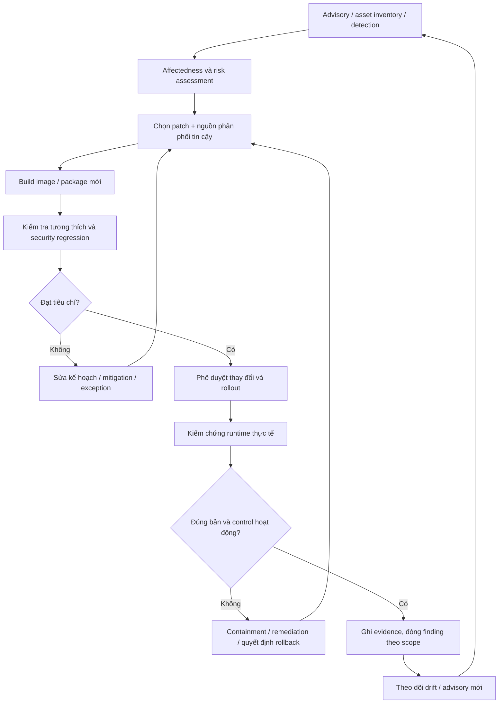

# Patch runtime: cập nhật và chứng minh môi trường thực thi đã được vá

## 1. Patch runtime là gì và vì sao cần quan tâm?

Một nhóm phát triển nền tảng học tập Java phát hiện lỗ hổng trong phiên bản Java Runtime đang chạy ở production. Nhóm thay `pom.xml`, cập nhật một số thư viện rồi chạy Maven test thành công. Công cụ SCA trên mã nguồn không còn cảnh báo liên quan đến các thư viện ứng dụng. Nhưng container production vẫn khởi động bằng bản JDK/JRE cũ có trong base image. Vậy lỗ hổng runtime đã được xử lý chưa?

**Chưa.** Việc nâng cấp dependency ứng dụng không đồng nghĩa đã thay đổi Java Runtime, thư viện native hoặc package hệ điều hành nằm trong container. Ngược lại, tải image mới lên registry cũng chưa chứng minh cluster đã triển khai image đó: workload có thể vẫn chạy image digest cũ, node chưa thay thế hoặc một replica chưa được cập nhật.

**Patch runtime** là quá trình áp dụng và xác minh bản sửa lỗi, cập nhật bảo mật hoặc biện pháp thay thế phù hợp đối với **các thành phần môi trường thực thi** mà ứng dụng phụ thuộc khi đang chạy. Phạm vi có thể gồm Java Virtual Machine (JVM), Java Runtime/JDK, application server, thư viện native, package hệ điều hành, container base image, agent, sidecar và một số lớp nền tảng liên quan.

Điểm đặc biệt của patch runtime là phải trả lời đồng thời hai câu hỏi:

1. **Bản runtime được chọn có thực sự khắc phục vấn đề trong cấu hình áp dụng không?**
2. **Các instance/workload đang phục vụ người dùng có thực sự sử dụng bản đã được kiểm chứng không?**

Trong chương **Patch management** của module **SECURITY_SECURITY_ASSURANCE**, patch runtime là một hoạt động của **security assurance liên tục**: xác định rủi ro và yêu cầu kiểm soát, lựa chọn bản sửa, kiểm thử trước phát hành, theo dõi triển khai, lưu bằng chứng, audit và xử lý những phát hiện còn tồn tại.

### Mục tiêu học tập

Sau bài này, bạn có thể:

1. Phân biệt patch runtime với cập nhật thư viện, rebuild, restart, hot patch và cập nhật hạ tầng.
2. Kiểm kê đúng phiên bản runtime và các lớp phụ thuộc đang chạy trong môi trường đích.
3. Đánh giá patch theo affectedness, khả năng khai thác, impact, tính tương thích và khả năng triển khai.
4. Thiết kế quy trình chuẩn bị, kiểm thử, rolling rollout, xác minh và giám sát bản vá.
5. Phân tích những trường hợp image đã build mới nhưng pod/host vẫn chạy runtime cũ.
6. Lập assurance claims và evidence để chứng minh patch đã được áp dụng đúng phạm vi.
7. Quản lý rủi ro rollback, ngoại lệ, patch khẩn cấp và patch debt.

## 2. Xác định đúng “runtime” trong kiến trúc

Runtime không chỉ là dòng `java -version`. Một ứng dụng Java có nhiều lớp phần mềm thực thi:

| Lớp | Thành phần minh họa | Ví dụ vấn đề cần vá |
|---|---|---|
| **JVM/JDK/JRE** | Java VM, class library của bản phân phối JDK | Lỗi xử lý dữ liệu, TLS, thư viện chuẩn, JVM/JIT |
| **Application server** | Servlet container chạy cùng ứng dụng hoặc server độc lập | Lỗi xử lý HTTP, session, request parsing |
| **Framework/runtime library** | Spring Framework, logging, JSON/XML parser | Lỗ hổng code ứng dụng sử dụng tại runtime |
| **Native library** | OpenSSL hoặc thư viện native được process gọi, JNI | Lỗ hổng trong mã native, native parser, crypto |
| **Base image/container userland** | OS packages, libc, CA bundle và công cụ có trong image | Lỗ hổng package hệ điều hành hoặc trust store |
| **Runtime agent/sidecar** | APM agent, service mesh proxy, secret agent | Lỗ hổng agent hoặc proxy chạy với quyền đáng kể |
| **Container host/node** | Kernel, container runtime, kubelet, OS node | Lỗ hổng ảnh hưởng nhiều workload trên cùng node |
| **Nền tảng điều phối** | Kubernetes control plane, ingress controller, managed services | Lỗi và cấu hình bảo mật của thành phần vận hành |
| **Phần mềm tải động** | Plugin, JAR ngoài image, artifact được nạp lúc chạy | Version bị lệch, thành phần nằm ngoài inventory build |

Không phải mọi thành phần trong bảng đều được cập nhật bởi cùng một nhóm hoặc một thao tác. Ví dụ:

- Thay **JDK trong container image** thường đòi hỏi rebuild và thay image chạy.
- Vá **kernel của node** không được giải quyết bằng cách rebuild JAR; có thể cần cập nhật node hoặc đổi node pool.
- Cập nhật **sidecar service mesh** có thể do nền tảng điều phối quản lý, không theo chu kỳ release ứng dụng.
- Một **Java agent** gắn vào JVM có thể có lifecycle và compatibility requirements riêng.

### Phân biệt các hành động thường bị gọi chung là “patch”

| Hành động | Điều gì thực sự xảy ra? | Có thể kết luận đã vá runtime chưa? |
|---|---|---|
| **Upgrade dependency ứng dụng** | Đổi version thư viện trong build | Chỉ nếu finding thuộc thư viện đó và artifact/runtime đã cập nhật |
| **Rebuild image** | Tạo image mới từ source/base image | Chưa; phải xác minh base layer, digest và deployment |
| **Restart process** | Chạy lại cùng binary/image/config | Thường không thay đổi bản vá nếu các thành phần vẫn cũ |
| **Redeploy cùng tag mutable** | Kéo hoặc dùng lại tag được chỉ định | Chưa; tag không xác định chắc chắn digest mới |
| **Rolling update** | Từng instance được thay bằng bản mới | Chỉ khi tất cả workload thuộc scope dùng đúng bản vá và đạt health/security checks |
| **Host patch** | Cập nhật package/OS trên host | Cần xác minh package đang có hiệu lực và yêu cầu restart/reboot |
| **Live patch / hot patch** | Áp dụng sửa đổi đang khi hệ thống chạy bằng cơ chế hỗ trợ | Chỉ trong phạm vi và điều kiện cơ chế đó bảo đảm; có thể vẫn cần restart |
| **Mitigation** | Giới hạn đường khai thác, tắt tính năng, giảm quyền | Có thể giảm risk nhưng không đồng nghĩa đã sửa runtime |

**Restart không phải patch.** Nếu process khởi động lại với cùng JDK lỗi, kết quả chỉ là một instance mới chạy bản cũ. Ngược lại, nếu package trên host đã thay nhưng process vẫn giữ thư viện cũ đã load, cần đánh giá liệu restart hoặc reboot có cần thiết để bản sửa thực sự có hiệu lực.

## 3. Mục tiêu bảo mật và assurance của patch runtime

Một chương trình patch runtime cần đạt:

1. **Inventory chính xác:** biết thành phần nào đang chạy ở đâu, do ai sở hữu.
2. **Risk-based prioritization:** biết bản nào bị ảnh hưởng và cần xử lý khi nào.
3. **Trusted patch source:** dùng bản phát hành/bản vá từ kênh tin cậy, phù hợp support policy.
4. **Compatibility:** bản mới không phá các security controls hoặc chức năng quan trọng.
5. **Controlled rollout:** quá trình thay thế instance không tạo gián đoạn hoặc mở đường tấn công ngoài dự kiến.
6. **Runtime verification:** xác minh môi trường đang chạy, không chỉ source hoặc image dự kiến.
7. **Traceable evidence:** liên kết advisory → patch decision → build → test → artifact → deployment → observed runtime.
8. **Continuous monitoring:** phát hiện runtime cũ xuất hiện trở lại, drift hoặc advisory mới.



Điều kiện quan trọng: **“đã deploy” và “đã xử lý lỗ hổng” là hai claim khác nhau**. Việc deployment controller báo thành công không chứng minh bản runtime mới loại bỏ điều kiện bị ảnh hưởng, cũng không bảo đảm mọi instance đều chạy đúng.

## 4. Kiểm kê bản runtime thực sự đang chạy

### 4.1. Nguồn thông tin cần đối chiếu

| Nguồn | Giúp xác định | Giới hạn |
|---|---|---|
| `pom.xml` / Gradle manifest | Phiên bản dependency ứng dụng khai báo | Không cho biết JDK và OS package của production |
| Maven dependency tree | Thư viện được resolve cho một build/scope | Không bao phủ mọi package OS, runtime tải động |
| Dockerfile | Cách image được dự định tạo | Tag/base image có thể thay đổi; không chứng minh output đã deploy |
| SBOM của JAR/image | Danh mục thành phần theo scope công cụ | Có thể thiếu native/dynamic assets hoặc sai mapping |
| OCI manifest/image digest | Nội dung image được tham chiếu chính xác | Không tự chứng minh process đang dùng image đó |
| Kubernetes Deployment/Pod spec | Image được khai báo và trạng thái rollout | Cần đối chiếu imageID và các pod thực tế |
| Runtime inspection | Phiên bản process/JDK và package đang có hiệu lực | Phụ thuộc cách kiểm tra, quyền và số instance |
| Host/managed node inventory | Kernel, OS và runtime node | Không suy ra version của mọi container app |
| CMDB/asset inventory | Chủ sở hữu, criticality, môi trường và deployment | Có thể lỗi thời; cần reconcile với thực tế |

Một nguồn thông tin đơn lẻ thường không đủ. Với vấn đề thuộc Java Runtime, nên liên kết ít nhất:

**Service/release → container/image digest → JDK vendor/build trong image → workload đang chạy → advisory/patch status.**

Nếu vulnerability thuộc kernel của node, liên kết cần mở rộng đến **node identity, kernel version, node image/patch level, workloads trên node và trạng thái reboot**.

### 4.2. Xác minh Java Runtime

Ở môi trường được phép, có thể kiểm tra:

```bash
# Đọc phiên bản của executable java được gọi trong môi trường hiện tại.
java -version

# Xem thêm vendor, VM và đường dẫn runtime của lệnh java hiện tại.
java -XshowSettings:properties -version
```

Các kết quả quan trọng gồm Java feature version, bản cập nhật/security update, vendor/distribution, VM build và kiến trúc hệ thống. **Không chỉ so sánh số major version như Java 17 hoặc 21.** Hai bản cùng major có thể khác mức cập nhật bảo mật; các nhà cung cấp cũng có cách đặt version/backport và lịch cung cấp bản sửa khác nhau.

Lệnh `java -version` trong terminal của developer **không chứng minh runtime trong production**. Cần chạy ở đúng workload hoặc thu thập thông tin đáng tin từ inventory/telemetry của process đang chạy.

Đối với ứng dụng đang chạy, cần tránh suy ra runtime từ PATH nếu có nhiều JDK. Có thể dùng thông tin process, startup metadata, runtime diagnostics hoặc cơ chế inventory của nền tảng để đối chiếu executable JVM thực sự được ứng dụng dùng.

### 4.3. Kiểm tra container và pod đang chạy

Các lệnh sau chỉ mang tính **đọc trạng thái**; yêu cầu quyền phù hợp, context/namespace đúng và không nên ghi toàn bộ secret vào log:

```bash
# Xem image được khai báo và trạng thái các pod của service mục tiêu.
kubectl -n learning get deployment grade-service -o wide
kubectl -n learning get pods -l app=grade-service -o wide

# Đọc pod name, image được khai báo và imageID thực tế từng container.
kubectl -n learning get pods -l app=grade-service \
  -o jsonpath='{range .items[*]}{.metadata.name}{"\t"}{range .status.containerStatuses[*]}{.name}{" "}{.image}{" "}{.imageID}{"; "}{end}{"\n"}{end}'
```

Trong Docker/Kubernetes, cần phân biệt image reference theo tag, image digest của registry và `imageID`/runtime identity ở pod. Hình dạng giá trị `imageID` có thể thay đổi theo container runtime; khi kiểm tra multi-platform image, cần xác định digest của image index và từng platform manifest đúng cấp so sánh.

Không kết luận cluster đã vá nếu chỉ xem một pod. Cần kiểm tra mọi replica, namespace/region/tenant deployment thuộc scope và cả workload xử lý nền hoặc job chạy định kỳ có thể dùng image cũ.

### 4.4. Khi container quá tối giản

Distroless hoặc image tối giản có thể không chứa shell, `java` CLI ở PATH hoặc package manager. Không nên bổ sung shell vào production image chỉ để hỗ trợ kiểm tra. Có thể:

- Thu thập version/build metadata và SBOM ở CI bằng cơ chế được kiểm soát.
- Dùng image provenance, digest và manifest/attestation để xác minh nguồn build.
- Dùng inventory/agent hoặc giao diện quản trị đáng tin của nền tảng.
- Đối chiếu config và process information thông qua cơ chế debug có quyền hạn phù hợp, không thay đổi image phát hành.

Mục tiêu là có bằng chứng đáng tin mà không làm tăng bề mặt tấn công của runtime.

## 5. Xác định bản vá có áp dụng cho môi trường hay không

Một cảnh báo scanner chưa đủ để kết luận cần nâng toàn bộ JVM. Đánh giá ban đầu nên làm rõ:

1. **Component identity:** vendor, distribution, package, module hoặc library bị ảnh hưởng.
2. **Affected versions:** dải phiên bản, build, cấu hình và nền tảng được advisory nêu.
3. **Actual presence:** thành phần có nằm trong runtime image, host hoặc agent đang chạy?
4. **Affected function:** tính năng/lớp bị lỗi có được sử dụng hoặc có đường thực thi?
5. **Exposure:** kẻ tấn công có thể tiếp cận từ đâu, cần quyền/điều kiện gì?
6. **Threat signals:** có cảnh báo khai thác, KEV hoặc thông tin khác làm tăng ưu tiên?
7. **Fix availability:** vendor đã phát hành bản vá, bản backport hoặc mitigation nào?
8. **Patch prerequisites:** phiên bản hệ điều hành, CPU architecture, cấu hình, license/support và thay đổi tương thích.

### 5.1. Java Runtime có nhiều distribution

Ứng dụng có thể sử dụng các bản phân phối OpenJDK từ những nhà cung cấp khác nhau. Dù cùng Java major version, chúng có thể khác:

- Chu kỳ phát hành và mức hỗ trợ của vendor.
- Chuỗi version, build number và bản sửa được backport.
- Phạm vi package/binary đi kèm.
- Chứng thư CA/truststore, cơ chế crypto và cấu hình mặc định.
- Yêu cầu platform/OS architecture và phạm vi kiểm thử.

Vì vậy cần đối chiếu **advisory của đúng nhà cung cấp/bản phân phối và binary thực tế**. Không kết luận một package còn dễ tổn thương chỉ từ số version ngắn nếu vendor đã backport patch; ngược lại không kết luận an toàn chỉ vì tên tag trông mới.

### 5.2. Các chỉ số hỗ trợ ưu tiên

| Tín hiệu | Ý nghĩa | Điều không được suy ra |
|---|---|---|
| **CVE/advisory** | Xác định lỗ hổng, phiên bản và hướng xử lý | Mọi runtime đều bị ảnh hưởng như nhau |
| **CVSS** | Mức nghiêm trọng kỹ thuật theo metric và phiên bản scoring | Xác suất service sẽ bị khai thác |
| **EPSS** | Ước lượng xác suất CVE bị khai thác thực tế trong khoảng dự báo của mô hình | Xác suất riêng cho workload của tổ chức |
| **CISA KEV** | Tín hiệu CVE đã có khai thác thực tế theo tiêu chí danh mục | Service đã bị xâm nhập |
| **Vendor patch notes** | Bản đã sửa, thay đổi, yêu cầu và hướng dẫn | Patch đã triển khai trên hệ thống của tổ chức |
| **Inventory/exposure** | Những service/instance nằm trong phạm vi ảnh hưởng | Không có đường bypass hoặc thành phần tải động |
| **Incident/runtime telemetry** | Dấu hiệu tấn công hoặc hoạt động bất thường | Không có log nghĩa là không có tấn công |

Ưu tiên remediation dựa trên **rủi ro thực tế**, không chỉ một điểm CVSS hoặc mức độ ồn của scanner. Với hệ thống nhiều tenant xử lý dữ liệu điểm thi, một lỗ hổng có thể dẫn tới đọc dữ liệu ngoài quyền hoặc làm gián đoạn kỳ thi có thể cần xử lý gấp hơn một finding chỉ tác động môi trường test ít đặc quyền.

## 6. Quy trình patch runtime theo vòng đời

### Bước 1 — Tiếp nhận cảnh báo và lập phạm vi

Nhận advisory, báo cáo scanner, sự cố hoặc phát hiện từ vendor. Gắn finding với service, môi trường, owner, runtime build, image digest/node và dữ liệu nhạy cảm liên quan.

### Bước 2 — Xác minh affectedness và đánh giá rủi ro

Đối chiếu phiên bản, cấu hình, exploitability, threat signals và business impact. Đánh giá ảnh hưởng nếu vá trễ cũng như nguy cơ gián đoạn nếu cập nhật.

### Bước 3 — Chọn nguồn bản vá và chiến lược triển khai

Chọn vendor distribution/version có hỗ trợ, xác minh nguồn download/image, signature/digest nếu áp dụng. Xác định patch **application image**, **node**, **agent/sidecar** hay phối hợp nhiều lớp.

### Bước 4 — Đánh giá thay đổi tương thích

Đọc release notes/security notes và những thay đổi có thể ảnh hưởng TLS, crypto, truststore, bytecode, reflection, GC, JNI, serialization, timezone, performance và ứng dụng.

### Bước 5 — Build artifact mới và tạo inventory

Rebuild theo source/recipe đã duyệt, quản lý dependency, lưu artifact digest, SBOM, provenance và bản ghi kết quả kiểm tra. Tránh sửa trực tiếp container đang chạy theo cách không thể tái hiện.

### Bước 6 — Kiểm thử trước triển khai

Chạy unit/integration/security regression, kiểm tra kết nối và nghiệp vụ trọng yếu, review cấu hình bảo mật, fault/recovery tests phù hợp. Nếu patch node, dùng môi trường hoặc node canary để kiểm chứng tương thích workload.

### Bước 7 — Phê duyệt và rollout có kiểm soát

Xác định window, khả năng rollback/roll forward, canary hoặc rolling rollout, điều kiện dừng, giám sát và người chịu trách nhiệm.

### Bước 8 — Kiểm chứng runtime thực tế

Đối chiếu digest, runtime version/build và số lượng replica/nodes đã cập nhật, kiểm tra controls và health của bản mới, xác nhận không còn instance cũ ngoài scope ngoại lệ.

### Bước 9 — Ghi evidence và quản lý finding

Chỉ đóng finding khi tiêu chí đã được xác minh. Ghi kết quả, phạm vi còn sót, quyết định risk và đường truy vết từ advisory đến deployment.

### Bước 10 — Giám sát liên tục

Theo dõi runtime drift, thay đổi image/node pool, advisory mới, instance cũ khởi động lại, việc thay đổi release policy và exception hết hạn.

**Patch management không kết thúc ở “pipeline xanh”.** Nó kết thúc ở mức claim đã xác minh cho phiên bản runtime thực tế, đồng thời chuyển sang giám sát liên tục.

## 7. Thiết kế strategy cho các lớp runtime

| Phạm vi patch | Cách tiếp cận thường gặp | Rủi ro vận hành cần xét | Bằng chứng trọng tâm |
|---|---|---|---|
| JDK/JRE trong image | Chọn base image mới, rebuild application image và redeploy | Compatibility, memory/GC, TLS, startup | Vendor/build version, image digest, pod runtime |
| OS package trong image | Rebuild từ image base đã vá; quét image cuối | Native dependency ABI, thiếu package, architecture | SBOM/image scan và deployed digest |
| Application server nhúng | Cập nhật dependency/server, build và test | Session, HTTP handling, API change | Resolved dependency, regression, artifact scan |
| Native/JNI component | Nâng native package và Java binding khi cần | ABI, load path, crash, platform-specific behavior | Runtime loaded module/version, tests |
| Agent/sidecar | Cập nhật agent/proxy theo lifecycle của nền tảng | Telemetry, TLS, network, overhead | Sidecar/agent version của từng pod |
| Node OS/kernel | Thay hoặc cập nhật node, kiểm tra reboot/patch level | Workload disruption, PDB, capacity, storage/network | Node image/kernel, rollout, scheduling |
| Container runtime/Kubelet | Cập nhật theo platform lifecycle | Ảnh hưởng đa workload, tương thích cluster | Node agent/runtime inventory, node tests |
| Managed platform | Tuân theo kênh update/maintenance của nhà cung cấp | Shared responsibility, version drift | Provider evidence, observed config, acceptance tests |

**Ranh giới trách nhiệm phải rõ.** Với managed Kubernetes, nhà cung cấp có thể chịu một phần trách nhiệm điều khiển nền tảng, nhưng đội vận hành vẫn có thể cần quản lý node pools, runtime images, sidecars và các yêu cầu kiểm chứng riêng.

### 7.1. Không vá “in place” khi có thể thay artifact bất biến

Trong môi trường container, cách tiếp cận đáng ưu tiên là tạo image mới và thay các instance dùng image cũ, thay vì cài package trực tiếp trong container đang chạy. Lý do:

- Dễ liên kết patch với source, build, SBOM và digest.
- Dễ tái hiện, audit và rollback có kiểm soát.
- Tránh image mới và trạng thái runtime bị lệch.
- Khả năng phát hiện workload chưa cập nhật tốt hơn.

Tuy nhiên tính bất biến của image **không đồng nghĩa** patch đã có hiệu lực trên node hoặc mọi lớp động; cần xác minh từng loại finding.

### 7.2. Hot patch/live patch

Một số nền tảng có cơ chế cập nhật mã hoặc kernel khi hệ thống đang chạy. Điều đó không có nghĩa mọi lỗ hổng JDK hoặc OS đều có thể vá mà không restart. Khi dùng cơ chế hot patch:

1. Vendor có hỗ trợ bản vá cho đúng phiên bản và môi trường không?
2. Cơ chế áp dụng lên lớp nào: kernel, process hay library?
3. Có yêu cầu agent/privilege đặc biệt hoặc hạn chế support?
4. Có bằng chứng patch thực sự active, không chỉ “installed”?
5. Sau một lần restart/reboot, bản vá còn áp dụng đúng không?
6. Có kịch bản rollback và sự cố nếu patch thất bại không?

Đừng dùng từ “hot patch” để quảng bá cho một thao tác thay binary rồi restart process. Hai cơ chế có giả định và bằng chứng khác nhau.

## 8. Ví dụ Java/Spring Boot: chọn JDK mới và rebuild image

Giả sử `grade-service` chạy Java trong container image, phục vụ dữ liệu kết quả thi. Scanner cảnh báo về một thành phần Java Runtime đã có bản sửa từ vendor. Nhóm lựa chọn bản JDK được hỗ trợ, rebuild image và triển khai theo digest.

### 8.1. Dockerfile minh họa

```dockerfile
# Ví dụ khái niệm: thay <verified-base-digest> bằng digest thật
# của bản base image đã được phê duyệt.
FROM eclipse-temurin:21-jre@sha256:<verified-base-digest>

# Đường dẫn JAR là ví dụ; artifact phải được build/test trước bước này.
WORKDIR /app
COPY --chown=10001:10001 target/grade-service.jar /app/grade-service.jar

USER 10001:10001
EXPOSE 8080
ENTRYPOINT ["java", "-jar", "/app/grade-service.jar"]
```

Đây **không phải Dockerfile chạy nguyên văn**, vì digest và tên JAR là placeholder. Một pipeline production cần xác minh nguồn image, digest và cách đưa JAR đã được kiểm thử vào build. Tùy thiết kế, việc pin digest phải đi kèm quy trình **chủ động cập nhật** digest đã vá; pin một digest cũ vô thời hạn cũng giữ nguyên lỗ hổng.

### 8.2. Điều gì phải kiểm tra ở bản base image mới?

| Hạng mục | Câu hỏi |
|---|---|
| Vendor/build | Đúng phân phối JDK, phiên bản update và security patch được thông báo? |
| OS architecture | Có đúng linux/amd64, linux/arm64 hoặc architecture của node? |
| OS userland | Các package và thư viện native có được sửa theo yêu cầu? |
| Truststore | Chứng chỉ CA, thuật toán và TLS policy thay đổi có gây lỗi tích hợp? |
| JVM behavior | Khởi động, memory, GC, JIT, reflection hoặc module access có thay đổi? |
| File permissions | Non-root, filesystem quyền tối thiểu và thư mục cần ghi còn hoạt động? |
| Security agents | APM, profiling, service mesh và native integrations tương thích? |
| SBOM/SCA | Artifact mới có đủ inventory và không tái đưa bản lỗi vào image? |
| Provenance | Builder, source, workflow và output digest có thể truy vết? |

Một bản cập nhật JDK có thể ảnh hưởng hệ thống dù không thay API ứng dụng. Ví dụ thay đổi truststore hoặc mặc định thuật toán có thể khiến việc kết nối tới một service cũ thất bại. Test kết nối TLS/authorization quan trọng phải nằm trong kế hoạch patch, thay vì chỉ chạy unit tests tách biệt.

### 8.3. Đừng bỏ qua Java Runtime bên trong image

Thư viện Java được đóng trong JAR và Java Runtime được cài trong image là hai nguồn cập nhật khác nhau. Ví dụ khi chạy `mvn dependency:tree`, không nhất thiết sẽ thấy toàn bộ thành phần của JDK hoặc OS. Với lỗ hổng Java Runtime, cần sử dụng **metadata của runtime image và bản phân phối**, đồng thời kiểm chứng runtime thực sự được khởi chạy.

Nếu dùng image build multi-stage, phải xác định **stage runtime cuối**. Việc nâng compiler JDK ở builder stage không bảo đảm JRE ở final stage được nâng. Ngược lại, nâng JRE ở final stage không tự vá các build plugins có vấn đề ở build stage; chúng thuộc rủi ro chuỗi cung ứng riêng.

## 9. Quy trình rolling update và canary rollout

Patch runtime có thể cần restart hoặc thay instance. Việc triển khai phải tránh tạo ra khoảng trống bảo mật hoặc gián đoạn nghiệp vụ.

### 9.1. Những chiến lược phổ biến

| Chiến lược | Đặc điểm | Phù hợp khi |
|---|---|---|
| **Rolling update** | Thay dần replica cũ bằng replica mới | Dịch vụ stateless hoặc có readiness và capacity tốt |
| **Canary** | Chỉ chuyển một tỷ lệ nhỏ lưu lượng/instance sang bản vá | Cần quan sát regression trước rollout rộng |
| **Blue-green** | Chuẩn bị môi trường mới rồi chuyển lưu lượng | Có đủ hạ tầng và khả năng đồng bộ trạng thái |
| **Maintenance window** | Dừng hoặc giảm tải có kế hoạch để cập nhật | Ứng dụng khó zero-downtime, yêu cầu đặc biệt |
| **Node replacement/drain** | Thay node hoặc đẩy workload sang node đã vá | Patch kernel, container runtime hoặc host OS |
| **Emergency mitigation** | Giới hạn đường tấn công trong khi chuẩn bị patch | Không thể triển khai bản sửa ngay hoặc rủi ro đang tăng |

Không một chiến lược nào mặc nhiên an toàn hơn trong mọi hệ thống. Canary có thể làm tăng thời gian bản lỗi vẫn chạy; blue-green có thể khiến dữ liệu hoặc policy drift giữa hai môi trường. Đánh giá cần dựa trên tốc độ khai thác, nguy cơ regression, khả năng chuyển tải, statefulness và kế hoạch rollback.

### 9.2. Ví dụ cấu hình Kubernetes Deployment

```yaml
# Mẫu cấu hình mang tính minh họa, chưa phải manifest deploy hoàn chỉnh.
apiVersion: apps/v1
kind: Deployment
metadata:
  name: grade-service
  namespace: learning
spec:
  replicas: 4
  strategy:
    type: RollingUpdate
    rollingUpdate:
      maxSurge: 1
      maxUnavailable: 0
  selector:
    matchLabels:
      app: grade-service
  template:
    metadata:
      labels:
        app: grade-service
    spec:
      containers:
        - name: grade-service
          image: registry.example.org/learning/grade-service@sha256:<approved-digest>
          ports:
            - containerPort: 8080
          readinessProbe:
            httpGet:
              path: /actuator/health/readiness
              port: 8080
            initialDelaySeconds: 5
            periodSeconds: 10
          livenessProbe:
            httpGet:
              path: /actuator/health/liveness
              port: 8080
            periodSeconds: 20
```

**Mẫu này chứa placeholder, chưa bao gồm toàn bộ tài nguyên, quyền, securityContext, startupProbe, resources, network policies hay policy quản trị endpoint.** Các actuator health endpoints cần được cấu hình/phân quyền phù hợp và không làm lộ chi tiết nội bộ. Các giá trị `maxSurge` và `maxUnavailable` phải xem xét tài nguyên dự phòng, yêu cầu sẵn sàng và tình trạng workload; không tự bảo đảm zero downtime.

### 9.3. Kiểm tra rollout và instance

```bash
# Theo dõi trạng thái rollout trong đúng namespace.
kubectl -n learning rollout status deployment/grade-service

# Quan sát pod và imageID thực tế.
kubectl -n learning get pods -l app=grade-service -o wide

# Kiểm tra revision, sự kiện và nguyên nhân không ready nếu có.
kubectl -n learning describe deployment grade-service
```

`kubectl rollout status` thành công là **một bằng chứng vận hành**, nhưng chưa đủ chứng minh CVE đã được sửa. Cần so phiên bản JDK/OS package và digest của **tất cả instance trong scope**, cũng như xác minh test bảo mật và cấu hình quan trọng sau deploy.

### 9.4. Drain node để patch kernel/OS

Trong Kubernetes, drain node có thể làm gián đoạn các workload nếu không đáp ứng điều kiện scheduling, capacity và PodDisruptionBudget (PDB). Một patch plan cần kiểm tra:

- Có node đích đủ tài nguyên cho workload được di chuyển?
- PDB và số replica có cho phép eviction không?
- StatefulSets, local storage hoặc workload singleton xử lý ra sao?
- Có đúng thứ tự patch, reboot và kiểm tra version/kernel không?
- Các thành phần mạng/storage/CSI/CNI có tương thích?
- Sau node replacement, service có đủ ready endpoints và không phát sinh drift?

Không nên áp dụng drain/reboot hàng loạt vào production chỉ dựa trên ví dụ lệnh. Đây là hoạt động thay đổi hạ tầng có thể gây gián đoạn; cần kế hoạch triển khai, phê duyệt, giám sát và quy trình khôi phục.

## 10. Kiểm thử trước khi patch vào production

### 10.1. Kiểm thử chức năng và tương thích

| Nhóm kiểm thử | Điều cần chứng minh |
|---|---|
| **Startup/smoke** | JVM khởi động, cấu hình và health checks đúng trên image mới |
| **Unit/integration** | Luồng nghiệp vụ không bị phá bởi runtime update |
| **Authentication/authorization** | JWT/OIDC, quyền tenant và object permission hoạt động |
| **TLS/crypto** | Kết nối HTTPS, mTLS, truststore, cipher/protocol đáp ứng policy |
| **Database/messaging** | JDBC, transaction, serialization và queue tương thích |
| **Native/agent** | JNI, image processing, APM/observability không crash hoặc bỏ qua kiểm soát |
| **Data integrity** | Không mất/sai dữ liệu, transaction và batch xử lý nhất quán |
| **Performance/capacity** | CPU, memory, GC pauses, latency, throughput trong ngưỡng chấp nhận |
| **Resilience** | Retry, timeout, failover, pod termination/graceful shutdown đúng |
| **Security regression** | Các negative tests trọng yếu vẫn từ chối truy cập trái phép |
| **SBOM/SCA/artifact scan** | Phiên bản bị ảnh hưởng không còn trong artifact theo phạm vi xác minh |
| **Rollback/roll forward readiness** | Kịch bản khôi phục có thể thực hiện theo điều kiện đã duyệt |

Thử nghiệm nên sát môi trường thực tế về Java vendor, base image, kernel, network policy, kiến trúc CPU và dữ liệu đặc trưng. Nhưng **staging pass không chứng minh production không có khác biệt**; cần đối chiếu drift và kiểm tra sau triển khai.

### 10.2. Các trường hợp đặc biệt của Java Runtime

- **JDK update:** thuật toán mã hóa, truststore, certificate validation, security properties có thể thay đổi.
- **GC/JIT:** tài nguyên và latency có thể khác dưới tải thật.
- **Timezone/locale:** một số xử lý thời gian, lịch học/thi có thể chịu ảnh hưởng nếu runtime data thay đổi.
- **Serialization/bytecode:** thư viện dùng reflection hoặc bytecode instrumentation có thể cần kiểm tra.
- **JNI/native access:** phụ thuộc ABI và thư viện OS; cần test trên đúng architecture.
- **Java agent:** patch runtime có thể tương tác khác với profiler, security/monitoring agent.
- **Container memory limits:** cấu hình heap và giới hạn container cần đối chiếu tránh OOM.

Một patch chủ yếu để bảo mật vẫn có thể gây sự cố nghiệp vụ. Kiểm thử tương thích nhằm **giảm rủi ro thay đổi**, không phải lý do trì hoãn vô hạn một lỗ hổng có khai thác thực tế.

## 11. Ví dụ xuyên suốt: vá Java Runtime của grade-service

### 11.1. Tình huống giả định

Hệ thống quản lý kết quả thi dùng Spring Boot, PostgreSQL và Kubernetes. Các API xử lý thông tin người học nhiều tenant. Một advisory giả định thông báo bản JDK đang chạy có một lỗi liên quan đến xử lý dữ liệu đầu vào trong cấu hình cụ thể. Nhà cung cấp đã có bản update được hỗ trợ.

**Không có CVE hoặc số phiên bản lỗi có thật nào được khẳng định trong tình huống này.** Đây là ví dụ quy trình để tránh suy diễn sai rằng một version cụ thể đang có lỗ hổng.

Giả sử:

- Ứng dụng gồm 4 pod trong namespace `learning`.
- Bản deploy hiện tại dùng image digest `D-OLD`; image chứa runtime build `R-OLD`.
- Pipeline mới tạo image digest `D-NEW` với runtime build `R-FIXED`.
- Dịch vụ có các yêu cầu không lộ kết quả xuyên tenant và duy trì khả năng phục vụ trong kỳ thi.

### 11.2. Triage trước khi nâng

| Câu hỏi | Điều cần làm | Evidence |
|---|---|---|
| Bản nào bị ảnh hưởng? | Đối chiếu vendor advisory với JDK distribution/build trong image | Advisory, runtime inventory |
| Có ở production không? | Đọc image digest và runtime đang chạy trên mọi pod | Pod/image status, SBOM, runtime metadata |
| Có đường khai thác không? | Xem đầu vào, endpoint, quyền, điều kiện cấu hình | DFD, logs, code/config review |
| Có bản sửa phù hợp không? | Chọn release được hỗ trợ cho đúng OS/architecture | Vendor patch note, image source/digest |
| Có nguy cơ gián đoạn? | Xem traffic kỳ thi, readiness, session state, capacity | SLO, traffic pattern, rollout plan |
| Có biện pháp tạm thời? | Nếu patch chưa thể triển khai, giới hạn exposure theo risk | Verified mitigation, exception nếu cần |

### 11.3. Chuỗi build và evidence

```text
Advisory / Finding F-JDK-01 (giả định)
         |
         v
Risk assessment: grade-service, production, 4 pods, runtime R-OLD
         |
         v
Approved patch target R-FIXED
         |
         v
Reviewed Dockerfile/base image digest + trusted build
         |
         v
Security tests + compatibility tests + image/SBOM scan
         |
         v
Image artifact D-NEW + provenance + release approval
         |
         v
Canary / rolling update
         |
         v
Observe each pod imageID + runtime R-FIXED
         |
         v
Verify authz/TLS/health/performance + monitoring
         |
         v
Close F-JDK-01 for verified scope; retain evidence
```

Nếu scanner vẫn báo phiên bản cũ ở một pod, finding chưa thể đóng hoàn toàn cho scope `grade-service production`. Cần xem pod đó thuộc rollout chưa hoàn tất, Job cũ, deployment khác hoặc kiểm tra version đang so nhầm lớp artifact.

### 11.4. Kịch bản lỗi sau patch

Khi triển khai `D-NEW`, readiness của hai pod mới không đạt vì TLS handshake tới một dịch vụ tích hợp cũ thất bại. Hệ thống không nên tự xem patch “thành công” chỉ vì image mới đã được push.

Quy trình:

1. Giữ rollout trong giới hạn đã duyệt; theo dõi capacity của pod còn ready.
2. Thu thập lỗi TLS đã được giảm nhạy cảm, phiên bản JDK, cấu hình truststore và endpoint bị ảnh hưởng.
3. Xác định nguyên nhân do bản runtime mới, cấu hình sai, chứng thư không hợp lệ hoặc thiết kế tích hợp cũ.
4. Đánh giá lựa chọn sửa cấu hình/đối tác, roll forward hay rollback có điều kiện.
5. **Không** vô hiệu hóa certificate validation hoặc bật giao thức yếu chỉ để “đưa dịch vụ lên nhanh” mà không có đánh giá rủi ro và thẩm quyền.
6. Chạy lại security regression và deployment checks sau mỗi thay đổi.
7. Ghi rõ thời gian instance cũ còn hoạt động và residual risk trong giai đoạn xử lý.

Đây là ví dụ quan trọng về **patch risk**: sửa một lỗ hổng không được làm mất hiệu lực các security controls khác.

## 12. Rollback không phải luôn là phương án an toàn

Trong thay đổi thông thường, rollback là một phương án khôi phục. Với bản vá bảo mật, rollback về phiên bản dễ tổn thương có thể làm mở lại đường khai thác.

### Ma trận lựa chọn khi patch gây lỗi

| Điều kiện | Hướng cân nhắc | Evidence/approval cần có |
|---|---|---|
| Bản mới lỗi nhẹ, có thể sửa cấu hình an toàn | Roll forward/patch forward | Test cấu hình, monitor, xác minh security control |
| Bản mới làm mất khả năng phục vụ trọng yếu | Containment và đánh giá khôi phục | SLO, blast radius, risk owner, rollback/forward criteria |
| Bản cũ có lỗ hổng đang bị khai thác | Tránh quay lại không kiểm soát; ưu tiên giảm exposure hoặc bản sửa khác | Threat signals, mitigation tests, phê duyệt khẩn |
| Bản cũ có risk được chấp nhận có điều kiện tạm thời | Rollback giới hạn phạm vi/thời gian theo policy | Exception, owner, expiry, monitoring và kế hoạch patch lại |
| Dữ liệu/schema đã được migrate không tương thích | Có thể không thể rollback ứng dụng an toàn | Migration plan, data integrity validation, recovery |
| Có nhiều image versions cùng chạy | Kiểm soát mixed-version behavior và trạng thái | Compatibility tests, routing, pod inventory |

Rollback cần được thiết kế **trước** khi triển khai, đặc biệt khi thay đổi runtime kéo theo schema hoặc crypto defaults. Không nên tự động trả production về image lỗi chỉ vì health check không đạt mà không xét lỗ hổng và mức tác động.

### 12.1. Trạng thái patch rõ ràng

| Trạng thái | Khi dùng |
|---|---|
| **IDENTIFIED** | Có finding/advisory, chưa kết luận affectedness |
| **AFFECTED_CONFIRMED** | Runtime và điều kiện ảnh hưởng được xác minh |
| **PATCH_PLANNED** | Đã chọn patch và kế hoạch test/rollout |
| **PATCH_BUILT** | Có artifact mới nhưng chưa deploy |
| **PATCH_TESTED** | Kiểm thử trước deploy đạt trong phạm vi được ghi |
| **ROLLOUT_IN_PROGRESS** | Một phần instance đang cập nhật |
| **DEPLOYED_NOT_VERIFIED** | Deployment khai báo hoàn tất nhưng chưa chứng minh runtime/control |
| **PATCH_VERIFIED** | Mọi đối tượng trong scope được xác nhận chạy bản đã sửa và đạt tiêu chí |
| **MITIGATED_PENDING_PATCH** | Có control tạm, lỗ hổng chưa được vá đầy đủ |
| **EXCEPTION_APPROVED** | Residual risk có thẩm quyền chấp nhận theo điều kiện |
| **FAILED_ROLLOUT / ROLLED_BACK** | Có sự cố/khôi phục; phải ghi lại risk và trạng thái thực tế |

Nhãn là ví dụ để tổ chức triển khai quy trình. Điều quan trọng là không nhập nhằng **đã build**, **đã deploy** và **đã xác minh vá hoàn tất**.

## 13. Kiểm chứng post-deployment: chứng minh bản vá đang có hiệu lực

### 13.1. Các kiểm tra tối thiểu

1. **Deployment identity:** revision, image digest và artifact thực tế khớp release được duyệt.
2. **Runtime build/version:** process/JDK hoặc OS/agent thực sự ở bản đã sửa.
3. **Coverage:** toàn bộ pod, node, tenant environment, region, worker và scheduled jobs thuộc scope.
4. **Affectedness:** binary/config cuối không còn nằm trong điều kiện bị ảnh hưởng theo advisory/vendor.
5. **Security controls:** authorization, TLS, logging, secret handling và các control liên quan vẫn đạt.
6. **Functional correctness:** service đáp ứng yêu cầu nghiệp vụ và SLO được chấp nhận.
7. **Monitoring:** alert, telemetry, logs và rollback triggers hoạt động.
8. **Residual risk:** phần chưa vá/chưa kiểm tra có owner và quyết định rõ ràng.

### 13.2. Không nhầm “image pull” với runtime process

Một node có thể tải image mới nhưng pod cũ vẫn chạy. Một pod có thể dùng image digest mới nhưng bên trong chứa JDK cũ do Dockerfile build sai hoặc cache. Một Java process có thể nạp plugin/JAR động từ volume ngoài image. Do đó:

**Thực hiện deploy → quan sát instance → kiểm tra thành phần thực thi → đối chiếu advisory → lưu evidence.**

Việc xác minh cần dựa trên cơ chế an toàn, có quyền phù hợp và ít làm ảnh hưởng production. Nếu không thể truy cập trực tiếp process vì image tối giản, dùng inventory/provenance/attestation kết hợp kiểm tra workload có cơ sở, rồi ghi rõ những giả định còn lại.

### 13.3. Drift và tự động thay pod

Sau patch, hệ thống autoscaling, rollback controller, CronJob hoặc node replacement có thể tạo lại instance cũ nếu template vẫn tham chiếu image lỗi. Vì vậy:

- Cập nhật **source-of-truth** của cấu hình triển khai (GitOps/IaC/Helm chart nếu dùng).
- Kiểm tra tất cả template, CronJob và workflow dùng runtime image.
- Thiết lập policy/admission để ngăn digest đã bị cấm quay lại.
- Theo dõi image/runtime inventory và phát hiện drift.
- Xem lại exception khi một workload mới được tạo ngoài phạm vi đã phê duyệt.

“Đã thay pod hôm nay” không đủ để khẳng định “ngày mai không còn runtime lỗi”.

## 14. Assurance claims cho patch runtime

Một lời khẳng định như “hệ thống đã được vá hoàn toàn” quá rộng. Cần chia thành claim có phạm vi, tiêu chí và evidence.

| Claim | Acceptance criteria | Evidence phù hợp |
|---|---|---|
| **CLM-01: Phạm vi runtime được kiểm kê** | Service, image, node, agent và owner đủ cho finding | Asset inventory, SBOM, cluster/node inventory |
| **CLM-02: Bản đang chạy được nhận diện đúng** | Vendor/build/digest thực tế gắn với từng workload | Runtime metadata, observed imageID, node version |
| **CLM-03: Bản vá giải quyết finding** | Patch target nằm ngoài affected range hoặc có backport evidence | Vendor advisory, release notes, package patch evidence |
| **CLM-04: Artifact vá được tạo từ nguồn tin cậy** | Build, source và input có thể truy vết | Build log, provenance, artifact digest, registry policy |
| **CLM-05: Tương thích và security controls được kiểm thử** | Test trọng yếu đạt trên image/bản phù hợp | Test suite, SCA, TLS/authz regression, performance smoke |
| **CLM-06: Rollout bao phủ toàn bộ scope** | Mọi replica/node thuộc scope đã cập nhật hoặc có ngoại lệ | Deployment history, pod/node reports, rollout record |
| **CLM-07: Runtime patch thực sự có hiệu lực** | Phiên bản/patch level của process hoặc host đúng theo yêu cầu | Runtime inspection, diagnostics, reboot verification |
| **CLM-08: Không suy giảm bảo mật do patch** | Không mở giao thức yếu, bỏ logging hoặc giảm kiểm tra quyền | Config diff, security regression, observability |
| **CLM-09: Residual risk được quản trị** | Finding còn lại có owner, hạn, mitigation/approval | Risk register, exception record, kiểm tra controls |
| **CLM-10: Drift được phát hiện sau deploy** | Image cũ bị ngăn hoặc phát hiện khi tái xuất hiện | Admission policy, alert, inventory reconciliation |

### 14.1. Một assurance case rút gọn

```text
GOAL: Grade-service production không còn chạy Java Runtime
      bị ảnh hưởng bởi finding F-JDK-01 trong phạm vi 4 replicas
  |
  +-- CLAIM A: Patch target của vendor xử lý finding
  |     +-- EVIDENCE: Vendor advisory + runtime build information
  |
  +-- CLAIM B: Image được phát hành chứa runtime target
  |     +-- EVIDENCE: SBOM + base image digest + build provenance
  |
  +-- CLAIM C: Image đã qua kiểm thử tương thích và bảo mật
  |     +-- EVIDENCE: CI test results + negative authorization/TLS tests
  |
  +-- CLAIM D: Mọi production pod trong scope chạy image đã duyệt
  |     +-- EVIDENCE: Pod imageID/revision + runtime version per instance
  |
  +-- CLAIM E: Patch không làm suy yếu controls quan trọng
  |     +-- EVIDENCE: Post-deploy checks + monitoring + security review
  |
  +-- ASSUMPTION: Không còn runtime/plugin tải động ngoài inventory
  +-- LIMITATION: Node kernel patch được quản lý bằng change riêng
```

Khi limitation có thể làm claim sai, cần thu hẹp phạm vi hoặc kiểm chứng bổ sung. Ví dụ sửa Java Runtime không cho phép kết luận kernel của mọi node đã được vá.

### 14.2. Evidence cần có provenance và freshness

Bằng chứng tốt nên lưu:

- Finding/CVE/advisory, product, vendor/build affected và patch target.
- Asset, environment, tenant/region scope, owner và thời điểm xác minh.
- Source commit, Dockerfile/recipe revision, JDK/base image reference và digest.
- CI run ID, test, scan, SBOM, provenance và artifact digest mới.
- Release approval, change record, rollout window, từng instance đang chạy.
- Test kết quả trước/sau, security regression và trạng thái health.
- Finding/exception còn mở, người phê duyệt, thời hạn và hành động tiếp theo.

Lưu evidence ở nơi có phân quyền và retention phù hợp, không ghi token registry, secret hoặc dữ liệu người học vào báo cáo public.

## 15. Negative tests và fault injection cho quy trình patch

Không chỉ kiểm tra đường thành công. Để khẳng định patch process hiệu quả, cần thử các tình huống sai trong môi trường được phép.

| Test | Thiết lập | Kết quả mong đợi |
|---|---|---|
| **Old runtime remains** | Một replica vẫn dùng digest/JDK cũ | Patch coverage báo chưa hoàn tất, finding chưa đóng |
| **Wrong base image** | Pipeline build JAR mới nhưng Dockerfile dùng JRE cũ | SCA/SBOM hoặc policy phát hiện, release gate chặn |
| **Mutable tag drift** | Tag trỏ image khác digest đã duyệt | Verification/admission không chấp nhận digest mới |
| **Sidecar omitted** | App đã vá nhưng proxy/agent còn version bị ảnh hưởng | Inventory ghi partial coverage; tạo finding riêng |
| **Node not rebooted** | Host cài package mới nhưng kernel cũ còn hoạt động | Xác minh running kernel không đạt, node patch chưa hoàn tất |
| **Canary authz regression** | JVM update gây lỗi control hoặc cấu hình auth | Negative tests fail, rollout dừng/escalate |
| **TLS incompatibility** | Endpoint phụ thuộc certificate/algorithm cũ | Phát hiện trong integration test, không tắt validation vô điều kiện |
| **Pod restart with old template** | Autoscaler tạo pod từ image lỗi | Admission/inventory cảnh báo, chặn tái xuất hiện |
| **Version backport ambiguity** | Distro version string trông cũ nhưng vendor có backport | Không tự false positive/negative; lưu vendor evidence |
| **Scanner data stale** | Scanner dùng advisory database cũ | Ghi phạm vi, update dữ liệu và đánh giá lại |
| **Release verification skipped** | Deploy bypass yêu cầu bằng chứng | Policy chặn hoặc có audit/exception đúng thẩm quyền |
| **Rollback to vulnerable version** | Thử khôi phục image cũ trong môi trường test | Trigger cảnh báo và yêu cầu risk decision |
| **Patch only staging** | Staging có image mới, production vẫn cũ | Không đóng finding production |
| **Patch beyond support boundary** | Dùng JDK hoặc OS distribution không còn support | Gate hoặc review phát hiện; chọn target được hỗ trợ |

### 15.1. Kiểm tra cả controls nghiệp vụ

Ví dụ một patch JVM ảnh hưởng serialization hoặc HTTP stack. API có thể vẫn trả 200 cho request hợp lệ nhưng bắt đầu trả dữ liệu tenant khác trong một đường cache hiếm. Do đó test patch nên ưu tiên **negative security regression** theo risk: token sai, cross-tenant access, quyền đã bị thu hồi, input bất thường, transaction integrity, audit logging và lỗi TLS.

### 15.2. Failure injection phải có ranh giới

Khi thử kill pod, mất network, lỗi DNS, service timeout hoặc node drain, cần:

- Dùng môi trường test hoặc phạm vi production được ủy quyền rõ.
- Xác định blast radius, điều kiện dừng và khả năng khôi phục.
- Không cố tình gây gián đoạn kỳ thi hoặc hoạt động nhạy cảm ngoài kế hoạch.
- Ghi expected/actual, thời điểm, build và thay đổi cấu hình.
- Xác nhận trạng thái sau test được khôi phục, không để lại policy yếu.

Kết quả fault injection chỉ chứng minh hành vi trong điều kiện đã thử; không tự đảm bảo mọi dạng lỗi thực tế đều được kiểm soát.

## 16. Patch khẩn cấp và patch window

Thời hạn patch không nên chỉ phụ thuộc vào lịch bảo trì cố định. Khi có lỗ hổng đã bị khai thác thực tế hoặc tài sản critical phơi lộ lớn, có thể cần phản ứng khẩn.

### Mô hình ưu tiên rủi ro

| Tiêu chí | Câu hỏi |
|---|---|
| **Known exploitation** | Có tín hiệu KEV, khai thác thực tế hoặc cảnh báo liên quan không? |
| **Exploitability** | Actor nào có thể đạt điều kiện kích hoạt, ở những entry points nào? |
| **Impact** | Lộ dữ liệu người học, sửa điểm hoặc gián đoạn kỳ thi nghiêm trọng đến đâu? |
| **Blast radius** | Một runtime lỗi ảnh hưởng bao nhiêu service/tenant/node? |
| **Patch readiness** | Có patch tương thích, image đáng tin, test/canary nhanh không? |
| **Mitigation feasibility** | Có thể đóng đường khai thác tạm thời trong khi build/test không? |
| **Operational risk** | Vá ngay có thể gây outage hoặc mất dữ liệu không? Có kế hoạch giảm thiểu? |
| **Business constraints** | Lịch thi, thời gian cao điểm và nghĩa vụ dịch vụ cho phép window nào? |

Không có một thời hạn cố định áp dụng mọi tổ chức. SLA cần dựa trên chính sách nội bộ, risk appetite, mức trọng yếu của tài sản và nghĩa vụ cụ thể; việc chấp nhận trì hoãn phải có thẩm quyền và thời hạn.

### 16.1. Emergency change vẫn cần evidence

Một patch khẩn có thể giảm số vòng phê duyệt hoặc độ sâu test theo quy trình được định trước, nhưng **không nên bỏ qua**:

- Xác định đúng asset/affectedness và patch target.
- Kiểm tra nguồn patch, artifact digest và trust phù hợp.
- Smoke tests cho nghiệp vụ và controls có ảnh hưởng cao.
- Người phụ trách, phương án containment và tiêu chí rollback/forward.
- Kiểm chứng deployment thực tế và ghi finding/decision.
- Post-change review để bổ sung evidence, sửa quy trình và xử lý technical debt.

Một thay đổi khẩn thiếu bản ghi có thể khiến tổ chức không biết chính xác bản nào đang chạy và không thể chứng minh patch có hiệu lực.

## 17. Ngoại lệ, patch debt và tài sản hết hỗ trợ

Không phải runtime nào cũng được vá ngay. Legacy system có thể dùng JDK không còn được nhà cung cấp hỗ trợ, framework cũ hoặc native module không tương thích với bản JDK mới. Đây là rủi ro cần quản trị, không phải lý do ghi “đã an toàn”.

### 17.1. Hồ sơ exception

```yaml
exception_id: "PATCH-EX-DEMO-01"
service: "legacy-report-worker"
runtime: "Legacy JDK distribution (minh hoa)"
affected_finding: "F-RUNTIME-DEMO-01"
scope: "Worker nội bộ, môi trường đã định"
reason: "Ứng dụng hiện chưa tương thích bản runtime được sửa"
residual_risk:
  impact: "Khả năng ảnh hưởng tính bí mật và tính sẵn sàng"
  uncertainty: "Một số plugin chưa có đủ test coverage"
compensating_controls:
  - "Giới hạn network và identity"
  - "Tắt một số nguồn dữ liệu không tin cậy"
  - "Giám sát và cảnh báo hoạt động bất thường"
verification:
  - "Kiểm tra network policy ở runtime"
  - "Negative tests đường input còn cho phép"
owner: "service-risk-owner"
approval: "<authorized-approval-reference>"
expires_at: "<approved-expiry-date>"
reassessment_triggers:
  - "Có bản runtime tương thích"
  - "Exploit/KEV/threat signal mới"
  - "Đổi exposure hoặc controls"
remediation_plan: "Thay dependency legacy, nâng JDK và retest"
status: "CONDITIONAL_ACCEPTANCE"
```

Mẫu này **chỉ mang tính minh họa**; người dùng cần điền bằng dữ liệu thật. Nếu không có bản vá vì runtime đã hết hỗ trợ, có thể cần đầu tư migration/thay thế hoặc cô lập mạnh hơn. Ngoại lệ không nên kéo dài vô thời hạn bằng cách tự gia hạn.

### 17.2. Patch debt là gì?

**Patch debt** là lượng công việc và rủi ro tích tụ từ những bản vá bị trì hoãn, phiên bản quá cũ, phụ thuộc không tương thích hoặc thiếu khả năng triển khai/kiểm chứng tự động.

Hậu quả:

- Khoảng cách giữa runtime và bản được hỗ trợ ngày càng lớn.
- Update lớn có rủi ro regression cao hơn các cập nhật nhỏ, đều đặn.
- Có nhiều bản/vùng/instance với trạng thái không nhất quán.
- Chi phí audit và incident response tăng do thiếu inventory.
- Không thể áp dụng nhanh bản sửa khẩn cấp.

Giảm patch debt bằng quy trình cập nhật đều đặn, phân quyền sở hữu rõ, chuẩn hóa runtime image, kiểm thử tự động, inventory và retirement plan cho nền tảng legacy.

## 18. Roles và trách nhiệm

| Vai trò | Trách nhiệm điển hình |
|---|---|
| **Service owner** | Xác định tính trọng yếu, phạm vi ảnh hưởng, quyết định thay đổi và đảm bảo xử lý findings |
| **Development/Java team** | Đánh giá tương thích JDK, thay build config, sửa code/dependency và chạy regression |
| **Platform/DevOps/SRE** | Quản lý base images, node, deployment, rollout, monitoring và drift |
| **Security/AppSec** | Cung cấp tiêu chí triage, tư vấn exploitability và xác minh security controls/evidence |
| **Vulnerability management** | Điều phối inventory, finding lifecycle, SLA, ngoại lệ và dashboard |
| **Risk owner** | Quyết định hoặc phê duyệt residual risk theo thẩm quyền |
| **Change/release approver** | Xác nhận tiêu chí release, maintenance window và bằng chứng thay đổi |
| **Audit/assurance reviewer** | Kiểm tra mẫu bằng chứng, hiệu lực controls và chất lượng kết luận |

Một bản vá có thể vượt qua nhiều nhóm sở hữu. Ví dụ cập nhật JDK do nhóm Java đề xuất nhưng runtime image do platform quản lý, rollout do SRE thực hiện, còn việc chấp nhận gián đoạn kỳ thi thuộc business owner/risk owner. RACI hoặc cơ chế phân định trách nhiệm nên được ghi trước khi xảy ra tình huống khẩn cấp.

## 19. Metrics cho chương trình patch runtime

| Chỉ số | Ý nghĩa | Cảnh báo khi diễn giải |
|---|---|---|
| **Runtime inventory coverage** | Tỷ lệ workload/nodes được nhận diện vendor, version, owner | Inventory đầy đủ trên giấy chưa chắc trùng thực tế |
| **Patch compliance by asset criticality** | Tỷ lệ tài sản đáp ứng baseline runtime được duyệt | Baseline cần được cập nhật khi advisory thay đổi |
| **Time to triage** | Từ advisory/finding đến đánh giá affectedness có owner | Triage nhanh không thay thế độ chính xác |
| **Time to deploy** | Từ patch available đến thay artifact/deploy | Deploy chưa chứng minh patched |
| **Time to verify** | Từ deploy đến xác nhận runtime thực tế đã vá | Nên đo riêng với time to deploy |
| **Vulnerable runtime exposure window** | Thời gian runtime bị ảnh hưởng còn phục vụ trong scope | Cần đối chiếu thời điểm có lỗ hổng và phát hiện |
| **Partial rollout count/age** | Workload bị kẹt ở phiên bản hỗn hợp | Hỗn hợp có thể tạm chấp nhận trong window đã duyệt |
| **Rollback due to patch regression** | Số và nguyên nhân rollback | Không coi rollback là thất bại nếu ngăn outage lớn, nhưng cần xét risk security |
| **Unsupported runtime count** | Tài sản dùng bản hết hỗ trợ | Cần kế hoạch migration và risk acceptance |
| **Exception age/expiry** | Ngoại lệ còn mở, quá hạn và kiểm chứng controls | Không để exception thay patch vô thời hạn |
| **Patch verification evidence coverage** | Tỷ lệ patch có artifact/instance evidence và test | Không chỉ đếm ticket “closed” |
| **Runtime drift rate** | Số lần version/image cũ xuất hiện lại | Cần phát hiện qua autoscaling/CronJob/node replacement |
| **Emergency patch lead time** | Thời gian phản ứng khi có threat signal nghiêm trọng | Giảm thời gian không được đánh đổi bằng bỏ qua integrity checks |

**Đừng dùng số lượng patch đã cài làm chỉ số an toàn duy nhất.** Điều quan trọng hơn là tài sản có rủi ro cao có được vá kịp, thực sự chạy bản đã sửa và giữ các security controls sau thay đổi hay không.

## 20. Những sai lầm thường gặp

| Sai lầm | Hậu quả | Cách khắc phục |
|---|---|---|
| Chỉ cập nhật `pom.xml` khi finding thuộc JDK | Runtime image vẫn lỗi | Xác định lớp bị ảnh hưởng và thay đúng runtime |
| Chỉ chạy `java -version` trên máy developer | Không phản ánh production | Inventory process/pod hoặc builder/runtime metadata đúng môi trường |
| Dùng tag image để chứng minh patch | Tag có thể thay đổi | Pin/đối chiếu digest và release evidence |
| Rebuild image nhưng không redeploy | Workload vẫn chạy image cũ | Rollout + runtime verification |
| Chỉ kiểm tra một pod | Còn replica/worker/node chưa vá | Kiểm tra toàn bộ scope và autoscaling templates |
| Restart cùng binary rồi đóng finding | Lỗ hổng chưa được sửa | Xác minh version/patch level có hiệu lực |
| Nâng build JDK nhưng final JRE image vẫn cũ | Bản phát hành chưa vá runtime | Review multi-stage Dockerfile và final artifact |
| Bỏ qua base OS, sidecar hoặc node | Một phần bề mặt tấn công còn bị ảnh hưởng | Inventory theo lớp, giao owner |
| Chỉ chạy unit tests | Không phát hiện lỗi TLS/GC/agent/authorization runtime | Integration và security regression đúng trọng tâm |
| Mặc định rollback về bản dễ tổn thương | Tái mở đường khai thác | Risk decision, containment và roll-forward plan |
| Tắt xác minh TLS để sửa lỗi sau patch | Làm suy yếu bảo mật | Sửa nguyên nhân, có review và test |
| Đóng ticket khi CI xanh | Production có thể chưa cập nhật | Ghi `PATCH_VERIFIED` sau runtime check |
| Suppress scanner vì vendor backport mà không có chứng cứ | Khó audit, có thể bỏ sót lỗ hổng | Lưu vendor patch evidence và scope |
| Bỏ qua CronJob và workload không thường trực | Runtime cũ quay lại sau patch | Kiểm tra templates, job images và policy |
| Ngoại lệ không owner hoặc hết hạn | Rủi ro kéo dài | Approval đúng thẩm quyền, expiry và re-review triggers |

## 21. Checklist triển khai và assurance cho runtime patch

### A. Kiểm kê và phân tích

- [ ] Đã xác định đúng loại runtime bị ảnh hưởng: JVM, image OS, native lib, sidecar, host/kernel?
- [ ] Có version/build/vendor và digest thực tế của mọi asset trong scope?
- [ ] Có inventory service, pod/node, namespace, region, owner và criticality?
- [ ] Advisory/affected versions/backport đã được đối chiếu theo đúng vendor?
- [ ] Đã phân tích exploitability, exposure, threat signals và impact?
- [ ] Có phương án xử lý khi patch chưa thể triển khai ngay?

### B. Chuẩn bị bản vá

- [ ] Chọn patch target được hỗ trợ, nguồn phân phối tin cậy?
- [ ] Base image, plugin, toolchain và build inputs được review?
- [ ] Artifact mới có digest, SBOM/provenance phù hợp?
- [ ] Đã đọc release notes và kiểm tra TLS, crypto, DB, JNI, agents, performance?
- [ ] Đã xác định risk owner, rollout plan và điều kiện dừng?

### C. Kiểm thử và triển khai

- [ ] Unit/integration/security regression tests quan trọng đạt?
- [ ] Có canary/rolling strategy, capacity, readiness và giám sát?
- [ ] Không làm suy yếu authorization, TLS validation, audit hoặc secret handling?
- [ ] Node drain/reboot và PDB được xem xét nếu patch host?
- [ ] Có quyết định rõ về rollback, roll forward và containment?

### D. Kiểm chứng sau triển khai

- [ ] Image digest/deployment revision đúng bản được duyệt?
- [ ] JDK/JRE/OS/agent version thực sự đang chạy đã đạt patch level?
- [ ] Tất cả pod, worker, CronJob, node thuộc scope đã được kiểm tra?
- [ ] Post-deploy security smoke tests và health/SLO đạt?
- [ ] Không có runtime cũ do autoscaler/template tạo lại?
- [ ] Finding được đóng trên evidence, không chỉ trạng thái pipeline?
- [ ] Residual risk/exception có owner, hạn và controls được xác minh?
- [ ] Evidence được lưu, có retention và audit trail phù hợp?

Checklist giúp đánh giá phạm vi và tiến độ. Kết luận security assurance phải dựa trên **bản runtime thực tế, điều kiện advisory và các test/evidence có thể truy vết**.

## 22. Bài tập tình huống

Một nền tảng Java/Spring Boot có ba thành phần:

- **A — Grade API:** 4 pod Kubernetes, final image dùng JRE thuộc bản đã có advisory bảo mật, dữ liệu nhiều tenant.
- **B — Export worker:** được tạo bằng CronJob từ một template image cũ, xử lý PDF trong nền.
- **C — Kubernetes nodes:** kernel có finding khác; nhóm platform đã cập nhật package nhưng chưa hoàn tất reboot/thay node.

Nhóm kỹ thuật đã merge một PR đổi Maven dependency, build image mới và push cùng tag `release-latest`. Pipeline test pass. Một pod của A đã restart nhưng ba pod còn lại vẫn dùng image cũ. B chưa thay đổi CronJob template. C vẫn chạy kernel cũ.

**Yêu cầu:**

1. Chỉ ra những claim nào hiện **chưa được chứng minh** dù CI báo pass.
2. Phân biệt ba phạm vi patch: JRE image, CronJob worker và node kernel.
3. Xây dựng bảng inventory cần thu thập: asset, version, digest, owner, environment, trạng thái.
4. Đề xuất cách chọn patch target, kiểm tra nguồn và test tương thích.
5. Lập kế hoạch canary/rolling rollout cho A, cập nhật template cho B và node patch cho C.
6. Nêu những điều kiện có thể khiến rollback về bản cũ gây rủi ro bảo mật.
7. Thiết kế ba negative tests để phát hiện image/JDK/kernel còn lỗi.
8. Viết assurance claim cho “toàn bộ Grade API production đã được vá”, cùng evidence cần có trước khi đóng finding.
9. Đề xuất cách giám sát để ngăn CronJob/autoscaler tạo lại runtime cũ.
10. Nếu không thể cập nhật B trong tuần này, cần những thông tin gì cho exception có điều kiện?

**Gợi ý đánh giá:** PR và pipeline pass không chứng minh workload được thay. Cần kiểm tra image digest, runtime build của mỗi pod, CronJob template và kernel đang chạy của node. Finding chỉ đóng đúng phạm vi khi có evidence đủ; thành phần chưa vá cần owner, mitigation/exception hoặc kế hoạch xử lý rõ ràng.

## 23. Câu hỏi tự ôn tập

1. Vì sao cập nhật dependency trong `pom.xml` không nhất thiết khắc phục lỗ hổng JVM?
2. Sự khác nhau giữa “image đã build mới”, “deployment thành công” và “runtime patch verified” là gì?
3. Khi nào restart process là cần thiết để patch có hiệu lực, và khi nào restart không mang lại bản vá?
4. Tại sao `java -version` trên máy developer không đủ để đóng finding production?
5. Vì sao cần đối chiếu Java distribution/vendor và backport thay vì chỉ so version string?
6. Một multi-stage Dockerfile có thể gây hiểu nhầm về bản JDK nào được vá như thế nào?
7. Trong rolling update, cần kiểm tra gì để bảo đảm mọi replica thuộc scope đã được thay?
8. Node đã cài bản vá kernel nhưng chưa reboot: làm thế nào xác minh kernel patch đã hoạt động?
9. Những test bảo mật nào cần ưu tiên khi patch JDK có thể ảnh hưởng TLS và authorization?
10. Tại sao rollback về một image cũ đã có lỗ hổng phải được xem là một risk decision?
11. Một instance được tạo bởi autoscaler sau rollout có thể làm phát sinh drift ra sao?
12. Làm sao lập assurance case để chứng minh patch từ advisory đến workload đang chạy?

## 24. Ghi nhớ

- **Patch runtime** là cập nhật và kiểm chứng **thành phần thực sự được thực thi**, không chỉ thay dependency hay rebuild source.
- Cần kiểm kê đúng lớp: **JVM/JDK/JRE, application server, OS packages, native libraries, container image, agents/sidecars, node/kernel**.
- Quy trình có thể truy vết: **advisory → affectedness/risk → patch target → trusted build → test → artifact digest → rollout → observed runtime → evidence → monitoring**.
- **Tag, PR merge, CI pass và rollout status** đều hữu ích nhưng không tự chứng minh runtime đã vá.
- Patch cần đánh giá rủi ro bảo mật **và** rủi ro tương thích, tính sẵn sàng; rollback có thể tái đưa lỗ hổng vào production.
- Ngoại lệ phải có **owner, thẩm quyền, controls bù đắp, thời hạn và trigger review lại**.
- Assurance claim cần rõ **phạm vi, phiên bản, phương pháp, test và limitations**; nếu còn pod/node chưa vá, không thể kết luận toàn bộ môi trường đã được xử lý.
- Patch management là một chương trình **liên tục**, bao gồm kiểm chứng sau triển khai và phát hiện drift.

### Tài liệu tham khảo định hướng

- **NIST SP 800-40 Rev. 4 — Guide to Enterprise Patch Management Planning: Preventive Maintenance for Technology:** hướng dẫn tổ chức chương trình patch và giảm rủi ro bảo trì.
- **NIST SP 800-53 — Security and Privacy Controls for Information Systems and Organizations:** các controls liên quan flaw remediation, configuration và change management.
- **CISA Known Exploited Vulnerabilities (KEV) Catalog:** tín hiệu các lỗ hổng đã được khai thác thực tế để xem xét ưu tiên.
- **FIRST Common Vulnerability Scoring System (CVSS) và Exploit Prediction Scoring System (EPSS):** công cụ bổ trợ đánh giá severity và khả năng bị khai thác theo mô hình.
- **Tài liệu và security advisories của nhà cung cấp JDK/runtime:** xác định bản sửa, build, phạm vi affectedness, kênh phân phối và hỗ trợ.
- **Kubernetes Documentation — Deployments, Rolling Updates, PodDisruptionBudgets, Node Maintenance:** tham khảo chiến lược triển khai và duy trì khả dụng.
- **OWASP Application Security Verification Standard (ASVS):** yêu cầu kiểm chứng cho các controls ứng dụng cần bảo vệ trong quá trình patch.
- **CycloneDX / SPDX và SLSA/in-toto:** tham khảo SBOM, provenance và truy vết artifact theo phạm vi áp dụng.

Khi dùng trong thực tế, hãy kiểm tra phiên bản tài liệu, advisory, công cụ và chính sách tổ chức tại thời điểm quyết định. **Một runtime chỉ được xem là đã vá trong phạm vi xác định khi bằng chứng cho thấy bản sửa có hiệu lực trên đối tượng thực sự đang chạy và các security controls liên quan vẫn đạt tiêu chí.**
