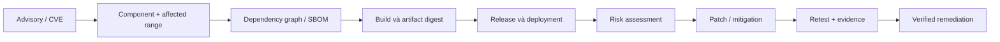
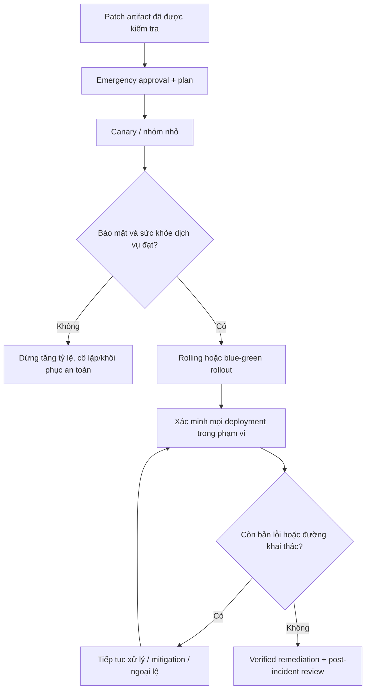

# Patch khẩn cấp

Một dịch vụ SaaS xử lý tài liệu của nhiều khách hàng sử dụng thư viện phân tích file. Vào buổi tối, nhóm vận hành nhận được thông báo đáng tin rằng một lỗ hổng nghiêm trọng trong phiên bản thư viện đang triển khai có thể bị kích hoạt bởi file do người dùng tải lên; thông tin khai thác thực tế cũng bắt đầu xuất hiện. Dịch vụ có nhiều cụm production, một số job bất đồng bộ và một kho lưu trữ tài liệu nhạy cảm. Nếu đợi đến lịch cập nhật hàng tháng, hệ thống có thể tiếp tục phơi nhiễm. Nhưng nếu triển khai ngay một phiên bản chưa kiểm chứng, bản vá có thể làm hỏng chức năng xử lý tài liệu hoặc đưa vào dependency khác không an toàn.

Đây là bài toán **patch khẩn cấp** (*emergency patching*): **giảm rủi ro đang tăng nhanh trong thời gian ngắn, trong khi vẫn kiểm soát độ tin cậy của bản sửa và thay đổi production**. Mục tiêu không phải bỏ qua quy trình bảo mật để “ra bản vá cho nhanh”, mà là sử dụng một quy trình ưu tiên, rút gọn hợp lý những bước ít giá trị và giữ lại các **security gates tối thiểu nhưng có thể kiểm chứng**.

Trong module **SECURITY_SECURITY_ASSURANCE**, patch khẩn cấp còn là một bài toán **security assurance trong điều kiện thời gian hạn chế**. Tổ chức phải đưa ra quyết định có căn cứ dựa trên phân tích rủi ro, yêu cầu bảo mật, security controls, kiểm thử, audit và khắc phục phát hiện. Phải xác minh được rằng **đúng tài sản, đúng phiên bản, đúng môi trường** đã được bảo vệ, đồng thời ghi rõ các giới hạn kiểm chứng và rủi ro còn lại.

## 1. Patch khẩn cấp là gì?

**Patch** là một thay đổi nhằm xử lý lỗ hổng hoặc lỗi, có thể ở source code, dependency, package hệ điều hành, firmware, cấu hình, image hoặc thành phần được nhà cung cấp quản lý.

**Patch khẩn cấp** là việc ưu tiên chuẩn bị, đánh giá và triển khai thay đổi nhằm giải quyết một rủi ro không thể chờ tới chu kỳ bảo trì thông thường. Tính “khẩn cấp” phụ thuộc vào **nguy cơ đối với hệ thống**, không đơn thuần vào tên gọi mức nghiêm trọng trên scanner.

Ví dụ:

- Một endpoint công khai cho phép truy cập dữ liệu của tenant khác.
- Dependency runtime có lỗ hổng được xác nhận đang bị khai thác và nằm trên đường xử lý input không tin cậy.
- Một máy chủ Internet-facing sử dụng phiên bản sản phẩm có lỗ hổng cho phép chiếm quyền, với điều kiện khai thác phù hợp.
- Credential hoặc khóa có nguy cơ bị lộ, cần thu hồi/luân chuyển và vá nguồn lộ lọt.
- Cấu hình cloud vô tình mở quyền ghi vào storage chứa dữ liệu nhạy cảm.
- Một bản vá đã có từ lâu nhưng tình báo mối đe dọa mới làm thay đổi đáng kể mức độ ưu tiên.

### 1.1. Patch khẩn cấp không đồng nghĩa với bất kỳ hotfix nào

| Khái niệm | Mục đích | Ví dụ |
| --- | --- | --- |
| **Patch thường kỳ** | Xử lý vấn đề trong cửa sổ bảo trì theo lịch | Nâng thư viện theo chu kỳ |
| **Hotfix** | Thay đổi nhỏ ngoài chu kỳ phát hành, thường để sửa lỗi cụ thể | Sửa lỗi xử lý timeout gây gián đoạn |
| **Security emergency patch** | Xử lý rủi ro bảo mật không thể chờ, trong luồng thay đổi được ưu tiên | Vá lỗ hổng có đường khai thác thực tế |
| **Containment** | Ngăn hoặc giới hạn tác động ngay | Tạm vô hiệu hóa upload hoặc cô lập workload |
| **Mitigation** | Giảm xác suất hay hậu quả của khai thác mà có thể chưa loại bỏ nguyên nhân | Giới hạn input, giảm quyền, chặn đường truy cập |
| **Remediation** | Xử lý nguyên nhân hoặc điều kiện rủi ro theo tiêu chí đã xác định | Nâng đúng version đã sửa và xác minh toàn bộ deployment |

Một thay đổi “khẩn cấp” có thể kết hợp **containment ngay**, **mitigation tạm thời** và **patch triệt để sau đó**. Những mốc này cần được báo cáo riêng. Một WAF rule có thể giảm phơi nhiễm nhưng không nhất thiết loại bỏ lỗi bên trong thư viện.

### 1.2. Khi nào chưa nên tuyên bố đã vá xong?

Không nên đánh dấu hoàn thành chỉ vì:

- Pull request sửa lỗi đã merge.
- Nhà cung cấp đã công bố phiên bản fixed.
- CI build thành công.
- Image đã được đẩy lên registry.
- Một cụm production đã được triển khai.
- Scanner không phát hiện lỗi trên một artifact khác với artifact đang chạy.
- Endpoint bị tắt tạm thời nhưng có thể bật lại mà chưa có cơ chế kiểm soát.

**Khắc phục được xác minh** đòi hỏi bằng chứng rằng thay đổi hoặc control phù hợp đã có hiệu lực trên **phạm vi tài sản thực sự bị ảnh hưởng**, và yêu cầu bảo mật được kiểm tra trong điều kiện liên quan.

## 2. Khi nào kích hoạt quy trình patch khẩn cấp?

Không nên tự động kích hoạt chỉ dựa trên một điểm CVSS. Cần đánh giá **lỗ hổng + sản phẩm đang dùng + bối cảnh tấn công + mức ảnh hưởng + khả năng phản ứng**.

### 2.1. Tín hiệu kích hoạt

Những tín hiệu thường cần triage nhanh:

1. **Đã có bằng chứng khai thác:** thông tin đáng tin về cuộc tấn công hoặc nỗ lực khai thác phù hợp với hệ thống.
2. **Lỗ hổng có thể khai thác từ xa:** sản phẩm bị ảnh hưởng đang được công khai trên Internet hoặc phục vụ đầu vào không tin cậy.
3. **Ảnh hưởng quyền cao hoặc dữ liệu nhạy cảm:** khả năng chiếm quyền quản trị, lấy secret, sửa dữ liệu hoặc truy cập chéo tenant.
4. **Bề mặt tấn công rộng:** cùng image, thư viện hoặc cấu hình xuất hiện trong nhiều dịch vụ/region.
5. **Control giảm thiểu không đủ:** không có phân đoạn, bộ lọc hoặc quyền tối thiểu đáng tin để giới hạn tác động.
6. **Nghĩa vụ xử lý khẩn:** chính sách, yêu cầu của cơ quan quản lý, hợp đồng hoặc quyết định xử lý sự cố trong phạm vi áp dụng.

Thông tin từ vendor advisories, CVE, cơ sở dữ liệu lỗ hổng đã biết, nguồn tình báo khai thác và kết quả kiểm thử nội bộ có thể làm thay đổi ưu tiên. Phải ghi **nguồn, thời điểm, mức tin cậy và điều kiện áp dụng**, không chỉ chuyển tiếp một tiêu đề tin tức.

### 2.2. Ma trận quyết định ban đầu

| Tình huống | Hướng ưu tiên | Lý do |
| --- | --- | --- |
| Lỗ hổng đang bị khai thác, endpoint công khai, dữ liệu nhạy cảm | Containment/incident response ngay và luồng patch khẩn cấp | Rủi ro hiện hữu, không thể chờ đợt bảo trì |
| Lỗ hổng nghiêm trọng, package tồn tại nhưng đường lỗi chưa rõ | Điều tra nhanh có thời hạn, chuẩn bị patch/mitigation song song | Thiếu bằng chứng không được xem là an toàn |
| Lỗ hổng chỉ ở dependency của test, CI có token production | Đánh giá khẩn theo quyền CI và điều kiện khai thác | Build supply chain vẫn có thể gây tác động lớn |
| Package không có trong artifact triển khai và đã xác minh nguồn gốc | Ghi kết luận không bị ảnh hưởng trong phạm vi | Không cần patch artifact không chứa component |
| Scanner báo severity cao nhưng khớp sai sản phẩm | Triage và xác minh false positive có căn cứ | Tránh thay đổi production không cần thiết |
| Có patch nhưng bản mới làm hỏng yêu cầu bảo mật cốt lõi | Xem phương án containment/mitigation và triển khai có kiểm soát | Vá lỗ hổng này không được tạo rủi ro lớn hơn mà không có quyết định |

**Nguyên tắc:** đánh giá cả **rủi ro không thay đổi** (*risk of not patching*) và **rủi ro do thay đổi** (*risk of patching*). Quyết định cần có lý do, owner và mốc xem xét lại.

## 3. Quy trình khẩn cấp khác quy trình thay đổi thường kỳ ở điểm nào?

Trong quy trình thường kỳ, nhóm có thể chờ sprint, kiểm thử toàn bộ hệ thống và cửa sổ bảo trì định sẵn. Luồng khẩn cấp cần **ưu tiên thời gian**, nhưng không thể loại bỏ kiểm soát mà nếu thiếu sẽ làm bản vá không đáng tin.

| Hoạt động | Thường kỳ | Khẩn cấp theo rủi ro |
| --- | --- | --- |
| Triage | Theo hàng đợi định kỳ | Ưu tiên tức thời với on-call phù hợp |
| Phân tích phạm vi | Có thể theo kỳ scan | Xác định nhanh affected assets/releases/deployments |
| Phê duyệt | CAB hoặc lịch review thông thường | Emergency change authority đã định trước, ghi audit |
| Phạm vi thay đổi | Có thể gộp tính năng | Ưu tiên bản vá nhỏ, riêng biệt, dễ đối chiếu |
| Kiểm thử | Suite đầy đủ và nhiều vòng | Tối thiểu bắt buộc theo risk scenario, mở rộng song song/sau rollout |
| Phát hành | Theo release train | Thời điểm được điều phối riêng, có guardrails |
| Triển khai | Cửa sổ chuẩn | Canary/rolling/blue-green phù hợp, giám sát sát sao |
| Bằng chứng | Theo quy trình kiểm thử chung | Thu trực tiếp theo release, bổ sung hậu kiểm có hạn |
| Hậu kiểm | Theo sprint | Bắt buộc rà soát hiệu lực, phần thiếu và nguyên nhân |

**Rút gọn không phải bỏ qua.** Một pipeline khẩn vẫn nên bảo vệ nguồn thay đổi, quyền runner, secret, artifact identity, security regression test và quyền triển khai. Nếu cần thay thế một phép kiểm tra không khả dụng, phải ghi bằng chứng thay thế và người phê duyệt theo chính sách.

## 4. Xác minh thành phần và phiên bản thực sự bị ảnh hưởng

Phản ứng nhanh sai phạm vi có thể khiến nhóm vá nhầm thành phần hoặc bỏ quên bản đang chạy.

### 4.1. Các câu hỏi cần trả lời trong triage

- Advisory đề cập **package/sản phẩm** và **affected versions** nào?
- Dịch vụ nào dùng package trực tiếp hoặc gián tiếp?
- Phiên bản **khai báo, resolved, packaged và deployed** có giống nhau không?
- Có thư viện shaded/vendored, plugin tải động hoặc package OS không được scanner nhận diện không?
- Artifact/image digest nào đang chạy ở từng cluster/region?
- Lỗ hổng nằm trong **runtime, build, test, CI plugin, firmware hay cloud service**?
- Code path lỗi có nhận input từ người dùng, đối tác hoặc đường quản trị không?
- Môi trường dự phòng, batch job và release cũ đang hỗ trợ có bị ảnh hưởng không?

Inventory và SBOM giúp nhận diện thành phần, nhưng cần đối chiếu với **artifact thực tế** và **deployment inventory**. Một SBOM của image A không thể tự chứng minh image B an toàn.

### 4.2. Truy vết đường đi của một dependency



Đường truy vết giúp đội ứng cứu lập danh sách tài sản chính xác, phân công owner và xác nhận sau triển khai không còn bản bị ảnh hưởng trong phạm vi.

### 4.3. Version mới hơn không đồng nghĩa đã sửa

Một số sản phẩm có nhiều nhánh hỗ trợ, bản backport hoặc vendor fork. Cần xác minh **fixed version phù hợp nhánh đang dùng** và nội dung thay đổi. Chỉ kiểm tra số version lớn hơn không đủ nếu advisory có điều kiện riêng, hoặc image vẫn chứa bản binary cũ.

## 5. Xây timeline xử lý: containment nhanh, remediation có kiểm chứng

Với sự cố có nguy cơ khai thác cao, các nhóm nên điều phối nhiều luồng công việc song song.

### 5.1. Những đồng hồ cần phân biệt

| Mốc | Ý nghĩa | Bằng chứng |
| --- | --- | --- |
| `T0 / first_actionable_notice` | Khi nhận thông tin đủ để bắt đầu hành động theo chính sách | Advisory, alert, ticket và timestamp |
| `triage_completed_at` | Khi đã xác định sơ bộ tính áp dụng, rủi ro và owner | Triage notes, asset scope |
| `contained_at` | Khi đường tấn công đang hoạt động bị giới hạn theo tiêu chí | Policy/config, negative test, telemetry |
| `patch_ready_at` | Khi artifact/config vá đã được chuẩn bị | Commit, artifact digest, build evidence |
| `test_approved_at` | Khi bộ kiểm chứng khẩn đạt ngưỡng cần thiết | Test run, review và finding disposition |
| `deployed_at` | Khi bản vá được triển khai trên một hoặc nhiều asset | Deployment audit và version |
| `all_scope_verified_at` | Khi phạm vi yêu cầu được xác minh đã xử lý | Retest, deployed inventory và risk review |
| `incident_closed_at` | Khi sự cố được khép theo quy trình incident response | Incident report, restoration và postmortem |

Các mốc không nhất thiết xảy ra đúng thứ tự trong mọi tình huống: containment có thể đi trước khi biết root cause, và test có thể tiếp tục trong lúc rollout canary. Nhưng từng mốc cần mang **đúng ý nghĩa**, không dùng `patch_ready_at` như `all_scope_verified_at`.

### 5.2. Thời hạn không có con số chung cho mọi hệ thống

Một tổ chức có thể có SLA hoặc mục tiêu riêng cho khẩn cấp: thời gian triage, time to contain, time to verified remediation và thời gian phản hồi của vendor. Thời hạn phải dựa trên risk appetite, nghĩa vụ và khả năng vận hành. **Không nên tự áp một mốc 24/48/72 giờ như tiêu chuẩn chung** nếu không có chính sách cụ thể.

Với dấu hiệu khai thác thực tế, tổ chức cần kích hoạt incident response và xử lý nhanh theo tình huống; việc chưa đến SLA remediation **không có nghĩa được phép chờ** nếu rủi ro không thể chấp nhận.

### 5.3. Hạn xử lý và các ngoại lệ phải minh bạch

Nếu upstream chưa có patch, cần báo tiến độ containment, kế hoạch thay thế/giảm thiểu, hạn review, chủ sở hữu và quyết định rủi ro. Không đổi T0 hay reset ticket mỗi lần có scan mới để làm dashboard “đúng hạn”.

## 6. Tổ chức đội phản ứng: quyền, trách nhiệm và điều phối

Patch khẩn cấp yêu cầu phối hợp nhanh giữa nhiều người. Trách nhiệm cần được chuẩn bị **trước** sự kiện.

| Vai trò | Trách nhiệm | Bằng chứng/hành động |
| --- | --- | --- |
| **Incident commander / emergency coordinator** | Điều phối ưu tiên, quyết định luồng khẩn và cập nhật stakeholders | Timeline, quyết định, tình trạng khẩn |
| **Security analyst / vulnerability owner** | Xác minh advisory, rủi ro, phạm vi và control | Triage, threat scenario, evidence |
| **Service/asset owner** | Chịu trách nhiệm kết quả trên hệ thống thuộc phạm vi | Inventory, quyết định ưu tiên, owner |
| **Developer / maintainer** | Sửa code hoặc dependency, viết regression test | PR, code review, patch diff |
| **Build/platform engineer** | Bảo vệ pipeline, dependency source, artifact và registry | CI run, provenance, digest |
| **SRE / Operations** | Cửa sổ triển khai, canary, quan sát, rollback/roll-forward | Deployment log, alert, runbook |
| **QA / security verifier** | Xác minh lỗi gốc không còn, kiểm tra chức năng trọng yếu | Test run, reviewer sign-off |
| **Risk owner / emergency approver** | Chấp nhận rủi ro còn lại trong thẩm quyền | Decision record và ngoại lệ có hạn |
| **Communications / customer owner** | Thông báo nội bộ/khách hàng khi nghĩa vụ yêu cầu | Thông điệp đã phê duyệt và timeline |

Trong nhóm nhỏ, một người có thể kiêm nhiều nhiệm vụ. Tuy vậy, **quyền phát hành và quyền phê duyệt ngoại lệ cần có kiểm soát thích hợp**, đặc biệt khi change tác động dữ liệu nhạy cảm hoặc quyền quản trị. Không thiết kế quy trình khẩn sao cho một tài khoản không được kiểm tra có thể tự đổi policy, build và deploy artifact bất kỳ.

### 6.1. Emergency change authority

Cơ chế phê duyệt khẩn nên quy định rõ:

- Ai được kích hoạt luồng khẩn và trong điều kiện nào?
- Những security gates nào là bắt buộc ngay cả khi khẩn?
- Ai được phê duyệt triển khai ngoài cửa sổ bảo trì?
- Những sai lệch nào có thể được phê duyệt có điều kiện?
- Ai có quyền dừng rollout khi tín hiệu bất lợi?
- Khi hệ thống phê duyệt điện tử gặp sự cố, có phương án thủ công nào và audit trail được bổ sung thế nào?

Quyết định khẩn không nhất thiết có đủ các bước hành chính của CAB thông thường, nhưng cần được **ủy quyền trước, giới hạn phạm vi và có thể hậu kiểm**.

## 7. Kế hoạch xử lý theo hai trục rủi ro

Một quyết định patch khẩn phải cân bằng:

1. **Security exposure risk:** nếu chưa vá, hệ thống có thể bị khai thác như thế nào?
2. **Change/deployment risk:** nếu vá ngay, có thể làm gián đoạn, mất dữ liệu, suy giảm bảo mật hoặc gây lỗi tương thích như thế nào?

### 7.1. Ma trận lựa chọn

| Rủi ro chưa vá | Rủi ro triển khai bản vá | Hướng xử lý thường hợp lý |
| --- | --- | --- |
| Cao | Thấp | Patch khẩn nhanh sau kiểm tra trọng yếu |
| Cao | Cao | Containment ngay, làm nhỏ change, canary nghiêm ngặt, phương án phục hồi |
| Trung bình | Thấp | Ưu tiên patch có kiểm soát, cân nhắc tốc độ theo policy |
| Thấp có căn cứ | Cao | Tăng xác minh, lên lịch phù hợp; giữ bằng chứng lý do không khẩn |
| Chưa đủ dữ liệu | Chưa đủ dữ liệu | Điều tra có deadline, thực hiện mitigation an toàn trong khi chờ |

Bảng chỉ gợi ý hướng ra quyết định. Nếu lỗ hổng đang bị khai thác, có thể cần tạm dừng chức năng trước cả khi bản vá đủ tin cậy.

### 7.2. Xác định phạm vi thay đổi nhỏ nhất

Khuyến nghị ưu tiên:

- Patch hoặc backport được xác nhận thay vì nâng toàn bộ hệ thống nhiều major version nếu có phương án hợp lệ;
- một thay đổi chuyên biệt cho security finding;
- tránh gộp refactor, tính năng mới hoặc thay đổi dữ liệu không liên quan;
- ghi rõ dependency mới, thay đổi cấu hình mặc định và migration cần thiết;
- tách hotfix branch/release khi quy trình hiện có hỗ trợ;
- cherry-pick có kiểm soát, tránh lấy nhầm commit hoặc xung đột với nhánh release cũ.

**Patch nhỏ** dễ review hơn nhưng không phải lúc nào cũng ít rủi ro. Một bản vá nhỏ làm thay đổi authentication hoặc encryption có thể ảnh hưởng nhiều tích hợp; cần test theo risk scenario chứ không chỉ theo kích thước diff.

## 8. Containment và mitigation trong khi chuẩn bị patch

Nếu chưa thể có bản vá an toàn ngay, có thể giảm rủi ro với những biện pháp có chứng cứ.

| Biện pháp | Mục tiêu | Điểm cần xác minh |
| --- | --- | --- |
| **Tạm khóa chức năng/endpoint** | Cắt đường khai thác đang được xác định | Có đường vòng, API cũ hoặc worker tiếp tục xử lý không? |
| **Giới hạn network access** | Giảm khả năng tiếp cận mục tiêu | Rule có hiệu lực trên mọi node/region/IPv6 không? |
| **WAF/virtual patch** | Lọc một số mẫu khai thác | Có bypass, false positive và những giao thức ngoài WAF không? |
| **Giảm quyền workload** | Giới hạn hậu quả khi bị khai thác | Credential, IAM policy, secret và service account thực tế? |
| **Tắt định dạng file rủi ro** | Ngăn input đi vào parser bị ảnh hưởng | Upload async, cache, retry và đường admin có bị chặn không? |
| **Cô lập tenant hoặc hệ thống** | Giới hạn blast radius | Có ảnh hưởng hoạt động hay rò dữ liệu qua đường khác không? |
| **Thu hồi/luân chuyển secret** | Loại bỏ credential có thể bị lộ | Token cũ thực sự không còn sử dụng được chưa? |
| **Thêm telemetry/cảnh báo** | Phát hiện khai thác hoặc hành vi bất thường sớm hơn | Event đến đúng nơi, có người nhận và hành động không? |

Một control bù chỉ có ý nghĩa khi **được thử trên đường khai thác và trên môi trường liên quan**. Không coi “đã bật WAF” là “đã vá thư viện”. Phải đánh giá liệu control có phù hợp với input, protocol và các đường truy cập thực tế.

### 8.1. Khi containment làm ảnh hưởng tính sẵn sàng

Tắt chức năng export để ngăn lộ dữ liệu có thể ảnh hưởng người dùng. Risk owner cần cân nhắc giữa bảo mật và tính sẵn sàng, công bố phạm vi chức năng bị ảnh hưởng và kế hoạch mở lại. Không bật lại chỉ vì bản build mới được tạo: cần xác minh bản vá và các luồng liên quan trước khi mở.

### 8.2. Nếu hệ thống đã bị xâm phạm

Patch không thay thế điều tra sự cố. Nếu có khả năng kẻ tấn công đã chiếm máy, chiếm credential hoặc cài persistence, chỉ nâng version phần mềm có thể không đủ. Cần incident response để xác định phạm vi, thu hồi secret, bảo toàn chứng cứ, kiểm tra persistence và phục hồi từ nguồn đáng tin, sau đó mới kết luận rủi ro đã được loại bỏ.

## 9. Chuẩn bị và xác minh bản vá trước triển khai

### 9.1. Nguồn và tính toàn vẹn bản vá

Trước khi dùng bản vá khẩn:

- Xác minh advisory và fixed version từ nguồn đáng tin, lưu reference và thời điểm.
- Lấy package/image từ registry hoặc kênh được cho phép.
- Kiểm tra digest, chữ ký và provenance nếu hệ sinh thái/quy trình hỗ trợ.
- Xem release notes, breaking changes, cấu hình mới và dependencies phát sinh.
- Ghi commit/build ID, artifact digest, phiên bản build tool và nguồn base image.
- Bảo vệ credential, CI runner và quyền publish/deploy.
- Kiểm tra artifact chuẩn bị triển khai **đúng với artifact đã được kiểm chứng**.

Nếu package registry hoặc tài khoản phát hành upstream bị nghi ngờ xâm phạm, dùng version “mới nhất” chưa đủ. Cần xem thông tin nguồn gốc, lịch sử artifact và phương án rebuild từ nguồn đáng tin.

### 9.2. Kiểm thử khẩn theo risk scenario

Bộ kiểm thử phải **đủ để chứng minh bản vá xử lý lỗi gốc và không phá những điều kiện quan trọng**. Có thể ưu tiên:

1. **Reproduction regression:** bài test tái hiện điều kiện lỗi trước vá và xác nhận lỗi không còn sau vá, trong môi trường an toàn.
2. **Security negative tests:** truy cập trái quyền, input không hợp lệ, expired token, sai tenant hoặc đường bị cấm liên quan.
3. **Positive critical paths:** chức năng nghiệp vụ quan trọng vẫn hoạt động.
4. **Dependency/inventory check:** version bị ảnh hưởng đã không còn trong artifact phù hợp.
5. **Configuration/IAM check:** bản vá không mở quyền hoặc tắt bảo vệ mặc định.
6. **Data integrity test:** migration hoặc xử lý file không làm sai dữ liệu.
7. **Observability test:** audit, log và alert liên quan tiếp tục hoạt động.
8. **Operational smoke tests:** khởi động, health check, kết nối cơ sở dữ liệu, queue và dịch vụ phụ thuộc.

Khi khả thi, chạy thêm suite đầy đủ **song song** hoặc sau đợt rollout đầu; những kiểm tra bị rút gọn phải ghi rõ và có mốc bổ sung. Không tuyên bố toàn bộ security assurance đã đạt dựa trên một số smoke tests.

### 9.3. Test cần gắn với bản phát hành

Một test run có giá trị nên lưu `test_id`, mục tiêu, phiên bản artifact, cấu hình, môi trường, fixture, kết quả, timestamp và người hoặc hệ thống thực hiện.

Ví dụ: nếu hotfix sửa một lỗi authorization ở export worker, chạy test cho user A được phép xuất và user B bị từ chối khi đưa tài liệu A vào job. Chỉ test API gateway chưa chứng minh worker không đi vòng authorization.

### 9.4. Gate tối thiểu trong CI/CD khẩn cấp

Một pipeline giả định có thể có các điểm bắt buộc:

| Gate | Điều kiện | Vì sao không nên bỏ |
| --- | --- | --- |
| **Source / reviewer** | Xác định đúng commit, thay đổi có review đủ thẩm quyền | Ngăn patch sai nguồn hoặc mã độc |
| **Dependency / provenance** | Artifact có định danh và nguồn đã được xác minh | Tránh artifact substitution |
| **Fix regression** | Kịch bản lỗi gốc được kiểm tra | Không phát hành bản “vá” chưa chứng minh tác dụng |
| **Critical security controls** | Authorization/secret/config quan trọng vẫn được áp dụng | Ngăn fix tạo đường tấn công mới |
| **Artifact identity** | Deployed digest khớp digest đã kiểm tra | Bằng chứng phải đúng bản chạy |
| **Release approval** | Người có thẩm quyền phê duyệt phạm vi/rủi ro | Rõ trách nhiệm và audit |
| **Runtime guardrails** | Có cơ chế dừng rollout, theo dõi và phục hồi | Hạn chế blast radius khi có lỗi |

**Gate bị lỗi hoặc thiếu kết quả không mặc định là PASS.** Trường hợp hệ thống CI hay công cụ kiểm tra gặp sự cố, dùng quy trình thay thế được phê duyệt, ghi rõ bằng chứng thay thế và phần chưa kiểm chứng. Không cấu hình “emergency=true” như một cờ mà bất kỳ developer nào cũng tự bật để bỏ qua các gate.

## 10. Triển khai khẩn cấp theo các đợt có kiểm soát

Patch khẩn cần nhanh, nhưng **triển khai đồng loạt toàn bộ production** có thể làm tăng rủi ro nếu bản vá sai. Khi kiến trúc cho phép, ưu tiên canary, rolling hoặc blue-green để vừa giảm phơi nhiễm vừa thu thập tín hiệu.



### 10.1. Những điều cần chuẩn bị trước khi deploy

- Danh sách affected assets theo region/cluster/service và người chịu trách nhiệm.
- Artifact digest, config version, migration và dependencies.
- Tiêu chí canary: lỗi, latency, crash, throughput, security alerts, truy cập trái quyền.
- Cửa sổ quan sát đủ phù hợp với lưu lượng và tính năng; không dùng một khoảng cố định cho mọi dịch vụ.
- Quyền dừng rollout và kênh liên lạc với on-call.
- Kế hoạch rollback hoặc **roll forward** nếu rollback không an toàn.
- Trạng thái tồn đọng: queue jobs, phiên người dùng, cache và worker đang chạy.
- Kế hoạch xác minh sau triển khai, gồm đường tấn công đã được khắc phục.

### 10.2. Chỉ số canary không chỉ là HTTP 200

Đối với security patch, cần quan sát cả tín hiệu bảo mật: số lần truy cập bị từ chối, tài nguyên nhạy cảm được trả sai quyền, audit pipeline, phiên bị thu hồi, lỗi secret, egress bất thường và các dấu hiệu sự cố liên quan.

Một bản vá có thể đạt health check nhưng làm hỏng authorization; vì vậy monitoring cần phản ánh **mục tiêu bảo mật ban đầu** chứ không chỉ tình trạng tiến trình đang chạy.

### 10.3. Khi rollout trên nhiều cluster

Ví dụ có ba cụm:

| Asset | Artifact đang chạy | Kết quả | Quyết định |
| --- | --- | --- | --- |
| Production cluster A | Digest phiên bản đã vá | Retest đạt | Có thể xác nhận trong phạm vi A |
| Production cluster B | Digest phiên bản đã vá | Retest và config đạt | Có thể xác nhận trong phạm vi B |
| Production cluster C – batch workers | Image cũ còn tồn tại | Chưa được kiểm chứng | Finding chưa được khắc phục toàn bộ |

Những dòng trên chỉ minh họa. Nếu claim của tổ chức nói “đã vá toàn production”, cụm C chưa xử lý phải được hiển thị; không gộp 2/3 thành hoàn thành.

## 11. Rollback, roll forward và tình huống khó

**Rollback** có thể khôi phục khả năng vận hành nhưng **đồng thời đưa lỗ hổng trở lại**. Đây là khác biệt quan trọng giữa security patch và thay đổi chức năng thông thường.

### 11.1. Khi nào rollback nguy hiểm?

- Phiên bản cũ chứa lỗ hổng đang bị khai thác.
- Dữ liệu đã migration theo schema mới và rollback có thể làm mất/sai dữ liệu.
- Bản vá đã luân chuyển khóa hoặc thay định dạng token, bản cũ không tương thích.
- Control mới chặn hành vi nguy hiểm; rollback tự mở lại đường truy cập.
- Artifact cũ không có provenance đáng tin hoặc đã bị nghi ngờ xâm phạm.

### 11.2. Lựa chọn ứng cứu khi patch gây sự cố

Tùy bối cảnh, nhóm có thể:

1. Dừng mở rộng rollout và giữ canary cách ly.
2. Dùng feature flag tắt chức năng lỗi mà không mở lại đường khai thác.
3. Roll forward bằng bản sửa bổ sung thay vì về image dễ bị khai thác.
4. Quay về phiên bản có bản backport bảo mật đã được xác minh.
5. Hạn chế lưu lượng hoặc giữ dịch vụ trong chế độ suy giảm an toàn.
6. Tạm ngừng chức năng nhạy cảm và thông báo tác động theo quy trình.
7. Khôi phục dữ liệu từ nguồn đáng tin nếu migration/độ toàn vẹn bị ảnh hưởng.

Quyết định rollback phải xét **security exposure risk** song song với availability. Không đặt quy tắc tự động “có lỗi thì rollback về bản bất kỳ trước đó” mà không biết trạng thái bảo mật của bản trước.

## 12. Ví dụ xuyên suốt: patch thư viện xử lý file trong Java

Giả sử một dịch vụ quản lý tài liệu đa tenant dùng một thư viện xử lý file thông qua transitive dependency. Advisory hư cấu mô tả lỗi khi parse một loại file đặc biệt. Dịch vụ nhận file từ Internet và đẩy job vào worker chạy ở Kubernetes.

### 12.1. Xác định phạm vi

Nhóm thu thập:

- Danh sách version đang chạy và image digest của API, worker, các môi trường.
- Graph dependency thực tế của Java module và version parser đã resolve.
- Loại file người dùng có thể upload và code path được gọi.
- Quyền của worker (storage, secrets, API, network).
- Trạng thái job queue và đường xử lý retry.
- Available fixed version hoặc mitigation của vendor.
- Dữ liệu audit/telemetry liên quan đến dấu hiệu khai thác.

**Giả định cần tránh:** vì `document-api` không khai báo trực tiếp package lỗi nên không bị ảnh hưởng. Transitive dependency và shaded JAR vẫn có thể hiện diện.

### 12.2. Các lệnh điều tra ở mức minh họa

Trên dự án Java/Gradle phù hợp, có thể dùng:

```bash
# Minh họa, không chạy tự động trên production.
./gradlew dependencies --configuration runtimeClasspath

# Xác định vì sao một package xuất hiện và version cuối cùng.
./gradlew dependencyInsight \
  --configuration runtimeClasspath \
  --dependency example-parser
```

Với Maven:

```bash
# Minh họa cho dự án Maven được cấu hình tương ứng.
mvn dependency:tree
mvn dependency:tree -Dincludes=com.example:example-parser
```

Tên package ở ví dụ chỉ là giả định và **không gắn với CVE thực tế**. Các lệnh giúp thu thập graph, nhưng không thay thế kiểm tra JAR/image cuối cùng, runtime plugin hoặc các nhánh release khác.

### 12.3. Phương án xử lý

1. Giới hạn hoặc tạm tắt định dạng file nguy hiểm nếu có thể và xác minh mọi đường vào (upload, import, retry).
2. Chọn fixed version được nhà cung cấp xác nhận hoặc bản thay thế được hỗ trợ.
3. Nâng dependency trực tiếp kéo parser vào, hoặc dùng constraint/version override đã kiểm tra tính tương thích.
4. Kiểm tra resolved graph và artifact không còn chứa bản bị ảnh hưởng.
5. Viết regression test cho file hợp lệ và input lỗi trong môi trường kiểm thử an toàn.
6. Kiểm tra file upload, job bất đồng bộ, tenant authorization và resource limits.
7. Build image từ nguồn được phép; lưu digest và SBOM.
8. Canary với telemetry, sau đó rollout mọi API/worker liên quan.
9. Kiểm tra lại rằng image cũ không còn chạy trong phạm vi được công bố.
10. Lập bằng chứng và cập nhật finding, risk register, decision.

### 12.4. Một ví dụ test cần có

Với lỗi gây cạn tài nguyên khi parse tệp, nhóm cần test định dạng lỗi trong môi trường giới hạn tài nguyên, xác minh handler trả lỗi có kiểm soát và worker không kéo theo toàn bộ hệ thống. Với lỗi phân quyền, test phải có principal khác tenant và kiểm tra cả API, worker, download/export path.

Đừng thử payload khai thác không được phê duyệt trên production hoặc dữ liệu khách hàng. Kiểm thử bản vá cần tuân thủ phạm vi an toàn, giới hạn tải và cơ chế dừng khẩn cấp.

## 13. Patch khẩn cấp ở các lớp công nghệ khác nhau

### 13.1. Ứng dụng và thư viện

Thường sửa code, nâng dependency hoặc thay base image. Cần kiểm tra dependency graph, test logic nghiệp vụ, regression security và artifact digest. Với nhánh release cũ, xác minh chính xác bản vá đã được cherry-pick và build.

### 13.2. Container và hệ điều hành

Một JAR đã cập nhật không khắc phục lỗi ở `libc` hoặc thư viện hệ điều hành trong image nền. Cần dựng lại image từ base image đã vá, kiểm tra package inventory, khởi tạo pod/VM mới phù hợp và xác minh instance đang chạy.

Với host kernel patch, có thể cần reboot hoặc thay node; việc package manager báo “installed” chưa chắc kernel mới đang hoạt động. Nên xác minh version runtime, lịch khởi động và tình trạng node sau patch.

### 13.3. Kubernetes và control plane

Khi patch cluster, cần xác định thành phần bị ảnh hưởng: API server, kubelet, container runtime, CNI hoặc addon. Quan tâm tính tương thích version, node rotation, quyền cluster, workloads có PodDisruptionBudget và control plane availability.

Không dùng một lệnh “update cluster” chung để kết luận đã xong; cần kiểm tra version hiệu lực, trạng thái node, chức năng chính và đường tấn công liên quan. Nếu platform managed, trách nhiệm cập nhật control plane và worker nodes có thể thuộc các bên khác nhau.

### 13.4. Cloud/SaaS được nhà cung cấp quản lý

Khi vendor giữ quyền vá, tổ chức vẫn cần biết sản phẩm/dịch vụ nào đang sử dụng, advisory nào áp dụng, trách nhiệm từng bên, mốc cam kết, tình trạng mitigation và bằng chứng từ vendor phù hợp.

Nếu quyền kiểm soát trực tiếp bị hạn chế, có thể áp cấu hình giảm phơi nhiễm ở phía khách hàng, tạm tắt tích hợp hoặc chặn luồng nhạy cảm. Vendor thông báo “đã xử lý” cần được đối chiếu phạm vi dịch vụ/region/tenant và thông tin khách hàng đang sử dụng.

### 13.5. Firmware, thiết bị mạng và IoT

Patch firmware có thể không dễ rollback, có yêu cầu tương thích phần cứng, tính liên tục dịch vụ và nguy cơ brick thiết bị. Cần đánh giá tính xác thực firmware, model/hardware revision, cơ chế bảo toàn cấu hình, khả năng phục hồi và lịch triển khai có kiểm soát.

Với thiết bị không thể vá ngay, nên xem phân đoạn mạng, giới hạn đường quản trị, giám sát và lộ trình thay thế. Không đánh dấu “fixed” chỉ vì có firmware mới nhưng thiết bị thực chưa cài.

## 14. Khi upstream chưa có bản vá

Trường hợp **zero-day hoặc chưa có fixed version** không thể giải quyết bằng việc đợi một mốc cố định. Cần quản lý rủi ro đang tồn tại.

Một quy trình phù hợp:

1. Ghi mức tin cậy của advisory và affected assets.
2. Xác định điều kiện khai thác, mức phơi nhiễm, tài sản quan trọng.
3. Kiểm chứng containment/mitigation có thể áp dụng ngay.
4. Đánh giá khả năng bỏ chức năng, thay package, tách workload hoặc giảm quyền.
5. Thiết lập monitoring và incident readiness theo rủi ro.
6. Theo dõi vendor/maintainer, xác định owner và lịch review gần.
7. Trình risk owner khi cần chấp nhận rủi ro có thời hạn, kèm control bù và bằng chứng.
8. Khi có patch, làm lại triage về compatibility, provenance và verification; không mặc định version đầu tiên đã đáp ứng mọi điều kiện.

**Không có patch** không có nghĩa được phát hành một tính năng không đáp ứng security requirement bắt buộc. Nếu không giảm được rủi ro xuống ngưỡng chấp nhận, có thể phải giới hạn hoặc tạm ngừng chức năng.

## 15. Emergency release gate và ngoại lệ

Release gate khẩn có thể giảm số bước thủ tục, nhưng vẫn phải bảo vệ những bất biến:

- Bản vá bắt nguồn từ nguồn đáng tin và commit/release xác định.
- Security regression theo lỗi gốc đã được kiểm tra hoặc có quyết định thay thế có căn cứ.
- Các control nhạy cảm không bị vô hiệu hóa ngoài phạm vi phê duyệt.
- Artifact được kiểm chứng và triển khai theo digest phù hợp.
- Có người phê duyệt đúng thẩm quyền.
- Có phương án dừng rollout, giám sát và khôi phục an toàn.
- Mọi kiểm tra bị hoãn/loại khỏi phạm vi có danh sách, owner và hạn bổ sung.
- Có audit trail về thời điểm, lý do khẩn, risk acceptance và quyết định.

### 15.1. Quyết định gate

| Kết quả | Khi nào dùng | Hành động |
| --- | --- | --- |
| **PASS** | Các kiểm tra bắt buộc có bằng chứng phù hợp | Cho phép triển khai theo plan |
| **BLOCK** | Bản vá không giải quyết lỗi gốc, artifact sai hoặc control bắt buộc thất bại | Dừng release, xử lý |
| **NEEDS_REVIEW** | Có bằng chứng chưa đủ hoặc rủi ro cần phán đoán chuyên môn | Giữ để đánh giá có thẩm quyền |
| **CONDITIONAL_APPROVAL** | Rủi ro được chấp nhận theo quy trình, scope và thời hạn xác định | Triển khai có điều kiện, tăng giám sát |
| **REVOKED / EXPIRED** | Phê duyệt hết hạn, artifact/config thay đổi | Đánh giá lại trước khi tiếp tục |

Không nên cấu hình `CONDITIONAL_APPROVAL` thành `PASS` không có dấu vết. Phê duyệt có điều kiện phải hiển thị phần chưa kiểm chứng, control bù, mốc đánh giá lại và owner.

### 15.2. Ngoại lệ khẩn phải có giới hạn

Một ngoại lệ thường cần:

- Tài sản/release/environment chịu ảnh hưởng và finding cụ thể;
- lý do không thể đáp ứng gate thông thường;
- rủi ro còn lại và hậu quả nếu khai thác;
- biện pháp bù và kết quả kiểm chứng;
- người chịu trách nhiệm, người có thẩm quyền phê duyệt;
- thời điểm bắt đầu/hết hạn, kế hoạch hoàn thiện kiểm chứng;
- sự kiện kích hoạt hủy ngoại lệ (exploit mới, mitigation thất bại, exposure thay đổi).

Một ngoại lệ chỉ áp dụng cho đúng phạm vi được ghi. Không để cờ “approved emergency” trở thành quyền triển khai vô hạn cho mọi release sau đó.

## 16. Hồ sơ bằng chứng cho emergency patch

Bằng chứng giúp người đánh giá độc lập hiểu tại sao tổ chức quyết định vá ngay, đã triển khai như thế nào và kết quả xác minh thực sự ở đâu.

### 16.1. Claim – Argument – Evidence

**Claim minh họa:**

> **CLM-PATCH-EM-01:** Trong phạm vi các dịch vụ và deployment được xác định, bản vá khẩn cấp cho `FIND-EM-01` đã xử lý đường khai thác được mô tả mà không làm suy giảm các security controls trọng yếu đã được kiểm chứng theo kế hoạch khẩn; các rủi ro và hạn chế còn lại được ghi nhận.

**Argument:**

1. Thành phần hoặc logic chịu ảnh hưởng đã được định danh đúng.
2. Bản vá đến từ nguồn được phép và phù hợp affected/fixed version.
3. Các kiểm thử trọng yếu chứng minh lỗ hổng gốc không còn trong kịch bản đã xét.
4. Các control có liên quan vẫn được duy trì hoặc phần thay đổi được đánh giá.
5. Artifact/config đã được triển khai và xác minh trên các tài sản thuộc phạm vi.
6. Những điều chưa kiểm tra, ngoại lệ, trường hợp chưa rollout và rủi ro còn lại được công khai.

**Evidence:**

| Evidence ID | Hiện vật | Hỗ trợ kết luận |
| --- | --- | --- |
| `EV-EM-01` | Advisory, finding, nguồn và T0 | Lý do và tính khẩn cấp |
| `EV-EM-02` | Asset inventory, SBOM, affected ranges | Phạm vi và version thực tế |
| `EV-EM-03` | Emergency change record, approval | Thẩm quyền và quyết định |
| `EV-EM-04` | Patch diff, dependency graph, build provenance | Nội dung/nguồn bản vá |
| `EV-EM-05` | Regression/security test, config/IAM check | Hiệu lực control và lỗi gốc |
| `EV-EM-06` | Artifact digest, signed/verified artifact nếu áp dụng | Tính nhất quán artifact được kiểm chứng |
| `EV-EM-07` | Canary/rollout logs, deployment inventory | Bản vá đã đến các asset |
| `EV-EM-08` | Monitoring và test sau triển khai | Hệ thống vận hành sau patch |
| `EV-EM-09` | Closure, risk acceptance và postmortem | Rủi ro còn lại và cải tiến |

**Giới hạn:** một báo cáo scanner “không thấy lỗ hổng” chỉ có giá trị với nguồn dữ liệu, artifact và thời điểm scan đó. Một phiên bản mới trên registry chưa chứng minh tất cả deployment đã dùng bản vá.

### 16.2. Mẫu bản ghi emergency patch

```yaml
emergency_patch:
  change_id: "EM-<change-id>"
  finding_id: "FIND-<finding-id>"
  reason: "<exploit-evidence-or-risk-description>"
  initiated_at: "<UTC-timestamp>"
  incident_id: "<incident-id-if-applicable>"
  scope:
    service: "document-api"
    affected_assets: ["<asset-1>", "<asset-2>"]
    environments: ["production"]
    affected_versions: ["<affected-version>"]
    known_exclusions: ["<unassessed-or-deferred-scope>"]
  risk_assessment:
    impact: "<impact>"
    exploitability: "<evidence-and-assumptions>"
    not_patching_risk: "<description>"
    change_risk: "<description>"
    residual_risk: "<description>"
  plan:
    patch_source: "<vendor-advisory-or-commit>"
    source_commit: "<commit-sha>"
    target_artifact_digest: "sha256:<digest>"
    containment: ["<temporary-control>"]
    critical_tests: ["<test-id>"]
    deployment_strategy: "canary-then-rolling"
    stop_conditions: ["<security-or-operational-trigger>"]
    recovery_plan: "<safe-rollback-or-roll-forward>"
  approvals:
    emergency_authority: "<authorized-approver>"
    approved_at: "<UTC-timestamp>"
    exceptions: ["<exception-id-if-any>"]
  evidence:
    build: "<ci-run>"
    dependency_inventory: "<sbom-or-graph>"
    security_regression: "<test-run>"
    control_checks: "<policy-check>"
    canary: "<canary-observation>"
    deployments: ["<deployment-proof>"]
  result:
    mitigated_at: "<UTC-timestamp-or-null>"
    all_scope_verified_at: "<UTC-timestamp-or-null>"
    status: "<in-progress|mitigated|verified-remediated|conditional>"
    reviewer: "<reviewer>"
    decision_at: "<UTC-timestamp>"
  follow_up:
    postponed_checks: ["<check-with-owner-and-due-date>"]
    postmortem_ref: "<review-ref>"
    revisit_triggers:
      - "new-advisory-or-exploit-evidence"
      - "change-in-exposure"
      - "mitigation-failure"
```

Các dấu ngoặc nhọn là **placeholders**; không phải evidence đã được tạo. Bản ghi có giá trị khi liên kết tới hiện vật gốc có quyền truy cập và bảo vệ tính toàn vẹn, kèm thời điểm và phạm vi kiểm tra.

### 16.3. Không trộn kết quả kỹ thuật với phê duyệt rủi ro

Một quyết định của risk owner có thể cho phép tạm vận hành khi chưa có bản vá, nhưng không có nghĩa lỗ hổng đã biến mất. Dashboard phải phân biệt:

- `PATCH_PENDING`: đang chuẩn bị.
- `MITIGATED`: đã kiểm chứng control giảm rủi ro.
- `PATCH_TESTED`: artifact mới được kiểm chứng.
- `PARTIALLY_DEPLOYED`: chưa đạt toàn bộ phạm vi.
- `VERIFIED_REMEDIATED`: chứng cứ xác nhận đã xử lý trong phạm vi.
- `ACCEPTED_RISK`: chấp nhận có điều kiện và thời hạn.
- `REOPENED`: đánh giá trước đó mất hiệu lực hoặc lỗ hổng tái xuất hiện.

## 17. Hậu kiểm sau patch: sửa hệ thống, không chỉ sửa một phiên bản

Sau khi rủi ro cấp bách đã được kiểm soát, cần review để phát hiện các thiếu sót quy trình và tránh lặp lại.

### 17.1. Post-emergency review nên trả lời

- Phát hiện nào đã kích hoạt luồng khẩn? Có đáng tin và đến đúng người không?
- Từ T0 đến containment/verified remediation mất bao lâu? Chỗ nào bị chậm?
- Inventory có giúp tìm hết asset không, có sót cluster/worker/region không?
- Có test hồi quy nào lẽ ra phải có trước khi lỗi xuất hiện không?
- Patch có gây outage, data inconsistency hoặc suy giảm control khác không?
- Quyền phê duyệt, audit trail và các security gates tối thiểu có hoạt động không?
- Có bước nào được hoãn; khi nào hoàn tất, ai chịu trách nhiệm?
- Có cần cập nhật threat model, security requirements, dependency policy hay runbook không?
- Các bản phát hành cũ có cần backport và thông báo khách hàng không?
- Có rủi ro persistence, credential compromise hay incident nào cần điều tra riêng không?

### 17.2. Các loại cải tiến thường thấy

- Xây dependency inventory và SBOM gắn artifact tốt hơn.
- Đảm bảo hotfix branch có pipeline và test được duy trì.
- Thiết kế sẵn emergency access có thời hạn, audit và phân tách quyền.
- Chuẩn hóa feature flag/kill switch và khả năng cô lập workload.
- Cải thiện canary, rollout, policy checks và kiểm tra deployed digest.
- Bổ sung security regression tests cho đường vừa phát hiện.
- Thêm cảnh báo khi asset không được cập nhật trong thời hạn.
- Tập dượt rollback/roll-forward cho dịch vụ có dữ liệu quan trọng.
- Kiểm tra khả năng liên lạc với vendor và nhóm trực ngoài giờ.

## 18. Metrics đánh giá hiệu quả patch khẩn cấp

Không nên chỉ báo cáo “số bản vá đã triển khai”. Các chỉ số nên mô tả tốc độ **giảm rủi ro và xác minh kết quả**.

| Chỉ số | Cách dùng | Cần lưu ý |
| --- | --- | --- |
| **Time to triage** | T0 → quyết định về mức rủi ro/phạm vi | T0 và chất lượng triage phải nhất quán |
| **Time to contain** | T0 → control giới hạn khai thác có hiệu lực | Khác với thời gian hoàn tất patch |
| **Time to patch-ready** | T0 → artifact có bản vá được build | Chưa phản ánh deployment |
| **Time to verified remediation** | T0 → xác minh mọi asset trong phạm vi đã xử lý | Không dùng lúc merge PR làm điểm kết thúc |
| **Deployment coverage** | Tỷ lệ affected assets được xác minh chạy bản đã vá | Theo dõi cả region dự phòng và batch workers |
| **Emergency change failure rate** | Tỷ lệ patch gây gián đoạn hoặc rollback/roll-forward ngoài kế hoạch | Phân tích theo impact và nguyên nhân |
| **Residual exposure aging** | Thời gian asset còn phơi nhiễm sau khi đã biết lỗ hổng | Cần phân biệt đã mitigate và chưa mitigate |
| **Exception debt** | Ngoại lệ khẩn còn mở, sắp/quá hạn | Không xem ngoại lệ là đã sửa |
| **Post-release regression findings** | Lỗi bảo mật/chức năng xuất hiện sau patch | Có thể phản ánh phạm vi test chưa đủ |
| **Inventory discovery gaps** | Asset/component chỉ được tìm thấy sau khi rollout đã bắt đầu | Quan trọng cho bảo đảm phạm vi đầy đủ |

Đối với số liệu thời gian, nên lưu phân phối (trung vị, P90/P95) và các trường hợp ngoại lệ rủi ro cao. Một lần patch rất nhanh không chứng minh chương trình tốt nếu đồng thời bỏ qua một cluster production hoặc ngừng audit logging.

## 19. Các sai lầm thường gặp

| Sai lầm | Hậu quả | Cách khắc phục |
| --- | --- | --- |
| Coi mọi CVE Critical đều khẩn như nhau | Tốn nguồn lực vào lỗ hổng không áp dụng, bỏ qua lỗ hổng khác quan trọng hơn | Triage theo exploitability, exposure và asset |
| Chờ đợt bảo trì dù đang bị khai thác | Kéo dài cửa sổ phơi nhiễm | Kích hoạt incident/emergency workflow |
| Bỏ toàn bộ security gates để triển khai nhanh | Có thể đưa mã độc hoặc patch sai vào production | Giữ các gate tối thiểu có bằng chứng |
| Chỉ vá code, không kiểm tra image/OS | Rủi ro ở package khác vẫn tồn tại | Truy vết artifact, dependency và image |
| Chỉ patch một service trong hệ thống nhiều worker | Đường khai thác vẫn còn | Inventory asset và deployment coverage |
| Xem WAF rule là bản vá triệt để | Bypass hoặc đường đi ngoài WAF vẫn tồn tại | Ghi mitigation riêng và kế hoạch remediation |
| Tin vendor nói “fixed” là toàn hệ thống đã sửa | Khách hàng có thể đang chạy version cũ | Xác minh artifact/deployed version |
| Dùng tag thay digest | Deploy artifact khác bản đã test | Đối chiếu image/binary digest |
| Gộp hotfix với refactor lớn | Khó kiểm tra và rollback | Tối thiểu hóa diff theo mục tiêu |
| Chỉ test health check | Bỏ sót authorization, dữ liệu, audit | Test security scenario và critical paths |
| Rollback tự động về bản chứa lỗ hổng | Mở lại đường khai thác | Plan roll-forward/safe rollback theo rủi ro |
| Cấp quyền admin vô thời hạn cho hotfix | Tạo cửa ngõ supply-chain khác | JIT access, hạn và audit |
| Đóng finding lúc PR merge | Production chưa được xác minh | Verified remediation theo scope |
| Không lưu quyết định và timestamp | Không có căn cứ assurance/audit | Incident/change log, evidence manifest |
| Tắt chức năng khẩn nhưng không theo dõi bật lại | Control bù có thể mất hiệu lực | Ownership, monitoring và revisit triggers |
| Không làm hậu kiểm | Lỗi quy trình tái diễn | Post-emergency review và action items |

## 20. Checklist tác nghiệp patch khẩn cấp

- [ ] Đã xác định advisory/finding và nguồn thông tin đáng tin.
- [ ] Có T0, incident/change ID và người điều phối.
- [ ] Đã phân tích rủi ro chưa vá và rủi ro do thay đổi.
- [ ] Đã nhận diện component, affected version, code path và các tài sản trong phạm vi.
- [ ] Có xác minh artifact/image và môi trường thực tế đang chạy.
- [ ] Đã quyết định có cần containment ngay, và kiểm chứng hiệu lực control bù.
- [ ] Có owner, người phê duyệt khẩn và kênh liên lạc phù hợp.
- [ ] Phạm vi thay đổi patch được giữ nhỏ và có nguồn đáng tin.
- [ ] Có review patch, dependency/image changes và quyền CI.
- [ ] Có security regression cho kịch bản lỗi gốc cùng các critical paths.
- [ ] Có evidence build, test, provenance và artifact digest.
- [ ] Có kế hoạch canary/rolling/blue-green và điều kiện dừng rollout.
- [ ] Có phương án rollback **an toàn về bảo mật** hoặc roll-forward/disable feature.
- [ ] Đã quan sát telemetry, audit, ảnh hưởng chức năng và dữ liệu trong rollout.
- [ ] Đã xác minh các deployment/worker/region thuộc phạm vi dùng đúng bản vá.
- [ ] Nếu còn asset chưa sửa, đã ghi ngoại lệ/rủi ro và biện pháp bảo vệ rõ ràng.
- [ ] Không nhầm mitigation, patch-ready, deployed và verified remediation.
- [ ] Đã ghi người xác nhận, thời điểm, test run, control checks và decision.
- [ ] Những kiểm tra bị hoãn có người thực hiện và hạn hoàn tất.
- [ ] Đã cập nhật inventory, risk register, threat model và tình trạng finding.
- [ ] Có hậu kiểm và cải tiến khả năng phản ứng cho lần tiếp theo.

## 21. Tình huống thực hành

### Tình huống A: vendor có bản vá nhưng ứng dụng chưa cập nhật

Một advisory cho biết dependency parser có fixed version. Nhóm đã update file build và merge PR, nhưng production vẫn dùng image cũ. Có thể đóng finding không?

**Không.** Bản vá chưa được xác minh ở deployment. Phải build, kiểm tra version resolved/packaged, test và đối chiếu các instance production, rồi mới kết luận trong phạm vi tương ứng.

### Tình huống B: scanner báo lỗi nhưng package chỉ ở test scope

Công cụ SCA báo lỗ hổng nghiêm trọng trong thư viện test không nằm trong image runtime. Có thể bỏ qua hoàn toàn không?

**Không.** Cần đánh giá phạm vi và quyền của môi trường test/CI. Nếu test runner dùng credential triển khai hoặc xử lý dữ liệu không tin cậy, vẫn có rủi ro supply chain đáng kể. Kết luận không ảnh hưởng production phải có evidence và không làm biến mất rủi ro ở CI.

### Tình huống C: patch khẩn làm lỗi chức năng xuất dữ liệu

Patch được triển khai canary và phát hiện export trả lỗi 500. Phiên bản cũ chứa lỗ hổng đang bị khai thác. Có nên rollback tự động không?

**Không nên mặc định.** Có thể dừng rollout, tắt export có kiểm soát, roll forward hoặc dùng bản backport đã vá. Quyết định phải cân nhắc rủi ro mở lại lỗ hổng cùng tác động availability; ghi lý do và bằng chứng.

### Tình huống D: WAF chặn một mẫu khai thác

Một rule chặn được các request thử nghiệm nhưng ứng dụng vẫn chạy thư viện lỗi. Trạng thái hợp lý là gì?

Có thể ghi **mitigated** trong phạm vi và điều kiện rule đã kiểm chứng; chưa nên ghi **verified-remediated** nếu không có căn cứ rằng nguyên nhân/rủi ro đã xử lý đủ theo chính sách. Cần theo dõi bypass, các đường ngoài WAF và kế hoạch patch.

### Tình huống E: chỉ một cụm chưa cập nhật

API và worker tại hai region đã chạy bản vá, nhưng một region dự phòng vẫn dùng image cũ. Nhóm có thể tuyên bố “production đã vá xong” không?

**Chưa.** Cần cập nhật region còn lại hoặc có quyết định giới hạn phạm vi/ngoại lệ hợp lệ. Assurance claim phải công khai phần chưa đạt.

### Tình huống F: xuất hiện dấu hiệu đã bị xâm nhập

Sau khi vá thành công, nhóm tìm thấy credential bất thường và các tiến trình không thuộc phiên bản chuẩn. Có thể chỉ đóng sự cố vì version đã fixed không?

**Không.** Cần điều tra incident, kiểm tra persistence, thu hồi credential, bảo toàn bằng chứng và phục hồi nguồn sạch. Patch sửa đường xâm nhập nhưng không chứng minh đã loại bỏ hậu quả của xâm phạm trước đó.

### Tình huống G: phê duyệt khẩn làm bỏ qua mọi kiểm thử

Một người có quyền production đề nghị tắt toàn bộ CI/security checks vì lỗi đang bị khai thác. Có nên làm không?

Không nên dùng việc khẩn cấp để tự động bỏ các điều kiện bảo mật trọng yếu. Có thể chọn bộ kiểm thử tối thiểu theo risk scenario và quy trình phê duyệt ngoại lệ với evidence thay thế khi công cụ không khả dụng. Phải biết bản vá có tác dụng và không thay thế artifact đã kiểm tra.

### Tình huống H: upstream chưa có patch

Một chức năng đọc file đang phơi nhiễm có nguy cơ cao, nhà cung cấp chưa có fixed version và chưa chứng minh được biện pháp giảm thiểu. Có thể tiếp tục vận hành vì “không có cách sửa” không?

Không tự động. Cần escalation và quyết định rủi ro theo thẩm quyền. Nếu rủi ro vượt ngưỡng, phải xem giới hạn hoặc tạm ngưng chức năng chịu ảnh hưởng, tách workload, tìm thay thế và cập nhật kế hoạch khi có thông tin mới.

## 22. Kết luận

**Patch khẩn cấp** là quy trình xử lý thay đổi bảo mật khi việc trì hoãn có thể tạo ra rủi ro không thể chấp nhận. Quy trình hiệu quả phải vừa **nhanh trong containment và remediation**, vừa **đáng tin trong xác định phạm vi, chuẩn bị artifact, kiểm thử các mục tiêu bảo mật trọng yếu và xác minh triển khai thực tế**.

Trong **security assurance**, kết luận “đã vá” phải có căn cứ: phát hiện nào được xử lý, asset/version nào bị ảnh hưởng, bản vá đến từ đâu, security control nào đã được kiểm tra, artifact nào đã triển khai, còn bao nhiêu hệ thống chưa xử lý và người nào chấp nhận rủi ro còn lại. Bằng chứng theo release và theo môi trường phải được duy trì, kể cả khi các bước review được rút gọn trong tình huống khẩn.

**Mục tiêu của patch khẩn cấp không phải chỉ là đưa phiên bản mới lên production sớm nhất, mà là làm giảm rủi ro thật sự trong thời gian ngắn nhất có thể, với kết quả có thể kiểm chứng và khả năng phục hồi nếu thay đổi gặp sự cố.**
